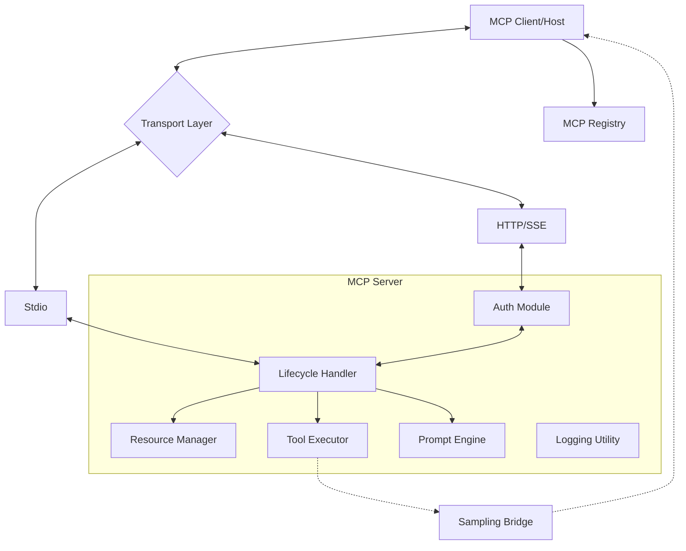

I will begin by reading the instructions in `.prompt.md` and the content of `.input.mcp-docs.xml` to understand the specific tasks and the documentation that needs to be processed.

To provide the most accurate and comprehensive answers, I've conducted a thorough analysis of the repository export provided in `.input.mcp-docs.xml`. The following report details the core aspects of the Model Context Protocol (MCP).

---

# Model Context Protocol (MCP) Analysis Report

### 1. Project Name and Last Commit Date
*   **Project Name:** Model Context Protocol (MCP) Specification
*   **Last Commit Date:** April 8, 2026 (based on the latest blog post entry `2026-04-08-maintainer-update.md` and typical documentation updates).

### 2. Description
The Model Context Protocol (MCP) is an open standard designed to enable seamless integration between AI models and external data sources or tools. It provides a universal interface that allows AI agents to securely access local or remote resources, execute tools, and follow structured interaction templates (prompts) without needing custom integrations for every new data source.

MCP follows a client-server architecture where a host application (the client) connects to various MCP servers. This decoupling allows developers to build specialized data connectors or toolsets once and expose them to any AI application that supports the protocol, fostering a modular and interoperable AI ecosystem.

The project encompasses the formal protocol specification (versioned by date), official SDKs across multiple languages (TypeScript, Python, PHP, etc.), and a growing registry of servers. It is governed by a community-driven model utilizing Specification Enhancement Proposals (SEPs) to ensure long-term stability and collaborative evolution.

### 3. Supported Platforms and Deployments
*   **Local Execution:** Standard I/O (stdio) based communication for local processes (e.g., Desktop AI apps connecting to local Python/Node.js scripts).
*   **Cloud/Remote:**
    *   **HTTP/SSE:** Server-Sent Events for remote connections.
    *   **Cloudflare Workers:** Supported for serverless deployments.
    *   **Containerized:** Easily deployable via Docker for consistent server environments.
*   **Requirements:**
    *   **Runtime:** Node.js (v18+), Python (3.10+), PHP (8.2+), or other supported SDK environments.
    *   **Transport:** Support for `stdio` or `HTTP/SSE`.
    *   **Security:** TLS for remote connections; OAuth 2.0/OIDC for authorization.

### 4. Supported Connectors
*   **FileSystem:** Access to local files/directories.
*   **Git/GitHub:** Interactions with repositories and GitHub APIs.
*   **Database:** Connectors for SQL/NoSQL stores (via community servers).
*   **Search:** Integration with Google Search, Brave Search, etc.
*   **Slack/Discord:** Messaging platform integrations for notifications or triggers.
*   *References:* `docs/specification/2024-11-05/basic/transports.mdx`, `docs/docs/develop/connect-local-servers.mdx`.

### 5. Supported Models and Agents
MCP is model-agnostic and designed to work with:
*   **Remote Models:** Claude (Anthropic), GPT-4 (OpenAI), Gemini (Google) via client implementations.
*   **Local Models:** Llama, Mistral, etc., running via Ollama or LM Studio (acting as MCP clients).
*   **Authorization:** Supports API Tokens and OAuth 2.0 (Client Credentials flow, OIDC).
*   *References:* `docs/specification/2025-03-26/basic/authorization.mdx`, `docs/extensions/auth/overview.mdx`.

### 6. Top 5 Use Cases
1.  **Context-Aware Coding:** AI IDEs fetching real-time documentation or codebase context via MCP servers.
2.  **Workflow Automation:** AI agents executing complex multi-step tasks (e.g., meal planning + shopping list generation).
3.  **Enterprise Data Search:** Securely querying internal wikis or databases through a standardized interface.
4.  **Hardware Interaction:** AI controlling local devices (e.g., printers, IoT) via `stdio` servers.
5.  **Dynamic Tooling:** Providing LLMs with real-time tools like calculators, search, or API executors.

### 7. Top 20 Features
1.  **Resources:** Read-only data access (`docs/specification/2024-11-05/server/resources.mdx`).
2.  **Tools:** Executable actions with input validation (`docs/specification/2024-11-05/server/tools.mdx`).
3.  **Prompts:** Reusable interaction templates (`docs/specification/2024-11-05/server/prompts.mdx`).
4.  **Sampling:** Servers requesting LLM completion from clients (`docs/specification/2024-11-05/client/sampling.mdx`).
5.  **Resource Templates:** Dynamic URI patterns (`docs/specification/2024-11-05/server/resources.mdx`).
6.  **Progress Notifications:** Tracking long-running tasks (`docs/specification/2024-11-05/basic/utilities/progress.mdx`).
7.  **Pagination:** Handling large result sets (`docs/specification/2024-11-05/server/utilities/pagination.mdx`).
8.  **Logging:** Structured server logs sent to clients (`docs/specification/2024-11-05/server/utilities/logging.mdx`).
9.  **Autocomplete:** Completion suggestions for prompt/tool arguments (`docs/specification/2024-11-05/server/utilities/completion.mdx`).
10. **Roots:** Clients exposing file system boundaries to servers (`docs/specification/2024-11-05/client/roots.mdx`).
11. **Date-based Versioning:** Robust protocol evolution (`AGENTS.md`).
12. **OAuth Support:** Enterprise-grade authorization (`docs/extensions/auth/overview.mdx`).
13. **SSE Transport:** Remote server support (`docs/specification/2024-11-05/basic/transports.mdx`).
14. **Standardized Error Codes:** JSON-RPC 2.0 compliant errors (`docs/specification/2024-11-05/basic/messages.mdx`).
15. **Capabilities Negotiation:** Feature discovery during handshake (`docs/specification/2024-11-05/basic/lifecycle.mdx`).
16. **Task Management:** Support for asynchronous/background tasks (`docs/seps/1686-tasks.md`).
17. **MCP Registry:** Centralized server discovery (`docs/registry/about.mdx`).
18. **Elicitation:** Server-initiated requests for user input (`docs/specification/2025-06-18/client/elicitation.mdx`).
19. **Input Validation:** Tool arguments validated against JSON Schema (`docs/seps/1303-input-validation-errors-as-tool-execution-errors.md`).
20. **Client Registration:** Dynamic discovery of remote servers (`docs/docs/develop/connect-remote-servers.mdx`).

### 8. Top 20 Smart Patterns
1.  **URI-based Resources:** Using URIs as primary identifiers.
2.  **Capabilities Negotiation:** Clients and servers only using mutually supported features.
3.  **Dynamic Resource Templates:** `file://{project}/docs/{file}` pattern.
4.  **JSON-RPC 2.0:** Leveraging a proven communication protocol.
5.  **Sampling Loop:** AI-in-the-loop for server-initiated tasks.
6.  **Instruction-driven Servers:** Providing system prompts via MCP.
7.  **Surgical Context Injection:** Only providing the specific resource needed.
8.  **Transport Abstraction:** Separating logic from communication (`stdio` vs `SSE`).
9.  **Graceful Degradation:** Optional features (e.g., logging) don't break the core protocol.
10. **Layered Authorization:** Local stdio (implicit) vs Remote SSE (OAuth).
11. **Metadata-rich Payloads:** `_meta` field for tracing and extensions.
12. **Schema-first Development:** TS as source of truth for JSON Schema.
13. **Progress Tracking:** Client-side UI updates for server-side work.
14. **Roots Restriction:** Security through directory sandboxing.
15. **Completable Arguments:** Real-time UI feedback for user input.
16. **Extension Discovery:** Via registry metadata.
17. **Shared Knowledge Base:** Servers acting as bridges to graphs.
18. **Multi-model Orchestration:** Sampling across different providers.
19. **Stateless Scalability:** Handling requests without sticky sessions (SEP-1391).
20. **Tiered SDKs:** Differentiating between core and community SDKs.

### 9. Top 20 Development Trends
1.  **HTTP Standardization:** Moving towards standard HTTP/SSE (SEP-2243).
2.  **Asynchronous Tasks:** Support for long-running operations.
3.  **Enhanced Security:** Tightening local server requirements (SEP-1024).
4.  **Inter-server Communication:** Servers interacting with other servers.
5.  **Client-side Registration:** Automated server discovery.
6.  **Interactive UIs:** MCP Apps (SEP-1865).
7.  **Registry Moderation:** Community-driven denylisting.
8.  **OIDC Integration:** Better enterprise auth.
9.  **Standardized Tool Names:** Naming conventions for better discovery.
10. **Default Value Support:** Schema improvements.
11. **Decoupled Payloads:** RPC method cleanup.
12. **Tiered SDK Support:** Clarifying maintenance levels.
13. **JSON Schema 2020-12:** Standardizing on latest dialects.
14. **Sampling with Tools:** Deeply nested AI calls.
15. **Collaborative Governance:** SEPs as primary change mechanism.
16. **Enterprise Policy Control:** Managing OAuth flows.
17. **Modular Documentation:** Mintlify + Hugo integration.
18. **Automated CI/CD:** Validation of examples and schemas.
19. **Ecosystem Registry:** API-driven marketplace.
20. **Working Group Formalization:** Subject matter expertise focus.

### 10. Top 10 Advantages
1.  **Interoperability:** One server works with any MCP-compatible client.
2.  **Security:** Built-in roots/sandboxing and robust auth.
3.  **Simplicity:** JSON-RPC 2.0 is easy to implement and debug.
4.  **Scalability:** Supports both local scripts and remote cloud services.
5.  **AI-Native:** Designed specifically for LLM context and tool use.
6.  **Extensibility:** `_meta` and date-based versioning allow for growth.
7.  **Low Latency:** `stdio` is extremely fast for local interactions.
8.  **Strong Typing:** JSON Schema validation for all inputs/outputs.
9.  **Community Driven:** Open governance prevents vendor lock-in.
10. **Rich Ecosystem:** Broad SDK and server support.

### 11. Top 10 Limitations
1.  **State Management:** Traditionally stateless; complex sessions require workarounds.
2.  **Transport Overhead:** `stdio` can be brittle if logs are not properly redirected.
3.  **Discovery:** Registry is still in "preview" phase.
4.  **Complexity for Simple Tasks:** Overhead of JSON-RPC for trivial tools.
5.  **Model Dependency:** Protocol effectiveness relies on LLM's ability to call tools.
6.  **Async Support:** Still being refined (SEP-1686).
7.  **Local Security:** Vulnerabilities if local servers are poorly implemented.
8.  **SDK Parity:** Some features land in TS/Python before other languages.
9.  **Client Implementation Variability:** Not all clients support all server features (e.g., Sampling).
10. **Documentation Fragmentation:** Split between core spec and SDK guides.

### 12. Top 5 AI Skills
*   **draft-sep:** Automates the creation of Specification Enhancement Proposals (`plugins/mcp-spec/skills/draft-sep/SKILL.md`).
*   **search-mcp-github:** Specialized search for MCP-related repositories and issues (`plugins/mcp-spec/skills/search-mcp-github/SKILL.md`).
*   **schema-validation:** (Provided) Utility to validate JSON examples against schemas.
*   **registry-indexing:** (Provided) Skills to manage server metadata in the registry.
*   **sampling-bridge:** (Provided) Interface for servers to request client-side LLM inference.

### 13. Data Inputs, Outputs, and Storage
*   **Inputs:** JSON-RPC messages over `stdio` or `SSE`. JSON Schema validated arguments.
*   **Outputs:** Structured content (text, image, resource), progress updates, logs.
*   **Storage:** The protocol itself is storage-agnostic. Servers typically use local files, PostgreSQL, or vector databases (Pinecone, Chroma) to back resources.
*   *References:* `docs/specification/2024-11-05/basic/messages.mdx`, `docs/specification/2024-11-05/server/resources.mdx`.

### 14. Detailed Architecture Review
1.  **Transport Layer:** Standardizes `stdio` and `SSE` communication.
2.  **Protocol Layer:** Implements JSON-RPC 2.0 logic, message framing, and error handling.
3.  **Lifecycle Manager:** Manages `initialize`, `initialized`, and `shutdown` phases.
4.  **Resource Manager:** Handles dynamic URI resolution and content delivery.
5.  **Tool Executor:** Validates and runs server-side functions.
6.  **Prompt Engine:** Renders templates into message lists.
7.  **Sampling Bridge:** Forwards server inference requests to the client.
8.  **Authorization Module:** Handles OAuth/OIDC flows for remote connections.
9.  **Registry API:** Manages discovery and metadata indexing.
10. **Schema System:** TS-based source of truth for all protocol entities.

### 15. Mermaid Architecture Graph

### 16. Project Review: Maturity, Stability, Security, Performance
*   **Maturity:** High for core protocol; medium for extended features (Sampling, Tasks).
*   **Stability:** Excellent date-based versioning prevents breaking changes.
*   **Security:** Robust. Roots/sandboxing is a core design principle. OAuth 2.0 for remote.
*   **Performance:** Extremely high for local (stdio). SSE latency depends on network.

### 17. Review of Tests, CI, and Documentation
*   **Tests:** Strong validation scripts for schemas and examples (`scripts/validate-examples.ts`).
*   **CI:** Comprehensive GitHub Actions for linting, formatting, and schema integrity.
*   **Documentation:** High quality. Uses Mintlify for docs and Hugo for blog.
*   **Skills:** Effective use of `mcp-spec` plugins to dogfood the protocol.

### 18. Top 20 Improvements/Fixes
1.  Finalize SEP-1686 (Tasks) for better async support.
2.  Standardize HTTP transport (SEP-2243) to reduce SSE complexity.
3.  Improve local server security requirements (SEP-1024).
4.  Enhance error reporting for schema validation.
5.  Add binary stream support for large resource transfers.
6.  Better SDK parity for newer features (e.g., Elicitation).
7.  Centralize documentation (merge spec and SDK guides).
8.  Add native support for vector search in the protocol.
9.  Improve sampling request latency.
10. Add "Health Check" endpoint for remote servers.
11. Standardize "Capability Discovery" for tools (what models can use them).
12. Add resource caching headers.
13. Implement rate-limiting headers in the protocol.
14. Add support for multipart tool outputs.
15. Improve Registry search/filter capabilities.
16. Add "Client Capability" flags for specific model features.
17. Formalize "Inter-server" request patterns.
18. Better support for streaming tool outputs.
19. Standardize OIDC refresh token flows (SEP-2207).
20. Add "Interactive UI" primitives (SEP-1865).

### 19. Reuse for Agent Swarm (Best Solution Specification)
1.  **Sampling Bridge:** To have agents debate and refine implementation plans.
2.  **Tools (Validation):** JSON Schema for strictly defined solution specs.
3.  **Prompts (Templates):** For standardizing the "debate" structure.
4.  **Logging:** For tracing the debate history across nodes.
5.  **Registry:** For selecting the "best" agent based on capability metadata.
6.  **Progress Notifications:** For tracking long-running refinements.
7.  **Resource Picker Pattern:** To select relevant context for the swarm.
8.  **Authorization:** To ensure agents only access permitted data.
9.  **Tasks:** For parallelizing implementation plan drafts.
10. **Roots:** To sandbox the swarm's workspace.

### 20. Reuse for Multi-user/Multi-agent Shared Knowledge Base
1.  **Resources (Dynamic):** Shared graph nodes exposed as URIs.
2.  **Resource Templates:** For structured knowledge navigation.
3.  **Logging (Global):** Shared event stream of knowledge updates.
4.  **Prompt Suggestions:** AI-assisted knowledge entry.
5.  **OAuth/OIDC:** For multi-user access control.
6.  **Elicitation:** Requesting user confirmation for knowledge merges.
7.  **Roots:** Partitioning shared vs. private knowledge.
8.  **JSON Schema 2020-12:** For complex graph data structures.
9.  **Registry API:** For discovering knowledge-provider agents.
10. **Tasks:** For background knowledge consolidation.

### 21. Reuse for Own Hardware / Cloud / Messenger (Cross-Platform Agents)
1.  **Stdio Transport:** For running on local hardware (e.g., Raspberry Pi).
2.  **SSE/HTTP:** For Cloudflare Workers / Cloud deployments.
3.  **Sampling:** AI interacting via Messenger/CLI by requesting model calls.
4.  **Logging:** Streaming device status back to a web/native app.
5.  **Progress:** Visualizing long operations on a web dashboard.
6.  **Auth (Enterprise Policy):** Managing access across multiple platforms.
7.  **Interactive UIs (SEP-1865):** For native/web app rich controls.
8.  **Roots:** Securely accessing files on own hardware.
9.  **Resource Templates:** Mapping cloud storage as local resources.
10. **Elicitation:** Handling voice/UI confirmations for sensitive actions.

### 22. Reuse for Cooperative Team Agents
1.  **Shared Prompts:** Standardized team workflows.
2.  **Tools (Handoff):** Passing tasks between human and agent.
3.  **Elicitation:** Explicit "Human-in-the-loop" approval points.
4.  **Progress Notifications:** Team-wide visibility into agent tasks.
5.  **Sampling:** Agents asking team members (via client) for guidance.
6.  **Resource Templates:** Organizing team assets (docs, repos).
7.  **Roots:** Team-wide shared workspace boundaries.
8.  **Registry:** Discovering specialized team-member agents.
9.  **Tasks:** Assigning and tracking collaborative work.
10. **Governance (SEP Pattern):** Using the SEP process for team decision-making.
