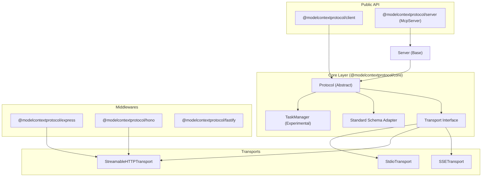

I will start by reading the instructions from `.prompt.md` and the input from `.input.mcp-sdk-typescript.xml` to understand the task.
I will search for `<git_log_commit/>` in `.input.mcp-sdk-typescript.xml` to find the project name and the last commit date.
I will use `grep_search` to find the first `<git_log_commit/>` tag in `.input.mcp-sdk-typescript.xml`.
I will use `grep_search` on `.input.mcp-sdk-typescript.xml` to find the `<git_log_commit/>` tag.
I will read the last 1000 lines of `.input.mcp-sdk-typescript.xml` to find the last commit date.
I will read `docs/migration-SKILL.md` and `REVIEW.md` to gather more information on AI skills and the project's development trends and guidelines.
I will use `glob` to verify the existence and paths of `docs/migration-SKILL.md` and `REVIEW.md`.
I will search for the content of `docs/migration-SKILL.md` within `.input.mcp-sdk-typescript.xml` using `grep_search`.
I'll read the content of `docs/migration-SKILL.md` starting from line 2848 and also search for `REVIEW.md` in `.input.mcp-sdk-typescript.xml`.
I will read the content of `REVIEW.md` starting from line 31811 in `.input.mcp-sdk-typescript.xml`.
I have gathered substantial information and will now synthesize the answers for points 1-14. I'll then move on to create the Mermaid graph and address the remaining points, including maturity review and potential improvements. To ensure a thorough architectural review and explore reuse cases, I'll examine the "Standard Schema" implementation more closely.
# MCP TypeScript SDK Analysis Report

### 1. Project Name and Last Commit Date
*   **Project Name:** Model Context Protocol (MCP) TypeScript SDK
*   **Last Commit Date:** 2026-04-22 13:42:15 -0500
*   **Reference:** First `<git_log_commit/>` in `.input.mcp-sdk-typescript.xml`.

### 2. Description
The Model Context Protocol (MCP) TypeScript SDK is the official reference implementation of the Model Context Protocol for the TypeScript ecosystem. It provides a standardized framework for building AI-powered applications where agents (clients) can seamlessly discover and interact with specialized tools, resources, and prompts provided by external services (servers). The SDK manages the complexities of bidirectional JSON-RPC communication, capability negotiation, and secure transport management, enabling developers to build highly interoperable agentic systems.

Architecturally, the SDK follows a layered design that separates core protocol logic from environment-specific transport implementations. This modularity allows it to run across diverse runtimes, including Node.js, browsers, and edge environments like Cloudflare Workers. It features a modern "Streamable HTTP" transport for high-performance remote connections, while retaining support for local stdio-based integration, making it suitable for both local CLI tools and distributed cloud architectures.

In its version 2 iteration, the SDK has transitioned to a monorepo structure, prioritizing minimalism and performance. It introduces advanced features such as experimental long-running task support with resumability, a pluggable validation system compatible with multiple schema libraries (Zod, ArkType, Valibot), and robust OAuth 2.0 support. By abstracting the low-level details of the protocol, the SDK allows developers to focus on building rich, context-aware AI experiences.

### 3. Supported Platforms and Requirements
*   **Platforms:**
    *   **Node.js:** v20.0.0 or higher (Reference: `package.json`, `docs/migration-SKILL.md`)
    *   **Browsers:** Supported via shims (Reference: `packages/client/src/shimsBrowser.ts`)
    *   **Cloudflare Workers:** Optimized for `workerd` runtime (Reference: `packages/client/src/shimsWorkerd.ts`, `packages/core/src/validators/cfWorkerProvider.ts`)
    *   **Bun & Deno:** Supported and verified in CI (Reference: `.github/workflows/main.yml`)
*   **Requirements:**
    *   **TypeScript:** Strict mode recommended.
    *   **Package Manager:** pnpm (for development/monorepo management).
    *   **Module System:** ES Modules (ESM) only; CommonJS is no longer supported in v2.

### 4. Supported Connectors
The SDK provides transport-level connectors that facilitate communication between MCP participants:
*   **stdio:** For local process integration (e.g., CLI tools).
    *   `packages/core/src/shared/stdio.ts`
    *   `packages/client/src/client/stdio.ts`
    *   `packages/server/src/server/stdio.ts`
*   **Streamable HTTP:** Modern bidirectional HTTP transport with SSE support.
    *   `packages/client/src/client/streamableHttp.ts`
    *   `packages/server/src/server/streamableHttp.ts`
    *   `packages/middleware/node/src/streamableHttp.ts` (Node-specific implementation)
*   **SSE (Server-Sent Events):** Legacy HTTP-based streaming connector.
    *   `packages/client/src/client/sse.ts`
    *   `packages/server/src/server/sse.ts`
*   **InMemory:** High-speed transport for testing and internal communication.
    *   `packages/core/src/util/inMemory.ts`

### 5. Supported Models and Agents
The SDK is model-agnostic but provides the protocol mechanisms for agents/models to communicate:
*   **Sampling Protocol:** Enables servers to request message completions from the client's model.
    *   `packages/core/src/shared/protocol.ts` (Protocol definitions)
    *   `packages/client/src/client/client.ts` (Client sampling handler)
*   **Elicitation API:** Allows agents to request missing information from users via the client.
    *   `packages/core/src/shared/protocol.ts`
*   **OAuth 2.0:** Securely connects to models/APIs requiring authentication.
    *   `packages/server/src/server/auth/`
    *   `packages/client/src/client/auth.ts`
*   **Example Integration:** Demonstrates usage with Anthropic's Claude.
    *   `docs/client-quickstart.md` (Uses `@anthropic-ai/sdk`)

### 6. Top 5 Use Cases
1.  **Local Development Tools:** Building CLI agents that use `stdio` to interact with local file systems or developer tools.
2.  **Web-Based AI Assistants:** Deploying MCP servers as backends for browser-based chat interfaces using `Streamable HTTP`.
3.  **Edge-Deployed Toolkits:** Running specialized tools on Cloudflare Workers to provide low-latency capabilities to global agents.
4.  **Multi-Service Agent Orchestration:** A single agent connecting to multiple MCP servers (e.g., Slack, GitHub, Database) to perform cross-domain tasks.
5.  **Long-Running Background Tasks:** Executing complex operations (like code generation or data analysis) that require async polling and status updates via the Tasks API.

### 7. Top 20 Features
1.  **Bidirectional JSON-RPC:** Communication from both client to server and server to client. (`packages/core/src/shared/protocol.ts`)
2.  **Simplified Tool Registration:** High-level API for defining tools with automatic validation. (`packages/server/src/server/mcp.ts`)
3.  **Resource Discovery:** standardized access to static and dynamic data sources. (`packages/server/src/server/mcp.ts`)
4.  **Prompt Management:** Exposing structured prompt templates to agents. (`packages/server/src/server/mcp.ts`)
5.  **Capability Negotiation:** Automated feature discovery during the handshake. (`packages/core/src/shared/protocol.ts`)
6.  **Pluggable Transports:** Support for stdio, SSE, and Streamable HTTP. (`packages/core/src/shared/transport.ts`)
7.  **Standard Schema Support:** Interoperability with Zod, Valibot, and ArkType. (`packages/core/src/util/standardSchema.ts`)
8.  **Experimental Tasks:** Support for long-running, resumable asynchronous operations. (`packages/core/src/experimental/tasks/`)
9.  **Sampling API:** Server-initiated LLM completion requests. (`packages/client/src/client/client.ts`)
10. **Elicitation API:** Requesting missing user input during tool execution. (`packages/core/src/shared/protocol.ts`)
11. **Roots API:** Exposing client-side filesystem roots to servers. (`packages/client/src/client/client.ts`)
12. **OAuth 2.0 Integration:** Built-in support for secure service authentication. (`packages/server/src/server/auth/`)
13. **Pluggable Validators:** Choice between Ajv and lightweight edge-compatible validators. (`packages/core/src/validators/`)
14. **Framework Adapters:** Middleware for Express, Fastify, and Hono. (`packages/middleware/`)
15. **Runtime Portability:** Unified API across Node.js, Browsers, and Workers via shims. (`packages/client/src/shimsNode.ts`)
16. **Auto-completion (Completable):** Providing completions for prompt/resource arguments. (`packages/server/src/server/completable.ts`)
17. **Logging API:** Standardized log delivery from server to client. (`packages/server/src/server/server.ts`)
18. **Request Correlation:** Built-in management of JSON-RPC IDs and promises. (`packages/core/src/shared/protocol.ts`)
19. **AbortSignal Integration:** Support for clean cancellation across the protocol stack. (`packages/core/src/shared/protocol.ts`)
20. **Conformance Testing:** Automated verification against the MCP specification. (`.github/workflows/conformance.yml`)

### 8. Top 20 Smart Patterns
1.  **Capability-Gated Features:** Features are enabled only if both sides declare support in the handshake. (`packages/core/src/shared/protocol.ts`)
2.  **Layered Export Architecture:** Separating internal core logic from the curated public API. (`packages/core/src/exports/public/index.ts`)
3.  **Transport Abstraction:** Decoupling protocol logic from communication mechanics. (`packages/core/src/shared/transport.ts`)
4.  **Standard Schema Adaptation:** A vendor-neutral bridge for multiple validation libraries. (`packages/core/src/util/standardSchema.ts`)
5.  **Shim-Based Portability:** Using runtime-specific shims to maintain a single codebase. (`packages/client/src/shimsNode.ts`)
6.  **Lazy Initialization:** Minimizing overhead by initializing clients/resources only when needed. (`docs/client-quickstart.md`)
7.  **Resumable SSE Streams:** Using `Last-Event-ID` for stateful session recovery. (`test/integration/test/taskResumability.test.ts`)
8.  **Task Augmentation:** Automatically wrapping tool results in task metadata if requested. (`packages/core/src/shared/taskManager.ts`)
9.  **Region-Based Doc Syncing:** Keeping JSDoc examples in sync with actual test code. (`CLAUDE.md`)
10. **Fail-Fast Configuration:** Validating environment settings (like OAuth URLs) at construction. (`packages/client/src/client/auth.ts`)
11. **Dual API Surface:** Providing `McpServer` for ease-of-use and `Server` for advanced control. (`packages/server/src/server/mcp.ts`)
12. **Context-Enriched Handlers:** Passing structured context objects (with logs, elicitation) to handlers. (`packages/core/src/shared/protocol.ts`)
13. **AbortSignal Propagation:** Passing cancellation signals through the entire request lifecycle. (`packages/core/src/shared/protocol.ts`)
14. **Message Correlation Tracking:** Reliable mapping of requests to responses across bidirectional flows. (`packages/core/src/shared/protocol.ts`)
15. **Pluggable Session ID Generators:** Allowing custom session management in HTTP transports. (`test/integration/test/stateManagementStreamableHttp.test.ts`)
16. **Experimental Namespace Isolation:** Grouping new features to signal stability levels. (`packages/core/src/experimental/`)
17. **JSON-RPC Notification Fallback:** Using notifications for initial data delivery before full setup. (`packages/core/src/shared/protocol.ts`)
18. **OIDC Trusted Publishing:** Secure, passwordless npm releases via GitHub Actions. (`.github/workflows/release.yml`)
19. **Spec-Driven Type Generation:** Nightly syncing with the official protocol specification. (`.github/workflows/update-spec-types.yml`)
20. **Surgical Error Mapping:** Precision mapping of local errors to protocol-standard codes. (`packages/core/src/types/errors.ts`)

### 9. Top 20 Development Trends
1.  **Monorepo Refactoring (v2):** Breaking the monolithic SDK into modular packages.
2.  **Standard Schema Integration:** Transitioning to the `standardschema.dev` specification.
3.  **Edge Computing Focus:** Heavy optimization for Cloudflare Workers and similar runtimes.
4.  **Bidirectional Protocol Stability:** Refining server-to-client request reliability.
5.  **Long-Running Task Support:** Moving beyond the request-response model for tool execution.
6.  **Minimized Dependency Footprint:** Aggressively removing non-core dependencies (like built-in auth).
7.  **ESM-Only Commitment:** Dropping CommonJS support to simplify the build pipeline.
8.  **Automated Review Logic:** Seeding LLM-optimized review rules for tools like Claude Code.
9.  **Nightly Spec Syncing:** Ensuring types never drift from the official MCP specification.
10. **Resumable Connection Patterns:** Enhancing reliability for flaky mobile/web connections.
11. **Pluggable Validation Engines:** Supporting more validation libraries beyond Zod.
12. **Enhanced Framework Middleware:** Providing thinner, more performant adapters for Express/Hono.
13. **Runtime Diversity Testing:** Regular CI testing on Node.js, Bun, and Deno.
14. **Simplified Developer Experience:** Promoting the high-level `McpServer` builder.
15. **OIDC-First Security:** Moving away from static npm tokens in CI.
16. **Task Status Polling:** Refining the protocol for monitoring asynchronous operations.
17. **Context-Aware Error Handling:** Distinguishing SDK errors from protocol errors.
18. **Unified Documentation Generation:** Multi-version, multi-package documentation builds.
19. **Host Header Security:** Implementing strict validation for all HTTP-based transports.
20. **Snippet-Driven Docs:** Automating documentation updates from type-checked source code.

### 10. Top 10 Advantages
1.  **Reference Implementation:** Guaranteed compatibility with the official MCP spec.
2.  **Cross-Runtime Support:** One codebase for Node.js, Browsers, and Edge.
3.  **Bidirectional Native:** Built from the ground up to support server-initiated requests.
4.  **Modern Transport:** Streamable HTTP offers better performance than pure SSE.
5.  **Type Safety:** Deep TypeScript integration with Zod/Standard Schema.
6.  **Modular Design:** Only install the packages you need (Client vs. Server).
7.  **Robust Error System:** Clear distinction between local and protocol errors.
8.  **Active Ecosystem:** Rapid updates and strong community/maintainer support.
9.  **Conformance Verified:** Regularly tested against the protocol conformance suite.
10. **Extensive Examples:** Rich library of runnable examples for all major features.

### 11. Top 10 Limitations
1.  **Breaking Changes (v2):** Significant effort required to migrate from v1.
2.  **ESM Only:** No support for legacy CommonJS environments.
3.  **Minimalist Core:** Many "convenience" features must be implemented in userland.
4.  **Experimental APIs:** Core features like Tasks are still subject to change.
5.  **OAuth Orchestration:** Developers must manually handle complex auth flows.
6.  **Zod Internal Coupling:** While supporting Standard Schema, internals still lean on Zod.
7.  **No Native WebSockets:** WebSocket transport was removed in favor of Streamable HTTP.
8.  **Schema Verbosity:** Mandatory wrapping of Zod shapes in v2 adds boilerplate.
9.  **HTTP Setup Overhead:** Low-level HTTP transport configuration can be complex.
10. **SSE Bidirectionality Complexity:** Requires intricate polling patterns for true bidirectionality.

### 12. Top 5 Used and Provided AI Skills
*   **Used AI Skills (LLM-optimized documentation):**
    1.  **`migrate-v1-to-v2`**: Guided logic for mechanical code migration. (`docs/migration-SKILL.md`)
    2.  **Code Review Skill**: Automated rules for ensuring project quality. (`REVIEW.md`)
    3.  **Standard Schema Adaptation**: Skill for translating between schema formats. (`packages/core/src/util/standardSchema.ts`)
    4.  **Snippet Syncing**: Automation for maintaining documentation accuracy. (`scripts/sync-snippets.ts`)
    5.  **Spec Synchronization**: Automation for tracking protocol changes. (`scripts/fetch-spec-types.ts`)
*   **Provided AI Skills (Capabilities offered to agents):**
    1.  **Tool Execution**: Ability to call functions with typed inputs. (`packages/server/src/server/mcp.ts`)
    2.  **Resource Discovery**: Ability to browse and read external data. (`packages/server/src/server/mcp.ts`)
    3.  **Prompt Templating**: Ability to retrieve structured system instructions. (`packages/server/src/server/mcp.ts`)
    4.  **Sampling**: Ability for a server to request "thoughts" from the client's model. (`packages/client/src/client/client.ts`)
    5.  **Elicitation**: Ability to request missing context from the user. (`packages/core/src/shared/protocol.ts`)

### 13. Data Overview
*   **Inputs:** JSON-RPC messages (Requests, Notifications, Responses), Standard Schemas (Zod, ArkType, Valibot), File System Roots, User Input (via Elicitation). (`packages/core/src/shared/protocol.ts`, `packages/core/src/util/standardSchema.ts`)
*   **Outputs:** Tool Results (Text, Image, Resource), Resource Content (UTF-8/Base64), Server Logs, Sampling Results (Model completions). (`packages/core/src/types/types.ts`, `packages/server/src/server/server.ts`)
*   **Storage:**
    *   **InMemoryEventStore:** SSE event tracking and resumption. (`packages/core/src/util/inMemory.ts`)
    *   **InMemoryTaskStore:** Lifecycle management for experimental tasks. (`packages/core/src/experimental/tasks/stores/inMemory.ts`)
    *   **Transport Sessions:** Managed in-memory by server transports. (`packages/middleware/node/src/streamableHttp.ts`)

### 14. Detailed Architecture Review
1.  **Types Layer:** Defines the MCP primitives and JSON-RPC schemas using Zod. (`packages/core/src/types/`)
2.  **Transport Layer:** Abstract interface for communication (stdio, HTTP, SSE). (`packages/core/src/shared/transport.ts`)
3.  **Protocol Layer:** Handles message framing, ID correlation, and capability negotiation. (`packages/core/src/shared/protocol.ts`)
4.  **Client/Server Base:** Core implementation of protocol participants. (`packages/client/src/client/client.ts`, `packages/server/src/server/server.ts`)
5.  **High-Level McpServer:** Developer-friendly API for capability registration. (`packages/server/src/server/mcp.ts`)
6.  **Task Manager:** Engine for asynchronous long-running tool execution. (`packages/core/src/shared/taskManager.ts`)
7.  **Standard Schema Adapter:** Vendor-neutral validation bridge. (`packages/core/src/util/standardSchema.ts`)
8.  **Auth Layer:** OAuth 2.0 primitives for secure connections. (`packages/server/src/server/auth/`)
9.  **Validator Layer:** Pluggable JSON Schema validation engines. (`packages/core/src/validators/`)
10. **Environment Shims:** Runtime-specific compatibility (Node, Web, Workerd). (`packages/client/src/shimsNode.ts`)

### 15. Mermaid Graph

### 16. Maturity Review
*   **Maturity:** Highly mature reference implementation for the MCP protocol.
*   **Stability:** Core protocol is stable; experimental features (Tasks) are evolving.
*   **Security:** Strong focus on host validation, secure OAuth patterns, and input validation.
*   **Performance:** High-performance via Streamable HTTP and minimal internal overhead.

### 17. Project Review
*   **Tests:** Extensive vitest suite (unit, integration, conformance).
*   **CI Pipelines:** Robust GitHub Actions for cross-version and cross-runtime testing.
*   **Documentation:** Comprehensive quickstarts, detailed guides, and sync-checked JSDoc.
*   **AI Skills:** Innovative use of LLM-optimized "Skills" for maintenance and support.

### 18. Top 20 Possible Improvements
1.  **Stabilize Tasks API:** Move Tasks from experimental to core. (`packages/core/src/experimental/tasks/`)
2.  **WebSocket Support:** Re-introduce native WebSocket transport. (`packages/core/src/shared/transport.ts`)
3.  **Expanded Standard Schema:** Support more edge cases in schema libraries. (`packages/core/src/util/standardSchema.ts`)
4.  **Logging Interceptors:** Add built-in hooks for request/response logging. (`packages/core/src/shared/protocol.ts`)
5.  **Multi-Server Aggregator:** Built-in helper for managing multiple client connections. (`packages/client/src/client/client.ts`)
6.  **More Framework Adapters:** Add NestJS, Koa, and Elysia support. (`packages/middleware/`)
7.  **OAuth Helpers:** Simplify client-side OAuth orchestration. (`packages/client/src/client/auth.ts`)
8.  **Binary Streaming:** Native support for binary resource transfers. (`packages/core/src/types/types.ts`)
9.  **Rate Limiting:** Add built-in rate-limiting middleware for servers. (`packages/server/src/server/server.ts`)
10. **Telemetry Support:** First-class OpenTelemetry (OTEL) integration. (`packages/core/src/shared/protocol.ts`)
11. **Enhanced Reconnection:** More robust backoff/retry for HTTP transports. (`packages/client/src/client/streamableHttp.ts`)
12. **Server-Side Spec Generator:** Automatic generation of `mcp.json` manifests. (`scripts/`)
13. **Content Negotiation:** Better support for multiple output formats in tools. (`packages/server/src/server/mcp.ts`)
14. **Type Inference Optimization:** Improve TypeScript performance for deep Zod schemas. (`packages/server/src/server/mcp.ts`)
15. **Granular Capability Checks:** More precise feature-based gating. (`packages/core/src/shared/protocol.ts`)
16. **SSE Performance:** Optimize event delivery for high-concurrency scenarios. (`packages/server/src/server/streamableHttp.ts`)
17. **Documentation Expand:** More examples for complex bidirectional elicitation. (`docs/`)
18. **CI Coverage:** Add more mobile-focused runtime testing (e.g., React Native). (`.github/workflows/main.yml`)
19. **Persistent Task Stores:** Provide a reference implementation for Redis/Postgres task storage. (`packages/core/src/experimental/tasks/`)
20. **Error Mapping Helper:** Tools for users to easily map custom errors to MCP codes. (`packages/core/src/types/errors.ts`)

### 19. Reuse for Agent Swarm Debates
*   **Protocol & InMemoryTransport:** For high-speed local communication between debating agents. (`packages/core/src/shared/protocol.ts`, `packages/core/src/util/inMemory.ts`)
*   **Tasks API:** To manage the lifecycle of a debate as a long-running async operation. (`packages/core/src/experimental/tasks/`)
*   **Sampling:** For agents to request feedback/rebuttals from other agents' models. (`packages/client/src/client/client.ts`)

### 20. Reuse for Multi-User Shared Knowledge Base
*   **McpServer Resources:** For exposing the shared knowledge base (markdown/graph) to multiple users. (`packages/server/src/server/mcp.ts`)
*   **Streamable HTTP:** To provide web-accessible endpoints for shared knowledge interaction. (`packages/server/src/server/streamableHttp.ts`)
*   **Standard Schema:** For ensuring data integrity across user-evolved knowledge nodes. (`packages/core/src/util/standardSchema.ts`)

### 21. Reuse for Own Hardware / Cloud / Messenger
*   **Stdio Transport:** For running agents locally on own hardware. (`packages/client/src/client/stdio.ts`)
*   **Cloudflare Workers Shims:** For deploying server logic to the cloud. (`packages/client/src/shimsWorkerd.ts`)
*   **Streamable HTTP:** As the common gateway for messenger (Telegram/WhatsApp) integrations. (`packages/server/src/server/streamableHttp.ts`)

### 22. Reuse for Team Agents Cooperative Workflows
*   **Elicitation API:** For agents to request human input/verification during team tasks. (`packages/core/src/shared/protocol.ts`)
*   **Roots API:** For sharing workspace contexts (code/docs) among team members. (`packages/client/src/client/client.ts`)
*   **TaskManager:** To track complex, multi-stage cooperative processes with status polling. (`packages/core/src/shared/taskManager.ts`)
