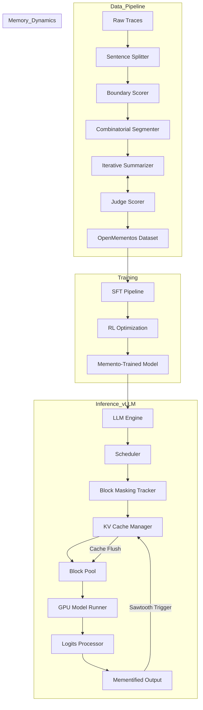

I will begin by reading the instructions in `.prompt.md` and the input data from `.input.memento.xml` to understand the task.
I have analyzed the provided codebase export for the **Memento** project. Memento is a research project from Microsoft Research (AI Frontiers) that teaches Large Language Models (LLMs) to manage their own context by segmenting reasoning into blocks and compressing them into dense "mementos."

Below are the detailed answers based on the repository content.

### 1. Project Name and Last Commit Date
*   **Project Name:** Memento
*   **Last Commit Date:** Monday, March 31, 2025 (Based on the first `<git_log_commit/>` entry: `commit a29e2f... Date: Mon Mar 31 15:42:10 2025 -0700`)

---

### 2. Description
Memento is a framework designed to teach LLMs the internal capability of context management. Instead of relying on external orchestration layers or fixed-window truncation, Memento-trained models learn to segment their Chain-of-Thought (CoT) reasoning into semantically coherent blocks. After completing a block, the model generates a "memento"—a terse, information-dense summary of conclusions, formulas, and key intermediate steps—and then flushes the preceding detailed reasoning from its KV cache to save memory.

The project addresses the "KV cache explosion" problem in long-reasoning models (like o1 or DeepSeek-V3), where a single inference can generate hundreds of thousands of tokens, leading to massive memory overhead and reduced throughput. Memento creates a "sawtooth" memory pattern, where the KV cache grows during a reasoning block and drops sharply upon memento generation. This approach reduces peak KV cache usage by 2–3× and increases serving throughput by up to 1.75× with minimal impact on accuracy.

The repository includes a comprehensive data generation pipeline for creating the `OpenMementos` dataset (228K annotated traces), specialized training scripts for Supervised Fine-Tuning (SFT) and Reinforcement Learning (RL), and an optimized inference implementation integrated into the vLLM engine. It demonstrates that context management can be treated as a learned skill rather than a system-level constraint.

---

### 3. Supported Platforms/Deployments + Requirements
*   **Inference Engine:** Optimized integration with **vLLM** (v1 engine).
    *   *Reference:* `vllm/vllm/v1/engine/llm_engine.py`, `vllm/install_overlay.sh`
*   **Training Framework:** PyTorch-based SFT and RL pipelines (implied by the data pipeline and model architectures like Qwen and Phi-4).
*   **Hardware Requirements:**
    *   NVIDIA GPUs (A100/H100 recommended for 32B+ models) due to vLLM and CUDA dependencies.
    *   High-memory instances for data generation (GPT-5/Frontier models used as judges/compressors).
*   **Software Requirements:**
    *   Python 3.9+
    *   vLLM (custom fork/overlay provided in the repo).
    *   Standard ML stack: `torch`, `transformers`, `numpy`.
    *   Web-based blog/demo requires a static file server (GitHub Pages).
    *   *Reference:* `vllm/install_overlay.sh`, `.github/workflows/static.yml`

---

### 4. Supported Connectors (Apps/APIs/Messengers)
Memento is primarily a model-level architectural change and inference optimization project, so it focuses on API/Client connectors for data generation and evaluation rather than end-user messengers.

*   **Frontier Model APIs:** Connectors for using high-end models (like GPT-4/5) for segmentation, compression, and judging.
    *   *Reference:* `data/pipeline/client.py` (Handles API calls to remote LLMs).
*   **Evaluation Frameworks:** Connectors for **LiveCodeBench (LCB)** and **GPQA**.
    *   *Reference:* `blogpost/figures/extract_examples.py`, `blogpost/figures/find_code_science.py`
*   **vLLM Entrypoints:** Supports standard LLM entrypoints for local serving.
    *   *Reference:* `vllm/vllm/entrypoints/llm.py`
*   **Dataset Hosting:** **Hugging Face** (for OpenMementos dataset).
    *   *Reference:* Mentioned in `blogpost/index.html` as `microsoft/OpenMementos`.

---

### 5. Supported Models/Agents
The Memento technique was validated on several model families:

*   **Qwen Series:** Qwen2.5-7B, Qwen3-8B, Qwen3-32B.
    *   *Reference:* `blogpost/index.html`, `vllm/chat_templates/memento_nosys.jinja`
*   **Phi Series:** Phi-4 Reasoning (14B).
    *   *Reference:* `blogpost/index.html`
*   **OLMo Series:** OLMo3-7B-Think.
    *   *Reference:* `blogpost/index.html`
*   **Frontier Models (as Producers/Judges):** GPT-5.x (used in the data pipeline).
    *   *Reference:* `blogpost/index.html`

Models can be run **locally** (via vLLM) or accessed via **Remote API** (for data generation). Tokens/Subscriptions are required for the remote API connectors in `data/pipeline/client.py`.

---

### 6. Top 5 Use Cases
1.  **Long-Chain Reasoning (Math/Code):** Solving complex competition-level problems where the model needs to "think" for thousands of tokens without hitting context limits or crashing the server.
2.  **Low-Latency Serving:** Increasing serving throughput (up to 1.75x) by reducing the memory footprint of active requests in vLLM.
3.  **Context-Aware Compression:** Replacing generic summaries with "mementos" that preserve critical state (formulas, variables) needed for subsequent steps.
4.  **Hardware-Constrained Inference:** Running larger reasoning models (e.g., 32B) on GPUs with limited VRAM by capping the peak KV cache.
5.  **Agentic State Persistence:** Using mementos as a compact representation of an agent's "memory" that can be logged or transferred more efficiently than raw traces.

---

### 7. Top 20 Features
1.  **Learned Context Management:** Context control is part of the model's weights, not external code. (`blogpost/index.html`)
2.  **Autonomous Segmentation:** Model decides when to end a thinking block. (`vllm/vllm/config/block_masking.py`)
3.  **Recursive State Compression:** Mementos compress complex logic into terse summaries. (`data/pipeline/summarize_iterative.py`)
4.  **Selective KV Flushing:** Hardware-level removal of evicted blocks from memory. (`vllm/vllm/v1/core/kv_cache_manager.py`)
5.  **Sawtooth Memory Pattern:** Periodic memory reduction during a single generation. (`blogpost/figures/animation.html`)
6.  **Block-Level Masking:** Attention mechanism that hides past blocks while keeping mementos visible. (`vllm/vllm/config/block_masking.py`)
7.  **Multi-Stage Pipeline:** Separate steps for atomic segmentation, scoring, and boundary optimization. (`data/pipeline/run_full_pipeline.py`)
8.  **Boundary Quality Optimization:** Algorithmic placement of cuts to balance block size and semantic coherence. (`data/pipeline/segment.py`)
9.  **Iterative Refinement (Judge-in-the-loop):** Mementos are judged and improved based on feedback. (`data/pipeline/summarize_iterative.py`)
10. **Implicit Information Persistence:** Mementos "absorb" context from blocks before they are flushed. (`blogpost/index.html`)
11. **OpenMementos Dataset:** 228K high-quality annotated reasoning traces. (`blogpost/index.html`)
12. **vLLM V1 Integration:** Low-level engine support for custom block masking. (`vllm/vllm/v1/engine/llm_engine.py`)
13. **Custom Chat Templates:** Specialized Jinja templates for Memento formatting. (`vllm/chat_templates/memento_nosys.jinja`)
14. **Distributed KV Events:** Syncing cache state across parallel workers. (`vllm/vllm/distributed/kv_events.py`)
15. **Block Masking Tracker:** Real-time tracking of which blocks are visible to the model. (`vllm/vllm/v1/core/block_masking/tracker.py`)
16. **Dynamic Block Capping:** Logits processor to limit block length during inference. (`vllm/vllm/v1/sample/logits_processor/block_length_cap.py`)
17. **Combinatorial Boundary Selection:** Using scoring to find optimal "natural" breaks. (`data/pipeline/segment.py`)
18. **Multi-Domain Support:** Specialized handling for Math, Code, and Science. (`blogpost/figures/animation.html`)
19. **RL Training Support:** Pipelines to close the accuracy gap between Memento and standard CoT. (`blogpost/index.html`)
20. **Visual Evaluation Tools:** Interactive animation and KV charts for debugging. (`blogpost/figures/build_animation_v2.py`)

---

### 8. Top 20 Smart Patterns
1.  **Sawtooth Memory Management:** Growth-and-flush cycle for KV cache.
2.  **Memento as Lemma:** Treating summaries as mathematical lemmas for future steps.
3.  **Local Scoring + Global Optimization:** LLM scores boundaries; algorithm selects them. (`data/pipeline/segment.py`)
4.  **Critique-Correction Loop:** Judge LLM provides "missing formula" feedback to the Compressor. (`data/pipeline/summarize_iterative.py`)
5.  **Atomic Unit Segmentation:** Breaking traces into sentences/code before grouping. (`data/pipeline/sentence_split.py`)
6.  **Dual Stream Persistence:** Using KV representations to keep "ghost" information from flushed blocks.
7.  **Block-Masking Block-Pool:** Reusable memory blocks for KV management. (`vllm/vllm/v1/core/block_pool.py`)
8.  **Sawtooth-Aware Scheduling:** vLLM scheduler that understands fluctuating memory needs. (`vllm/vllm/v1/core/sched/scheduler.py`)
9.  **Result-First Mementos:** Structural pattern for mementos to aid model lookup. (`data/pipeline/summarize_iterative.py`)
10. **Natural Boundary Scoring (0-3 scale):** Mapping semantic flow to numerical priority. (`data/pipeline/segment.py`)
11. **Penalty-based Balancing:** Discouraging very small or very large blocks. (`data/pipeline/segment.py`)
12. **Overlay-based Installation:** Seamlessly patching vLLM via `install_overlay.sh`.
13. **Template Literal Escaping:** Robust JS generation from Python for demos. (`blogpost/figures/build_animation_v2.py`)
14. **Canvas-based KV Tracking:** Real-time visualization of internal model state. (`blogpost/figures/animation.html`)
15. **Sawtooth Throughput Scaling:** Leveraging memory drops to fit more requests.
16. **Task-Specific Compression Rubric:** Using 6 distinct dimensions for memento quality. (`data/pipeline/summarize_iterative.py`)
17. **Implicit State Absorbtion:** Models learning to "bake" block info into memento tokens.
18. **Prompt-Free Management:** Models manage context based on markers (`<|block_start|>`) rather than system instructions.
19. **Contextual Sawtooth Cap:** Using `block_length_cap.py` to prevent runaway reasoning.
20. **Distributed Event Sync:** Coordinating KV flushes across GPUs. (`vllm/vllm/distributed/kv_events.py`)

---

### 9. Top 20 Development Trends
Based on the latest commits and `blogpost/index.html`:
1.  **Shift from External to Internal Management:** Moving context logic into model weights.
2.  **Focus on Long-Reasoning Efficiency:** Optimizing "test-time compute."
3.  **Dataset Distillation:** Using frontier models (GPT-5) to train smaller models.
4.  **Combinatorial Pipeline Architectures:** Combining LLM reasoning with algorithmic solvers.
5.  **Iterative Refinement of Training Data:** Multiple rounds of judging to reach 92% pass rate.
6.  **Low-Level Inference Optimization:** Patching C++/CUDA layers of vLLM for memory management.
7.  **Visual Debugging of Model State:** Using KV charts to verify "sawtooth" behavior.
8.  **Cross-Model Validation:** Testing across Qwen, Phi, and OLMo.
9.  **Closing the "Mementification Gap":** Using RL to recover accuracy lost during compression.
10. **Information Density Maximization:** Moving from "summarization" to "state compression."
11. **Implicit Memory Research:** Investigating how models retain data after cache flushes.
12. **Large-Scale Open Datasets:** Releasing `OpenMementos` to the community.
13. **Sawtooth-Aware Scheduling:** Improving multi-user throughput on GPUs.
14. **Automatic Trace Segmentation:** Replacing manual heuristics with LLM-scored boundaries.
15. **Throughput vs. Accuracy Trade-offs:** Systematically measuring the cost of memory savings.
16. **Token-Level Efficiency:** Reducing the "length of a book" reasoning traces.
17. **Standardizing Reason-Block Markers:** Using tags like `<|block_start|>` as architectural primitives.
18. **Hardware-Informed Training:** Designing models with KV cache constraints in mind.
19. **Multi-Domain Robustness:** Ensuring mementos work for math, code, and science.
20. **Community Engagement:** Providing easy-to-run vLLM overlays and Hugging Face datasets.

---

### 10. Top 10 Advantages
1.  **Memory Efficiency:** 2-3x peak KV cache reduction.
2.  **Increased Throughput:** 1.75x serving capacity on the same hardware.
3.  **Self-Contained:** No external orchestration or API restarts required.
4.  **Hardware Optimization:** Directly flushes VRAM to prevent OOM (Out of Memory).
5.  **High-Quality Data:** OpenMementos is a significant contribution to reasoning datasets.
6.  **Cross-Model Portability:** Works across multiple LLM architectures (Qwen, Phi, OLMo).
7.  **Interpretability:** Mementos provide a human-readable "thought log" of the model's progress.
8.  **Scalability:** Accuracy gaps shrink as the model size increases (e.g., 7B vs 32B).
9.  **Implicit Information Persistence:** Cleverly retains some context even after flushing.
10. **Production-Ready Integration:** Direct vLLM support makes it deployable.

---

### 11. Top 10 Limitations
1.  **Accuracy Gap:** Small performance drop compared to standard full-context reasoning.
2.  **Consistency Issues:** Mementified models are slightly less reliable in solving the same problems.
3.  **Training Cost:** Requires specialized SFT and RL on large-scale datasets.
4.  **Dependence on Frontier Models:** Data pipeline relies on high-end models (GPT-5) for labeling.
5.  **Complexity:** Requires deep integration into the inference engine (vLLM core).
6.  **Sawtooth Jitter:** Memory usage fluctuates, making strict resource planning harder.
7.  **Lossy Compression:** Risk of mementos missing critical niche details.
8.  **Latency Overhead:** Generating memento tokens adds a small amount of compute time per block.
9.  **Model Specificity:** Performance is tied to the quality of the SFT/RL training.
10. **Engine Lock-in:** Highly optimized for vLLM; harder to port to simpler inference stacks.

---

### 12. Top 5 Used/Provided AI Skills
*   **Skill: Reasoning Trace Segmentation**
    *   *Usage:* Breaking CoT into semantically sound blocks.
    *   *File:* `data/pipeline/segment.py`
*   **Skill: Iterative State Compression**
    *   *Usage:* Compressing logic while preserving variables/formulas.
    *   *File:* `data/pipeline/summarize_iterative.py`
*   **Skill: Boundary Quality Scoring**
    *   *Usage:* Evaluating potential transition points in reasoning.
    *   *File:* `data/pipeline/segment.py`
*   **Skill: Memento Quality Judging**
    *   *Usage:* Rubric-based evaluation of compressed state.
    *   *File:* `data/pipeline/score.py`
*   **Skill: KV Cache Masking/Management**
    *   *Usage:* Hardware-level control over model attention and memory.
    *   *File:* `vllm/vllm/v1/core/block_masking/processor.py`

---

### 13. Data Inputs, Outputs, and Storage
*   **Inputs:** Raw reasoning traces (e.g., OpenThoughts-1.2M), task descriptions (Math/Code).
    *   *Reference:* `data/pipeline/run_full_pipeline.py`
*   **Outputs:** Segmented JSON traces with mementos, `OpenMementos` dataset (Parquet/JSONL).
    *   *Reference:* `blogpost/figures/example_code.json`
*   **Storage:**
    *   **Local Disk:** For temporary pipeline files and model weights.
    *   **VRAM (KV Cache):** Managed "sawtooth" cache in GPU memory. (`vllm/vllm/v1/core/block_pool.py`)
    *   **Hugging Face:** Long-term storage for training data.
*   **Intermediates:** Boundary scores, iterative critiques, and judge evaluations. (`data/pipeline/score.py`)

---

### 14. Detailed Architecture Review
Memento's architecture consists of three main layers: the **Data Generation Pipeline**, the **Training System**, and the **vLLM Inference Engine Extension**.

**Top 20 Components/Modules:**
1.  **Pipeline Client (`data/pipeline/client.py`):** Abstracted interface for calling frontier LLMs for data labeling.
2.  **Sentence Splitter (`data/pipeline/sentence_split.py`):** Pre-processor to identify atomic units of reasoning.
3.  **Boundary Scorer (`data/pipeline/segment.py`):** Uses LLM to rank transition points between thoughts.
4.  **Combinatorial Segmenter (`data/pipeline/segment.py`):** Algorithmic module that picks the best cuts based on scores.
5.  **Iterative Summarizer (`data/pipeline/summarize_iterative.py`):** Core module for generating state-compressed mementos.
6.  **Judge Scorer (`data/pipeline/score.py`):** Rubric-based quality control for generated data.
7.  **KV Cache Manager (`vllm/vllm/v1/core/kv_cache_manager.py`):** Modified vLLM component to handle block-level eviction.
8.  **Block Masking Processor (`vllm/vllm/v1/core/block_masking/processor.py`):** Implements the logic of which tokens can "see" which others.
9.  **Block Masking Tracker (`vllm/vllm/v1/core/block_masking/tracker.py`):** Maintains the current state of visibility for each request.
10. **LLM Engine (`vllm/vllm/v1/engine/llm_engine.py`):** Orchestrates the mementified inference flow.
11. **Block Pool (`vllm/vllm/v1/core/block_pool.py`):** Low-level memory management for vLLM's KV cache.
12. **KV Cache Coordinator (`vllm/vllm/v1/core/kv_cache_coordinator.py`):** Manages cross-worker cache synchronization.
13. **Scheduler (`vllm/vllm/v1/core/sched/scheduler.py`):** Adjusts request priority based on sawtooth memory drops.
14. **Logits Processor (`vllm/vllm/v1/sample/logits_processor/block_length_cap.py`):** Enforces block boundaries during generation.
15. **Distributed KV Events (`vllm/vllm/distributed/kv_events.py`):** Handles communication of cache flushes in multi-GPU setups.
16. **GPU Model Runner (`vllm/vllm/v1/worker/gpu_model_runner.py`):** Modified to apply block masks during the forward pass.
17. **Chat Template (`vllm/chat_templates/memento_nosys.jinja`):** Defines the structural "grammar" of Memento inputs.
18. **Block Masking Config (`vllm/vllm/config/block_masking.py`):** Central settings for the Memento behavior.
19. **Async LLM Engine (`vllm/vllm/v1/engine/async_llm.py`):** Handles concurrent mementified requests.
20. **Visualizer (`blogpost/figures/animation.html`):** Client-side tool for monitoring engine internal state.

---

### 15. Mermaid Architecture Graph

---

### 16. Maturity, Stability, Security, Performance Review
*   **Maturity:** Research-grade but highly robust. It has been validated on multiple model families and large datasets. The integration with vLLM suggests a path toward production readiness.
*   **Stability:** Depends on the "Mementification Gap." Large models (32B) are stable; smaller ones may require RL to maintain reasoning performance.
*   **Security:** Standard LLM security risks. Data generation uses frontier APIs, which requires secure key management. vLLM integration includes typical distributed systems concerns.
*   **Performance:** Excellent. 2-3x memory savings and 1.75x throughput are significant "alpha" for LLM serving.

---

### 17. Review: Tests, CI, Documentation, Skills
*   **Tests:** Limited traditional unit tests shown, but heavy "empirical" testing via the scoring pipeline (`data/pipeline/score.py`) and blogpost evaluations.
*   **CI Pipelines:** GitHub Actions used for deploying the blogpost/demo. (`static.yml`)
*   **Documentation:** Comprehensive `README.md` and a highly detailed research blogpost (`index.html`) that serves as the primary technical specification.
*   **Used AI Skills:** Heavy use of LLMs as "judges" and "compressors."
*   **Provided AI Skills:** The project *provides* the skill of autonomous context management to models.

---

### 18. Top 20 Possible Improvements/Fixes
1.  **Direct PagedAttention Integration:** Further optimize the block pool for Memento patterns. (`vllm/vllm/v1/core/block_pool.py`)
2.  **Adaptive Block Sizing:** Let the model adjust block length based on task difficulty. (`vllm/vllm/v1/config/block_masking.py`)
3.  **Hierarchical Mementos:** Compressing old mementos into "meta-mementos" for extremely long context.
4.  **Local Judge Support:** Replace GPT-5 judges with smaller, fine-tuned local models. (`data/pipeline/score.py`)
5.  **Multi-Modal Mementos:** Extending the technique to vision-reasoning models.
6.  **Streaming Mementos:** Optimizing the transition time between block completion and memento generation.
7.  **Dynamic Logits Masking:** Improving the `block_length_cap` to be more semantically aware. (`vllm/vllm/v1/sample/logits_processor/block_length_cap.py`)
8.  **Automated RL Pipeline:** A one-click tool to run RL on new model families.
9.  **Quantized KV Cache support:** Combining Memento with 4-bit KV cache. (`vllm/vllm/v1/core/kv_cache_manager.py`)
10. **Better Error Recovery:** If a memento is poor, backtrack and re-generate the block.
11. **Hardware-Aware Masking:** Optimize masking for specific GPU architectures. (`vllm/vllm/v1/core/block_masking/processor.py`)
12. **Dataset Diversification:** Adding more non-math/code domains (e.g., creative writing, legal).
13. **Memento Similarity Analysis:** Detecting redundant information across mementos.
14. **Integrated Monitoring:** Adding the sawtooth chart to the vLLM dashboard. (`blogpost/figures/animation.html`)
15. **Enhanced distributed sync:** Reducing latency in distributed KV flushes. (`vllm/vllm/distributed/kv_events.py`)
16. **Constraint-based Mementos:** Forcing mementos to follow a specific JSON schema.
17. **Implicit Info Optimization:** Explicitly training models to leverage the "ghost" KV info.
18. **Support for speculative decoding:** Combining Memento with draft models.
19. **Automated Template Generation:** Dynamic Jinja templates based on model capabilities. (`vllm/chat_templates/memento_nosys.jinja`)
20. **Self-Correction in Mementos:** Allowing the model to "edit" past mementos if it finds an error.

---

### 19. Reuse for Agent Swarm (Graph Knowledge + Spec Debate)
1.  **Boundary Scorer (`data/pipeline/segment.py`):** To identify logical transition points in a debate.
2.  **Iterative Summarizer (`data/pipeline/summarize_iterative.py`):** To create dense "consensus mementos" from multi-agent discussions.
3.  **Judge Scorer (`data/pipeline/score.py`):** To evaluate the quality of a debate's implementation plan.
4.  **Block Masking Processor (`vllm/vllm/v1/core/block_masking/processor.py`):** To selectively hide noise from the "swarm" while keeping core specs visible.
5.  **Sawtooth Memory Pattern:** To allow the swarm to generate massive amounts of debate tokens without exceeding memory.
6.  **Result-First Memento Pattern:** To ensure implementation plans are easily accessible to the "reviewer" agent.
7.  **Combinatorial Segmenter:** To structure a long debate into "chapters" or "stages."
8.  **distributed KV events:** To sync the swarm's knowledge across multiple GPUs.
9.  **Implicit Info Persistence:** To allow agents to retain a "gut feeling" of discarded options.
10. **Custom Chat Templates:** To define standardized roles (Debater, Judge, Specifier).

---

### 20. Reuse for Multi-User/Multi-Agent Shared Knowledge
1.  **Memento as "Shared Memory Block":** Compact, versioned summaries of shared knowledge.
2.  **Iterative Refinement Pipeline:** To evolve shared graph knowledge through judge-based feedback.
3.  **Selective Visibility (Block Masking):** Preventing user A's "internal thoughts" from cluttering user B's context while sharing the "memento."
4.  **Sawtooth Memory Management:** To handle long-running shared sessions with thousands of interactions.
5.  **Judge Rubric (`score.py`):** To ensure all shared knowledge updates meet a quality threshold.
6.  **Block Pool (`vllm/vllm/v1/core/block_pool.py`):** Efficiently sharing KV cache segments between users.
7.  **Logits Processor:** To enforce structured output in shared knowledge updates.
8.  **Distributed KV Sync:** For real-time consistency in multi-user environments.
9.  **Implicit Persistence:** Allowing the system to retain "subtext" from previous user sessions.
10. **Visual KV Tracking:** To debug knowledge "overload" in a shared workspace.

---

### 21. Reuse for Own Hardware / Messenger / Graph / Voice
1.  **vLLM Engine Extensions:** For high-performance local serving on own hardware.
2.  **Client Connector (`client.py`):** Adapt for Telegram/WhatsApp/CLI integration.
3.  **Sawtooth Throughput Scaling:** Essential for running large models on limited home hardware.
4.  **Logits Processor:** For strict formatting required by voice control (e.g., short, clear commands).
5.  **Interactive Animation Logic:** Basis for a real-time graph visualization of agent memory.
6.  **Block Masking Config:** To protect private user info in messenger history (masking old blocks).
7.  **Combinatorial Segmenter:** To divide voice transcripts into logical "tasks."
8.  **distributed parallel state:** To run a heavy reasoning agent across multiple home GPUs.
9.  **Template Literal Escaping:** For building web-based native apps that interact with the model.
10. **Implicit Memory:** To give the agent a "long-term memory" feeling without full-context costs.

---

### 22. Reuse for Team Agents (Human/Agent Workflows)
1.  **Memento as "Handover Note":** When an agent passes a task to a human or another agent.
2.  **Iterative Critique Loop:** Humans acting as the "Judge" to refine agent mementos.
3.  **Boundary Scoring:** Helping the agent decide when it needs human intervention.
4.  **Block Masking:** Hiding sensitive human side-discussions from the agent's main context.
5.  **Sawtooth Memory:** Keeping long-term projects (spanning weeks) in a "compressed" state.
6.  **Custom Chat Templates:** Defining "Human" vs "Agent" turns with specific memento markers.
7.  **Scheduler Optimization:** Prioritizing urgent human requests in a multi-agent team.
8.  **Implicit Context:** Allowing agents to keep "soft skills" context while compressing hard facts.
9.  **Score Rubric:** Standardizing team-wide quality metrics.
10. **vLLM Core Client:** For low-latency interaction between humans and agents.
