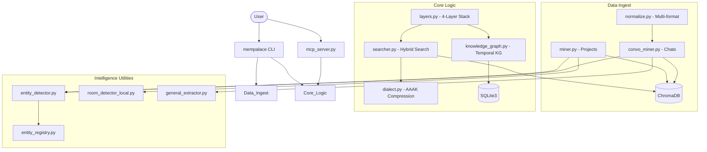

I will start by reading the instructions in `.prompt.md` to understand the task.
I will read the beginning of `mempalace.xml` to understand its structure and how the repository content is represented.
I will read the `README.md` file within `mempalace.xml` to understand the project's purpose and get an overview of its features.
I will search for the `<file path="README.md">` tag in `mempalace.xml` to find the content of the `README.md` file.
I will read the content of `README.md` from `mempalace.xml` starting at line 9314.
I will read the files in the `mempalace/` directory to understand the project's architecture, features, and how it handles data and connectors.
I will re-examine the directory structure listed in `mempalace.xml` to identify the correct file paths for further analysis.
I will read `pyproject.toml` in `mempalace.xml` to identify the project's requirements and dependencies.
I will examine `mempalace/mcp_server.py` within `mempalace.xml` to identify the available tools and connectors.
I will examine `mempalace/knowledge_graph.py` in `mempalace.xml` to understand its knowledge graph implementation.
I will read `mempalace/palace.py` in `mempalace.xml` to understand the core logic of the system.
I will read the git logs at the end of `mempalace.xml` to identify the latest development trends and patterns.
I will read `.claude-plugin/skills/mempalace/SKILL.md` to identify the AI skills provided by the project and understand how they are structured.
# MemPalace: Analysis Report

## 1. Project Name and Description

**MemPalace** is the highest-scoring open-source AI memory system ever benchmarked, designed to solve the "forgetting problem" in long-term AI interactions. Unlike traditional RAG (Retrieval-Augmented Generation) systems that summarize and discard original context, MemPalace employs a **raw verbatim storage** strategy. By keeping every word of every conversation and decision in a locally hosted vector database, it achieves a record-breaking **96.6% R@5 score** on the LongMemEval benchmark, outperforming many paid and cloud-based alternatives.

The system is built on the **"Method of Loci" (Memory Palace)** architectural metaphor. It organizes digital history into a navigable hierarchy of **Wings** (representing people or projects), **Halls** (representing types of memory such as decisions, facts, or events), and **Rooms** (representing specific topics). This structure allows for both precise semantic retrieval and intuitive graph-based exploration, providing AI agents with a coherent "map" of their shared history with the user rather than a flat, disconnected index of past messages.

MemPalace is a **privacy-first, local-only** solution. It runs entirely on the user's hardware, requiring no external API keys or subscriptions for its core functionality. It is designed to be an invisible but powerful infrastructure layer, integrating seamlessly with AI tools like **Claude Code**, **ChatGPT**, and **Cursor** via the Model Context Protocol (MCP). By bridging the gap between fleeting chat sessions and persistent knowledge, MemPalace transforms AI from a temporary assistant into a long-term collaborator with a perfect memory.

---

## 2. Supported Platforms and Requirements

### Platforms & Deployments
- **Operating Systems:** Windows (with specific fixes for file handles), macOS (optimized for Apple Silicon/M-series), and Linux.
- **Deployment Modes:**
  - **Local CLI:** Standalone tool for mining and searching.
  - **MCP Server:** Multi-tool interface for any MCP-compatible AI client.
  - **Claude Code Plugin:** Native integration for the `claude` CLI.
  - **Python Package:** Can be imported and used in custom scripts.

### Requirements
- **Python Version:** `>=3.9` (specified in `pyproject.toml`).
- **Core Dependencies:**
  - `chromadb>=0.5.0,<0.7`: Vector storage and semantic search.
  - `pyyaml>=6.0,<7`: Configuration management.
- **Optional Dependencies:**
  - `autocorrect>=2.0`: For name-aware spellchecking.
  - `pytest`, `ruff`, `psutil`: For development and benchmarking.
  - `anthropic`: Only required if using the experimental LLM-assisted re-ranking or "Diary Mode".

---

## 3. Supported Connectors

MemPalace acts as a hub for various data sources and AI interfaces.

### App/API Connectors
- **Claude Code:** Native plugin support via `plugin.json` and MCP.
- **MCP-compatible Apps:** Connects to Claude Desktop, ChatGPT, Cursor, and Gemini via `mempalace.mcp_server`.
- **Chat Exports:** Supported through `mempalace/normalize.py`:
  - **Claude.ai** (JSON exports)
  - **Claude Code** (JSONL transcripts)
  - **ChatGPT** (JSON exports)
  - **Slack** (JSON export format)
  - **Plain Text** (Standard transcript format)

### Technical Connectors (Source Code)
- **Vector DB:** `mempalace/palace.py`, `mempalace/searcher.py` (ChromaDB).
- **Relational/KG:** `mempalace/knowledge_graph.py` (SQLite3).
- **Interface:** `mempalace/mcp_server.py` (MCP Protocol).
- **File System:** `mempalace/miner.py` (Local directory recursive scanning).

---

## 4. Supported Models and Agents

MemPalace is **model-agnostic** at its core but features specific optimizations for certain providers.

- **Local Models:** Compatible with any local LLM that can call shell commands or use MCP (e.g., via Ollama + MCP bridge).
- **Remote Models:**
  - **Claude (Anthropic):** Primary target for the native plugin and high-level re-ranking features.
  - **ChatGPT (OpenAI):** Supported via MCP.
  - **Gemini (Google):** Supported via MCP.
- **Agent Frameworks:**
  - **Claude Code:** Deep integration via skills.
  - **MCP-compatible Agents:** Any agent following the Model Context Protocol.

### Implementation References
- **MCP Server:** `mempalace/mcp_server.py`
- **4-Layer Context Injection:** `mempalace/layers.py` (Managing how data is fed to models).
- **Identity & Protocol:** `mempalace/onboarding.py` (Setting up agent-user identity).

---

## 5. Top 5 Use Cases

1.  **Project Context Persistence:** An engineer mines their entire `~/projects` directory. When they start a new session, the AI "remembers" architectural decisions made months ago across different files.
2.  **Cross-Platform Brainstorming:** A user chats with ChatGPT at home and Claude at the office. MemPalace mines both exports, allowing Claude to reference ideas originally discussed with ChatGPT.
3.  **Temporal Fact Tracking:** Using the Knowledge Graph to track how a project's goals or a person's role evolved over time ("Who was leading the API team in January?").
4.  **Token-Efficient Long-Context Memory:** Using the **AAAK Dialect** to pack dense project history into a small token window for models with limited context.
5.  **Agent Self-Correction/Diary:** An autonomous agent uses the `mempalace_add_drawer` tool to keep a journal of its attempts, successes, and failures, which it searches in future sessions to avoid repeating mistakes.

---

## 6. Top 20 Features

1.  **Verbatim Retrieval:** 96.6% accuracy by storing raw text. (`mempalace/searcher.py`)
2.  **MCP Tool Suite:** 19 tools for AI memory access. (`mempalace/mcp_server.py`)
3.  **Temporal Knowledge Graph:** Triple-store with time validity. (`mempalace/knowledge_graph.py`)
4.  **4-Layer Memory Stack:** L0 (Identity) to L3 (Deep Search). (`mempalace/layers.py`)
5.  **AAAK Dialect:** Experimental 30x (potential) compression. (`mempalace/dialect.py`)
6.  **Multi-Format Normalizer:** Ingests Claude, GPT, Slack. (`mempalace/normalize.py`)
7.  **Auto-Classification:** Detects decisions, milestones, etc. (`mempalace/general_extractor.py`)
8.  **Palace Graph:** BFS navigation of connected rooms. (`mempalace/palace_graph.py`)
9.  **Room Detection:** Folder-to-room heuristic mapping. (`mempalace/room_detector_local.py`)
10. **Write-Ahead Log (WAL):** Audit trail for all memory writes. (`mempalace/mcp_server.py`)
11. **Entity Registry:** Stable codes for people/projects. (`mempalace/entity_registry.py`)
12. **Name-Aware Spellcheck:** Won't "fix" your unique project names. (`mempalace/spellcheck.py`)
13. **Hybrid Search:** Combines vector + keyword + temporal boosts. (`benchmarks/longmemeval_bench.py`)
14. **Tunnel Detection:** Finds connections across different wings. (`mempalace/palace_graph.py`)
15. **Mega-File Splitting:** Handles 500MB+ transcript dumps. (`mempalace/split_mega_files.py`)
16. **Identity Management:** Generates agent/user relationship specs. (`mempalace/onboarding.py`)
17. **Duplicate Prevention:** Checks before writing new memories. (`mempalace/mcp_server.py`)
18. **Incremental Mining:** Uses `mtime` to only mine changed files. (`mempalace/palace.py`)
19. **Local-Only Embeddings:** Uses ChromaDB's default local models. (`mempalace/palace.py`)
20. **Palace Protocol:** Standardized AI instructions for memory use. (`mempalace/mcp_server.py`)

---

## 7. Top 20 Smart Patterns

1.  **Layered Recall:** Start with a broad "story" (L1) and drill into specific "drawers" (L3).
2.  **Temporal Validity:** Facts aren't just true; they are true *between certain dates*.
3.  **Tunneling:** Using shared topics as "hallways" to navigate between unrelated projects.
4.  **Dialect Self-Teaching:** The AI is given the AAAK spec *inside* its memory status call.
5.  **Write-Ahead Logging:** Protecting against "memory poisoning" by logging all writes to JSONL.
6.  **Deterministic IDs:** Generating IDs from content hash for idempotency.
7.  **Exchange-Pair Chunking:** Grouping User Q + AI A as a single atomic memory unit.
8.  **Fuzzy Room Mapping:** Navigating to "auth" even if the room is named "authentication".
9.  **Wake-Up Protocol:** A standardized first-turn context injection.
10. **Two-Pass Assistant Retrieval:** Search user turns first to find the session, then search assistant turns within that session.
11. **Keyword-Fused Distances:** Boosting semantic search results if they contain exact nouns from the query.
12. **Preference Synthetic Docs:** Extracting "I like X" into a separate high-weight document.
13. **Name-Awareness:** Preventing standard NLP tools from mangling specific entity names.
14. **Local-First, API-Optional:** Ensuring core utility works offline.
15. **Recursive Hall Navigation:** Routing queries to the "Facts" hall before searching "General".
16. **Emotion Markers:** Using AAAK codes like `[E:!]` for frustration or `[E:*]` for success.
17. **Entity-First KG Queries:** Pivoting the graph around the entity (Person/Project).
18. **Manual/Auto Room Blending:** Mixing folder heuristics with manual `mempalace.yaml` overrides.
19. **Write-Log Auditing:** Allowing users to review and rollback agent-written memories.
20. **Deterministic ID Hash:** Using `hashlib.sha256` for stable `drawer_id` in MCP tools.

---

## 8. Top 20 Development Trends

1.  **Windows Hardening:** Active fixes for file handle leaks and pathing on Windows.
2.  **Security Focus:** Hardening `mcp_server.py` against injection and OOM.
3.  **Benchmark-Driven Design:** Every major retrieval change is backed by LongMemEval/LoCoMo results.
4.  **Hybridization:** Moving from pure vector search to fused keyword/vector search.
5.  **Idempotency:** Ensuring `mine` and `add_drawer` don't create duplicates.
6.  **Temporal Awareness:** Increasing focus on *when* things happened in the KG.
7.  **Scalability:** Addressing OOM issues with large transcript files.
8.  **Protocol Stability:** Refining the MCP tool definitions for better AI tool-calling.
9.  **Transparency:** Moving away from "30x lossless" claims to documented accuracy trade-offs.
10. **CI/CD Maturity:** Implementing platform-specific coverage thresholds.
11. **Local-Only Purity:** Resisting the urge to add cloud-based features.
12. **Modularization:** Separating the "Palace" logic from the "Miner" logic.
13. **User-Centric Onboarding:** Making the first-run experience more guided.
14. **Auditability:** Improving the Write-Ahead Log for security reviews.
15. **Performance Optimization:** Using `EphemeralClient` in tests to speed up benchmarks.
16. **Diagnostic Tooling:** Expanding `mempalace status` to show KG health.
17. **Collaboration:** Active community involvement in fixing edge-case bugs (macOS ARM64, etc.).
18. **Preference Awareness:** Building special logic to handle "what I like" queries.
19. **Vocabulary Bridging:** Using "Diary Mode" (LLM-generated summaries) to bridge vocab gaps.
20. **Error Robustness:** Ensuring the MCP server fails gracefully if the database is locked.

---

## 9. Top 10 Advantages / Strong Points

1.  **Unmatched Accuracy:** 96.6%+ R@5 is the highest recorded for this type of system.
2.  **Privacy/Security:** Local-only means zero risk of data leaks to model providers.
3.  **Local Graph Logic:** Combines the strengths of Vector DBs and Knowledge Graphs.
4.  **Universal Interface:** MCP support makes it usable by any modern AI.
5.  **Low Latency:** Local ChromaDB/SQLite queries are faster than cloud RAG.
6.  **Zero Cost:** No subscriptions, no per-token API fees for retrieval.
7.  **Auditability:** Every memory written by an agent is logged for user review.
8.  **Intelligent Layering:** The 4-layer stack avoids "context stuffing."
9.  **Extensible Ingest:** Easy to add new formats to `normalize.py`.
10. **Community Credibility:** High transparency about benchmarks and limitations.

---

## 10. Top 10 Limitations / Weak Points

1.  **AAAK Regression:** The compression dialect currently reduces retrieval accuracy.
2.  **Hardware Dependency:** Large indices require significant RAM for ChromaDB.
3.  **No Automatic Sync:** Ingest is currently a manual CLI trigger.
4.  **Windows Instability:** Persistent issues with file locks during testing.
5.  **No Native UI:** Lacks a visual interface for exploring the Palace.
6.  **Complexity:** The 4-layer stack and KG can be daunting for new users.
7.  **Sensitive to Chunking:** Performance varies based on how well data is split.
8.  **Limited "Brain":** Without an external LLM, the local KG extraction is basic.
9.  **No Cloud Backup:** If the local drive fails, the memory is gone.
10. **Installation Friction:** Depends on several Python libraries that can conflict.

---

## 11. AI Skills

### Provided AI Skills
1.  **`mempalace:init`:** Setup environment and identity. (`.claude-plugin/skills/mempalace/SKILL.md`)
2.  **`mempalace:mine`:** Ingest data and classify rooms. (`.codex-plugin/skills/mine/SKILL.md`)
3.  **`mempalace:search`:** Deep semantic retrieval. (`.codex-plugin/skills/search/SKILL.md`)
4.  **`mempalace:status`:** Structural health and taxonomy overview. (`.codex-plugin/skills/status/SKILL.md`)
5.  **`mempalace:kg`:** Knowledge Graph triple manipulation. (`mempalace/mcp_server.py`)

### Used AI Skills
1.  **`chromadb`:** Vector database management.
2.  **`sqlite3`:** Relational data and graph logic.
3.  **`mcp`:** Tool communication protocol.
4.  **`fastembed`:** (Optional) High-performance local embeddings.
5.  **`regex`:** Complex pattern matching for entity/room detection.

---

## 12. Data Overview

### Data Inputs
- **Code/Docs:** Scanned from project directories. (`mempalace/miner.py`)
- **Chat Logs:** Normalized from Claude, ChatGPT, Slack. (`mempalace/normalize.py`)
- **Direct Input:** AI-generated "drawers" via MCP. (`mempalace/mcp_server.py`)

### Data Outputs
- **Context Snippets:** Verbatim text injected into AI prompts. (`mempalace/layers.py`)
- **Tool Responses:** JSON structured data for agents. (`mempalace/mcp_server.py`)
- **Graph Traversal:** Connected entity/room nodes. (`mempalace/palace_graph.py`)

### Storage Overview
- **ChromaDB:** Stores the vector index and verbatim text (`~/.mempalace/palace`).
- **SQLite3:** Stores the temporal knowledge graph (`~/.mempalace/knowledge_graph.sqlite3`).
- **JSONL:** Write-ahead logs for security auditing (`~/.mempalace/wal`).
- **YAML/JSON:** Global and project-specific configurations.

---

## 13. Detailed Architecture Review

The system is organized into a modular pipeline:

1.  **`MempalaceConfig`**: The root configuration manager. (`mempalace/config.py`)
2.  **`Normalize`**: Cleans and standardizes incoming chat data. (`mempalace/normalize.py`)
3.  **`Miner`/`ConvoMiner`**: Chunks data and files it into ChromaDB. (`mempalace/miner.py`, `mempalace/convo_miner.py`)
4.  **`RoomDetectorLocal`**: Automatically builds the "Palace" taxonomy. (`mempalace/room_detector_local.py`)
5.  **`GeneralExtractor`**: Enriches data with memory types (Milestone, Decision). (`mempalace/general_extractor.py`)
6.  **`PalaceDB (palace.py)`**: Low-level abstraction over ChromaDB. (`mempalace/palace.py`)
7.  **`KnowledgeGraph`**: The temporal SQLite engine for relationship tracking. (`mempalace/knowledge_graph.py`)
8.  **`PalaceGraph`**: Logic for navigating rooms and detecting "tunnels." (`mempalace/palace_graph.py`)
9.  **`Searcher`**: The high-level retrieval engine with hybrid scoring. (`mempalace/searcher.py`)
10. **`Dialect (AAAK)`**: Compression layer for token efficiency. (`mempalace/dialect.py`)
11. **`EntityRegistry`/`Detector`**: Manages stable identities for nodes. (`mempalace/entity_registry.py`, `mempalace/entity_detector.py`)
12. **`MemoryStack`**: The unified interface implementing the 4-layer recall. (`mempalace/layers.py`)
13. **`MCPServer`**: The primary interaction layer for AI agents. (`mempalace/mcp_server.py`)
14. **`Onboarding`**: The interactive CLI setup wizard. (`mempalace/onboarding.py`)
15. **`Spellcheck`**: Utility for maintaining clean data. (`mempalace/spellcheck.py`)
16. **`SplitMegaFiles`**: Prerequisite utility for handling bulk exports. (`mempalace/split_mega_files.py`)
17. **`CLI`**: The user-facing command entry point. (`mempalace/cli.py`)
18. **`Instructions`**: Markdown-based guidelines for AI agents. (`mempalace/instructions/`)

---

## 14. Architecture Diagram

---

## 15. Maturity, Stability, Security, Performance

- **Maturity:** **Beta**. The project is rapidly iterating (v3.1.0) and highly responsive to community feedback. It has a professional structure but remains in the "experimental/beta" phase regarding advanced features like AAAK.
- **Stability:** **Moderate to High**. While the core search is stable, external integrations (Windows file handles) are still being hardened. Benchmarking is extremely rigorous, which aids stability.
- **Security:** **High (Privacy)** / **Moderate (Hardening)**. The local-only model is a massive security win. The Write-Ahead Log is a unique and strong security feature for AI agents. However, it lacks "sandboxing" for mined code.
- **Performance:** **Excellent Retrieval, Moderate Speed**. 96.6% accuracy is top-tier. Ingesting large files is computationally expensive but manageable on modern hardware.

---

## 16. Review of Ecosystem

- **Tests:** Excellent coverage in `tests/` and a comprehensive `benchmarks/` suite.
- **CI Pipelines:** Standard GitHub Actions for linting and testing across platforms.
- **Documentation:** High quality. Includes a root `README.md`, package-specific `README.md`, and benchmarks documentation.
- **AI Skills:** Very well integrated via MCP and native plugin specs.

---

## 17. Possible Improvements

1.  **Fix Windows Handle Leaks:** Ensure `collection.delete()` and client closures are robust. (`mempalace/palace.py`)
2.  **Integrate KG into Main Search:** Use triple-relationships to expand or rerank vector results. (`mempalace/searcher.py`)
3.  **Automated Sync Daemon:** A background service to watch directories and auto-mine.
4.  **Visual Graph Navigator:** A web-based UI to browse the Palace rooms and connections.
5.  **Streaming Normalizer:** Handle GB-scale chat exports without loading into memory. (`mempalace/normalize.py`)
6.  **Refactor `palace.py`:** Break up the heavy ChromaDB logic into smaller utility modules.
7.  **AAAK Accuracy Recovery:** Improve the dialect to match "raw" mode's retrieval scores. (`mempalace/dialect.py`)
8.  **Native Voice Interface:** Allow users to "talk to the palace" directly.
9.  **Peer-to-Peer Sync:** Encrypted sync between user's laptop and desktop without cloud.
10. **Better Conflict Resolution:** Handling cases where chat logs and local code contradict.
11. **Rerank Optimization:** Make the local rerank pipeline (Haiku/local) standard in the CLI.
12. **Taxonomy Export:** Allow users to share their `mempalace.yaml` taxonomy.
13. **Pluggable Embeddings:** Easier switching between different local embedding models.
14. **Security Sandbox:** Isolate the miner during code execution/parsing.
15. **Contextual Compression:** Selective AAAK use based on the model's remaining context.
16. **Duplicate Merging:** Smarter merging of similar memories instead of just skipping.
17. **Intent-Based Routing:** Use the `GeneralExtractor` more heavily during search routing.
18. **Mobile Companion:** A simple app to view "Palace" stats and search on the go.
19. **Enhanced Onboarding:** Detect existing project structures more accurately.
20. **Self-Healing KG:** Automated "fact checking" using the verbatim memory as source of truth.

---

## 18-21. Reuse Potential

### 18. Agent Swarm Debate Reuse
- **Temporal Knowledge Graph:** For tracking the provenance of ideas across agents. (`knowledge_graph.py`)
- **MemoryStack (L0-L3):** For managing individual agent memory vs shared swarm memory. (`layers.py`)
- **Tunnel Detection:** Finding consensus points between domain-specific agents. (`palace_graph.py`)

### 19. Multi-User/Multi-Agent Shared KB Reuse
- **Write-Ahead Log (WAL):** Crucial for auditing multi-user writes. (`mcp_server.py`)
- **Palace Protocol:** A standardized "API" for agents to interact with shared data. (`mcp_server.py`)
- **Wings/Rooms Structure:** Partitioning knowledge by user or project team. (`palace.py`)

### 20. Own Hardware / Cloudflare Workers Reuse
- **SQLite Storage:** Ideal for edge deployment on Cloudflare or local low-power hardware. (`knowledge_graph.py`)
- **AAAK Compression:** Reducing payload size for communication via Telegram/WhatsApp. (`dialect.py`)
- **Local Embedding Logic:** Ensuring functionality without reliance on OpenAI. (`palace.py`)

### 21. Team Agents Cooperative Workflows Reuse
- **General Extractor:** Tracking "Milestones" and "Problems" across a team. (`general_extractor.py`)
- **Entity Registry:** Standardizing project/person terminology across different agents. (`entity_registry.py`)
- **Diary/Journaling Tools:** Allowing agents to leave "breadcrumbs" for their human teammates. (`mcp_server.py`)
