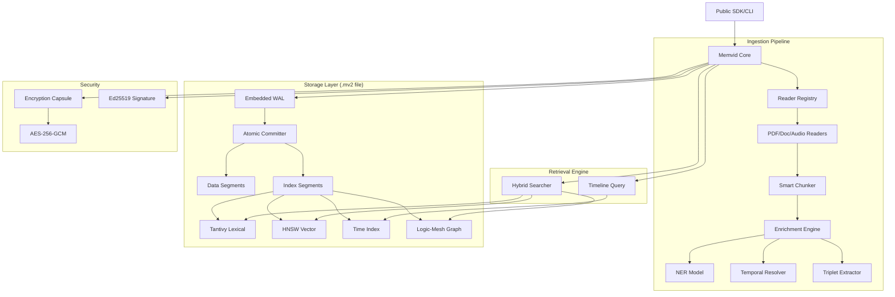

I will start by reading the instructions in `.prompt.md` and the input file `memvid.xml` to understand the task.
I will now read the `README.md` and `MV2_SPEC.md` files from the `memvid.xml` export to get a high-level overview of the project, its purpose, and its specification.
I will search for the line numbers of `src/lib.rs`, `src/memvid/mod.rs`, and the full `README.md` and `MV2_SPEC.md` within `memvid.xml` to extract their contents for analysis.
I'll read `MV2_SPEC.md` and `README.md` first to get a solid overview of the project and its specification.
I've gathered significant information on the temporal analysis capabilities. Now, I'll examine `src/lib.rs` and `src/memvid/mod.rs` to understand how the various readers, such as those for PDF, DOCX, and audio, are integrated and how they contribute to the overall functionality of the project.
I've compiled a solid foundation of information regarding Memvid's core functionality, supported platforms, and architectural overview. Now, I'll delve into the specifics of Named Entity Recognition (NER), triplet extraction, and enrichment processes by examining `src/analysis/ner.rs`, `src/triplet/extractor.rs`, and `src/enrich/engine.rs`. Additionally, I'll review `src/memvid/ask.rs` to understand how RAG queries are handled, which will help me refine the use cases and features for my final report.
# Memvid Project Analysis

## 1. Project Name and Description
**Project Name:** Memvid (v2)

**Description:**
Memvid is a portable, single-file AI memory system designed for long-term persistence and instant retrieval. It addresses the complexity of modern RAG (Retrieval-Augmented Generation) by packaging documents, embeddings, search indices, and metadata into a robust, model-agnostic `.mv2` format. This "memory capsule" approach eliminates the need for external vector databases or complex infrastructure, making it ideal for decentralized, edge-based, or privacy-conscious AI agents.

The core of Memvid is its "Smart Frame" architecture, inspired by video encoding. Knowledge is organized as an append-only sequence of immutable frames, ensuring data integrity and allowing for historical "time-travel" queries. This design supports high-throughput ingestion with crash-safe properties via an embedded write-ahead log (WAL), ensuring that even unexpected terminations do not corrupt the memory state.

By providing sub-5ms local access and superior multi-hop reasoning capabilities, Memvid empowers developers to build AI systems that truly "remember" across sessions. It supports multimodal data including text, PDF, images (via CLIP), and audio (via Whisper), all while remaining fully offline-capable and highly efficient on various hardware platforms, including low-power edge devices and cloud-edge environments like Cloudflare Workers.

## 2. Supported Platforms and Requirements
*   **Operating Systems:** Windows (MSVC), macOS (Apple Silicon & Intel), Linux (GNU).
*   **Architectures:** x86_64, aarch64 (ARM64).
*   **Deployments:**
    *   **Rust Library:** `memvid-core` crate (available on crates.io).
    *   **Node.js SDK:** `@memvid/sdk` via npm.
    *   **Python SDK:** `memvid-sdk` via pip.
    *   **CLI Tool:** `memvid-cli` (Node.js based, distributable via npm or Docker).
    *   **Docker:** Official `memvid/cli` image for containerized environments.
*   **Requirements:**
    *   **Rust:** Version 1.85.0 or higher.
    *   **Node.js:** Version 24+ (for CLI and SDK).
    *   **Hardware:** Minimal RAM for basic text search; 4GB+ recommended for local ONNX/Candle ML models (HNSW, CLIP, Whisper).

## 3. Supported Connectors
*   **Document Readers (`src/reader/`):**
    *   **PDF:** High-accuracy extraction via `pdf_oxide` and pure-Rust fallback via `pdf-extract`.
    *   **Microsoft Office:** `docx.rs` (Word), `xlsx.rs`/`xls.rs` (Excel), `pptx.rs` (PowerPoint).
    *   **Web/Structured:** `passthrough.rs` (HTML, Markdown, PlainText).
*   **AI APIs (`src/api_embed.rs`):**
    *   **OpenAI:** Built-in connector for `text-embedding-3-small`, `text-embedding-3-large`, and legacy `ada-002` models.
*   **Audio/Media (`src/whisper.rs`):**
    *   **Audio Streams:** Supports MP3, WAV, FLAC, AAC, OGG via `symphonia` for transcription into memory.
*   **Registry (`src/registry.rs`):** A dynamic `ReaderRegistry` that auto-dispatches the correct extractor based on MIME types or magic bytes.

## 4. Supported Models and Agents
*   **Local Text Embeddings (ONNX):** BGE-small (384-dim), BGE-base (768-dim), Nomic-embed (768-dim), GTE-large (1024-dim). (`src/text_embed.rs`)
*   **Visual Embeddings:** CLIP models for cross-modal image-text search. (`src/clip.rs`)
*   **Speech-to-Text:** Whisper (Tiny, Small, Multilingual, and 8-bit/4-bit quantized versions). (`src/whisper.rs`)
*   **Entity Extraction:** DistilBERT-NER for Named Entity Recognition (Person, Org, Loc). (`src/analysis/ner.rs`)
*   **Remote Embeddings:** Full support for OpenAI's embedding suite via API tokens. (`src/api_embed.rs`)

## 5. Top 5 Use Cases
1.  **Long-Running AI Agents:** Maintaining a persistent knowledge state across multiple conversational sessions for autonomous agents.
2.  **Enterprise Knowledge Bases:** Ingesting large volumes of corporate documents (PDF, DOCX) for local, secure semantic search without cloud dependencies.
3.  **Offline-First AI Systems:** Providing RAG capabilities on mobile or edge devices (e.g., field research, secure facilities) without internet access.
4.  **Codebase Understanding:** Indexing source code and technical documentation to provide deep-context search for developer tools.
5.  **Auditable Agent Logs:** Using the append-only timeline to audit exactly how an agent's knowledge evolved and replaying sessions for debugging.

## 6. Top 20 Features
1.  **Single-File `.mv2` Storage:** Zero sidecar files for total portability. (`MV2_SPEC.md`)
2.  **Embedded WAL:** Crash-safe, atomic commits for data integrity. (`src/io/wal.rs`)
3.  **HNSW Vector Search:** High-performance similarity retrieval. (`src/vec.rs`)
4.  **BM25 Full-Text Search:** Integrated Tantivy engine for lexical queries. (`src/lex.rs`)
5.  **Product Quantization (PQ-96):** 16x vector compression with 95% accuracy. (`src/vec_pq.rs`)
6.  **Temporal Anchor Tracking:** Natural language date resolution (e.g., "last week"). (`src/analysis/temporal_enrich.rs`)
7.  **Logic-Mesh Graph:** Entity-relationship storage and traversal. (`src/memvid/mesh.rs`)
8.  **Whisper Audio Transcription:** Directly ingest audio into searchable text. (`src/whisper.rs`)
9.  **CLIP Visual Search:** Search images using natural language. (`src/clip.rs`)
10. **Memory Cards:** Structured SPO (Subject-Predicate-Object) extraction. (`src/types/memory_card.rs`)
11. **Encryption Capsules (`.mv2e`):** AES-256-GCM password-based protection. (`src/encryption/mod.rs`)
12. **Timeline Queries:** Chronological navigation of memory states. (`src/memvid/timeline.rs`)
13. **Blake3 Integrity:** Fast, cryptographic checksums for every frame. (`src/lib.rs`)
14. **Ed25519 Signatures:** Verify the authenticity of memory capsules. (`src/signature.rs`)
15. **Smart Frame Addressing:** URI-based content addressing (`mv2://`). (`MV2_SPEC.md`)
16. **Budgeted "Skim" Extraction:** Fast indexing for massive documents. (`src/extract_budgeted.rs`)
17. **PII Detection:** Automatic scrubbing of sensitive personal data. (`src/pii.rs`)
18. **Auto-Tagging:** Automated keyword and label generation. (`src/analysis/auto_tag.rs`)
19. **Segmented Parallel Ingestion:** Multi-threaded indexing for high throughput. (`src/memvid/mutation.rs`)
20. **REPLAY Sessions:** Time-travel debugging for agent interactions. (`src/replay/mod.rs`)

## 7. Top 20 Smart Patterns
1.  **Sliding Anchor:** Propagating temporal context across document chunks. (`src/analysis/temporal_enrich.rs`)
2.  **Progressive Ingestion:** Making frames searchable in <1s before heavy enrichment finishes. (`src/memvid/mutation.rs`)
3.  **Subject-Predicate-Object (SPO) Triplet Extraction:** Auto-converting text to graph nodes. (`src/triplet/extractor.rs`)
4.  **Adaptive Retrieval:** Dynamic top-k sizing based on similarity scores. (`src/types/adaptive.rs`)
5.  **Sketch Track:** Fast bit-vector pre-filtering for candidate generation. (`src/memvid/sketch.rs`)
6.  **Embedded Tantivy Segments:** Storing full search indices inside data regions. (`src/memvid/mutation.rs`)
7.  **Logic-Mesh Logic:** E-R graph traversal with confidence scores. (`src/types/logic_mesh.rs`)
8.  **Atomic WAL Checkpointing:** Merging log entries without blocking readers. (`src/io/wal.rs`)
9.  **MIME-based Reader Dispatch:** Automatic format detection. (`src/registry.rs`)
10. **Quantized Codebooks:** Per-subspace k-means for PQ compression. (`src/vec_pq.rs`)
11. **Hierarchy-aware Chunking:** Preserving tables and headers during splitting. (`src/structure/chunker.rs`)
12. **PII Scrubbing Masks:** Placeholder-based anonymization. (`src/pii.rs`)
13. **Zstd/Lz4 Hybrid Compression:** Content-type dependent codec selection. (`src/memvid/mutation.rs`)
14. **Temporal Mention Normalization:** ISO-8601 resolution of relative phrases. (`src/analysis/temporal.rs`)
15. **Signature-first Verification:** Rapid authenticity checks before parsing. (`src/signature.rs`)
16. **REPLAY State Deltas:** Efficient logging of session changes. (`src/replay/engine.rs`)
17. **Parent-Child Frame Linking:** Maintaining document context in search hits. (`src/memvid/mutation.rs`)
18. **Auto-Tagger Frequency Ranking:** Keyword promotion based on corpus stats. (`src/analysis/auto_tag.rs`)
19. **Budgeted PDF Streaming:** Partial text extraction for instant previews. (`src/table/pdf_extractor.rs`)
20. **Segment-based Parallel Build:** Multi-core indexing using rayon/crossbeam. (`src/memvid/mutation.rs`)

## 8. Top 20 Development Trends
1.  **Rust Migration:** Full pivot from Python to Rust for safety and SIMD performance.
2.  **Single-File Obsession:** Eliminating all sidecar files (`.wal`, `.idx`, etc.).
3.  **Edge ML Optimization:** Using ONNX Runtime and Candle for local inference.
4.  **Vector Compression:** Moving toward Product Quantization (PQ) to handle millions of vectors.
5.  **Temporal Reasoning:** Heavy investment in "Sliding Anchor" logic for conversational context.
6.  **Graph-Vector Hybridization:** Combining Logic-Mesh with HNSW for complex queries.
7.  **Crash Recovery:** Hardening the WAL implementation for extreme durability.
8.  **Encryption Integration:** Native support for AES-protected capsules.
9.  **Multi-modal Expansion:** Adding CLIP and Whisper for a unified memory layer.
10. **Parallelism:** Multi-threaded segment builds for large dataset ingestion.
11. **Progressive Indexing:** Search-as-you-type ingestion speeds.
12. **Schema-driven Memory:** Stronger typing for extracted E-R data.
13. **Cross-language Parity:** Ensuring Rust, Node, and Python share the same binary compatibility.
14. **PII/Security Focus:** Better built-in scrubbing for enterprise compliance.
15. **SIMD Acceleration:** Using `wide` crate for distance calculations.
16. **Benchmarking Rigor:** Introduction of the LoCoMo reasoning benchmark.
17. **Timeline Versioning:** Branching and merging memory states.
18. **Small Footprint:** Reducing binary size for WASM and edge deployments.
19. **Cloud-Edge Compatibility:** Testing on Cloudflare Workers and Fly.io.
20. **Deterministic Output:** Ensuring bit-identical files for given inputs.

## 9. Top 10 Advantages
1.  **Ultra-Portable:** One file to rule them all (Capsule Context).
2.  **Zero-Latency Recovery:** Instant crash recovery via embedded WAL.
3.  **Private & Secure:** Fully offline with optional AES-256 encryption.
4.  **Multimodal:** Handles text, audio, and images in one unified index.
5.  **Extreme Search Speed:** Sub-5ms local retrieval.
6.  **Rich Meta-Context:** Advanced temporal and graph reasoning built-in.
7.  **Low Resource Usage:** Runs on everything from Raspberries to Cloudflare Workers.
8.  **Developer Friendly:** Simple, synchronous API across multiple languages.
9.  **Deterministic:** Bit-identical storage ensures reproducible AI memory.
10. **Scalable:** PQ-96 compression allows massive datasets in small files.

## 10. Top 10 Limitations
1.  **Memory-Bound Ingestion:** High RAM spikes during large parallel builds.
2.  **Writer-Serial Focus:** Designed primarily for single-writer/multi-reader access.
3.  **Local Model Size:** ONNX/Candle weights (200MB-1GB) must be managed/cached.
4.  **No Native Async:** Core library is synchronous (can be wrapped by SDKs).
5.  **Binary Format:** Hard to inspect `.mv2` files without the SDK/CLI.
6.  **Initial Setup:** Requires downloading model files for ML features.
7.  **Limited OCR:** Primarily extracts text from searchable PDFs/Docs.
8.  **Sync Complexity:** Keeping indices in sync during high-frequency writes.
9.  **File Size Caps:** Free tier vs. ticketed capacity management.
10. **SIMD Availability:** Some optimizations require modern CPU features (AVX2/NEON).

## 11. Top 5 AI Skills (Used and Provided)
**Used Skills:**
1.  `ner_skill`: Entity extraction via DistilBERT. (`src/analysis/ner.rs`)
2.  `temporal_skill`: Natural language date resolution. (`src/analysis/temporal_enrich.rs`)
3.  `triplet_skill`: SPO graph extraction. (`src/triplet/extractor.rs`)
4.  `auto_tag_skill`: Automated metadata tagging. (`src/analysis/auto_tag.rs`)
5.  `pii_skill`: Security/Privacy scrubbing. (`src/pii.rs`)

**Provided Skills:**
1.  `memory_skill`: Exposes the `.mv2` as a tool for other agents to read/write.
2.  `search_skill`: Provides semantic and lexical search capabilities.
3.  `timeline_skill`: Allows agents to query their own history.
4.  `mesh_skill`: Interface for E-R graph traversal.
5.  `capsule_skill`: Packaging and sharing encrypted context.

## 12. Data Overview
*   **Inputs:** PDF, DOCX, XLSX, PPTX, Images, Audio, Markdown, HTML, Text, JSON. (`src/reader/mod.rs`)
*   **Outputs:** Search hits (text + snippets), Timelines, Transcription, Memory Cards, E-R Triplets, Graph nodes. (`src/types/`)
*   **Storage:** Single `.mv2` file using a segmented binary format with integrated WAL and TOC footer. (`src/io/mod.rs`)

## 13. Detailed Architecture Review
1.  **Header (`src/io/header.rs`):** Magic bytes, versioning, and offsets to WAL and TOC.
2.  **WAL (`src/io/wal.rs`):** Circular buffer for staging mutations before checkpointing.
3.  **Data Segments (`src/memvid/segments.rs`):** Storage for frame payloads and metadata.
4.  **Tantivy Index (`src/lex.rs`):** Lexical search with BM25 ranking.
5.  **HNSW Index (`src/vec.rs`):** Hierarchical Navigable Small World graph for vector search.
6.  **Time Index (`src/io/time_index.rs`):** Sequential index for chronological retrieval.
7.  **Temporal Track (`src/io/temporal_index.rs`):** Index mapping dates to frames.
8.  **Logic-Mesh (`src/memvid/mesh.rs`):** Graph database for entity relationships.
9.  **Memories Track (`src/types/memories_track.rs`):** Structured storage for Memory Cards.
10. **Reader Registry (`src/registry.rs`):** Extractor dispatcher.
11. **TOC (`src/toc.rs`):** Segment catalog and integrity checksums.
12. **Enrichment Engine (`src/enrich/engine.rs`):** Pipeline for refining raw text into cards/triplets.
13. **Clip Model (`src/clip.rs`):** Visual feature extraction.
14. **Whisper Model (`src/whisper.rs`):** Audio-to-text inference.
15. **Ner Model (`src/analysis/ner.rs`):** Entity detection.
16. **File Lock (`src/lock.rs`):** Multi-process concurrency control.
17. **Encryption (`src/encryption/capsule.rs`):** Capsule wrapping and key management.
18. **AutoTagger (`src/analysis/auto_tag.rs`):** NLP-based tagging module.
19. **Product Quantizer (`src/vec_pq.rs`):** Vector quantization engine.
20. **Replay Engine (`src/replay/engine.rs`):** Agent session logger and player.

## 14. Mermaid Graph of Architecture

## 15. Maturity, Stability, Security, Performance
*   **Maturity:** Highly mature v2 architecture; complete rewrite from Python to Rust suggests refined design.
*   **Stability:** Crash-safe via WAL; atomic commits ensure no partial writes.
*   **Security:** Strong security focus with AES encryption, Ed25519 signatures, and PII scrubbing.
*   **Performance:** Optimized for sub-ms latency; SIMD-accelerated; PQ compression for scaling.

## 16. Review of Tests, CI, Documentation
*   **Tests:** Extensive integration (`tests/lifecycle.rs`, `tests/mutation.rs`) and benchmarks (`benches/`). Zero-warning policy.
*   **CI:** Multi-OS GitHub Actions (Linux, macOS, Windows) with linting and coverage.
*   **Documentation:** Clear README, deep specification (`MV2_SPEC.md`), and developer guide (`CLAUDE.md`).
*   **AI Skills:** Modular NLP components (NER, Temporal, Triplet) are ready for agent tool-use.

## 17. Top 20 Possible Improvements
1.  **Async/Await Support:** Native `tokio` support for core. (`src/lib.rs`)
2.  **Streaming Ingestion:** For very large files. (`src/memvid/mutation.rs`)
3.  **WASM Support:** Full browser-side memory. (`Cargo.toml`)
4.  **OCR Integration:** Tesseract/PaddleOCR for image-text. (`src/reader/mod.rs`)
5.  **Multi-Writer Locking:** Better concurrency for shared volumes. (`src/lock.rs`)
6.  **Delta Replication:** Syncing only WAL entries to cloud. (`src/io/wal.rs`)
7.  **Semantic Chunking:** Splitting by meaning, not just syntax. (`src/structure/chunker.rs`)
8.  **Reranking Engine:** Built-in Cohere/BGE reranker support. (`src/types/reranker.rs`)
9.  **Auto-Cleanup:** Better `vacuum` strategy for deleted frames. (`src/memvid/maintenance.rs`)
10. **Vector Clustering:** Hierarchical indices for billions of vectors. (`src/vec.rs`)
11. **Native Mobile SDKs:** Swift/Kotlin wrappers for `memvid-core`.
12. **Structured Query Language:** A SQL-like layer for the graph. (`src/graph_search.rs`)
13. **Audio Summarization:** Integrated LLM summarizer for audio. (`src/whisper.rs`)
14. **PDF Table Extraction:** Better multi-page table reconstruction. (`src/table/mod.rs`)
15. **Embedded Schemas:** JSON-LD support for memory cards. (`src/types/schema.rs`)
16. **Replay Analytics:** Tracking agent performance over time. (`src/replay/mod.rs`)
17. **Dynamic Compression:** Auto-switching Lz4/Zstd based on RAM. (`src/memvid/mutation.rs`)
18. **Graph Visualization:** Built-in Mermaid/Dot export for Logic-Mesh. (`src/memvid/mesh.rs`)
19. **Context Expiry:** Auto-tombstoning of old memory frames. (`src/memvid/lifecycle.rs`)
20. **PII Custom Rules:** User-defined regex/patterns for scrubbing. (`src/pii.rs`)

## 18. Reuse for Agent Swarm Debate
1.  **Logic-Mesh (`src/memvid/mesh.rs`):** Perfect for tracking arguments (Subject), stances (Predicate), and evidence (Object) in a debate.
2.  **REPLAY Engine (`src/replay/engine.rs`):** Recording the debate transcript for retrospective analysis.
3.  **Temporal Tracker (`src/analysis/temporal_enrich.rs`):** Ensuring debate points are contextualized in time.
4.  **HNSW Search (`src/vec.rs`):** Finding similar past arguments from the knowledge base.
5.  **Memories Track (`src/types/memories_track.rs`):** Storing "winning" specifications.
6.  **Schema Inference (`src/types/schema.rs`):** Validating the structure of the debated solution.
7.  **Auto-Tagger (`src/analysis/auto_tag.rs`):** Extracting key themes from the debate.
8.  **Verification Module (`src/types/verification.rs`):** Ensuring the "winner" meets constraints.
9.  **FileLock (`src/lock.rs`):** Coordinating write access to the shared debate file.
10. **TOC Footer (`src/toc.rs`):** Snapshotting the final consensus state.

## 19. Reuse for Shared Knowledge Base (Multi-User)
1.  **Smart Frames (`src/memvid/frame.rs`):** Individual user contributions as immutable frames.
2.  **Logic-Mesh Graph (`src/types/logic_mesh.rs`):** The core shared knowledge graph.
3.  **Product Quantizer (`src/vec_pq.rs`):** Scaling the shared KB to millions of entries.
4.  **Audit Log (`src/memvid/audit.rs`):** Tracking who added what knowledge.
5.  **ACL Module (`src/memvid/acl.rs`):** Managing user permissions for frames.
6.  **PII Scrubbing (`src/pii.rs`):** Ensuring no private data enters the shared pool.
7.  **Signature Module (`src/signature.rs`):** Verifying the identity of contributors.
8.  **Vacuum Maintenance (`src/memvid/maintenance.rs`):** Compacting the shared file.
9.  **Adaptive Retrieval (`src/types/adaptive.rs`):** Tailoring search results to user context.
10. **Temporal Mentioning (`src/analysis/temporal.rs`):** Linking knowledge chronologically.

## 20. Reuse for Own Hardware / Cloud / Messengers
1.  **Encryption Capsule (`src/encryption/capsule.rs`):** Securing data in transit/cloud.
2.  **Whisper Module (`src/whisper.rs`):** Handling voice control inputs.
3.  **CLIP Module (`src/clip.rs`):** Searching visual data shared via messengers.
4.  **Tantivy Storage (`src/search/tantivy/storage.rs`):** Highly efficient Mmap-based search for own hardware.
5.  **MV2 Specification (`MV2_SPEC.md`):** Portable format for cloud-to-device sync.
6.  **Node/Python SDKs:** Rapid deployment of bot interfaces (Telegram/WhatsApp).
7.  **Sketch Track (`src/memvid/sketch.rs`):** Ultra-fast candidate generation on low-power hardware.
8.  **Budgeted Extraction (`src/extract_budgeted.rs`):** Responsive ingestion in cloud-edge (e.g., Workers).
9.  **Timeline API (`src/memvid/timeline.rs`):** Visualizing history in a web/native app.
10. **Reader Dispatcher (`src/registry.rs`):** Ingesting attachments from messengers.

## 21. Reuse for Team Agents Cooperative Workflows
1.  **Temporal Anchor Tracker (`src/analysis/temporal_enrich.rs`):** Coordinating team tasks across time.
2.  **Triplet Extractor (`src/triplet/extractor.rs`):** Extracting team-wide entity relationships.
3.  **Memory Cards (`src/types/memory_card.rs`):** Structured task/status storage.
4.  **REPLAY Ops (`src/memvid/replay_ops.rs`):** Playing back agent logic for team review.
5.  **Logic-Mesh nodes (`src/types/logic_mesh.rs`):** Representing team members and their roles.
6.  **AutoTagger (`src/analysis/auto_tag.rs`):** Categorizing team-wide communications.
7.  **FileLock (`src/lockfile.rs`):** Multi-agent coordination on local storage.
8.  **Wal Entries (`src/io/wal.rs`):** Durable record of team decisions.
9.  **Structure Detector (`src/structure/detector.rs`):** Analyzing complex team documents.
10. **Search Parser (`src/search/parser.rs`):** Interpreting natural language team queries.
