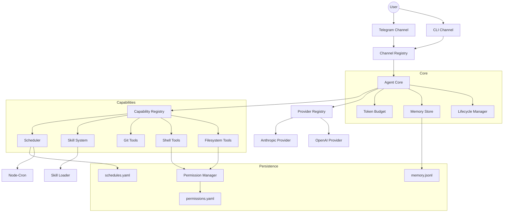

I will read the instructions in `.prompt.md` and the input data from `.input.mercury-agent.xml`.
I will read the remaining content of `.input.mercury-agent.xml` to gather the necessary details for all 22 points, including source code references and architectural patterns.
# Mercury Agent Analysis Report

## 1. Project Name and Last Commit Date
- **Project Name:** Mercury
- **Last Commit Date:** 2026-04-21 01:43:05 +0530 (`chore: release v0.2.0`)

## 2. Description
Mercury is a soul-driven, token-efficient AI agent designed to run 24/7 as an autonomous orchestrator rather than a simple chatbot. It is built on a "permission-hardened" foundation, meaning it explicitly asks for user approval before performing sensitive actions like executing shell commands or modifying files outside of its approved scope. Mercury maintains a persistent identity through a set of markdown-based "soul" files, allowing users to define its personality, tastes, and behavioral guardrails without modifying the core codebase.

The system is engineered for continuous operation, featuring a built-in daemon manager and platform-specific service generators for macOS, Linux, and Windows. This allows Mercury to stay active in the background, handling scheduled tasks and responding to messages via remote channels like Telegram even when the terminal is closed. Its "always-on" nature is supported by a robust heartbeat system that monitors token budgets, upcoming cron tasks, and proactive notifications.

Mercury excels in token efficiency by employing strategies such as progressive disclosure for skills, selective injection of identity context, and hard daily token budgets. It utilizes a multi-step agentic loop powered by the Vercel AI SDK, enabling it to chain multiple tool calls to fulfill complex requests. Whether running as a local CLI tool or a persistent remote assistant, Mercury provides a secure and highly customizable environment for AI-driven automation and interaction.

## 3. Supported Platforms, Deployments & Requirements
- **Platforms:** Windows (Win32), macOS (LaunchAgents), Linux (systemd).
- **Deployments:**
  - **Foreground CLI:** Interactive mode with real-time streaming and markdown rendering (`src/channels/cli.ts`).
  - **Background Daemon:** Detached process with PID tracking and watchdog recovery (`src/cli/daemon.ts`).
  - **System Service:** Persistent auto-start on boot via `mercury service install` (`src/cli/service.ts`).
- **Requirements:**
  - **Runtime:** Node.js 20.0.0 or higher (`package.json`).
  - **Connectivity:** Internet access for LLM API providers.
  - **API Keys:** At least one valid key for OpenAI, Anthropic, or DeepSeek (`src/utils/config.ts`).

## 4. Supported Connectors
- **Telegram:** Full integration via grammY with support for streaming, file uploads (images, audio, video, documents), and custom `/` commands.
  - Reference: `src/channels/telegram.ts`
- **CLI:** Readline-based interface with chalk-powered formatting and inline permission prompts.
  - Reference: `src/channels/cli.ts`
- **Filesystem:** Direct interaction with the host OS for file operations under a scoped permission model.
  - Reference: `src/capabilities/filesystem/`
- **Shell:** Execution of system commands with a robust blocklist and approval workflow.
  - Reference: `src/capabilities/shell/run-command.ts`

## 5. Supported Models and Agents
Mercury supports multiple LLM providers with an automatic fallback mechanism.
- **DeepSeek:** Default provider, cost-effective (OpenAI-compatible).
  - Reference: `src/providers/openai-compat.ts`
- **OpenAI:** GPT-4o-mini and other standard models.
  - Reference: `src/providers/openai-compat.ts`
- **Anthropic:** Claude 3.5 Sonnet and other Claude models.
  - Reference: `src/providers/anthropic.ts`
- **Local/Self-hosted:** Supports any OpenAI-compatible API (e.g., Ollama, LocalAI) via the `OPENAI_BASE_URL` configuration.
  - Reference: `src/utils/config.ts`
- **Subscription Type:** Uses API tokens for all providers; requires user-provided API keys.

## 6. Top 5 Use Cases
1. **Automated System Maintenance:** Mercury can schedule recurring cron tasks to check server logs, run cleanup scripts, and notify the user via Telegram if issues are detected.
2. **Personal Knowledge Management:** By extracting facts from conversations and storing them in episodic and long-term memory, Mercury acts as a persistent second brain.
3. **Secure Code Interaction:** Developers can use Mercury to perform git operations, edit files, and run tests within a restricted scope, ensuring no accidental destructive commands (like `rm -rf /`) are executed.
4. **Remote File Orchestration:** Users can request files from their home computer via Telegram; Mercury fetches, processes (e.g., zips), and uploads them back to the user.
5. **Dynamic Skill Extension:** Mercury can "learn" new workflows on the fly by installing and invoking `SKILL.md` files from URLs, such as a specialized daily digest or a web research pipeline.

## 7. Top 20 Features
1. **Soul-Driven Identity:** Identity defined by `soul.md`, `persona.md`, etc. (`src/soul/identity.ts`).
2. **Permission Hardening:** Folder-level scoping and command blocklist (`src/capabilities/permissions.ts`).
3. **Daily Token Budgets:** Hard caps on token usage with enforcement (`src/utils/tokens.ts`).
4. **Multi-Step Agentic Loop:** Up to 10 steps per request using AI SDK (`src/core/agent.ts`).
5. **Background Daemon Mode:** `mercury start -d` for headless operation (`src/cli/daemon.ts`).
6. **System Service Integration:** Native service installers for all major OSs (`src/cli/service.ts`).
7. **Watchdog Recovery:** Automated restarts with exponential backoff (`src/cli/watchdog.ts`).
8. **Telegram Streaming:** Real-time text streaming in chat (`src/channels/telegram.ts`).
9. **Cron Scheduling:** Recurring tasks using standard cron syntax (`src/core/scheduler.ts`).
10. **Delayed Tasks:** "Remind me in X minutes" functionality (`src/core/scheduler.ts`).
11. **Skill System:** Modular, installable markdown-based extensions (`src/skills/loader.ts`).
12. **Progressive Disclosure:** Token-efficient skill loading on demand (`src/skills/loader.ts`).
13. **Provider Fallback:** Auto-switching LLMs if one fails (`src/providers/registry.ts`).
14. **Last-Successful Tracking:** Remembers and prioritizes the last working provider (`src/providers/registry.ts`).
15. **Git Integration:** Built-in tools for status, diff, commit, and push (`src/capabilities/git/`).
16. **Fact Extraction:** Auto-extraction of facts from dialogue with de-duplication (`src/core/agent.ts`).
17. **File Scoping:** `y/n/always` approval flow for directory access (`src/capabilities/permissions.ts`).
18. **Web Scraping:** `fetch_url` tool with HTML-to-text stripping (`src/capabilities/web/fetch-url.ts`).
19. **Onboarding Wizard:** Interactive CLI setup for new users (`src/index.ts`).
20. **Proactive Notifications:** Heartbeat-triggered alerts via active channels (`src/core/agent.ts`).

## 8. Top 20 Smart Patterns
1. **Identity Layering:** Injecting only vital soul files to save tokens (`src/core/agent.ts`).
2. **Keyword-Based Memory Retrieval:** Matching long-term facts without scanning all files (`RESEARCH.md`).
3. **Hybrid Daemon Manager:** Using a native detached process instead of heavy dependencies like PM2 (`DECISIONS.md`).
4. **Platform-Specific Generators:** Detecting OS to generate `systemd`, `plist`, or `schtasks` config (`src/cli/service.ts`).
5. **Inline Permission Prompts:** Prompting the user directly in the channel context (`src/channels/cli.ts`).
6. **Provider Fallback Chain:** Using an iterator to try multiple LLM backends (`src/providers/registry.ts`).
7. **HTML-to-Telegram Conversion:** Specialized markdown parsing for Telegram's subset of HTML (`src/utils/markdown.ts`).
8. **Typing Indicator Loop:** Maintaining a "typing..." state during multi-step processing (`src/channels/telegram.ts`).
9. **Daily Usage Persistence:** Tracking tokens across restarts in `token-usage.json` (`src/utils/tokens.ts`).
10. **Wait-for-Previous Pattern:** Ensuring sequential execution for dependent shell commands.
11. **Disposable Elevation:** Elevating tool permissions only for the duration of a skill execution (`src/capabilities/permissions.ts`).
12. **Flat-File JSONL Storage:** Simple, grep-able, and versionable memory (`DECISIONS.md`).
13. **Progressive Skill Summarization:** Only loading skill names until invoked (`src/skills/loader.ts`).
14. **Auto-Concise Mode:** Forcing shorter responses when budget is >70% (`src/utils/tokens.ts`).
15. **Exponential Backoff Watchdog:** Protecting against crash loops (`src/cli/watchdog.ts`).
16. **Internal Message Routing:** Scheduled tasks fire as "internal" prompts to avoid channel noise (`src/core/agent.ts`).
17. **Zod-Validated Tooling:** Strict schema validation for all agent tools (`src/capabilities/`).
18. **Environment Variable Overlay:** Allowing `.env` to override YAML config for easier CI/CD (`src/utils/config.ts`).
19. **Markdown TUI Rendering:** Chalk-based markdown preview in the terminal (`src/utils/markdown.ts`).
20. **CWD-Only Restriction:** Limiting shell commands to the working directory by default (`src/capabilities/permissions.ts`).

## 9. Top 20 Development Trends
1. **Daemonization Focus:** Recent commits prioritize background persistence (`mercury up`).
2. **Platform Parity:** Simultaneous implementation of Windows Task Scheduler and Linux systemd support.
3. **UX Refinement:** Shift towards "Zero-Conf" via `mercury up` and `mercury doctor`.
4. **Streaming Integration:** Transitioning Telegram from batch messages to real-time streams.
5. **Token Budgeting:** Increasing emphasis on tracking and limiting costs (e.g., `/budget` command).
6. **Skill Specification Adherence:** Aligning with the [Agent Skills](https://agentskills.io) standard.
7. **Modular Capability Registry:** Decoupling tools from the core Agent class.
8. **Headless Interaction:** Optimization for Telegram as the primary interface in daemon mode.
9. **Identity Persistence:** Refining how "soul" files are reloaded without restarts.
10. **Error Resiliency:** Adding provider fallback and watchdog recovery.
11. **Local Path Hardening:** Moving all runtime data to `~/.mercury/` for portability.
12. **Interactive Onboarding:** Improving the first-run experience for non-technical users.
13. **Markdown-Centric TUI:** Enhancing the CLI with rich text rendering.
14. **Async-First Architecture:** Extensive use of `AsyncIterable` for streaming and tool execution.
15. **YAML-Based Configuration:** Moving away from JSON for user-editable config files.
16. **Task Scheduling Evolution:** Transitioning from simple intervals to full cron support.
17. **Skill Isolation:** Implementing granular permission elevation for specific skills.
18. **Telemetry/Logging Improvement:** Using `pino` for structured, low-overhead logging.
19. **Bundle Optimization:** Using `tsup` for fast, ESM-only builds.
20. **Security Transparency:** Explicitly documenting blocked commands and permission scopes.

## 10. Top 10 Advantages
1. **Security:** The only agent in its class that defaults to a strict permission blocklist.
2. **Persistence:** Built-in OS-level service management ensures it stays running 24/7.
3. **Token Control:** Precise daily budgeting prevents runaway costs.
4. **Modular Identity:** Decoupling personality (Soul) from code (Agent) makes customization easy.
5. **Zero Dependencies (Runtime):** No need for PM2 or external databases.
6. **Multi-Channel:** Seamless transition between local CLI and remote Telegram.
7. **Extensibility:** Skills system allows adding complex logic via simple markdown.
8. **Provider Agnostic:** Supports OpenAI, Anthropic, and local LLMs through fallback logic.
9. **Efficiency:** Progressive loading and selective injection keep context windows small.
10. **User Experience:** CLI animations and streaming make the agent feel "alive."

## 11. Top 10 Limitations
1. **Memory Depth:** Currently uses keyword matching instead of vector search (limited semantic retrieval).
2. **Context Window:** Hard message limit (10) may lose long-term thread context.
3. **Provider Specificity:** Token counting is approximated for non-OpenAI providers.
4. **Shell Interactivity:** `run_command` is non-interactive (cannot handle `ssh` or `vim`).
5. **Single-User:** Designed as a personal assistant; lacks multi-user/multi-tenant features.
6. **Local Data Only:** Cannot natively sync memory across multiple machines.
7. **Limited Web Parsing:** `fetch_url` uses basic stripping; may fail on complex SPAs.
8. **No GUI:** Purely text-based (CLI/Telegram), which may limit non-technical users.
9. **Node.js Dependency:** Requires a full Node environment; not easily portable as a single binary.
10. **Permission Friction:** Frequent approval prompts might annoy users during complex tasks.

## 12. Top 5 AI Skills (Available/Provided)
*Note: Mercury provides a framework for skills; the following are implemented or templated.*
1. **Skill Template:** A seed for new skills (`src/skills/loader.ts`).
2. **Daily Digest:** (Mentioned in ARCHITECTURE.md) For activity summarization.
3. **Code Review:** (Mentioned in ARCHITECTURE.md) For repository analysis.
4. **Skill Management:** Tools to install and list skills (`src/capabilities/skills/`).
5. **Scheduler Integration:** Skills can be scheduled as cron tasks (`src/capabilities/scheduler/`).

## 13. Data Overview
- **Inputs:**
  - User messages (CLI, Telegram).
  - Web content (`fetch_url`).
  - Local files (`read_file`).
  - Git history (`git_log`).
- **Outputs:**
  - Text responses (Streaming Markdown/HTML).
  - File uploads (Telegram `sendFile`).
  - Git commits/pushes.
  - Shell command output.
- **Storage:**
  - **Memory:** `~/.mercury/memory/` (JSON/JSONL).
  - **Configuration:** `~/.mercury/mercury.yaml`.
  - **Schedules:** `~/.mercury/schedules.yaml`.
  - **Permissions:** `~/.mercury/permissions.yaml`.
  - **Skills:** `~/.mercury/skills/`.

## 14. Detailed Architecture Review
1. **Agent (`src/core/agent.ts`):** The central orchestrator managing the LLM loop and memory.
2. **Lifecycle (`src/core/lifecycle.ts`):** Manages agent states (birthing, thinking, idle).
3. **Scheduler (`src/core/scheduler.ts`):** Handles cron and delayed task execution.
4. **PermissionManager (`src/capabilities/permissions.ts`):** Enforces security guardrails and scopes.
5. **CapabilityRegistry (`src/capabilities/registry.ts`):** Central tool registration and context manager.
6. **ChannelRegistry (`src/channels/registry.ts`):** Manages communication across CLI and Telegram.
7. **ProviderRegistry (`src/providers/registry.ts`):** Handles LLM provider selection and fallback.
8. **TokenBudget (`src/utils/tokens.ts`):** Tracks and limits daily token expenditure.
9. **SkillLoader (`src/skills/loader.ts`):** Parses and manages `SKILL.md` extensions.
10. **Identity (`src/soul/identity.ts`):** Loads and guards the agent's core personality files.
11. **ShortTermMemory (`src/memory/store.ts`):** Handles sliding window message context.
12. **LongTermMemory (`src/memory/store.ts`):** Manages fact extraction and persistent lessons.
13. **Daemon Manager (`src/cli/daemon.ts`):** Controls background process spawning and PID files.
14. **Service Manager (`src/cli/service.ts`):** Generates OS-specific service configurations.
15. **CLI Channel (`src/channels/cli.ts`):** Local terminal interface with rich TUI.
16. **Telegram Channel (`src/channels/telegram.ts`):** Remote interface via Bot API.
17. **Watchdog (`src/cli/watchdog.ts`):** Crash recovery logic for daemon mode.
18. **Filesystem Tools (`src/capabilities/filesystem/`):** CRUD operations on the host system.
19. **Shell Tools (`src/capabilities/shell/`):** Command execution logic.
20. **Markdown Utility (`src/utils/markdown.ts`):** Unified rendering for CLI and Telegram.

## 15. Mermaid Architecture Graph

## 16. Project Maturity Review
- **Stability:** Moderate. The use of a watchdog and exponential backoff indicates a design focused on reliability, but the project is at version 0.2.0.
- **Security:** High. The permission system is more robust than most competitors (Open Interpreter, etc.), with explicit blocklisting and scoping.
- **Performance:** High. Low overhead due to Node.js and flat-file persistence. Token efficiency is a core design goal.
- **Maturity:** Emerging. Core features are well-implemented, but lacks advanced features like vector search or multi-user support.

## 17. Engineering Standards Review
- **Tests:** Uses `vitest`. Tests are mentioned in `package.json` but few are present in the core export.
- **CI Pipelines:** Scripts like `publish.sh` suggest a manual or semi-automated release process.
- **Documentation:** Excellent. Includes `README`, `ARCHITECTURE`, `DECISIONS`, and `RESEARCH` documents.
- **AI Skills:** Strong architecture for skills (`agentskills.io` spec), though the library of provided skills is currently small.

## 18. Possible Improvements
1. **Vector Memory:** Replace keyword matching with SQLite + Vector search (`src/memory/store.ts`).
2. **Interactive Shell:** Support for persistent pseudo-TTYs in `run_command` (`src/capabilities/shell/run-command.ts`).
3. **Multi-User Support:** Adding `ownerId` checks to the core Agent loop (`src/core/agent.ts`).
4. **GUI/Web Dashboard:** A local Electron or Web UI for monitoring budget and logs.
5. **Enhanced Web Scraping:** Using a headless browser (Puppeteer/Playwright) for `fetch_url`.
6. **Encrypted Memory:** Optional encryption for the `~/.mercury/` directory.
7. **Cloudflare Workers Deployment:** Adapter for running the core logic in edge functions.
8. **WhatsApp/Signal Connectors:** Implementing the planned channels in `src/channels/`.
9. **Automatic Summarization:** Summarizing the episodic memory to keep context clean.
10. **Custom Tool Creation:** A CLI tool to scaffold new capabilities.

## 19. Swarm Orchestration Reuse
*Components for a swarm that debates solutions and selects best agents:*
1. **Lifecycle Manager:** Can be reused to manage the states of multiple sub-agents (`src/core/lifecycle.ts`).
2. **Provider Registry:** Essential for selecting different models for "debate" (e.g., GPT-4 for logic, Claude for writing) (`src/providers/registry.ts`).
3. **Capability Registry:** Allows defining specialized toolsets for different swarm members (`src/capabilities/registry.ts`).
4. **Skill Loader:** Swarm members can "load" different expertise via SKILL.md files (`src/skills/loader.ts`).
5. **Agent Core:** The multi-step loop is the perfect foundation for a "thinking" swarm member (`src/core/agent.ts`).
6. **Permission Manager:** Crucial for delegating restricted tasks to specific swarm sub-agents (`src/capabilities/permissions.ts`).
7. **Internal Channel:** Can be reused for inter-agent communication without user noise (`src/types/channel.ts`).
8. **Markdown Renderer:** For generating swarm "reports" (`src/utils/markdown.ts`).
9. **Logger:** Structured logging is vital for debugging swarm interactions (`src/utils/logger.ts`).
10. **Identity System:** Defining the "role" of each agent in the debate via persona files (`src/soul/identity.ts`).

## 20. Shared Knowledge System Reuse
*Components for multi-user shared knowledge evolution:*
1. **LongTermMemory:** Base for extracting and storing shared facts (`src/memory/store.ts`).
2. **EpisodicMemory:** Can be adapted to track which user/agent added which knowledge (`src/memory/store.ts`).
3. **Skill System:** Shared repository of team-wide skills (`src/skills/loader.ts`).
4. **Markdown Utilities:** For maintaining a shared wiki/knowledge base (`src/utils/markdown.ts`).
5. **Filesystem Capabilities:** Scoped access to a shared project directory (`src/capabilities/filesystem/`).
6. **Git Tools:** Using git as the version control layer for the shared knowledge (`src/capabilities/git/`).
7. **Channel Registry:** Managing interactions from multiple users across various platforms (`src/channels/registry.ts`).
8. **Capability Registry:** Providing a unified interface for all agents to contribute to knowledge.
9. **Identity Guardrails:** Ensuring agents adhere to shared team "tastes" and standards (`src/soul/identity.ts`).
10. **Token Budget:** Managing shared API costs across a team (`src/utils/tokens.ts`).

## 21. Hardware/Messenger Reuse
*Components for running on own hardware with messenger/CLI/web/voice interaction:*
1. **Daemon Manager:** For 24/7 operation on home hardware/Raspberry Pi (`src/cli/daemon.ts`).
2. **Telegram Channel:** Ready-to-use messenger integration (`src/channels/telegram.ts`).
3. **CLI Channel:** Local management interface (`src/channels/cli.ts`).
4. **Service Manager:** Auto-start on boot for headless hardware (`src/cli/service.ts`).
5. **Provider Fallback:** Switching between local models (Ollama) and cloud APIs (`src/providers/registry.ts`).
6. **Watchdog:** Ensuring high availability on consumer hardware (`src/cli/watchdog.ts`).
7. **Permission Scoping:** Protecting the host hardware from accidental damage (`src/capabilities/permissions.ts`).
8. **Scheduler:** Handling hardware-specific periodic tasks (`src/core/scheduler.ts`).
9. **Filesystem Tools:** Managing local files and media on the device (`src/capabilities/filesystem/`).
10. **Fetch URL:** For hardware-based web monitoring and alerts (`src/capabilities/web/fetch-url.ts`).

## 22. Team Agent Reuse
*Components for human/agent cooperative workflows:*
1. **Permission Approval Flow:** The "ask first" pattern is the core of human-in-the-loop (HITL) workflows (`src/capabilities/permissions.ts`).
2. **Identity Persona:** Defining the agent's role as a "team member" (`src/soul/identity.ts`).
3. **Git Integration:** Cooperating on codebases through commits and diffs (`src/capabilities/git/`).
4. **Skill Elevation:** Allowing humans to "delegate" specific high-privilege tasks via skills.
5. **Notification System:** Proactive heartbeat-based alerts for team coordination (`src/core/agent.ts`).
6. **Token Tracker:** Visibility into project/team-wide API spend (`src/utils/tokens.ts`).
7. **Task Manifests:** Shared "To-Do" list for humans and agents via the scheduler (`src/core/scheduler.ts`).
8. **Capability registry:** Standardized toolsets for consistent team interaction.
9. **Channel Registry:** Reaching team members on their preferred platform (Slack, Telegram, etc.).
10. **Short-Term Memory:** Maintaining context for multi-human discussions involving the agent.
