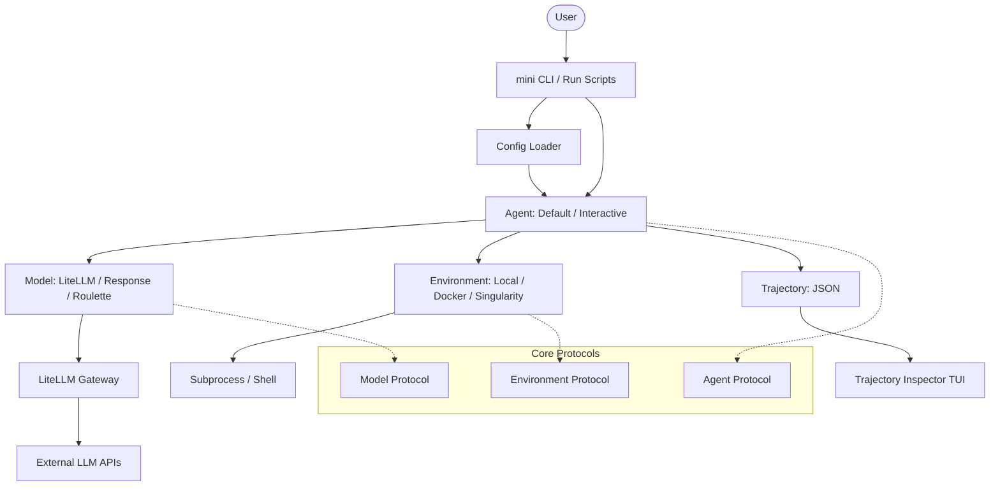

I will read the instructions in `.prompt.md` to understand the task.
I will check the size of `.input.mini-swe-agent.xml` to determine how to proceed with the analysis.
I will read the beginning of `.input.mini-swe-agent.xml` to understand its structure and content.
I'll find the git log to identify the project name and the last commit date.
I'll search for `<git_log_commit/>` within `.input.mini-swe-agent.xml` to find the project name and last commit date.
I'll search for `<git_log>` or `commit` in `.input.mini-swe-agent.xml` or look at the end of the file for the git logs.
I'll search for `pyproject.toml` and `README.md` in the input file to gather more information about the project.
I'll find and read `README.md` to get more details about the project.
I'll list the `src` directory to get a more comprehensive overview of the project's source code structure.
I'll read the directory structure from `.input.mini-swe-agent.xml` to locate the source files.
I'll start by reading `src/minisweagent/__init__.py` to understand the project's protocols and base classes.
I'll search for the content of `src/minisweagent/__init__.py` within `.input.mini-swe-agent.xml` by using `grep_search` to find the corresponding file path tag.
I'll continue reading `src/minisweagent/agents/default.py` to understand the agent's loop logic and control flow.
I've gathered a substantial amount of information and will now perform a final check of the file contents, specifically looking for any additional "AI skills" mentioned in the README files, before finalizing the report.
Analysis of the **mini-swe-agent** repository based on the provided export.

### 1. Project Name and Last Commit Date
*   **Project Name:** mini-swe-agent
*   **Last Commit Date:** Friday, April 17, 2026, 00:30:22 -0400 (Ref: First `<git_log_commit/>` in `.input.mini-swe-agent.xml`)

### 2. Project Description
**mini-swe-agent** is a radically simplified, high-performance AI software engineering agent designed to solve GitHub issues and complex programming tasks with minimal overhead. Created by the team behind SWE-bench and the original SWE-agent, it focuses on a "minimalist" philosophy, providing an agent scaffold that is roughly 100 lines of code. It prioritizes readability and hackability, making it an ideal choice for researchers, developers, and teams building on top of Large Language Models (LLMs).

The core architecture is built around a stateless, linear loop where the agent interacts with its environment exclusively through a standard bash shell. Unlike more complex agents that rely on stateful shell sessions or custom tool-calling interfaces, `mini` executes each action as an independent subprocess. This design eliminates common stability issues associated with long-running shell states and ensures that the agent's trajectory is perfectly aligned with the model's message history, facilitating easier debugging and fine-tuning.

The project is highly versatile, supporting a wide range of execution environments—from local systems to sandboxed Docker containers and high-performance computing (HPC) clusters using Singularity. By leveraging **LiteLLM**, it provides a unified interface to hundreds of language models (OpenAI, Anthropic, Gemini, etc.), allowing users to easily switch between models or even use a "roulette" strategy to boost performance by randomly alternating between top-tier models like GPT-5 and Claude 3.5 Sonnet.

### 3. Supported Platforms/Deployments + Requirements
*   **Local Execution:** Running bash commands directly on the host machine. (Ref: `src/minisweagent/environments/local.py`)
*   **Docker/Podman:** Sandboxed execution within containers for security and reproducibility. (Ref: `src/minisweagent/environments/docker.py`)
*   **Singularity/Apptainer:** Support for high-performance computing (HPC) environments. (Ref: `src/minisweagent/environments/singularity.py`)
*   **Bubblewrap:** Unprivileged Linux sandboxing. (Ref: `src/minisweagent/environments/extra/bubblewrap.py`)
*   **Contree:** Specialized high-performance sandboxing. (Ref: `src/minisweagent/environments/extra/contree.py`)
*   **Modal:** Cloud-based execution for scalable runs. (Ref: `src/minisweagent/environments/extra/swerex_modal.py`)
*   **Requirements:** Python >= 3.10. (Ref: `pyproject.toml`)

### 4. Supported Connectors to Apps/APIs/Messengers
*   **Bash Shell:** The primary "tool" used for all code manipulation, exploration, and testing. (Ref: `src/minisweagent/environments/local.py`)
*   **LiteLLM:** Universal connector for 100+ LLM APIs. (Ref: `src/minisweagent/models/litellm_model.py`)
*   **OpenRouter:** Aggregator for accessing various model providers via a single API. (Ref: `src/minisweagent/models/openrouter_model.py`)
*   **Portkey:** AI gateway for observability, routing, and caching. (Ref: `src/minisweagent/models/portkey_model.py`)
*   **Requesty:** Connector for Requesty's model API. (Ref: `src/minisweagent/models/requesty_model.py`)
*   **GitHub:** Integration via issue URLs and repository cloning in run scripts. (Ref: `src/minisweagent/run/benchmarks/swebench_single.py`)
*   **HuggingFace Datasets:** Used for loading benchmarks like SWE-bench. (Ref: `src/minisweagent/run/benchmarks/swebench.py`)

### 5. Supported Models/Agents
*   **Models:**
    *   **LiteLLM Models:** GPT-4o, Claude 3.5 Sonnet, Gemini 1.5 Pro, etc. (Ref: `src/minisweagent/models/litellm_model.py`)
    *   **OpenAI Responses API:** Models using structured output endpoints. (Ref: `src/minisweagent/models/litellm_response_model.py`)
    *   **Roulette Model:** A strategy that randomly picks from a list of models to improve task success. (Ref: `src/minisweagent/models/extra/roulette.py`)
*   **Agents:**
    *   **DefaultAgent:** Simple linear-loop autonomous agent. (Ref: `src/minisweagent/agents/default.py`)
    *   **InteractiveAgent:** Human-in-the-loop agent with "confirm", "human", and "yolo" modes. (Ref: `src/minisweagent/agents/interactive.py`)

### 6. Top 5 Use Cases
1.  **Autonomous Bug Fixing:** Solving real-world GitHub issues by providing an issue URL; the agent clones the repo, identifies the bug, applies a fix, and verifies it with tests.
2.  **Benchmark Evaluation:** Running large-scale evaluations on SWE-bench or other coding benchmarks using parallel workers in sandboxed environments.
3.  **Local Development Assistant:** A CLI-based "copilot" that can execute complex multi-step refactorings or codebase explorations directly on a developer's machine.
4.  **Fine-Tuning/RL Baseline:** A minimal, stable agent scaffold used as a foundation for training new language models on software engineering tasks.
5.  **Secure Code Exploration:** Safely exploring and understanding unknown codebases within a sandboxed Docker or Bubblewrap environment.

### 7. Top 20 Features
1.  **Stateless Action Execution:** Each command runs in a fresh subprocess, preventing shell state corruption. (`src/minisweagent/environments/local.py`)
2.  **Linear Trajectory History:** Every step is simply appended to the message list, mirroring the LM's context. (`src/minisweagent/agents/default.py`)
3.  **Bash-Only Tooling:** Eliminates complex tool-calling protocols; uses standard shell commands. (`src/minisweagent/agents/default.py`)
4.  **Multi-Environment Support:** Seamless switching between Local, Docker, and HPC environments. (`src/minisweagent/environments/`)
5.  **Interactive Supervision:** Human-in-the-loop mode for reviewing and confirming agent actions. (`src/minisweagent/agents/interactive.py`)
6.  **Trajectory Inspector TUI:** A Textual-based UI for visualizing and debugging agent runs. (`src/minisweagent/run/utilities/inspector.py`)
7.  **LiteLLM Bridge:** Instant support for hundreds of proprietary and open-source models. (`src/minisweagent/models/litellm_model.py`)
8.  **Structured Output Integration:** Support for OpenAI-style tool-calling and response APIs. (`src/minisweagent/models/litellm_response_model.py`)
9.  **Parallel Worker Benchmark Runner:** Efficiently running many tasks simultaneously. (`src/minisweagent/run/benchmarks/swebench.py`)
10. **YAML-driven Configuration:** Fully customizable agent and model behaviors via config files. (`src/minisweagent/run/utilities/config.py`)
11. **Real-time Cost Monitoring:** Tracks API usage costs and enforces hard limits. (`src/minisweagent/agents/default.py`)
12. **Automatic Trajectory Persistence:** Saves full run details to JSON for audit and replay. (`src/minisweagent/agents/default.py`)
13. **Model Roulette Strategy:** Improves success rates by diversifying model usage. (`src/minisweagent/models/extra/roulette.py`)
14. **Bubblewrap Sandboxing:** Secure Linux execution without requiring root privileges. (`src/minisweagent/environments/extra/bubblewrap.py`)
15. **Anthropic Cache Control:** Support for prompt caching headers to reduce costs and latency. (`src/minisweagent/models/utils/cache_control.py`)
16. **Multimodal Capability:** Ready-to-use infrastructure for vision and multimodal inputs. (`src/minisweagent/models/utils/openai_multimodal.py`)
17. **Rich Terminal Output:** Beautifully formatted logs and progress trackers using `rich`. (`src/minisweagent/utils/log.py`)
18. **Configurable Prompt Templates:** Uses Jinja2 for dynamic system and task instructions. (`src/minisweagent/agents/default.py`)
19. **Global Config Management:** Simple setup for API keys and default settings. (`src/minisweagent/run/utilities/config.py`)
20. **Dynamic Class Loading:** Load agents and models via string specifications in YAML. (`src/minisweagent/agents/__init__.py`)

### 8. Top 20 Smart Patterns
1.  **Polymorphic Protocol-based Design:** Using `Protocol` for core components (Model, Environment, Agent) to allow flexible extensions. (`src/minisweagent/__init__.py`)
2.  **Stateless Command Execution:** Running each bash command independently to avoid "sticky" environment variables or broken shells. (`src/minisweagent/environments/local.py`)
3.  **Linear Context Mapping:** The trajectory is the history, making debugging and fine-tuning data generation trivial. (`src/minisweagent/agents/default.py`)
4.  **Custom Structured Action Tags:** Using specific delimiters (e.g., `mswea_bash_command`) for robust parsing of shell commands. (`src/minisweagent/models/utils/actions_text.py`)
5.  **Recursive Configuration Merging:** Allowing deep overrides of configuration from global to task-specific levels. (`src/minisweagent/utils/serialize.py`)
6.  **Duck-Typing for Extensibility:** Favoring protocol compliance over rigid inheritance. (`src/minisweagent/__init__.py`)
7.  **Tenacious API Retries:** Robust handling of rate limits and transient API failures. (`src/minisweagent/models/utils/retry.py`)
8.  **Jinja2 Template Injection:** Using a powerful templating engine for all prompts. (`src/minisweagent/agents/default.py`)
9.  **Environment Wrapper Pattern:** Adding functionality like logging by wrapping environment instances. (`src/minisweagent/environments/__init__.py`)
10. **Interrupt-Resistant Loops:** Graceful handling of Ctrl+C in interactive sessions. (`src/minisweagent/agents/interactive.py`)
11. **Model-Agnostic Execution:** The agent scaffold works identically regardless of the underlying LLM. (`src/minisweagent/agents/default.py`)
12. **Safe Recursive Serialization:** Handling nested configurations and trajectory data without circular references. (`src/minisweagent/utils/serialize.py`)
13. **Slash Commands in TUI:** Providing a fast way for humans to switch agent modes (e.g., `/u`, `/c`, `/y`). (`src/minisweagent/agents/interactive.py`)
14. **Content String Abstraction:** Uniformly handling text, tool calls, and multimodal content. (`src/minisweagent/models/utils/content_string.py`)
15. **Strategy-based Model Selection:** Implementing the Roulette pattern as a pluggable model class. (`src/minisweagent/models/extra/roulette.py`)
16. **Live Progress Rendering:** Using Textual and Rich to provide high-fidelity feedback during long runs. (`src/minisweagent/run/benchmarks/utils/batch_progress.py`)
17. **Global Configuration Auto-Setup:** Prompting the user for configuration if not found. (`src/minisweagent/run/utilities/config.py`)
18. **Deterministic Testing with Trajectory Replay:** Verifying the agent loop using pre-recorded model outputs. (`tests/run/test_local.py`)
19. **Cache-Aware API Calls:** Managing Anthropic-style cache markers to optimize token usage. (`src/minisweagent/models/utils/cache_control.py`)
20. **Uncaught Exception Handling:** Capturing and recording crash information directly into the trajectory JSON. (`src/minisweagent/agents/default.py`)

### 9. Top 20 Development Trends
1.  **Unification of Content Representation:** Recent commits show a push toward the `ContentString` abstraction for multimodal/tool support. (`src/minisweagent/models/utils/content_string.py`)
2.  **Expanding Secure Sandboxing:** Continued refinement of Bubblewrap and Contree environments. (`src/minisweagent/environments/extra/bubblewrap.py`)
3.  **Observability Integration:** Increasing support for gateways like Portkey. (`src/minisweagent/models/portkey_model.py`)
4.  **Benchmark Scaling:** Enhancements to the parallel benchmark runner and progress visualization. (`src/minisweagent/run/benchmarks/utils/batch_progress.py`)
5.  **Refining Interactive UX:** Better handling of user interruptions and slash commands. (`src/minisweagent/agents/interactive.py`)
6.  **Dependency Hardening:** Explicitly excluding compromised or buggy dependency versions. (`pyproject.toml`)
7.  **Standardized Coding Style:** Adoption of Cursor/Claude style rules. (`.cursor/rules/style.mdc`)
8.  **Automated Release Workflows:** Scripts for versioning and GitHub Actions integration. (`.github/bump_version.py`)
9.  **Support for Newest Frontier Models:** Quick adoption of GPT-5 and Claude 3.5 Sonnet features. (`README.md`)
10. **Documentation Maturity:** Shifting toward MkDocs with structured tutorials and cookbooks. (`docs/`)
11. **Cloud Execution Parity:** Ensuring Modal/Swerex environments behave exactly like local ones. (`src/minisweagent/environments/extra/swerex_modal.py`)
12. **Structured Output Optimization:** Better parsing for tool-calling models. (`src/minisweagent/models/utils/actions_toolcall.py`)
13. **Reducing Scaffolding Complexity:** Constant refactoring to keep the core agent classes small. (`src/minisweagent/agents/default.py`)
14. **Improving Error Diagnostics:** Detailed exception logging in trajectories. (`src/minisweagent/run/benchmarks/swebench.py`)
15. **HPC Compatibility:** Maintaining first-class support for Singularity/Apptainer. (`src/minisweagent/environments/singularity.py`)
16. **User-Centric Configuration:** Moving toward interactive setup wizards. (`src/minisweagent/run/utilities/config.py`)
17. **Performance Monitoring:** Adding cost and token usage tracking to all model calls. (`src/minisweagent/models/litellm_model.py`)
18. **Prompt Engineering for Benchmarks:** Iterative tuning of `swebench` specific templates. (`src/minisweagent/config/benchmarks/`)
19. **Community-Driven Extensions:** Integrating "extra" environments and models from contributors. (`src/minisweagent/environments/extra/`)
20. **Linear History Rigor:** Ensuring that even complex tool-calling models maintain a linear message history. (`src/minisweagent/models/litellm_response_model.py`)

### 10. Top 10 Advantages
1.  **Radical Simplicity:** The codebase is small enough to be understood in an hour.
2.  **Extreme Stability:** Stateless shell execution avoids the "dirty shell" syndrome.
3.  **High Performance:** Consistently ranks among the top open-source agents on SWE-bench.
4.  **Universal Compatibility:** Works with any shell and any LLM (via LiteLLM).
5.  **Developer-Friendly:** Designed as a hackable tool rather than a black-box service.
6.  **Scalability:** Built-in support for parallel workers and cloud environments (Modal).
7.  **Excellent Debugging:** Linear trajectories are easy to inspect and replay.
8.  **Low Latency:** Minimal overhead results in faster execution than Claude Code or SWE-agent.
9.  **Security-First:** Multiple sandboxing options are built-in from the start.
10. **Research Pedigree:** Built by the world-class team behind the foundational SWE-bench.

### 11. Top 10 Limitations
1.  **Bash-Centricity:** Highly dependent on the model's proficiency with shell commands.
2.  **Stateless Execution Overhead:** Slight performance penalty for starting new subprocesses for every command.
3.  **Minimal Native Tooling:** Relies on the model installing what it needs via bash (e.g., no built-in web browser).
4.  **Alpha Status:** APIs and configurations are still evolving and may break.
5.  **Limited Long-Term Memory:** Lacks built-in RAG or persistent vector stores (left to the model/bash).
6.  **Single-Agent Design:** Not natively built for multi-agent coordination.
7.  **UI is Terminal-Only:** The inspector is a TUI, which may not appeal to non-technical users.
8.  **Dependency on LiteLLM:** Inherits the stability and rate-limiting behaviors of LiteLLM.
9.  **No Built-in PR Management:** Focuses on generating patches rather than high-level GitHub workflow management.
10. **Python Dependency:** The core runner and bindings are Python-only.

### 12. Top 5 Used and Top 5 Provided AI Skills
*   **Top 5 Used Skills (capabilities used by the agent):**
    1.  **Shell Scripting & Automation:** Executing multi-step bash workflows.
    2.  **Codebase Exploration:** Using `ls`, `grep`, and `find` to map repository structures.
    3.  **File Patching:** Using `sed`, `cat`, and redirections to modify source code.
    4.  **Automated Testing:** Running and interpreting results from test suites.
    5.  **Git Management:** Handling cloning, branching, and diffing.
*   **Top 5 Provided Skills (modules providing specialized intelligence):**
    1.  **Structured Action Parsing:** Converting LLM text into precise executable commands. (`src/minisweagent/models/utils/actions_text.py`)
    2.  **Safe Environment Provisioning:** Dynamic setup of Docker or Singularity sandboxes. (`src/minisweagent/environments/`)
    3.  **Trajectory Serialization & Replay:** Managing the lifecycle of agent "memory" (trajectories). (`src/minisweagent/utils/serialize.py`)
    4.  **Intelligent Model Routing:** The Roulette strategy for optimal model selection. (`src/minisweagent/models/extra/roulette.py`)
    5.  **Human-Agent Coordination:** Logic for mode-switching and confirmation prompts. (`src/minisweagent/agents/interactive.py`)

### 13. Data Inputs, Outputs, and Storage Overview
*   **Inputs:** Task descriptions (text), GitHub Issue URLs, Local repositories, YAML Configs.
*   **Outputs:** Trajectory JSON files (logs of all thoughts and actions), Diffs (patches for fixes), Rich terminal logs.
*   **Storage:** 
    *   **Local Filesystem:** For trajectories, logs, and temporary working directories.
    *   **Global Config:** `~/.config/mini-swe-agent` for API keys and global settings. (`src/minisweagent/__init__.py`)
    *   **HuggingFace:** For fetching benchmark datasets like SWE-bench. (`src/minisweagent/run/benchmarks/swebench.py`)

### 14. Detailed Architecture Review (Top 20 Modules)
1.  **`src/minisweagent/__init__.py`**: Core Protocols and global configuration management.
2.  **`src/minisweagent/agents/default.py`**: The central autonomous loop implementation.
3.  **`src/minisweagent/agents/interactive.py`**: Human-in-the-loop logic and slash commands.
4.  **`src/minisweagent/environments/local.py`**: Direct subprocess execution on the host.
5.  **`src/minisweagent/environments/docker.py`**: Native Docker container execution.
6.  **`src/minisweagent/models/litellm_model.py`**: Main bridge to the LiteLLM library.
7.  **`src/minisweagent/models/litellm_response_model.py`**: Support for OpenAI's structured response API.
8.  **`src/minisweagent/run/mini.py`**: The primary CLI entry point (`mini`).
9.  **`src/minisweagent/run/benchmarks/swebench.py`**: Parallel runner for large benchmarks.
10. **`src/minisweagent/run/utilities/config.py`**: Interactive setup and global config management.
11. **`src/minisweagent/run/utilities/inspector.py`**: The Trajectory Inspector TUI.
12. **`src/minisweagent/models/utils/actions_text.py`**: Parsing bash commands from raw text.
13. **`src/minisweagent/models/utils/content_string.py`**: Message content abstraction layer.
14. **`src/minisweagent/utils/serialize.py`**: Recursive merging and JSON serialization helpers.
15. **`src/minisweagent/utils/log.py`**: Centralized logging system using `rich`.
16. **`src/minisweagent/environments/extra/bubblewrap.py`**: Secure unprivileged sandboxing.
17. **`src/minisweagent/models/extra/roulette.py`**: Multi-model strategy implementation.
18. **`src/minisweagent/run/benchmarks/utils/batch_progress.py`**: Real-time progress tracking for benchmarks.
19. **`src/minisweagent/config/`**: Repository of default YAML configuration templates.
20. **`src/minisweagent/exceptions.py`**: Unified project-wide exception handling.

### 15. Mermaid Graph of Architecture

### 16. Project Review: Maturity, Stability, Security, Performance
*   **Maturity:** Alpha stage. Rapidly evolving with a strong focus on minimalist stability.
*   **Stability:** High for the core execution loop. The stateless design makes it very resilient.
*   **Security:** Strong foundations with Docker, Singularity, and Bubblewrap support.
*   **Performance:** Excellent. Minimal scaffold overhead leads to fast agent response times.

### 17. Review of Tests, CI, Documentation, and Skills
*   **Tests:** Robust `pytest` suite with high coverage. Includes integration tests with real environments. (Ref: `tests/`)
*   **CI:** GitHub Actions for automated linting, testing, and releases. (Ref: `.github/workflows/`)
*   **Documentation:** High quality. Includes a dedicated documentation site with tutorials and cookbooks. (Ref: `docs/`)
*   **Skills:** Strong "agentic" capabilities provided by the polymorphic environment and model modules.

### 18. Top 20 Possible Improvements
1.  **Native Web Search Tool:** Native bridge for more robust internet access.
2.  **Persistent Shell Option:** Optional stateful sessions for specific workflows.
3.  **Enhanced TUI Editing:** Allow manual editing of trajectories in the inspector. (`src/minisweagent/run/utilities/inspector.py`)
4.  **Automatic Environment Detection:** Intelligent selection of the best available sandbox.
5.  **Vector Store Integration:** Built-in RAG for large-scale repo search.
6.  **Multi-Agent Orchestration:** Framework for agent swarms.
7.  **PowerShell Support:** Support for Windows-native environments.
8.  **Trajectory Replay with Intervention:** Ability to resume an agent from any point in a trajectory.
9.  **Visual Debugger:** A web-based graph view of the agent's decision tree.
10. **Fine-tuning Data Exporter:** One-click conversion of trajectories to training formats.
11. **Cost Prediction:** Estimating task costs before execution.
12. **Context Compression:** Intelligent truncation of long histories.
13. **Native GitHub PR Integration:** Handling the full PR lifecycle via API.
14. **Local Model First-Class Support:** Easier integration with Ollama/vLLM.
15. **Strategy-based Model Selection:** More advanced Roulette logic (e.g., based on error types).
16. **Audit Trails for Interactive Mode:** Detailed logging of human interventions.
17. **Standardized Tool Definition API:** Easier way to add non-bash tools.
18. **Automated Verification Heuristics:** Smarter logic to determine if a fix is correct.
19. **Collaborative Trajectories:** Allowing multiple users to work on the same agent run.
20. **Voice Control Bridge:** Integrating voice-to-command for the interactive mode.

### 19. Top 10 Reusable Modules for Agent Swarms
1.  **`src/minisweagent/agents/__init__.py`**: Dynamic agent factory.
2.  **`src/minisweagent/__init__.py`**: Protocol definitions for role-based agents.
3.  **`src/minisweagent/models/extra/roulette.py`**: Consensus/selection logic between agents.
4.  **`src/minisweagent/utils/serialize.py`**: Knowledge sharing and state synchronization.
5.  **`src/minisweagent/run/utilities/config.py`**: Complex multi-agent configuration management.
6.  **`src/minisweagent/agents/interactive.py`**: Human "arbitrator" interface.
7.  **`src/minisweagent/models/utils/actions_text.py`**: Standardized inter-agent communication format.
8.  **`src/minisweagent/environments/`**: Independent sandboxes for each swarm member.
9.  **`src/minisweagent/utils/log.py`**: Coordinated logging for multiple agents.
10. **`src/minisweagent/run/benchmarks/utils/batch_progress.py`**: Monitoring swarm-wide progress.

### 20. Top 10 Reusable Modules for Shared Knowledge Base
1.  **`src/minisweagent/utils/serialize.py`**: Core logic for merging updates into a shared state.
2.  **`src/minisweagent/agents/default.py`**: Base for graph-based knowledge evolution.
3.  **`src/minisweagent/models/utils/content_string.py`**: Uniform handling of markdown/media in the KB.
4.  **`src/minisweagent/config/`**: Standard templates for knowledge initialization.
5.  **`src/minisweagent/run/utilities/inspector.py`**: Visualization logic for the shared KB.
6.  **`src/minisweagent/environments/local.py`**: Filesystem persistence layer.
7.  **`src/minisweagent/__init__.py`**: Global config directory as a persistent store.
8.  **`src/minisweagent/models/utils/cache_control.py`**: Optimizing KB access in LLM prompts.
9.  **`src/minisweagent/utils/log.py`**: Collaborative edit history/audit log.
10. **`src/minisweagent/run/mini.py`**: CLI for knowledge base interaction.

### 21. Top 10 Reusable Modules for Hardware/Cloud/Messenger Deployment
1.  **`src/minisweagent/environments/extra/bubblewrap.py`**: Secure execution on personal hardware.
2.  **`src/minisweagent/environments/extra/swerex_modal.py`**: Cloud-scale execution logic.
3.  **`src/minisweagent/models/litellm_model.py`**: Connectivity regardless of deployment target.
4.  **`src/minisweagent/agents/interactive.py`**: Interaction loop suitable for messenger interfaces.
5.  **`src/minisweagent/run/utilities/inspector.py`**: Visualization foundation for web/native apps.
6.  **`src/minisweagent/models/utils/openai_multimodal.py`**: Handling voice/image from native apps.
7.  **`src/minisweagent/run/mini.py`**: core CLI/service logic.
8.  **`src/minisweagent/utils/log.py`**: Message formatting for varied output channels.
9.  **`src/minisweagent/config/mini.yaml`**: Pre-configured environment profiles.
10. **`src/minisweagent/agents/utils/prompt_user.py`**: Asynchronous input handling.

### 22. Top 10 Reusable Modules for Team Agents
1.  **`src/minisweagent/agents/interactive.py`**: The core human/agent cooperation bridge.
2.  **`src/minisweagent/agents/utils/prompt_user.py`**: Multi-input prompt handling.
3.  **`src/minisweagent/run/utilities/inspector.py`**: Real-time progress sharing for teams.
4.  **`src/minisweagent/__init__.py`**: Protocols for cooperative agent roles.
5.  **`src/minisweagent/models/utils/actions_text.py`**: standardizing team communication protocols.
6.  **`src/minisweagent/utils/serialize.py`**: Merging contributions from team members.
7.  **`src/minisweagent/run/benchmarks/utils/batch_progress.py`**: Coordinating team-wide goals.
8.  **`src/minisweagent/environments/`**: Shared sandboxes for team collaboration.
9.  **`src/minisweagent/models/extra/roulette.py`**: Assigning specific models to specialized team roles.
10. **`src/minisweagent/utils/log.py`**: Consolidated audit trail for team interactions.
