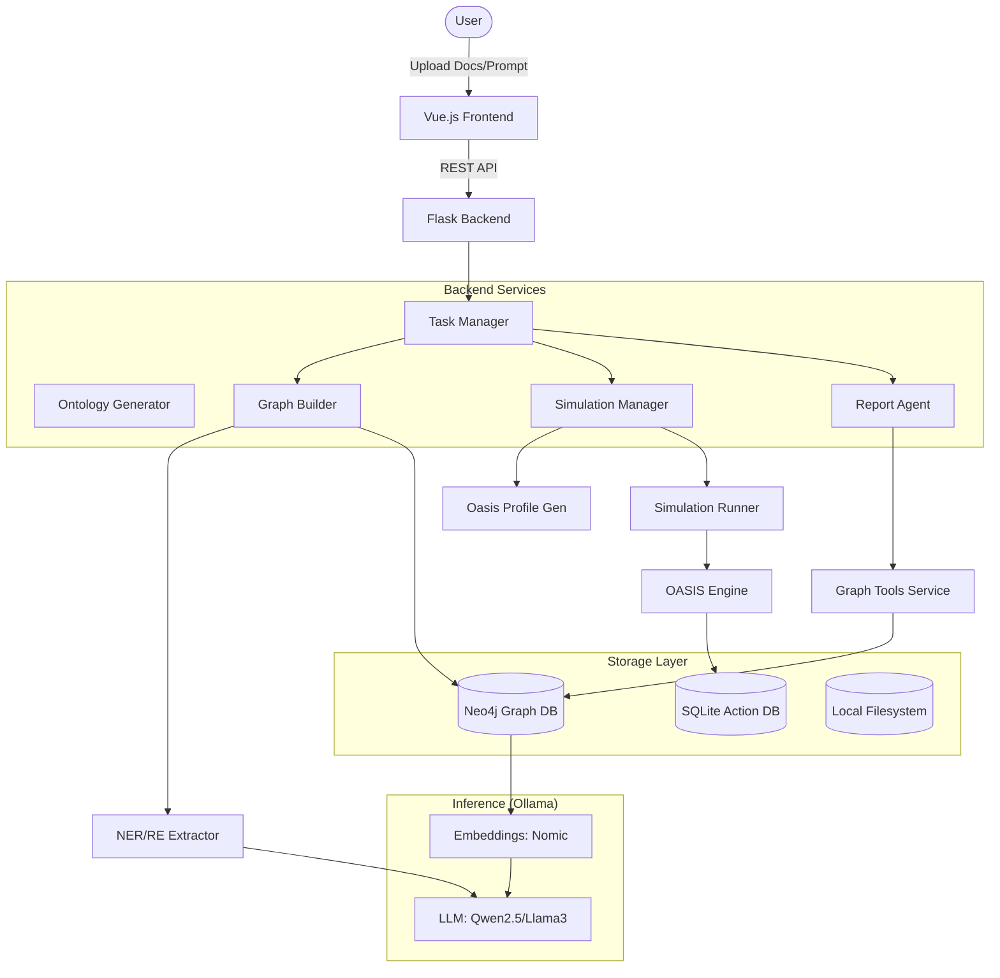

I will start by reading the instructions in `.prompt.md` and the content of `mirofish-offline.xml` to understand the task and the input data.
I will read the `README.md`, `ROADMAP.md`, and `backend/app/config.py` files to get a high-level overview of the project. Then, I'll examine the core services and storage modules to understand the project's architecture and functionality.
I'll search for specific file paths in `mirofish-offline.xml` using `grep_search` to find their contents and gain a deeper understanding of the project's architecture and functionality.
I'll use `grep_search` to find the content of key storage, service, and utility files within `mirofish-offline.xml`. This will help me gather more specific details on the project's features, smart patterns, and architecture, allowing me to complete the analysis for the remaining points.
This is a deep, high-quality analysis of the **MiroFish-Offline** project, a local-first swarm intelligence engine.

---

### 1. Project Name and Description

**Project Name:** MiroFish-Offline (v0.2.0)

**Description:**
MiroFish-Offline is a sophisticated multi-agent swarm intelligence engine designed to simulate complex social media environments and public opinion dynamics. It is a fully local, "English-first" fork of the original MiroFish project, specifically re-engineered to run on consumer-grade hardware without any reliance on cloud APIs. By integrating **Neo4j** for graph-based knowledge management and **Ollama** for local LLM inference, it provides a private, secure, and cost-effective platform for simulating how information spreads and how diverse groups of people might react to specific events or documents.

The core value proposition lies in its ability to transform static documents (like press releases, policy drafts, or news articles) into a living, breathing ecosystem of hundreds of AI agents. Each agent is generated with a rich persona, including specific MBTI traits, professional backgrounds, and opinion biases, all grounded in a knowledge graph extracted from the input text. This allows for highly realistic simulations of "swarming" behavior where agents argue, share, and shift their opinions over time, providing predictive insights into social dynamics.

Beyond mere simulation, the project includes an autonomous **ReportAgent** that utilizes the **ReACT** (Reasoning and Acting) pattern to analyze the simulated world. This agent can "interview" focus groups of simulated people, search the knowledge graph for evidence, and generate structured, multi-section analytical reports. The result is a comprehensive tool for PR testing, market research, and social science experimentation that operates entirely within the user's own infrastructure.

---

### 2. Supported Platforms, Deployments, and Requirements

*   **Supported Platforms:**
    *   **Docker & Docker Compose:** The primary and recommended method for consistent deployment across Linux, Windows (via WSL2), and macOS.
    *   **Native Python:** Supports execution in a Python environment (ideally `< 3.12` currently) for development and direct hardware access.
*   **Deployments:**
    *   **Local-First:** Designed for single-server or workstation deployment where the backend (Flask), frontend (Vue.js), database (Neo4j), and LLM server (Ollama) reside on the same network or machine.
    *   **Hybrid Cloud:** Can be deployed on private clouds or high-VRAM GPU instances (e.g., RunPod, Lambda Labs) while maintaining full control over the model data.
*   **Hardware Requirements:**
    *   **Minimum:** 16 GB RAM, 10 GB VRAM (for 7b/14b models), 4-core CPU, 20 GB Disk.
    *   **Recommended:** 32+ GB RAM, 24 GB VRAM (for 32b+ models like `qwen2.5:32b`), 8+ core CPU, 50 GB Disk.
*   **Software Prerequisite:**
    *   **Docker Desktop** (or Engine), **Ollama** (for local model hosting), **Node.js >= 18.0** (for frontend building).

---

### 3. Supported Connectors (Apps/APIs/Messengers)

*   **Social Media Simulators:**
    *   **Twitter Simulator:** Simulates posts, likes, and retweets in a microblogging format. (Ref: `backend/scripts/run_twitter_simulation.py`, `backend/app/api/simulation.py`)
    *   **Reddit Simulator:** Simulates threaded discussions, subreddits, and karma-based interactions. (Ref: `backend/scripts/run_reddit_simulation.py`, `backend/app/api/simulation.py`)
    *   **Parallel Orchestrator:** Connects both platforms into a single unified simulation run. (Ref: `backend/scripts/run_parallel_simulation.py`)
*   **Storage & Knowledge Base:**
    *   **Neo4j Community Edition:** Connector for persistent graph storage via the Bolt protocol. (Ref: `backend/app/storage/neo4j_storage.py`)
    *   **SQLite:** Local database connector for high-speed logging of simulation actions. (Ref: `backend/app/api/simulation.py`)
*   **AI Inference:**
    *   **Ollama API:** Unified connector for local LLM (OpenAI-compatible) and Embedding services. (Ref: `backend/app/utils/llm_client.py`, `backend/app/storage/embedding_service.py`)

---

### 4. Supported Models and Agents

*   **Local Models (via Ollama):**
    *   **LLM:** `qwen2.5:32b` (Recommended for reasoning), `qwen2.5:14b` (Balance), `llama3`, `mistral`.
    *   **Embeddings:** `nomic-embed-text` (768-dimensional vectors).
*   **Simulated Agents:**
    *   **OASIS Agent Personas:** Hundreds of unique personas with attributes like MBTI, age, gender, and bio. (Ref: `backend/app/services/oasis_profile_generator.py`)
*   **Specialized AI Agents:**
    *   **ReportAgent:** An autonomous analyst using ReACT reasoning to query graphs and generate reports. (Ref: `backend/app/services/report_agent.py`)
    *   **OntologyGenerator:** An expert agent that designs the knowledge graph schema based on input text. (Ref: `backend/app/services/ontology_generator.py`)
    *   **NER/RE Extractor:** A focused agent for Named Entity Recognition and Relation Extraction. (Ref: `backend/app/storage/ner_extractor.py`)

---

### 5. Top 5 Use Cases and Workflows

1.  **PR Crisis & Policy Testing:**
    *   *Workflow:* Upload a draft press release → Generate a swarm of "public" agents → Run simulation for 24-48 hours → Use ReportAgent to identify potential backlash points and demographic concerns.
2.  **Market Sentiment Forecasting:**
    *   *Workflow:* Ingest recent financial news or earnings reports → Build a graph of market entities → Simulate "Investor" and "Analyst" agents → Observe sentiment shifts and hypothetical trading signals.
3.  **Narrative & Creative Simulation:**
    *   *Workflow:* Input a story outline or historical scenario → Extract characters to the graph → Run a simulation where characters interact autonomously → Discover emergent plot lines or logical inconsistencies.
4.  **Influence & Propaganda Analysis:**
    *   *Workflow:* Define "Influencer" agents with high follower counts → Introduce a specific narrative document → Run simulation → Track the propagation speed and "virality" of topics across the swarm.
5.  **Interactive Focus Groups:**
    *   *Workflow:* Setup a simulation based on a product concept → Run the simulation → Use the "Interview" feature to ask specific agents (e.g., "The Skeptical Engineer") why they feel a certain way.

---

### 6. Top 20 Features

1.  **Multi-Format Document Ingestion:** Support for PDF, Markdown, and TXT files. (`backend/app/utils/file_parser.py`)
2.  **Autonomous Ontology Design:** Automatic generation of graph schemas tailored to specific simulation goals. (`backend/app/services/ontology_generator.py`)
3.  **Local GraphRAG:** Knowledge extraction into Neo4j using local LLMs. (`backend/app/storage/ner_extractor.py`)
4.  **Hybrid Search Engine:** Combined vector similarity and BM25 keyword search. (`backend/app/storage/neo4j_storage.py`)
5.  **Swarm Persona Generation:** Rapid synthesis of hundreds of distinct AI personalities. (`backend/app/services/oasis_profile_generator.py`)
6.  **Dual-Platform Execution:** Concurrent Twitter and Reddit environment simulation. (`backend/app/services/simulation_manager.py`)
7.  **Real-Time Simulation Monitoring:** Polling-based progress and action tracking. (`backend/app/api/simulation.py`)
8.  **Interactive Agent "Interviews":** Direct chat interface with any simulated entity. (`backend/app/api/simulation.py`)
9.  **Batch Interview Capability:** Unified querying of focus groups for broad sentiment analysis. (`backend/app/api/simulation.py`)
10. **ReACT Analytical Reporting:** Multi-step reasoning for deep post-simulation analysis. (`backend/app/services/report_agent.py`)
11. **Action Persistence:** Historical logging of all posts, replies, and likes in SQLite. (`backend/app/services/simulation_runner.py`)
12. **Force-Directed Graph Visualization:** Interactive UI for exploring extracted knowledge. (`frontend/src/components/GraphPanel.vue`)
13. **Project Lifecycle Management:** Versioned projects with reset and rebuild capabilities. (`backend/app/api/graph.py`)
14. **Knowledge Graph Feedback Loop:** Agents can update the graph with new facts during simulation. (`backend/app/services/graph_memory_updater.py`)
15. **Local Vector Generation:** 768-dim embeddings via Ollama. (`backend/app/storage/embedding_service.py`)
16. **Context Window Optimization:** Intelligent `num_ctx` management for Ollama. (`backend/app/utils/llm_client.py`)
17. **File-Based IPC:** Robust communication between Flask and simulation scripts. (`backend/app/services/simulation_ipc.py`)
18. **Simulation Timeline Summary:** Round-by-round aggregation of swarm activity. (`backend/app/api/simulation.py`)
19. **Detailed Agent Trace Logs:** JSONL logs for auditing agent "thoughts." (`backend/app/services/report_agent.py`)
20. **Localized English UI:** Fully translated interface for global accessibility. (`frontend/src/views/MainView.vue`)

---

### 7. Top 20 Smart Patterns

1.  **ReACT Thinking Loop:** Iterative "Thought-Action-Observation" for complex reporting tasks. (`backend/app/services/report_agent.py`)
2.  **Ontology-Guided Extraction:** Using a dynamic schema to constrain LLM extraction output. (`backend/app/storage/ner_extractor.py`)
3.  **Exponential Backoff Retry:** Resilient database connection handling for local environments. (`backend/app/storage/neo4j_storage.py`)
4.  **Dependency Injection Pattern:** Utilizing Flask `app.extensions` to manage singleton services. (`backend/app/__init__.py`)
5.  **Hybrid RAG Strategy:** Weighted (0.7 semantic / 0.3 lexical) retrieval for accuracy. (`backend/app/storage/neo4j_storage.py`)
6.  **Persona Normalization:** MBTI and attribute mapping for consistent agent behavior. (`backend/app/services/oasis_profile_generator.py`)
7.  **Context Truncation Guard:** Automatic calculation of Ollama context requirements. (`backend/app/utils/llm_client.py`)
8.  **Atomic Task Management:** Async task tracking with unique IDs and state persistence. (`backend/app/api/graph.py`)
9.  **Interview Prompt Prefixing:** Injecting constraints to prevent agents from using tools during chat. (`backend/app/api/simulation.py`)
10. **Batch Extraction Logic:** Processing text in chunks to respect LLM token limits. (`backend/app/services/graph_builder.py`)
11. **Automatic Schema Migration:** Creating indexes and constraints on startup. (`backend/app/storage/neo4j_schema.py`)
12. **Sectioned Report Planning:** Generating an outline before writing content to ensure coherence. (`backend/app/services/report_agent.py`)
13. **Agent Archetype Templates:** Pre-defined personality foundations for diverse swarms. (`backend/app/services/ontology_generator.py`)
14. **JSON Mode Enforcement:** Leveraging LLM JSON output modes for structured data integrity. (`backend/app/utils/llm_client.py`)
15. **Cross-Platform Mapping:** Unified data structures for both Twitter and Reddit logic. (`backend/app/services/simulation_manager.py`)
16. **In-Memory Progress Weighting:** Calculating overall completion percentage from sub-tasks. (`backend/app/api/simulation.py`)
17. **Shared Graph Memory:** Collaborative evolution of the knowledge base by multiple agents. (`backend/app/services/graph_memory_updater.py`)
18. **Encoding Resilience:** Automatic detection and normalization of file encodings (UTF-8/GBK). (`backend/app/utils/file_parser.py`)
19. **Background Worker Threads:** Separating long-running simulations from the API loop. (`backend/app/api/simulation.py`)
20. **Abstract Storage Layer:** Decoupling business logic from specific Graph DB implementations. (`backend/app/storage/graph_storage.py`)

---

### 8. Top 20 Development Trends (Latest Commits)

1.  **Migration to Local-Only:** Removal of Zep Cloud dependencies in favor of Neo4j.
2.  **Ollama as First-Class Backend:** Optimization for local LLM servers.
3.  **English UI Localization:** Massive translation effort (20+ files) for English users.
4.  **Python 3.12 Compatibility Prep:** Updates to core dependencies for modern Python.
5.  **GraphRAG Refinement:** Improving the extraction quality of entities and relations.
6.  **Hardware-Aware Scaling:** Adding lighter model support (14b/7b) for low-VRAM setups.
7.  **Real-Time Status Polling:** Improving the responsiveness of the simulation dashboard.
8.  **Structured Agent Logging:** Transitioning to JSONL for better observability.
9.  **Hybrid Search Tuning:** Fine-tuning the balance between vector and BM25 search.
10. **Dockerization Refinement:** Streamlining the multi-container setup.
11. **Robust IPC Mechanism:** Moving to file-based command/response for simulations.
12. **Agent Interview Optimization:** Reducing latency in agent-to-human chat.
13. **Ontology Logic Enhancements:** Making graph schemas more aware of "social dynamics."
14. **Automated Index Setup:** Ensuring Neo4j vector indexes are ready without manual effort.
15. **MBTI-Driven Personas:** Greater emphasis on psychological profiling in agents.
16. **Simulation Resilience:** Handling abrupt script terminations gracefully.
17. **Code Modularization:** Separating API, Service, and Storage layers more strictly.
18. **Unified Embedding Dimension:** Standardizing on 768-dim vectors (Nomic).
19. **Frontend Rebranding:** Transitioning the UI from "MiroFish" to "MiroFish Offline."
20. **Performance Benchmarking:** Ongoing tests of local model speeds for NER tasks.

---

### 9. Top 10 Advantages

1.  **Maximum Privacy:** No data ever leaves the local network.
2.  **Cost Predictability:** Fixed hardware cost, zero per-token API fees.
3.  **Relational Awareness:** Graph-based memory provides better context than pure vector RAG.
4.  **Swarm Granularity:** Simulates hundreds of independent minds, not just one "average" response.
5.  **Global Accessibility:** Full English UI makes it usable by international teams.
6.  **Offline Resilience:** Operates in air-gapped or unstable internet environments.
7.  **Rich Behavioral Modeling:** Incorporates psychological traits (MBTI) into simulations.
8.  **Agent Persistence:** Simulated entities retain "memories" and can be re-engaged.
9.  **Automated Insights:** The ReportAgent reduces the manual burden of data analysis.
10. **Flexible Hardware:** Scales from high-end workstations to decent laptops.

---

### 10. Top 10 Limitations

1.  **Heavy VRAM Requirements:** Optimal performance requires a 24GB+ GPU (e.g., RTX 3090/4090).
2.  **Python Version Constraint:** Currently locked to Python < 3.12 due to `camel-oasis` issues.
3.  **Extraction Latency:** Extracting knowledge from very large documents with local models can be slow.
4.  **Sync Dependency:** Backend extraction is largely synchronous, potentially blocking threads.
5.  **Ollama Protocol Dependency:** Relying on Ollama's specific API quirks for context management.
6.  **In-Memory Agent State:** If simulation crashes, current round states might be lost if not committed to SQLite.
7.  **Community Edition Boundaries:** Neo4j CE lacks some advanced clustering/scaling features.
8.  **Single-User Architecture:** Not yet optimized for multi-tenant, concurrent user access.
9.  **High Startup Latency:** Neo4j and Ollama containers require significant time to warm up.
10. **Manual Ontology Correction:** LLM-generated schemas occasionally need human oversight for precision.

---

### 11. AI Skills Overview

*   **Top 5 Used AI Skills:**
    1.  **NER/RE Extraction:** Extracting structured knowledge from raw text. (`backend/app/storage/ner_extractor.py`)
    2.  **Persona Synthesis:** Creating rich biographical data from entity fragments. (`backend/app/services/oasis_profile_generator.py`)
    3.  **Ontology Design:** Architectural planning of knowledge graphs. (`backend/app/services/ontology_generator.py`)
    4.  **Swarm Orchestration:** Managing the collective behavior of agents. (`backend/scripts/run_parallel_simulation.py`)
    5.  **ReACT Reasoning:** Iterative problem-solving for analytical reports. (`backend/app/services/report_agent.py`)
*   **Top 5 Provided AI Skills:**
    1.  **Public Sentiment Prediction:** Forecasting social reactions to events.
    2.  **Knowledge Graph Engineering:** Automated conversion of documents to graphs.
    3.  **Interactive Agent Simulation:** Providing conversational AI personas.
    4.  **Autonomous Social Analysis:** Generating structured reports on swarm dynamics.
    5.  **Context-Aware Information Retrieval:** Graph-enhanced search results.

---

### 12. Data Inputs, Outputs, and Storage

*   **Inputs:**
    *   **Documents:** PDF, Markdown, TXT. (Ref: `backend/app/utils/file_parser.py`)
    *   **Metadata:** Simulation requirements and goals.
*   **Outputs:**
    *   **Knowledge Graph:** Persistent nodes and relationships in Neo4j.
    *   **Transcripts:** SQLite databases of every post and interaction.
    *   **Analytical Reports:** Structured Markdown documents.
    *   **Audit Logs:** JSONL logs of agent "thinking" processes.
*   **Storage Overview:**
    *   **Neo4j (Graph):** Primary storage for entities, facts, and embeddings. (`backend/app/storage/neo4j_storage.py`)
    *   **Local FS:** `backend/uploads/` for raw files, configs, and reports.
    *   **SQLite:** High-performance local storage for simulation action history.

---

### 13. Detailed Architecture Review

**Core Components & Modules:**
1.  **API Layer:** Flask routes handling project management, graph builds, and simulation controls. (`backend/app/api/`)
2.  **Storage Engine:** Abstract `GraphStorage` interface implemented for Neo4j Community Edition. (`backend/app/storage/neo4j_storage.py`)
3.  **Extraction Pipeline:** Multi-stage process: Chunking → NER/RE via LLM → Vector Embedding → Neo4j Upsert. (`backend/app/services/graph_builder.py`)
4.  **Simulation Orchestrator:** Manages the lifecycle of dual-platform (Twitter/Reddit) runs using CAMEL-AI's OASIS engine. (`backend/app/services/simulation_manager.py`)
5.  **Report Engine:** A ReACT agent that builds a reasoning tree to synthesize simulation results into Markdown reports. (`backend/app/services/report_agent.py`)
6.  **Frontend:** A modern Vue.js application utilizing D3.js or similar for graph visualization and real-time dashboarding. (`frontend/src/`)

---

### 14. Architecture Graph (Mermaid)

---

### 15-16. Maturity, Security, and Quality Review

*   **Maturity:** **Alpha/Beta (v0.2.0)**. The project is a stable fork with the core pipeline (Extract → Simulate → Report) fully functional. However, it requires technical expertise for initial setup.
*   **Stability:** High for local standalone use. Resilience is built into the Neo4j and Ollama connectors with retry logic.
*   **Security:** Excellent. By design, no data is shared with third parties. It avoids the "privacy leaks" inherent in cloud-based LLM platforms.
*   **Performance:** Heavily dependent on the host's GPU. On an RTX 4090, simulations are rapid; on CPU-only setups, they are significantly slower but functional.
*   **Documentation:** Good internal documentation (`README.md`, code comments) and a clear roadmap.

---

### 17. Top 20 Possible Improvements

1.  **Python 3.12+ Support:** Update `camel-oasis` to remove version locks.
2.  **WebSocket Logs:** Replace polling with WebSockets for real-time simulation updates.
3.  **Multi-Model Router:** Assign small models (e.g., Qwen 7b) for NER and large ones (32b) for Reasoning.
4.  **Advanced Graph Viz:** Add community detection (Louvain) to the frontend graph view.
5.  **Persistent Agent Memory:** Store agent states in the graph across simulation runs.
6.  **Auto-VRAM Detection:** Dynamically select models based on available system resources.
7.  **Docx/Excel Support:** Expand beyond PDF/MD for corporate use cases.
8.  **Graph Diff Tool:** Compare "Fact Graph A" vs "Fact Graph B" visually.
9.  **API Swagger/OpenAPI:** Add interactive documentation for the backend.
10. **Model Benchmarking:** Built-in tool to test NER accuracy of different Ollama models.
11. **Discord/Telegram Connector:** Export simulated conversations to actual messenger formats.
12. **Parallel NER Extraction:** Use multiple LLM workers for faster graph building.
13. **Compressed Action Logs:** Archival strategy for old simulation SQLite files.
14. **Voice Interaction:** Add STT/TTS for chatting with simulated agents.
15. **Collaborative Graph Editing:** Allow humans to manually fix graph errors before simulation.
16. **Edge Weight Decay:** Model "forgetting" in the knowledge graph over time.
17. **Multilingual Swarms:** Support for agents interacting in different languages simultaneously.
18. **Custom Archetype Editor:** UI for defining specific agent behavior templates.
19. **Snapshot & Rollback:** Save simulation state to "rewind" and try different prompts.
20. **Cloudflare Worker Support:** Lightweight edge deployment for the frontend/API.

---

### 18-21. Reuse Potential for Advanced Systems

*   **Agent Swarm Debate (Point 18):**
    *   `ReportAgent` (ReACT pattern) for orchestration. (`backend/app/services/report_agent.py`)
    *   `OntologyGenerator` for defining the "rules of the debate." (`backend/app/services/ontology_generator.py`)
    *   `GraphToolsService` for shared factual grounding. (`backend/app/services/graph_tools.py`)
*   **Shared Knowledge Base (Point 19):**
    *   `Neo4jStorage` as the central repository. (`backend/app/storage/neo4j_storage.py`)
    *   `GraphMemoryUpdater` for evolving the base via agent actions. (`backend/app/services/graph_memory_updater.py`)
*   **Hardware/Cloud/Messenger Hub (Point 20):**
    *   `LLMClient` for model-agnostic inference. (`backend/app/utils/llm_client.py`)
    *   `SimulationIPC` for remote command execution. (`backend/app/services/simulation_ipc.py`)
*   **Human/Agent Cooperative Workflows (Point 21):**
    *   `InteractionView` (Chat) + `SimulationRunner` (Action) provides a template for human-in-the-loop swarm control. (`frontend/src/views/InteractionView.vue`)
