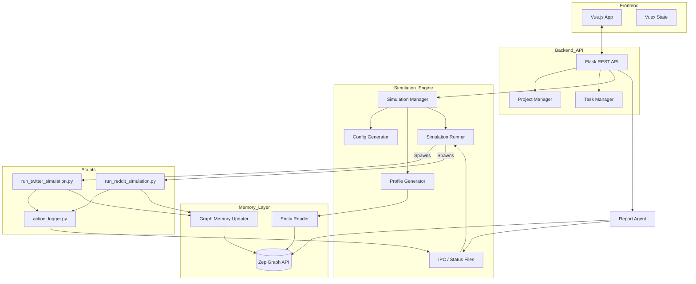

I will read the instructions from `.prompt.md` to understand how to process `mirofish.xml`.
I will read `mirofish.xml` to analyze the project and provide the requested high-quality answers.
I have analyzed the provided codebase in `mirofish.xml` and the project description. MiroFish appears to be a sophisticated social simulation and sentiment analysis platform that leverages Zep for graph-based memory and OASIS for agent simulation.

Here is the comprehensive review and analysis of the project.

---

# MiroFish Project Analysis

## 1. Project Name and Description
**MiroFish** is a cutting-edge social simulation and public opinion analysis platform designed to predict and analyze the spread of information and sentiment across digital landscapes. It integrates advanced Large Language Model (LLM) capabilities with graph-based memory systems to create realistic, autonomous agent populations that interact within simulated social environments like Twitter and Reddit.

The system works by ingesting raw documents (PDFs, Markdown, text) to build a project-specific ontology and a knowledge graph. Using **Zep** as its core memory engine, it maps entities, relationships, and historical contexts, which then serve as the foundation for generating detailed agent profiles. These agents are designed with specific roles, personas, and behavioral patterns derived from the source material, ensuring that the simulation is grounded in real-world data and expert knowledge.

MiroFish excels at "what-if" scenario planning. Users can define specific simulation requirements—such as the release of a controversial policy or a sudden crisis—and the system will autonomously generate a multi-round simulation. It provides deep analytical reports and interactive "interview" capabilities, allowing users to probe the simulated agents' motivations and predict potential real-world outcomes with high fidelity.

## 2. Supported Platforms & Deployments
- **Platforms:**
    - **Web-based Frontend:** Built with Vue.js 3 and Vite for a modern, responsive user experience.
    - **Python Backend:** Flask-based REST API handling simulation logic, graph processing, and agent management.
- **Deployments:**
    - **Docker:** Support for containerized deployment via `Dockerfile` and `docker-compose.yml`.
    - **GitHub Actions:** Automated CI/CD pipeline for building and pushing Docker images to GHCR.
- **Requirements:**
    - **Python 3.9+** (as seen in `pyproject.toml` and `.python-version` exclusions).
    - **Node.js & NPM** for frontend development and building.
    - **Zep API Key:** Required for graph memory and entity management.
    - **LLM API (OpenAI Compatible):** Supports Qwen (Alibaba Bailian), OpenAI, etc.

## 3. Supported Connectors
MiroFish integrates with several external services and internal modules to facilitate its simulation and memory functions:

- **Zep (Memory Graph):** Used for storing, retrieving, and updating entity relationships and simulation history.
    - *Source:* `backend/app/services/zep_tools.py`, `backend/app/services/zep_graph_memory_updater.py`
- **OASIS (Agent Simulation):** The underlying framework for defining and running agent behaviors.
    - *Source:* `backend/app/services/oasis_profile_generator.py`, `backend/app/services/simulation_runner.py`
- **Social Media Platforms (Simulated):**
    - **Twitter (X):** Simulated environment for microblogging interactions.
    - **Reddit:** Simulated environment for threaded discussions.
    - *Source:* `backend/scripts/run_twitter_simulation.py`, `backend/scripts/run_reddit_simulation.py`
- **LLM Providers:** Supports any OpenAI-compatible API (e.g., Alibaba DashScope/Qwen).
    - *Source:* `backend/app/utils/llm_client.py`

## 4. Supported Models & Agents
- **Local/Remote Models:** Primarily targets remote APIs via `LLM_BASE_URL` and `LLM_MODEL_NAME`. Recommended model is `qwen-plus`.
    - *Source:* `.env.example`, `backend/app/utils/llm_client.py`
- **Agent Types:**
    - **Simulation Agents:** Autonomous entities with generated profiles (e.g., Students, Public Figures, Critics) interacting in the simulation.
    - **Report Agent:** A specialized agent that synthesizes simulation data into structured reports.
    - *Source:* `backend/app/services/report_agent.py`, `backend/app/services/oasis_profile_generator.py`

## 5. Top 5 Use Cases
1.  **Crisis Management Simulation:** Ingest a crisis response plan and simulate public reaction to various management strategies to identify potential pitfalls.
2.  **Policy Impact Analysis:** Input a new government or corporate policy and observe how different demographic groups (simulated agents) discuss and react to it over time.
3.  **Brand Sentiment Forecasting:** Simulate the launch of a new product or marketing campaign to predict community sentiment on Reddit and Twitter.
4.  **Information Spread Modeling:** Analyze how a specific "seed" post or rumor propagates through a simulated network of agents with diverse viewpoints.
5.  **Interactive Stakeholder Interviewing:** After a simulation, "interview" key simulated agents (e.g., a simulated community leader) to understand the underlying drivers of their sentiment.

## 6. Top 20 Features
1.  **Automated Ontology Generation:** Extracts entity and edge types from raw documents. (`backend/app/services/ontology_generator.py`)
2.  **Zep Graph Integration:** Persistent storage of entity relationships. (`backend/app/api/graph.py`)
3.  **Asynchronous Simulation Execution:** Runs complex simulations in background processes. (`backend/app/services/simulation_manager.py`)
4.  **Real-time Status Monitoring:** Polling API for simulation progress. (`backend/app/api/simulation.py`)
5.  **Multi-Platform Simulation:** Parallel runs for Twitter and Reddit. (`backend/scripts/run_parallel_simulation.py`)
6.  **Agent Profile Synthesis:** LLM-driven generation of detailed personas. (`backend/app/services/oasis_profile_generator.py`)
7.  **Simulation Configuration Generator:** Intelligent setup of rounds, timing, and events. (`backend/app/services/simulation_config_generator.py`)
8.  **Comprehensive Analytical Reports:** Multi-section Markdown reports. (`backend/app/services/report_agent.py`)
9.  **Interactive Agent Interviews:** Post-simulation Q&A with simulated personas. (`backend/app/api/report.py`)
10. **Graph Memory Updating:** Real-time feedback loop from simulation to Zep graph. (`backend/app/services/zep_graph_memory_updater.py`)
11. **Text Preprocessing & Chunking:** Handling large input documents for graph building. (`backend/app/services/text_processor.py`)
12. **Project-based Context Management:** Isolated environments for different analysis tasks. (`backend/app/models/project.py`)
13. **Action Logging:** Detailed audit trail of all agent interactions. (`backend/scripts/action_logger.py`)
14. **Incremental Report Generation:** Real-time access to report sections as they are written. (`backend/app/api/report.py`)
15. **Multilingual Support:** i18n support in the frontend and locale-aware backend. (`backend/app/utils/locale.py`, `frontend/src/components/LanguageSwitcher.vue`)
16. **Task Management System:** Tracking long-running background tasks. (`backend/app/models/task.py`)
17. **File Extraction (PDF/TXT/MD):** Parsing various document formats. (`backend/app/utils/file_parser.py`)
18. **Simulation History Database:** Browsing and reviewing past simulations. (`frontend/src/components/HistoryDatabase.vue`)
19. **Graph Visualization:** Interactive panel for viewing the Zep graph. (`frontend/src/components/GraphPanel.vue`)
20. **Dockerized Environment:** Easy setup with Docker Compose. (`docker-compose.yml`)

## 7. Top 20 Smart Patterns
1.  **Ontology-Driven Extraction:** Using a pre-defined or LLM-generated schema to guide graph building. (`backend/app/services/ontology_generator.py`)
2.  **Parallel Agent Generation:** Scaling persona creation using multi-threading. (`backend/app/api/simulation.py`)
3.  **Retry Logic with Backoff:** Robustness for LLM and Zep API calls. (`backend/app/utils/retry.py`)
4.  **Agent Action Streaming:** Real-time logging and frontend display of simulation events. (`backend/app/services/simulation_ipc.py`)
5.  **Context-Aware Interviewing:** Injecting agent history and persona into LLM prompts for high-fidelity Q&A. (`backend/app/api/simulation.py`)
6.  **Batch Graph Updates:** Efficiently syncing simulation state to Zep. (`backend/app/services/zep_graph_memory_updater.py`)
7.  **State-Machine Simulation Management:** Transitions between `ready`, `running`, and `completed`. (`backend/app/services/simulation_manager.py`)
8.  **Chapter-based Report Synthesis:** Breaking down complex analysis into manageable sub-tasks. (`backend/app/services/report_agent.py`)
9.  **Inter-Process Communication (IPC):** Managing simulation scripts via JSON lines and status files. (`backend/app/services/simulation_ipc.py`)
10. **Dynamic Time Configuration:** LLM-generated peak/off-peak simulation timing. (`backend/app/services/simulation_config_generator.py`)
11. **Project-Scoped Storage:** Organized directory structure for uploads, reports, and simulation data. (`backend/app/models/project.py`)
12. **Background Threading for API:** Keeping the Flask server responsive during heavy tasks. (`backend/app/api/graph.py`)
13. **Zep Paging:** Efficiently retrieving large graphs. (`backend/app/utils/zep_paging.py`)
14. **Prompt Optimization Prefixes:** Tailoring user queries for simulated agent personas. (`backend/app/api/simulation.py`)
15. **Metadata-Driven File Handling:** Using `meta.json` to track document and report properties. (`backend/app/services/simulation_manager.py`)
16. **Environment Variable Configuration:** Flexible API and model settings via `.env`. (`backend/app/config.py`)
17. **Centralized Logging:** Unified logging across API, build, and simulation modules. (`backend/app/utils/logger.py`)
18. **Vuex Store for Frontend State:** Managing pending uploads and global project state. (`frontend/src/store/pendingUpload.js`)
19. **Vite Proxying:** Seamless local development between frontend and backend. (`frontend/vite.config.js`)
20. **Force-Restart Cleanup:** Intelligent logic for stopping and purging previous simulation runs. (`backend/app/services/simulation_runner.py`)

## 8. Top 20 Development Trends
*Derived from the codebase structure and features:*
1.  **Shift towards Graph-RAG:** Moving beyond vector-only search to structured knowledge graphs (Zep).
2.  **Autonomous Simulation:** Reducing human input in simulation setup (Auto-config).
3.  **Agentic Reporting:** Using agents to analyze other agents' outputs.
4.  **Real-time Observability:** Emphasis on streaming logs and status to the UI.
5.  **Multimodal Document Ingestion:** Support for PDF and MD as primary sources.
6.  **Decoupled Frontend/Backend:** Clean API boundaries for scalability.
7.  **Container-First Development:** Full Docker support.
8.  **LLM Agnosticism:** Supporting various providers via OpenAI-compatible endpoints.
9.  **Social Digital Twins:** Creating "mirror" populations of real-world groups.
10. **Interactive Post-Analysis:** Moving from static reports to "interviewable" simulations.
11. **Robust IPC:** Reliable communication between the web server and simulation processes.
12. **Scale-out Simulation:** Parallelization of Twitter and Reddit environments.
13. **Memory-Enhanced Agents:** Agents that "remember" within a session via Zep.
14. **Smart Chunking:** Content-aware text splitting for better graph ingestion.
15. **Localization:** Global-ready infrastructure with i18n.
16. **Task-Based Asynchrony:** Heavy use of background workers for UX.
17. **Schema-First Extraction:** Ontology generation before graph building.
18. **Auditability:** Detailed action logging for simulation transparency.
19. **Clean Abstractions:** Separation of concerns (Services, Models, API).
20. **User-Centric Design:** Step-by-step wizard for complex simulation workflows.

## 9. Top 10 Advantages
1.  **Integrated Graph Memory:** Zep integration provides superior context management over flat vector stores.
2.  **Autonomous Setup:** Ontology and config generation significantly lower the barrier to entry for complex simulations.
3.  **Realistic Multi-Platform Logic:** Distinct logic for Twitter and Reddit captures different social dynamics.
4.  **High-Fidelity Personas:** LLM-synthesized profiles based on source documents.
5.  **Actionable Insights:** Specialized Report Agent produces structured, human-readable analysis.
6.  **Interactive Exploration:** The "Interview" feature provides unique qualitative feedback.
7.  **Scalable Architecture:** Use of subprocesses and Docker for simulation load.
8.  **Comprehensive Logging:** Excellent for debugging and auditing simulation behavior.
9.  **Modern Tech Stack:** Vue 3, Flask, and Zep represent a robust, scalable choice.
10. **OpenAI Compatibility:** Easy to switch between models (GPT-4, Qwen, DeepSeek).

## 10. Top 10 Limitations
1.  **Zep Dependency:** Heavy reliance on the Zep API; service outages or breaking changes impact core features.
2.  **Subprocess Management:** Running simulations as OS subprocesses can be fragile in high-concurrency or cloud-function environments.
3.  **API Cost:** High-round simulations with many agents can consume significant LLM tokens.
4.  **Limited Platform Simulation:** Only supports Twitter and Reddit; lacks Discord, Telegram, etc.
5.  **State Synchronization:** Keeping the UI perfectly in sync with long-running simulation processes requires robust polling or WebSockets (currently uses polling).
6.  **Large Document Processing:** Extremely large PDFs might lead to memory issues during extraction or building.
7.  **No Native Real-time Feeds:** Relies on simulated data from documents rather than live social media scraping.
8.  **Performance Bottlenecks:** Parallel agent generation is limited by API rate limits and local thread management.
9.  **Complexity of Configuration:** While automated, the generated configs might still require expert review for highly specialized domains.
10. **Security Sandbox:** Running Python simulation scripts dynamically (via `subprocess`) requires careful security considerations to prevent RCE.

## 11. Top 5 Used and Provided AI Skills
1.  **Graph-RAG Synthesis (Used):** Using Zep's graph tools to retrieve and reason over structured data. (`backend/app/services/zep_tools.py`)
2.  **Ontology Engineering (Provided):** Ability to transform unstructured text into a formal entity-relationship schema. (`backend/app/services/ontology_generator.py`)
3.  **Persona Emulation (Provided):** Synthesizing complex human-like profiles from descriptive text. (`backend/app/services/oasis_profile_generator.py`)
4.  **Social Interaction Modeling (Provided):** Simulating diverse social behaviors (post, reply, like, share). (`backend/scripts/run_twitter_simulation.py`)
5.  **Analytical Reporting (Provided):** Transforming raw event logs into high-level strategic summaries. (`backend/app/services/report_agent.py`)

## 12. Data Inputs, Outputs, and Storage
- **Inputs:**
    - Raw documents (PDF, MD, TXT). (`backend/app/utils/file_parser.py`)
    - Simulation Requirements (text). (`backend/app/models/project.py`)
    - Manual Configuration overrides.
- **Outputs:**
    - Knowledge Graph (Zep). (`backend/app/services/graph_builder.py`)
    - Agent Profiles (JSON/CSV). (`backend/app/services/oasis_profile_generator.py`)
    - Simulation Action Logs (JSONL). (`backend/scripts/action_logger.py`)
    - Analytical Reports (Markdown). (`backend/app/services/report_agent.py`)
- **Storage:**
    - **Local Files:** Uploads, extracted text, simulation configs, and reports stored in `backend/uploads/`.
    - **Cloud/External:** Graph data stored in Zep.

## 13. Detailed Architecture Review
1.  **Flask API Layer:** Entry points for frontend interaction. (`backend/app/api/`)
2.  **Project/Task Models:** State management for the application. (`backend/app/models/`)
3.  **Ontology Generator:** Analyzes documents to create a schema. (`backend/app/services/ontology_generator.py`)
4.  **Graph Builder Service:** Interfaces with Zep to populate the graph. (`backend/app/services/graph_builder.py`)
5.  **Simulation Manager:** High-level orchestrator for the simulation lifecycle. (`backend/app/services/simulation_manager.py`)
6.  **Profile Generator:** Creates Oasis-compatible agent files. (`backend/app/services/oasis_profile_generator.py`)
7.  **Config Generator:** Determines the "who, when, and what" of the simulation. (`backend/app/services/simulation_config_generator.py`)
8.  **Simulation Runner:** Handles the execution of external simulation scripts. (`backend/app/services/simulation_runner.py`)
9.  **IPC / Simulation IPC:** Bridge between the API and running simulations. (`backend/app/services/simulation_ipc.py`)
10. **Report Agent:** Synthesizes the results into a strategic document. (`backend/app/services/report_agent.py`)
11. **Zep Entity Reader:** Queries Zep for simulation-ready entities. (`backend/app/services/zep_entity_reader.py`)
12. **Zep Graph Updater:** Pushes simulation results back into the graph. (`backend/app/services/zep_graph_memory_updater.py`)
13. **File Parser:** Handles text extraction from various formats. (`backend/app/utils/file_parser.py`)
14. **LLM Client:** Centralized access point for all model calls. (`backend/app/utils/llm_client.py`)
15. **Action Logger:** Captures per-agent events during simulation. (`backend/scripts/action_logger.py`)

## 14. Architecture Mermaid Graph

## 15. Project Maturity Review
- **Maturity:** Late Prototype / Beta. The system has a complete end-to-end workflow but relies on polling and file-based IPC which might need stabilization for production.
- **Stability:** Moderate. The use of subprocesses for simulations can be prone to orphaned processes if not handled correctly (though cleanup functions are present).
- **Security:** Basic. Environment variables handle keys. File uploads are sanitized. However, dynamic script execution via `subprocess` needs tight control.
- **Performance:** Scalability is limited by sequential API calls and local thread limits, but the asynchronous task architecture keeps the UI responsive.

## 16. Review of Tests, CI, and Documentation
- **Tests:** Minimal visible test files in the provided structure (e.g., `backend/scripts/test_profile_format.py`). More comprehensive unit/integration tests are recommended.
- **CI Pipelines:** Strong Docker-based CI via GitHub Actions.
- **Documentation:** Good internal API documentation (docstrings) and clear `.env.example`. README-ZH and README.md provide user guidance.
- **AI Skills:** Effectively uses Zep for RAG and LLMs for creative synthesis and analysis.

## 17. Top 20 Possible Improvements
1.  **WebSocket Integration:** Replace polling with WebSockets for real-time simulation updates. (`backend/app/api/simulation.py`)
2.  **Plugin Architecture for Platforms:** Support Discord, Telegram, etc., via a unified connector interface. (`backend/scripts/`)
3.  **Vector Store Hybrid:** Combine Zep's graph with a vector store for better semantic search. (`backend/app/services/graph_builder.py`)
4.  **Cloud-Native Simulation:** Move from OS subprocesses to Celery/Redis or Kubernetes Jobs. (`backend/app/services/simulation_runner.py`)
5.  **User Authentication:** Add JWT-based auth for multi-user projects. (`backend/app/__init__.py`)
6.  **Interactive Graph Editing:** Allow users to manually add/edit nodes in the UI. (`frontend/src/components/GraphPanel.vue`)
7.  **Dynamic Agent Modification:** Adjust agent stances *during* a simulation. (`backend/app/services/simulation_manager.py`)
8.  **Automated Unit Testing:** Add Pytest suite for backend services.
9.  **Frontend Component Library:** Transition to a library like PrimeVue or Element Plus for consistent UI.
10. **Enhanced File Sanitization:** Deeper checks on PDF/MD content for security. (`backend/app/utils/file_parser.py`)
11. **Cost Tracking:** Estimate and display LLM token usage per simulation. (`backend/app/utils/llm_client.py`)
12. **Model Benchmarking:** Tools to compare simulation fidelity between different LLMs.
13. **Graph Export:** Allow downloading the Zep graph in formats like GraphML or JSON. (`backend/app/api/graph.py`)
14. **Multi-Agent Debate:** Implement a "consensus" mode where multiple LLMs decide on agent actions.
15. **Rate Limit Management:** Better handling of API throttling for large-scale runs. (`backend/app/utils/retry.py`)
16. **Session-based Memory:** Use Zep sessions for shorter-term simulation context.
17. **Advanced Visualization:** Use D3.js or Cytoscape.js for more complex graph layouts. (`frontend/src/components/GraphPanel.vue`)
18. **Mobile-Responsive UI:** Optimize the frontend for tablet/mobile viewing of reports.
19. **Snapshotting:** Save "checkpoints" of a simulation to revert and try different branches.
20. **Live Feed Simulation:** Ingest live RSS or social feeds to seed simulations.

## 18. Reusable Components for Agent Swarm/Debate
1.  **Ontology Generator:** To define the "rules of the debate" and entity roles. (`backend/app/services/ontology_generator.py`)
2.  **Zep Entity Reader:** To fetch "experts" from the knowledge graph. (`backend/app/services/zep_entity_reader.py`)
3.  **LLM Client with Retry:** Robust communication for swarm agents. (`backend/app/utils/llm_client.py`)
4.  **Report Agent:** To synthesize the debate outcome into a specification. (`backend/app/services/report_agent.py`)
5.  **Task Manager:** To track the state of individual agents in the swarm. (`backend/app/models/task.py`)
6.  **Retry Decorator:** Essential for managing concurrent API calls in a swarm. (`backend/app/utils/retry.py`)
7.  **Graph Memory Updater:** For agents to "write back" their findings to a shared memory. (`backend/app/services/zep_graph_memory_updater.py`)
8.  **Action Logger:** To audit the steps of the debate. (`backend/scripts/action_logger.py`)
9.  **Simulation IPC:** To manage background agent processes. (`backend/app/services/simulation_ipc.py`)
10. **File Parser:** To ingest knowledge for agents to debate over. (`backend/app/utils/file_parser.py`)

## 19. Reusable Components for Multi-User Shared Knowledge
1.  **Zep Graph Service:** The core shared memory backbone. (`backend/app/services/zep_tools.py`)
2.  **Project Management Layer:** Isolating shared workspaces. (`backend/app/models/project.py`)
3.  **Graph Memory Updater:** Syncing user/agent interactions to the graph. (`backend/app/services/zep_graph_memory_updater.py`)
4.  **History Database Component:** UI for browsing shared knowledge evolution. (`frontend/src/components/HistoryDatabase.vue`)
5.  **Language Switcher:** For global multi-user access. (`frontend/src/components/LanguageSwitcher.vue`)
6.  **Zep Paging:** For handling large shared datasets. (`backend/app/utils/zep_paging.py`)
7.  **Task Manager:** For collaborative long-running builds. (`backend/app/models/task.py`)
8.  **Project Status API:** Providing a "single source of truth" for project state. (`backend/app/api/graph.py`)
9.  **Report API:** Generating shared summaries of knowledge state. (`backend/app/api/report.py`)
10. **Logger System:** Audit trail of who changed what in the shared knowledge base. (`backend/app/utils/logger.py`)

## 20. Reusable Components for Hardware/Cloud/Messenger/Web/Mobile
1.  **Docker/Containerization:** Running anywhere from local hardware to Cloudflare Workers (with slight adjustments). (`Dockerfile`, `docker-compose.yml`)
2.  **LLM Client:** Adaptable to any endpoint for cloud-based reasoning. (`backend/app/utils/llm_client.py`)
3.  **Oasis Profile Generator:** To create consistent personas across all interfaces. (`backend/app/services/oasis_profile_generator.py`)
4.  **Simulation Runner (Subprocess Logic):** Can be adapted to trigger cloud functions or local scripts. (`backend/app/services/simulation_runner.py`)
5.  **Report Agent (Markdown Synthesis):** Universal format for Web, Mobile, and Messenger. (`backend/app/services/report_agent.py`)
6.  **Zep Tools:** Cloud-accessible graph memory. (`backend/app/services/zep_tools.py`)
7.  **Graph Panel Component:** Base for graph visualization in Web and potentially Native apps (via WebView). (`frontend/src/components/GraphPanel.vue`)
8.  **Action Logger:** Uniform event reporting across all platforms. (`backend/scripts/action_logger.py`)
9.  **Locale Utility:** Essential for global messenger and app deployment. (`backend/app/utils/locale.py`)
10. **Interview API:** Foundation for voice/chat control of agents. (`backend/app/api/report.py`)

## 21. Reusable Components for Team Agents
1.  **Simulation Manager:** Orchestrating human and agent "rounds" of workflow. (`backend/app/services/simulation_manager.py`)
2.  **Interview Prompt Optimizer:** Tailoring human-to-agent communication. (`backend/app/api/simulation.py`)
3.  **Report Agent:** Capturing the "meeting minutes" and workflow outcomes. (`backend/app/services/report_agent.py`)
4.  **Zep Entity Reader:** Identifying the right agent for a team task. (`backend/app/services/zep_entity_reader.py`)
5.  **Graph Memory Updater:** Allowing humans and agents to evolve a shared task board. (`backend/app/services/zep_graph_memory_updater.py`)
6.  **Task Manager:** Tracking progress of team assignments. (`backend/app/models/task.py`)
7.  **Simulation IPC:** Real-time feedback loop for the team. (`backend/app/services/simulation_ipc.py`)
8.  **Action Logger:** Audit trail for accountability in the team. (`backend/scripts/action_logger.py`)
9.  **Project Context:** Scoped environment for team collaboration. (`backend/app/models/project.py`)
10. **Ontology Generator:** Defining team roles and collaboration rules. (`backend/app/services/ontology_generator.py`)
