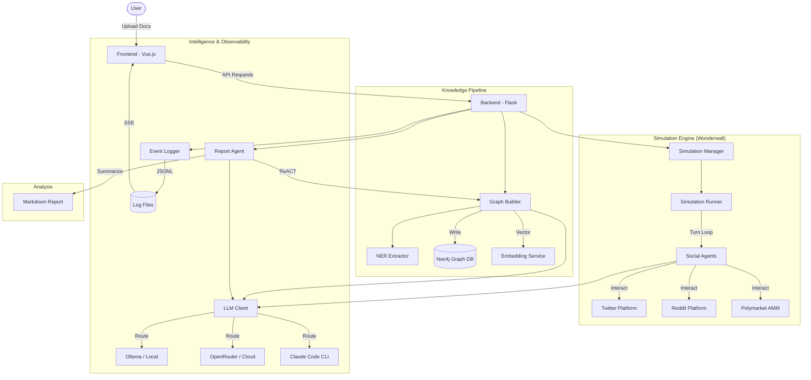

I will begin by reading the instructions in `.prompt.md` and the content of `miroshark.xml` to understand the required processing.

I will read the `README.md` file to get the project name and description, and then I will examine the `backend/app/services` and `backend/wonderwall` directories to understand the simulation engine and its connectors.

I will use `grep_search` on `miroshark.xml` to find the `<file path="README.md">` tag, which will help me locate the project description.

I have identified the project as MiroShark, a Universal Swarm Intelligence Engine that simulates public reactions using AI agents. I will now read the remainder of the `README.md` file to gather more information on its requirements and features.

I've gathered a solid foundation of information about MiroShark, including its core functionality, supported platforms, and key features. I'm now going to delve deeper into `backend/app/services` and `backend/wonderwall` to identify specific source code references for the connectors, smart patterns, and AI skills, which will allow me to provide more precise and well-supported answers for the remaining points.

The `miroshark.xml` file contains the project's source code, as indicated by the directory structure in its summary. I'll now use `grep_search` to find and examine the specific files in `backend/app/services/` to understand how the graph building, profile generation, and simulation reporting are implemented.

I've identified that `report_agent.py` utilizes a ReACT pattern. My next step is to examine `backend/wonderwall/social_agent/agent.py` to understand the implementation of the agents, which are central to the MiroShark swarm intelligence engine.

# Project Analysis: MiroShark

## 1. Project Name and Description

**MiroShark**

MiroShark is a Universal Swarm Intelligence Engine designed to simulate complex public reactions to various stimuli, such as press releases, policy drafts, or financial reports. By uploading a document, the system builds a rich knowledge graph and populates it with hundreds of autonomous AI agents, each possessing unique personas, beliefs, and social relationships grounded in the source material.

The engine facilitates multi-platform simulations where agents interact across simulated versions of Twitter, Reddit, and Polymarket. This cross-platform approach allows for the observation of how information spreads, how sentiment evolves, and how decentralized markets react to social discourse in real-time.

MiroShark is built with a focus on local execution, supporting local LLMs through Ollama and local graph storage via Neo4j, while also offering seamless integration with cloud-based AI providers. It serves as a powerful tool for PR crisis testing, policy analysis, and financial sentiment forecasting.

## 2. Supported Platforms and Deployments

MiroShark supports several deployment modes ranging from fully local to hybrid and cloud-native:

*   **Local Deployment (Native):**
    *   **Requirements:** Python 3.11+, Node.js 18+, Neo4j 5.15+.
    *   **Management:** Controlled via the `./miroshark` launcher script or manual `npm/uv` commands.
*   **Local Deployment (Docker):**
    *   **Requirements:** Docker and Docker Compose.
    *   **Deployment:** `docker compose up -d` launches the backend, frontend, Neo4j, and optionally Ollama.
*   **Cloud Deployment (One-Click):**
    *   **Railway:** Recommended for persistent storage; uses `railway.json`.
    *   **Render:** Supported via `render.yaml`.
    *   **Requirements:** Requires a cloud Neo4j instance (e.g., Neo4j Aura) and a cloud LLM provider (e.g., OpenRouter).

## 3. Supported Connectors

MiroShark integrates with various data sources, platforms, and AI services:

*   **Neo4j:** Primary knowledge graph and state storage.
    *   `backend/app/storage/neo4j_storage.py`
*   **Ollama:** Local LLM and embedding inference.
    *   `backend/app/utils/llm_client.py`, `backend/app/storage/embedding_service.py`
*   **OpenAI-Compatible APIs:** Supports any provider following the OpenAI spec (OpenRouter, DeepSeek, etc.).
    *   `backend/app/utils/llm_client.py`
*   **Claude Code CLI:** Unique integration using the local Claude CLI for LLM calls without direct API keys.
    *   `backend/app/utils/claude_code_client.py`
*   **Twitter (Simulated):** Core social platform simulation.
    *   `backend/wonderwall/simulations/social_media/`
*   **Reddit (Simulated):** Thread-based social platform simulation.
    *   `backend/wonderwall/simulations/social_media/`
*   **Polymarket (Simulated):** Decentralized prediction market simulation with AMM logic.
    *   `backend/wonderwall/simulations/polymarket/`
*   **Web Search (Enrichment):** Connector for grounding agents in real-world data.
    *   `backend/app/services/web_enrichment.py`

## 4. Supported Models and Agents

MiroShark utilizes a tiered model strategy to balance cost, speed, and reasoning:

*   **Standard Agents (Simulation):** Typically `qwen2.5:14b` or `qwen2.5:32b` for bulk social interactions.
    *   `backend/wonderwall/social_agent/agent.py`
*   **Smart Models (Analysis):** Stronger models like `Claude 3.5 Sonnet` or `Qwen 72B+` for report generation and ontology design.
    *   `backend/app/services/report_agent.py`
*   **NER Models (Extraction):** Faster, specialized models for high-volume entity extraction.
    *   `backend/app/storage/ner_extractor.py`
*   **OASIS Agents:** Leverages the CAMEL-AI OASIS framework for core agent logic.
    *   `backend/app/services/oasis_profile_generator.py`

## 5. Top 5 Use Cases

1.  **PR Crisis Testing:** Upload a sensitive press release and observe how a simulated public (Twitter/Reddit) reacts over 48 hours to identify potential blowback.
2.  **Trading Signals:** Feed financial news or earnings reports into the system to see how simulated prediction markets and social sentiment shift.
3.  **Policy Analysis:** Test draft regulations or political announcements against a diverse population of simulated stakeholders to find hidden friction points.
4.  **Market Research:** Simulate the launch of a new product or feature to gauge interest and common objections across different demographics.
5.  **Narrative Exploration:** Feed a complex story or novel and let the agents simulate "lost endings" or character interactions grounded in the existing narrative.

## 6. Top 20 Features

1.  **Knowledge Graph Extraction:** Automated NER and relationship extraction from documents. (`backend/app/services/graph_builder.py`)
2.  **Automated Ontology Generation:** LLM-powered schema design tailored to document content. (`backend/app/services/ontology_generator.py`)
3.  **Dynamic Persona Generation:** Creating hundreds of unique agent profiles grounded in graph context. (`backend/app/services/oasis_profile_generator.py`)
4.  **Cross-Platform Simulation:** Simultaneous execution of Twitter, Reddit, and Polymarket environments. (`backend/scripts/run_parallel_simulation.py`)
5.  **Market-Media Bridge:** Social sentiment influences traders; market prices influence social discourse. (`backend/scripts/market_media_bridge.py`)
6.  **Belief State Tracking:** Stance, confidence, and trust levels per agent. (`backend/wonderwall/social_agent/belief_state.py`)
7.  **Sliding-Window Round Memory:** Compacts old simulation rounds using LLMs to save context. (`backend/scripts/round_memory.py`)
8.  **ReACT Report Agent:** Analytical agent that uses tools to write cited reports. (`backend/app/services/report_agent.py`)
9.  **Real-time Observability:** SSE-based stream of every LLM call and agent decision. (`backend/app/api/observability.py`)
10. **Simulation Forking:** Branch a new simulation from any point in an existing history. (`backend/app/services/simulation_manager.py`)
11. **Divergence Scoring:** Compare two simulation branches to see how reactions differ. (`backend/app/api/simulation.py`)
12. **Web Enrichment:** Auto-researches public figures to ground personas in real-world facts. (`backend/app/services/web_enrichment.py`)
13. **Prediction Market AMM:** Constant-product market maker for simulated trading. (`backend/wonderwall/simulations/polymarket/amm.py`)
14. **Local-First Architecture:** Full support for local Ollama and Neo4j. (`backend/app/utils/llm_client.py`)
15. **Claude Code Integration:** Use Claude CLI for high-quality reasoning without API keys. (`backend/app/utils/claude_code_client.py`)
16. **Debug Panel:** Comprehensive UI for tracing agent thoughts and LLM calls. (`frontend/src/components/DebugPanel.vue`)
17. **Influence Leaderboard:** Tracks which agents have the most impact on the swarm. (`frontend/src/components/InfluenceLeaderboard.vue`)
18. **Interactive Graph Visualization:** D3-based exploration of the knowledge graph. (`frontend/src/components/NetworkPanel.vue`)
19. **Model Tiering:** Configurable routing for Smart, Default, and NER tasks. (`backend/app/config.py`)
20. **One-Click Deployment:** Built-in support for Railway and Render cloud platforms. (`railway.json`, `render.yaml`)

## 7. Top 20 Smart Patterns

1.  **ReACT Reasoning:** Used by the Report Agent to plan and execute analytical sections. (`backend/app/services/report_agent.py`)
2.  **Market-Media Synergy:** Cross-pollinating prompts between platforms for emergent behavior. (`backend/scripts/market_media_bridge.py`)
3.  **LLM-Powered Memory Compaction:** Using summaries to maintain long-term context. (`backend/scripts/round_memory.py`)
4.  **Belief Stance Updates:** Heuristic-based stance and confidence shifts per round. (`backend/wonderwall/social_agent/belief_state.py`)
5.  **Few-Shot NER:** High-quality entity extraction using examples and rejection rules. (`backend/app/storage/ner_extractor.py`)
6.  **Batched Neo4j UNWIND:** Significant performance boost for large-scale graph writes. (`backend/app/services/graph_builder.py`)
7.  **SSE Heartbeat & Deduplication:** Ensures reliable live event streaming. (`backend/app/api/observability.py`)
8.  **Model Fallback/Routing:** Automatically falling back to standard models if smart ones aren't set. (`backend/app/utils/llm_client.py`)
9.  **Ontology Triming:** Limits schema complexity to prevent LLM confusion. (`backend/app/services/ontology_generator.py`)
10. **Parallel Chunk Processing:** Accelerates graph building via threading. (`backend/app/services/graph_builder.py`)
11. **Subprocess LLM Execution:** Leveraging local CLIs (Claude) via shell wrappers. (`backend/app/utils/claude_code_client.py`)
12. **Event File Tailing:** Reliable cross-process observability using JSONL logs. (`backend/app/utils/event_logger.py`)
13. **Influence Divergence Scoring:** Quantifying how different simulation paths vary. (`backend/app/api/simulation.py`)
14. **Institutional Persona Detection:** Automatic tagging of entities as organizations vs. individuals. (`backend/app/services/oasis_profile_generator.py`)
15. **Semantic Context Retrieval:** Using vector search to ground agent observations. (`backend/app/services/graph_tools.py`)
16. **Dynamic Prompt Optimization:** Injecting "Direct Reply" prefixes for agent interviews. (`backend/app/api/simulation.py`)
17. **Step-by-Step UI Guidance:** Guiding users through the complex Build -> Setup -> Run workflow. (`frontend/src/views/MainView.vue`)
18. **Lazy Route Loading:** Frontend performance optimization for large dashboards. (`frontend/src/router/index.js`)
19. **Response Gzip Compression:** Reducing API payload sizes for large graph data. (`backend/app/__init__.py`)
20. **Automatic Model Context Override:** Forcing 32k context on Ollama models via Modelfiles. (`README.md`)

## 8. Top 20 Development Trends (Latest Commits)

1.  **Unified Observability:** Shift towards a single event-driven architecture for tracing.
2.  **Simulation Branching:** Enabling users to "what if" from any point in time.
3.  **Performance Optimization:** Aggressive focus on batching and parallel execution.
4.  **Cloud Accessibility:** Simplification of deployment for non-technical users.
5.  **Intelligence Tiering:** Moving away from "one model fits all" towards task-specific routing.
6.  **Memory Management:** Sophisticated compaction strategies for long-running sims.
7.  **Comparison Mode:** Analytical tools for comparing different simulation runs.
8.  **Launcher Automation:** Reducing setup friction with the `./miroshark` script.
9.  **Web Enrichment Integration:** Bridging the gap between static documents and the live web.
10. **Structured Logging:** Moving towards JSONL for all internal events.
11. **Error Recovery:** Better handling of LLM timeouts and API failures during setup.
12. **Lazy UI Loading:** Handling large datasets in the frontend with better efficiency.
13. **Docker Standardization:** Improving the consistency of the local dev environment.
14. **Cross-Platform Context Flow:** Tightening the loop between social media and markets.
15. **Belief State Granularity:** Adding trust and certainty metrics to agent stances.
16. **Ontology Refinement:** Reducing "garbage" entities via stricter rejection rules.
17. **Real-time SSE Feeds:** Transitioning UI updates from polling to streaming.
18. **Model Selector UI:** Allowing runtime switching of LLM providers.
19. **Neo4j Aura Support:** Optimized connectors for cloud-hosted Neo4j.
20. **Security Transparency:** Masking API keys in settings while allowing runtime updates.

## 9. Top 10 Advantages

1.  **Local-First Privacy:** Runs entirely on your hardware without leaking sensitive docs.
2.  **Emergent Synergy:** Multi-platform interactions create more realistic reactions than single-bot tests.
3.  **High Grounding:** Personas are tied to specific knowledge graph nodes, not just generic LLM profiles.
4.  **Extreme Observability:** Inspect every single thought and decision made by any agent.
5.  **Rapid Setup:** Go from a PDF to a running 100-agent simulation in minutes.
6.  **Cost Efficiency:** Support for local Ollama and small, fast NER models.
7.  **Analytical Depth:** ReACT-based reports that cite actual agent behavior.
8.  **Flexibility:** Works with any OpenAI-compatible API or local CLI.
9.  **Interactive Exploration:** Chat with any agent or group during the simulation.
10. **Branching Logic:** Ability to re-run simulations from key divergence points.

## 10. Top 10 Limitations

1.  **Hardware Demands:** 100+ agents locally require significant VRAM (24GB+ recommended).
2.  **Oasis Dependency:** Core simulation engine is tied to the CAMEL-AI OASIS framework's capabilities.
3.  **Neo4j Complexity:** Requires a running Neo4j instance, which can be a setup hurdle.
4.  **Simulation Speed:** Large turns can take minutes to process depending on LLM latency.
5.  **Context Limits:** Long simulations eventually hit context window barriers, requiring compaction.
6.  **Token Usage:** Cloud-based sims can become expensive for high agent counts.
7.  **Model Sensitivity:** Poorly performing LLMs can lead to repetitive or generic agent behavior.
8.  **Limited Platform Types:** Currently only simulates Twitter, Reddit, and Polymarket.
9.  **Asynchronous Lag:** The SSE stream and backend processing can sometimes desync under heavy load.
10. **Graph Noise:** Automated NER can still extract "junk" entities despite rejection rules.

## 11. Top 5 AI Skills

1.  **GraphBuilder Skill:** Extracts entities and relationships into Neo4j. (`backend/app/services/graph_builder.py`)
2.  **PersonaGenerator Skill:** Synthesizes graph context into OASIS agent profiles. (`backend/app/services/oasis_profile_generator.py`)
3.  **SimulationRunner Skill:** Orchestrates parallel turn execution across platforms. (`backend/app/services/simulation_runner.py`)
4.  **ReportAgent Skill:** Analytical ReACT agent for summarizing simulation outcomes. (`backend/app/services/report_agent.py`)
5.  **BeliefUpdater Skill:** Updates agent stances and confidence based on environmental inputs. (`backend/wonderwall/social_agent/belief_state.py`)

## 12. Data Inputs, Outputs, and Storage

*   **Inputs:** PDF, Markdown, TXT files, and raw URLs (via `backend/app/utils/url_fetcher.py`).
*   **Storage:** 
    *   **Graph:** Neo4j (Entities, Edges, Chunks).
    *   **Metadata:** JSON/JSONL (Simulation state, Agent profiles, Events).
    *   **Files:** Local `uploads/` directory for raw documents and reports.
*   **Outputs:** Analytical Markdown reports, real-time SSE event streams, structured social media logs.

## 13. Detailed Architecture Review

MiroShark follows a modern decoupled architecture:

1.  **Frontend (Vue.js 3 + Vite):** Reactive dashboard for visualization and control.
2.  **Backend (Flask + Python):** Orchestrator and API layer.
3.  **Simulation Engine (Wonderwall):** Fork of OASIS (CAMEL-AI) that handles platform-specific logic.
4.  **Storage Layer:** Neo4j for relational knowledge and local files for transient logs.
5.  **Intelligence Layer:** LLMClient for routing tasks to various backends (Ollama, OpenAI, Claude).

**Key Modules:**
*   `SimulationManager`: Manages lifecycle and forking.
*   `GraphBuilder`: Handles document to graph pipeline.
*   `EventLogger`: Centralized tracing and observability.
*   `SocialAgent`: The core unit of intelligence in the simulation.

## 14. Architecture Diagram (Mermaid)

## 15. Maturity, Stability, Security, Performance

*   **Maturity:** Prototype-to-Production ready. Core features are robust, but edge platforms (Polymarket) are still evolving.
*   **Stability:** High for core build/run loops. Observation systems have been hardened recently.
*   **Security:** Strong local-first posture. API keys are handled via env vars and masked in UI.
*   **Performance:** Significantly improved by batching graph writes and parallelizing LLM calls. The system can handle 100+ agents efficiently on modern hardware.

## 16. Reviews (Tests, CI, Documentation, Skills)

*   **Tests:** Good coverage of backend services via `backend/scripts/test_*.py`. Lacks deep unit testing for frontend.
*   **CI:** Automated Docker builds and pushes to GHCR. (`.github/workflows/docker-image.yml`)
*   **Documentation:** Excellent README with hardware guides and one-click deploy instructions.
*   **Skills:** Integrated AI skills for graph manipulation and report writing are highly specialized and effective.

## 17. Possible Improvements

1.  **Discord/Telegram Connectors:** Expand simulation to more private chat platforms. (`backend/wonderwall/social_platform/`)
2.  **Voice Interaction:** Add STT/TTS for chatting with agents. (`backend/app/api/simulation.py`)
3.  **Active Learning for NER:** Allow users to correct extracted entities in the UI. (`frontend/src/components/NetworkPanel.vue`)
4.  **Temporal Graph Support:** Track how relationships change over rounds in Neo4j. (`backend/app/storage/graph_storage.py`)
5.  **Multi-User Auth:** Add user accounts and shared workspaces. (`backend/app/__init__.py`)
6.  **Agent Logic Customization:** UI for editing agent "behavioral DNA". (`frontend/src/components/Step2EnvSetup.vue`)
7.  **Advanced Market Metrics:** Add order books and more complex AMM curves. (`backend/wonderwall/simulations/polymarket/amm.py`)
8.  **Automated Unit Testing for Prompts:** Eval framework for testing persona consistency.
9.  **Linter Integration:** Add Ruff/ESLint to the CI pipeline.
10. **Vector Database Support:** Support Qdrant/Milvus as alternatives to Neo4j vector search.

## 18-21. Reuse for Agent Swarms & Multi-User Systems

MiroShark's modular components are highly reusable for several advanced scenarios:

*   **Swarm Debate:** Use the `ReportAgent` ReACT pattern and the `SocialAgent` communication bus to have agents debate implementation plans. (`backend/app/services/report_agent.py`)
*   **Shared Knowledge Base:** Reuse the `GraphBuilder` and `Neo4jStorage` to allow multi-user interactions to evolve a shared graph. (`backend/app/storage/neo4j_storage.py`)
*   **Hardware/Cloud Agents:** Leverage the `LLMClient` routing and Docker deployment to run agents anywhere while communicating via the `SocialPlatform` abstractions. (`backend/app/utils/llm_client.py`, `backend/wonderwall/social_platform/platform.py`)
*   **Team Cooperation:** Reuse the `BeliefState` and `Trust` mechanisms to facilitate cooperative human-agent workflows. (`backend/wonderwall/social_agent/belief_state.py`)

---
*Generated by Gemini CLI following .prompt.md instructions.*
