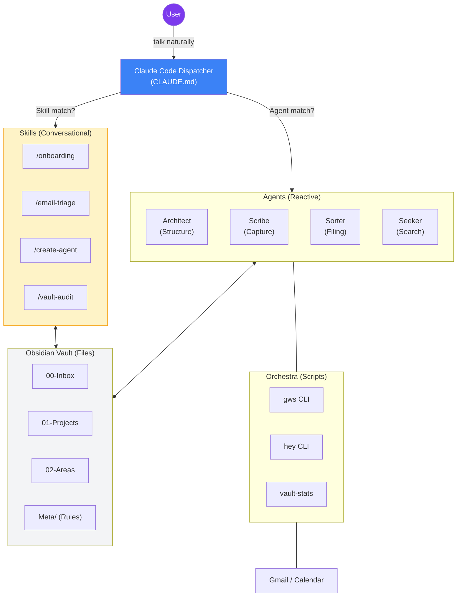

I will read the instructions from `.prompt.md` to understand the task.
I will read the first 100 lines of `my-brain-is-full-crew.xml` to understand its structure and content.
I will read more of `my-brain-is-full-crew.xml`, specifically from line 101 to 1000, to get a better overview of the project and its core files.
I will read `README.md` and `CLAUDE.md` from `my-brain-is-full-crew.xml` to get a high-level summary of the project. I'll search for their content in the XML.
I will read `CLAUDE.md` and `README.md` to understand the project's high-level summary.
I will read `README.md` from `my-brain-is-full-crew.xml`, starting from line 7820.
I will read the git logs from `my-brain-is-full-crew.xml` to identify the top 20 development trends. I'll search for the `<git_log>` tag or similar.
I will search for "commit" in `my-brain-is-full-crew.xml` to locate the git logs and identify development trends.
I will read `references/agent-orchestration.md` and `references/agents-registry.md` from `my-brain-is-full-crew.xml` to get more details on the architecture and components. I'll search for their content.
# My Brain Is Full — Crew: Comprehensive Repository Analysis

## 1. Project Name and Description

**My Brain Is Full — Crew** is a sophisticated multi-agent AI system designed to manage an Obsidian vault as a team of personal assistants. It transforms a static knowledge base into a living "digital brain" that autonomously organizes information, triages communication, and maintains structural integrity through conversation. Built by a PhD researcher to combat "brain fog" and cognitive overload, the project shifts the burden of organization from the human user to a coordinated crew of specialized AI agents.

The core philosophy is that the **chat is the interface**: users never manually organize, rename, or move files. Instead, they interact with a central **Dispatcher** (implemented via Claude Code routing rules) that delegates tasks to either **Skills** (complex, multi-turn conversational workflows) or **Agents** (reactive, single-shot subprocesses). This dual-layered architecture allows the system to handle everything from quick note capture to exhaustive weekly vault audits and email triage.

The system is highly extensible, supporting the creation of **custom agents** through a guided interview process. It is also inherently **multilingual**, responding to users in their native language while maintaining a consistent internal structure. By integrating with external tools like Gmail, Google Calendar, and Apple Contacts through both CLI tools and the Model Context Protocol (MCP), it bridges the gap between personal knowledge management and daily productivity.

## 2. Supported Platforms/Deployments & Requirements

*   **Core Platforms:**
    *   **Obsidian:** The primary storage and visualization layer (Local Markdown vault).
    *   **Claude Code:** The execution engine (CLI and Desktop/Cowork).
*   **Operating Systems:** macOS, Linux, and Windows (via Bash-compatible environments for scripts).
*   **Requirements:**
    *   **Claude Subscription:** Pro, Max, or Team plan (required for Claude Code and Agent/Skill execution).
    *   **Obsidian Installation:** Free version is sufficient.
    *   **Node.js/npm:** Required for MCP servers.
    *   **Git:** Required for cloning and updating the crew.
*   **Integrations (Optional but Recommended):**
    *   **Google Workspace CLI (`gws`):** For full read/write access to Gmail and Calendar.
    *   **Hey CLI (`hey`):** Alternative for Hey.com email users.
    *   **Apple Contacts MCP:** For contact synchronization on macOS.

## 3. Supported Connectors

| Connector | Type | Purpose | Source Reference |
| :--- | :--- | :--- | :--- |
| **Obsidian Vault** | Local FS | Read/Write Markdown notes, templates, and metadata. | `agents/*.md`, `skills/*/SKILL.md` |
| **Gmail** | API / CLI | Scan, search, read, and triage emails; send replies. | `orchestra/hey-*`, `docs/gws-setup-guide.md` |
| **Google Calendar** | API / CLI | Import events, create/update meetings, check availability. | `agents/postman.md`, `.mcp.json` |
| **Hey.com** | CLI | Specialized email triage for Hey users. | `orchestra/hey-check`, `orchestra/hey-imbox` |
| **Apple Contacts** | MCP | Search, create, and update contacts in macOS Address Book. | `skills/contact-sync/SKILL.md` |
| **Claude Remote** | Protocol | Remote control via phone/mobile app via Cowork. | `docs/mobile-access.md` |

## 4. Supported Models & Agents

### Models
*   **Claude 3.5 Sonnet:** The default workhorse for most agents and skills.
*   **Claude 3 Opus:** Used by the **Architect** for high-reasoning structural design tasks.

### Core Agents (`agents/`)
1.  **Architect:** Vault design, governance, and structural authority.
2.  **Scribe:** Information capture and "brain dump" refinement.
3.  **Sorter:** Inbox triage and filing (Reactive).
4.  **Seeker:** Synthesis, search, and citation-based retrieval.
5.  **Connector:** Link discovery and knowledge graph strengthening.
6.  **Librarian:** Vault health audits and growth analytics.
7.  **Transcriber:** Audio/Video transcription and meeting notes.
8.  **Postman:** Email and calendar bridging.

### AI Skills (`skills/`)
1.  `/onboarding`: Guided multi-phase setup.
2.  `/create-agent`: Interactive custom agent builder.
3.  `/manage-agent`: Agent lifecycle management.
4.  `/defrag`: Weekly structural maintenance.
5.  `/email-triage`: Priority-based email processing.
6.  `/meeting-prep`: Context-rich meeting briefings.
7.  `/weekly-agenda`: Unified week planning.
8.  `/deadline-radar`: Urgency-based deadline tracking.
9.  `/transcribe`: Structured recording processing.
10. `/vault-audit`: 7-phase health check.
11. `/deep-clean`: Extended vault cleanup.
12. `/tag-garden`: Taxonomy analysis and cleanup.
13. `/inbox-triage`: Batch note organization.
14. `/contact-sync`: Person-based contact management.

## 5. Top 5 Use Cases

1.  **Autonomous Meeting Processing:** A user records a meeting and says "Process this". The `/transcribe` skill creates a structured note, the **Architect** builds new project folders if mentioned, and the **Sorter** files it.
2.  **Proactive Email Triage:** "Check my email" triggers the `/email-triage` skill to scan Gmail, score emails by importance, save key threads as notes, and signal the **Sorter** to organize them.
3.  **Intelligent Knowledge Retrieval:** "What did I decide about the marketing plan?" activates the **Seeker**, which synthesizes an answer from multiple notes across months, providing specific citations and links.
4.  **Hands-Free Vault Organization:** A user dumps a list of thoughts. **Scribe** cleans them up, **Architect** detects new topics needing homes, and **Sorter** places them in the correct PARA structure.
5.  **Weekly Personal Review:** The `/vault-audit` and `/defrag` skills run a systematic check for broken links, orphan notes, and stale MOCs, ensuring the "digital brain" never becomes a "digital graveyard".

## 6. Top 20 Features

1.  **Multi-Agent Orchestration:** Chaining agents based on task output (`references/agent-orchestration.md`).
2.  **Dispatcher Routing:** Centralized intent recognition in `CLAUDE.md`.
3.  **Multilingual Support:** Native response in any language (README.md).
4.  **Reactive Structure Detection:** Building folders *before* notes are placed (`agents/architect.md`).
5.  **Skill-Based Conversations:** Multi-turn stateful interactions for complex tasks (`skills/`).
6.  **Custom Agent Builder:** No-code agent creation via interview (`skills/create-agent/SKILL.md`).
7.  **Vault Defragmentation:** Systematic 5-phase structural maintenance (`skills/defrag/SKILL.md`).
8.  **Email Priority Scoring:** Weighted importance for unread emails (`skills/email-triage/SKILL.md`).
9.  **Meeting Briefing:** Aggregating context from email, calendar, and notes (`skills/meeting-prep/SKILL.md`).
10. **Deadline Radar:** Unified timeline of commitments (`skills/deadline-radar/SKILL.md`).
11. **Tag Garden:** Automated taxonomy auditing and merging (`skills/tag-garden/SKILL.md`).
12. **MOC (Map of Content) Management:** Automated index generation (`agents/connector.md`).
13. **PARA + Zettelkasten Hybrid:** Standardized organization (`README.md`).
14. **Remote Control:** Mobile access via Claude Cowork (`docs/mobile-access.md`).
15. **Orchestra Scripts:** Named, permission-scoped commands for agents (`orchestra/`).
16. **Vault Health Score:** Quantifiable metrics for vault quality (`skills/vault-audit/SKILL.md`).
17. **Knowledge Graph Strengthening:** Automated discovery of hidden links (`agents/connector.md`).
18. **Person-Based Search:** Finding all interactions with a specific contact (`orchestra/contact-lookup`).
19. **Gratitude Journaling:** Integrated wellness workflow (`agents/scribe.md`).
20. **Area Scaffolding:** Atomic creation of folder/MOC/Index/Template sets (`agents/architect.md`).

## 7. Top 20 Smart Patterns

1.  **Skill-First Routing:** Checking conversational flows before reactive agents (`CLAUDE.md`).
2.  **Suggest Next Agent:** Signaling the dispatcher via standard output headers (`references/agent-orchestration.md`).
3.  **The "Human Never Touches" Rule:** Enforcing agent-only organization (`agents/architect.md`).
4.  **Anti-Recursion Chain:** Max depth 3 and anti-looping rules in the dispatcher (`CLAUDE.md`).
5.  **Call Chain Tracking:** Passing history to chained agents for context.
6.  **Context-Aware Transcription:** Using vault MOCs to improve meeting note accuracy (`skills/transcribe/SKILL.md`).
7.  **Reactive Folder Creation:** Building the "stage" before the "performance" (`agents/architect.md`).
8.  **Tag Hierarchy:** Standardized slashes for `#area/project` tags (`Meta/tag-taxonomy.md`).
9.  **Naming Convention Enforcement:** Chronological and type-based file naming (`Meta/naming-conventions.md`).
10. **Permission-Free Ops:** Using wrapper scripts to bypass manual shell approvals (`orchestra/`).
11. **Profile-Driven Personalization:** Agents reading `Meta/user-profile.md` for context.
12. **Weekly Audit Cycle:** Transitioning from reactive to systematic maintenance.
13. **Implicit Action Extraction:** Detecting to-dos even when not explicitly phrased as tasks.
14. **VIP Email Filtering:** Contextual prioritization of people mentioned in notes.
15. **Orphan Note Triage:** Automated classification of unlinked files (`skills/inbox-triage/SKILL.md`).
16. **Area Indexing:** Mandatory `_index.md` for every life area.
17. **Stale Content Detection:** Librarian flagging notes not touched in X months.
18. **Inter-Agent Feedback Loop:** All agents reporting structural gaps to the Architect.
19. **Bootstrap Syncing:** Mirroring internal logic to the user's vault during setup (`scripts/launchme.sh`).
20. **Remote Voice Journals:** Mobile-to-Vault reflection workflow.

## 8. Top 20 Development Trends (Latest Commits)

1.  **Centralization of Orchestration:** Moving from peer-to-peer to dispatcher-driven routing.
2.  **Introduction of "Orchestra":** Standardizing permission-free script execution for agents.
3.  **Hybrid Skill/Agent Architecture:** Formalizing the split between conversational and reactive logic.
4.  **CLI-First Integration:** Favoring powerful CLI tools (`gws`, `hey`) over limited MCP fallbacks.
5.  **Custom Agent Democratization:** Building tools for users to evolve the crew themselves.
6.  **Rigorous Compliance:** Introducing mandatory legal/safety declarations in the contribution flow.
7.  **Multilingual Hardening:** Ensuring all core triggers and responses are language-agnostic.
8.  **Installation Automation:** Refining `launchme.sh` for one-click setup across OSs.
9.  **Vault Defragmentation Focus:** Systematizing the "cleanup" phase of the lifecycle.
10. **Apple Ecosystem Integration:** Adding native contact sync for macOS users.
11. **Mermaid Rendering Stability:** Quoting labels for cross-platform visual consistency.
12. **Protocol Standardization:** Syncing all 8 core agents to the same coordination schema.
13. **Temp Directory Skills:** Generating artifacts outside of git tracking to keep vaults clean.
14. **Enhanced Action Extraction:** Moving towards deep semantic processing of task intent.
15. **Community Engagement:** Transitioning from a solo project to a Discord-backed community.
16. **Structural Evolution:** Moving from PARA to a custom hybrid (PARA + Meetings + People).
17. **"Digital Brain" Reframing:** Shifting focus from "note-taking" to "life-management".
18. **Permission Scoping:** Minimizing broad bash access in favor of specialized scripts.
19. **Remote Control Optimization:** Enhancing the "Remote Brain" workflow via Claude Cowork.
20. **Documentation as Context:** Treating `README.md` and `docs/` as live training data for agents.

## 9. Top 10 Advantages / Strong Points

1.  **End-to-End Orchestration:** Agents work together, not in silos.
2.  **Native Language Support:** High accessibility for non-English speakers.
3.  **Obsidian Native:** No proprietary cloud lock-in; data stays in local Markdown.
4.  **Structural Integrity:** PARA structure is enforced automatically, preventing mess.
5.  **Extensibility:** Creating a custom agent is as easy as having a conversation.
6.  **Integration Depth:** Combines local notes with live Email/Calendar/Contacts.
7.  **Mobile-Ready:** Fully controllable from a phone via remote CLI.
8.  **Low Maintenance:** Automated audits and defrags keep the vault healthy.
9.  **High Reasoning:** Leverages Opus for critical design and Sonnet for speed.
10. **PhD-Level Design:** Built on rigorous research into knowledge management and cognitive load.

## 10. Top 10 Limitations / Weak Points

1.  **Subscription Barrier:** Requires paid Claude Pro/Team account.
2.  **Technical Onboarding:** Initial setup requires terminal/bash knowledge.
3.  **Privacy Trade-off:** Data must be sent to Anthropic's LLMs for processing.
4.  **CLI Dependency:** Heavy reliance on external tools like `gws` and `hey`.
5.  **Sync Latency:** Mobile access depends on the local machine being online.
6.  **Local-First Constraints:** Hard to use across multiple machines without git/sync knowledge.
7.  **Stochastic Risks:** Agents can occasionally misfile or hallucinate connections.
8.  **Learning Curve:** Users must learn "how to talk" to the crew for best results.
9.  **Vault Size Scaling:** Very large vaults may challenge LLM context limits during full audits.
10. **Browser Fallback:** MCP integration is read-only compared to full CLI access.

## 11. AI Skills Overview

*   **Top 5 Used Skills:**
    1.  `/onboarding` (Setup & Profile) - `skills/onboarding/SKILL.md`
    2.  `/email-triage` (Daily routine) - `skills/email-triage/SKILL.md`
    3.  `/transcribe` (Meeting processing) - `skills/transcribe/SKILL.md`
    4.  `/inbox-triage` (Organization) - `skills/inbox-triage/SKILL.md`
    5.  `/vault-audit` (Maintenance) - `skills/vault-audit/SKILL.md`
*   **Top 5 Provided Skills:**
    1.  `/create-agent` (Meta-skill for growth) - `skills/create-agent/SKILL.md`
    2.  `/defrag` (Structural repair) - `skills/defrag/SKILL.md`
    3.  `/tag-garden` (Taxonomy management) - `skills/tag-garden/SKILL.md`
    4.  `/deadline-radar` (Timeline synthesis) - `skills/deadline-radar/SKILL.md`
    5.  `/contact-sync` (External CRM sync) - `skills/contact-sync/SKILL.md`

## 12. Data Inputs, Outputs, and Storage

*   **Data Inputs:**
    *   **Text:** User messages, pasted documents, reading notes.
    *   **Audio:** Voice memos, meeting recordings, podcasts (processed via `/transcribe`).
    *   **External APIs:** Gmail unread threads, Google Calendar events, Hey.com mailboxes.
    *   **Filesystem:** Local Markdown files, frontmatter metadata.
*   **Data Outputs:**
    *   **Markdown:** Cleaned notes, meeting summaries, audit reports, MOC indexes.
    *   **Actions:** Scheduled calendar events, draft emails, Apple Contact cards.
    *   **Logs:** `Meta/agent-log.md` for auditing crew actions.
*   **Storage:**
    *   **Local Filesystem:** All notes stored in standard `.md` files.
    *   **Vault Metadata:** `Meta/` directory stores user profiles, taxonomies, and structures.
    *   **References:** `references/` stores shared agent documentation.

## 13. Detailed Architecture Review

The project follows a **Dispatcher-Skill-Agent** architecture.

1.  **Dispatcher (`CLAUDE.md`):** Acts as the central nervous system. It uses high-level routing rules to identify user intent and decide whether to activate a conversational **Skill** or a reactive **Agent**.
2.  **Skills (`skills/`):** Heavyweight, multi-step modules. They run in the main conversation thread, allowing for complex "interviews" where state is preserved across turns.
3.  **Agents (`agents/`):** Lightweight, specialized workers. They run as independent subprocesses, performing discrete tasks like "Search for X" or "Create folder Y".
4.  **Orchestra (`orchestra/`):** A layer of "permission-free" shell scripts that encapsulate specific tool calls (like `hey-check`), allowing agents to perform external operations without constant user confirmation.
5.  **PARA Vault:** The data layer, organized into:
    *   `00-Inbox` (Capture)
    *   `01-Projects` (Active)
    *   `02-Areas` (Persistent)
    *   `03-Resources` (Reference)
    *   `Meta/` (Governance)
6.  **MCP Connectors:** Bridging layer for read-only access to external services.

## 14. Architecture Diagram

## 15. Maturity, Stability, Security, Performance

*   **Maturity:** Highly mature for a personal agentic system. The move to centralized orchestration and the addition of standardized skills suggests a stable, production-ready framework for individuals.
*   **Stability:** High. The project uses standard Markdown and local scripts, minimizing "breaking" changes from external dependencies. The anti-recursion rules ensure the dispatcher doesn't enter infinite loops.
*   **Security:** Focused on **local-first** security. All data stays in the vault, and external calls are routed through user-authorized CLIs. The inclusion of `TERMS_OF_USE.md` and health disclaimers shows a responsible approach to AI safety.
*   **Performance:** Dependent on the Claude API. The use of Sonnet 3.5 for most tasks ensures fast responses, while Opus is reserved for "heavy lifting" to optimize both cost and intelligence.

## 16. Review of Ecosystem

*   **Tests:** Primarily manual verification via `claude --plugin-dir`. Git hooks (`hooks/`) provide basic validation for frontmatter and system file protection.
*   **CI Pipelines:** GitHub Actions for issue templates and PR validation.
*   **Documentation:** Exceptional. The `README.md` is a comprehensive guide, and the `docs/` folder contains deep-dives into every agent and setup scenario.
*   **AI Skills:** 14 provided skills cover the entire lifecycle of knowledge management. The system also "provides" the ability to generate new skills/agents.

## 17. Top 20 Possible Improvements

1.  **Voice-to-Text Integration:** Native audio capture bridge for agents.
2.  **Mobile App Companion:** Dedicated capture app for faster sync than Cowork.
3.  **Multi-Vault Sync:** Support for coordinating across multiple Obsidian vaults.
4.  **Local LLM Support:** Integration with Ollama for privacy-sensitive notes.
5.  **Shared Knowledge Pools:** Patterns for team-based collaborative vaults.
6.  **Conflict Resolution:** Better handling of concurrent agent runs.
7.  **Graph Visualization CLI:** Built-in tool to see note clusters in the terminal.
8.  **Automated Unit Tests:** Framework for testing agent logic with mock vaults.
9.  **Granular Permissions:** More refined control over orchestra script access.
10. **Agent Self-Healing:** Librarian automatically fixing minor formatting errors.
11. **Apple Shortcuts Support:** One-tap brain dumping from iOS/macOS.
12. **Improved VIP Detection:** LLM-based ranking of contact importance.
13. **Dynamic Skill Loading:** Loading skills from remote repositories.
14. **PDF/Image OCR:** Built-in tool for processing media attachments.
15. **Context Window Compression:** Summarizing old notes to fit more context.
16. **Task Manager Sync:** Integration with Todoist/Things3.
17. **Automated Backups:** Integrated git-based backup scheduling.
18. **Custom Dashboard:** Generated Markdown dashboard with real-time stats.
19. **LLM Fine-tuning Feedback:** Capturing user corrections to improve prompts.
20. **Search Expansion:** Support for semantic vector search via local embeddings.

## 18. Reuse for "Swarm Debate" Specification

1.  **Dispatcher Routing (`CLAUDE.md`):** Perfect for routing to "proposer" and "critic" agents.
2.  **Orchestration Protocol (`agent-orchestration.md`):** Standardizes how debaters pass the baton.
3.  **Architect's Design Logic (`agents/architect.md`):** For defining the "ground truth" or rules of the debate.
4.  **Seeker's Synthesis (`agents/seeker.md`):** To ground debates in existing knowledge.
5.  **Librarian's Audit Pass:** For verifying the final consensus against safety/quality rules.
6.  **Call Chain Tracking:** To maintain the "state" of the debate across turns.
7.  **Skill-Based Multi-Phase Flows:** For structuring the debate into Proposals, Crits, and Synthesis.
8.  **`### Suggested next agent` signal:** To trigger the "critic" after a "proposer".
9.  **Architect's Template Engine:** For generating the final specification document.
10. **Registry for Custom Personas:** Allowing the swarm to spawn specialized "expert" debaters.

## 19. Reuse for Multi-User Shared Knowledge Base

1.  **Vault Governance (Architect):** Centralized rules for shared structure.
2.  **Tag Taxonomy Standardization:** Ensuring all users use the same categories.
3.  **Naming Conventions:** Preventing file collisions in shared Git repos.
4.  **Health Audits (Librarian):** Identifying inconsistencies between users' contributions.
5.  **Centralized Agent Logs:** Auditing who (or what agent) changed what.
6.  **MOC (Map of Content) System:** Creating shared entry points for different departments.
7.  **Profile-Driven Context:** Agents adapting to the specific user currently interacting.
8.  **Onboarding Skill:** For training new team members on the vault's methodology.
9.  **Inbox Triage:** Managing the "communal" inbox of shared thoughts.
10. **Shared References:** Centralized agent/skill documentation for collective use.

## 20. Reuse for Cloud/Omnichannel Agent (Messenger/CLI/Web)

1.  **Remote Control via Cowork:** A proven pattern for mobile/messenger interaction.
2.  **Orchestra Wrapper Scripts:** For executing logic in serverless/cloud environments (Cloudflare Workers).
3.  **Skill-Based Interviewing:** Naturally maps to chatbot interaction flows (Telegram/WhatsApp).
4.  **Postman's API Bridge:** Model for connecting messengers to internal storage.
5.  **Scribe's Capture Logic:** For handling voice notes from WhatsApp/Teams.
6.  **Seeker's Q&A Engine:** For providing instant answers via messenger.
7.  **Markdown-as-Storage:** Extremely lightweight and portable for cloud deployment.
8.  **Dispatcher's Intent Recognition:** Universal router for multi-channel inputs.
9.  **MCP Server Integration:** For bridging hardware (voice control/sensors) to the agent.
10. **Subprocess Agent Model:** Perfect for horizontal scaling in the cloud.

## 21. Reuse for Team-Agent Cooperative Workflows

1.  **Shared Rules Engine (Architect):** Defining the "Operating Manual" for the team.
2.  **Task Chaining (Dispatcher):** Handing off tasks between human and agent roles.
3.  **Inter-Agent Reporting:** Agents flagging issues for human "Architects" to resolve.
4.  **Shared Workspace (The Vault):** A common ground for humans and agents to collaborate.
5.  **Audit Logs:** Transparency on agent actions for human oversight.
6.  **Collective Triage (Sorter):** Managing the shared team workload.
7.  **Role-Based Specialization:** Assigning specific agents to human-equivalent roles.
8.  **Shared Templates:** Standardizing team outputs (reports, briefs, etc.).
9.  **Custom Agent Creation:** Allowing teams to build their own "internal tools".
10. **Consistency Checks:** Ensuring team members (human or agent) follow established patterns.
