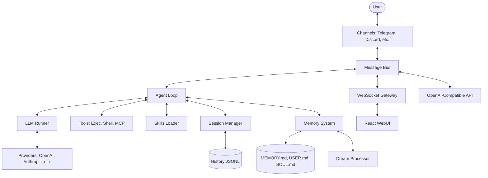

I will start by reading the instructions in `.prompt.md`.
I will read the beginning of `.input.nanobot.xml` to identify the project and its recent activity.
I will search for the `<git_log_commit/>` tag in `.input.nanobot.xml` to find the project name and the most recent commit date.
I will read the last 500 lines of `.input.nanobot.xml` to find the `<git_log_commit/>` tag and other relevant project information.
I will read the last 500 lines of `.input.nanobot.xml`, starting from line 41745, to find the git log information.
I will read `README.md` to get an overview of the Nanobot project, which will help me address several points of the analysis.
I will search for the `<file path="README.md">` tag within `.input.nanobot.xml` to locate the project's actual `README.md` content.
I will read 500 lines of `README.md` from `.input.nanobot.xml`, starting at line 21854.
I will list the files in the `nanobot/` directory to gain a better understanding of the project's structure and identify key modules for further analysis.
I will search for and read the `nanobot/agent/loop.py` file within `.input.nanobot.xml` to understand the core agent loop.
I will read the next 500 lines of `nanobot/agent/loop.py` starting from line 5150 to get a deeper understanding of the agent loop's implementation.
I will search for the `nanobot/agent/skills.py` file in `.input.nanobot.xml` to identify the AI skills provided and used by the project.
I will search for `SKILL.md` files within the `.input.nanobot.xml` to identify the specific skills implemented in the project.
I will read the `memory` and `skill-creator` skills from `.input.nanobot.xml` to understand their functionality.
I will read the `skill-creator` skill from `.input.nanobot.xml` to understand how the agent creates and manages its own skills.
# Project Analysis: Nanobot

## 1. Project Name and Last Commit Date
- **Project Name:** Nanobot
- **Last Commit Date:** 2026-04-23 07:43:21 +0000 (Ref: `<git_log_commit/>` in `.input.nanobot.xml`)

## 2. Description
Nanobot is an open-source, ultra-lightweight AI agent framework designed to provide a stable and readable core for long-running agent behavior. It emphasizes simplicity and research-readiness, allowing developers to easily study, modify, and extend the agent's capabilities. The framework is built to bridge the gap between local experimental setups and production-ready personal agents with minimal overhead.

At its core, Nanobot features a pluggable architecture that supports a vast array of LLM providers (including OpenAI, Anthropic, Gemini, and local models via Ollama or vLLM) and chat channels (such as Telegram, Discord, WhatsApp, and Feishu). This decoupling allows the agent to interact across multiple platforms while maintaining a unified session and memory context, making it a versatile tool for various communication needs.

The framework is equipped with advanced features like the Model Context Protocol (MCP) for tool integration, a two-stage memory system (Dream) for long-term knowledge retention, and sandboxed execution environments for security. With its interactive setup wizard and WebUI, Nanobot is designed to be accessible for beginners while providing the depth required by advanced users for complex tasks like market analysis, software engineering, and automated personal assistance.

## 3. Supported Platforms and Requirements
- **Platforms:**
  - **Linux:** Full support, including kernel-level sandboxing via `bwrap`.
  - **macOS:** Supported (sandboxing via workspace restrictions).
  - **Windows:** Recently added support for CLI and agent runtime.
- **Deployments:**
  - **Local:** Direct execution via Python CLI.
  - **WebUI:** Local development server (Bun/Vite).
  - **Docker:** Official Dockerfile and `docker-compose.yml` provided.
  - **Service:** Instructions for Linux systemd service deployment.
- **Requirements:**
  - **Python:** ≥ 3.11 (v3.14 support recently added).
  - **Node.js/Bun:** Required for the WebUI and the WhatsApp bridge.
  - **Bubblewrap (bwrap):** Highly recommended for secure tool execution on Linux.

## 4. Supported Connectors
Nanobot supports a wide range of "channels" for interacting with users and external services.
- **Telegram:** `nanobot/channels/telegram.py`
- **Discord:** `nanobot/channels/discord.py`
- **WhatsApp:** `nanobot/channels/whatsapp.py` (via Node.js bridge in `bridge/`)
- **Feishu/Lark:** `nanobot/channels/feishu.py`
- **WeChat:** `nanobot/channels/wechat.py`
- **Matrix:** `nanobot/channels/matrix.py`
- **Slack:** `nanobot/channels/slack.py`
- **QQ:** `nanobot/channels/qq.py`
- **DingTalk:** `nanobot/channels/dingtalk.py`
- **Email:** `nanobot/channels/email.py`
- **WebSocket:** `nanobot/channels/websocket.py` (powers the WebUI)
- **OpenAI-Compatible API:** `nanobot/api/server.py`

## 5. Supported Models and Agents
Nanobot supports multiple LLM providers through a unified interface.
- **OpenAI:** GPT-4o, o-series models (`nanobot/providers/openai_compat_provider.py`)
- **Anthropic:** Claude 3.5 Sonnet, Opus with thinking mode (`nanobot/providers/anthropic_provider.py`)
- **Google Gemini:** Pro/Flash models with thought signatures (`nanobot/providers/gemini_provider.py`)
- **DeepSeek:** V3, R1 (`nanobot/providers/openai_compat_provider.py`)
- **Moonshot/Kimi:** K2.6 support (`nanobot/providers/openai_compat_provider.py`)
- **Local Models:** Ollama, vLLM, LM Studio (`nanobot/providers/openai_compat_provider.py`)
- **Specialized:** Azure OpenAI, VolcEngine, MiniMax, StepFun, Xiaomi MiMo (`nanobot/providers/`)
- **Authentication:** Supports API tokens, environment variables, and OAuth (Codex).

## 6. Top 5 Use Cases
1. **24/7 Market Analysis:** Periodically searches the web for trends, analyzes data, and sends reports via Telegram or Discord.
2. **Personal Software Engineer:** Edits codebases, runs tests in sandboxed environments, and manages GitHub issues/PRs using MCP tools.
3. **Smart Daily Manager:** Handles reminders, email filtering, and calendar coordination via natural language commands.
4. **Knowledge Assistant:** Accumulates project facts and user preferences over time using the Dream memory system for contextual recall.
5. **Multi-Channel Bridge:** Acts as a central agent accessible across multiple messengers, maintaining history continuity.

## 7. Top 20 Features
1. **Model Context Protocol (MCP):** Dynamic tool discovery and execution. (`nanobot/agent/tools/mcp.py`)
2. **Dream Memory System:** Autonomous background processing of long-term knowledge. (`nanobot/agent/memory.py`)
3. **Multi-Channel Bus:** Unified event-driven communication across 10+ platforms. (`nanobot/bus/`)
4. **Sandboxed Shell (bwrap):** Secure execution of arbitrary shell commands. (`nanobot/agent/tools/exec.py`)
5. **Interactive Onboarding:** Guided setup wizard for easy configuration. (`nanobot/__main__.py`)
6. **WebUI Chat:** Modern React-based interface for local interaction. (`webui/`)
7. **OpenAI-Compatible API:** Exposes the agent as a standard API. (`nanobot/api/server.py`)
8. **Python SDK:** programmatic access to agent capabilities. (`nanobot/agent/subagent.py`)
9. **Cron Scheduling:** Natural language task scheduling and management. (`nanobot/agent/tools/cron.py`)
10. **Context Compaction:** Automatically shrinks long histories to save tokens. (`nanobot/agent/autocompact.py`)
11. **Thinking Mode Support:** Surfaces reasoning process for Anthropic/Gemini. (`nanobot/providers/`)
12. **Multi-Modal Support:** Handles images and voice across supported channels. (`nanobot/utils/media_decode.py`)
13. **Lifecycle Hooks:** Extensible agent turn logic via `AgentHook`. (`nanobot/agent/hook.py`)
14. **Unified Sessions:** Continuity of conversation across different channels. (`nanobot/session/manager.py`)
15. **Self-Management Tool:** Agent can view/edit its own configuration. (`nanobot/agent/tools/my.py`)
16. **SSE Streaming:** Real-time response streaming for web integrations. (`nanobot/api/server.py`)
17. **I18n Locales:** Multi-language support in the WebUI. (`webui/src/i18n/`)
18. **Workspace Isolation:** Restricts file operations to project directories. (`nanobot/agent/tools/base.py`)
19. **Atomic Session Writes:** Prevents history loss on crashes. (`nanobot/agent/loop.py`)
20. **Plugin System:** Pluggable commands and channel handlers. (`nanobot/agent/tools/base.py`)

## 8. Top 20 Smart Patterns
1. **Unified Session Key:** Maps multiple channel IDs to a single logical session. (`nanobot/agent/loop.py`)
2. **Composite Hooks:** Chainable lifecycle hooks for modular feature injection. (`nanobot/agent/hook.py`)
3. **Mid-Turn Injection:** Queueing new user messages while a turn is still processing. (`nanobot/agent/loop.py`)
4. **Early Persistence:** Saving the user message before LLM processing to prevent loss. (`nanobot/agent/loop.py`)
5. **Runtime Checkpoints:** Snapshotting tool state for crash recovery. (`nanobot/agent/loop.py`)
6. **Dream Background Loop:** Decoupled memory consolidation from real-time turns. (`nanobot/agent/memory.py`)
7. **Two-Stage Memory:** Fast JSONL history + slow Markdown knowledge. (`nanobot/agent/memory.py`)
8. **Auto-Compaction:** Sliding window or summarization for context windows. (`nanobot/agent/autocompact.py`)
9. **Provider Registry:** Abstracting LLM specifics from the agent loop. (`nanobot/providers/registry.py`)
10. **Channel Bus:** Asynchronous event-driven decoupling of core and IO. (`nanobot/bus/`)
11. **Tool-based Routing:** Treating skills and MCP servers as unified tools. (`nanobot/agent/tools/`)
12. **Bwrap Sandboxing:** Kernel-level isolation for shell tools. (`nanobot/agent/tools/exec.py`)
13. **Media Sanitization:** Stripping large binary data before session logging. (`nanobot/agent/loop.py`)
14. **Thought Stripping:** Cleaning `<think>` blocks for final user output. (`nanobot/agent/loop.py`)
15. **Unified Streaming:** Coalescing deltas across different provider protocols. (`nanobot/agent/loop.py`)
16. **Per-Session Locks:** Preventing race conditions in history writes. (`nanobot/agent/loop.py`)
17. **Subagent Orchestration:** Tracking and cancelling spawned sub-processes. (`nanobot/agent/subagent.py`)
18. **Interactive Setup Wizard:** Streamlining complex JSON configuration. (`nanobot/__main__.py`)
19. **Progressive Disclosure Skills:** Loading documentation only when triggered. (`nanobot/agent/skills.py`)
20. **Auto-Repair Sessions:** Detecting and fixing corrupted JSONL history files. (`nanobot/session/manager.py`)

## 9. Top 20 Development Trends
1. **Removing LiteLLM:** Transitioning to native OpenAI/Anthropic SDKs for stability.
2. **WebUI Parity:** Rapidly adding features like image uploads to the Web interface.
3. **Multi-modal Focus:** Adding voice and image handling to almost all channels.
4. **Reliability Hardening:** Focus on atomic writes and crash recovery (Checkpoints).
5. **Provider Proliferation:** Adding support for diverse Asian LLM providers (Kimi, DeepSeek).
6. **Channel UX Polish:** Inline buttons for Telegram and rich cards for Feishu.
7. **Token Management:** Advanced context compaction and prompt caching support.
8. **Windows/3.14 Support:** Expanding the platform and runtime matrix.
9. **MCP Ecosystem Integration:** Deeper support for MCP resources and prompts.
10. **Dream Memory Refinement:** Improving the "long-term" retention logic.
11. **Localization:** Extensive i18n support in the WebUI.
12. **Security Focus:** Refining sandboxing rules and blocked patterns.
13. **Observability:** Integration with Langfuse/LangSmith for tracing.
14. **Core/Plugin Decoupling:** Refactoring the agent loop into smaller components.
15. **Test Coverage:** Increasing unit and integration tests for channels.
16. **SSE Standardization:** Using SSE for all streaming API responses.
17. **Interactive CLI:** Improving the `nanobot` command UX.
18. **Unified Sessions:** Bridging the gap between mobile (chat) and web (desktop).
19. **Reasoning Visibility:** Explicitly handling "thinking" signatures in responses.
20. **Skill Modularity:** Encouraging the creation of standalone `.skill` packages.

## 10. Top 10 Advantages
1. **Ultra-lightweight:** Extremely small core loop compared to LangChain/CrewAI.
2. **High Extensibility:** Modular channels, providers, and tools.
3. **Production-Ready Memory:** Dream system is more robust than simple RAG.
4. **Platform Coverage:** Supports almost all popular messaging apps.
5. **Security First:** Built-in Linux sandboxing.
6. **Ease of Use:** interactive `onboard` wizard is superior to manual JSON editing.
7. **Research-Ready:** Clean code makes it ideal for studying agent behavior.
8. **Native Streaming:** End-to-end streaming support across channels.
9. **Local First:** Strong support for Ollama/vLLM.
10. **Modern Stack:** Uses Python 3.11+, Pydantic, and asyncio.

## 11. Top 10 Limitations
1. **Sandbox Platform Gap:** Kernel sandboxing only works on Linux.
2. **WebUI Maturity:** Still requires source checkout for development.
3. **Multi-User Isolation:** Default behavior is a unified single-user session.
4. **Bridge Overhead:** WhatsApp and WeChat require complex external bridges.
5. **History Migration:** Upgrading from legacy formats can be fragile.
6. **Python Requirement:** Strictly requires Python 3.11+.
7. **No Built-in Vector DB:** Uses file-based search instead of specialized VDBs.
8. **Manual Configuration:** Advanced features require non-trivial JSON setup.
9. **Session Poisoning Risk:** Large tool results can still impact context if not pruned.
10. **Limited Planning:** Lacks complex multi-step planning found in AutoGPT-style systems.

## 12. AI Skills
- **Provided Skills:**
  - `memory`: Knowledge management. (`nanobot/skills/memory/SKILL.md`)
  - `skill-creator`: Guidelines for creating new skills. (`nanobot/skills/skill-creator/SKILL.md`)
  - `clawhub`: Discovering and installing public skills. (`nanobot/skills/clawhub/SKILL.md`)
  - `cron`: Scheduling tasks. (`nanobot/skills/cron/SKILL.md`)
  - `github`: Repository management. (`nanobot/skills/github/SKILL.md`)
  - `summarize`: Context reduction. (`nanobot/skills/summarize/SKILL.md`)
  - `my`: Self-configuration and status. (`nanobot/agent/tools/my.py`)
- **Used Skills:**
  - The agent uses `memory` for persistent knowledge.
  - The agent uses `summarize` for context compaction.
  - The agent uses `skill-creator` to help the user extend it.

## 13. Data Overview
- **Inputs:** Chat messages (text/media), CLI commands, API calls, WebSocket events.
- **Outputs:** Chat responses, media uploads, streaming tokens, session checkpoints.
- **Storage:**
  - `history.jsonl`: Raw append-only conversation history. (`nanobot/agent/memory.py`)
  - `MEMORY.md`: Long-term project/world knowledge.
  - `USER.md`: User profiles and preferences.
  - `SOUL.md`: Agent personality and instructions.
  - `config.json`: Runtime configuration. (`nanobot/config/loader.py`)

## 14. Architecture Review
1. **Bus:** Central event hub for messages. (`nanobot/bus/`)
2. **Loop:** Orchestrates the turn-based agent logic. (`nanobot/agent/loop.py`)
3. **Runner:** Executes LLM requests and handles retries. (`nanobot/agent/runner.py`)
4. **Provider Registry:** Manages LLM backend implementations. (`nanobot/providers/`)
5. **Session Manager:** Tracks history and metadata per user. (`nanobot/session/`)
6. **Channel Manager:** Handles external messaging platform integration. (`nanobot/channels/`)
7. **Tool Registry:** Discovers and validates executable tools. (`nanobot/agent/tools/`)
8. **Skill Loader:** Manages Markdown-based procedural knowledge. (`nanobot/agent/skills.py`)
9. **MCP Client:** Connects to external Model Context Protocol servers. (`nanobot/agent/tools/mcp.py`)
10. **Context Builder:** Assembles prompts for different providers. (`nanobot/agent/context.py`)
11. **Hook System:** Lifecycle events for extensibility. (`nanobot/agent/hook.py`)
12. **Memory System:** Pure file I/O layer for knowledge. (`nanobot/agent/memory.py`)
13. **Dream Processor:** Background knowledge consolidation. (`nanobot/agent/memory.py`)
14. **API Server:** FastAPI-based OpenAI-compatible endpoint. (`nanobot/api/`)
15. **WebUI:** React SPA for interaction. (`webui/`)
16. **Config Loader:** Pydantic-based configuration management. (`nanobot/config/`)
17. **Media Handler:** Decodes and sanitizes image/voice payloads. (`nanobot/utils/media_decode.py`)
18. **Shell Sandbox:** `bwrap` wrapper for command execution. (`nanobot/agent/tools/exec.py`)
19. **Cron Engine:** Schedules and executes background tasks. (`nanobot/agent/tools/cron.py`)
20. **Gateway:** Bridges the bus to external WebSocket clients. (`nanobot/api/gateway.py`)

## 15. Architecture Graph

## 16. Maturity and Quality Review
- **Maturity:** Mid-stage (v0.1.5). Core runtime is stable; WebUI and some channels are experimental.
- **Stability:** High for CLI usage; recently hardened for long-running tasks.
- **Security:** Strong emphasis on sandboxing (`bwrap`) and access control (`allowFrom`).
- **Performance:** Excellent token efficiency due to custom compaction and lightweight core.

## 17. Project Review
- **Tests:** Comprehensive pytest suite covering core, providers, and tools.
- **CI:** Active GitHub Actions for linting, testing, and Docker builds.
- **Documentation:** High quality, including repo docs and a dedicated wiki.
- **AI Skills:** Advanced usage of skills for procedural knowledge and self-extension.

## 18. Possible Improvements
1. **Windows Sandbox:** Implement a native sandbox for Windows (e.g., Job Objects). (`nanobot/agent/tools/exec.py`)
2. **Vector DB Integration:** Add optional ChromaDB/Qdrant for large-scale RAG. (`nanobot/agent/memory.py`)
3. **Multi-User Multi-Tenancy:** Better isolation for multi-user server deployments. (`nanobot/session/manager.py`)
4. **Unified Package:** Bundle WebUI assets into the Python package. (`webui/`)
5. **Bridge Management:** Automated installation and lifecycle for WhatsApp/WeChat bridges. (`nanobot/channels/`)
6. **Visual Memory:** Support for image-based knowledge in Dream. (`nanobot/agent/memory.py`)
7. **Refined Planning:** Add a `ReAct` or `Plan-and-Execute` runner mode. (`nanobot/agent/runner.py`)
8. **Telemetry:** Optional opt-in usage metrics for maintainers.
9. **GUI Configurator:** A visual way to edit `config.json`. (`webui/`)
10. **Voice Interface:** Native STT/TTS support for mobile channels. (`nanobot/utils/media_decode.py`)
11. **Browser Tool:** Integrated Playwright/Selenium for web automation. (`nanobot/agent/tools/`)
12. **Notebook Support:** Better handling of Jupyter/Notebook files. (`nanobot/agent/tools/`)
13. **Advanced Rate Limiting:** Per-user/Per-channel token budgeting. (`nanobot/agent/loop.py`)
14. **Encryption:** Optional at-rest encryption for session history. (`nanobot/agent/memory.py`)
15. **Plugin Marketplace:** Centralized hub for discovering `.skill` files.
16. **Unified Logging:** Better cross-process logging for bridges and gateway.
17. **Mobile App:** Native React Native or Flutter app using the Gateway API.
18. **Teams/Slack polish:** Better support for threaded conversations. (`nanobot/channels/slack.py`)
19. **Prompt Caching:** deeper integration with Anthropic/OpenAI prompt cache. (`nanobot/providers/`)
20. **Self-Correction:** Turn-level reflection on tool failures. (`nanobot/agent/loop.py`)

## 19. Reusable for Agent Swarm
1. **Runner:** Robust LLM execution with retry logic. (`nanobot/agent/runner.py`)
2. **Bus:** Asynchronous communication layer. (`nanobot/bus/`)
3. **Subagent:** Pattern for spawning child agents. (`nanobot/agent/subagent.py`)
4. **Hook System:** Lifecycle management for debating turns. (`nanobot/agent/hook.py`)
5. **Context Builder:** Building complex multi-agent prompts. (`nanobot/agent/context.py`)
6. **Tool Registry:** Unified tool discovery for different agents. (`nanobot/agent/tools/`)
7. **Session Manager:** shared history tracking. (`nanobot/session/manager.py`)
8. **Dream Memory:** Long-term consensus storage. (`nanobot/agent/memory.py`)
9. **Provider Registry:** Easily switching between specialized models. (`nanobot/providers/`)
10. **Media Handler:** Handling multimodal inputs across the swarm. (`nanobot/utils/media_decode.py`)

## 20. Reusable for Multi-User Shared Knowledge
1. **Dream:** The background consolidation logic. (`nanobot/agent/memory.py`)
2. **MemoryStore:** Pure file I/O for shared Markdown files. (`nanobot/agent/memory.py`)
3. **Consolidator:** Merging individual logs into shared knowledge. (`nanobot/agent/memory.py`)
4. **Session Manager:** Mapping multi-user interactions to shared contexts. (`nanobot/session/`)
5. **Skill Loader:** Distributing shared capabilities (skills). (`nanobot/agent/skills.py`)
6. **Unified Session Key:** Bridging users across platforms. (`nanobot/agent/loop.py`)
7. **Atomic Writes:** Ensuring data integrity in concurrent environments. (`nanobot/agent/loop.py`)
8. **Config Loader:** Managing shared system-wide settings. (`nanobot/config/`)
9. **Gateway:** Centralized access point for web/mobile users. (`nanobot/api/gateway.py`)
10. **Auth logic:** `allowFrom` patterns for group access control. (`nanobot/channels/`)

## 21. Reusable for Cloud/Hardware/Messenger Agents
1. **Channel Plugins:** Ready-to-use Telegram, Discord, etc. code. (`nanobot/channels/`)
2. **Provider Abstraction:** Unified LLM API. (`nanobot/providers/`)
3. **Gateway API:** WebSocket-based remote interaction. (`nanobot/api/gateway.py`)
4. **Exec Tool:** Sandboxed execution for own hardware security. (`nanobot/agent/tools/exec.py`)
5. **MediaDecode:** Cross-platform media processing. (`nanobot/utils/media_decode.py`)
6. **Cron Tool:** Background task management on hardware. (`nanobot/agent/tools/cron.py`)
7. **OpenAI API Server:** Cloud-ready API endpoint. (`nanobot/api/server.py`)
8. **Config interpolation:** Resolving environment variables for Cloud/Docker. (`nanobot/config/`)
9. **Docker setup:** Production-ready containerization. (`Dockerfile`)
10. **CLI Commands:** Standardized interface for hardware management. (`nanobot/__main__.py`)

## 22. Reusable for Team Agents
1. **Subagent Logic:** Human-in-the-loop or agent-to-agent delegation. (`nanobot/agent/subagent.py`)
2. **Hook System:** Coordination hooks for team workflows. (`nanobot/agent/hook.py`)
3. **Mid-turn Injection:** Injecting human feedback into active agent turns. (`nanobot/agent/loop.py`)
4. **Unified History:** Shared context for team awareness. (`nanobot/session/`)
5. **Dream Knowledge:** Evolving team-wide best practices. (`nanobot/agent/memory.py`)
6. **Observability:** Langfuse/LangSmith for team collaboration audits. (`nanobot/agent/loop.py`)
7. **Shared Skills:** reusable team-specific procedures. (`nanobot/agent/skills.py`)
8. **Permission Gates:** controlling tool access per user/team. (`nanobot/channels/`)
9. **Command Dispatcher:** Unified slash-command interface for teams. (`nanobot/agent/loop.py`)
10. **Media Replay:** Visualizing team history in the WebUI. (`webui/`)
