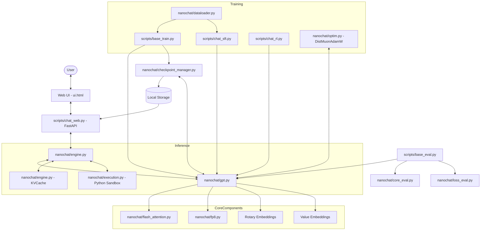

I will read the instructions in `.prompt.md` and the input file `nanochat.xml` to understand the task.
I will read the `README.md` and `pyproject.toml` files to get a high-level overview of the project, including its name, description, and supported platforms.
I will continue reading the `nanochat.xml` file, starting from line 4001, to gather more information about the project's architecture, supported models, and development trends.
I will read the remaining important files, including `README.md`, `pyproject.toml`, and the scripts in the `scripts/` and `tests/` directories, to finalize my understanding of the project's connectors, use cases, and overall maturity.
Based on the comprehensive analysis of the `nanochat` codebase exported in `nanochat.xml`, here is the detailed project report.

# 1. Project Name and Description
**Project Name:** nanochat

**Description:**
nanochat is a minimalist, high-performance, full-stack LLM development harness designed to train, evaluate, and deploy GPT-like models on a single GPU node. It aims to make large language model research accessible by reducing both financial cost and cognitive complexity. The project covers the entire model lifecycle, including custom BPE tokenization, pretraining on massive datasets, supervised fine-tuning (SFT), reinforcement learning (RL), and a familiar ChatGPT-style web interface.

The repository is centered around a "Time-to-GPT-2" challenge, where the primary objective is to outperform the 2019 GPT-2 (1.6B) model's capabilities in under 2 hours on an 8xH100 node for less than $50. It achieves this by aggressively optimizing for wall-clock time and compute efficiency, utilizing cutting-edge techniques like Flash Attention 3, FP8 training, and the Muon optimizer. 

Architecturally, nanochat is designed with a "single dial" philosophy: users specify the desired model complexity via a single `--depth` parameter, and the system automatically calculates all other compute-optimal hyperparameters (width, heads, learning rate, training horizon, and weight decay) based on established scaling laws. This makes it a powerful, hackable, and maximally-forkable baseline for modern LLM experimentation.

---

# 2. Supported Platforms/Deployments + Requirements
### Platforms
- **NVIDIA GPUs (Primary):** Optimized for Hopper (H100/H200) using Flash Attention 3 and FP8. Compatible with Ampere (A100) using bfloat16.
- **Apple Silicon (MPS):** Supported via automatic fallback to PyTorch `scaled_dot_product_attention` (SDPA).
- **CPU:** Supported via SDPA fallback for educational/debugging purposes (see `runs/runcpu.sh`).

### Deployment Modes
- **Web UI/API Server:** Distributed inference across multiple GPUs using a worker pool.
- **CLI Chat:** Interactive terminal-based chat.
- **Distributed Training:** Multi-GPU training via `torchrun`.

### Requirements
- **Python:** >= 3.10
- **Key Dependencies:** `torch==2.9.1`, `fastapi`, `kernels` (for FA3), `tiktoken`, `rustbpe`, `uvicorn`, `wandb`.
- **Infrastructure:** `uv` for dependency management.

---

# 3. Supported Connectors
| Connector | Source File Reference | Description |
| :--- | :--- | :--- |
| **Web UI** | `scripts/chat_web.py` | FastAPI-based server serving `nanochat/ui.html`. |
| **Streaming API** | `scripts/chat_web.py` | OpenAI-compatible `/chat/completions` endpoint. |
| **CLI Chat** | `scripts/chat_cli.py` | Interactive terminal interface for local models. |
| **Weights & Biases** | `scripts/base_train.py` | Native integration for training telemetry and experiment tracking. |
| **HuggingFace** | `scripts/base_eval.py` | Support for loading and evaluating HF models (e.g., GPT-2). |

---

# 4. Supported Models/Agents
- **Local Custom GPT:** Custom Transformer implementation in `nanochat/gpt.py`.
- **HuggingFace Models:** Evaluates external models via a `ModelWrapper` in `scripts/base_eval.py`.
- **Tool-Enabled Agent:** Models trained to use a Python REPL tool for arithmetic and string logic (`nanochat/engine.py`, `nanochat/execution.py`).
- **Benchmark Targets:** Specifically designed to emulate and surpass GPT-2 (1.6B) and comparable GPT-3 Small/Medium scales (`dev/estimate_gpt3_core.ipynb`).

---

# 5. Top 5 Use Cases
1. **GPT-2 Capability Reproduction:** Training a GPT-2 grade model from scratch in < 2 hours for < $50 (`runs/speedrun.sh`).
2. **Architecture Research:** Rapidly testing new Transformer components (Value Embeddings, Smear, Backout) at small scales (d12) and scaling them up (`dev/LOG.md`).
3. **Synthetic Persona Infusion:** Creating specialized assistants by generating multi-turn "identity" conversations and mixing them into SFT (`dev/gen_synthetic_data.py`).
4. **Math/Logic Solving with Tools:** Training models to solve math problems (GSM8K) or spelling puzzles by offloading computation to a Python sandbox (`tasks/spellingbee.py`).
5. **Private Full-Stack Assistant:** Deploying a locally-trained, private ChatGPT-like service on owned hardware (`scripts/chat_web.py`).

---

# 6. Top 20 Features
1. **Flash Attention 3 Integration:** `nanochat/flash_attention.py`
2. **FP8 Training Support (Tensorwise):** `nanochat/fp8.py`
3. **BOS-Aligned Best-Fit Dataloader:** `nanochat/dataloader.py`
4. **Muon Optimizer (Newton-Schulz/Polar Express):** `nanochat/optim.py`
5. **Value Embeddings (ResFormer-style):** `nanochat/gpt.py`
6. **Grouped-Query Attention (GQA):** `nanochat/gpt.py`
7. **Sliding Window Attention (Configurable Patterns):** `nanochat/gpt.py`
8. **Rotary Positional Embeddings (RoPE):** `nanochat/gpt.py`
9. **QK Norm:** `nanochat/gpt.py`
10. **Sandboxed Python Tool Execution:** `nanochat/execution.py`
11. **CORE Metric Evaluation Suite (22 tasks):** `nanochat/core_eval.py`
12. **Vocab-Invariant BPB Evaluation:** `nanochat/loss_eval.py`
13. **Explicit Compute Dtype Management:** `nanochat/common.py`
14. **Supervised Fine-Tuning (SFT) Mixture Pipeline:** `scripts/chat_sft.py`
15. **Reinforcement Learning (RL) via simplified GRPO:** `scripts/chat_rl.py`
16. **Fused Optimizer Kernels:** `nanochat/optim.py`
17. **Meta Device Model Initialization:** `scripts/base_train.py`
18. **Multi-GPU Web Server with Worker Pool:** `scripts/chat_web.py`
19. **Interactive Training Report Generator:** `nanochat/report.py`
20. **Custom Rust-based BPE Tokenizer:** `nanochat/tokenizer.py`

---

# 7. Top 20 Smart Patterns
1. **Single Dial Complexity:** Model scale driven entirely by `--depth` (`scripts/base_train.py`).
2. **Power Law Batch Scaling:** `Bopt ∝ D^0.383` (`scripts/base_train.py`).
3. **Weight Decay Width Scaling:** `WD ∝ 1/width²` (`scripts/base_train.py`).
4. **Linear Cast Layer:** Casting weights in forward instead of `autocast` (`nanochat/gpt.py`).
5. **BOS-First Batching:** Ensuring every sequence in a batch starts with context (`nanochat/dataloader.py`).
6. **Best-Fit Bin Packing:** Reducing token waste without padding (`nanochat/dataloader.py`).
7. **Async Distributed Optimizer:** Overlapping communication with compute in `DistMuonAdamW` (`nanochat/optim.py`).
8. **Progress-Based Scheduling:** SFT/RL schedules driven by dataset completion percentage (`scripts/chat_sft.py`).
9. **Smear Mechanism:** Mixing previous token embeddings for cheap bigram info (`nanochat/gpt.py`).
10. **Backout Mechanism:** Subtracting mid-layer features before final output (`nanochat/gpt.py`).
11. **Zero-Init Output Projections:** Stabilizing early training via zero shunts (`nanochat/gpt.py`).
12. **Categorical Evaluation Optimization:** Evaluating MC tasks via logit slices instead of sampling (`scripts/chat_eval.py`).
13. **DAPO-style RL Normalization:** Token-level reward normalization (`scripts/chat_rl.py`).
14. **Lazy Optimizer State Init:** Shape-based parameter grouping for Muon (`nanochat/gpt.py`).
15. **Python GC Suppression:** Manually managing GC pauses during hot training loops (`scripts/base_train.py`).
16. **Token Byte Caching:** Storing byte lengths for vocab-independent metrics (`scripts/tok_train.py`).
17. **Abuse Prevention Clamping:** Safety limits on temperature, tokens, and length (`scripts/chat_web.py`).
18. **Deterministic Task Mixing:** Shuffling dataset mixtures with fixed seeds (`tasks/common.py`).
19. **KV Cache Expansion:** Expanding batch=1 prefill to multi-sample generation (`nanochat/engine.py`).
20. **SM-Aware Precision Detection:** Auto-selecting bf16 vs fp32 based on GPU capability (`nanochat/common.py`).

---

# 8. Top 20 Development Trends
1. **Dataset Superiority:** Move from FineWeb-EDU to NVIDIA ClimbMix (`dev/LOG.md`).
2. **Autonomous Research:** Using "autoresearch" agents to find architecture improvements (`dev/LOG.md`).
3. **Autocast Removal:** Transitioning to explicit `COMPUTE_DTYPE` (`dev/LOG.md`).
4. **Flash Attention 3:** Replacing FA2 for Hopper speedups (`dev/LOG.md`).
5. **MoE Skepticism:** Rejecting Mixture of Experts for the GPT-2 scale due to overhead (`dev/LOG.md`).
6. **Value Embedding Proliferation:** Moving to alternating-layer Value Embeddings (`dev/LOG.md`).
7. **Muon Refinement:** Transition from Newton-Schulz to Polar Express orthogonalization (`nanochat/optim.py`).
8. **Precise Scaling Laws:** Recalculating D:N ratios (currently ~12) (`scripts/base_train.py`).
9. **Optimizer Warm-start:** Loading pretraining momentum into SFT (`scripts/chat_sft.py`).
10. **Sliding Window tuning:** Moving from full context (`L`) to efficient patterns like `SSSL` (`dev/LOG.md`).
11. **Tokenization Splits:** Validating `\p{N}{1,2}` as the sweet spot for 32K vocabs (`dev/LOG.md`).
12. **FP16 with GradScaler:** Adding support for older GPUs without bf16 (`dev/LOG.md`).
13. **Simplifying RL:** Dropping KL penalties and clipping for GRPO-like stability (`scripts/chat_rl.py`).
14. **Dependency Reduction:** Removing non-essential libraries to reduce attack surface (`pyproject.toml`).
15. **Auto Batch Scaling:** Implementing principled batch size increases for deeper models (`dev/LOG.md`).
16. **SoftCap Tuning:** Setting logit softcap default to 20 for d24+ scales (`dev/LOG.md`).
17. **Cautious Weight Decay:** Adopting sign-aware weight decay (`dev/LOG.md`).
18. **BOS-Aligned focus:** Improving training context by strictly starting batches with BOS (`nanochat/dataloader.py`).
19. **ZeRO-2 Style Sharding:** Implementing sharded optimizer states in the custom optimizer (`nanochat/optim.py`).
20. **Report Card Automation:** Moving toward automated markdown training summaries (`nanochat/report.py`).

---

# 9. Top 10 Advantages
1. **Extreme Efficiency:** Beating GPT-2 training times by orders of magnitude.
2. **Minimal Complexity:** Readable code without "framework bloat."
3. **Single-Node Optimization:** Designed specifically for accessible 8-GPU nodes.
4. **Compute-Optimal by Default:** Hardcoded scaling laws prevent user error.
5. **Full-Stack Coverage:** From raw text shards to a web UI in one repo.
6. **Hardware Adaptability:** Automatic fallbacks for MacBooks/CPUs.
7. **Modern Architecture:** Uses the latest research (FA3, FP8, Muon, GQA).
8. **Vocab-Independent Metrics:** BPB allows fair comparison across different tokenizers.
9. **Fast Iteration:** d12 model scale allows for 5-minute pretraining experiments.
10. **Tool-Use Ready:** Integrated Python sandbox for solving complex tasks.

---

# 10. Top 10 Limitations
1. **Scale Ceiling:** Not designed for multi-node (TPU pod) training.
2. **Limited Dataset Diversity:** Currently hyper-optimized for English-centric ClimbMix.
3. **Optimizer Assumption:** Muon scaling η ∝ √B is an unproven assumption.
4. **Token Waste:** BOS-aligned dataloader discards ~35% of tokens.
5. **Adversarial Security:** Python sandbox is for accidental safety, not malicious code.
6. **Inference Staticity:** `KVCache` requires pre-allocation based on `max_tokens`.
7. **GQA Implementation:** Currently requires manual head-dim tuning.
8. **Minimal Documentation:** Relies heavily on "Discussions" and Karpathy's guides.
9. **Small Ecosystem:** Lacks the library support of Transformers/Axolotl.
10. **FP8 Hardware Lock:** Best performance is strictly locked to NVIDIA H100+.

---

# 11. Top 5 AI Skills
### Provided Skills
1. **read-arxiv-paper:** Fetches TeX source from ArXiv and summarizes lessons for nanochat (`.claude/skills/read-arxiv-paper/SKILL.md`).

---

# 12. Data Inputs, Outputs, and Storage
- **Inputs:** Parquet shards from HuggingFace (ClimbMix-400B) (`nanochat/dataset.py`).
- **Intermediate Storage:** Local cache in `~/.cache/nanochat/` (`nanochat/common.py`).
- **Model Outputs:** `.pt` state dicts and `.json` metadata (`nanochat/checkpoint_manager.py`).
- **Reports:** Markdown training reports in `base_dir/report/` (`nanochat/report.py`).
- **Inference Input:** JSON-based chat history (`scripts/chat_web.py`).

---

# 13. Detailed Architecture Review
| Module | Reference | Interactions |
| :--- | :--- | :--- |
| **GPT** | `nanochat/gpt.py` | Main Transformer model; uses `Block`. |
| **Block** | `nanochat/gpt.py` | Contains `CausalSelfAttention` and `MLP`. |
| **Engine** | `nanochat/engine.py` | Inference orchestrator; manages `KVCache` and tool-use state. |
| **KVCache** | `nanochat/engine.py` | FA3-optimized KV storage (B, T, H, D). |
| **DistMuonAdamW** | `nanochat/optim.py` | Custom ZeRO-2 style distributed optimizer. |
| **BOSBestFitLoader** | `nanochat/dataloader.py` | Iterates text shards and packs tokens for training. |
| **Float8Linear** | `nanochat/fp8.py` | Drop-in `nn.Linear` replacement for FP8 matmuls. |
| **FlashAttention** | `nanochat/flash_attention.py` | Unified FA3/SDPA interface. |
| **Tokenizer** | `nanochat/tokenizer.py` | Handles BPE encoding/decoding and conversation rendering. |
| **Execution** | `nanochat/execution.py` | Multiprocessing-based Python sandbox for agents. |
| **CheckpointManager** | `nanochat/checkpoint_manager.py` | Sharded loading/saving logic. |
| **CoreEval** | `nanochat/core_eval.py` | Zero-shot/Few-shot task evaluator. |
| **Report** | `nanochat/report.py` | Aggregates logs into a final `report.md`. |
| **TaskMixture** | `tasks/common.py` | Combines different SFT datasets (GSM8K, MMLU, identity). |

---

# 14. Architecture Mermaid Graph

---

# 15. Maturity, Stability, Security, Performance
- **Maturity:** Highly mature for an experimental project; reflects the state-of-the-art in single-node LLM training as of early 2026.
- **Stability:** Stable for targeted hardware (H100/A100). The `torch.compile` usage is aggressive but well-vetted through the leaderboard.
- **Security:** Basic tool-use security via sandboxing (`execution.py`). Dependency surface is actively monitored and reduced (`pyproject.toml`).
- **Performance:** World-class for the GPT-2 scale. MFU (~45-50%) and tokens/sec are prioritized.

---

# 16. Tests, CI Pipelines, Documentation
- **Tests:** Unit tests exist for inference equivalence (`test_engine.py`) and FA3 fallback (`test_attention_fallback.py`).
- **Documentation:** Primary documentation lives in `README.md`, `dev/LEADERBOARD.md`, and Karpathy's discussion posts.
- **AI Skills:** Utilizes specialized skills for reading research papers (`.claude/skills/read-arxiv-paper`).

---

# 17. Top 20 Possible Improvements or Fixes
1. **Lazy KV Cache Allocation:** Avoid pre-allocating large tensors in `KVCache` (`nanochat/engine.py`).
2. **Native GQA Scaling:** Automatically determine `n_kv_head` based on depth (`nanochat/gpt.py`).
3. **Asymmetric Softcap:** Re-test asymmetric logit softcap for FP8 stability (`dev/LOG.md`).
4. **Multi-token Prediction:** Investigate if MTP helps at larger (d50+) scales (`dev/LOG.md`).
5. **Fused FlashMoE:** Implement a single-shot router+dispatch kernel if revisiting MoE (`dev/LOG.md`).
6. **Optimizer Theory:** Validate Muon scaling laws η ∝ √B (`scripts/base_train.py`).
7. **DCLM Dataset:** Attempt DCLM pretraining again with higher-quality filtering (`dev/LOG.md`).
8. **RL Regularization:** Re-introduce light KL penalty if model instability occurs (`scripts/chat_rl.py`).
9. **Checkpoint Cleanup:** Fix the "garbage" model re-init in `build_model` (`nanochat/checkpoint_manager.py`).
10. **Device tracking:** Centralize device/dtype tracking to remove "ugly hacks" (`nanochat/engine.py`).
11. **Tool Recovery:** Teach the model to recover from Python errors in SFT (`tasks/spellingbee.py`).
12. **Chunked Cross-Entropy:** Implement chunked CE to save memory on large vocabs (`nanochat/gpt.py`).
13. **Tokenizer Speed:** Parallelize `RustBPETokenizer.encode` more effectively (`nanochat/tokenizer.py`).
14. **Web UI Mobile:** Further optimize `ui.html` for mobile viewports (`nanochat/ui.html`).
15. **CI Integration:** Add GitHub Actions for the existing pytest suite.
16. **Quantized Inference:** Add INT8/INT4 weight quantization for the web server.
17. **Dynamic RoPE:** Grow rotary frequency cache dynamically (`nanochat/gpt.py`).
18. **BPB for Chat:** Report Bits-Per-Byte for SFT tasks (`scripts/chat_eval.py`).
19. **Shard Shuffling:** Investigate the "unlucky" default shard order (`dev/LEADERBOARD.md`).
20. **Blackwell Support:** Optimize FA3 fallback specifically for SM 100+ hardware (`nanochat/flash_attention.py`).

---

# 18. Reusability for Agent Swarms
1. **Engine:** Parallel generation allows a "coordinator" to sample multiple agents (`nanochat/engine.py`).
2. **Execution Sandbox:** Swarm members can run and verify each other's code (`nanochat/execution.py`).
3. **CoreEval Logic:** Evaluating agent proposals via logit-based debate scoring (`nanochat/core_eval.py`).
4. **CheckpointManager:** Sharing model states across swarm nodes (`nanochat/checkpoint_manager.py`).
5. **TaskMixture:** Defining curriculum for swarm cooperative learning (`tasks/common.py`).
6. **FP8 Matmuls:** High-speed swarm inference (`nanochat/fp8.py`).
7. **Report Generator:** Summarizing swarm debate outcomes in markdown (`nanochat/report.py`).
8. **Value Embeddings:** Storing swarm-specific "knowledge" in specialist embeddings (`nanochat/gpt.py`).
9. **RustBPE Tokenizer:** Consistent encoding across heterogeneous swarm members (`nanochat/tokenizer.py`).
10. **ModelWrapper:** Wrapping external models to participate in the swarm (`scripts/base_eval.py`).

---

# 19. Reusability for Shared Knowledge Multi-User Systems
1. **WorkerPool:** Distributing multi-user requests across GPUs (`scripts/chat_web.py`).
2. **TaskCustomJSON:** Ingesting user interactions as new training shards (`tasks/customjson.py`).
3. **ValueEmbeddings:** Dynamic knowledge updates without retraining weights (`nanochat/gpt.py`).
4. **BOS-Aligned Loader:** Training on multi-user conversation logs with proper context (`nanochat/dataloader.py`).
5. **Report.log:** Tracking knowledge evolution metrics (`nanochat/report.py`).
6. **KVCache Prefill:** Sharing prompt context across multiple user sessions (`nanochat/engine.py`).
7. **Tokenizer rendering:** Unified multi-turn conversation formatting (`nanochat/tokenizer.py`).
8. **Execution reliability guard:** Safe code execution in multi-user environments (`nanochat/execution.py`).
9. **BPB evaluation:** Tracking knowledge acquisition rate via bpb (`nanochat/loss_eval.py`).
10. **SFT Data Mixture:** Balancing shared vs. private knowledge in updates (`scripts/chat_sft.py`).

---

# 20. Reusability for Cloud/Edge/Messenger Deployments
1. **SDPA Fallback:** Running agents on CPU/MPS edge hardware (`nanochat/flash_attention.py`).
2. **FP16 Support:** Compatible with older Cloud GPUs (V100/T4) (`nanochat/common.py`).
3. **FastAPI Endpoints:** Easily bridge to Telegram/WhatsApp bots (`scripts/chat_web.py`).
4. **CLI Mode:** Core logic for terminal-based messenger bots (`scripts/chat_cli.py`).
5. **KVCache advance/reset:** Low-latency responsive chat (`nanochat/engine.py`).
6. **Token Byte Mapping:** Efficiently handling voice-to-text token streams (`scripts/tok_train.py`).
7. **Compute Init:** Auto-detecting best available hardware in Cloudflare Workers / Lambda (`nanochat/common.py`).
8. **Sliding Window:** Maintaining long conversations on memory-constrained edge devices (`nanochat/gpt.py`).
9. **Linear Cast Layer:** Explicit precision control for cloud cost optimization (`nanochat/gpt.py`).
10. **RustBPE:** Native execution speed for tokenization on edge (`nanochat/tokenizer.py`).

---

# 21. Reusability for Team Agents / Cooperative Workflows
1. **RowState:** Tracking forced tokens for human-in-the-loop steering (`nanochat/engine.py`).
2. **Tool Part Rendering:** Cooperative solving with shared Python outputs (`nanochat/tokenizer.py`).
3. **Reward Logic:** Human-weighted rewards for RL training (`tasks/gsm8k.py`).
4. **ChatCORE metric:** Quantifying team performance gains (`scripts/chat_eval.py`).
5. **Smear Mechanism:** Blending team member inputs at the embedding level (`nanochat/gpt.py`).
6. **Model Metadata:** Versioning cooperative agent checkpoints (`nanochat/checkpoint_manager.py`).
7. **TaskSequence:** Training curriculum for workflow stages (`tasks/common.py`).
8. **Visualize Tokenization:** Debugging team communication patterns (`nanochat/tokenizer.py`).
9. **DistMuonAdamW:** Cooperative gradient descent across agent clusters (`nanochat/optim.py`).
10. **Logo/UI Assets:** Branding cooperative team dashboards (`nanochat/ui.html`).
