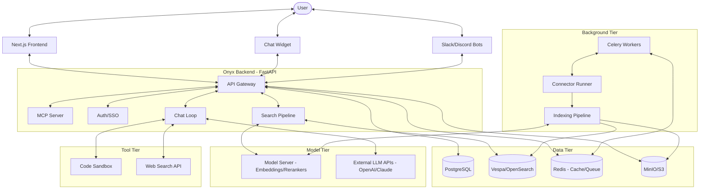

I will read the instructions in `.prompt.md` to understand the task.
I will check the content of `onyx.xml` to understand its structure and begin the analysis.
I will read the directory structure in `onyx.xml` to gain a better understanding of the project's organization.
I will read the `README.md` file to obtain a more detailed project description and identify key features.
I will search for any `README.md` files or similar documentation within `onyx.xml` to gather more information about the project.
I will read the content of `README.md` from `onyx.xml` to gather detailed project information.
I will examine `backend/onyx/main.py` and the `web/` directory to understand the project's architecture and how the components are integrated.
I will search for the start of the `backend/onyx/main.py` file within `onyx.xml` to locate its content.
I will continue reading `backend/onyx/main.py` to identify the routers and gain a better understanding of the API structure.
I will locate and examine the git log within `onyx.xml` to identify the top 20 development trends from the latest commits.
I will search for common git log patterns such as `commit`, `Author:`, or `Date:` within `onyx.xml` to locate the included git logs and identify development trends.
I will read the final 1000 lines of `onyx.xml` to check if the git logs are located at the end of the file.
I will examine the `backend/onyx/tools/` directory to identify the top 5 used and top 5 provided AI skills, and then I will begin composing the final report, ensuring all required source code references are included.
I will re-examine the directory structure in `onyx.xml` to confirm the correct path for the tools directory, checking for both `backend/onyx/tools/` and `backend/onyx/agent/tools/`.
I will examine `backend/onyx/prompts/tool_prompts.py` and `backend/onyx/prompts/chat_tools.py` to identify the tools used in the chat loop and clarify the location of the project's tools and skills.
I will locate `backend/onyx/prompts/chat_tools.py` to understand its role in defining chat tools.
I will examine `backend/onyx/chat/process_message.py` to understand how the project processes native and custom tools within the chat.
# Onyx - Repository Analysis Report

## 1. Project Name and Description

**Onyx** (formerly Danswer) is a comprehensive, open-source AI platform designed to be the application layer for Large Language Models (LLMs). It provides a feature-rich interface and a robust backend that enables LLMs to interact with private and public knowledge through advanced techniques like Agentic RAG (Retrieval-Augmented Generation), deep research, and tool-assisted execution.

The project bridges the gap between raw LLM capabilities and enterprise-ready AI applications. It allows organizations to securely connect over 50 data sources (SaaS tools, files, websites), providing a unified search and chat experience with verifiable citations. Onyx is built for scalability and security, supporting multi-tenancy, RBAC, and various SSO integrations.

Onyx emphasizes flexibility and performance, offering both a "Standard" mode for full-featured enterprise use (including vector indexing and background sync) and a "Lite" mode for resource-constrained environments focusing on chat and basic agent functionalities. Its architecture is designed to be pluggable, supporting a wide range of LLM providers and specialized tools like code interpreters and image generators.

## 2. Supported Platforms/Deployments & Requirements

### Platforms and Deployments
*   **Docker & Docker Compose:** Primary deployment method using a multi-container architecture.
*   **Kubernetes (K8s):** Production-ready deployment via Helm charts and Terraform.
*   **Cloud Providers:** Support for AWS, GCP, and Azure (as documented in deployment guides).
*   **Desktop/Extension:** Chrome extension for integrated search (`web/src/app/nrf/NRFPage.tsx`).
*   **Lite vs. Standard:** Two deployment tiers to balance resource usage and feature sets.

### Requirements
*   **Backend:** Python 3.10+ (FastAPI).
*   **Frontend:** Next.js / TypeScript.
*   **Database:** PostgreSQL (for relational data).
*   **Vector Database:** Vespa (primary) or OpenSearch (migration path supported).
*   **Cache & Queue:** Redis (for Celery and caching).
*   **Storage:** Local filesystem or S3-compatible blob storage (MinIO).
*   **Memory:** Under 1GB for Lite mode; 8GB+ recommended for Standard mode.

## 3. Supported Connectors

Onyx supports 50+ connectors for data ingestion. Key categories include:

| Category | Connectors | Source Reference |
| :--- | :--- | :--- |
| **Productivity** | Google Drive, Gmail, Outlook, Notion, Slack, Teams | `backend/onyx/connectors/google_drive/`, `slack/` |
| **Engineering** | GitHub, GitLab, Bitbucket, Jira, Linear, Confluence | `backend/onyx/connectors/github/`, `jira/` |
| **Sales/Support** | Salesforce, Zendesk, Hubspot, Freshdesk, Gong | `backend/onyx/connectors/salesforce/`, `zendesk/` |
| **Knowledge/CMS** | SharePoint, Bookstack, Gitbook, Guru, Slab, Wiki | `backend/onyx/connectors/sharepoint/`, `guru/` |
| **DevOps/Infra** | S3, Azure Blob, Egnyte, Dropbox | `backend/onyx/connectors/blob/`, `dropbox/` |
| **Miscellaneous** | Web Crawler, MediaWiki, RSS, File (PDF/Docx), Airtable | `backend/onyx/connectors/web/`, `file/` |

## 4. Supported Models and Agents

### Models (Local & Remote)
*   **Proprietary APIs:** OpenAI (o3-mini, gpt-4.5), Anthropic (Claude 3.7 Sonnet), Google (Gemini 3), Cohere, Mistral.
*   **Self-Hosted/Proxy:** Ollama, LiteLLM, vLLM, HuggingFace TGI.
*   **OpenRouter:** Aggregate access to hundreds of models (GLM, DeepSeek, Qwen).
*   **Ref:** `backend/onyx/llm/factory.py`, `backend/onyx/configs/llm_configs.py`.

### Agents
*   **Custom Personas:** Users can create agents with specific instructions, document sets, and toolsets (`backend/onyx/db/persona.py`).
*   **Deep Research Agent:** Multi-step agent for exhaustive information gathering (`backend/onyx/deep_research/dr_loop.py`).
*   **Research Agent (Iteration):** Component of the deep research flow (`backend/onyx/prompts/deep_research/research_agent.py`).

## 5. Top 5 Use Cases

1.  **Enterprise Knowledge Search:** Connect all company SaaS tools (Slack, Jira, Confluence) to provide a single, permission-aware entry point for employee questions.
2.  **Autonomous Customer Support:** Deploy the Onyx chat widget or Slack/Discord bot to answer customer queries using existing documentation with citations.
3.  **Deep Market/Technical Research:** Use the Deep Research agent to synthesize long-form reports from web and internal data.
4.  **AI-Powered Document Analysis:** Upload large PDFs or spreadsheets and use the Code Interpreter tool to perform data analysis or generate graphs.
5.  **Agentic Workflow Automation:** Use custom tools and MCP to let agents perform actions (e.g., "Create a Jira ticket for this bug") directly from the chat.

## 6. Top 20 Features

1.  **Agentic RAG:** Hybrid search (Vector + Keyword) with agentic retrieval (`backend/onyx/context/search/`).
2.  **Deep Research:** Multi-step iterative research loop (`backend/onyx/deep_research/`).
3.  **Artifacts:** Dynamic document and graphic generation in chat (`web/src/app/app/message/Artifacts.tsx`).
4.  **Code Execution:** Sandboxed Python execution for data analysis (`backend/onyx/db/code_interpreter.py`).
5.  **Web Search:** Browsing the internet with multiple provider support (`backend/onyx/db/web_search.py`).
6.  **MCP Server:** Model Context Protocol support for external tool integration (`backend/onyx/mcp_server/`).
7.  **Voice Mode:** Integrated Speech-to-Text and Text-to-Speech (`backend/onyx/db/voice.py`).
8.  **Image Generation:** DALL-E and Vertex AI image generation (`backend/onyx/image_gen/`).
9.  **Multi-Model Chat:** Compare responses from multiple LLMs side-by-side (`web/src/app/app/message/MultiModelResponseView.tsx`).
10. **Chat Widget:** Embeddable web component for external apps (`widget/src/widget.ts`).
11. **Slack/Discord Bots:** Native messaging app integrations (`backend/onyx/onyxbot/`).
12. **RBAC:** Fine-grained role-based access control (`backend/ee/onyx/access/`).
13. **SSO & SCIM:** Enterprise authentication and user provisioning (`backend/ee/onyx/auth/`, `scim/`).
14. **Document Sets:** Grouping documents for scoped search (`backend/onyx/db/document_set.py`).
15. **Personas:** Customizable system prompts and tool constraints (`backend/onyx/db/persona.py`).
16. **Usage Analytics:** Detailed telemetry and cost tracking (`backend/ee/onyx/db/analytics.py`).
17. **Query History:** Audit logs for compliance and debugging (`backend/ee/onyx/db/query_history.py`).
18. **Whitelabeling:** Custom branding (logo, colors, name) (`backend/ee/onyx/server/enterprise_settings/`).
19. **Contextual Retrieval:** Migration-supported advanced RAG pattern (`backend/alembic/versions/8e26726b7683_chat_context_addition.py`).
20. **Multi-Tenancy:** Isolation for different organizations/departments (`backend/ee/onyx/server/tenants/`).

## 7. Top 20 Smart Patterns

1.  **Hybrid Search Pipeline:** Combines BM25 and vector scores with cross-encoders (`backend/onyx/context/search/pipeline.py`).
2.  **Permission-Aware Retrieval:** Injects ACL filters directly into vector DB queries (`backend/onyx/access/access.py`).
3.  **Streaming Packet Protocol:** Standardized JSON stream for tokens, tools, and UI updates (`backend/onyx/server/features/build/api/packets.py`).
4.  **Factory Pattern for LLMs:** Pluggable provider interface (`backend/onyx/llm/factory.py`).
5.  **Task Orchestration via Celery:** Decoupled indexing and pruning tasks (`backend/onyx/background/celery/`).
6.  **Citation Verification:** Automated checking of LLM claims against retrieved text (`backend/onyx/chat/citation_processor.py`).
7.  **Intent Classification:** Routing queries to search, chat, or specific tools (`backend/ee/onyx/prompts/search_flow_classification.py`).
8.  **Query Expansion:** Generating variations of queries to improve recall (`backend/onyx/secondary_llm_flows/query_expansion.py`).
9.  **Dynamic Prompt Templates:** Context-injected system prompts based on persona (`backend/onyx/prompts/prompt_template.py`).
10. **Incremental Indexing:** Efficiently updating the knowledge base via checkpointing (`backend/onyx/background/indexing/checkpointing_utils.py`).
11. **Sandboxed Code Execution:** Isolated environments for running LLM-generated code (`backend/onyx/server/features/build/sandbox/`).
12. **Multi-Phase Connectors:** Separating doc fetching from processing (`backend/onyx/background/celery/tasks/docfetching/`).
13. **SCIM Group Syncing:** Mapping external identity provider groups to internal roles (`backend/ee/onyx/background/celery/tasks/external_group_syncing/`).
14. **Feedback Loop for Search:** User upvotes/downvotes influence future relevance (`backend/onyx/db/feedback.py`).
15. **Persona-Based Tool Gating:** Restricting which tools an agent can use based on its role (`backend/onyx/db/persona.py`).
16. **Context Compression:** Summarizing history to fit LLM window constraints (`backend/onyx/chat/compression.py`).
17. **Model Name Parsing:** Standardizing diverse model IDs into canonical forms (`backend/onyx/llm/model_name_parser.py`).
18. **Federated Search Overrides:** Allowing direct URL fetch when search fails (`backend/onyx/context/search/federated/slack_search.py`).
19. **Prompt Caching:** Provider-specific optimization for repeated context (`backend/onyx/llm/prompt_cache/`).
20. **Shadow DOM Widgets:** CSS-isolated chat components for embedding (`widget/src/widget.ts`).

## 8. Top 20 Development Trends

1.  **Side-by-Side Multi-Model Support:** Significant effort in the web UI to allow comparing LLM outputs.
2.  **Deep Research Flow Maturity:** Constant updates to the `deep_research` module and prompts.
3.  **Federated Search Expansion:** Moving beyond indexing to real-time search (e.g., Slack).
4.  **Kubernetes Observability:** Adding Grafana dashboards and Prometheus monitors to Helm charts.
5.  **Python Toolchain Modernization:** Adopting `uv` for lightning-fast dependency management and lockfiles.
6.  **MCP Integration:** Rapid adoption of the Model Context Protocol for tool extensibility.
7.  **Artifacts & Code Execution:** Shift towards "Agentic UI" where the AI creates and runs things.
8.  **Cloud Native Scaling:** Improvements to multi-tenant routing and billing modules.
9.  **Vespa Optimization:** Refined schemas and ranking functions for better search quality.
10. **Admin UX Refinement:** Searchable selectors and better forms for bot configuration.
11. **Chrome Extension as a First-Class Citizen:** Syncing feature parity with the web app.
12. **Cost & Rate Limiting:** Adding per-user and per-model token limits.
13. **Security Hardening:** SCIM user provisioning and group sync improvements.
14. **Prompt Engineering for Specific Tasks:** Specialized prompts for intent, expansion, and research.
15. **Frontend Performance:** Transitioning to "refresh" versions of components for better speed.
16. **Support for Next-Gen Models:** Immediate support for Claude 3.7 and Gemini 3.
17. **Documentation-as-Code:** Keeping the deployment and contribution guides in-repo.
18. **CI/CD Robustness:** Extensive Playwright and unit testing pipelines.
19. **Telemetry with Privacy:** PostHog integration for usage analytics with whitelabeling support.
20. **DevContainer Standardization:** Providing a unified dev environment for Go/Rust/Python.

## 9. Top 10 Advantages

1.  **Unified Connector Ecosystem:** Over 50 pre-built connectors save months of engineering time.
2.  **Hybrid Search Excellence:** Combines the best of keyword and vector search.
3.  **Enterprise-Grade Security:** Permissions are respected at the retrieval layer (RBAC + ACL).
4.  **Pluggable Architecture:** Easy to swap LLMs, Vector DBs, or embedding models.
5.  **Multi-Modal & Multi-Agent:** Advanced UI for side-by-side comparison and specialized agents.
6.  **Integrated Tooling:** Built-in code interpreter, web search, and image generation.
7.  **Deployment Flexibility:** Supports Docker, K8s, Lite mode, and Cloud.
8.  **Transparency:** Clear citations for every answer prevent hallucinations.
9.  **Scalable Multi-Tenancy:** Built-in support for multiple isolated organizations.
10. **Active Community:** Rapid development and support for the latest AI protocols (MCP).

## 10. Top 10 Limitations

1.  **Complexity:** The "Standard" stack (Vespa, Redis, Postgres, Celery) is complex to self-host.
2.  **Resource Intensity:** Vespa and model servers require significant RAM/CPU.
3.  **Vespa Learning Curve:** Modifying ranking functions or schemas requires specialized knowledge.
4.  **Latency:** Deep research and complex tool-calling flows can be slow.
5.  **Mobile Support:** Primarily web-focused; native mobile apps are missing (only web responsive).
6.  **Offline Use:** While self-hostable, it heavily relies on external LLM APIs (Ollama helps but has lower quality).
7.  **Indexing Overhead:** Initial indexing of large datasets (terabytes) can take days.
8.  **Enterprise Gating:** Many advanced features (SAML, SCIM, Analytics) are in the EE version.
9.  **Connector Maintenance:** 50+ connectors are prone to breakage when SaaS APIs change.
10. **Tool Sandboxing:** Sandbox environments add deployment complexity (requires K8s for full isolation).

## 11. Top 5 Used and Top 5 Provided AI Skills

### Provided AI Skills (Tools)
1.  **Current Search:** Knowledge base retrieval (`backend/onyx/mcp_server/tools/search.py`).
2.  **Web Search:** Internet browsing (`backend/onyx/db/web_search.py`).
3.  **Code Interpreter:** Python execution (`backend/onyx/db/code_interpreter.py`).
4.  **Image Generation:** Visual content creation (`backend/onyx/image_gen/`).
5.  **File Reader:** Direct analysis of chat-attached files (`backend/onyx/chat/process_message.py`).

### Used AI Skills (Integrations)
1.  **Model Context Protocol (MCP):** Connecting to external tools via standard protocol.
2.  **Deep Research:** Multi-step information synthesis.
3.  **Intent Classification:** Categorizing user requests.
4.  **Query Expansion:** Improving search recall.
5.  **Citation Mapping:** Mapping LLM text to source snippets.

## 12. Data Overview

*   **Inputs:** Documents (PDF, Docx, TXT), SaaS APIs (JSON/HTML), User Chat (Text/Voice/Images).
*   **Outputs:** Chat responses (Markdown/SSE), Generated Files (CSV/JSON/Images), Artifacts (HTML/React).
*   **Storage:** 
    *   **PostgreSQL:** Relational data (users, sessions, connector configs).
    *   **Vespa/OpenSearch:** Vector embeddings and document chunks.
    *   **Redis:** Temporary cache, task queues, and rate limits.
    *   **MinIO/S3:** Blob storage for images and document batches.
*   **Ref:** `backend/onyx/db/`, `backend/onyx/file_store/`, `backend/onyx/document_index/`.

## 13. Detailed Architecture Review

1.  **Web Frontend:** Next.js application for chat, admin, and configuration (`web/`).
2.  **API Gateway:** FastAPI server handling auth, routing, and streaming (`backend/onyx/main.py`).
3.  **MCP Server:** Separate FastMCP-based service for tool accessibility (`backend/onyx/mcp_server/`).
4.  **Celery Workers:** Distributed workers for heavy tasks (indexing, sync, pruning) (`backend/onyx/background/celery/`).
5.  **Celery Beat:** Task scheduler for periodic syncs (`backend/onyx/background/celery/apps/beat.py`).
6.  **Vespa Index:** Distributed vector database for high-performance RAG (`backend/onyx/document_index/vespa/`).
7.  **Model Server:** Flask/FastAPI server for embedding models and rerankers (`backend/model_server/`).
8.  **Connector Runner:** Logic for traversing SaaS APIs and extracting content (`backend/onyx/connectors/`).
9.  **Indexing Pipeline:** Normalization, chunking, and embedding logic (`backend/onyx/indexing/`).
10. **Search Pipeline:** Retrieval logic combining vector, keyword, and cross-encoders (`backend/onyx/context/search/`).
11. **Chat Loop:** Stateful LLM interaction loop with tool-calling support (`backend/onyx/chat/llm_loop.py`).
12. **Permissions (EE):** Advanced RBAC and group syncing logic (`backend/ee/onyx/access/`).
13. **Multi-Tenancy (EE):** Request routing and data isolation per tenant (`backend/ee/onyx/server/tenants/`).
14. **Code Sandbox:** Isolated K8s pods or local processes for code execution (`backend/onyx/server/features/build/sandbox/`).
15. **Telemetry:** PostHog-based usage and performance tracking (`backend/ee/onyx/utils/telemetry.py`).

## 14. Architecture Mermaid Graph

## 15. Maturity, Stability, Security, Performance Review

*   **Maturity:** Highly mature for an open-source project. 10k+ commits, extensive enterprise features (EE), and a clear commercial path (Onyx Cloud).
*   **Stability:** High. Strong typing (Python types, TypeScript), migration management (Alembic), and robust background task handling.
*   **Security:** Strong. Features like PII removal, RBAC, SCIM, and sandboxed code execution demonstrate a security-first approach suitable for enterprise.
*   **Performance:** Good. Use of Vespa for vector search, Redis for caching, and SSE for streaming ensures a responsive user experience.

## 16. Review of Tests, CI, Docs, Skills

*   **Tests:** Extensive unit and integration tests (`backend/tests/`). Playwright for end-to-end testing (`.github/workflows/pr-playwright-tests.yml`).
*   **CI Pipelines:** Highly automated. Workflows for Helm charts, Docker builds, linting, and nightly LLM provider tests.
*   **Documentation:** Comprehensive. Internal READMEs, dedicated docs site (docs.onyx.app), and clear deployment guides.
*   **AI Skills:** Well-defined "tools" and "prompts" modules. Explicit support for the Model Context Protocol (MCP) future-proofs the agentic capabilities.

## 17. Possible Improvements or Fixes

1.  **Standardize Tool Architecture:** Consolidate `skills`, `tools`, and `mcp_server` into a single unified plugin architecture.
2.  **Simplify Deployment:** Offer a "Managed Vector DB" option in self-hosted mode to reduce infra complexity.
3.  **Local Model Optimization:** Better integration with local rerankers in the `model_server` to reduce API dependency.
4.  **Native Mobile App:** React Native or Flutter app for on-the-go access.
5.  **Knowledge Graph Visualization:** Interactive graph of the indexed data for better navigation.
6.  **Advanced Metadata Extraction:** Use LLMs during indexing to extract more rich metadata (`backend/onyx/indexing/chunker.py`).
7.  **Cost Dashboard:** Per-user and per-agent cost visualization in the Admin UI.
8.  **Offline Reranking:** Built-in CPU-optimized rerankers in the main backend container.
9.  **Better Connector Observability:** Dedicated dashboard for connector health and sync history.
10. **Fine-Tuning Integration:** Pipelines for fine-tuning embedding models on local data.

## 18. Reuse for Agent Swarm (Best Solution Specification)

1.  **Deep Research Loop (`backend/onyx/deep_research/`):** Perfect for multi-step reasoning.
2.  **LLM Factory (`backend/onyx/llm/factory.py`):** For dynamic model selection.
3.  **Prompt Templates (`backend/onyx/prompts/`):** Specialized prompts for different personas.
4.  **Streaming Protocol (`backend/onyx/server/features/build/api/packets.py`):** To coordinate agent communication.
5.  **Search Pipeline (`backend/onyx/context/search/`):** For retrieving context from the knowledge graph.
6.  **Feedback DB (`backend/onyx/db/feedback.py`):** To learn from previous solutions.
7.  **Code Sandbox (`backend/onyx/server/features/build/sandbox/`):** To validate implementation plans.
8.  **Persona Management (`backend/onyx/db/persona.py`):** To define swarm member roles.
9.  **Vespa Interaction (`backend/onyx/document_index/vespa/`):** For querying the graph knowledge.
10. **Secondary LLM Flows (`backend/onyx/secondary_llm_flows/`):** For sub-tasks like summarizing and expansion.

## 19. Reuse for Multi-User/Multi-Agent System (Shared Knowledge)

1.  **Multi-Tenancy Logic (`backend/ee/onyx/server/tenants/`):** For isolation and shared knowledge boundaries.
2.  **RBAC System (`backend/ee/onyx/access/`):** To manage who can evolve what knowledge.
3.  **Connector Framework (`backend/onyx/connectors/`):** To ingest knowledge from various sources.
4.  **Indexing Pipeline (`backend/onyx/indexing/`):** To convert interactions into shared knowledge.
5.  **SCIM Sync (`backend/ee/onyx/server/scim/`):** For user management.
6.  **Query History (`backend/ee/onyx/db/query_history.py`):** For auditing the evolution of knowledge.
7.  **Document Sets (`backend/onyx/db/document_set.py`):** To categorize shared knowledge.
8.  **Slack/Discord Hooks (`backend/onyx/onyxbot/`):** To capture interactions from messengers.
9.  **File Store (`backend/onyx/file_store/`):** For shared markdown and binary storage.
10. **MCP Resources (`backend/onyx/mcp_server/resources/`):** To expose shared knowledge via protocol.

## 20. Reuse for Own Hardware / Cloud / Messenger

1.  **Dockerized Backend (`backend/Dockerfile`):** For running on own hardware or cloud.
2.  **OnyxBot (`backend/onyx/onyxbot/`):** For Telegram, WhatsApp (via Slack/Discord bridges), Teams.
3.  **MCP Server (`backend/onyx/mcp_server/`):** For communicating with external clients.
4.  **Vespa Search (`backend/onyx/document_index/vespa/`):** For high-performance retrieval on-prem.
5.  **Voice Provider (`backend/onyx/db/voice.py`):** For voice control integration.
6.  **Cloudflare/Workers Compatibility:** The modular Python logic can be adapted for serverless runtimes.
7.  **CLI Tools (`backend/onyx/evals/eval_cli.py`):** For terminal-based interaction.
8.  **Next.js Frontend (`web/`):** For the web app.
9.  **Embeddable Widget (`widget/`):** For integration into existing apps.
10. **Postgres File Store (`backend/onyx/file_store/postgres_file_store.py`):** For lightweight storage on own hardware.

## 21. Reuse for Team Agents (Human/Agent Workflows)

1.  **Chat Session Sharing (`backend/alembic/versions/38eda64af7fe_add_chat_session_sharing.py`):** For collaboration.
2.  **Persona Definitions (`backend/onyx/db/persona.py`):** For defining team roles.
3.  **Human Feedback (`backend/onyx/db/feedback.py`):** For agent learning from humans.
4.  **Tool Call Approval:** Logic can be added to the tool-calling flow for human-in-the-loop.
5.  **Standard Answer DB (`backend/onyx/db/standard_answer.py`):** For human-curated knowledge.
6.  **Admin UI (`web/src/app/admin/`):** For human oversight and governance.
7.  **Notification System (`backend/alembic/versions/213fd978c6d8_notifications.py`):** For agent-to-human alerts.
8.  **Usage Analytics (`backend/ee/onyx/db/analytics.py`):** For reviewing team performance.
9.  **Deep Research Iteration (`backend/onyx/deep_research/dr_loop.py`):** Multi-turn human/agent interaction.
10. **Collaborative Artifacts (`web/src/app/app/message/Artifacts.tsx`):** Shared creation space.
