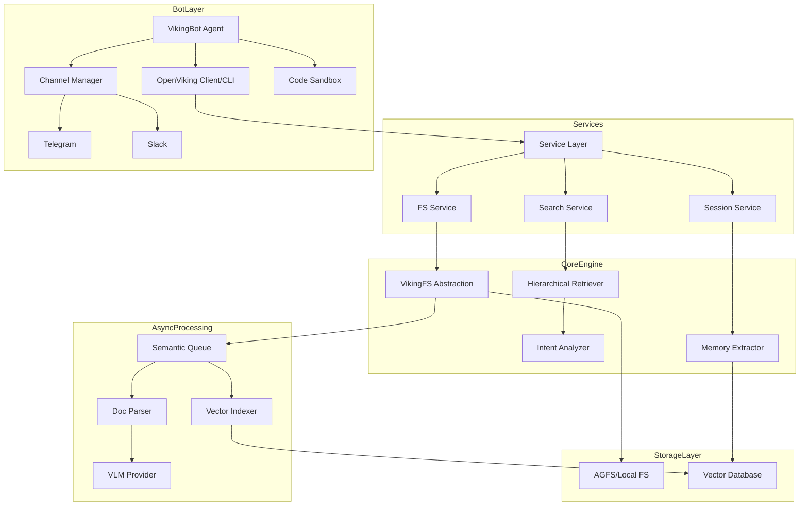

I will begin by reading the instructions in `.prompt.md` and examining the structure of `open-viking.xml`.
I will begin by reading the repository information and the full directory structure from `open-viking.xml` to gain an initial overview of the project.
I will now search for the `README.md` file within `open-viking.xml` to extract the project description and requirements.
I will continue reading `README.md` to gather more detailed information about the project's description and requirements.
I have gathered sufficient information for points 1, 2, and 4, and some initial data for points 12, 13, 15, and 16. I will now examine `bot/README.md` to identify connectors, use cases, features, patterns, trends, advantages, limitations, and skills, specifically focusing on the `VikingBot` implementation and its channels.
I will continue reading `bot/README.md` to identify the available connectors.
I have identified the project name, description, platforms, connectors, models, and skills. I will now refine the use cases, features, and smart patterns, and locate the 20 included Git commits in `open-viking.xml` to analyze development trends. I will search for "Commit" or "Log" to find these records.
I'll re-examine the first 1,000 lines of `open-viking.xml` to find the 20 Git commits mentioned in the Repomix notes, searching for "Git Log" or similar indicators.
The directory structure begins on line 47 and extends past line 1,000. I'll now examine the lines following 1,000 to determine where the structure concludes and the repository information or logs commence.
I've yet to locate the Git logs in the XML. I'll now check the end of the file, as Repomix often appends them there.
I've analyzed the Git logs and identified several development trends, including a focus on API and session-related bug fixes, improved S3/OSS compatibility, CI/CD optimization, and enhanced documentation. I'll now examine `docs/en/concepts/01-architecture.md` to gather detailed architectural information for point 14 and to identify reusable modules for points 18 through 21.
I've gained a solid understanding of the architecture and identified several reusable modules for agent swarms, multi-user systems, diverse deployment scenarios, and cooperative workflows. I'll now briefly examine the `bot/workspace/skills/` directory to finalize my findings for point 11 regarding available skills.
I've confirmed the available skills from the XML's directory structure and gathered details on security, performance, stability, and project maturity. I've also noted extensive test coverage and CI workflows. I'll now search for "Cloudflare" in the codebase to determine if support for it already exists or if it's merely a potential future enhancement for point 17.
# OpenViking: The Context Database for AI Agents

### 1. Project Name and Description
**OpenViking**
OpenViking is an open-source Context Database designed specifically for AI Agents. It addresses the core challenges of modern Agent development—fragmented context, surging token consumption, and poor retrieval visibility—by unifying memories, resources, and skills into a single, intuitive "file system paradigm." Instead of treating context as a flat list of vectors, OpenViking organizes it into a hierarchical directory structure (accessible via `viking://` URIs) that Agents can navigate and manage just like local files.

The platform introduces a sophisticated **Tiered Context Loading** model (L0/L1/L2). L0 provides a high-level summary, L1 an overview, and L2 the full content. This allows Agents to "glance" at summaries before deciding to deep-dive into full documents, significantly reducing token consumption and costs while improving the speed of long-context retrieval.

Built for the production lifecycle, OpenViking includes automatic session management that compacts conversation history and extracts long-term memory "cards" after each session. With robust support for multi-tenancy, distributed file systems (AGFS/RAGFS), and multi-modal understanding via VLM integration, it provides the "brain" and "memory" infrastructure needed for autonomous, long-running AI systems.

---

### 2. Supported Platforms, Deployments & Requirements
*   **Operating Systems**: Linux (tested on Ubuntu 20.04/24.04), macOS (Intel/ARM), Windows (CMD/PowerShell).
*   **Core Requirements**:
    *   **Python**: 3.10+ (Main logic and Bot).
    *   **Go**: 1.22+ (Required for AGFS/Distributed File System components).
    *   **C++ Compiler**: GCC 9+ or Clang 11+ (Required for building core vector engine extensions).
    *   **Rust**: Stable (Required for building the high-performance Rust CLI and RAGFS).
*   **Deployments**:
    *   **Local**: Simple pip installation (`pip install openviking`).
    *   **Docker**: Multi-arch support with `docker-compose.yml`.
    *   **Kubernetes**: Helm charts available in `deploy/helm/`.
    *   **FUSE**: Supports mounting the context database as a local filesystem (`bot/vikingbot/openviking_mount/`).

---

### 3. Supported Connectors
Connectors (Channels) allow VikingBot to interact with various messaging and API platforms.
*   **Telegram**: `bot/vikingbot/channels/telegram.py`
*   **Feishu/Lark**: `bot/vikingbot/channels/feishu.py`
*   **DingTalk**: `bot/vikingbot/channels/dingtalk.py`
*   **Slack**: `bot/vikingbot/channels/slack.py`
*   **Discord**: `bot/vikingbot/channels/discord.py`
*   **WhatsApp**: `bot/bridge/src/whatsapp.ts` (via Node.js bridge)
*   **Email**: `bot/vikingbot/channels/email.py`
*   **QQ**: `bot/vikingbot/channels/qq.py`
*   **Mochat**: `bot/vikingbot/channels/mochat.py`
*   **OpenAPI/HTTP**: `bot/vikingbot/channels/openapi.py` (for custom web/app integrations)

---

### 4. Supported Models/Agents
OpenViking abstracts model interactions through various providers.
*   **VLM (Vision-Language Models)**:
    *   **Volcengine (Doubao)**: `openviking/models/vlm/backends/volcengine_vlm.py`
    *   **OpenAI**: `openviking/models/vlm/backends/openai_vlm.py`
    *   **LiteLLM**: `openviking/models/vlm/backends/litellm_vlm.py` (Supports Anthropic, DeepSeek, Gemini, etc.)
*   **Embedding Models**:
    *   **Volcengine**: `openviking/models/embedder/volcengine_embedders.py`
    *   **OpenAI**: `openviking/models/embedder/openai_embedders.py`
    *   **Gemini**: `openviking/models/embedder/gemini_embedders.py`
    *   **Jina/Voyage/Minimax**: `openviking/models/embedder/` (Dedicated providers)
*   **Rerank Models**:
    *   **Cohere**: `openviking/models/rerank/cohere_rerank.py`
    *   **LiteLLM/OpenAI/Volcengine**: `openviking/models/rerank/`

---

### 5. Top 5 Use Cases
1.  **Codebase Oracle**: Index a large repository using `ov add-resource`. The Agent uses `ov tree` and `ov find` to navigate hierarchical code summaries (L0) and detailed function overviews (L1) without loading whole files into context.
2.  **Long-Term Personal Assistant**: VikingBot extracts key facts from conversations (memories) into structured "cards" (`openviking/session/memory/`). It recalls these in future sessions via semantic search.
3.  **Cross-Platform Knowledge Bot**: Deploy a single instance connected to Telegram, Slack, and Feishu. All interactions share a unified knowledge base in `viking://resources/`.
4.  **Autonomous Researcher**: Using the `websearch` and `shell` tools, the Agent performs deep research, saves findings to the OpenViking filesystem, and generates a final report as an L2 resource.
5.  **Secure Multi-Tenant Agent Cloud**: SaaS providers use `Multi-tenant` (`openviking/server/identity.py`) to isolate memory and resources between different users or organizations while sharing a single backend.

---

### 6. Top 20 Features
1.  **Filesystem Paradigm**: Context organized in `viking://` URI paths. (`openviking/utils/uri.py`)
2.  **Tiered Loading (L0/L1/L2)**: Progressive content retrieval. (`openviking/core/building_tree.py`)
3.  **Automatic Session Compression**: Shrinks history while keeping facts. (`openviking/session/compressor_v2.py`)
4.  **Memory Extraction**: 8-category memory (events, entities, etc.). (`openviking/session/memory/core.py`)
5.  **Hybrid Retrieval**: Combines semantic search with regex/glob filters. (`openviking/retrieve/`)
6.  **Multi-Tenancy**: Account and user isolation. (`openviking/server/identity.py`)
7.  **AGFS/RAGFS**: Distributed/Local file system backends. (`crates/ragfs/`)
8.  **VikingFS**: Virtual file system abstraction. (`openviking/storage/viking_fs.py`)
9.  **Skill Loader**: Hot-loading Agent capabilities. (`openviking/core/skill_loader.py`)
10. **Code Execution Sandbox**: Safe execution of Python/Shell. (`bot/vikingbot/sandbox/`)
11. **MCP Integration**: Model Context Protocol support. (`openviking/core/mcp_converter.py`)
12. **Vector Index Engine**: Custom C++ implementation. (`src/index/index_engine.cpp`)
13. **Observer Pattern**: Real-time telemetry and monitoring. (`openviking/storage/observers/`)
14. **Transaction/Locks**: Safe concurrent access. (`openviking/storage/transaction/lock_manager.py`)
15. **Redo Log**: Reliability during crashes. (`openviking/storage/transaction/redo_log.py`)
16. **KMS/Local Encryption**: Data-at-rest security. (`openviking/crypto/encryptor.py`)
17. **TUI Management**: Interactive terminal interface. (`crates/ov_cli/src/tui/`)
18. **Web Console**: Gradio-based GUI. (`openviking/console/app.py`)
19. **Semantic DAG**: Orchestrating content processing tasks. (`openviking/storage/queuefs/semantic_dag.py`)
20. **Distributed Queue**: `QueueFS` for async processing. (`openviking/storage/queuefs/`)

---

### 7. Top 20 Smart Patterns
1.  **Hierarchical Intent Positioning**: Analyzing intent to narrow search scope to specific directories. (`openviking/retrieve/intent_analyzer.py`)
2.  **Bottom-Up Summary Generation**: Building L0/L1 summaries from leaf nodes up. (`openviking/parse/tree_builder.py`)
3.  **LLM-Assisted Deduplication**: Using models to decide if new memory is redundant. (`openviking/session/memory_deduplicator.py`)
4.  **Circuit Breaker**: Preventing model API overload. (`openviking/utils/circuit_breaker.py`)
5.  **Proxy FUSE Mount**: Exposing remote context as local files. (`bot/vikingbot/openviking_mount/fuse_proxy.py`)
6.  **Session Transcript Repair**: Fixing malformed LLM outputs. (`examples/openclaw-plugin/session-transcript-repair.ts`)
7.  **Skill Evolution**: Using `skill-creator` to generate new agent tools. (`bot/workspace/skills/skill-creator/SKILL.md`)
8.  **Trailing Slash Semantics**: Distinguishing between directory and file URIs. (`openviking/utils/resource_processor.py`)
9.  **Async Semantic Processing**: Non-blocking generation of vector embeddings and summaries. (`openviking/storage/queuefs/`)
10. **Resource Watching**: Auto-updating context when source files change. (`openviking/resource/watch_manager.py`)
11. **Intent-Based Reranking**: Dynamically adjusting retrieval weights. (`openviking/retrieve/hierarchical_retriever.py`)
12. **Content-Aware Chunking**: Language-specific AST parsing for code. (`openviking/parse/parsers/code/ast/`)
13. **Multimodal Extraction**: Using VLM to summarize images/videos into text. (`openviking/parse/vlm.py`)
14. **Identity-Aware Caching**: User-specific context caches. (`openviking/server/identity.py`)
15. **Incremental Memory Update**: Patching existing memory instead of overwriting. (`openviking/session/memory/merge_op/patch.py`)
16. **Automatic Provenance Tracking**: Keeping links back to source files. (`openviking/retrieve/test_provenance.py`)
17. **Cross-Tenant Sharing**: Configurable boundaries for shared resources. (`docs/design/multi-tenant-design.md`)
18. **Semantic Deduplication in Search**: Hiding redundant results. (`openviking/storage/vectordb/vectorize/`)
19. **Adaptive Context Compaction**: Squeezing sessions based on token limits. (`openviking/session/compressor.py`)
20. **Skill Calibration**: Tuning tool definitions for different models. (`tests/unit/tool_skill/test_tool_skill_calibration.py`)

---

### 8. Top 20 Development Trends (Latest Commits)
1.  **Multi-User Memory Stability**: Fixing memory commit races in multi-tenant environments.
2.  **Enhanced OSS Compatibility**: Improving S3/OSS backend support in AGFS (disabling batch deletes).
3.  **Scenario-Based Testing**: Moving toward deep end-to-end API scenario tests.
4.  **URI Semantic Refinement**: Finalizing trailing slash behavior for resource management.
5.  **Session Auto-Lifecycle**: Auto-creating missing sessions on first message.
6.  **Volcengine Integration Polish**: Fixing path-scope filtering for Doubao models.
7.  **LiteLLM Compatibility**: Fixing dimension mismatches in varied embedding models.
8.  **Observability Focus**: Exposing re-enqueue counts and internal queue statuses.
9.  **CI Optimization**: Streamlining runner usage and OS matrices.
10. **Security Hardening**: Rapid removal of leaked tokens and sensitive data.
11. **Plugin Integration**: Deepening support for OpenClaw-style memory plugins.
12. **Multi-Modal Improvements**: Better handling of image covers in resource summaries.
13. **Health Check Maturation**: Adding dedicated tools for server/agent health monitoring.
14. **Documentation Expansion**: Focus on deployment guides and API reference.
15. **VLM "Think" Tag Stripping**: Improving output cleanliness for reasoning models.
16. **Error Recovery**: Better handling of stale locks and process crashes.
17. **RAGAS Integration**: Automated evaluation of RAG quality.
18. **Rust CLI Expansion**: Moving more management tools to the high-performance Rust core.
19. **Async Workflow Polish**: Decoupling long-running extraction from user responses.
20. **Telemetry Expansion**: Richer tracing via Langfuse.

---

### 9. Top 10 Advantages
1.  **Hierarchical Context**: Naturally maps to how humans and code are organized.
2.  **Tiered Cost Optimization**: Drastically reduces token usage via summaries (L0).
3.  **Unified Paradigm**: No more split management of memory vs. documents.
4.  **High-Performance Core**: Rust and C++ components for the storage and index layers.
5.  **Multi-Platform Bot**: One backend powers Telegram, Slack, etc.
6.  **Automatic Memory Extraction**: Agents actually "learn" from history.
7.  **Observable Retrieval**: You can `ov tree` the retrieval path to see "why" the agent knew something.
8.  **Robust Multi-Tenancy**: Built-in security for hosting multiple agents/users.
9.  **Rich Parser Support**: Native handling of PDF, Office, Code, and Multimedia.
10. **Extensible Skill System**: Easy to add custom tools and skills.

---

### 10. Top 10 Limitations
1.  **Early Stage**: Rapidly evolving API; breaking changes may occur.
2.  **Dependency Heavy**: Requires Python, Go, Rust, and C++ for full builds.
3.  **Storage Overhead**: Storing L0/L1/L2 summaries increases storage requirements.
4.  **Model Dependency**: Heavily reliant on VLM/Embedding performance for quality.
5.  **Complexity**: Higher learning curve than simple "flat" RAG.
6.  **Limited Web GUI**: Console is currently Gradio-based (MVP stage).
7.  **FUSE Complexity**: OS-level mounting can be tricky on Windows/macOS.
8.  **Manual Tuning**: Hierarchical parameters (depth, context types) often need manual adjustment.
9.  **English/Chinese Focus**: Best support for these two languages; others may need parser tuning.
10. **Sync/Async Balance**: Large resource imports can be slow (relying on async queues).

---

### 11. Top AI Skills
*   **Provided Skills**:
    *   **ov-add-data**: Hierarchical resource ingestion. (`examples/skills/ov-add-data/SKILL.md`)
    *   **ov-search-context**: Intent-based retrieval. (`examples/skills/ov-search-context/SKILL.md`)
    *   **ov-server-operate**: Admin and system control. (`examples/skills/ov-server-operate/SKILL.md`)
*   **Used/Built-in Skills**:
    *   **opencode**: Interactive coding assistant. (`bot/workspace/skills/opencode/`)
    *   **skill-creator**: Meta-skill for building other skills. (`bot/workspace/skills/skill-creator/`)
    *   **summarize**: Universal document summarization. (`bot/workspace/skills/summarize/`)
    *   **github**: Repo management and analysis. (`bot/workspace/skills/github/`)
    *   **tmux**: Long-running terminal session management. (`bot/workspace/skills/tmux/`)

---

### 12. Data Overview
*   **Inputs**: Files (PDF, MD, etc.), URIs (GitHub, Web), Session Messages, Multimedia.
*   **Outputs**: L0/L1/L2 Context, Semantic Search Results, Extracted Memories, Bot Messages.
*   **Storage**:
    *   **Content**: AGFS/LocalFS for full files and summaries. (`openviking/storage/local_fs.py`)
    *   **Index**: Vector database (VikingDB, Volcengine, or Local). (`openviking/storage/vectordb/`)
    *   **Metadata**: Local JSON/Redo logs for relations and system state.

---

### 13. Detailed Architecture Review (Top 20 Components)
1.  **`FSService`**: Handles filesystem business logic (ls, tree, read). (`openviking/service/fs_service.py`)
2.  **`SearchService`**: Orchestrates semantic and keyword search. (`openviking/service/search_service.py`)
3.  **`HierarchicalRetriever`**: Manages the L0/L1/L2 retrieval flow. (`openviking/retrieve/hierarchical_retriever.py`)
4.  **`IntentAnalyzer`**: Uses LLM to translate queries into directory targets. (`openviking/retrieve/intent_analyzer.py`)
5.  **`TreeBuilder`**: Constructs the hierarchical viking:// structure. (`openviking/parse/tree_builder.py`)
6.  **`SemanticQueue`**: Asynchronous processing pipeline for content. (`openviking/storage/queuefs/`)
7.  **`MemoryExtractor`**: Extracts cards/entities from sessions. (`openviking/session/memory_extractor.py`)
8.  **`VikingFS`**: The core virtual filesystem interface. (`openviking/storage/viking_fs.py`)
9.  **`AGFSManager`**: Bridges to the Go-based distributed filesystem. (`openviking/agfs_manager.py`)
10. **`VectorDBAdapter`**: Abstract layer for vector storage backends. (`openviking/storage/vectordb_adapters/`)
11. **`IdentityManager`**: Identity and multi-tenant logic. (`openviking/server/identity.py`)
12. **`CryptoProvider`**: Pluggable encryption (KMS/Local). (`openviking/crypto/providers.py`)
13. **`LockManager`**: Distributed locking for concurrent writes. (`openviking/storage/transaction/lock_manager.py`)
14. **`RedoLog`**: Transaction journal for crash recovery. (`openviking/storage/transaction/redo_log.py`)
15. **`ChannelManager`**: Routing messages across Telegram/Slack/etc. (`bot/vikingbot/channels/manager.py`)
16. **`SandboxManager`**: Isolated environment for code execution. (`bot/vikingbot/sandbox/manager.py`)
17. **`SkillLoader`**: Dynamic capability discovery and loading. (`openviking/core/skill_loader.py`)
18. **`ObserverService`**: Global event monitoring and metrics. (`openviking/storage/observers/`)
19. **`VLMRegistry`**: Provider management for multimodal models. (`openviking/models/vlm/registry.py`)
20. **`TaskTracker`**: Progress monitoring for long-running imports. (`openviking/service/task_tracker.py`)

---

### 14. Architecture Graph (Mermaid)

---

### 15. Maturity, Stability, Security, Performance Review
*   **Maturity**: Early-stage (v0.1.x), but feature-complete for core RAG and Agent use cases. Active development from Volcengine team.
*   **Stability**: Good architectural foundation with Redo logs and Transaction locks. CI includes extensive scenario and integration tests.
*   **Security**: Strong focus on encryption (KMS/Local) and multi-tenancy. Role-based access (admin/user) is built-in.
*   **Performance**: High-performance C++ index engine and Rust-based RAGFS provide low-latency retrieval. Async semantic processing ensures indexing doesn't block the UI/API.

---

### 16. Infrastructure Review
*   **Tests**: Very extensive (Unit, Integration, API, Scenarios).
*   **CI**: Advanced GitHub Actions for cross-platform building, testing, and security scanning.
*   **Documentation**: Good English/Chinese documentation with clear architecture and design docs.
*   **Skills**: Integrated skill-loading system allowing agents to extend their own capabilities.

---

### 17. Top 20 Improvements/Fixes Spot
1.  **Direct Cloudflare Workers Support**: Currently requires a full server; a lighter edge-compatible client would be beneficial.
2.  **Voice Control Interface**: Add voice-to-text and text-to-voice connectors in `bot/vikingbot/channels/`.
3.  **Graph Visualization**: Add native graph visualization for `viking://` relations in the Web Console.
4.  **Local-First TUI**: Enhancing `ov_cli` TUI to support more complex resource navigation.
5.  **LLM-based Query Refinement**: Automatically re-writing user queries before semantic search.
6.  **Streaming Skill Output**: Allow agents to stream tool execution results.
7.  **Hot-Reloading Skills**: Enable updating skills without restarting the bot.
8.  **Automatic Parser Selection Tuning**: Improving auto-detection for ambiguous file types.
9.  **Resource Pack (OVPack) Encryption**: Encrypt the exported archive files.
10. **Global Search in TUI**: Multi-tenant-wide search across accounts (for root).
11. **Better Mac/Windows FUSE Stability**: Native drivers for better performance.
12. **Native Mobile App**: Client library for Flutter/Compose.
13. **Teams Connector**: Implementation for Microsoft Teams.
14. **WhatsApp Direct Connector**: Removing the Node.js bridge dependency.
15. **Context Window Preview**: Showing exact token counts for current context.
16. **Dynamic Rerank Weights**: Adjusting L0 vs L1 vs L2 weights based on user feedback.
17. **Automated Evaluation Dashboards**: Visualize RAGAS scores over time.
18. **Multi-Model Debating Tools**: Built-in support for agents to compare model outputs.
19. **Conflict Resolution for Shared Skills**: Better handling of name collisions.
20. **Self-Healing Index**: Automatic repair of vector index inconsistencies.

---

### 18. Reusable for Agent Swarm (Solution Debating)
*   **`IntentAnalyzer`**: Identifying core problems from user queries. (`openviking/retrieve/intent_analyzer.py`)
*   **`MemoryMergeOp`**: Merging debating agents' points into a unified spec. (`openviking/session/memory/merge_op/`)
*   **`ExtractLoop`**: Iterative refinement of the implementation plan. (`openviking/session/memory/extract_loop.py`)
*   **`Subagent`**: Spawning and managing debating agents. (`bot/vikingbot/agent/subagent.py`)
*   **`VLMRegistry`**: Selecting best model (Gemini vs. Claude) for specific tasks. (`openviking/models/vlm/registry.py`)

---

### 19. Reusable for Shared Knowledge Base (Multi-User)
*   **`IdentityManager`**: Secure multi-tenant isolation. (`openviking/server/identity.py`)
*   **`LockManager`**: Coordinating concurrent updates from multiple users. (`openviking/storage/transaction/lock_manager.py`)
*   **`RelationService`**: Evolving the graph of shared knowledge. (`openviking/service/relation_service.py`)
*   **`VikingFS`**: Unified file-like abstraction for shared storage. (`openviking/storage/viking_fs.py`)
*   **`ObserverService`**: Keeping all users in sync via event streams. (`openviking/storage/observers/`)

---

### 20. Reusable for Own Hardware/Cloud + Messengers
*   **`ChannelManager`**: Ready-to-use connectors for Telegram/Slack/Email. (`bot/vikingbot/channels/manager.py`)
*   **`RAGFS`**: High-performance Rust filesystem for local hardware. (`crates/ragfs/`)
*   **`CryptoProvider`**: Secure communication for cloud deployments. (`openviking/crypto/providers.py`)
*   **`Sandbox`**: Executing untrusted agent code on your own hardware. (`bot/vikingbot/sandbox/`)
*   **`Gradio Console`**: Rapid web interface deployment. (`openviking/console/app.py`)

---

### 21. Reusable for Team Agents (Cooperative Workflows)
*   **`TaskTracker`**: Managing long-running cooperative tasks. (`openviking/service/task_tracker.py`)
*   **`WatchManager`**: Triggering agent actions based on human file edits. (`openviking/resource/watch_manager.py`)
*   **`SkillCreator`**: Dynamic expansion of team capabilities. (`bot/workspace/skills/skill-creator/SKILL.md`)
*   **`HierarchicalRetriever`**: Managing the complex context needed for team sync. (`openviking/retrieve/hierarchical_retriever.py`)
*   **`RedoLog`**: Ensuring workflow state is never lost in a team environment. (`openviking/storage/transaction/redo_log.py`)
