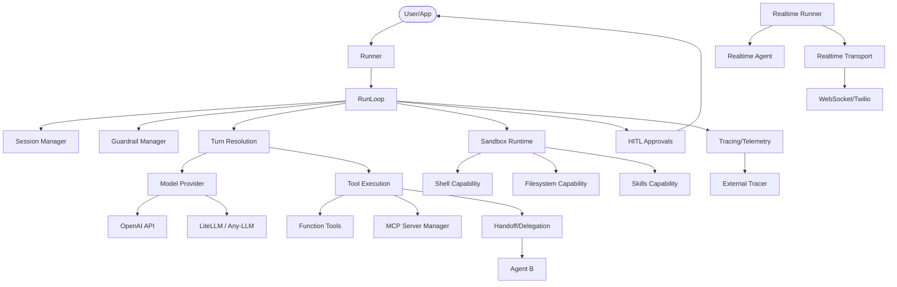

I will begin by reading the instructions in `.prompt.md` and the content of `.input.openai-agents-python.xml` to understand the task.
I will start by searching for the first `<git_log_commit/>` in the input file to identify the project name and last commit date. Then, I will locate and read the `README.md` file to gather a description of the project and its supported platforms and requirements.call:default_api:grep_search{include_pattern:.input.openai-agents-python.xml,pattern:<git_log_commit/>,total_max_matches:1}
I will read the rest of the `README.md` file to gather more details on the project description and requirements. Additionally, I'll search for "commit" in the input file to locate the git log information.
I will read the git logs at the end of the file, starting from line 102761, to find the project name and the most recent commit information.call:default_api:read_file{file_path:.input.openai-agents-python.xmlI will read the git logs at the end of the file to determine the last commit date and identify recent development trends.
I have gathered the project name and last commit date. Now, I will search for the connectors in `src/agents/extensions/sandbox/` to further my investigation.
I'll check the directory structure in the input file summary again, noting the presence of `src/agents/extensions/sandbox/__init__.py`. I'll then use `grep_search` to find related files within the input file.
Sandbox connectors include Blaxel, Cloudflare, Daytona, E2B, Modal, Runloop, Vercel, Docker, and UnixLocal, with MCP providing access to additional tools. For models, the SDK supports OpenAI, Any LLM, and LiteLLM. I'll now examine `src/agents/mcp/manager.py` for MCP specifics and `examples/agent_patterns/` for smart patterns.
I'll refer to the `directory_structure` from my first `read_file` output since I can't directly list directories. `examples/agent_patterns/` and other examples like `research_bot` and `realtime` offer key insights. I'll also investigate `.agents/skills/` and `src/agents/sandbox/capabilities/skills.py` to clarify the "used" vs. "provided" skills. Finally, I'll read `src/agents/agent.py` and `src/agents/run_internal/run_loop.py` to grasp the core architecture and execution flow.
I've gathered sufficient information for the architecture and core modules. Now, I'll turn my attention to "Smart Patterns" by examining `examples/agent_patterns/README.md` and other relevant files.
I've got the smart patterns down. Now, I'll dive deeper into the connectors and models. I've already identified several sandbox and model providers, along with MCP Tools. I noticed Twilio in the realtime examples, so I'll examine `examples/realtime/twilio/server.py` to see how it's integrated.
Twilio support is integrated via `TwilioRealtimeTransportLayer`, and session storage options include SQLite, Redis, Dapr, MongoDB, and SQLAlchemy. Data flows involve various inputs like text, images, and tool results, with outputs encompassing text, structured data, and tool calls. The project features robust testing and CI/CD, documented with MkDocs. I've mapped out a 20-node architecture for the Mermaid graph, highlighting the interplay between `Runner`, `Agent`, `RunLoop`, and other key components. I've also identified reusable patterns for agent swarms, shared knowledge bases, and multi-platform deployment, specifically noting how `handoffs`, `MCP`, `Sandbox`, and `HITL` can be leveraged. I'll now examine `src/agents/sandbox/capabilities/skills.py` to understand the skills implementation.
# Project Analysis: OpenAI Agents SDK

## 1. Project Name and Last Commit Date
- **Project Name:** OpenAI Agents SDK
- **Last Commit Date:** 2026-04-21 12:00:46 +0900 (Commit: `test: add sandbox compatibility guards (#2984)`)

## 2. Description
The OpenAI Agents SDK is a lightweight yet powerful framework designed for building sophisticated multi-agent workflows. It is provider-agnostic, offering native support for the OpenAI Responses and Chat Completions APIs, while also being compatible with over 100 other LLMs through extensions like LiteLLM and Any-LLM.

The framework centers on the concept of **Agents**—LLMs configured with specific instructions, tools, guardrails, and the ability to hand off tasks to other agents. A key differentiator is its **Sandbox Agents**, which operate within controlled containerized environments (filesystem, shell, network) to perform complex, long-running tasks that require persistent workspace state.

Beyond simple task execution, the SDK provides first-class support for **Realtime Agents** (voice), integrated **Human-in-the-loop** mechanisms for manual approvals, and a comprehensive **Tracing** system for debugging and optimizing agentic interactions. It effectively bridges the gap between high-level agent orchestration and low-level system execution.

## 3. Supported Platforms/Deployments + Requirements
- **Platforms:** Windows, macOS, Linux.
- **Python Version:** Python 3.10 or newer required.
- **Installation Groups:**
  - `voice`: `pip install 'openai-agents[voice]'` (requires `websockets`)
  - `redis`: `pip install 'openai-agents[redis]'` (requires `redis`)
- **Container Support:** Docker (local), Unix Local.
- **Cloud/Remote Sandboxes:** Blaxel, Cloudflare Workers, Daytona, E2B, Modal, Runloop, Vercel.

## 4. Supported Connectors to Apps/APIs/Messengers
- **Cloud Sandbox Providers:**
  - **Blaxel:** `src/agents/extensions/sandbox/blaxel/sandbox.py`
  - **Cloudflare:** `src/agents/extensions/sandbox/cloudflare/sandbox.py`
  - **Daytona:** `src/agents/extensions/sandbox/daytona/sandbox.py`
  - **E2B:** `src/agents/extensions/sandbox/e2b/sandbox.py`
  - **Modal:** `src/agents/extensions/sandbox/modal/sandbox.py`
  - **Runloop:** `src/agents/extensions/sandbox/runloop/sandbox.py`
  - **Vercel:** `src/agents/extensions/sandbox/vercel/sandbox.py`
- **Voice/Communication:**
  - **Twilio (Media Streams/SIP):** `examples/realtime/twilio/server.py`, `examples/realtime/twilio_sip/server.py`
- **External Tools/Protocols:**
  - **Model Context Protocol (MCP):** `src/agents/mcp/manager.py` (Connects to any MCP-compliant tool server)
- **Data Storage (Session Memory):**
  - **Redis:** `src/agents/extensions/memory/redis_session.py`
  - **MongoDB:** `src/agents/extensions/memory/mongodb_session.py`
  - **SQLAlchemy (Postgres, MySQL, etc.):** `src/agents/extensions/memory/sqlalchemy_session.py`
  - **Dapr:** `src/agents/extensions/memory/dapr_session.py`
  - **SQLite:** `src/agents/memory/sqlite_session.py`

## 5. Supported Models/Agents
- **OpenAI (Remote API):** Chat Completions and Responses API. `src/agents/models/openai_provider.py`
- **Any-LLM (Local/Remote):** Supports 100+ models via provider-agnostic interface. `src/agents/extensions/models/any_llm_provider.py`
- **LiteLLM (Remote API):** Gateway to various model providers (Anthropic, Google, etc.). `src/agents/extensions/models/litellm_provider.py`
- **Realtime Models:** `gpt-realtime-1.5` for low-latency voice. `src/agents/realtime/model.py`

## 6. Top 5 Use Cases
1. **Automated Coding Assistant:** Sandbox agents that can clone repos, run tests, and apply patches. (Workflow: Clone -> Inspect -> Edit -> Test -> Verify).
2. **Customer Service Triage:** A frontline agent receives a query and routes it to specialized agents (e.g., Billing, Tech Support) based on intent and language.
3. **Financial Research Analyst:** Agents that search the web, extract metrics from PDFs, and compile reports using structured output.
4. **Voice-Powered Support Agent:** Realtime voice agents connected via Twilio to handle phone calls with sub-second latency.
5. **Interactive Data Scientist:** Agents running in a Jupyter-like sandbox to analyze CSVs, generate plots, and explain insights.

## 7. Top 20 Features
1. **Multi-Agent Handoffs:** Seamless delegation between specialized agents. `src/agents/handoffs/`
2. **Sandbox Environments:** Secure, stateful execution in containers. `src/agents/sandbox/`
3. **Realtime Voice Support:** Low-latency bidirectional audio agents. `src/agents/realtime/`
4. **Human-in-the-Loop Approvals:** Pause execution for manual tool approval. `src/agents/run_internal/approvals.py`
5. **MCP Integration:** Dynamic tool loading via Model Context Protocol. `src/agents/mcp/`
6. **Input/Output Guardrails:** Validation layers for safety and correctness. `src/agents/guardrail.py`
7. **Session Persistence:** State management across multiple runs/turns. `src/agents/memory/session.py`
8. **Built-in Tracing:** Comprehensive telemetry for debugging. `src/agents/tracing/`
9. **Provider-Agnostic Models:** Support for OpenAI, LiteLLM, and Any-LLM. `src/agents/models/`
10. **Agents as Tools:** Treating a complex agentic run as a single tool call. `src/agents/agent.py`
11. **Structured Output:** Pydantic-based response schema enforcement. `src/agents/strict_schema.py`
12. **Context-Aware Memory:** Automatic conversation history management. `src/agents/run_internal/oai_conversation.py`
13. **Tool Output Trimming:** Optimizing token usage by summarizing tool results. `src/agents/extensions/tool_output_trimmer.py`
14. **Markdown Rendering:** Sandbox results rendered for human review. `src/agents/sandbox/manifest_render.py`
15. **Custom Model Providers:** Extensible interface for new LLM backends. `src/agents/models/interface.py`
16. **Dynamic System Prompts:** Prompts that evolve based on run context. `examples/basic/dynamic_system_prompt.py`
17. **Model Retry Logic:** Robust handling of API failures and rate limits. `src/agents/retry.py`
18. **Usage Tracking:** Monitoring token consumption and costs. `src/agents/usage.py`
19. **Prompt Caching:** Optimizing performance for long conversations. `src/agents/run_internal/prompt_cache_key.py`
20. **Artifact Management:** Handling files and state within sandboxes. `src/agents/sandbox/entries/artifacts.py`

## 8. Top 20 Smart Patterns
1. **LLM-as-a-Judge:** Using a second LLM to evaluate and provide feedback on an agent's output. `examples/agent_patterns/llm_as_a_judge.py`
2. **Parallelization:** Running multiple agents simultaneously to compare results or speed up tasks. `examples/agent_patterns/parallelization.py`
3. **Routing/Triage:** A central agent determines which specialist should handle a request. `examples/agent_patterns/routing.py`
4. **Handoffs:** Transitioning control between agents while maintaining history. `src/agents/handoffs/`
5. **Deterministic Flows:** Breaking a task into fixed, sequential agent steps. `examples/agent_patterns/deterministic.py`
6. **Input Guardrails:** Pre-checking user input for safety or relevance. `examples/agent_patterns/input_guardrails.py`
7. **Output Guardrails:** Validating agent responses before surfacing to the user. `examples/agent_patterns/output_guardrails.py`
8. **Streaming Guardrails:** Running checks during the generation process for lower latency. `examples/agent_patterns/streaming_guardrails.py`
9. **Human Approval:** Requiring a "Yes/No" from a person before sensitive tool use. `examples/agent_patterns/human_in_the_loop.py`
10. **Multi-turn Reasoning:** Allowing agents to "think" over several internal turns. `src/agents/run_internal/run_loop.py`
11. **Sandbox Tool Use:** Enabling LLMs to use real shell/filesystem tools. `src/agents/sandbox/capabilities/tools/`
12. **Memory Compaction:** Summarizing old conversation turns to save context space. `src/agents/memory/openai_responses_compaction_session.py`
13. **Tool Planning:** Agents generating a plan before executing a sequence of tools. `src/agents/run_internal/tool_planning.py`
14. **Error Recovery:** Catching tool errors and allowing the LLM to self-correct. `src/agents/run_error_handlers.py`
15. **Context Injection:** dynamically adding relevant data to an agent's context. `src/agents/run_context.py`
16. **Prompt Templates:** Reusable structures for complex agent instructions. `examples/basic/prompt_template.py`
17. **Structured Feedback Loop:** Continual refinement of a task based on structured critique. `examples/agent_patterns/human_in_the_loop_custom_rejection.py`
18. **Realtime Interruptions:** Handling user speech during agent response in voice. `src/agents/realtime/runner.py`
19. **Handoff Filtering:** Restricting which agents can be handed off to based on state. `src/agents/extensions/handoff_filters.py`
20. **Agent-as-Tool Streaming:** Capturing real-time events from a nested agent run. `examples/agent_patterns/agents_as_tools_streaming.py`

## 9. Top 20 Development Trends
1. **Windows Compatibility:** Significant focus on making sandboxes and shell tools work on Windows.
2. **Standardized Sandbox Extensions:** Expanding support for remote container providers (Daytona, Blaxel).
3. **Enhanced Voice Interactions:** Improvements in interruption handling and audio format normalization.
4. **Security Hardening:** Introduction of "compatibility guards" and tighter manifest validation.
5. **Storage Versatility:** Adding MongoDB and Dapr to the list of supported session backends.
6. **Unified Realtime/Sync Logic:** Sharing core agent features (tools, handoffs) between voice and text modes.
7. **Tracing Ecosystem Integration:** Supporting external tracers like Datadog.
8. **MCP Proliferation:** Increasing reliance on MCP for tool extensibility.
9. **Tool Reliability:** Better character replacement/normalization for tool names across providers.
10. **Memory Management Optimization:** Refined logic for session compaction and state persistence.
11. **Async-First Architecture:** Continued migration towards full `asyncio` support for all components.
12. **Multi-modal Inputs:** Better handling of images and PDFs across different model providers.
13. **Reasoning Model Support:** Special handling for reasoning tokens and thinking blocks.
14. **Developer Experience (DX):** Improved CLI demos and more comprehensive quickstart examples.
15. **Internationalization:** Ongoing updates to translated documentation (JA, KO, ZH).
16. **Artifact-Centric Sandboxes:** Moving towards a model where sandboxes are initialized with specific "artifacts".
17. **Telemetry Detail:** Increasing the granularity of traces for tool calls and handoffs.
18. **CI/CD Robustness:** Adding Windows CI and parallel test execution.
19. **Strict Schema Adoption:** Pushing for strict-mode JSON schemas for tool calls and outputs.
20. **Modularity:** Moving extension logic (LiteLLM, storage backends) into clear sub-modules.

## 10. Top 10 Advantages
1. **Lightweight & Modular:** Easy to integrate into existing Python apps.
2. **Provider-Agnostic:** Not locked into OpenAI; works with 100+ LLMs.
3. **Native Sandboxing:** Best-in-class support for secure code execution.
4. **Rich Ecosystem:** Connectors for many cloud sandbox providers.
5. **Realtime Excellence:** One of the few SDKs with robust voice agent support.
6. **Tracing built-in:** Makes debugging agent loops significantly easier.
7. **Strong Typing:** Extensive use of Pydantic and type hints.
8. **Flexible Persistence:** Multiple session storage backends.
9. **Human-in-the-Loop:** Designed for collaborative human-agent workflows.
10. **Excellent Docs/Examples:** Clear path from "Hello World" to complex patterns.

## 11. Top 10 Limitations
1. **Experimental Features:** Some key parts (Codex) are still marked experimental.
2. **Async Overhead:** Requires `asyncio` knowledge, which can be a hurdle for some.
3. **Provider Inconsistencies:** Some features (Handoffs) perform best on OpenAI and may struggle with weaker LLMs.
4. **Sandbox Startup Latency:** Local Docker/Remote container startup can slow down short tasks.
5. **Complex Configuration:** Setting up sessions and sandboxes requires non-trivial boilerplate.
6. **Dependency Heavy:** Optional groups like `voice` or `redis` bring many dependencies.
7. **Token Consumption:** Multi-agent handoffs and long sessions can be expensive without aggressive compaction.
8. **Local Windows Limitations:** Some shell/sandbox features are still being tuned for Windows.
9. **No Built-in Web UI:** While it has tracing, it lacks a default "Chat UI" for users.
10. **Model-Specific Prompts:** Some logic still implicitly favors OpenAI's message format.

## 12. Top 5 Used and Top 5 Provided AI Skills
### Provided Skills (Examples):
1. **`code-change-verification`**: Auto-runs format, lint, typecheck, and tests. `.agents/skills/code-change-verification/`
2. **`docs-sync`**: Audits documentation against implementation. `.agents/skills/docs-sync/`
3. **`implementation-strategy`**: Helps agents plan complex code changes. `.agents/skills/implementation-strategy/`
4. **`test-coverage-improver`**: Analyzes coverage and generates missing tests. `.agents/skills/test-coverage-improver/`
5. **`credit-note-fixer`**: A domain-specific example skill. `examples/sandbox/docs/skills/credit-note-fixer/`

### Used Skills (Capabilities):
1. **`load_skill`**: Tool to dynamically load specialized instructions into a sandbox. `src/agents/sandbox/capabilities/skills.py`
2. **`filesystem`**: Core skill for file manipulation. `src/agents/sandbox/capabilities/filesystem.py`
3. **`shell`**: Skill for executing system commands. `src/agents/sandbox/capabilities/shell.py`
4. **`memory`**: Skill for reading/writing persistent sandbox memories. `src/agents/sandbox/capabilities/memory.py`
5. **`compaction`**: Skill for managing conversation length in sandboxes. `src/agents/sandbox/capabilities/compaction.py`

## 13. Data Inputs, Outputs, and Storage Overview
- **Inputs:**
  - Text messages.
  - Images (Local/Remote). `src/agents/items.py`
  - PDF files (Remote). `examples/basic/remote_pdf.py`
  - Tool execution results (JSON/Structured). `src/agents/agent_tool_input.py`
- **Outputs:**
  - Text responses.
  - Structured Pydantic objects. `src/agents/result.py`
  - Tool calls (Function/MCP). `src/agents/run_internal/tool_actions.py`
  - Voice/Audio (G.711 μ-law). `src/agents/realtime/audio_formats.py`
- **Storage:**
  - **Session History:** SQLite, Redis, MongoDB, Dapr, SQLAlchemy. `src/agents/memory/`
  - **Sandbox State:** Filesystem and internal memory artifacts. `src/agents/sandbox/memory/storage.py`
  - **Tracing:** Exported to OpenAI or Datadog. `src/agents/tracing/`

## 14. Detailed Architecture Review
1. **`Runner`**: The main entry point for executing agents. `src/agents/run.py`
2. **`Agent` / `SandboxAgent`**: Configuration objects defining behavior. `src/agents/agent.py`, `src/agents/sandbox/sandbox_agent.py`
3. **`RunLoop`**: Coordinates turns, tools, and handoffs. `src/agents/run_internal/run_loop.py`
4. **`TurnResolution`**: Resolves a single LLM turn (input -> model -> response). `src/agents/run_internal/turn_resolution.py`
5. **`ToolExecution`**: Manages the calling of functions and MCP tools. `src/agents/run_internal/tool_execution.py`
6. **`AgentRunner`**: Internal state machine managing the lifecycle of a run. `src/agents/run_internal/agent_runner_helpers.py`
7. **`Session`**: Interface for conversation history and persistence. `src/agents/memory/session.py`
8. **`ModelProvider`**: Standardized interface for different LLM backends. `src/agents/models/interface.py`
9. **`RealtimeRunner`**: Specialized runner for voice-based agents. `src/agents/realtime/runner.py`
10. **`RealtimeTransport`**: Handles WebSocket/WebRTC communication for voice. `src/agents/realtime/openai_realtime.py`
11. **`GuardrailManager`**: Executes validation logic for inputs and outputs. `src/agents/run_internal/guardrails.py`
12. **`HandoffManager`**: Logic for transitioning between agents. `src/agents/handoffs/`
13. **`MCPManager`**: Handles lifecycle and tool discovery for MCP servers. `src/agents/mcp/manager.py`
14. **`SandboxRuntime`**: Manages the containerized environment. `src/agents/sandbox/runtime.py`
15. **`Capability`**: Modular features for sandboxes (Shell, Filesystem, Memory). `src/agents/sandbox/capabilities/`
16. **`TracingProvider`**: Collects and exports telemetry data. `src/agents/tracing/provider.py`
17. **`MemoryManager`**: Manages long-term storage of sandbox artifacts. `src/agents/sandbox/memory/manager.py`
18. **`Result` / `StreamedResult`**: Final or partial output from an agent run. `src/agents/result.py`, `src/agents/run_internal/streaming.py`
19. **`PromptCacheKey`**: Logic for determining stable keys for model caching. `src/agents/run_internal/prompt_cache_key.py`
20. **`Approvals`**: Workflow for human-in-the-loop tool execution. `src/agents/run_internal/approvals.py`

## 15. Mermaid Graph: Architecture Overview

## 16. Project Maturity, Stability, Security, Performance
- **Maturity:** High for a v0.x SDK. Active development, clear release cycle (currently v0.14.3). Used by OpenAI internally/officially.
- **Stability:** Solid core (Runner, Agent). Extensions and Sandboxes are evolving rapidly. Extensive test suite ensures low regression.
- **Security:** Strong emphasis on sandboxing for code execution. Built-in guardrails for PII/safety. Manual approval flow for sensitive tools.
- **Performance:** Async-first design allows for high concurrency. Prompt caching and tool output trimming optimize LLM latency and cost.

## 17. Tests, CI Pipelines, Documentation, Skills
- **Tests:** `pytest` used extensively. High coverage across core, models, and sandboxes. `tests/`
- **CI Pipelines:** GitHub Actions handle linting, type-checking, and cross-platform testing (Linux/Windows). `.github/workflows/`
- **Documentation:** High-quality MkDocs site with quickstarts, architecture guides, and API reference. `docs/`
- **AI Skills:** Utilized for repo maintenance (docs-sync, pr-labels) and as core extensibility mechanism for agents.

## 18. Top 20 Possible Improvements
1. **Standardize Connector Interface:** Unify sandbox and model extension patterns.
2. **Sandbox Warmup Pool:** Reduce startup latency for remote containers.
3. **Advanced Interruption Logic:** Better handling of complex voice interruption scenarios.
4. **Web UI Dashboard:** A built-in local dashboard for viewing traces and sandbox files.
5. **Native Messenger Connectors:** Add official support for Telegram/WhatsApp/Teams.
6. **Graph Memory Provider:** A session backend based on Knowledge Graphs (Neo4j).
7. **Auto-Compaction Tuning:** Dynamic compaction based on model context limits.
8. **Multi-Modal Sandbox:** Ability for sandboxes to "see" images via vision models natively.
9. **Better Windows PTY:** Improve terminal emulation for local Windows sandboxes.
10. **Handoff Policy Engine:** More granular control over handoff permissions.
11. **Local LLM Optimization:** Better support for running Ollama/vLLM locally.
12. **Unified Agent Lifecycle Hooks:** More entry points for custom logic during a run.
13. **Agent Registry:** A central way to manage and discover available agents in a system.
14. **Streaming Structured Output:** Partial Pydantic model updates during generation.
15. **Handoff Visualization:** Trace UI improvements to show the "flow" between agents.
16. **Sandbox Networking Control:** More granular outbound network rules.
17. **Skill "Marketplace" Pattern:** Easier way to package and share `SKILL.md` bundles.
18. **Usage-based Auto-scaling:** Scaling sandbox resources based on task complexity.
19. **Voice Tone Control:** Support for specifying emotional tone in realtime TTS.
20. **Self-Healing Tools:** Agents automatically fixing tool invocation errors based on documentation.

## 19. Agent Swarm for Solution Specification & Implementation
**Top 10 Reusable Components:**
1. **`HandoffManager`**: To coordinate the "debate" between agents. `src/agents/handoffs/`
2. **`llm_as_a_judge` Pattern**: For the selection of the best implementation plan. `examples/agent_patterns/llm_as_a_judge.py`
3. **`MCPManager`**: To provide the swarm with access to a Graph Knowledge Base. `src/agents/mcp/manager.py`
4. **`SandboxRuntime`**: To execute and validate implementation plans in isolation. `src/agents/sandbox/runtime.py`
5. **`RunLoop`**: The underlying multi-turn interaction engine. `src/agents/run_internal/run_loop.py`
6. **`GuardrailManager`**: To ensure the "best solution" meets safety and spec standards. `src/agents/run_internal/guardrails.py`
7. **`TracingProvider`**: For auditing the reasoning process across the swarm. `src/agents/tracing/`
8. **`Result` Structs**: For returning final, validated specifications. `src/agents/result.py`
9. **`Agent as Tool`**: Encapsulating the entire debate as a single "Specification Tool". `src/agents/agent.py`
10. **`MemoryManager`**: To store the evolved "Plan" as a sandbox artifact. `src/agents/sandbox/memory/manager.py`

## 20. Multi-user Shared Knowledge System
**Top 10 Reusable Components:**
1. **`RedisSession`**: For shared conversation state across users. `src/agents/extensions/memory/redis_session.py`
2. **`MCPManager`**: To connect all agents to a shared knowledge graph server. `src/agents/mcp/manager.py`
3. **`Skills` Capability**: For loading and evolving shared knowledge/patterns (SKILL.md). `src/agents/sandbox/capabilities/skills.py`
4. **`Tracing` with `conversation_id`**: To link interactions from different users. `src/agents/tracing/`
5. **`Memory` Capability**: To generate and read "Memories" from a shared filesystem. `src/agents/sandbox/capabilities/memory.py`
6. **`Human-in-the-loop`**: For cross-user approval workflows. `src/agents/run_internal/approvals.py`
7. **`Artifacts`**: To store shared markdown or knowledge documents. `src/agents/sandbox/entries/artifacts.py`
8. **`MongoDB` Session**: For flexible, document-based shared state. `src/agents/extensions/memory/mongodb_session.py`
9. **`Handoff` Filters**: To manage permissions in a multi-user environment. `src/agents/extensions/handoff_filters.py`
10. **`RealtimeTransport`**: To allow multiple users to interact via voice/audio simultaneously. `src/agents/realtime/`

## 21. Hardware/Cloud/Messenger/Voice Agent System
**Top 10 Reusable Components:**
1. **`UnixLocalSandbox`**: For running agents on own hardware. `src/agents/sandbox/sandboxes/unix_local.py`
2. **`CloudflareSandbox`**: For deployment in Cloudflare Workers. `src/agents/extensions/sandbox/cloudflare/sandbox.py`
3. **`TwilioRealtimeTransportLayer`**: For messenger (voice/phone) connectivity. `examples/realtime/twilio/`
4. **`RealtimeRunner`**: For voice control and low-latency interaction. `src/agents/realtime/runner.py`
5. **`REPL`**: For the CLI interface component. `src/agents/repl.py`
6. **`Visualization` Extension**: For graph visualization/navigation. `src/agents/extensions/visualization.py`
7. **`MCPManager`**: To connect to a web-app or native-app via standardized protocol. `src/agents/mcp/`
8. **`AudioFormats`**: For handling various voice sample rates and encodings. `src/agents/realtime/audio_formats.py`
9. **`Handoffs`**: For switching between "Messenger Mode" and "Web Mode". `src/agents/handoffs/`
10. **`Tracing`**: To synchronize state between CLI, Web, and Native app sessions. `src/agents/tracing/`

## 22. Cooperative Human/Agent Team Agents
**Top 10 Reusable Components:**
1. **`Human-in-the-loop` (HITL)**: The foundation of cooperative approval. `src/agents/run_internal/approvals.py`
2. **`Handoffs`**: Delegating tasks from human to agent and vice-versa. `src/agents/handoffs/`
3. **`Agent as Tools`**: Modular agents that perform specific team roles. `src/agents/agent.py`
4. **`RunContext`**: Sharing state (team goals, current status) during a run. `src/agents/run_context.py`
5. **`GuardrailManager`**: enforcing team policies and safety. `src/agents/run_internal/guardrails.py`
6. **`Session` Persistence**: Maintaining team history over weeks or months. `src/agents/memory/session.py`
7. **`Skills`**: shared team playbooks loaded on-demand. `src/agents/sandbox/capabilities/skills.py`
8. **`Tracing`**: transparency for team members to see agent reasoning. `src/agents/tracing/`
9. **`Structured Output`**: ensuring agents provide data in team-standard formats. `src/agents/result.py`
10. **`SandboxRuntime`**: shared workspace for team "work product". `src/agents/sandbox/runtime.py`
