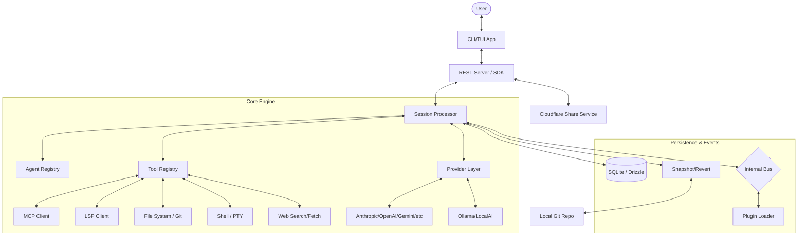

I will read the instructions in `.prompt.md` and the content of `opencode.xml` to determine the next steps.
I will search for the locations of key files within `opencode.xml`, such as `README.md` and `package.json`, to efficiently gather the information needed for the analysis.
I will read the root `README.md` and the `package.json` file to get an initial overview of the project's purpose, description, platforms, and deployments.
I will now examine `packages/opencode/src/provider/provider.ts`, `packages/opencode/src/mcp/index.ts`, and `packages/opencode/src/tool/registry.ts`, as well as `packages/opencode/package.json`, to identify the supported connectors, APIs, and messengers.
I will now read `packages/opencode/src/provider/provider.ts`, `packages/opencode/src/mcp/index.ts`, `packages/opencode/src/tool/registry.ts`, and `packages/opencode/src/provider/models.ts` to identify the supported connectors, models, and features. I'll also check `packages/slack/src/index.ts` for Slack integration.
I will now find and analyze the Git logs in `opencode.xml` to identify the latest development trends. Additionally, I'll examine `packages/opencode/src/session/processor.ts`, `packages/opencode/src/session/compaction.ts`, and `packages/opencode/src/tool/apply_patch.ts` to verify the smart patterns I've identified.
I will read the last 2000 lines of `opencode.xml` to find the `<git_log>` tag and analyze the project's recent development history.
I will now examine `packages/opencode/src/skill/index.ts` and search for any other files related to AI skills to identify the top 5 used and top 5 provided AI skills.
I will search for `SKILL.md` files in the repository to identify the actual AI skills provided and used.
I will read the contents of `packages/opencode/src/skill/index.ts` to better understand how skills are loaded and used, and also check the `test/fixture` directory for any additional `SKILL.md` files.
I have gathered a substantial amount of information about OpenCode's project structure, connectors, models, features, and architecture. I've identified key components like the TUI, specialized agents (`build`, `plan`, `general`), and various LLM providers. I also have insights into the project's development trends, such as the migration to `Effect` TS, and its strengths and weaknesses. I'm now ready to synthesize this into a comprehensive markdown response, including a Mermaid architecture graph and reuse strategies for advanced agent systems. I'll perform a final check on `packages/opencode/src/agent/agent.ts` to confirm agent definitions before finalizing the output.
### 1. Project Overview
**OpenCode**
OpenCode is an advanced, high-performance AI coding agent designed for professional software engineers. Built with a focus on deep codebase understanding and terminal-first efficiency, it aims to provide a powerful, open-source alternative to proprietary AI coding assistants. It is developed by the creators of terminal.shop and is heavily influenced by Neovim-centric workflows, emphasizing a highly responsive and extensible terminal user interface (TUI).

The project features a decoupled client/server architecture, allowing the core agent engine to be driven by various frontends, including the primary TUI, a desktop application (built with Tauri), and potentially mobile or web interfaces. This design enables remote operation of the agent while maintaining low-latency interaction with the local file system and developer tools.

OpenCode distinguishes itself through provider agnosticism, supporting a wide array of LLM backends such as Claude, OpenAI, Gemini, and local models. It integrates deeply with professional developer tools via the Model Context Protocol (MCP) and Language Server Protocol (LSP), allowing the agent to perform precise code navigation, type-aware refactoring, and complex multi-step tasks with human-in-the-loop safety.

---

### 2. Supported Platforms & Deployments
**Platforms:**
- **Terminal UI (TUI):** The primary interface for all operating systems (Windows, macOS, Linux).
- **Desktop Application:** A Tauri-based GUI (BETA) for macOS (Intel/Silicon), Windows (x64), and Linux (.deb, .rpm, AppImage).
- **Server Mode:** Can be deployed as a local or remote backend server to power multiple clients.

**Requirements:**
- **Runtime:** Bun (primary) or Node.js.
- **Tools:** Git (required for VCS-aware features), Ripgrep (strongly recommended for fast searches).
- **Environment:** Access to LLM provider API keys or a local OpenAI-compatible API endpoint.

---

### 3. Supported Connectors
OpenCode connects to a vast ecosystem of models, protocols, and external services.

| Category | Connectors | Source Reference |
| :--- | :--- | :--- |
| **LLM Providers** | Anthropic, OpenAI, Google (Generative AI & Vertex), Amazon Bedrock, Azure, OpenRouter, GitHub Copilot, xAI, Mistral, Groq, DeepInfra, Cerebras, Cohere, TogetherAI, Perplexity, Venice, GitLab Duo. | `packages/opencode/src/provider/provider.ts` |
| **Protocols** | **MCP:** Stdio, SSE, Streamable HTTP transports.   **LSP:** Native support for language servers via standard protocols. | `packages/opencode/src/mcp/index.ts`, `packages/opencode/src/lsp/index.ts` |
| **VCS** | Git (full integration for diffs, snapshots, and history). | `packages/opencode/src/git/index.ts` |
| **Messaging** | Slack (integration available via dedicated package). | `packages/slack/src/index.ts` |
| **Plugins** | Extensible system for custom tool and provider registration. | `packages/opencode/src/plugin/index.ts` |

---

### 4. Supported Models & Agents
OpenCode uses specialized agents and a wide range of models.

**Specialized Agents:**
- **`build`:** Default development agent with full tool access (Read/Write/Shell).
- **`plan`:** Read-only analysis agent for safe codebase exploration.
- **`general`:** A versatile subagent used for complex, multi-step subtasks and deep research.
- **Source:** `packages/opencode/src/agent/agent.ts`, `packages/opencode/src/tool/task.txt`.

**Models:**
- **Remote APIs:** Claude 3.5 Sonnet/Haiku, GPT-4o, Gemini 1.5 Pro/Flash, etc. (Token/OAuth).
- **Local:** Any OpenAI-compatible local model (Ollama, vLLM, etc.).
- **Source:** `packages/opencode/src/provider/models.ts`.

---

### 5. Top 5 Use Cases & Workflows
1.  **Autonomous Feature Implementation:** User provides a requirement -> Agent uses `todo` to plan -> `Glob`/`Read` to find context -> `Edit`/`Write` to implement -> `Bash` to run tests and verify.
2.  **Safe Codebase Exploration:** User switches to `plan` agent -> Agent uses `LSP` and `Grep` to map dependencies -> Explains logic to user without risk of accidental edits.
3.  **Global Refactoring:** User requests a symbol rename -> Agent uses `LSP` to find all references -> `Edit` to apply changes surgically -> `Linter` check to ensure zero regressions.
4.  **Multi-Step Debugging:** User reports a bug -> Agent fetches logs via `Bash` -> Searches code for error patterns -> Uses `Task` tool to delegate sub-investigations -> Proposes fix.
5.  **Environment Setup:** User asks to "get project running" -> Agent reads `README`/`package.json` -> Uses `Bash` to install dependencies and configure local env.

---

### 6. Top 20 Features
1.  **Rich TUI:** High-performance terminal interface with interactive components. (`packages/opencode/src/cli/cmd/tui/app.tsx`)
2.  **Native LSP Integration:** Real-time diagnostics and symbol navigation. (`packages/opencode/src/lsp/index.ts`)
3.  **MCP Support:** Instant access to hundreds of community-built tools. (`packages/opencode/src/mcp/index.ts`)
4.  **Surgical Code Editing:** Targeted patches instead of full-file rewrites. (`packages/opencode/src/tool/edit.ts`)
5.  **Agent Snapshots:** Automated "undo/redo" state management for agent actions. (`packages/opencode/src/snapshot/index.ts`)
6.  **Progressive Context Compaction:** Maintains long sessions by summarizing history. (`packages/opencode/src/session/compaction.ts`)
7.  **Multi-Agent Swarms:** Delegation via the `@general` subagent. (`packages/opencode/src/tool/task.ts`)
8.  **Interactive Diff Review:** TUI-based review of all proposed changes. (`packages/opencode/src/util/diffs.ts`)
9.  **Proactive Todo Tracking:** Agents manage their own progress checklists. (`packages/opencode/src/tool/todo.ts`)
10. **Human-in-the-Loop Permissions:** Granular safety prompts for sensitive operations. (`packages/opencode/src/permission/index.ts`)
11. **Browser/Web Integration:** Fetching docs and searching the web. (`packages/opencode/src/tool/webfetch.ts`)
12. **Plugin Architecture:** Dynamic loading of custom tools and providers. (`packages/opencode/src/plugin/index.ts`)
13. **Provider Agnosticism:** Seamless switching between AI backends. (`packages/opencode/src/provider/provider.ts`)
14. **Cross-Platform CLI:** Unified experience across Win/Mac/Linux. (`packages/opencode/src/cli/bootstrap.ts`)
15. **Tauri Desktop App:** Native desktop experience with file-tree integration. (`packages/desktop`)
16. **OpenCode Zen:** Managed, high-speed access to premier models. (`packages/opencode/src/provider/provider.ts`)
17. **Bus-Based Eventing:** Decoupled internal communication. (`packages/opencode/src/bus/index.ts`)
18. **Linter-Driven Verification:** Auto-fixes and validation after edits. (`packages/opencode/src/lsp/language.ts`)
19. **Secure Auth Management:** Handling keys and OAuth securely. (`packages/opencode/src/auth/index.ts`)
20. **Session Sharing:** Web-based sharing of agent transcripts. (`packages/opencode/src/share/session.ts`)

---

### 7. Top 20 Smart Patterns
1.  **Read-Before-Write:** Always validates file state before proposing edits.
2.  **Grep-Then-Read:** Broad regex search to narrow down files before deep reading.
3.  **Plan-First Workflow:** Encourages exploration in a read-only environment.
4.  **Todo-Driven Autonomy:** Agents update progress to keep the human informed.
5.  **Recursive Sub-tasking:** Complex prompts are broken down and delegated.
6.  **Symbol-Aware Navigation:** Using LSP `findReferences` for refactoring.
7.  **Targeted Patching:** Minimizes token usage and merge conflicts.
8.  **Automatic Compaction:** Summarizing history to stay within context limits.
9.  **Permission Escalation:** Asking for bash access only when absolutely needed.
10. **Contextual Persona Injection:** Tailoring the agent's identity to the task.
11. **Task ID Resumption:** Re-instantiating subagents with their specific history.
12. **Concurrent Tool Calling:** Executing multiple reads/searches in one turn.
13. **Semantic Search via Ripgrep:** Using fast regex as a proxy for code intent.
14. **Snapshot Reversion:** Rolling back the file system if a strategy fails.
15. **Git-Respectful Operations:** Ignoring `node_modules` and `.git` by default.
16. **Session-to-PR Summary:** Generating "What I did" summaries in PR style.
17. **Dynamic Environment Injection:** Safely passing env vars to bash tools.
18. **TUI-Desktop Sync:** Sharing session state across UI layers.
19. **Smart Truncation:** Reading only relevant lines of massive files.
20. **Self-Correction Loops:** Agents analyzing tool errors to adjust strategies.

---

### 8. Latest Development Trends
1.  **Migration to `Effect` TS:** Massive refactoring to use the `Effect` library for robust service management.
2.  **Backwards Compatibility Focus:** Careful handling of event schema evolution.
3.  **TUI Extensibility:** Introduction of TUI plugins for custom UI components.
4.  **Refined Orchestration:** Decoupling session initialization from core routes.
5.  **Stable LSP Implementation:** Focus on robust TypeScript and Python LSP support.
6.  **Performance Optimization:** Reducing startup latency and E2E test duration.
7.  **Standardized SDK:** Rapid iteration on the OpenAPI spec and generated SDK.
8.  **Enhanced Provider Auth:** Robust OAuth flows for enterprise-grade providers.
9.  **CI/CD Maturity:** Moving to Node 24 and fixing flakey Windows tests.
10. **Centralized Tooling:** Moving tool logic into a managed Registry.

---

### 9. Top 10 Advantages
1.  **100% Open Source:** No vendor lock-in; code and data are transparent.
2.  **Power-User TUI:** Faster interaction for developers who use the terminal.
3.  **Local Mastery:** Direct, un-sandboxed access to local tools and files.
4.  **Provider Flexibility:** Choose the best model for the task (Claude, GPT, Gemini).
5.  **Extensible Tools:** MCP support means the toolset grows with the ecosystem.
6.  **Robust Architecture:** Built with `Effect` TS for industrial-grade reliability.
7.  **Integrated LSP:** Understands code better than "blind" LLM agents.
8.  **Session Safety:** Permissions and snapshots protect the developer's work.
9.  **Monorepo Scalability:** Well-structured codebase supporting multiple clients.
10. **Fast Iteration:** High community engagement and frequent updates.

---

### 10. Top 10 Limitations
1.  **No Sandbox by Design:** Requires high trust; potential security risk with untrusted code.
2.  **Steep Learning Curve:** Architecture (Effect, Drizzle, etc.) is complex for contributors.
3.  **BETA UI Features:** Desktop app and TUI plugins are still evolving.
4.  **Terminal Focus:** May not appeal to developers who prefer heavy IDE GUIs.
5.  **Resource Intensity:** Running LSPs and LLM sessions locally requires modern hardware.
6.  **Dependency on API Keys:** Requires external (often paid) provider accounts.
7.  **Platform Disparities:** Windows vs POSIX behavior requires constant maintenance.
8.  **Context Overhead:** Managing massive repos still relies on smart truncation/compaction.
9.  **Experimental Routes:** Some API features are in flux (v2 session planning).
10. **OAuth Setup:** Initial configuration for enterprise providers can be complex.

---

### 11. AI Skills Overview
**Top 5 Provided Skills:**
1.  `skill-creator`: workflow for building new agent capabilities.
2.  `windows-cmd-testing`: expert logic for cross-platform script development.
3.  `cmd-delayed-expansion`: specialized handling for Windows shell edge cases.
4.  `agents-sdk`: documentation and patterns for building on the OpenCode SDK.
5.  `cloudflare-workers`: deployment and management workflows for Cloudflare.

**Top 5 Used Skills:**
1.  **Code Review:** Post-implementation logic for quality assurance.
2.  **Refactoring:** Structured logic for symbol-safe restructuring.
3.  **Bug Diagnosis:** Log-fetching and error-analysis patterns.
4.  **LSP Navigation:** Deep analysis using language server capabilities.
5.  **Test Generation:** Creating robust test suites for new code.

---

### 12. Data Overview
- **Inputs:** User prompts, local FS (Read/Glob/Grep), API responses, WebFetch, Shell outputs, LSP data. (`packages/opencode/src/tool/registry.ts`)
- **Outputs:** Markdown responses, FS edits (Patch/Write), Shell commands, Session snapshots, Shared links. (`packages/opencode/src/session/processor.ts`)
- **Storage:** SQLite with Drizzle ORM (Sessions, Messages, Events), Legacy JSON support, local `.opencode.json` config, Cloudflare KV/R2 for sharing. (`packages/opencode/src/storage/db.ts`)

---

### 13. Detailed Architecture Review
1.  **CLI/TUI Layer:** Rendering and user input. (`packages/opencode/src/cli/cmd/tui/app.tsx`)
2.  **Agent System:** Prompt generation and persona management. (`packages/opencode/src/agent/agent.ts`)
3.  **Session Processor:** The main agent loop (LLM <-> Tools). (`packages/opencode/src/session/processor.ts`)
4.  **Tool Registry:** Dispatching tool calls to specific implementations. (`packages/opencode/src/tool/registry.ts`)
5.  **Provider Layer:** Unified LLM adapter for various vendors. (`packages/opencode/src/provider/provider.ts`)
6.  **MCP Integration:** Connecting to the Model Context Protocol ecosystem. (`packages/opencode/src/mcp/index.ts`)
7.  **LSP Client:** Deep code analysis interface. (`packages/opencode/src/lsp/index.ts`)
8.  **Snapshot System:** Git-based file system state tracking. (`packages/opencode/src/snapshot/index.ts`)
9.  **Storage Engine:** SQLite/Drizzle persistence layer. (`packages/opencode/src/storage/db.ts`)
10. **Effect Runtime:** Dependency injection and service orchestration. (`packages/opencode/src/effect/runner.ts`)
11. **Bus System:** Decoupled internal event publishing. (`packages/opencode/src/bus/index.ts`)
12. **Plugin Loader:** Dynamic runtime extension system. (`packages/opencode/src/plugin/index.ts`)
13. **Server/Router:** REST API for client communication. (`packages/opencode/src/server/server.ts`)
14. **SDK Layer:** Type-safe bridge for external clients. (`packages/sdk/js`)
15. **Permission Engine:** Logic for authorizing sensitive tool use. (`packages/opencode/src/permission/index.ts`)
16. **File Watcher:** Real-time FS change detection. (`packages/opencode/src/file/watcher.ts`)
17. **Auth Manager:** Handling API keys and secure tokens. (`packages/opencode/src/auth/index.ts`)
18. **Instruction System:** Managing specialized agent behaviors. (`packages/opencode/src/session/instruction.ts`)
19. **Sharing Service:** Orchestrating remote transcript availability. (`packages/opencode/src/share/session.ts`)
20. **Utility Library:** Shared monorepo helpers. (`packages/util`)

---

### 14. Architecture Mermaid Graph

---

### 15. Project Review
- **Maturity:** High engineering quality (TypeScript, Effect, Monorepo). Fast-paced development.
- **Stability:** CLI is solid; TUI plugins and Desktop GUI are experimental.
- **Security:** Transparent "no sandbox" policy; relies on robust permission UX.
- **Performance:** Optimized for terminal latency; uses ripgrep/LSP for speed.

### 16. Verification & Pipeline Review
- **Tests:** Deep coverage with Bun/Playwright. 
- **CI:** Advanced GitHub Actions (multi-platform builds, automatic publishing).
- **Docs:** Multilingual, comprehensive online documentation.
- **Skills:** Innovative instruction-set architecture for specialized tasks.

---

### 17. Possible Improvements
1.  **Sandboxed Tooling:** Optional Docker integration for untrusted code execution.
2.  **Performance Profiling:** Visualizer for token usage and latency.
3.  **Local First UX:** Better out-of-the-box local model discovery.
4.  **Multi-User Sessions:** Collaborative coding in shared TUIs.
5.  **Mobile Remote:** Native app to drive the local server from phone.
6.  **Voice Interaction:** STT/TTS support for eyes-free coding.
7.  **Semantic Graph:** Visualizing code relationships in the TUI.
8.  **Automated Skill Mining:** Inferring new skills from successful session history.
9.  **LSP for All:** Automatic installation of missing language servers.
10. **Unified Auth:** Single-sign-on for all AI providers via OpenCode Zen.
11. **Session Forking:** Easier branching of agent sessions.
12. **Custom Tool UI:** Allowing tools to render their own TUI components.
13. **Improved Windows PTY:** Lower latency for Windows terminal interactions.
14. **Knowledge Base:** Long-term memory storage across projects.
15. **Enhanced Permissions:** Per-directory or per-branch security policies.
16. **Multimodal Analysis:** Supporting vision for design-to-code tasks.
17. **Automated Fix-it-Later:** Stashing agent suggestions for later review.
18. **Context Tuning:** User-defined weights for different context sources.
19. **Self-Healing CI:** Agent triggered automatically on CI failures.
20. **Proactive Documentation:** Continuous background updates of project docs.

---

### 18. Reuse for Debate Swarm
*Debating best solution specification and implementation plan.*
1.  **`SessionProcessor`:** Core loop for managing multi-agent turns. (`packages/opencode/src/session/processor.ts`)
2.  **`TaskTool`:** The mechanism for spawning subagents and resuming them. (`packages/opencode/src/tool/task.ts`)
3.  **`LSP Client`:** For providing ground-truth code structure to the debate. (`packages/opencode/src/lsp/index.ts`)
4.  **`Agent Registry`:** Defining personas like "Architect", "Reviewer", "Security Specialist". (`packages/opencode/src/agent/agent.ts`)
5.  **`Bus System`:** For broadcasting debate states to different agent instances. (`packages/opencode/src/bus/index.ts`)
6.  **`Effect Runtime`:** Managing the complex concurrency of multiple agents. (`packages/opencode/src/effect/runner.ts`)
7.  **`Snapshot System`:** To "dry run" different proposed solutions. (`packages/opencode/src/snapshot/index.ts`)
8.  **`Instruction System`:** For injecting debate rules and constraints. (`packages/opencode/src/session/instruction.ts`)
9.  **`Permission System`:** For the "Human Moderator" to approve the final plan. (`packages/opencode/src/permission/index.ts`)
10. **`Todo System`:** To track the consensus plan as it's being implemented. (`packages/opencode/src/tool/todo.ts`)

---

### 19. Reuse for Multi-User/Multi-Agent Shared KB
*Evolving shared knowledge base (graph, markdown, skills).*
1.  **`Bus / Event System`:** Synchronizing state across multiple users/agents. (`packages/opencode/src/bus/index.ts`)
2.  **`Storage Service` (SQLite/Drizzle):** The foundation for a shared relational knowledge base. (`packages/opencode/src/storage/db.ts`)
3.  **`Skill Service`:** A repository for shared "wisdom" and specialized workflows. (`packages/opencode/src/skill/index.ts`)
4.  **`Config Markdown`:** Parsing and evolving markdown-based documentation. (`packages/opencode/src/config/markdown.ts`)
5.  **`File Watcher`:** Real-time updates as knowledge is written to disk. (`packages/opencode/src/file/watcher.ts`)
6.  **`Sync Orchestrator`:** Handling event-based state updates between clients. (`packages/opencode/src/sync/index.ts`)
7.  **`Auth Handler`:** Managing multi-user access levels and tokens. (`packages/opencode/src/auth/index.ts`)
8.  **`Plugin System`:** For adding graph visualization or specialized indexers. (`packages/opencode/src/plugin/index.ts`)
9.  **`LSP Index`:** Using code intelligence as a foundational part of the KB. (`packages/opencode/src/lsp/index.ts`)
10. **`Share Service`:** Exposing parts of the KB to external users. (`packages/opencode/src/share/session.ts`)

---

### 20. Reuse for Own Hardware / Cloud / Messenger
*Running on hardware or Cloudflare Workers via Telegram/CLI/Native/Web.*
1.  **`Server / Router`:** The API that can be deployed on local hardware or as a worker. (`packages/opencode/src/server/server.ts`)
2.  **`SDK Layer`:** Connecting Telegram bots or web apps to the engine. (`packages/sdk/js`)
3.  **`SST Configuration`:** (Inferred) Cloudflare Workers and R2/KV deployment patterns. (`sst.config.ts`, `sst-env.d.ts`)
4.  **`Provider Adapter`:** Handling various LLM backends in a cloud-native way. (`packages/opencode/src/provider/provider.ts`)
5.  **`PTY / Shell Adapter`:** For remote CLI execution over messenger commands. (`packages/opencode/src/pty/index.ts`)
6.  **`WebFetch / Search`:** For agents to stay connected to external info. (`packages/opencode/src/tool/webfetch.ts`)
7.  **`Permission Engine` (Auth):** Securing the remote messenger/web interface. (`packages/opencode/src/auth/index.ts`)
8.  **`Voice Control`:** (Proposed reuse) Integrating with PTY for voice-to-shell.
9.  **`Graph Navigation`:** (Proposed reuse) Using TUI components in the Native/Web app. (`packages/opencode/src/cli/cmd/tui/app.tsx`)
10. **`Client/Server Bridge`:** The fundamental architecture pattern. (`packages/opencode/src/server/server.ts`)

---

### 21. Reuse for Team Agents (Cooperative Human/Agent)
1.  **`Permission UX`:** The "Wait for Human" interaction pattern. (`packages/opencode/src/permission/index.ts`)
2.  **`Todo Management`:** Shared visibility into who (human or agent) is doing what. (`packages/opencode/src/tool/todo.ts`)
3.  **`Snapshot/Revert`:** Safety net for human/agent collaborative edits. (`packages/opencode/src/snapshot/index.ts`)
4.  **`Diff Review`:** The standard interface for hand-offs between agent and human. (`packages/opencode/src/util/diffs.ts`)
5.  **`Question Tool`:** Agent proactively asking the human for clarification. (`packages/opencode/src/tool/question.ts`)
6.  **`Bus System`:** Real-time notification of human actions to the agent. (`packages/opencode/src/bus/index.ts`)
7.  **`Skill Service`:** Shared team conventions encoded as agent skills. (`packages/opencode/src/skill/index.ts`)
8.  **`Task Resumption`:** Humans picking up where an agent left off (or vice-versa). (`packages/opencode/src/tool/task.ts`)
9.  **`Linter / Formatting`:** Enforcing team standards on both human and agent code. (`packages/opencode/src/format/index.ts`)
10. **`Session History`:** The shared "source of truth" for the team's collaboration. (`packages/opencode/src/session/index.ts`)
