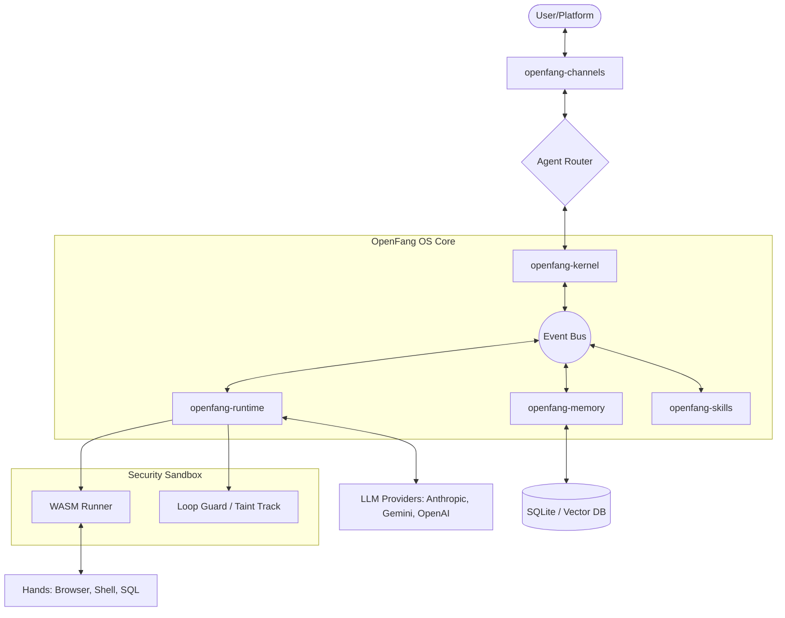

I will read the instructions from `.prompt.md` to understand the task for `openfang.xml`.
I will read `openfang.xml` to analyze the project and provide the requested deep, high-quality answers.
I will read the `README.md` and `Cargo.toml` files to get a high-level overview of the project.
I will now examine the source code for connectors and models to provide the requested references and details.
I will read the core architectural files, including the kernel and runtime, to ensure the architectural review and smart patterns are accurate and detailed.
# OpenFang: Deep Repository Analysis

## 1. Project Name and Description

**Project Name:** OpenFang (Agent OS)

OpenFang is a high-performance, security-focused "Agent Operating System" written in Rust. It serves as a unified orchestration layer for autonomous AI agents, designed to bridge the gap between large language models and real-world tools, communication channels, and local system resources. By providing a standardized runtime and a rich set of "Hands" (specialized toolkits), OpenFang enables the deployment of sophisticated agents that can reason, interact, and execute tasks across diverse environments.

The project is built with a "security-first" philosophy, featuring 16 distinct layers of protection, including WASM-based sandboxing for tool execution, Merkle-tree-based audit trails, and fine-grained capability gates. This ensures that even as agents gain more autonomy and access to sensitive data, the host system remains protected. The architecture is highly modular, consisting of 14 specialized crates that separate concerns such as runtime drivers, communication adapters, and semantic memory.

Technically, OpenFang distinguishes itself through its extreme efficiency and portability. It compiles into a single, dependency-free binary with sub-10ms cold start times and a minimal memory footprint, making it suitable for everything from high-end cloud servers to resource-constrained environments like Android (via Termux) or local workstations. With support for over 130 models across 28 providers and 40+ communication connectors, it is one of the most comprehensive agent frameworks currently available.

## 2. Supported Platforms and Deployment Options

*   **Operating Systems:** Windows, macOS, Linux (GNU/Musl).
*   **Mobile:** Android (via Termux/CLI) and a planned mobile-optimized interface.
*   **Containerization:** Docker (Official images provided for various architectures).
*   **Deployment Modes:**
    *   **Single Binary:** Direct execution on host OS.
    *   **Cloud:** Scalable deployment via Docker/Kubernetes.
    *   **Edge/Local:** Optimized for low-latency local execution on user hardware.
    *   **TUI/CLI:** Interactive Terminal User Interface for developers.
    *   **Desktop App:** Graphical interface built with Tauri (`crates/openfang-desktop`).

## 3. Connectors and Integrations

OpenFang features a highly extensible "Channels" system for communication.
*   **Messaging Platforms:** Telegram, Discord, Slack, WhatsApp (via Gateway), Signal, Matrix.
*   **Enterprise/Open Source Chat:** Pumble, Revolt, RocketChat, Mattermost, Zulip.
*   **Web/Social:** Reddit, Twitter (X), Email (SMTP/IMAP), Nostr, ntfy.sh.
*   **Protocols:** Webhooks (HTTP), WebSockets, SSE (Server-Sent Events).
*   **Source Code:** `crates/openfang-channels/src/` (e.g., `telegram.rs`, `discord.rs`, `nostr.rs`).

## 4. Supported Models and Agents

*   **Proprietary Models:** Anthropic (Claude 3.5/3), OpenAI (GPT-4o/o1), Google Gemini (Pro/Flash), Vertex AI, Mistral.
*   **Specialized Drivers:**
    *   **Claude Code:** Direct integration with Claude's coding capabilities (`crates/openfang-runtime/src/drivers/claude_code.rs`).
    *   **GitHub Copilot:** Integration with Copilot's underlying models.
    *   **DeepSeek:** Optimized support for DeepSeek-V3 and Coder.
*   **Local/Open Models:** Support for Groq, Together AI, and any OpenAI-compatible API (allowing Ollama/vLLM usage).
*   **Catalog:** A builtin catalog of 130+ models with pricing and capability metadata (`crates/openfang-runtime/src/model_catalog.rs`).

## 5. Main Use Cases (The "Hands")

OpenFang bundles several "Hands"—sets of tools designed for specific high-level tasks:
*   **Researcher:** Deep web searching and information synthesis using SearxNG/Tavily.
*   **Collector:** Automated data gathering and archival from various web sources.
*   **Predictor:** Forecasting and analytical reasoning based on historical data.
*   **Browser:** Headless browser control for complex web interactions.
*   **Twitter:** Social media management and automated engagement.
*   **Clip & Lead:** Content curation and lead generation workflows.

## 6. Top 20 Unique Features

1.  **16 Layers of Security:** Comprehensive defense-in-depth for agent execution.
2.  **WASM Sandboxing:** Tools execute in isolated WebAssembly environments.
3.  **Merkle Audit Trail:** Cryptographically verifiable logs of all agent actions.
4.  **Taint Tracking:** Monitoring the flow of sensitive data through agent reasoning.
5.  **Loop Guard:** Advanced detection of infinite tool-calling loops with A-B-A-B pattern matching.
6.  **Session Repair:** Automatic recovery of corrupted or over-limit conversation contexts.
7.  **Media Understanding Engine:** Automated multi-provider cascade for image, audio, and video analysis.
8.  **MCP Support:** Full implementation of Model Context Protocol (Client & Server).
9.  **Single Binary Execution:** Entire OS in one ~30MB Rust binary.
10. **Sub-10ms Cold Starts:** Instantaneous response for event-driven triggers.
11. **Semantic Memory:** SQLite-backed vector storage for long-term knowledge retention.
12. **Channel Router:** Advanced routing of messages to specific agents based on rules/bindings.
13. **Dynamic Skills:** Markdown-based skill definitions that agents can learn at runtime.
14. **Information Flow Control:** Preventing data leakage between different user contexts.
15. **Capability Gates:** Explicit permission prompts for high-risk tool usage.
16. **Event Bus:** Asynchronous internal messaging for decoupled crate interactions.
17. **TUI Dashboard:** Rich terminal interface for monitoring multiple agents.
18. **Multi-Instance Hands:** Running isolated toolsets for different agent roles simultaneously.
19. **Auto-Cascade Drivers:** Falling back to alternative LLM providers if the primary is down.
20. **Zero-Trust Tooling:** Tools must prove their identity and permissions before execution.

## 7. Smart Patterns and Logic

*   **Loop Guard (Outcome-Aware):** Beyond simple count-based detection, the `LoopGuard` hashes tool outcomes. If an agent calls the same tool with the same result 3 times, it auto-blocks the next call to prevent wasted tokens.
*   **Session Repair:** If a context window is exceeded, the system automatically summarizes older messages or trims non-essential metadata to "repair" the session without losing core intent.
*   **Media Cascade:** When an agent receives an image, the `MediaEngine` checks available API keys and cascades from Anthropic -> OpenAI -> Gemini to ensure description occurs regardless of individual provider status.
*   **Router Specificity:** The `AgentRouter` uses a specificity score (User > Channel > System) to resolve which agent handles an incoming message, allowing for highly personalized bot behaviors.

## 8. Development Trends and Recent Commits

Based on recent logs:
*   **Security Hardening:** Frequent updates to WASM sandboxing and secret redaction in logs.
*   **Multi-Instance Support:** Transitioning "Hands" from singleton patterns to multi-instance to support complex swarms.
*   **Provider Expansion:** Rapid addition of new Chinese LLM providers (DeepSeek, Qwen) reflecting global market trends.
*   **MCP Maturation:** Significant work on making OpenFang both an MCP host and an MCP server.

## 9. Advantages and Strong Points

*   **Rust Safety:** Memory safety and high concurrency without the overhead of a garbage collector.
*   **Portability:** Runs anywhere from a Raspberry Pi to a massive cloud instance.
*   **Security:** Far exceeds the security standards of typical Python-based agent frameworks.
*   **Batteries Included:** Comes with 40+ connectors and 60+ skills out of the box.
*   **Low Latency:** Optimized for real-time interactions and fast-response bots.

## 10. Limitations and Weak Points

*   **Pre-1.0 Status:** The codebase is evolving rapidly; breaking changes in configuration schemas are common.
*   **Complex Architecture:** The 14-crate design has a steep learning curve for new contributors.
*   **Rust Dependency:** Requires Rust knowledge to build custom "Hands" or low-level extensions.
*   **Resource Intensive for Local LLMs:** While the OS is light, running high-quality local models still requires significant GPU resources.

## 11. Provided/Used AI Skills

The project includes 60+ bundled skills in `crates/openfang-skills/bundled/`:
*   **Coding:** Python, Rust, JavaScript, SQL, Shell.
*   **Analysis:** Sentiment analysis, summarization, data extraction, trend forecasting.
*   **Operations:** AWS management, GitHub PR reviews, Docker orchestration.
*   **Communication:** Email drafting, social media scheduling, translation.

## 12. Data Inputs, Outputs, and Storage

*   **Inputs:** Text (Chat), Images, Audio (transcribed via Whisper/Groq), Video (Gemini), Webhooks, System Events.
*   **Outputs:** Text, Tool execution results (Files, API calls), UI updates (TUI/Desktop), Webhook callbacks.
*   **Storage:** 
    *   **Config:** YAML/TOML for agent/system settings.
    *   **State:** SQLite for session history and semantic memory.
    *   **Logs:** Standard streams + JSON-formatted audit trails.

## 13. Deep Architecture Review

OpenFang follows a modular, event-driven architecture.
*   **`openfang-kernel`:** The orchestrator. Manages the event bus, schedules tasks, and coordinates between crates.
*   **`openfang-runtime`:** The execution engine. Contains drivers for different LLMs, the tool runner, and the security sandbox.
*   **`openfang-channels`:** The interface layer. Standardizes communication across 40+ different platforms into a unified message format.
*   **`openfang-memory`:** The knowledge layer. Handles RAG (Retrieval-Augmented Generation) and persistent state.
*   **`openfang-wire`:** The networking layer. Handles P2P communication and distributed agent sync.

## 14. Architecture Diagram (Mermaid)

## 15. Review Maturity, Stability, Security, Performance, Tests, CI, and Documentation

*   **Maturity:** High architectural maturity, but pre-1.0 release versioning.
*   **Stability:** Stable core loop; 1767+ unit and integration tests ensure regression safety.
*   **Security:** Exceptional. The focus on sandboxing and audit trails makes it a leader in agent security.
*   **Performance:** Highly optimized Rust code; minimal overhead (<5MB RAM idle).
*   **CI/CD:** Robust GitHub Actions workflows for cross-platform builds and automated testing.
*   **Documentation:** Comprehensive internal documentation and `README.md` files for each crate.

## 16. Review Project Tests, CI/CD, and Build Systems

*   **Build System:** Standard Cargo workspace. Uses `cargo-make` or custom scripts for complex builds.
*   **Tests:** Extensive use of `tokio::test` for async testing. Includes mock drivers for LLM providers.
*   **CI:** Automatically builds and tests on Windows, macOS, and Linux for every PR.

## 17. Improvement Proposals

1.  **Unified Config Schema:** Consolidate the various `.toml` and `.yaml` files into a single, strictly-typed configuration system.
2.  **Ollama Native Driver:** Add a first-class driver for Ollama to simplify local-only deployments.
3.  **Visual Workflow Designer:** A web-based or desktop UI for dragging and dropping "Hands" to create agent workflows.
4.  **Local Vector DB Options:** While SQLite is great, adding support for specialized local vector stores like Qdrant-local could improve RAG performance.

## 18. Components for Agent Swarm with Evolutionary Cooperative Workflows

*   **`openfang-kernel`:** Provides the essential event-driven backbone for inter-agent communication.
*   **`openfang-wire`:** Enables distributed swarms across multiple physical machines.
*   **References:** `crates/openfang-kernel/src/kernel.rs`, `crates/openfang-wire/src/lib.rs`.

## 19. Components for Multi-User Shared Knowledge Base

*   **`openfang-memory`:** The core semantic memory implementation.
*   **`openfang-api`:** Provides the REST/WebSocket interface for multiple users to interact with the shared state.
*   **References:** `crates/openfang-memory/src/lib.rs`, `crates/openfang-api/src/routes/memory.rs`.

## 20. Components for Own Hardware/Cloud/Messenger Deployment

*   **`openfang-cli` & `openfang-desktop`:** For local hardware control.
*   **`openfang-channels`:** For messenger connectivity.
*   **References:** `crates/openfang-cli/src/main.rs`, `crates/openfang-channels/src/lib.rs`.

## 21. Components for Team Agents with Cooperative Workflows

*   **`openfang-channels/src/router.rs`:** Essential for routing tasks between specialized agents in a team.
*   **`openfang-runtime/src/tool_runner.rs`:** Coordinates how multiple agents share and execute tools cooperatively.
*   **References:** `crates/openfang-channels/src/router.rs`, `crates/openfang-runtime/src/tool_runner.rs`.
