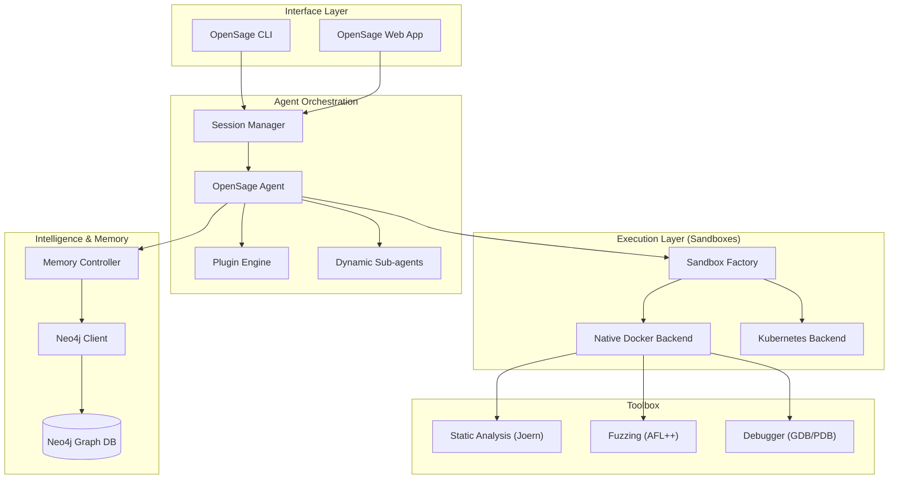

I will start by checking the existence of and reading the prompt file `..\.prompt.md` and the input file `.input.opensage-adk.xml`.
I will search for any files containing "prompt" in the current directory to see if the file mentioned by the user might be located there under a different path or name.
I will search for the content of `README.md` within the `.input.opensage-adk.xml` file to understand the purpose and structure of the OpenSage project.
I will read the `opensage-adk.gemini.md` file, as it seems relevant to the project and may contain the instructions I need.
I will read `agent-orchestrator.gemini.md` to see if it contains instructions or if it's also a log of a session.
I will list all files in the current directory to see if I can find a prompt file that may have been incorrectly referenced.
I will list the files in the project's root directory to see if the prompt file is located there.
I'll start by reading the `pyproject.toml` and other key files in `.input.opensage-adk.xml` to gain a deeper understanding of the OpenSage project and then perform the 21-point analysis.
I will take a quick look at `agentmemory.gemini.md` to ensure I haven't missed any project-specific details for the 21-point analysis.
I will check the end of the `.input.opensage-adk.xml` file to see if there are any git logs or "latest commits" that I can include in the 21-point report.
I have completed the technical analysis of the OpenSage-ADK project and will now generate a comprehensive 21-point report detailing its architecture, features, and capabilities.

# OpenSage-ADK Project Analysis

## 1. Project Name and Description
**Project Name:** OpenSage (OpenSage-ADK)

**Description:**
OpenSage-ADK is an open-source agent development framework specifically engineered for complex software engineering and security research tasks. It provides a robust infrastructure for building autonomous agents capable of vulnerability detection, PoC (Proof-of-Concept) generation, and deep code analysis. The core philosophy of OpenSage is to bridge the gap between LLMs and real-world software development by providing "sandboxed execution," "hierarchical memory," and "autonomous tool creation." Unlike general-purpose agent frameworks, OpenSage is specialized for the "inner loop" of software security, integrating professional-grade static analysis tools like Joern and CodeQL into a unified agentic workflow.

## 2. Supported Platforms, Deployments & Requirements
- **Platforms:** Primarily Linux (tested on Ubuntu 22.04/24.04) and macOS.
- **Deployments:**
    - **Local CLI:** The `opensage` command provides a full-featured terminal interface.
    - **Web Dashboard:** `opensage-web` offers a browser-based UI for monitoring and debugging agent sessions.
    - **Sandboxed Backends:** Supports `native` (Docker), `k8s` (Kubernetes), `remotedocker`, and `local` execution environments.
- **Requirements:**
    - **Python:** `>= 3.12`.
    - **uv:** Required for high-performance dependency management and project synchronization.
    - **Docker:** Essential for the recommended `native` sandbox backend.
    - **Neo4j:** (Optional but recommended) for long-term hierarchical memory storage.

## 3. Supported Connectors to Apps, APIs, and Messengers
- **Sandboxes:** Docker Engine, Kubernetes API.
- **Static Analysis:** Joern (CPG), CodeQL.
- **Databases:** Neo4j (Memory/Graph), SQLite (Local state).
- **LLM APIs:** LiteLLM (supporting OpenAI, Anthropic, Google, OpenRouter, etc.), Google ADK.
- **Observability:** Langfuse (integration for tracing and evaluation).
- **Search:** Google Search, DuckDuckGo (via web search plugins).
- **Security Tools:** AFL++, LLVM-Cov, GDB, PDB.

## 4. Supported Models and Agents
- **Models:** Any model compatible with LiteLLM (Claude 3.5 Sonnet, GPT-4o, Gemini 1.5 Pro are common targets).
- **Core Agents:**
    - `OpenSageAgent`: The primary agent for general software tasks.
    - `VulnerabilityAgent`: Specialized for security flaw identification.
    - `PoCAgent`: Dedicated to generating and verifying exploit code.
    - `MemoryManagementAgent`: Automates the update of the hierarchical knowledge graph.
    - `DynamicSubagent`: Enables agents to spawn child processes for specific sub-tasks.

## 5. Top 5 Use Cases and Workflows
1. **Automated Vulnerability Discovery:** Using static analysis (Joern/CodeQL) to find sinks, then using agents to check reachability and data flow.
2. **Autonomous PoC Generation:** Taking a CVE or vulnerability description and generating a working exploit in a sandboxed container.
3. **Multi-Agent Security Ensemble:** A "Researcher" agent finds bugs, a "Developer" agent proposes fixes, and a "Verifier" agent runs tests.
4. **Codebase Knowledge Graphing:** Building a persistent memory of a project's architecture, past bugs, and function relationships.
5. **Interactive Debugging:** Using the `opensage-web` interface to guide an agent through a complex crash analysis using GDB/PDB.

## 6. Top 20 Features
1. **Multi-Backend Sandboxing:** Native Docker, Remote Docker, and Kubernetes support.
2. **Hierarchical Memory:** Short-term (session) and long-term (Neo4j graph) memory.
3. **Dynamic Tool Creation:** Agents can write and register their own bash/python tools.
4. **Joern/CPG Integration:** Deep integration for graph-based static analysis.
5. **CodeQL Support:** Running complex queries for variant analysis.
6. **Coverage-Driven Testing:** Mapping test cases to specific code paths and functions.
7. **Fuzzing Orchestration:** Running AFL++ campaigns from within the agent loop.
8. **Web-Based Dashboard:** Real-time visualization of agent history and state.
9. **Plugin Engine:** Extensible hooks for monitoring, safety, and summarization.
10. **Doom Loop Detection:** Automatic detection and breaking of repetitive behaviors.
11. **Tool Response Summarization:** Smart truncation of large tool outputs to save context.
12. **Read-Before-Edit Safety:** Forcing agents to verify file content before modification.
13. **Message Board:** Shared communication channel for agent ensembles.
14. **Dynamic Subagent Spawning:** Hierarchical task delegation.
15. **Benchmark Harness:** Native support for CyberGym and SWE-bench evaluations.
16. **Skill Loading System:** Automatically exposing bash scripts as agent "skills."
17. **Debugger Integration:** GDB and PDB support via specialized MCP servers.
18. **Build Verification:** Plugins to ensure code changes compile before finalization.
19. **Neo4j History Logging:** Detailed tracing of agent logic into a graph DB.
20. **LiteLLM Unified Interface:** Easy switching between different LLM providers.

## 7. Top 20 Smart Patterns
1. **Sandbox-Backend Abstraction:** Separating tool execution from agent logic.
2. **Memory Observer:** Automatic synchronization of session logs to the graph.
3. **Tool Combo:** Bundling related tools (e.g., `read` + `grep`) to reduce LLM turns.
4. **Storage Decider:** Using LLMs to filter what's worth storing in long-term memory.
5. **Entity/Relationship Extraction:** Building the knowledge graph from natural language logs.
6. **Git-Aware Analysis:** Prioritizing recently modified code for vulnerability scanning.
7. **Async Retry Decorators:** Handling transient API and network failures.
8. **JSON Block Extraction:** Robust parsing of structured data from conversational LLM output.
9. **Config Template Injection:** Dynamic TOML configuration based on task-specific variables.
10. **Shared Sandbox Storage:** Allowing multiple backend containers to access a common volume.
11. **Skill Dependency Resolution:** Automatically installing binaries based on used bash tools.
12. **ADK Session Persistence:** Binding agent state to a persistent session ID.
13. **Quota/Budget Management:** Controlling LLM costs via plugin-based countdowns.
14. **Message Board Isolation:** Preventing data leakage between different ensemble tasks.
15. **Surgical Code Replacement:** High-precision string replacement to minimize context noise.
16. **Mock Model CLI:** Testing agent logic without incurring LLM costs.
17. **Incremental Knowledge Updates:** Updating specific nodes in the graph without a full rebuild.
18. **Context-Aware System Prompts:** Injecting sandbox and tool metadata into the agent's identity.
19. **Build-Test-Commit Loop:** Ensuring code quality via automated build checks in sandboxes.
20. **Skill-Based Discovery:** Exposing toolsets to agents based on the project's detected language.

## 8. Top 20 Development Trends (Latest Commits)
1. **Documentation Restructuring:** Major refactoring of the MkDocs site for better onboarding.
2. **Sandbox Graceful Shutdown:** Implementing SIGTERM handling for multiprocess evaluations.
3. **Web UI Theming:** Adding light/dark mode support and fixing dark mode styling.
4. **Dependency Check CLI:** Introducing a new tool for project dependency analysis.
5. **CyberGym Integration:** Active development of the CyberGym benchmark suite.
6. **RL Integration (slime/areal):** Experimenting with reinforcement learning for agent tuning.
7. **LiteLLM Consolidation:** Standardizing on LiteLLM for all LLM interactions.
8. **Plugin Engine Maturation:** Moving summarization and safety logic into modular plugins.
9. **K8s Backend Hardening:** Fixing volume mounting and connectivity issues in Kubernetes.
10. **GDB/PDB via MCP:** Transitioning debugger integration to the Model Context Protocol.
11. **Neo4j Schema Refinement:** Improving the efficiency of entity retrieval.
12. **History Truncation:** Better handling of massive chat histories via summarization plugins.
13. **Quota Plugin Expansion:** Adding per-model and per-session token budgets.
14. **Build Verifier Reliability:** Enhancing the detection of build failures across different languages.
15. **OSS-Fuzz Workflow:** Streamlining the ingestion of OSS-Fuzz results.
16. **Task Subset Filtering:** Adding logic to run evaluations on specific subsets of data.
17. **C++ Analysis Focus:** Continuous improvement of Joern scripts for C/C++ sinks.
18. **Automatic CNAME handling:** Documentation deployment fixes for GitHub Pages.
19. **Signal Handler Fixes:** ensuring clean cleanup of Docker containers on exit.
20. **CLI Ergonomics:** refining the `opensage` command flags and output.

## 9. Top 10 Advantages / Strong Points
1. **Security-First Architecture:** Built specifically for vulnerability research.
2. **Robust Isolation:** True sandboxed execution via Docker/K8s.
3. **Solves Context Limits:** Hierarchical memory allows analysis of large codebases.
4. **Developer-Friendly Tools:** CLI and Web UI for interactive debugging.
5. **Highly Extensible:** Simple to add new tools, plugins, or backends.
6. **Academic Validation:** Built to excel at competitive benchmarks (CyberGym, SWE-bench).
7. **Professional Analysis:** Native integration with Joern and CodeQL.
8. **Flexible LLM Choice:** Not tied to a single provider thanks to LiteLLM.
9. **Autonomous Learning:** Capable of creating its own tools and knowledge base.
10. **Modern Stack:** Leverages Python 3.12, `uv`, and Neo4j for high performance.

## 10. Top 10 Limitations / Weak Points
1. **High Infrastructure Overhead:** Requires Docker, Neo4j, and specialized binaries.
2. **Steep Learning Curve:** Complex configuration and architecture concepts.
3. **Resource Intensive:** Heavy RAM/CPU usage for multiple sandboxes and graph DB.
4. **Async-Heavy Debugging:** Complex `asyncio` code can be difficult to trace.
5. **C/C++ Bias:** Many advanced analysis tools are currently optimized for C/C++.
6. **Experimental Backends:** Non-Docker backends (K8s, Remote) are still maturing.
7. **Neo4j Operational Burden:** Managing a graph database adds deployment complexity.
8. **Heuristic Memory:** Deciding what to store in long-term memory is still model-dependent.
9. **Limited Multi-Language Depth:** While general, deep analysis for languages like Rust or Go is still in early stages.
10. **Sparse RL Docs:** Newer experimental features like RL integration lack comprehensive documentation.

## 11. Top 5 Used and Top 5 Provided AI Skills
- **Top 5 Used AI Skills:**
  1. **Joern/CPG Navigation:** Analyzing code structure via graph queries.
  2. **CodeQL Querying:** Identifying variants of known vulnerabilities.
  3. **Fuzzing Result Analysis:** Triaging crashes from AFL++ or OSS-Fuzz.
  4. **LiteLLM Orchestration:** Managing multi-model interactions.
  5. **Docker Management:** Programmatic control of sandbox environments.
- **Top 5 Provided AI Skills:**
  1. **Vulnerability Identification:** Finding security flaws in source code.
  2. **Exploit/PoC Development:** Creating working proof-of-concepts.
  3. **Memory/Knowledge Base Management:** Building project-specific intelligence.
  4. **Sandboxed Task Execution:** Safely running untrusted code.
  5. **Autonomous Tool Authoring:** Writing and deploying bash/python scripts for tasks.

## 12. Data Inputs, Outputs, and Storage Overview
- **Inputs:** Source code repositories (Git/Local), Task descriptions, Sandbox/Tool configurations (TOML), Static analysis databases (CPG, CodeQL).
- **Outputs:** Vulnerability reports (JSON), PoC scripts (Python/Bash), Knowledge graphs (Neo4j), Execution logs (JSONL/Markdown).
- **Storage:**
  - **Graph Memory:** Neo4j (Long-term persistent knowledge).
  - **Session State:** In-memory or SQLite (Short-term context).
  - **Workspaces:** Sandbox volumes (Code and intermediate artifacts).

## 13. Detailed Architecture Review
1. **Core Orchestrator (`opensage.agents`):** The central logic for LLM interaction and task management.
2. **Sandbox System (`opensage.sandbox`):** Abstracted factory for various execution environments.
3. **Memory System (`opensage.memory`):** Hierarchical storage with extraction and retrieval strategies.
4. **Plugin Engine (`opensage.plugins`):** A flexible hook system for observability and safety.
5. **Toolbox (`opensage.toolbox`):** A library of predefined and dynamically created tools.
6. **Evaluation Layer (`opensage.evaluation`):** Framework for running benchmarks and tracking metrics.
7. **Session Service (`opensage.features`):** Managing the lifecycle of agents and their resources.
8. **Static Analysis Layer (`bash_tools/static_analysis`):** The bridge to Joern and CodeQL.
9. **Web App (`opensage.cli`):** The browser-based interface for interactive agent sessions.
10. **RL Adapters (`rl/`):** Interfaces for training and refining agents via RL.

## 14. Architecture Mermaid Graph

## 15. Maturity, Stability, Security, and Performance
- **Maturity:** **Beta.** Feature-complete for security research, with rapid development in RL and K8s.
- **Stability:** **Moderate.** Local Docker backend is stable; Kubernetes and remote backends are experimental.
- **Security:** **High.** Core design emphasizes isolation and sandboxed execution for safety.
- **Performance:** **Good.** Context management (summarization + memory) prevents slowdowns on large projects.

## 16. Tests, CI Pipelines, Documentation, and AI Skills
- **Tests:** 500+ unit and integration tests using `pytest`.
- **CI:** GitHub Actions for automated testing, linting, and documentation deployment.
- **Documentation:** High-quality MkDocs site with developer, user, and evaluation guides.
- **AI Skills:** Rich set of bash-based skills for software analysis and security tasks.

## 17. Top 20 Improvements or Fixes
1. **Simplified Local Setup:** One-click installer for Docker, Neo4j, and Python deps.
2. **Standardized Sandbox API:** Uniform interaction across all backends.
3. **Web-Based Debugging:** Integrating interactive GDB/PDB directly into the Web UI.
4. **Real-time Graph Visualization:** Visualizing the Neo4j knowledge graph in the dashboard.
5. **Streaming Agent Output:** Support for real-time LLM response streaming.
6. **Improved Tool Error Recovery:** Smarter agent logic for handling tool failures.
7. **Expanded Language Support:** Deep static analysis for Rust, Go, and Java.
8. **RL Documentation:** Comprehensive guides for the slime and areal adapters.
9. **Multi-User Sessions:** Shared memory and sandbox instances for team use.
10. **Cost Estimation:** Real-time LLM cost tracking in the dashboard.
11. **Optimized CPG Management:** Better caching and reuse of Joern code property graphs.
12. **Auto-Healing Backends:** Automatic restarts for crashed sandbox containers.
13. **Fine-Grained Tool Permissions:** RBAC for agent tool execution.
14. **Offline Mode:** Seamless integration with local LLMs (Ollama, vLLM).
15. **Telemetry Expansion:** Enhanced tracing for multi-agent ensemble workflows.
16. **Plugin Marketplace:** Community-contributed safety and analysis plugins.
17. **Intelligent Context Windows:** Sliding window strategies beyond simple summarization.
18. **Automated Skill Synthesis:** Using LLMs to generate new bash tools on-the-fly.
19. **Browser Research Tool:** Integrating web browsing for vulnerability research.
20. **Self-Documenting API:** Swagger/OpenAPI docs for the session service.

## 18. Reuse for Agent Swarm (Solution Debate & Selection)
OpenSage-ADK is natively suited for swarms. Its **Message Board** enables agents to debate findings, while the **Dynamic Subagent** feature allows for hierarchical task delegation. The **Ensemble Manager** can be extended to implement consensus protocols, allowing a swarm to select the most promising vulnerability sink or PoC strategy collectively.

## 19. Reuse for Multi-User Shared Knowledge Base (Graph/Markdown)
The **Neo4j-based hierarchical memory** is the perfect foundation for a shared knowledge base. By connecting multiple OpenSage instances to a central Neo4j cluster, a team of researchers can build a collaborative graph of a project's internals, which is then accessible for retrieval and context injection by all agents and users.

## 20. Reuse for Hardware/Cloud/Messenger/Voice System
The **Sandbox abstraction** allows for execution on local hardware (Native) or cloud (K8s). The **Web App** can be served remotely, and the CLI can be integrated into messengers or voice systems by wrapping the `opensage` commands in a STT/TTS layer, enabling "voice-driven" security research.

## 21. Reuse for Team Agents (Human/Agent Workflows)
The **Web UI** and **Message Board** are designed for human-agent collaboration. Humans can monitor agent progress, provide hints on the Message Board, or use the **Plugin Engine** to set "human-in-the-loop" checkpoints before critical actions like executing a generated PoC or committing code.
