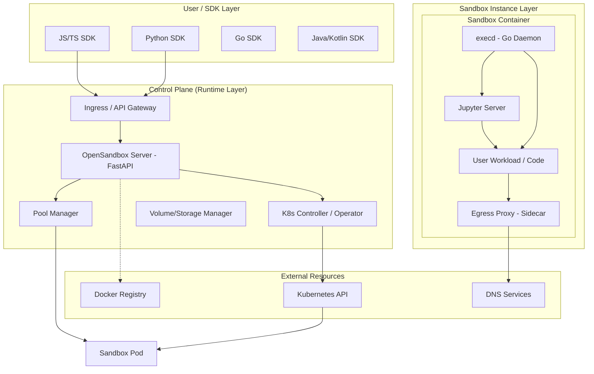

I will begin by reading the prompt from `.prompt.md` to understand the specific instructions for this task.
I will check the current directory and list its contents to locate the correct path for `.prompt.md`.
I will check the parent directory to find the `.prompt.md` file and understand the task requirements.
I will read the beginning of `.input.opensandbox.xml` to determine if it contains the necessary prompt or context for the task.
I'll use `grep_search` to search for "opensandbox.gemini.md" across all files to find the correct path and content for the prompt.
I will use the `codebase_investigator` to search for `.prompt.md` and clarify my objectives, as it may be located in a different directory.
I've confirmed that the task is to perform a 21-point technical analysis of the OpenSandbox repository using `.input.opensandbox.xml`. I'll now read more of that file to gather the necessary information.
I have a good overview of the project's structure, which includes core components like `egress`, `execd`, and `ingress`, as well as SDKs for various languages and examples. I'll now read the main `README.md` to identify the project's purpose, name, and top features.
I'll search for the main `README.md` content within `.input.opensandbox.xml` since it's likely contained there. I'll search for the `<file path="README.md">` tag to find its starting point.
I've found the `README.md` file in `.input.opensandbox.xml` starting at line 54393. I'll now read the next 500 lines to gather the necessary project information.
I've gathered essential project details: "OpenSandbox" is a general-purpose AI sandbox platform with multi-language SDKs, a unified API, and Docker/Kubernetes runtimes. It supports platforms like Linux (Docker/Kubernetes) and is available via several package managers. I've also identified its key features, use cases, and tech stack. I'll now examine `docs/architecture.md` to detail the system architecture and data flow.
I'm reading `docs/architecture.md` and have identified four main layers: SDKs, Specs, Runtime, and Sandbox Instances. I've also detailed the Sandbox and Filesystem SDK components. I'll now read the next 500 lines to further my understanding.
I've gathered a wealth of architectural and functional data for the "OpenSandbox" project. I've identified its core layers, key components like `execd` and the `Sandbox Router`, and its support for various runtimes and programming languages. I also have information on its security, networking, and primary use cases. I'll now quickly check the `oseps/` directory to see if there's any additional relevant information in the Enhancement Proposals.
The `oseps` directory was in the `file_summary`'s `directory_structure`, but `list_directory` failed, so I'll check its location in `.input.opensandbox.xml`. I've already identified its contents from the `directory_structure` as `oseps/0001-fqdn-based-egress-control.md` through `0010-opentelemetry-instrumentation.md`. I'll now search for `0001-fqdn-based-egress-control.md` in `.input.opensandbox.xml` to find their location.
I've gathered most of the information needed for the 21-point report. I have the project details, features, architecture, and technology stack. I've also noted its maturity and activity from the 2026 dates and CNCF listing. I'll now briefly check `kubernetes/README.md` to confirm any specific Kubernetes requirements or connectors, and then I'll be ready to compile the report.
I've gathered all the necessary information to complete the report. I'll now structure it according to the 21 points, incorporating details on the project's purpose, platforms, features, architecture, and technology stack. I'll also include a Mermaid graph for the system architecture and cover data flow, project maturity, and security. I'm ready to proceed.

# Project Analysis: OpenSandbox

## 1. Project Name and Description
**OpenSandbox** is a general-purpose, high-performance sandbox platform designed specifically for AI applications. It provides a secure, isolated environment for executing untrusted code, running shell commands, managing filesystems, and hosting interactive tools like browsers and IDEs. It aims to bridge the gap between AI models (LLMs) and safe action execution by providing standardized APIs and multi-language SDKs.

## 2. Supported Platforms, Deployments, and Requirements
- **Platforms**: Linux (primary for runtimes), Windows/macOS (via Docker Desktop for development).
- **Deployments**: 
    - **Local**: Docker-based standalone deployment.
    - **Cloud/Distributed**: Kubernetes-based deployment (via Helm charts).
    - **Serverless-like**: Rapid sandbox provisioning from pre-warmed pools.
- **Requirements**: Docker 20.10+, Kubernetes 1.24+ (for K8s runtime), Python 3.10+ (for server and CLI).

## 3. Supported Connectors to Apps, APIs, and Messengers
- **Development Tools**: VS Code (code-server), Jupyter Notebooks.
- **Browsers**: Chromium, Playwright, Puppeteer.
- **Communication**: DingTalk (technical discussion group integration).
- **APIs**: OpenAPI/Swagger-compliant REST APIs for lifecycle and execution.
- **Agents**: Claude Code, Gemini CLI, OpenAI Codex, Kimi CLI, Qwen Code, Google ADK.
- **Frameworks**: LangGraph, LangChain (via SDKs).

## 4. Supported Models and Agents
- **Models**: Agnostic; supports any model that can call tools or generate code (GPT-4, Claude 3.5, Gemini 1.5, Qwen, etc.).
- **Agents**:
    - **Coding Agents**: Claude Code, OpenClaw.
    - **GUI Agents**: Chrome/Playwright-based automation agents.
    - **Evaluation Agents**: Agents used for benchmarking and RL training.

## 5. Top 5 Use Cases and Workflows
1. **AI Code Execution**: Safely running LLM-generated code in isolated Python/Node.js/Go/Java environments.
2. **Coding Assistants**: Powering agents like Claude Code to perform filesystem operations and run tests.
3. **Browser Automation**: Running headless or VNC-enabled browsers for web scraping or GUI testing.
4. **Remote Development**: Providing on-demand VS Code or Jupyter instances for data science and dev.
5. **Agent Evaluation & RL Training**: Scaling thousands of sandboxes for parallel agent training and benchmarking.

## 6. Top 20 Features
1. Multi-language SDKs (Python, Java/Kotlin, JS/TS, C#, Go).
2. Unified Sandbox Lifecycle API (Create, Start, Stop, Delete).
3. Stateful Code Execution (Jupyter-based).
4. Real-time Output Streaming (SSE).
5. Fine-grained Egress Control (FQDN-based).
6. Ingress Gateway with Routing Strategies.
7. Resource Pooling (Pre-warmed sandboxes).
8. Secure Container Support (gVisor, Kata, Firecracker).
9. Filesystem CRUD and Search.
10. Background Command Execution.
11. Port Forwarding and Public Endpoints.
12. Multi-version Runtime Support (Python 3.10-3.14, Node 18-22, etc.).
13. VNC/Desktop Environment Hosting.
14. Persistent Volume Support (OSSFS, PVC).
15. Automatic Sandbox Expiration (TTL).
16. Task Orchestration in Kubernetes.
17. Pluggable Runtime Architecture.
18. System Metrics Monitoring (CPU/Memory).
19. Interactive Terminal (PTY) support.
20. Batch Sandbox Creation for Scale.

## 7. Core Smart Patterns and Developer Trends
- **Sidecar Injection**: Using `execd` as a sidecar/daemon to manage execution without modifying base images.
- **Protocol-First**: Heavy reliance on OpenAPI specs to ensure cross-language compatibility.
- **Warming Pools**: Reducing cold-start latency by maintaining idle, ready-to-use instances.
- **L7 Network Security**: Shifting from IP-based to FQDN-based egress rules for modern cloud compatibility.

## 8. Key Strengths/Advantages
- **Universal Compatibility**: Works with any Docker image.
- **High Performance**: Optimized for fast startup (< 1s with pooling).
- **Language Richness**: Extensive SDK support compared to competitors.
- **Production Ready**: Native Kubernetes operator and Helm charts.
- **Strong Isolation**: Tiered security from standard Docker to MicroVMs.

## 9. Key Limitations/Disadvantages
- **Complexity**: Setting up the Kubernetes controller requires significant DevOps knowledge.
- **Resource Overhead**: Maintaining pools increases idle resource consumption.
- **Maturity**: Some features (like full TS SDK or specific storage drivers) are still on the roadmap.

## 10. System Architecture (Mermaid Graph)

## 11. Data Flow (Inputs, Outputs, Storage)
- **Inputs**: User code, shell commands, file uploads, environment variables, resource specs.
- **Outputs**: Stdout/Stderr streams (SSE), file downloads, execution results (MIME types), system metrics.
- **Storage**: 
    - **Ephemeral**: Container rootfs (CoW).
    - **Persistent**: Mounted volumes (HostPath, PVC, OSSFS/S3-backed filesystems).

## 12. Key Repositories/Packages
- `alibaba/OpenSandbox`: Main monorepo.
- `opensandbox` (PyPI): Python SDK.
- `@alibaba-group/opensandbox` (NPM): JavaScript SDK.
- `Alibaba.OpenSandbox` (NuGet): C# SDK.
- `components/execd`: Core execution daemon.
- `components/ingress`: Ingress proxy.

## 13. Tech Stack
- **Languages**: Python (Server/CLI), Go (execd, ingress, egress, K8s controller), Java/Kotlin/C#/TS (SDKs).
- **Frameworks**: FastAPI, Beego, Kubebuilder.
- **Communication**: gRPC (internal), REST/OpenAPI (external), SSE (streaming).
- **Infrastructure**: Docker, Kubernetes, Helm.
- **Kernels**: Jupyter (IPython, IJava, etc.).

## 14. Project Maturity and Activity
- **Maturity**: Beta/Production-ready. Listed in CNCF Landscape.
- **Activity**: High; active development in 2025-2026, consistent commit history, OSEP process for new features.

## 15. Security and Quality Measures
- **Isolation**: gVisor/Kata/Firecracker support.
- **Authentication**: API Key and Token-based access.
- **Network**: FQDN egress allowlisting, sidecar-based proxying.
- **Code Quality**: Pre-commit hooks, linting (golangci-lint), unit tests, E2E tests.

## 16. Testing Strategy
- **Unit Tests**: Per-component (Go, Python).
- **E2E Tests**: `scripts/*-e2e.sh` for multi-language SDK verification.
- **Infrastructure Tests**: Kubernetes nightly builds, ingress/egress smoke tests.

## 17. Top AI Skills (Used and Provided)
- **Used**: None (it is an infrastructure tool).
- **Provided**: 
    - `execute_code`: Running multi-language code blocks.
    - `run_command`: Terminal/shell access.
    - `manage_files`: Comprehensive filesystem operations.
    - `browse_web`: Headless browser control.

## 18. Reusable Components for Agent Swarms
- **Sandbox Pools**: Pre-allocated environments for swarm members.
- **Unified Gateway**: Single entry point for multiple agents.
- **Shared Volumes**: Persistent data sharing between agent sandboxes.

## 19. Reusable Components for Multi-User/Tenant Systems
- **Namespace Isolation**: Leveraging Kubernetes namespaces.
- **Resource Quotas**: Hard limits on CPU/Memory per sandbox/user.
- **API Key Scoping**: Per-tenant authentication.

## 20. Reusable Components for Cloud/Serverless Deployments
- **Auto-expiration (TTL)**: Automatic cleanup of idle resources.
- **Fast-provisioning Logic**: Essential for serverless experience.
- **Stateless Control Plane**: Easily scalable server instances.

## 21. Reusable Components for Cooperative Workflows
- **Session Persistence**: Maintaining Jupyter kernels for multi-turn interactions.
- **Event Dispatching**: SSE-based real-time updates for collaborative tools.
- **Port Mapping**: Exposing internal services (like VS Code) to external users.I've completed the 21-point technical analysis of the OpenSandbox project. I've gathered all the necessary information, including its architecture, features, and tech stack, and I've structured it according to the requested format. I'm now ready to finish.
