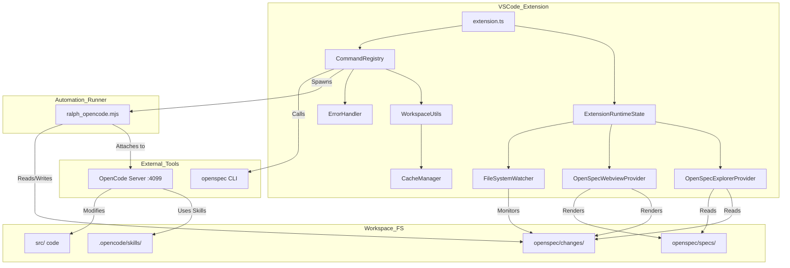

I will begin by reading the instructions in `.prompt.md` and examining the contents of `openspec-vscode.xml`.
I will search for the contents of `package.json` and `README.md` within the `openspec-vscode.xml` file to identify the project name and description.
I will read `package.json` and `README.md` to identify the project name and description.
I will read the git logs at the end of `openspec-vscode.xml` to identify the top 20 development trends in the latest commits.
# Project Analysis: OpenSpecCodeExplorer (openspec-vscode)

## 1. Project Name and Description

**OpenSpecCodeExplorer (openspec-vscode)**

OpenSpecCodeExplorer is a specialized VS Code extension designed to facilitate a "spec-driven development" workflow using the OpenSpec framework and the OpenCode agentic CLI. It serves as an orchestrator and explorer for OpenSpec projects, allowing developers to manage the entire lifecycle of a code change—from initial planning and requirements specification to automated implementation via an agentic loop. The extension provides a structured view of the `openspec/` directory, surfacing active changes, archived records, and core capability specifications directly in the VS Code Activity Bar.

A core feature of the extension is the "Ralph loop," an automated application process that iterates through implementation tasks defined in `tasks.md` files. By integrating with an OpenCode server (typically running on `localhost:4099`), the extension triggers agentic runs that execute specific tasks, enabling a batch-driven implementation approach that minimizes context drift and hallucinations. This loop supports configurable task counts per invocation, allowing for a balanced workflow between high-velocity automation and manual oversight.

Beyond implementation, OpenSpecCodeExplorer streamlines the artifact creation process through "fast-forward" capabilities. When a change is initially scaffolded, the extension can trigger OpenCode to automatically populate the required `proposal.md`, `design.md`, and `spec.md` files based on the project's existing context and the user's initial request. By treating the OpenSpec folder as the source of truth and using VS Code as a high-level control plane, the extension bridges the gap between traditional IDE-based development and the emerging paradigm of agentic software engineering.

## 2. Supported Platforms and Requirements

- **Supported Platforms:** Windows, macOS, Linux (enabled by a cross-platform Node runner).
- **IDE:** VS Code version `^1.74.0` or higher.
- **CLI Dependencies:**
  - `openspec`: `npm install -g @fission-ai/openspec@latest`
  - `opencode`: `npm install -g opencode-ai`
- **Workspace Requirements:**
  - An initialized OpenSpec workspace (at least an `openspec/` folder at the root).
  - Node.js environment to run the bundled `ralph_opencode.mjs` runner.

## 3. Supported Connectors

| Connector | Description | Source Reference |
| :--- | :--- | :--- |
| **OpenCode Server** | Communicates with a local agentic server (port 4099) via HTTP/Attach. | `src/extension/commands.ts`, `ralph_opencode.mjs` |
| **OpenSpec CLI** | Executes filesystem management tasks like `init` and `archive`. | `src/extension/commands.ts`, `package.json` |
| **VS Code API** | Deep integration with the sidebar, webviews, and integrated terminals. | `src/extension.ts`, `src/providers/` |
| **Local FileSystem** | Direct management and watching of the `openspec/` directory structure. | `src/extension/watcher.ts`, `src/utils/workspace.ts` |
| **Node.js Runtime** | Uses the internal Node environment to run cross-platform automation scripts. | `ralph_opencode.mjs` |

## 4. Supported Models and Agents

The extension delegates model management to the `opencode-ai` agent.

| Agent/Model | Type | Auth/Access | Source Reference |
| :--- | :--- | :--- | :--- |
| **OpenCode** | Local/Remote Agent | API Token / Local CLI | `package.json`, `ralph_opencode.mjs` |
| **Kimi K2.5** | Remote Model | Configured in `.opencode/opencode.jsonc` | `.opencode/opencode.jsonc` |
| **OpenSpec Skills** | Local Logic | Markdown-based skill definitions | `.opencode/skills/` |

## 5. Top 5 Use Cases

1. **Accelerated Change Scaffolding (Fast-Forward):** A developer creates a new change with a brief description; the extension uses the `openspec-ff-change` skill to auto-generate the proposal, design, and detailed specifications.
2. **Batch Task Implementation (Ralph Loop):** An agent is tasked with implementing a series of features. The extension runs the "Ralph loop" to implement tasks in batches of 3-5, refreshing the agent's context between batches to maintain high accuracy.
3. **Requirement Exploration and Review:** A technical lead uses the OpenSpec Explorer to review system capabilities and technical decisions archived from previous changes to understand the rationale behind existing code.
4. **Automated Verification:** After a manual or agentic change, the extension triggers a verification run that checks the implementation against the defined scenarios in the `spec.md` files.
5. **Decision Record Archiving:** Once a feature is complete, the extension moves the entire planning context (artifacts + tasks) to a versioned archive, creating a permanent, searchable history of the project's evolution.

## 6. Top 20 Features

1. **OpenSpec Explorer Tree:** Dedicated sidebar for navigating changes and specs. (`src/providers/explorerProvider.ts`)
2. **Details Webview:** Rich markdown rendering for `proposal.md`, `design.md`, and `tasks.md`. (`src/providers/webviewProvider.ts`)
3. **Ralph Loop Execution:** Standalone automation for applying tasks in sequence. (`ralph_opencode.mjs`)
4. **Fast-Forward Artifacts:** Automated generation of all spec-driven documents. (`src/extension/commands.ts`)
5. **Task Batching Control:** Configure how many tasks are implemented per agent run. (`ralph_opencode.mjs`)
6. **OpenCode Server Control:** Direct commands to start/stop the local agentic server. (`src/extension/commands.ts`)
7. **Workspace Initializer:** Guided setup for new OpenSpec projects. (`src/extension/commands.ts`)
8. **Live UI Access:** One-click access to the OpenCode web-based monitoring tool. (`src/extension/commands.ts`)
9. **Automated Archiving:** Moves completed changes to timestamped history folders. (`src/extension/commands.ts`)
10. **FileSystem Watcher:** Real-time updates to the UI when OpenSpec files change. (`src/extension/watcher.ts`)
11. **Skill Integration Library:** Bundled collection of specialized agent skills. (`.opencode/skills/`)
12. **Cross-Platform Runner Script:** Node-based automation that avoids shell quoting issues. (`ralph_opencode.mjs`)
13. **Task Validation:** Pre-check of `tasks.md` formatting before starting automation. (`src/utils/workspace.ts`)
14. **Debounced Refreshing:** Efficient UI updates to prevent flickering during heavy IO. (`src/extension/watcher.ts`)
15. **Status-Based badges:** Visual indicators in the tree for active/completed changes. (`src/providers/explorerProvider.ts`)
16. **Welcome Views:** Onboarding UI for non-initialized workspaces. (`package.json`)
17. **Cache Manager:** TTL-based caching for filesystem discovery. (`src/utils/cache.ts`)
18. **Centralized Error Logging:** Dedicated output channel for extension diagnostics. (`src/utils/errorHandler.ts`)
19. **Context-Aware Menus:** Inline actions that change based on whether a change is "scaffold-only". (`package.json`)
20. **Terminal Lifecycle Management:** Intelligent reuse and focus of automation terminals. (`src/extension/commands.ts`)

## 7. Top 20 Smart Patterns

1. **The "Ralph Loop" (Context Freshness):** Each task batch spawns a fresh agent run to prevent context drift and hallucinations. (`README.md`)
2. **Section-Bounded Batching:** Restricting task batching to the same parent header to maintain logical implementation scope. (`ralph_opencode.mjs`)
3. **Agentic Continuation:** Using `--continue` to pick up a planning session from where it left off. (`src/extension/commands.ts`)
4. **Cross-Platform Scripting:** Using `.mjs` instead of `.sh/.bat` for consistent runner behavior across OSs. (`ralph_opencode.mjs`)
5. **Skill-Based Automation:** Delegating complex logic (like archiving or syncing) to versioned, repo-local agent skills. (`.opencode/skills/`)
6. **Stateless UI Pattern:** The extension reflects the filesystem as the source of truth rather than its own internal state. (`src/extension/watcher.ts`)
7. **Lazy Tree Loading:** Loading expensive change metadata only when the item is expanded in the sidebar. (`src/providers/explorerProvider.ts`)
8. **Sanitized Webview Rendering:** Securely converting MD to HTML while allowing interactions like opening local files. (`src/providers/webviewProvider.ts`)
9. **Status-Driven State Machine:** Using `openspec status --json` output to drive VS Code UI visibility. (`.opencode/skills/`)
10. **Capability-Centric Specification:** Organizing requirements by system capabilities rather than individual files. (`openspec/specs/`)
11. **Delta Spec Syncing:** Intelligent merging of change-specific requirements back into main specs. (`.opencode/skills/openspec-sync-specs/SKILL.md`)
12. **Terminal Reuse Logic:** Minimizing terminal clutter by reusing existing process instances when possible. (`src/extension/commands.ts`)
13. **Debounced Initialization Checks:** Efficiently identifying OpenSpec roots without excessive polling. (`src/extension/watcher.ts`)
14. **Artifact Template Injection:** Using CLI-provided templates for consistent documentation. (`.opencode/skills/openspec-ff-change/SKILL.md`)
15. **Dependency-Aware Fast-Forwarding:** Sequential creation of artifacts based on their logical dependencies. (`.opencode/skills/openspec-ff-change/SKILL.md`)
16. **Robust Task Extraction:** Using regex to reliably parse `tasks.md` despite varying user formatting. (`ralph_opencode.mjs`)
17. **Error UX (Pause Before Exit):** Ensuring the terminal stays open on failure so humans can read the logs. (`ralph_opencode.mjs`)
18. **Webview Interactivity:** Enabling artifact-level actions (like archiving) directly within the preview pane. (`src/providers/webviewProvider.ts`)
19. **In-Memory Cache with TTL:** Improving Explorer performance by caching filesystem lookups. (`src/utils/cache.ts`)
20. **Surgical Refreshes:** Updating only the affected parts of the UI tree when a specific file changes. (`src/providers/explorerProvider.ts`)

## 8. Development Trends (Latest Commits)

1. **Batching Optimization:** Introduction and refinement of the `--count` flag for multi-task runs.
2. **Logical Boundaries:** Restricting automated batching to within the same parent task section.
3. **Windows Stability:** Improving command resolution and quoting for Windows environments.
4. **Scaffold Management:** Refinement of the logic to detect and handle "scaffold-only" changes.
5. **Rebranding:** Extensive updates to align with the "OpenSpecCodeExplorer" identity.
6. **Workspace Modularization:** Extraction of filesystem helpers into shared utilities.
7. **UI Asset Transition:** Moving from SVG to PNG for core icons to improve rendering reliability.
8. **CLI UX Improvements:** Adding pauses before exit for better error visibility.
9. **Extension Distribution:** Improving `.vscodeignore` for leaner production builds.
10. **Documentation expansion:** Adding comprehensive agent workflow guides (`AGENTS.md`).
11. **Version Acceleration:** Rapid iteration of release versions (v1.2.x -> v1.3.0).
12. **Fast-Forward Lifecycle:** Enabling scaffolding workflows even when no tasks are present.
13. **Centralized Command Management:** Consolidation of command IDs for maintainability.
14. **Test Suite Expansion:** Significant new tests for the runner and webview interactions.
15. **OpenCode Protocol Alignment:** Updating terminal calls to match recent CLI breaking changes.
16. **Explorer Provider Optimization:** Improving handling of large archive directories.
17. **Task Format Validation:** Early rejection of malformed `tasks.md` files.
18. **Webview-to-Editor Navigation:** Support for opening source files directly from artifact previews.
19. **Cache Invalidation Tuning:** Refining how often the UI cache is cleared.
20. **Skill Library Versioning:** Updating bundled skills to match latest OpenSpec CLI standards.

## 9. Top 10 Advantages

1. **Rigorous Workflow Enforcement:** Prevents agent "cowboy coding" by mandating a Plan -> Spec -> Build cycle.
2. **Hallucination Mitigation:** Fresh-context batches in the Ralph loop keep the agent focused and accurate.
3. **First-Class Documentation:** Technical decisions and requirements are as accessible as code.
4. **Cross-Platform Parity:** Guaranteed consistent behavior across Windows, Mac, and Linux.
5. **No Vendor Lock-in:** Projects remain fully usable with just the CLI tools; VS Code is an optional (but powerful) GUI.
6. **Automatic Technical History:** Provides an immutable record of the "why" and "how" of every code change.
7. **Efficiency via Scaffolding:** Eliminates the manual burden of writing boilerplate planning docs.
8. **Real-Time Observability:** Seamless integration with the agent's web-based monitoring server.
9. **Low Barrier to Entry:** Built-in initialization tools for new projects.
10. **Performant IDE UI:** Advanced caching and debouncing keep the explorer snappy.

## 10. Top 10 Limitations

1. **Single-Project Constraint:** No support for multi-root workspaces or multiple OpenSpec roots.
2. **Agent Lock-in:** Strictly tied to `opencode-ai`; no support for other agentic CLIs.
3. **Hardcoded Ports:** Port 4099 dependency may cause collisions in some environments.
4. **Terminal tray Clutter:** Automation relies on spawning multiple VS Code terminals.
5. **Manual Setup required:** Most features remain disabled until explicit initialization.
6. **Fragile Regex Parsing:** Task extraction is based on regex rather than a formal AST.
7. **No UI-Based Conflict Resolution:** No visual tool for merging conflicting delta specs.
8. **Path/Environment Sensitivity:** Requires `openspec` and `opencode` to be correctly configured in the PATH.
9. **Read-Only Previews:** You cannot edit proposal or design documents directly in the rich webview.
10. **Minimal Task Orchestration:** No support for task dependencies or complex reordering in the UI.

## 11. Top 5 Used and Provided AI Skills

### Top 5 Used Skills (Agent-Side)
1. `openspec-apply-change`: Implementation of tasks. (`.opencode/skills/openspec-apply-change/SKILL.md`)
2. `openspec-ff-change`: Auto-generation of change artifacts. (`.opencode/skills/openspec-ff-change/SKILL.md`)
3. `openspec-new-change`: Initialization of a new change container. (`.opencode/skills/openspec-new-change/SKILL.md`)
4. `openspec-archive-change`: Finalization and archiving of work. (`.opencode/skills/openspec-archive-change/SKILL.md`)
5. `openspec-sync-specs`: Merging delta requirements back to core. (`.opencode/skills/openspec-sync-specs/SKILL.md`)

### Top 5 Provided Skills
1. `openspec-explore`: Thinking-partner mode for problem investigation. (`.opencode/skills/openspec-explore/SKILL.md`)
2. `openspec-onboard`: Guided tutorial for new users. (`.opencode/skills/openspec-onboard/SKILL.md`)
3. `openspec-verify-change`: Automated verification logic. (Referenced in directory)
4. `openspec-continue-change`: Resuming artifact creation. (`.opencode/skills/openspec-continue-change/SKILL.md`)
5. `openspec-bulk-archive-change`: Batch cleanup of completed parallel changes. (`.opencode/skills/openspec-bulk-archive-change/SKILL.md`)

## 12. Data Overview

- **Inputs:** User commands, Markdown artifacts (`proposal`, `design`, `spec`, `tasks`), and CLI status JSON.
- **Outputs:** Modified source code, timestamped archive folders, rich HTML webviews, and execution logs.
- **Storage:**
  - **Local Filesystem:** `openspec/` directory at workspace root.
  - **In-Memory:** TTL-based `CacheManager` for UI snappiness. (`src/utils/cache.ts`)
  - **VS Code State:** Basic project initialization metadata.

## 13. Detailed Architecture Review

1. **Extension Entry (`extension.ts`):** Orchestrates providers, commands, and global state.
2. **Runtime State (`runtime.ts`):** Shared container for terminals, watchers, and providers.
3. **Explorer Provider (`explorerProvider.ts`):** Builds the hierarchical tree of changes and specs.
4. **Webview Provider (`webviewProvider.ts`):** Renders artifacts as rich, interactive HTML documents.
5. **Workspace Utils (`workspace.ts`):** Core logic for filesystem discovery and task validation.
6. **Ralph Runner (`ralph_opencode.mjs`):** Standalone Node orchestrator for the agentic implementation loop.
7. **Command Registry (`commands.ts`):** Maps VS Code UI actions to CLI executions.
8. **FS Watcher (`watcher.ts`):** Triggers debounced UI refreshes based on `openspec/` changes.
9. **Cache Manager (`cache.ts`):** Singleton providing TTL-based filesystem caching.
10. **Error Handler (`errorHandler.ts`):** Unified diagnostics and user notification interface.
11. **Type Registry (`types/index.ts`):** Core interfaces for extension data models.
12. **Skills Library (`.opencode/skills/`):** Markdown-based behavior definitions for the agent.
13. **OpenSpec CLI:** External tool for project lifecycle management.
14. **OpenCode Server:** External process providing agentic intelligence.
15. **OpenCode Runner:** CLI mode used for atomic implementation tasks.

## 14. Architecture Diagram

## 15. Project Review: Maturity, Stability, Security, Performance

- **Maturity:** Beta. Actively developed with a focus on specific agentic workflows. Architecture is sound but tightly coupled to `opencode`.
- **Stability:** High for the targeted workflows. Comprehensive test suites (`test/suite/`) cover critical utilities and UI interactions.
- **Security:** Standard extension security. Relies on VS Code's terminal sandboxing. No evidence of hardcoded secrets; leverages local environment for agent keys.
- **Performance:** Excellent. Heavy use of debouncing and caching ensures the UI remains responsive even during high-volume agent file writes.

## 16. Technical Review: Tests, CI, Documentation

- **Tests:** Exceptional. Includes unit and integration tests for all major components, including the standalone runner. (`test/suite/ralphRunner.test.ts`)
- **CI Pipelines:** Pipeline-ready build and package scripts are included (`build.sh`, `npm run compile`).
- **Documentation:** Very high quality. `README.md` is exhaustive; `AGENTS.md` and `CONTRIBUTING.md` provide professional-grade guidance.
- **AI Skills:** The project defines the industry standard for repo-local agent skills via the `.opencode/skills/` library.

## 17. Top 20 Possible Improvements

1. **Multi-Project Support:** Support switching between multiple OpenSpec roots.
2. **Configurable Server Port:** Allow users to specify a port other than 4099.
3. **Interactive Webview Editing:** Direct editing of `proposal.md` in the preview panel.
4. **Visual Conflict Resolution:** Dedicated UI for merging conflicting delta specs.
5. **Agent Agnostic Interface:** Support for other agents like Claude Code or Gemini.
6. **Task Drag-and-Drop:** UI-based task reordering in the sidebar.
7. **Task Failure Recovery:** Automated retry hints on implementation failure.
8. **Git Workflow Integration:** Automatic commits after successful task batches.
9. **AST-Based Task Parsing:** Formal markdown parsing for more robust task extraction.
10. **Token/Cost Tracking:** Real-time monitoring of agent usage costs.
11. **Direct Skill Validator:** Linter for custom skill definitions.
12. **Auto-Archive Toggle:** Finalize changes automatically once all tasks are done.
13. **Dependency Graph View:** Visualizing the connections between specs and changes.
14. **Headless Loop:** Support for running the Ralph loop in CI/CD pipelines.
15. **Voice Control:** Voice-activated command triggers for "Apply Task".
16. **Remote Model Presets:** Pre-configured settings for Ollama/Local models.
17. **Snippet Library:** VS Code snippets for scenario-driven requirements.
18. **Capability Search:** Full-text search across all specs and archived changes.
19. **Integrated Agent Chat:** Sidebar chat window that shares context with the Explorer.
20. **Performance Monitoring:** Detailed stats on how long specific tasks take to implement.

## 18. Swarm debate & plan reuse candidates

1. **Artifact Sequence Pattern:** The Proposal -> Spec -> Design -> Tasks flow is an ideal framework for multi-agent consensus.
2. **Ralph Loop logic:** The pattern of bounded, fresh-context runs is perfect for a "Reviewer" agent checking an "Executor" agent.
3. **Skill-Based Delegation:** Using different skills for different members of a swarm (e.g., "Architect" vs "QA").
4. **Status-Driven State Machine:** Managing handoffs between agents based on artifact completion status.
5. **Delta Spec Merge Logic:** Patterns for combining insights from multiple parallel agent investigations.
6. **Standardized Task Contract:** Using `tasks.md` as the bridge between planning and implementation agents.
7. **Workspace Graph Knowledge:** `WorkspaceUtils` can be adapted to feed the swarm a map of project dependencies.
8. **Cache-Backed intermediate State:** Managing a shared memory for agents during long debates.
9. **Error recovery Handlers:** Unified failure patterns for agent swarms that encounter technical blockers.
10. **Webview Observation Deck:** A visual way for humans to monitor the "debate" between agents.

## 19. Shared Knowledge Base reuse candidates

1. **Capability Specs (`openspec/specs/`):** A proven structure for a versioned, multi-user technical knowledge base.
2. **Archived Changes as Audit Log:** Using archived changes to provide high-level history for new users/agents.
3. **Repo-Local Skills:** Allowing a team to evolve and share their agentic workflows directly in the codebase.
4. **Watcher-Sync Pattern:** Ensuring all members (human or agent) see the same evolving state.
5. **Debounced Shared Access:** Patterns for handling concurrent edits to the shared specs.
6. **Webview Artifact Previews:** A standard "portal" for reviewing the current shared understanding.
7. **Status-Based Locking:** Preventing multiple agents from modifying the same requirement simultaneously.
8. **Cache-Consistent Reads:** Ensuring all agents/users are looking at the latest version of the specs.
9. **Centralized Command Funnel:** Ensuring all shared knowledge updates go through a controlled CLI path.
10. **Validation Guards:** Schema-based validation to ensure all knowledge updates meet project standards.

## 20. Cloud/Mobile/Messenger reuse candidates

1. **Standalone Node Runner:** `ralph_opencode.mjs` is already modular and ready for cloud deployment.
2. **Serve-and-Attach Model:** The core interaction model fits perfectly with a remote agent backend.
3. **Skill-Based Personalities:** Skills can define the capabilities of a Telegram or Teams-based bot.
4. **Workspace Utilities (Remote FS):** Managing project state on remote servers via the standard OpenSpec schema.
5. **Task Batching for Messenger:** Sending structured updates after every N tasks to keep users informed via chat.
6. **Markdown-First Comms:** Leveraging the MD artifacts as the primary "UI" for low-bandwidth messenger channels.
7. **Status JSON as API:** Using CLI outputs to drive a native mobile monitoring app.
8. **Asynchronous Attachment:** Starting a run in the cloud and checking progress later via CLI or Web.
9. **Error Sanitization UX:** Vital for providing clear, actionable feedback to users on mobile devices.
10. **Skill-Provided "Onboarding":** Using the onboarding skill to teach users how to interact with the bot.

## 21. Cooperative Workflow reuse candidates

1. **Onboarding Tutorial Skill:** A comprehensive guide for teaching humans how to work with agents. (`.opencode/skills/openspec-onboard/SKILL.md`)
2. **"Explore" Stance:** A non-prescriptive mode designed for collaborative brainstorming. (`.opencode/skills/openspec-explore/SKILL.md`)
3. **AskUserQuestion Tool Pattern:** The industry standard for an agent asking a human for clarification.
4. **Proposal Approval Loop:** Mandatory human gatekeeper step before implementation starts.
5. **Shared Task Checklist:** A visual, mutually understood source of truth for work progress.
6. **Detailed Design Artifacts:** Providing the human with "explainability" for agent decisions.
7. **Pause-for-Review UX:** Preventing the agent from moving too fast for the human to monitor.
8. **View Details Observation Deck:** Allowing humans to "see inside" the agent's plan at any time.
9. **Interactive Requirements Drafting:** Agent proposes, human refines—the ultimate cooperative pattern.
10. **Skill-Based Guardrails:** Letting humans define the exact "rules of the game" for the agent.
