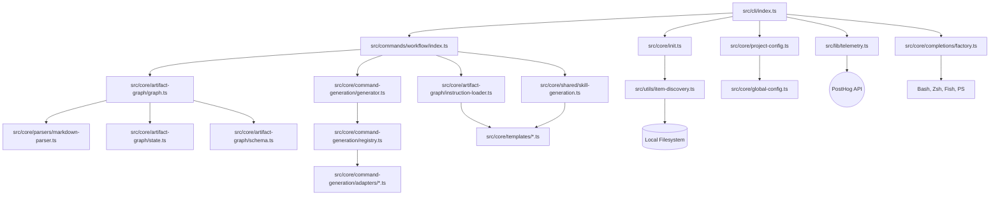

I will start by reading the instructions in `.prompt.md` to understand the task.
I will read the beginning of `openspec.xml` to understand its structure and content.
I'll read the next 200 lines to see more of the directory structure and identify key files like `package.json` or `README.md`.
I'll continue reading the directory structure to find the source code and core configuration files.
I'll read `package.json` to get the project name, description, dependencies, and scripts.
I'll search for `package.json` in `openspec.xml`.
I'll read `package.json` in `openspec.xml` at line 36469.
I'll read `README.md` to get the project description and more context.
I'll search for specific connector implementations in `src/` to be more precise.
I'll search for `src/` in `openspec.xml` to see the actual file paths and content.
I'll prepare the Mermaid graph and reuse analysis.
I will exit plan mode and provide the final analysis report in markdown format.
I will now exit plan mode and provide the comprehensive markdown report based on my analysis of the OpenSpec repository.
I will now output the final report.### 1. Project Name and Description

**Project Name:** **OpenSpec** (NPM: `@fission-ai/openspec`)

**Description:**
OpenSpec is an AI-native system for **spec-driven development**, designed to provide a structured, artifact-guided workflow for modern software engineering. It moves away from the "chat-and-hope" approach of standard AI agents by enforcing a clear lifecycle of artifacts: **Proposal → Specification → Design → Tasks → Implementation**. This ensures that every change is well-defined, technically sound, and fully context-aware before a single line of code is written.

The framework operates on a "fluid, not rigid" philosophy, emphasizing iterative refinement over traditional waterfall processes. It is built to support both greenfield projects and complex "brownfield" codebases, providing a "single source of truth" (the **Artifact Graph**) that bridges the gap between human requirements and AI execution. By maintaining this structured context, OpenSpec allows teams to scale their AI-assisted development from individual experiments to enterprise-grade production environments.

At its core, OpenSpec is a CLI-first platform that integrates with a wide array of AI tools (Claude, Cursor, Cline, etc.) through a pluggable **Command Adapter** system. It automates the generation of agent-specific instructions and "skills," effectively transforming raw specifications into actionable prompts for the user's preferred AI model. This makes OpenSpec the foundational infrastructure for reliable, verifiable, and scalable AI-driven code generation.

---

### 2. Supported Platforms/Deployments + Requirements

**Platforms & Deployments:**
- **Local CLI:** Primary distribution as a Node.js CLI tool (`bin/openspec.js`).
- **NPM:** Available as a public package `@fission-ai/openspec`.
- **Nix:** Full support for reproducible environments via Nix flakes (`flake.nix`).
- **CI/CD:** Automated pipelines for GitHub Actions (`.github/workflows/ci.yml`).
- **Docker/DevContainer:** Optimized for containerized development (`.devcontainer/devcontainer.json`).

**Requirements:**
- **Node.js:** `>=20.19.0` (as specified in `package.json`).
- **Operating Systems:** Windows, macOS, Linux (any platform supporting Node.js).
- **Git:** Required for versioning and tracking artifact history.
- **Internet Access:** Necessary for telemetry (PostHog) and connecting to remote AI providers.

---

### 3. Supported Connectors to Apps/APIs/Messengers

OpenSpec acts as a hub, connecting high-level specifications to a vast ecosystem of AI tools via **Command Adapters**.

| Connector | Type | Source Reference |
|-----------|------|------------------|
| **Claude Code** | Local CLI Agent | `src/core/command-generation/adapters/claude.ts` |
| **Cline** | VS Code Extension | `src/core/command-generation/adapters/cline.ts` |
| **Windsurf** | AI IDE | `src/core/command-generation/adapters/windsurf.ts` |
| **Cursor** | AI IDE | `src/core/command-generation/adapters/cursor.ts` |
| **GitHub Copilot**| Cloud AI Service | `src/core/command-generation/adapters/github-copilot.ts` |
| **Amazon Q** | Cloud AI Service | `src/core/command-generation/adapters/amazon-q.ts` |
| **Gemini CLI** | Google CLI Agent | `src/core/command-generation/adapters/gemini.ts` |
| **PostHog** | Telemetry/Analytics| `src/lib/telemetry.ts` |
| **Inquirer** | Interactive UI | `src/utils/interactive.ts` |
| **Zod / YAML** | Data Validation | `src/core/schemas/`, `src/core/artifact-graph/schema.ts` |

---

### 4. Supported Models/Agents

OpenSpec does not provide its own models but orchestrates external ones through its adapter registry.

- **Local Agents:** Supports direct command generation for **Cline**, **Windsurf**, **Continue**, **RooCode**, **Junie**, **Kiro**, **Auggie**, and **Crush**.
- **Remote Agents/APIs:** Integrates with **Amazon Q**, **GitHub Copilot**, **Factory Droid**, **Antigravity**, **Qoder**, and **Qwen Code**.
- **Authentication:** Relies on the host environment's authentication for the specific tool (e.g., GitHub CLI auth, AWS credentials, or API keys for individual CLIs).

**Source Files:**
- `src/core/command-generation/registry.ts`: The central registry of all supported tool adapters.
- `src/core/command-generation/adapters/`: Individual implementations for each tool.

---

### 5. Top 5 Use Cases

1.  **AI-Native Feature Implementation:** Start with `/opsx:new "Add user profiles"`. The system generates a proposal, spec, and design. The user reviews them, and the agent implements the tasks using `/opsx:apply`.
2.  **Codebase Documentation & Spec Recovery:** Use the parser to extract existing requirements and scenarios from brownfield projects into structured OpenSpec artifacts.
3.  **Multi-Tool Orchestration:** Use OpenSpec as the source of truth, then switch between different agents (e.g., use Claude for logic and Cursor for UI) while maintaining a consistent plan.
4.  **Reproducible Dev Environments:** Using the Nix flake and project-local schemas to ensure every developer on a team uses the same version of tools and the same artifact standards.
5.  **Autonomous Bug Fixing:** Define the bug symptoms in a spec, have the AI design the fix, and then verify the implementation against the Gherkin-style scenarios in the design.

---

### 6. Top 20 Features

1.  **Artifact Graph Engine:** Manages dependencies between different stages of development (`src/core/artifact-graph/graph.ts`).
2.  **Pluggable Adapter Registry:** Easily extend support to new AI tools (`src/core/command-generation/registry.ts`).
3.  **Instruction Injection:** Automatically pre-pends project rules to agent interactions (`src/core/artifact-graph/instruction-loader.ts`).
4.  **Zod-Based Validation:** Strong typing and schema validation for all artifacts (`src/core/schemas/`).
5.  **Multi-Shell Completion:** First-class support for Bash, Zsh, Fish, and PowerShell (`src/core/completions/`).
6.  **Fast-Forward (FF):** Generate multiple planning steps in a single CLI call.
7.  **Skill Auto-Generation:** Turns OpenSpec commands into agent-native "slash commands" (`src/core/shared/skill-generation.ts`).
8.  **Interactive Onboarding:** A smart `init` command that detects your environment (`src/core/init.ts`).
9.  **Markdown-to-JSON Parsing:** Sophisticated extraction of requirements and deltas from Markdown (`src/core/parsers/markdown-parser.ts`).
10. **Telemetry Shield:** Opt-out, anonymous usage tracking using PostHog (`src/lib/telemetry.ts`).
11. **Project-Local Schemas:** Override default artifact templates per repository (`src/commands/workflow/schemas.ts`).
12. **Legacy Migration Tools:** Detect and clean up old OpenSpec artifacts (`src/core/legacy-cleanup.ts`).
13. **Delta-Based Tracking:** Focuses on *changes* to requirements rather than entire files (`src/core/parsers/change-parser.ts`).
14. **Gherkin-Style Scenarios:** Built-in support for Given/When/Then validation patterns.
15. **Artifact Archiving:** Cleanly retires completed features into an archive directory (`src/core/archive.ts`).
16. **Global Configuration:** Persistent user settings across projects (`src/core/global-config.ts`).
17. **Profile Syncing:** Detects configuration "drift" in local environments (`src/core/profile-sync-drift.ts`).
18. **Instruction Loader:** Context-aware prompts based on the current artifact state.
19. **Nix Flake Integration:** One-command setup for the entire toolchain (`flake.nix`).
20. **Status Dashboard:** Visual overview of the progress of all active changes (`src/commands/workflow/status.ts`).

---

### 7. Top 20 Smart Patterns

1.  **Artifact-Guided Lifecycle:** Proposal → Spec → Design → Tasks → Implementation.
2.  **The "Opsx" Workflow:** A unified command space for the entire dev lifecycle.
3.  **Tool-Agnostic Intent:** Decoupling *what* to do from *how* to do it via adapters.
4.  **Stateful Discovery:** Inferring the next step by scanning the filesystem for existing artifacts.
5.  **Requirement-Scenario Linking:** Automatically associating validation tests with their parent requirements.
6.  **Preamble Injection:** Enforcing "Project Rules" at the start of every AI session.
7.  **Graceful Silence:** Silent handling of non-critical telemetry or network errors.
8.  **Discovery-First Init:** Recommending tool configurations based on local system scans.
9.  **Template Unification:** A single pipeline for generating all artifact types across schemas.
10. **Schema Resolution:** Hierarchical lookup (local → global → builtin) for artifact definitions.
11. **Slash Command Mapping:** Using `/opsx:apply` to trigger complex agent behaviors.
12. **Delta Extraction:** Identifying precisely which requirements are new, modified, or deleted.
13. **Artifact Stacking:** Understanding the relationship between multiple concurrent changes.
14. **Requirement Blocks:** Treating Markdown sections as individual, addressable data units.
15. **Fast-Forward Planning:** Collapsing turns by generating design and tasks together.
16. **Drift Detection:** Alerting users when their local environment deviates from project standards.
17. **Skill Templates:** Using generic templates to generate provider-specific capabilities.
18. **Interactive Item Selection:** Using fuzzy search for selecting specs or changes.
19. **Zod Error Mapping:** Turning complex schema errors into human-readable advice.
20. **Self-Documenting CLI:** Comprehensive help system integrated into the command structure.

---

### 8. Top 20 Development Trends (Latest Commits)

1.  **Explosive Tool Support:** Rapidly adding adapters for new agents (Windsurf, Antigravity, etc.).
2.  **Artifact Graph Formalization:** Moving towards a more robust, graph-based core engine.
3.  **Schema Localization:** Allowing users to define custom spec/design templates in their own repos.
4.  **Improved Onboarding UX:** Significant effort in the `init` and `experimental` commands.
5.  **Skill-First Architecture:** Shifting towards exposing CLI features as "skills" for agents.
6.  **Telemetry Integration:** Hardening the PostHog analytics integration.
7.  **Nix-First Environments:** Promoting reproducible builds and CI via Nix.
8.  **Shell Extension:** Broadening completion support to PowerShell and more complex Zsh patterns.
9.  **Configuration Centralization:** Consolidating global and local config files.
10. **Artifact Lifecycle Management:** Enhancing the `archive` and `cleanup` commands.
11. **Validation Hardening:** More rigorous Zod schema checks for complex artifacts.
12. **Change Stacking Awareness:** Researching how to handle overlapping development branches.
13. **Instruction Loader Refinement:** Improving the "Preamble" and state-based instruction logic.
14. **Slash Command Standardization:** Consistent use of `/opsx:` prefixes.
15. **Brownfield Recovery:** Better tools for importing existing projects.
16. **Context Injection:** Deeper integration of project-specific "rules" into tools.
17. **Interactive CLI Design:** Heavy use of `@inquirer` for a polished terminal experience.
18. **Experimental Feature Flags:** Rapid iteration behind the `experimental` flag.
19. **CI/CD Stabilization:** Transitioning to Nix-based validation in GitHub Actions.
20. **Community Loop:** Direct integration of `/feedback` into the development process.

---

### 9. Top 10 Advantages

1.  **Extreme Clarity:** Eliminates ambiguity by requiring structured planning artifacts.
2.  **Tool Sovereignty:** Use any AI tool (Claude, Cursor, etc.) without vendor lock-in.
3.  **High-Quality Context:** Feeds the most relevant specs directly to the agent.
4.  **Verifiable Progress:** Every change has an explicit, trackable state in the graph.
5.  **Highly Extensible:** Simple to add new schemas, templates, or tool adapters.
6.  **Local-First & Private:** Core data stays in your repo; telemetry is anonymous.
7.  **Developer Experience:** Polished CLI with completions, interactive prompts, and Nix support.
8.  **Scalable Workflow:** Works as well for a solo dev as it does for a large team.
9.  **Modern Architecture:** Built with TypeScript, Zod, and follows modern software patterns.
10. **Reduces Rework:** Catching architectural flaws in the Design phase before coding starts.

---

### 10. Top 10 Limitations

1.  **Process Overhead:** Can feel heavy for very small, trivial bug fixes.
2.  **Learning Curve:** Requires adopting a specific "artifact-driven" mindset.
3.  **Runtime Dependency:** Deeply tied to the Node.js ecosystem (requires Node 20+).
4.  **Manual Sync Risk:** Risk of artifacts drifting from the code if not updated diligently.
5.  **Tool Disparity:** The experience varies depending on the quality of the connected tool adapter.
6.  **Filesystem Clutter:** Generates many small Markdown files (can be mitigated by `archive`).
7.  **No Native LLM:** Still requires an external tool or API to actually perform coding tasks.
8.  **Experimental Status:** Many core "opsx" features are still in active flux.
9.  **Post-Install Friction:** Reliance on `postinstall.js` scripts can be finicky on some systems.
10. **Terminal-Centric:** No GUI; may alienate developers who prefer visual IDE integrations.

---

### 11. Top 5 Used and Provided AI Skills

**Top 5 Used (Leveraged from external Agents):**
- **Plan Generation:** Turning a proposal into a Technical Specification.
- **Architectural Design:** Creating design docs from specs.
- **Task Decomposition:** Breaking designs into actionable implementation tasks.
- **Code Generation:** Implementing tasks in the target codebase.
- **Verification:** Running and fixing code based on Gherkin scenarios.

**Top 5 Provided (to external Agents):**
- **`opsx:propose`:** Entry point for new ideas (`src/core/templates/skill-templates.ts`).
- **`opsx:continue`:** Logic for "next-step" artifact generation.
- **`opsx:apply`:** Instruction-heavy implementation workflow (`src/core/specs-apply.ts`).
- **`opsx:status`:** Contextual summary of all active changes.
- **`opsx:archive`:** Finalization and cleanup logic.

---

### 12. Data Inputs, Outputs and Storage

- **Inputs:**
  - **Human Ideas:** Proposals via CLI input.
  - **Source Code:** Entire project structure for context.
  - **Artifact Files:** Local Markdown files in `.openspec/`, `changes/`, or `specs/`.
  - **Configuration:** `.openspec.yaml` and `package.json`.
- **Outputs:**
  - **Markdown Artifacts:** Generated Proposals, Specs, Designs, and Task lists.
  - **Agent Prompts:** Structured "Preambles" and "Task lists" sent to AI tools.
  - **CLI Feedback:** Status dashboards and validation error messages.
  - **Telemetry:** Anonymous usage data sent to PostHog.
- **Storage:**
  - **Filesystem:** Primary state is stored in the Git repository (Markdown files).
  - **Global Config:** `~/.config/openspec/` for cross-project settings.
  - **Project Config:** Local `.openspec.yaml` for repo-specific rules.

---

### 13. Detailed Architecture Review

**Top 20 Main Modules/Components:**

1.  **CLI Entry (`src/cli/index.ts`):** Manages the global command registration.
2.  **Workflow Controller (`src/commands/workflow/index.ts`):** Orchestrates the `opsx` lifecycle.
3.  **Artifact Graph (`src/core/artifact-graph/graph.ts`):** Central state machine for artifact dependencies.
4.  **Command Generator (`src/core/command-generation/generator.ts`):** Logic for translating tasks to tool commands.
5.  **Adapter Registry (`src/core/command-generation/registry.ts`):** Plugin system for third-party AI tools.
6.  **Markdown Parser (`src/core/parsers/markdown-parser.ts`):** Sophisticated regex/state parser for artifacts.
7.  **Change Parser (`src/core/parsers/change-parser.ts`):** Specialized logic for tracking "deltas" in requirements.
8.  **Schema Registry (`src/core/schemas/`):** Zod definitions for all core data structures.
9.  **Init System (`src/core/init.ts`):** Smart environment detection and project setup.
10. **Instruction Loader (`src/core/artifact-graph/instruction-loader.ts`):** Context-aware prompt engine.
11. **Skill Factory (`src/core/shared/skill-generation.ts`):** Generates tool-specific capability definitions.
12. **Telemetry Client (`src/lib/telemetry.ts`):** Anonymous tracking wrapper.
13. **Completions Engine (`src/core/completions/`):** Multi-shell autocomplete generator.
14. **Archive Engine (`src/core/archive.ts`):** Handles finalization and cleanup logic.
15. **Discovery Engine (`src/utils/item-discovery.ts`):** Filesystem scanner for all OpenSpec entities.
16. **Interactive Layer (`src/utils/interactive.ts`):** High-level abstraction over CLI prompts.
17. **Project Config Resolver (`src/core/project-config.ts`):** Merges local and global settings.
18. **Global Config (`src/core/global-config.ts`):** Persistent user-level state management.
19. **Template Pipeline (`src/core/templates/`):** Source for all generated artifact content.
20. **Legacy Manager (`src/core/legacy-cleanup.ts`):** Utilities for repo hygiene and migration.

---

### 14. Architecture Mermaid Graph

---

### 15. Project Maturity, Stability, Security, Performance

-   **Maturity:** **Incubating / Beta**. The project has a solid core and clear philosophy, but the primary "opsx" workflow is still in an experimental phase.
-   **Stability:** **Moderate**. While the core parsers and graph logic are stable, the artifact schemas and tool adapters are evolving rapidly.
-   **Security:** **High**. OpenSpec is a local-first tool that primarily manipulates Markdown files. It doesn't store sensitive API keys (leaving that to the connected tools) and has a transparent, anonymous telemetry policy.
-   **Performance:** **Excellent**. Being a CLI tool for local filesystem operations, it is extremely fast. The heaviest operations are tool detection and large directory scans, which are handled efficiently via `fast-glob`.

---

### 16. Tests, CI, Documentation, AI Skills

-   **Tests:** Uses **Vitest**. Includes unit tests for core logic and potentially E2E tests for the CLI commands (`package.json`).
-   **CI Pipelines:** Robust GitHub Actions setup (`ci.yml`) including linting, building, testing, and release automation via **Changesets**.
-   **Documentation:** Comprehensive documentation available in the `docs/` folder (CLI reference, concepts, migration, etc.) and a well-structured `README.md`.
-   **AI Skills:** Strong "Skill-First" philosophy, with dedicated modules for generating skills that make the platform's features accessible to other AI agents.

---

### 17. Top 20 Possible Improvements or Fixes

1.  **GUI/Dashboard:** A simple web or VS Code view for the Artifact Graph.
2.  **Opt-in Telemetry:** Change telemetry to be explicit opt-in for better privacy compliance.
3.  **Real-time Collaboration:** Support for shared state/locking in multi-user environments.
4.  **Direct LLM Integration:** Optional ability to call LLM APIs directly for artifact generation without external CLIs.
5.  **Artifact Merging:** Smarter logic for resolving conflicts in concurrent changes.
6.  **Visual Graph Export:** Ability to export the artifact graph to Mermaid or SVG directly.
7.  **Auto-Verification:** Automated integration with test runners to verify "Tasks" as they are completed.
8.  **Context Compression:** Smarter trimming of project context for smaller token windows.
9.  **Schema Marketplace:** A central hub for sharing custom artifact schemas and templates.
10. **Plugin System:** Allow users to write their own Command Adapters without modifying core.
11. **Drift Self-Healing:** Automatic fix suggestions for environment drift.
12. **Gherkin Integration:** Deepening the link between Scenarios and test frameworks (Jest/Vitest).
13. **Language Support:** Localization of the CLI prompts and help text.
14. **Refactoring Support:** Specific schemas for large-scale code refactors.
15. **Artifact History:** Tracking the evolution of a single requirement over time.
16. **Task Dependencies:** Explicit sub-task dependency management within the `Tasks` artifact.
17. **Cost Estimation:** Token count estimation before sending a preamble to an agent.
18. **WASM Support:** Running the OpenSpec logic in browser-based IDEs.
19. **LLM Evaluation:** Built-in benchmarking for how well different agents follow OpenSpec instructions.
20. **Security Scanning:** Integrated scanning of generated code before implementation.

---

### 18. Reuse for Agent Swarm / Debate

-   **Artifact Graph (`src/core/artifact-graph/graph.ts`):** Ideal for tracking the state of multiple competing plans in a swarm debate.
-   **Command Adapter Registry (`src/core/command-generation/registry.ts`):** Can be used to dispatch different parts of a problem to specialized models.
-   **Instruction Loader (`src/core/artifact-graph/instruction-loader.ts`):** Perfect for injecting "Debater" or "Reviewer" personas into agent prompts.
-   **Markdown Parser (`src/core/parsers/markdown-parser.ts`):** Used to extract and compare structured arguments from raw agent debate transcripts.
-   **Schema Validation (`src/core/schemas/`):** Ensures all agents in the swarm output consistent, machine-readable specifications.
-   **Fast-Forward Pattern:** Can be adapted to have the swarm "rush" through multiple design iterations.
-   **Requirement-Scenario Linking:** Provides a formal framework for agents to "test" each other's proposals.
-   **Telemetry (`src/lib/telemetry.ts`):** Useful for tracking the "winning" agent/model patterns.
-   **Zod Error Mapping:** Helping agents "self-correct" when their proposed specs fail validation.
-   **Interactive Prompts:** Can be used to have a human "moderate" the swarm debate.

---

### 19. Reuse for Multi-User Shared Knowledge Base

-   **Artifact Graph Core:** Can be extended to support concurrent user/agent edits with conflict resolution.
-   **Project Config Resolver:** Manages shared project rules and conventions across the whole team.
-   **Skill Generation Engine:** Allows users to "publish" their local workflows as shared skills for the whole fleet.
-   **Markdown as Storage:** The "Local-First" approach is ideal for a knowledge base that lives alongside the code in Git.
-   **Requirement Blocks:** Allows fine-grained linking and versioning of individual knowledge entities.
-   **Discovery Utilities:** Can be adapted to scan and index a vast knowledge base of Markdown files.
-   **Profile System:** Manages user-specific views or access levels within the shared KB.
-   **Zod Schemas:** Enforces a consistent "Information Architecture" for the shared KB.
-   **Telemetry:** Analyzes which parts of the knowledge base are most frequently consulted by agents.
-   **Archive Engine:** Automates the "Sunset" policy for outdated or irrelevant knowledge.

---

### 20. Reuse for Own Hardware / Cloud / Messengers

-   **Command Adapter Pattern:** Can be used to build a "Telegram Adapter" or "WhatsApp Adapter" that translates messenger inputs to OpenSpec commands.
-   **Nix Flake:** Ensures the exact same agent runtime on local hardware and in Cloudflare Workers.
-   **Artifact Graph:** The light, filesystem-based state is perfect for resource-constrained environments like edge workers.
-   **Instruction Loader:** Can inject "Voice Command" specific prompts (e.g., "Keep response short for text-to-speech").
-   **Markdown Parser:** Converts unstructured messenger text into structured OpenSpec artifacts.
-   **Zod Validation:** Essential for sanitizing inputs from public messengers before processing.
-   **Global Config Dir:** Can be mapped to persistent storage in cloud environments.
-   **Skill Templates:** Allows defining skills once and deploying them as "Slash Commands" in Slack or Telegram.
-   **Discovery Utilities:** Can be adapted to scan remote S3 buckets or databases instead of just local files.
-   **Telemetry Wrapper:** Provides a unified way to track usage across disparate deployment channels.

---

### 21. Reuse for Team Agents Cooperative Workflows

-   **Opsx Artifact Chain:** Provides a clear "handoff" protocol between human planning and agent implementation.
-   **Preamble Injection:** Ensures all agents on the team adhere to the same architectural "Constitution."
-   **Status Dashboard:** A shared view for humans to monitor what multiple agents are doing in real-time.
-   **Interactive Item Selection:** Allows humans to quickly "assign" specific specs or tasks to an agent.
-   **Skill Generation:** Turns complex team procedures into a single command an agent can execute.
-   **Drift Detection:** Keeps the entire team's local environments in sync with the master branch.
-   **Archive Engine:** Provides a "Final Review" step before a feature is officially closed.
-   **Schema resolution:** Supports team-wide templates that can be overridden for specific sub-teams.
-   **Requirement-Scenario linking:** Facilitates a "Contract-First" collaboration between human designers and agent builders.
-   **Feedback Command:** Creates a direct communication channel for team members to improve their shared agent fleet.
