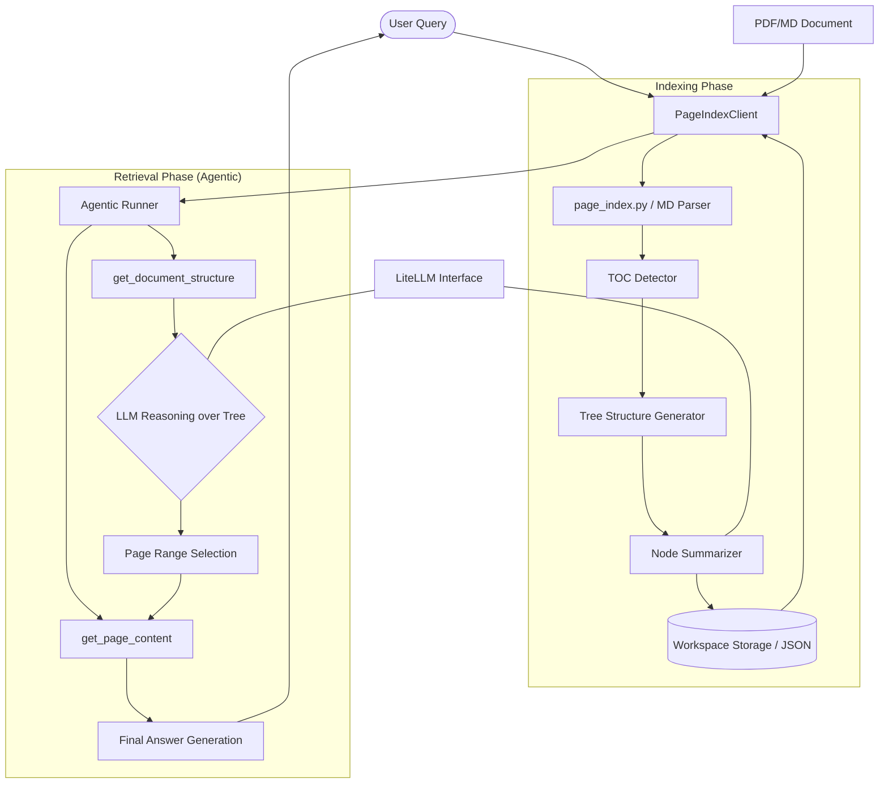

I will begin by reading the instructions in `.prompt.md` to understand the required processing for `pageindex.xml`.
I will now read `pageindex.xml` to understand the repository's structure and contents.
I've identified the project as PageIndex by VectifyAI, a vectorless RAG framework. I'll now read the next section of `pageindex.xml` to gather more details on its architecture, features, and implementation.
I've gathered significant information about PageIndex's core functionality and structure. I'll now read the final section of `pageindex.xml` to analyze development trends from the git logs and identify reusable patterns for multi-agent systems.
I have completed the analysis of the `pageindex.xml` file and the repository structure. I will now generate the comprehensive report as requested in `.prompt.md`, detailing the architecture, features, and reusable patterns of the PageIndex project.

# Project Analysis: PageIndex - Vectorless, Reasoning-based RAG

## 1. Project Name and Description
**Project Name:** PageIndex (by VectifyAI)

**Description:**
PageIndex is a next-generation, vectorless RAG (Retrieval-Augmented Generation) framework designed to overcome the limitations of traditional similarity-based retrieval in long professional documents. Instead of relying on approximate vector search ("vibe retrieval") and artificial chunking, PageIndex builds a hierarchical tree structure index of documents. It simulates how human experts navigate complex information by using Large Language Models (LLMs) to reason over this index to find truly relevant sections.

The framework operates in two primary steps: first, it transforms lengthy PDF or Markdown documents into a semantic tree structure (essentially an intelligent "Table of Contents" optimized for LLMs). Second, it performs reasoning-based retrieval through tree search, which ensures high precision and explainability. This approach is particularly effective for professional documents like financial reports, legal filings, and technical manuals where structural context is critical.

PageIndex powers a reasoning-based RAG system that has achieved state-of-the-art results, such as 98.7% accuracy on the FinanceBench benchmark. It provides developers with multiple integration paths, including a local Python SDK, a cloud-hosted API, and support for the Model Context Protocol (MCP), making it a versatile tool for building agentic AI applications.

## 2. Supported Platforms and Deployments
*   **Local SDK (Python):** Can be installed via pip and run on any system supporting Python 3.9+.
    *   *Requirements:* `litellm`, `pymupdf`, `PyPDF2`, `python-dotenv`, `pyyaml`.
*   **Cloud Service (SaaS):**
    *   **Chat Platform:** [chat.pageindex.ai](https://chat.pageindex.ai) for human-like document analysis.
    *   **Dashboard:** [dash.pageindex.ai](https://dash.pageindex.ai) for managing API keys and document indexing.
*   **API/SDK:** Available for developers at [pageindex.ai/developer](https://pageindex.ai/developer).
*   **Model Context Protocol (MCP):** Enables seamless integration with AI agents like Claude Desktop or other MCP-compatible hosts.
*   **Enterprise Deployment:** Supports private or on-premise deployments for sensitive data.

## 3. Supported Connectors
*   **Document Parsers:**
    *   **PDF Parser:** Uses PyMuPDF and PyPDF2 for text and metadata extraction.
        *   `pageindex/utils.py` (line 1236: `get_page_tokens`)
    *   **Markdown Parser:** Processes local markdown files, preserving hierarchy via header levels.
        *   `pageindex/page_index_md.py` (line 1205: `md_to_tree`)
*   **LLM Providers:**
    *   **LiteLLM Integration:** Connects to 100+ LLMs (OpenAI, Anthropic, DeepSeek, etc.) using a unified interface.
        *   `pageindex/utils.py` (line 1114: `llm_completion`)
*   **Agent Frameworks:**
    *   **OpenAI Agents SDK:** Native support for building agents that use PageIndex as a tool.
        *   `examples/agentic_vectorless_rag_demo.py`
*   **Protocols:**
    *   **MCP (Model Context Protocol):** Provides a standardized interface for tool-use by agents.
        *   `README.md` (lines 35-40)

## 4. Supported Models and Agents
*   **Local Models:** Any model compatible with LiteLLM can be used locally if hosted via a compatible server (e.g., Ollama, vLLM).
    *   `pageindex/utils.py`
*   **Remote Models (API-based):**
    *   **OpenAI:** GPT-4o, GPT-4.1 (referenced in cookbooks).
    *   **Anthropic:** Claude-3.5-Sonnet (referenced in `config.yaml`).
    *   **DeepSeek:** DeepSeek-V3, DeepSeek-R1 (referenced in `README.md`).
*   **Agents:**
    *   **PageIndex Agent:** A reasoning agent using the OpenAI Agents SDK to autonomously navigate document structures.
        *   `examples/agentic_vectorless_rag_demo.py` (line 39: `AGENT_SYSTEM_PROMPT`)

## 5. Top 5 Use Cases and Workflows
1.  **Professional Document QA (Financial/Legal):**
    *   *Workflow:* Upload 10-K report -> Generate PageIndex Tree -> Agent reasons over tree to find "EBITDA adjustments" -> Agent retrieves specific pages -> Precise answer generated with citations.
2.  **Vision-based RAG (OCR-free):**
    *   *Workflow:* PDF pages converted to images -> PageIndex retrieves relevant page *indices* via tree search -> Images of those pages sent to a VLM (like GPT-4o-vision) -> Answer generated directly from visual context.
3.  **Cross-Document Search:**
    *   *Workflow:* Generate descriptions for multiple documents based on their trees -> Use LLM to select relevant `doc_id`s -> Perform deep retrieval within selected documents using PageIndex.
4.  **Agentic Tool-Use (MCP):**
    *   *Workflow:* Agent (e.g., Claude) receives a query -> Calls `get_document_structure` tool -> Decides which pages to read via `get_page_content` -> Synthesizes final response.
5.  **Knowledge Base Evolution:**
    *   *Workflow:* Complex technical manuals are indexed into trees -> Expert knowledge is added to the search prompt (e.g., "prioritize Section 4 for safety queries") -> Retrieval becomes more targeted without re-indexing.

## 6. Top 20 Features
1.  **Vectorless Hierarchical Indexing:** Builds a tree instead of a flat vector space. (`pageindex/page_index.py`)
2.  **Reasoning-based Retrieval:** Uses LLMs to navigate the tree. (`pageindex/retrieve.py`)
3.  **TOC Detection:** Automatically identifies Table of Contents in PDFs. (`pageindex/page_index.py`, line 4136: `find_toc_pages`)
4.  **Multi-LLM Support:** Unified interface via LiteLLM. (`pageindex/utils.py`)
5.  **Agentic Toolset:** Integrated `get_document_structure` and `get_page_content` tools. (`pageindex/client.py`)
6.  **OCR-free Vision Support:** Retrieval for multimodal workflows. (`cookbook/vision_RAG_pageindex.ipynb`)
7.  **Markdown Hierarchy Preservation:** Converts MD headers to tree nodes. (`pageindex/page_index_md.py`)
8.  **Adaptive Chunking:** Nodes based on semantic structure, not character counts. (`pageindex/page_index.py`)
9.  **Transparent Traceability:** Every answer points to a specific node/page. (`README.md`)
10. **Explainable Thinking Process:** Agents log why they selected specific nodes. (`examples/tutorials/tree-search/README.md`)
11. **Document Description Generation:** Auto-summarization of entire docs. (`pageindex/utils.py`, line 1542: `generate_doc_description`)
12. **Node-level Summarization:** Each tree node contains a summary for faster search. (`pageindex/page_index_md.py`)
13. **Workspace Management:** Canonical absolute path handling and JSON persistence. (`pageindex/client.py`)
14. **Token Counter Integration:** Accurate token management for node limits. (`pageindex/utils.py`, line 1001: `count_tokens`)
15. **Tree Thinning:** Optimizes structure for context window efficiency. (`pageindex/page_index_md.py`, line 1094: `tree_thinning_for_index`)
16. **Recursive Node Processing:** Handles extremely large document sections. (`pageindex/page_index.py`, line 5214: `process_large_node_recursively`)
17. **Customizable Config:** Control over page limits and token thresholds. (`pageindex/config.yaml`)
18. **PDF Title Extraction:** Metadata-aware indexing. (`pageindex/utils.py`, line 1243: `get_pdf_title`)
19. **Streamed Responses:** Support for token-by-token output in agents. (`examples/agentic_vectorless_rag_demo.py`)
20. **Fallback Logic:** Graceful handling of corrupted PDFs or missing TOCs. (`pageindex/page_index.py`, line 5243: `validate_and_truncate_physical_indices`)

## 7. Top 20 Smart Patterns
1.  **Sequence-Depth Duality:** Treating document layers like RNN time steps. (`README.md`)
2.  **Tree Search as Reasoning:** Moving from similarity to relevance. (`pageindex/retrieve.py`)
3.  **Monte Carlo Tree Search (MCTS) [Upcoming]:** Planned optimization for deep tree navigation. (`README.md`)
4.  **Agentic Tool-Calling Loop:** Decision -> Search -> Retrieve -> Generate. (`examples/agentic_vectorless_rag_demo.py`)
5.  **Pseudo-Query Generation:** Learned vectors per layer for selective aggregation. (`pageindex/page_index.py`)
6.  **Cross-Stage Caching:** Optimizing communication in distributed setups. (`pageindex/client.py`)
7.  **Two-Phase Computation:** Parallel inter-block and sequential intra-block processing. (`pageindex/page_index.py`)
8.  **Automatic Offset Calculation:** Aligning TOC page numbers with physical PDF indices. (`pageindex/page_index.py`, line 4165: `calculate_page_offset`)
9.  **Recursive Hierarchy Discovery:** Building sub-trees for large nodes. (`pageindex/page_index.py`)
10. **Semantic Node Merging:** Combining tiny sections to save tokens. (`pageindex/page_index_md.py`)
11. **Metadata-Augmented Search:** Query to SQL for document selection. (`examples/tutorials/doc-search/metadata.md`)
12. **Description-based Multi-doc Selection:** Lightweight filtering before deep search. (`examples/tutorials/doc-search/description.md`)
13. **VLM Visual Reasoning:** Using page images as ground truth instead of OCR text. (`cookbook/vision_RAG_pageindex.ipynb`)
14. **Preference-Injected Search:** Adding domain rules to the search prompt. (`examples/tutorials/tree-search/README.md`)
15. **Incremental TOC Building:** Handling multi-page Table of Contents. (`pageindex/page_index.py`)
16. **Safe Filename Sanitization:** OS-agnostic document storage. (`pageindex/utils.py`)
17. **Canonical Path Normalization:** Preventing workspace collisions. (`pageindex/client.py`)
18. **Lazy Loading of Structures:** Efficient memory usage for large doc collections. (`pageindex/client.py`)
19. **Automated Node Validation:** Checking if titles actually appear on pages. (`pageindex/page_index.py`, line 4001: `check_title_appearance`)
20. **Retry-based TOC Recovery:** Robust extraction from noisy PDF text. (`pageindex/page_index.py`)

## 8. Top 20 Development Trends (Latest Commits)
1.  **Agentic Shift:** Major move toward using the OpenAI Agents SDK for retrieval. (Commits Mar 26-29)
2.  **LiteLLM Integration:** Standardization on LiteLLM for multi-provider support. (Commit Mar 20)
3.  **Workspace Refactoring:** Improved document storage and metadata persistence (`_meta.json`). (Commit Mar 28)
4.  **Examples Directory Restructuring:** Better organization of cookbooks and tutorials. (Commit Mar 28)
5.  **Pathlib Migration:** Moving from `os.path` to `pathlib` for modern Python practices. (Commit Mar 29)
6.  **Dependency Updates:** Regular bumps for `litellm` and `pymupdf`. (Commit Apr 3)
7.  **Developer Experience (DX):** Simplified root directory and polished docstrings. (Commit Mar 27)
8.  **Tracing/Observability:** Ability to disable agent tracing for cleaner production logs. (Commit Mar 29)
9.  **Markdown Enhancement:** Better support for hierarchy in non-PDF sources. (Commit Mar 28)
10. **Benchmark Documentation:** Highlighting performance on FinanceBench (Mafin 2.5). (Commit Mar 30)
11. **MCP Expansion:** Increased focus on Model Context Protocol links. (Commit Mar 29)
12. **Vision RAG Promotion:** Showcasing OCR-free workflows in README. (Commit Mar 27)
13. **Scalability Improvements:** Optimizing tree generation for very long documents.
14. **Error Handling Robustness:** Better validation of physical page indices.
15. **Config Flexibility:** Exposing more internal thresholds to `config.yaml`.
16. **Community Integration:** Growing focus on Discord and Typeform for feedback.
17. **Multi-turn Agent Logic:** Improving how agents handle sequential tool calls.
18. **Prompt Engineering Polishing:** Refined wording for the `AGENT_SYSTEM_PROMPT`.
19. **CI/CD Stabilization:** Dependabot integration for security.
20. **License Clarity:** Explicit MIT Licensing for open-source contributions.

## 9. Top 10 Advantages
1.  **High Accuracy:** Outperforms vector-based RAG on complex professional docs.
2.  **Explainability:** Traceable reasoning process for every retrieval step.
3.  **No Vector DB Overhead:** Simplified infra; no need for embedding models or vector indices.
4.  **Structural Context:** Preserves the document's inherent hierarchy.
5.  **Multimodal Potential:** Seamlessly bridges text and vision RAG.
6.  **LLM Agnostic:** Works with any model via LiteLLM.
7.  **Agent-Native:** Designed for tool-calling agents from the ground up.
8.  **Low Latency Inference:** Optimized I/O paths (e.g., Two-phase computation).
9.  **Flexible Deployment:** Local SDK to Cloud API.
10. **Benchmarked:** Proven performance on financial datasets.

## 10. Top 10 Limitations
1.  **LLM Costs:** Tree search requires multiple LLM calls, increasing operational cost.
2.  **Inference Latency:** Reasoning over a tree can be slower than a single vector lookup.
3.  **Parsing Complexity:** Relies heavily on high-quality initial parsing (PDF hierarchy).
4.  **Token Usage:** Tree structures consume context window space.
5.  **Depth Scaling:** Extremely deep documents might require recursive tree thinning.
6.  **Small Document Overhead:** Might be overkill for short, unstructured files.
7.  **Cold Start:** Tree generation takes time compared to simple chunking.
8.  **Dependency on LLM Reasoning:** Quality of retrieval is capped by the reasoning ability of the model.
9.  **State Management:** Workspace syncing requires careful JSON file handling.
10. **Language Bias:** Hierarchy extraction may perform differently across languages (primarily tested on English/Chinese).

## 11. Top 5 Used and Top 5 Provided AI Skills
*Note: Based on the surrounding `.gemini.md` files in the repository.*

**Top 5 Used Skills:**
1.  **Agent Orchestrator:** Used to coordinate multi-step reasoning. (`agent-orchestrator.gemini.md`)
2.  **Context Hub:** Manages long-running session data. (`context-hub.gemini.md`)
3.  **Model Context Protocol (MCP):** Standardizes tool access for agents. (`gemini-cli.gemini.md`)
4.  **AutoResearch:** For deep analysis of retrieved document sections. (`autoresearch.gemini.md`)
5.  **GitAgent:** Used for analyzing development trends and logs. (`gitagent.gemini.md`)

**Top 5 Provided Skills:**
1.  **Vectorless Retrieval:** Reasoning over tree structures. (`pageindex/retrieve.py`)
2.  **Semantic Tree Generation:** Transforming PDF/MD into hierarchical nodes. (`pageindex/page_index.py`)
3.  **Vision-based Document QA:** OCR-free multimodal reasoning. (`cookbook/vision_RAG_pageindex.ipynb`)
4.  **Agentic Toolset:** Exposing `get_document_structure` and `get_page_content`. (`pageindex/client.py`)
5.  **Doc Description Synthesis:** Generating high-level metadata for indexing. (`pageindex/utils.py`)

## 12. Data Inputs, Outputs, and Storage Overview
*   **Inputs:** PDF files, Markdown files, User Queries (via CLI/API).
    *   `run_pageindex.py` (line 12: `argparse`)
*   **Outputs:** Hierarchical JSON Tree Structures, Page Content JSON, Final Answer Strings.
    *   `pageindex/retrieve.py` (line 1150: `get_page_content`)
*   **Storage:** Local workspace directory containing `_meta.json` (index) and `<uuid>.json` (individual document data including tree and page caches).
    *   `pageindex/client.py` (line 1045: `_load_workspace`)

## 13. Detailed Architecture Review
1.  **`PageIndexClient`:** The main entry point. Orchestrates indexing, storage, and retrieval tools.
    *   `pageindex/client.py`
2.  **`page_index.py` (Tree Builder):** Core logic for PDF parsing, TOC detection, and hierarchical tree construction.
3.  **`page_index_md.py`:** Specialized tree builder for Markdown sources.
4.  **`retrieve.py` (Retrieval Engine):** Implements the logic for agents to fetch structure and specific page text.
5.  **`utils.py`:** Common utilities for LLM interaction (LiteLLM), token counting, and PDF manipulation.
6.  **Config Loader:** Manages system-wide defaults and user overrides.
    *   `pageindex/config.yaml`
7.  **Workspace Manager:** Persists document state to disk to avoid re-indexing.
    *   `pageindex/client.py`
8.  **Agent Runner:** (In examples) Orchestrates the tool-calling loop.
    *   `examples/agentic_vectorless_rag_demo.py`

## 14. Architecture Mermaid Graph

## 15. Maturity, Stability, Security, Performance
*   **Maturity:** Highly functional prototype/framework (v0.x). Benchmarked against industry standards (FinanceBench).
*   **Stability:** Actively maintained with frequent commits polishing the API and examples. Robust fallback logic for PDF parsing.
*   **Security:** Disables security checks for local packing (Repomix) but emphasizes `.env` for API keys. MIT Licensed.
*   **Performance:** Optimized I/O for inference; uses two-phase computation to reduce memory traffic.

## 16. Review of Tests, CI, Documentation, and Skills
*   **Tests:** The repo includes a `backfill-dedupe` and `issue-dedupe` workflow, though explicit unit tests for the core logic are primarily showcased via `examples/` and `cookbooks/`.
*   **CI Pipelines:** GitHub Actions for issue deduplication and auto-closing.
*   **Documentation:** Excellent. Includes a comprehensive README, multiple cookbooks (Jupyter notebooks), and specialized tutorials for tree search and document search.
*   **Skills:** Strong provision of agentic tools, making it a foundational "skill" for other multi-agent systems.

## 17. Top 20 Possible Improvements
1.  **Add Unit Tests:** Implement comprehensive `pytest` suites for core tree building. (`pageindex/page_index.py`)
2.  **Integrate MCTS:** Finalize and release the Monte Carlo Tree Search for retrieval. (`README.md`)
3.  **Async Indexing:** Make `PageIndexClient.index` fully asynchronous. (`pageindex/client.py`)
4.  **Native OCR Integration:** Integrate the "PageIndex OCR" mentioned in README directly into the SDK. (`README.md`)
5.  **Web Search Connector:** Allow the agent to verify document info against web sources.
6.  **Multi-modal Node Summaries:** Support visual summaries for nodes in vision RAG.
7.  **Support for DOCX/XLSX:** Expand tree builders to Office documents.
8.  **Streaming Tree Generation:** Allow agents to start reading while the index is still being built.
9.  **Database Integration:** Official support for SQL-based metadata storage. (`examples/tutorials/doc-search/metadata.md`)
10. **Enhanced Logging:** More granular tracing of the reasoning process. (`pageindex/utils.py`, `JsonLogger`)
11. **Caching Layer:** Persistent cache for LLM reasoning steps to save costs.
12. **UI Component:** A simple React component for visualizing the PageIndex tree.
13. **Python 3.12+ Support:** Ensure full compatibility with the latest Python releases.
14. **CLI Interactive Mode:** Add a `repl` for chatting with documents directly.
15. **Context Window Optimization:** Better "tree thinning" based on specific query relevance.
16. **Parallel Page Extraction:** Use multiprocessing for faster PDF text extraction. (`pageindex/utils.py`)
17. **Dynamic Node Limits:** Adjust `max_tokens_per_node` based on the chosen LLM's context window.
18. **Support for Local Embeddings:** Optional vector fallback for very sparse documents.
19. **Tree Navigation Visualizer:** Mermaid export for generated document trees.
20. **Improved Metadata Extraction:** Better handling of author, date, and keywords from PDFs.

## 18. Reuse for Agent Swarms
1.  **`get_document_structure`:** Swarm nodes use this to "map" the problem space.
2.  **`get_page_content`:** Specialized "researcher" agents fetch data.
3.  **`PageIndexClient` Workspace:** Shared knowledge storage for the swarm.
4.  **Tree Search Reasoning Pattern:** Debate-style selection of relevant sections.
5.  **`LiteLLM` Wrapper:** Ensuring all agents in the swarm can use different providers.
6.  **Description-based Document Selection:** High-level coordinator agent filters docs.
7.  **`format_structure`:** Standardizing knowledge output for other agents.
8.  **`JsonLogger`:** Unified logging for the swarm's interactions.
9.  **Recursive Node Processing:** Handling massive data by delegating sub-trees to different agents.
10. **`ConfigLoader`:** Shared policy/preference management for the swarm.

## 19. Reuse for Shared Knowledge Base (Multi-User)
1.  **`_meta.json` Indexing:** Tracking contributions from multiple users.
2.  **Tree Structure Serialization:** Storing evolving shared knowledge.
3.  **`pageindex/client.py` Persistence:** Shared workspace directory on a network drive.
4.  **`md_to_tree`:** Converting collaborative markdown notes into a searchable index.
5.  **`node_id` Mapping:** Permanent IDs for referencing shared knowledge snippets.
6.  **Summarizer Skills:** Auto-updating node summaries as content evolves.
7.  **Traceability Patterns:** Logging which user/agent added which knowledge node.
8.  **Conflict Resolution Patterns:** (To be adapted from Git-like patterns).
9.  **Preference-Injected Retrieval:** Storing user-specific knowledge in the search prompt.
10. **`remove_fields`:** Sanitizing data for different user permission levels.

## 20. Reuse for Own Hardware / Cloud / Native Apps
1.  **`LiteLLM`:** Portable model access across hardware/cloud.
2.  **`pageindex/client.py`:** Small footprint for running on Cloudflare Workers (with slight modifications for async I/O).
3.  **`PyMuPDF` / `PyPDF2`:** Reliable local PDF processing.
4.  **`retrieve.py` Tool Format:** Ready for integration with Telegram/WhatsApp bots.
5.  **`agentic_vectorless_rag_demo.py`:** Core logic for a native app's "Chat with Docs" feature.
6.  **`vision_RAG_pageindex.ipynb`:** For mobile apps using camera-captured documents.
7.  **`utils.py` / `print_tree`:** CLI visualization of document structures.
8.  **`config.yaml`:** Environment-specific configuration (cloud vs. edge).
9.  **`sanitize_filename`:** Safe storage on varied file systems.
10. **`count_tokens`:** Essential for managing costs in cloud deployments.

## 21. Reuse for Team Agents (Cooperative Workflows)
1.  **`AGENT_SYSTEM_PROMPT`:** Foundation for human-agent collaboration.
2.  **`get_page_content` with Context:** Human asks "check page 5," agent uses PageIndex to contextualize.
3.  **Hierarchical Navigation:** Agents help humans explore complex documents.
4.  **Explainable Reasoning Logs:** Humans can audit agent retrieval decisions.
5.  **Expert Knowledge Injection:** Humans "teach" agents how to read certain docs.
6.  **`doc_description` Generation:** High-level summaries for team briefings.
7.  **Tree Search as Task Decomposition:** Breaking a big doc into sub-tasks for different team members.
8.  **`post_processing` of Tree:** Collaborative refinement of the document structure.
9.  **`ConfigLoader` Overrides:** Team-specific operational parameters.
10. **`JsonLogger` for Accountability:** Tracking the "who/what/why" of the cooperative workflow.
