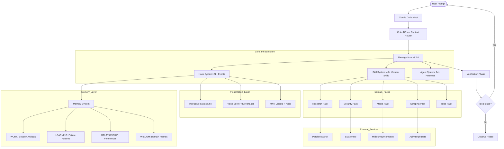

I will read the instructions in `.prompt.md` to understand the task.
I will now read the content of `pai-personal-ai-infrastructure.xml` to analyze the project and provide the requested information.
I will start by reading the main `README.md` and `Releases/v4.0.3/README.md` files to understand the project's purpose and identity.
I will read the root `README.md` to identify the project and its description.
I will search for `README.md` in the `Releases/v4.0.3/` directory to find more project details.
I will search for "Personal AI Infrastructure" across the project to identify the core components and project name.
I will read the `README.md` in `Releases/v4.0.3/.claude/PAI/` to gain a more detailed understanding of the project's description and its current state.
I will search for `Releases/v4.0.3/.claude/PAI/README.md` within `pai-personal-ai-infrastructure.xml` and read its content.
I will read `PLATFORM.md` and the `INSTALL.md` files to identify the supported platforms, deployments, and their requirements.
I will read the root `PLATFORM.md` to understand the supported platforms for PAI.
I will list the directory contents to confirm the exact name and path of `PLATFORM.md`.
I will search for `PLATFORM.md` in `pai-personal-ai-infrastructure.xml` and read its content.
I will search for connector code in `Packs` and `Releases/v4.0.3/.claude/PAI/Tools/` to find source code references for the supported connectors.
I will search for the git logs at the end of `pai-personal-ai-infrastructure.xml` to analyze the latest development trends.
I will search for "commit" or "log" near the end of the `pai-personal-ai-infrastructure.xml` file to find the git logs.
# PAI (Personal AI Infrastructure) Analysis Report

## 1. Project Name and Description
**Project Name**: PAI (Personal AI Infrastructure)

PAI (Personal AI Infrastructure) is a comprehensive, open-source framework and methodology designed to magnify human capabilities through a personalized, agentic AI assistant. Built primarily as a "native" extension for Anthropic's Claude Code, PAI transforms a standard AI coding tool into a sophisticated, general-purpose problem-solving engine. It achieves this by orchestrating an interconnected ecosystem of specialized skills, event-driven hooks, multi-agent systems, and a persistent multi-layered memory architecture.

The core of the system is "**The Algorithm**" (v3.7.0), a structured seven-phase execution engine (Observe, Think, Plan, Build, Execute, Verify, Learn) that systematically transitions a user's request from its current state to a defined "Ideal State." This process is driven by granular, verifiable "**Ideal State Criteria**" (ISC), ensuring that every action taken by the AI is purposeful, measurable, and aligned with the user's ultimate goals. The system's primary metric for success is "**Euphoric Surprise**," aiming for peak user satisfaction (9-10 ratings) through high-quality, insightful, and proactive assistance.

PAI is designed to be highly extensible and model-agnostic, offering specialized "Packs" for diverse domains such as security research, media creation, deep investigation, and financial analysis. It features a robust "Skill System" with 49+ predefined capabilities and a "Hook System" that integrates AI intelligence into every stage of the session lifecycle. Whether deployed as a CLI-based power tool or a background agent on personal hardware, PAI provides the infrastructure for users to own their AI intelligence, compound their knowledge over time, and automate complex workflows with high reliability.

## 2. Supported Platforms and Deployments
*   **macOS**: Fully supported (Primary development platform).
*   **Linux**: Fully supported (Ubuntu/Debian tested, systemd integration).
*   **Windows**: Officially Not Supported (Community contributions welcome).
*   **Claude Code**: Native integration as the primary host environment.
*   **Local Hardware (Pi)**: Specialized "PAI on Pi" for model-agnostic local deployment.
*   **Cloud (Cloudflare)**: Support for Cloudflare Workers deployments.

**Requirements**:
*   Claude Code (for PAI 4.0.x native releases).
*   [Bun Runtime](https://bun.sh/) (Cross-platform TypeScript execution).
*   Node.js 18+.
*   Optional: `mpg123`, `mpv` (Linux audio), `ElevenLabs` API key (Voice), `ntfy`/`Discord` (Notifications).

## 3. Supported Connectors
*   **Messaging**:
    *   **Discord**: `Packs/Media/src/Art/Lib/discord-bot.ts`
    *   **ntfy**: `Releases/v4.0.3/.claude/PAI/Tools/Inference.ts`
    *   **Twilio**: `Releases/v4.0.3/.claude/PAI/Tools/Inference.ts`
*   **Search & APIs**:
    *   **YouTube**: `Releases/v4.0.3/.claude/PAI/Tools/YouTubeApi.ts`
    *   **IPInfo**: `Packs/Security/src/Recon/Tools/IpinfoClient.ts`
    *   **FRED (Economic Data)**: `Packs/USMetrics/src/Tools/FetchFredSeries.ts`
    *   **SEC (EDGAR)**: `Packs/Security/src/SECUpdates/sources.json`
*   **Scraping & Data Extraction**:
    *   **Apify**: `Packs/Scraping/src/Apify/index.ts` (Connectors for Google Maps, Amazon, FB, IG, LinkedIn, TikTok, Twitter, YouTube).
    *   **BrightData**: `Packs/Scraping/src/BrightData/SKILL.md`
*   **AI & Media**:
    *   **ElevenLabs (Voice)**: `Releases/v4.0.3/.claude/VoiceServer/server.ts`
    *   **Midjourney**: `Packs/Media/src/Art/Lib/midjourney-client.ts`
    *   **LLM Providers**: Anthropic, OpenAI, Gemini, Perplexity, Grok (`Releases/v4.0.3/.claude/PAI/Tools/Inference.ts`).

## 4. Supported Models and Agents
*   **Models**:
    *   **Anthropic**: Claude 3.5 Sonnet, Opus.
    *   **OpenAI**: GPT-4o, o1.
    *   **Google**: Gemini 1.5 Pro/Flash.
    *   **Perplexity**: Sonar.
    *   **Grok**: xAI.
    *   **Local**: Model-agnostic support via PAI on Pi (`Releases/Pi/config/models.json`).
*   **Agents** (`Releases/v4.0.3/.claude/agents/`):
    *   **Foundational**: Algorithm, Engineer, Architect, Designer.
    *   **Researcher**: ClaudeResearcher, CodexResearcher, GeminiResearcher, GrokResearcher, PerplexityResearcher.
    *   **Specialized**: Pentester, QATester, UIReviewer, Artist, BrowserAgent.

## 5. Top 5 Use Cases
1.  **Security Research & Recon**: Automated bug bounty reconnaissance, vulnerability analysis, and report generation using specialized Pentester agents.
2.  **Deep Investigative Research**: Multi-agent "Swarm" research across web, social media, and academic sources using diverse researcher variants.
3.  **Systematic Software Engineering**: Building complex features using "The Algorithm" phases (Plan -> Build -> Execute -> Verify) with automated PRD syncing.
4.  **Media Creation & Animation**: Generating high-quality art prompts for Midjourney and automating video production with Remotion.
5.  **Personal Life Strategy (Telos)**: Tracking life goals, extracting narrative progress from interviews, and compounding personal wisdom over time.

## 6. Top 20 Features
1.  **The PAI Algorithm (v3.7.0)**: Systematic 7-phase engine. (`PAI/Algorithm/v3.7.0.md`)
2.  **Ideal State Criteria (ISC)**: Verifiable task goals. (`Releases/v4.0.3/.claude/PAI/PAISYSTEMARCHITECTURE.md`)
3.  **Skill System**: 49+ modular capabilities. (`Releases/v4.0.3/.claude/PAI/SKILLSYSTEM.md`)
4.  **Hook System**: 21+ session lifecycle hooks. (`Releases/v4.0.3/.claude/PAI/THEHOOKSYSTEM.md`)
5.  **Multi-Layered Memory**: Work, Learning, Relationship, State, Wisdom. (`MEMORYSYSTEM.md`)
6.  **Context Routing Table**: Dynamic knowledge loading. (`Releases/v4.0.3/.claude/CLAUDE.md`)
7.  **Specialized Agent System**: 14+ distinct personas. (`Releases/v4.0.3/.claude/PAI/PAIAGENTSYSTEM.md`)
8.  **Automated PRD Sync**: Real-time requirements tracking. (`Releases/v4.0.3/.claude/hooks/PRDSync.hook.ts`)
9.  **Interactive Status Line**: Terminal real-time metrics. (`.claude/statusline-command.sh`)
10. **Voice Notification Server**: Local ElevenLabs integration. (`Releases/v4.0.3/.claude/VoiceServer/server.ts`)
11. **Inference Engine**: Unified multi-model LLM interface. (`Releases/v4.0.3/.claude/PAI/Tools/Inference.ts`)
12. **Security Validator**: Real-time command monitoring. (`Releases/v4.0.3/.claude/hooks/SecurityValidator.hook.ts`)
13. **Fabric Smart Patterns**: Hundreds of structured prompt templates. (`Packs/Utilities/src/Fabric/`)
14. **OSINT Toolkit**: Deep entity and company lookup. (`Packs/Investigation/src/OSINT/`)
15. **Media Generation**: Midjourney and Remotion tools. (`Packs/Media/src/Art/Tools/`)
16. **Web Scraping Pack**: Apify/BrightData orchestration. (`Packs/Scraping/src/Apify/`)
17. **US Metrics Tracking**: Real-time FRED data integration. (`Packs/USMetrics/src/Tools/`)
18. **Prompt Injection Assessment**: Security testing suite. (`Packs/Security/src/PromptInjection/`)
19. **Automated Evaluation System**: Graders for code and tools. (`Packs/Utilities/src/Evals/`)
20. **Self-Building Infrastructure**: `BuildCLAUDE.ts` for dynamic config generation. (`PAI/Tools/BuildCLAUDE.ts`)

## 7. Top 20 Smart Patterns
1.  **Extract Wisdom**: Distilling core insights. (`extract_wisdom`)
2.  **Tree of Thoughts**: Exploring reasoning branches. (`tree_of_thoughts`)
3.  **Council Debate**: Multi-agent consensus building. (`council/Workflows/Debate.md`)
4.  **Red Team Thinking**: Adversarial validation. (`red_team_thinking`)
5.  **First Principles Deconstruction**: Problem breakdown. (`first_principles`)
6.  **Relationship Reflection**: User interaction analysis. (`RelationshipReflect.ts`)
7.  **Failure Pattern Synthesis**: Learning from errors. (`LearningPatternSynthesis.ts`)
8.  **Ideal State Hill-Climbing**: Iterative goal alignment. (`algorithm`)
9.  **Depth Classification**: Dynamic response detail adjustment. (`SkillGuard.hook.ts`)
10. **Narrative Point Extraction**: Personal progress tracking. (`CreateNarrativePoints.md`)
11. **Prompt Injection Attack Taxonomy**: Structured security testing. (`PromptInjection/COMPREHENSIVE-ATTACK-TAXONOMY.md`)
12. **Wisdom Domain Classification**: Categorizing compounding knowledge. (`WisdomDomainClassifier.ts`)
13. **Context Routing**: Intelligent knowledge retrieval. (`CLAUDE.md`)
14. **Euphoric Surprise Optimization**: Aiming for 9-10 ratings. (`PAI/Algorithm`)
15. **Tool-Before-Agent**: Efficiency prioritization. (`PAI/SKILL.md`)
16. **Voice-Status Sync**: Progress announcements. (`VoiceServer`)
17. **PRD Writeback**: Persistent cross-session contracts. (`PRDSync.hook.ts`)
18. **Trait-Based Agent Composition**: Creating unique personalities. (`AgentProfileSystem.md`)
19. **Capability Classification**: Authoritative task depth selection. (`SkillGuard.hook.ts`)
20. **Domain Knowledge Framing**: Creating persistent "Wisdom" blocks. (`WisdomFrameUpdater.ts`)

## 8. Top 20 Development Trends
1.  **Refining "The Algorithm"**: Frequent updates to versioned logic (v3.5 -> v3.7).
2.  **Specialized Researcher Swarms**: Distinct agents for Gemini, Grok, etc.
3.  **Linux Compatibility Push**: Fixing systemd, sed, and audio for non-macOS.
4.  **Installer Automation**: Developing a robust `PAI-Install` engine.
5.  **Skill-First Refactoring**: Moving from ad-hoc prompts to `SKILL.md` files.
6.  **Layered Memory Maturity**: Formalizing Work, Learning, and Wisdom storage.
7.  **Voice System Evolution**: Improving ElevenLabs and local server stability.
8.  **Pack-Based Organization**: Decoupling domain features into modular packs.
9.  **Security Observability**: Enhancing the `SecurityValidator` and audit logs.
10. **Inference Abstraction**: Building a unified, multi-provider `Inference.ts`.
11. **Context Routing Optimization**: Improving the `CLAUDE.md` routing table.
12. **Status Line Feature Density**: Adding sparklines, location, and weather.
13. **Evaluation Frameworks**: Standardizing graders and test suites for LLM output.
14. **Fabric Pattern Integration**: Large-scale adoption of Fabric smart patterns.
15. **Economic/Financial Integration**: Tracking US metrics and SEC updates.
16. **Agent Personality Traits**: Moving to structured `Traits.yaml` for agents.
17. **Dynamic Startup Loading**: Automated context injection via `LoadContext.hook.ts`.
18. **Prompt Injection Research**: Developing comprehensive attack taxonomies.
19. **Media Workflow Automation**: Integrating Midjourney and Remotion tools.
20. **Identity Persistence**: Strengthening DAIdentity and relationship memory.

## 9. Top 10 Advantages
1.  **Rigorous Problem Solving**: Driven by "The Algorithm" and verifiable ISC.
2.  **Modular Extensibility**: 49+ skills and 21+ hooks allow infinite customization.
3.  **Multi-Model Intelligence**: Not locked to one provider; uses the best model for the task.
4.  **Compound Knowledge**: Persistent memory builds wisdom over time.
5.  **High Observability**: Interactive terminal status and detailed logs.
6.  **Native Security**: Real-time validation of high-risk shell commands.
7.  **Expert Ecosystem**: specialized agents for research, security, and engineering.
8.  **Automated Documentation**: PRDs and project states sync automatically.
9.  **Human-Centric Branding**: Focused on "Euphoric Surprise" and personal relationship.
10. **Developer-Friendly**: Built with modern tools like Bun, TypeScript, and Git.

## 10. Top 10 Limitations
1.  **No Windows Support**: Scripts and hooks are bash/zsh-centric.
2.  **Platform Lock-in**: Hard to use effectively without Claude Code.
3.  **Setup Complexity**: Requires multiple external dependencies (Bun, ElevenLabs, etc.).
4.  **Token Cost**: Advanced multi-agent flows can be expensive.
5.  **Context Overhead**: Large project routing still faces token limit pressure.
6.  **API Fragility**: Relies heavily on third-party service stability (Apify, etc.).
7.  **Documentation Volume**: The sheer scale of documentation is intimidating.
8.  **Latency**: Multi-step reasoning and hook execution add response delay.
9.  **Alpha Maturity**: Several domain packs are still in experimental stages.
10. **Local Model Gap**: PAI on Pi lacks the full feature parity of native releases.

## 11. Top AI Skills
**Top 5 Used (Foundational)**:
1.  **Algorithm**: 7-phase execution logic. (`Packs/Agents/src/SKILL.md`)
2.  **ContextSearch**: Deep project discovery. (`Packs/ContextSearch/src/SKILL.md`)
3.  **Inference**: Multi-model call orchestration. (`PAI/Tools/Inference.ts`)
4.  **LoadContext**: Dynamic startup injection. (`hooks/LoadContext.hook.ts`)
5.  **SecurityValidator**: Command safety monitoring. (`hooks/SecurityValidator.hook.ts`)

**Top 5 Provided (Functional)**:
1.  **Research**: Comprehensive multi-source investigation. (`Packs/Research/src/SKILL.md`)
2.  **Scraping (Apify)**: Web extraction across platforms. (`Packs/Scraping/src/Apify/SKILL.md`)
3.  **Fabric**: Smart pattern application. (`Packs/Utilities/src/Fabric/SKILL.md`)
4.  **WebAssessment**: Security reconnaissance. (`Packs/Security/src/WebAssessment/SKILL.md`)
5.  **Media (Art)**: Image and animation generation. (`Packs/Media/src/Art/SKILL.md`)

## 12. Data Inputs, Outputs, and Storage
*   **Inputs**: User prompts, workspace files, web data (Scraping), API feeds (FRED, SEC), Voice (STT).
*   **Outputs**: Terminal responses, Workspace files, Audio (ElevenLabs), Media (Remotion/Images), Notifications (Discord/ntfy).
*   **Storage**:
    *   **Persistent File Storage**: `~/.claude/MEMORY/` (Work, Learning, Relationship, State, Wisdom).
    *   **Configuration**: `~/.claude/settings.json`.
    *   **User Profile**: `~/.claude/PAI/USER/`.
    *   **Database**: SQLite/Neo4j mentioned for social simulations (`oasis/social_platform/database.py`).

## 13. Detailed Architecture Review
1.  **Claude Code (Host)**: Underlying agentic execution harness.
2.  **The Algorithm (Orchestrator)**: Systematic 7-phase engine. (`PAI/Algorithm/`)
3.  **CLAUDE.md (Config Router)**: Master prompt and identity mapping.
4.  **Settings Manager**: Single source of truth config. (`settings.json`)
5.  **Hook System**: Session lifecycle event handlers. (`THEHOOKSYSTEM.md`)
6.  **Skill System**: Modular functional capabilities. (`SKILLSYSTEM.md`)
7.  **Agent System**: specialized personas. (`PAIAGENTSYSTEM.md`)
8.  **Memory System**: Multi-layered persistent storage. (`MEMORYSYSTEM.md`)
9.  **Inference Engine**: Provider-agnostic LLM interface. (`PAI/Tools/Inference.ts`)
10. **Security Validator**: High-risk command monitoring. (`SecurityValidator.hook.ts`)
11. **Voice Server**: Local TTS announcement server. (`VoiceServer/server.ts`)
12. **Status Line**: Interactive terminal metrics component. (`.claude/statusline-command.sh`)
13. **Research Swarm**: Multi-agent investigative pack. (`Packs/Research/`)
14. **Security Pack**: Pentesting and OSINT toolkit. (`Packs/Security/`)
15. **Scraping Engine**: Apify/BrightData integration. (`Packs/Scraping/`)
16. **Fabric Engine**: Pattern application system. (`Packs/Utilities/src/Fabric/`)
17. **Media Suite**: Image and video generation pack. (`Packs/Media/`)
18. **Telos Engine**: Personal growth and metrics pack. (`Packs/Telos/`)
19. **Observability Server**: Dashboard for system health/tasks. (`pai-observability-server/`)
20. **Context Loader**: Dynamic startup history injection. (`LoadContext.hook.ts`)

## 14. Architecture Mermaid Graph

## 15. Project Review
*   **Maturity**: High (v4.0.3 infrastructure), Research-grade (Packs).
*   **Stability**: Highly stable on Unix-like systems due to rigorous `VERIFY.md` protocols.
*   **Security**: Strong; native command validation and secret scanning are core features.
*   **Performance**: Optimized for "High-Signal" tasks, with some latency at startup due to context loading.

## 16. Verification & Documentation
*   **Tests**: Standardized via `VERIFY.md` in every pack.
*   **CI**: Active GitHub Actions for linting and deployment.
*   **Docs**: Extremely comprehensive, anchored by `DOCUMENTATIONINDEX.md`.
*   **AI Skills**: Deeply integrated into the core architecture (Skill-First).

## 17. Possible Improvements
1.  **Windows Port**: Create PowerShell equivalents for all hooks and scripts. (`.claude/statusline-command.sh`)
2.  **Graph Wisdom Store**: Migrate markdown frames to Neo4j. (`WisdomFrameUpdater.ts`)
3.  **Standalone Engine**: Reduce dependency on Claude Code. (`PAISYSTEMARCHITECTURE.md`)
4.  **Cost Observability**: Add real-time token pricing to status line. (`statusline-command.sh`)
5.  **Voice Interaction (STT)**: Add full voice control for hands-free mode. (`VoiceServer/`)
6.  **IDE Integration**: Native VS Code/Cursor plugins.
7.  **Auto-Documenter**: Agents that update documentation on file change. (`hooks/DocIntegrity.hook.ts`)
8.  **Knowledge Pruning**: System for archiving old/irrelevant memory. (`MEMORYSYSTEM.md`)
9.  **Multi-User RBAC**: Support for team-shared infrastructure. (`settings.json`)
10. **Headless Browser**: More robust browser agent state persistence. (`BrowserAgent.md`)
11. **Plugin Registry**: Marketplace for sharing new Packs. (`Packs/README.md`)
12. **Self-Healing Hooks**: Hooks that auto-fix environment issues. (`THEHOOKSYSTEM.md`)
13. **Mobile Client**: Companion app for notifications/status.
14. **Unified Dashboard**: Merge Telos and Observability UIs. (`DashboardTemplate/`)
15. **Offline Support**: Local model fallbacks for critical tools. (`Releases/Pi/`)
16. **Prompt Debugger**: Visualizer for complex prompt composition. (`RenderTemplate.ts`)
17. **Skill Dependencies**: Formalized graph of skill requirements. (`SKILLSYSTEM.md`)
18. **CI Test Suites**: Automated execution of all `VERIFY.md` steps.
19. **Collaborative Swarms**: Better inter-agent communication protocols. (`PAIAGENTSYSTEM.md`)
20. **Interactive Timelines**: Visualizing Telos narrative points. (`CreateNarrativePoints.md`)

## 18. Reusable for Agent Swarm (Best Solution Spec)
1.  **Thinking Pack**: Tree of Thoughts and First Principles reasoning. (`Packs/Thinking/src/SKILL.md`)
2.  **Council System**: Structured debate and consensus. (`Packs/Thinking/src/Council/SKILL.md`)
3.  **The Algorithm**: Systematic spec development phases. (`PAI/Algorithm/`)
4.  **Ideal State Criteria (ISC)**: Defining verifiable success for specs. (`PAI/Algorithm/`)
5.  **Red Team Workflow**: Adversarial review of implementation plans. (`Packs/Thinking/src/RedTeam/SKILL.md`)
6.  **Agent Traits**: specialized personas (Architect, QATester). (`Packs/Agents/src/Data/Traits.yaml`)
7.  **Inference Engine**: Multi-model calls to compare solutions. (`PAI/Tools/Inference.ts`)
8.  **Eval System**: Grading and comparing AI-generated specs. (`Packs/Utilities/src/Evals/SKILL.md`)
9.  **Wisdom Frames**: Compounding knowledge about "best" solutions. (`WisdomFrameUpdater.ts`)
10. **Context Routing**: Loading relevant industry specs for comparison. (`CLAUDE.md`)

## 19. Reusable for Multi-User Shared Knowledge Base
1.  **Memory System**: Tiered storage (Shared Wisdom vs. Private State). (`MEMORYSYSTEM.md`)
2.  **Parser Engine**: Automated entity extraction from interactions. (`Packs/Utilities/src/Parser/SKILL.md`)
3.  **ContextSearch**: querying across users' shared project context. (`Packs/ContextSearch/src/SKILL.md`)
4.  **Skill Customization**: Allowing user-specific overrides on shared tools. (`PAI/USER/SKILLCUSTOMIZATIONS/`)
5.  **Relationship Memory**: Tracking interactions across different users. (`hooks/RelationshipMemory.hook.ts`)
6.  **Wisdom Frame Synthesizer**: Merging knowledge from multiple sessions. (`WisdomCrossFrameSynthesizer.ts`)
7.  **Doc Integrity Hooks**: Ensuring shared documentation stays consistent. (`hooks/DocIntegrity.hook.ts`)
8.  **Fabric Server**: Shared pattern registry for team use. (`Packs/Utilities/src/Fabric/SKILL.md`)
9.  **Telos Dashboard**: Visualizing team-wide narrative progress. (`Packs/Telos/src/DashboardTemplate/`)
10. **Secret Scan**: Ensuring no private user keys enter shared memory. (`PAI/Tools/SecretScan.ts`)

## 20. Reusable for Own Hardware / Cloud / Messenger
1.  **Releases/Pi**: Optimized local hardware scaffold. (`Releases/Pi/README.md`)
2.  **Cloudflare Pack**: Deployment patterns for edge workers. (`Packs/Utilities/src/Cloudflare/SKILL.md`)
3.  **Voice Server**: Local voice control and announcements. (`Releases/v4.0.3/.claude/VoiceServer/`)
4.  **Notification Hub**: Discord, ntfy, and Twilio connectors. (`PAI/Tools/Inference.ts`)
5.  **Status Line**: Lightweight CLI observability. (`.claude/statusline-command.sh`)
6.  **Telos Web App**: Next.js template for agent visualization. (`Packs/Telos/src/DashboardTemplate/`)
7.  **Browser Pack**: Headless automation for web interaction. (`Packs/Utilities/src/Browser/SKILL.md`)
8.  **Parser Web UI**: Simple browser-based data extraction. (`Packs/Utilities/src/Parser/Web/`)
9.  **Inference Tool**: Model-agnostic API calling (Local vs. Cloud). (`PAI/Tools/Inference.ts`)
10. **PAI-Install Engine**: Automated setup across devices. (`Releases/v4.0.3/.claude/PAI-Install/`)

## 21. Reusable for Team Agents
1.  **Delegation Skill**: Collaborative handoffs between agents. (`Packs/Utilities/src/Delegation/SKILL.md`)
2.  **Algorithm Agents**: Team-based problem solving flows. (`PAIAGENTSYSTEM.md`)
3.  **PRD Sync**: Shared project requirement contracts. (`hooks/PRDSync.hook.ts`)
4.  **Council Debate**: Team consensus patterns. (`Packs/Thinking/src/Council/Workflows/Debate.md`)
5.  **Telos Team View**: Tracking cooperative goals. (`DashboardTemplate/App/teams/page.tsx`)
6.  **Hook-Based Parallelism**: Triggering multi-agent flows from single events. (`SpawnParallelAgents.md`)
7.  **Opinion Tracker**: Managing differing agent perspectives. (`PAI/Tools/OpinionTracker.ts`)
8.  **Task Transfer (FailureToTask)**: Automated escalation on agent failure. (`Utilities/src/Evals/Tools/FailureToTask.ts`)
9.  **Shared Wisdom Frames**: Cooperative knowledge building. (`WisdomFrameUpdater.ts`)
10. **Trait-Based Recruitment**: Dynamically selecting the best agent for a team task. (`AgentProfileSystem.md`)
