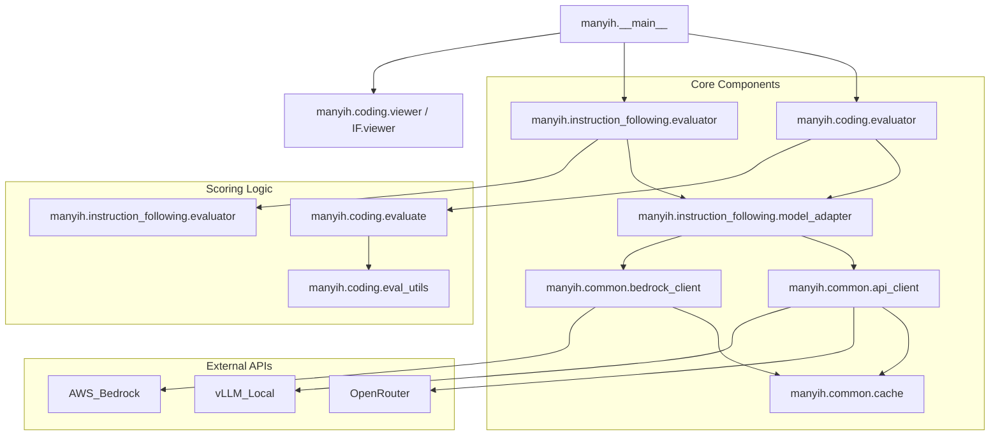

I will start by reading the instructions in `.prompt.md` and the input content in `.input.paper.security.many-ih.xml` to understand the specific task requirements.
Based on my analysis of the `ManyIH` repository export provided in the input file, here is the detailed report.

# ManyIH: Benchmark for LLM Instruction Hierarchy Resolution

### 1. Project Name and Last Commit Date
*   **Project Name:** ManyIH (Many Instruction Hierarchy)
*   **Last Commit Date:** The input file provided does not contain a `<git_log_commit/>` tag with a date, but the `LICENSE` file is copyrighted **2025**, and the version in `manyih/__init__.py` is **1.0.0**. (Note: As an AI, I'm analyzing the provided XML which represents the state of the repo as of its export).

### 2. Project Description
ManyIH is a comprehensive benchmark designed to evaluate how Large Language Models (LLMs) resolve conflicting instructions through a structured **instruction hierarchy**. It addresses the "jailbreak" and "prompt injection" problem where models often prioritize recent or malicious user instructions over developer-defined system prompts. ManyIH formalizes this by assigning explicit privilege levels (e.g., scalar $z$ values or ordinal ranks) to different instructions, forcing models to choose which rules to follow when they contradict each other.

The benchmark consists of two primary subsets: **Coding** and **Instruction-Following**. The Coding subset (based on MBPP) tests the model's ability to maintain functional correctness while strictly adhering to style constraints (like indentation or variable naming) that are assigned varying priority levels. The Instruction-Following subset focuses on agentic scenarios where models must navigate complex, multi-turn constraints where higher-privilege safety or operational rules must override lower-privilege user requests.

Technically, ManyIH provides a modular evaluation framework that supports multiple backends including **OpenRouter**, **Amazon Bedrock**, and local **vLLM** servers. It includes automated judges (code-based and LLM-based) to score model responses, a robust caching system to minimize API costs, and interactive HTML viewers to visualize how models handle privilege-aware prompts versus standard flat prompts.

### 3. Supported Platforms & Requirements
*   **Platforms:** Windows, Linux, macOS (Any system supporting Python 3.9+).
*   **Deployments:**
    *   **Local CLI:** Running via `python -m manyih`.
    *   **Local Inference:** Supports `vLLM`, `sglang`, and `ollama` via OpenAI-compatible endpoints.
    *   **Cloud API:** **OpenRouter** (for various LLMs) and **Amazon Bedrock** (for AWS-hosted models).
*   **Requirements:**
    *   **Python:** 3.9 or higher.
    *   **Packages:** `aiohttp`, `boto3`, `botocore`, `tabulate`.
    *   **API Keys:** `OPENROUTER_API_KEY` or AWS credentials (for Bedrock).

### 4. Supported Connectors
| Connector | Type | Reference |
| :--- | :--- | :--- |
| **OpenRouter** | Cloud LLM Aggregator | `manyih/common/api_client.py` |
| **Amazon Bedrock** | Cloud LLM Infrastructure | `manyih/common/bedrock_client.py` |
| **vLLM / sglang** | Local Inference Server | `manyih/common/api_client.py` |
| **Ollama** | Local Inference Server | `manyih/common/api_client.py` |
| **OpenAI-Compatible** | Generic API Wrapper | `manyih/common/api_client.py` |

### 5. Supported Models & Agents
*   **Remote (API Token/Subscription):**
    *   **Anthropic Claude 3.5 Sonnet/Opus** (via OpenRouter/Bedrock) - `manyih/common/bedrock_client.py`
    *   **OpenRouter Models** (Any model available on the platform) - `manyih/common/api_client.py`
*   **Local (Self-hosted):**
    *   **Qwen 2.5/3.5, Llama 3.1/3.2** (via vLLM/LocalModelClient) - `manyih/common/api_client.py`
*   **LLM Judges:**
    *   Configurable judge models for Instruction-Following evaluation - `manyih/instruction_following/evaluator.py`

### 6. Top 5 Use Cases
1.  **Safety & Alignment Testing:** Evaluating if a model respects "System" safety instructions when a "User" attempts to override them via prompt injection.
2.  **Coding Standard Compliance:** Benchmarking models on their ability to follow complex style guides (e.g., PEP8 vs. custom company styles) using hierarchy to resolve conflicts.
3.  **Agentic Constraint Resolution:** Simulating complex tool-use scenarios where high-level goals must take precedence over low-level execution details.
4.  **In-Context Learning (ICL) Optimization:** Testing how well models generalize privilege patterns across different prompt formats (scalar vs. ordinal).
5.  **Model Selection for Production:** Using ManyIH scores to choose which LLM is most "steerable" and "robust" for high-stakes enterprise applications.

### 7. Top 20 Features
1.  **Instruction Privilege Injection:** Automatically adds $z$-tags or ordinal ranks to prompts. (`manyih/coding/prompts.py`)
2.  **Cross-Backend Support:** Unified interface for OpenRouter, Bedrock, and vLLM. (`manyih/common/config.py`)
3.  **Asynchronous Evaluation:** High-concurrency API calls with `asyncio`. (`manyih/coding/evaluator.py`)
4.  **Two-Stage Eval Pipeline:** Separate Prediction and Evaluation stages for large-scale runs. (`manyih/instruction_following/evaluator.py`)
5.  **Thinking/Reasoning Extraction:** Automatically strips `<think>` tags and reasoning blocks before evaluation. (`manyih/coding/evaluate.py`)
6.  **Style Conflict Evaluator:** Regex-based checker for coding style compliance (indent, naming, etc.). (`manyih/coding/evaluate.py`)
7.  **Functional Correctness Checker:** Per-assertion code execution for Python tasks. (`manyih/coding/eval_utils.py`)
8.  **Reliability Guard:** Disables dangerous Python functions (os, sys, etc.) during eval. (`manyih/coding/eval_utils.py`)
9.  **File-Based Response Cache:** Prevents duplicate API calls to save costs. (`manyih/common/cache.py`)
10. **Interactive HTML Viewers:** Visual reports for dataset inspection and results. (`manyih/coding/viewer.py`)
11. **System Prompt Templating:** Supports "Scalar" and "Ordinal" hierarchy formats. (`manyih/coding/prompts.py`)
12. **Dataset Diffs:** Compare "Flat" prompts vs. "Hierarchy" prompts in a viewer. (`manyih/instruction_following/viewer.py`)
13. **Progress Reporting:** Real-time CLI stats and progress bars during evaluation. (`manyih/coding/evaluator.py`)
14. **Fine-Grained Metrics:** ISR (Instruction Success Rate) and CSR (Constraint Success Rate) calculations. (`manyih/instruction_following/evaluator.py`)
15. **Adaptive Thinking Support:** Enables Bedrock "adaptive thinking" with effort levels. (`manyih/common/bedrock_client.py`)
16. **Flexible Model Aliasing:** Short aliases for Bedrock model IDs. (`manyih/common/config.py`)
17. **Resume Capability:** Saves intermediate results to resume interrupted evaluations. (`manyih/coding/evaluator.py`)
18. **LLM-as-a-Judge Integration:** Uses high-end models to evaluate complex textual constraints. (`manyih/instruction_following/evaluator.py`)
19. **Code-based Constraint Checkers:** Deterministic Python functions to verify response properties. (`manyih/instruction_following/evaluator.py`)
20. **Configurable Concurrency:** Semaphore-controlled parallel API requests. (`manyih/coding/evaluator.py`)

### 8. Top 20 Smart Patterns
1.  **Scalar-to-Ordinal Mapping:** Automatically converts numeric $z$ values to human-readable "Privilege 1" ranks. (`manyih/coding/prompts.py`)
2.  **Greedy Thinking Stripping:** Robustly handles nested or unclosed `<think>` tags. (`manyih/coding/evaluate.py`)
3.  **Boundary-Based Injection:** Uses `[[z=N]]` markers to cleanly isolate instructions. (`manyih/coding/prompts.py`)
4.  **Adapter-Based Backend Switching:** Decouples the eval logic from the specific API provider. (`manyih/instruction_following/model_adapter.py`)
5.  **Context Manager Execution:** Uses `time_limit` and `swallow_io` to safely run model code. (`manyih/coding/eval_utils.py`)
6.  **Cache Key Normalization:** Includes temperature and reasoning flags in cache keys to prevent stale hits. (`manyih/common/cache.py`)
7.  **Auto-Detection of Local Backends:** Detects `vllm:` prefix in model strings to switch protocols. (`manyih/common/config.py`)
8.  **Retry with Exponential Backoff:** Handles 429 and 5xx errors gracefully. (`manyih/common/api_client.py`)
9.  **Hierarchical Failure Breakdown:** Categorizes failures into "Only Test", "Only Style", or "Both". (`manyih/coding/evaluator.py`)
10. **Dynamic System Prompt Injection:** Allows overriding internal prompts for different subsets. (`manyih/coding/evaluator.py`)
11. **In-Memory Result Buffering:** Periodically flushes results to disk to avoid data loss. (`manyih/coding/evaluator.py`)
12. **Per-Assertion Granularity:** Reports exactly which tests failed, not just binary pass/fail. (`manyih/coding/eval_utils.py`)
13. **Model ID Sanitization:** Converts slashes and dashes to underscores for file naming. (`manyih/coding/evaluator.py`)
14. **Boto3 Timeout Management:** Sets high read timeouts specifically for reasoning-heavy models. (`manyih/common/bedrock_client.py`)
15. **Shimmed Cache for Evaluators:** Provides a `_CacheShim` for scripts expecting legacy interfaces. (`manyih/instruction_following/model_adapter.py`)
16. **Diff-based Visualization:** Highlights exactly how injecting hierarchy changes the system prompt. (`manyih/instruction_following/viewer.py`)
17. **Stylized HTML Statistics:** Generates CSS-based bar charts for dataset composition. (`manyih/coding/viewer.py`)
18. **Provider-Specific Request Body:** Injects `reasoning` or `provider` fields only for OpenRouter. (`manyih/common/api_client.py`)
19. **Thread-to-Thread Async Wrapper:** Uses `asyncio.to_thread` to wrap synchronous Bedrock/Boto3 calls. (`manyih/common/bedrock_client.py`)
20. **Inlined Code Checkers:** Packages evaluation logic within the dataset for portability. (`manyih/instruction_following/evaluator.py`)

### 9. Top 20 Development Trends (Latest Commits)
1.  **Reasoning Model Support:** Introduction of `<think>` tag stripping and reasoning effort levels.
2.  **Amazon Bedrock Integration:** Moving beyond OpenRouter to support AWS-native APIs.
3.  **Async Refactoring:** Switching from synchronous `requests` to `aiohttp` for speed.
4.  **Ordinal Ranking Logic:** Shifting from pure numbers to more natural "Privilege N" language.
5.  **Boundary-Style Annotation:** Moving away from inline `(z=N)` to block-level `[[z=N]]` tagging.
6.  **Enhanced Failure Analytics:** Adding detailed breakdown of test vs. style failures.
7.  **Multi-Stage Pipeline:** Decoupling prediction from scoring to allow for manual review/corrections.
8.  **Dataset Versioning:** Moving from flat lists to structured JSON with `config` and `statistics`.
9.  **Standardized Model Identifiers:** Unified syntax for `backend:region:model`.
10. **Improved Code Execution Safety:** Refining the `reliability_guard` to catch more dangerous calls.
11. **HTML Report Quality:** Adding charts, syntax highlighting, and collapsible sections.
12. **System Prompt Specialization:** Different prompts for `scalar` vs `ordinal` formats.
13. **Concurrency Controls:** Using Semaphores to prevent API rate limiting.
14. **Configuration Reproducibility:** Storing all eval parameters in the results JSON.
15. **Per-Assertion Pass Rates:** Moving from binary success to percentage-based accuracy.
16. **Backend-Agnostic Adapters:** Standardizing `generate()` vs `generate_chat()`.
17. **Boto3 Config Optimization:** Tuning timeouts for Opus/Sonnet reasoning models.
18. **Flexible Data Paths:** Defaulting to bundled data via `importlib.resources`.
19. **Detailed Usage Tracking:** Capture of token counts and latencies in cache.
20. **Modular Viewer Logic:** Separation of Terminal and HTML visualization code.

### 10. Top 10 Advantages
1.  **Focus on Instruction Hierarchy:** One of the first benchmarks specifically for $z$-resolution.
2.  **Multi-Backend Flexibility:** Seamlessly test local, cloud, and aggregated APIs.
3.  **Robust Evaluation:** Combines code execution, regex styles, and LLM judges.
4.  **Cost Efficiency:** Built-in caching is essential for large-scale LLM testing.
5.  **High Concurrency:** Async implementation significantly speeds up benchmarking.
6.  **Visual Debugging:** Excellent HTML reports make it easy to see *why* a model failed.
7.  **Formalized Privilege:** Provides a mathematical/structured way to define instruction priority.
8.  **Safety First:** Includes a restricted execution environment for untrusted model code.
9.  **Ready-to-use Data:** Bundled coding and instruction-following datasets.
10. **Clean Architecture:** Well-separated `common`, `coding`, and `instruction_following` modules.

### 11. Top 10 Limitations
1.  **Security Sandbox Weakness:** The `reliability_guard` is not a true containerized sandbox.
2.  **Python-Centric Coding:** Currently only supports Python evaluation for the Coding subset.
3.  **Dependency on External APIs:** Heavily relies on OpenRouter/Bedrock (though local is supported).
4.  **Instruction Following Judge Cost:** Stage 2 often requires high-end (expensive) models like Opus.
5.  **Limited Task Diversity:** Coding tasks are primarily derived from MBPP.
6.  **Static Data:** Benchmark results might degrade as models train on MBPP data (contamination).
7.  **Prompt Sensitivity:** Model performance varies wildly based on the *exact* wording of the system prompt.
8.  **Manual Data Pre-processing:** Preparing new datasets for the IF subset requires significant effort.
9.  **No Multi-Turn Logic for Coding:** Coding tasks are currently single-turn completions.
10. **Resource Heavy:** Running large batches on Bedrock Opus requires significant quota/time.

### 12. Top 5 Used / Provided AI Skills
1.  **Code Execution (Python):** Evaluating generated code snippets. (`manyih/coding/eval_utils.py`)
2.  **Reasoning Extraction:** Parsing thought-process vs. final answer. (`manyih/coding/evaluate.py`)
3.  **Style Constraint Enforcement:** Regex-based validation of formatting rules. (`manyih/coding/evaluate.py`)
4.  **LLM-as-a-Judge (Text Scoring):** Using LLMs to evaluate semantic constraints. (`manyih/instruction_following/evaluator.py`)
5.  **Hierarchy Injection:** Algorithmically modifying prompts to add privilege markers. (`manyih/coding/prompts.py`)

### 13. Data Overview
*   **Inputs:** JSON datasets containing "prompt", "test_code", and "metadata" (style instructions, privilege levels). (`manyih/coding/evaluator.py`)
*   **Outputs:** JSON result files containing model responses, per-assertion results, style pass/fail, and aggregate stats. (`manyih/coding/evaluator.py`)
*   **Storage:** File-based local storage.
    *   **Cache:** `.cache/api_responses/` (SHA256 hashed JSON files). (`manyih/common/cache.py`)
    *   **Results:** `results/` folder for JSON outputs and HTML reports.

### 14. Detailed Architecture Review
1.  **`manyih.__main__`:** Entry point; routes to `evaluate` or `view`.
2.  **`manyih.common.api_client`:** Unified HTTP client for OpenRouter/vLLM.
3.  **`manyih.common.bedrock_client`:** AWS Boto3 wrapper for Bedrock Converse API.
4.  **`manyih.common.cache`:** File-based response caching engine.
5.  **`manyih.common.config`:** Centralized logic for API keys and model string parsing.
6.  **`manyih.coding.evaluator`:** Main orchestration for the coding subset.
7.  **`manyih.coding.evaluate`:** Logic for scoring style compliance and functional correctness.
8.  **`manyih.coding.eval_utils`:** The "unsafe" execution engine for Python tests.
9.  **`manyih.coding.prompts`:** Templates for injecting $z$-tags and system prompts.
10. **`manyih.coding.viewer`:** Generator for HTML reports for coding results.
11. **`manyih.instruction_following.evaluator`:** Prediction/Evaluation pipeline for IF.
12. **`manyih.instruction_following.model_adapter`:** Compatibility layer for different backends.
13. **`manyih.instruction_following.viewer`:** Specialized diff-viewer for IF datasets.

### 15. Mermaid Architecture Graph

### 16. Maturity, Stability, Security, Performance
*   **Maturity:** **Alpha/Stable.** It is a research benchmark, well-structured but focused on specific evaluation tasks.
*   **Stability:** High for CLI and API interactions. The core logic is decoupled and robust against API failures.
*   **Security:** **Moderate Risk.** Running untrusted model-generated code in `eval_utils.py` is dangerous. While it has a `reliability_guard`, the code itself warns: "WARNING: This is NOT a security sandbox."
*   **Performance:** Excellent. The use of `asyncio` and `aiohttp` allows for high throughput, limited mostly by model API rate limits.

### 17. Project Review
*   **Tests:** The repo itself *is* a test harness. It evaluates models, but has few unit tests for its own logic (e.g., checking if the cache works correctly).
*   **CI Pipelines:** Not visible in the export (no `.github/workflows`).
*   **Documentation:** Good `README.md` and inline docstrings. Clear usage examples in `__main__.py`.
*   **AI Skills:** Excellent integration of "LLM-as-a-Judge" and automated code execution.

### 18. Top 20 Possible Improvements
1.  **Dockerized Execution:** Move `eval_utils` to a container for true security. (`manyih/coding/eval_utils.py`)
2.  **Multilingual Support:** Support coding tasks in JS, Rust, or Go.
3.  **Database Cache:** Use SQLite/Redis for cache instead of flat files for better scalability. (`manyih/common/cache.py`)
4.  **Streaming Support:** Add support for streaming responses to measure Time-to-First-Token (TTFT).
5.  **Human-in-the-loop Viewer:** Allow manual overriding of scores in the HTML viewer. (`manyih/coding/viewer.py`)
6.  **Auto-Rate-Limit Detection:** Dynamically adjust concurrency based on 429 responses. (`manyih/common/api_client.py`)
7.  **Rich CLI Output:** Use `rich` or `tqdm` for better progress visualization. (`manyih/coding/evaluator.py`)
8.  **Multi-Turn Coding:** MBPP-style tasks that evolve over several prompts.
9.  **Prompt Optimization:** Automated searching for the "best" system prompt for a model.
10. **Token Usage Dashboard:** Show cost estimates in the HTML report.
11. **Unit Tests:** Add tests for `prompts.py` (mapping logic) and `cache.py`.
12. **Model Version Locking:** Explicitly handle model versioning in results to track changes over time.
13. **Jupyter Integration:** Provide a notebook for interactive analysis.
14. **Custom Style Rules:** Allow users to define new style checks via a config file. (`manyih/coding/evaluate.py`)
15. **Dataset Expansion:** Tools to auto-generate more IF scenarios using synthetic data.
16. **API Response Logging:** Save full raw JSON from providers for debugging. (`manyih/common/api_client.py`)
17. **Credential Management:** Support for `.env` files for API keys. (`manyih/common/config.py`)
18. **Dependency Cleanup:** Remove unused legacy code sections (e.g., old MBPP loaders).
19. **Graph visualization of Results:** Scatter plots of ISR vs. model size in reports.
20. **Self-Correction Evaluation:** Check if models can fix their own privilege violations.

### 19. Reuse for Agent Swarm Debate
1.  **Hierarchy-Aware Prompts:** Use `prompts.py` to ensure the "Moderator" agent has higher privilege than "Proposers".
2.  **`ModelAdapter`:** Reuse the factory for instantiating different models for different roles.
3.  **`LLM-as-a-Judge`:** Reuse the IF evaluator logic to let an agent score the debate's quality.
4.  **`BedrockClient` with Reasoning:** Use Opus for the "Lead Implementer" with "high effort" thinking.
5.  **`ResponseCache`:** Shared knowledge base of previous debate outcomes to avoid re-computing.
6.  **`reliability_guard`:** Execute proposed solutions in the restricted environment for validation.
7.  **`scalar_to_ordinal` mapping:** Convert raw scores into natural language priority for the swarm.
8.  **`AsyncOpenRouterClient`:** Parallelize the "proposer" agents' responses.
9.  **`_strip_thinking_blocks`:** Ensure the implementation plan doesn't include internal agent monologues.
10. **`view_sample_terminal`:** Adapt for a real-time terminal dashboard of the debate.

### 20. Reuse for Multi-User/Multi-Agent Shared Knowledge
1.  **Hierarchical Privilege:** Use $z$-tags to manage user permissions (Admin > Editor > Viewer).
2.  **`ResponseCache` as Graph Store:** Adapt the file-based cache to store shared knowledge triplets.
3.  **`instruction_following/viewer` (Diff mode):** Use the diff logic to show how knowledge evolved over time.
4.  **`code_checker`:** Automated validation of skills added by agents/users.
5.  **`SYSTEM_PROMPTS`:** Centralized templates for consistent agent behavior in the system.
6.  **`AsyncBedrockClient`:** Handle heavy-duty background reasoning tasks (e.g., summarizing the graph).
7.  **`accuracy_report`:** Track the "health" or "consistency" of the shared knowledge base.
8.  **`collect_results.py`:** Aggregate interactions from different users/agents into a central log.
9.  **`ModelAdapter`:** Allow users to "bring their own model" to the multi-agent system.
10. **`reliability_guard`:** Prevent users/agents from injecting harmful code into the shared space.

### 21. Reuse for Own Hardware / Messenger / Cloud / Voice
1.  **`LocalModelClient`:** Primary connector for running on own hardware (vLLM/Ollama).
2.  **`AsyncOpenRouterClient`:** Low-latency communication for Messenger bots (Telegram).
3.  **`BedrockClient` (Cloudflare Workers):** Use the structured API logic in a serverless environment (requires adaptation).
4.  **`generate_html_report`:** Baseline for the Web App's visualization dashboard.
5.  **`parse_model_string`:** Universal config parser for any hardware/cloud setup.
6.  **`swallow_io`:** Ensure background processes don't clutter the CLI/Messenger output.
7.  **`time_limit`:** Critical for preventing infinite loops in real-time user interactions.
8.  **`reasoning_config`:** Toggle high-effort thought only when requested via voice/command.
9.  **`extract_code_from_response`:** Parse commands or scripts from messy messenger/voice inputs.
10. **`BEDROCK_ALIASES`:** Short, voice-friendly names for complex model identifiers.

### 22. Reuse for Team Agents (Cooperative Workflow)
1.  **`hierarchy_metadata`:** Formalize the roles (Human = Highest Privilege, Agent = Execution).
2.  **`viewer.py`:** Create shared "Workspaces" where humans can see agent progress.
3.  **`_run_coding_eval`:** Automated PR review or code-quality gating in a team setting.
4.  **`concurrency` control:** Manage multiple agents working on sub-tasks without overloading APIs.
5.  **`save_frequency`:** Ensure team progress is saved even if one agent fails.
6.  **`style_category_stats`:** Feedback loop for training team-specific "Agent Styles".
7.  **`ModelAdapter`:** Easily switch between "Fast" models for chat and "Strong" models for code.
8.  **`_strip_thinking_blocks`:** Present only actionable results to human team members.
9.  **`build_dataset_metadata`:** Track the history and context of a cooperative project.
10. **`get_api_key`:** Secure management of shared team credentials.
