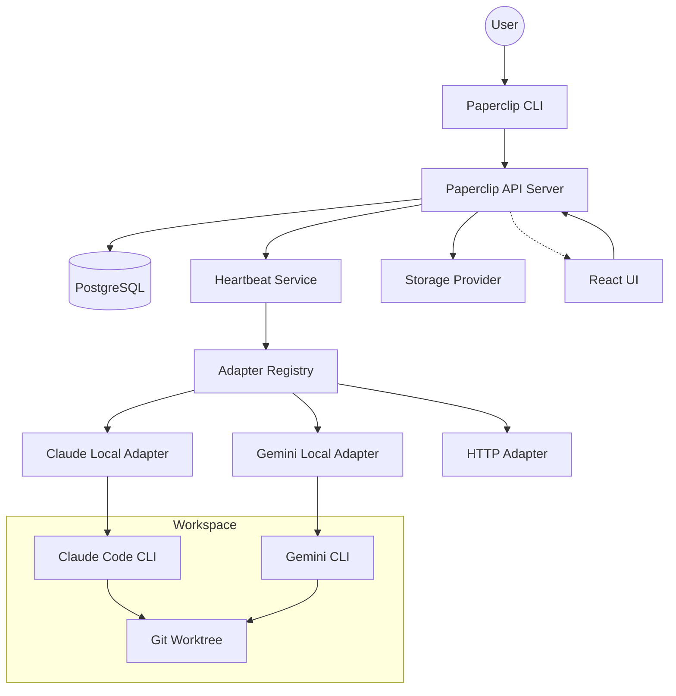

I will begin by reading the instructions in `.prompt.md` and the contents of `paperclip.xml` to understand the task.
I will start by searching for the `README.md` file within `paperclip.xml` to gather the project name and description. I'll also look for deployment documentation to identify supported platforms and requirements.
I will now read the deployment overview, adapter overview, and the supported models for the Claude local adapter by searching for their content in `paperclip.xml`. This will help me address points 2 through 4 of the analysis.
I'll now search for `doc/TASKS.md` and the git logs in `paperclip.xml` to gain insights into use cases and recent development trends. Following that, I'll examine the database schema to understand the data storage architecture.
I've gathered significant information, but I still need to pinpoint the "top 5 use cases" and "top 20 features." I'll refine these by examining the `skills/` directory for AI skills, `server/src/app.ts` for architectural details, and search for the git logs—possibly at the end of `paperclip.xml`—to identify recent development trends. For now, I'll start by reading the end of the `paperclip.xml` file.
Based on the repository export provided in `paperclip.xml`, here is a deep analysis of the **Paperclip** project.

---

# Paperclip: Open-Source Orchestration for Zero-Human Companies

### 1. Project Name and Description
**Paperclip** is a comprehensive orchestration platform designed to run and manage "zero-human companies" by coordinating teams of autonomous AI agents. While it presents a user interface similar to modern task managers like Linear, it is fundamentally an "Agent OS" that handles the complexities of organizational structure, governance, and goal alignment for a fleet of AI entities.

The platform provides a unified control plane where users can define high-level business goals, "hire" various AI agents (using different LLM providers and runtimes), and monitor their work through a sophisticated dashboard. It bridges the gap between individual AI employees and a cohesive business unit, offering features like org charts, budget enforcement, and collaborative workflows.

Under the hood, Paperclip orchestrates agent activity through a "Heartbeat" protocol, ensuring that agents wake up to address new comments, tasks, or external triggers. It emphasizes human-in-the-loop governance, allowing users to approve high-stakes actions while letting agents handle the day-to-day execution of projects and issues.

### 2. Supported Platforms, Deployments & Requirements
Paperclip is designed for flexibility, ranging from single-user local setups to internet-facing team environments.

*   **Platforms:** Windows, macOS, and Linux (Node.js 20+ runtime).
*   **Deployment Modes:**
    *   **Local Trusted (Default):** No login required; loopback-only binding; best for solo experimentation.
    *   **Authenticated + Private:** Requires login (Better Auth); binds to all interfaces; best for teams on a VPN or Tailscale.
    *   **Authenticated + Public:** Requires login and explicit public URL; strictest security; best for cloud hosting.
*   **Requirements:**
    *   **Runtime:** Node.js 20+, pnpm 9+.
    *   **Database:** PostgreSQL (Paperclip uses an embedded version by default via `embedded-postgres`).
    *   **Storage:** Local filesystem or S3-compatible storage.
*   **Source Reference:** `docs/deploy/overview.md`, `docs/deploy/local-development.md`, `cli/src/config/schema.ts`.

### 3. Supported Connectors (Adapters)
Adapters bridge Paperclip's orchestration layer with agent runtimes.

*   **Claude Local:** Runs the Claude Code CLI locally.
    *   *Source:* `packages/adapters/claude-local/`
*   **Codex Local:** Runs the OpenAI Codex CLI locally.
    *   *Source:* `packages/adapters/codex-local/`
*   **Gemini Local:** Runs Google's Gemini CLI locally.
    *   *Source:* `packages/adapters/gemini-local/`
*   **OpenCode Local:** Multi-provider adapter for various open-source models.
    *   *Source:* `packages/adapters/opencode-local/`
*   **Cursor:** Integrates with the Cursor editor in background mode.
    *   *Source:* `packages/adapters/cursor-local/`
*   **OpenClaw Gateway:** Connects to remote OpenClaw agent instances.
    *   *Source:* `packages/adapters/openclaw-gateway/`
*   **Process:** Executes arbitrary shell commands or custom scripts.
    *   *Source:* `server/src/adapters/process/`
*   **HTTP:** Webhook-based integration for external cloud-hosted agents.
    *   *Source:* `server/src/adapters/http/`
*   **Hermes Local:** Specific adapter for the Hermes CLI.
    *   *Source:* `ui/src/adapters/hermes-local/`

### 4. Supported Models & Agents
Paperclip supports a wide array of models through its adapter system, covering both local and remote execution.

*   **Claude Models:** Supports Anthropic API and AWS Bedrock (e.g., Claude 3.5 Sonnet, Claude 3 Opus).
    *   *Source:* `packages/adapters/claude-local/src/server/models.ts`
*   **Gemini Models:** Supports Google Gemini models via the Gemini CLI.
    *   *Source:* `packages/adapters/gemini-local/src/server/execute.ts`
*   **OpenCode Models:** Leverages various models through providers like Groq, Together, or local runners.
    *   *Source:* `packages/adapters/opencode-local/src/server/models.ts`
*   **Codex/OpenAI:** Standard OpenAI models (GPT-4o, etc.) via CLI wrappers.
    *   *Source:* `packages/adapters/codex-local/src/server/execute.ts`
*   **Custom Agents:** Any agent that can be triggered via HTTP or a Shell command can be onboarded as an agent.

### 5. Top 5 Use Cases
1.  **AI-Native Software Development:** A "CEO Agent" creates projects and issues, which are then picked up by "Engineer Agents" (Claude/Codex) to write code and open PRs.
2.  **Autonomous Content Operations:** Marketing agents monitor a "Routine" (e.g., daily trends), draft articles as "Documents," and submit them for human approval.
3.  **Agent Governance & Budgeting:** A company sets a $500/month budget policy; Paperclip's `budgets-service` automatically pauses agents when thresholds are hit.
4.  **Multi-Agent Research Swarms:** High-level goals are decomposed into "Initiatives," and multiple specialized agents collaborate via issue comments and shared workspaces.
5.  **Self-Healing Infrastructure Management:** Agents monitor system health and execute "Routines" to fix issues, using the `process` adapter for direct CLI access.

### 6. Top 20 Features
1.  **Unified Agent Dashboard:** Real-time visibility into all active agents and their tasks (`ui/src/pages/Dashboard.tsx`).
2.  **Embedded Postgres:** Zero-dependency setup using embedded database logic (`packages/db/src/client.ts`).
3.  **Encrypted Secrets Management:** Local master-key encryption for API tokens (`server/src/secrets/local-encrypted-provider.ts`).
4.  **Heartbeat Orchestration:** The engine that manages agent wake/sleep cycles (`server/src/services/heartbeat.ts`).
5.  **Human-in-the-Loop Approvals:** Manual sign-off for sensitive agent actions (`server/src/services/approvals.ts`).
6.  **Budget Policies & Alerts:** Spend tracking and enforcement per agent or project (`server/src/services/budgets.ts`).
7.  **Org Chart Visualization:** View reporting lines and team structures (`ui/src/pages/OrgChart.tsx`).
8.  **Reusable AI Skills:** Injecting capabilities like "create-agent" into LLM runtimes (`skills/paperclip/SKILL.md`).
9.  **Real-time Run Transcripts:** Streaming stdout/stderr from agent processes (`ui/src/components/transcript/RunTranscriptView.tsx`).
10. **Git Worktree Isolation:** Dedicated, isolated workspaces for agent code execution (`server/src/services/workspace-runtime.ts`).
11. **Telemetry & Insights:** Anonymous usage and performance tracking (`packages/shared/src/telemetry/`).
12. **Plugin System:** Extensible UI and adapter framework (`packages/plugins/sdk/`).
13. **Model Context Protocol (MCP) Support:** Integration with MCP for tool discovery (`packages/mcp-server/`).
14. **Goal-Issue Hierarchy:** Linking tactical tasks to strategic objectives (`packages/db/src/schema/goals.ts`).
15. **Cost Reporting:** Granular LLM spend analysis per issue or agent (`server/src/services/costs.ts`).
16. **Issue-Backed Chat:** Communication between humans and agents within the task context (`ui/src/components/IssueChatThread.tsx`).
17. **Routine Automation:** Scheduled or triggered tasks for agents (`server/src/services/routines.ts`).
18. **Interactive CLI Tooling:** `paperclipai` command for setup and management (`cli/src/index.ts`).
19. **Self-Healing Diagnostics:** `paperclipai doctor` to repair environment issues (`cli/src/commands/doctor.ts`).
20. **Live UI Updates:** WebSocket-driven state synchronization (`server/src/realtime/live-events-ws.ts`).

### 7. Top 20 Smart Patterns
1.  **Adapter Pattern:** Standardized interface for diverse AI runtimes (`server/src/adapters/registry.ts`).
2.  **Heartbeat Loop:** Event-driven agent activation rather than constant polling (`server/src/services/heartbeat.ts`).
3.  **Skill Injection:** Symlinking skill files into agent runtimes at startup (`packages/adapters/claude-local/src/server/skills.ts`).
4.  **Secret Redaction:** Automatically scrubbing API keys from logs (`packages/adapter-utils/src/log-redaction.ts`).
5.  **Optimistic UI:** Updating task states instantly before server confirmation (`ui/src/lib/optimistic-issue-runs.ts`).
6.  **Git-Aware Workspaces:** Using Git worktrees to prevent agents from colliding on the same files (`doc/plans/2026-03-10-workspace-strategy-and-git-worktrees.md`).
7.  **Human-Agent Parity:** Agents and humans use the same issue/comment systems.
8.  **Quota Probing:** Running CLI commands to check remaining LLM balance (`packages/adapters/claude-local/src/server/quota.ts`).
9.  **Session Resumption:** Persisting CLI session IDs to maintain LLM context across runs (`packages/adapters/gemini-local/src/server/execute.ts`).
10. **Plugin Slots:** Dynamic UI injection points for external extensions (`ui/src/plugins/slots.tsx`).
11. **Entity-Level Costing:** Attributing every cent of LLM spend to a specific project or issue (`packages/db/src/schema/cost_events.ts`).
12. **Master Key Encryption:** Deriving encryption keys from a local file that never leaves the machine (`cli/src/config/secrets-key.ts`).
13. **One-Command Onboarding:** Simplifying complex setup into a single CLI wizard (`cli/src/commands/onboard.ts`).
14. **Markdown-First Documentation:** Using Markdown for agent instructions and project docs alike.
15. **Type-Safe API Client:** Shared types between server and UI (`ui/src/api/client.ts`).
16. **Hierarchical Permissions:** Inheriting access from Company -> Project -> Issue.
17. **Soft Archival:** Preserving history while keeping active views clean (`packages/db/src/schema/issues.ts`).
18. **Environment Diagnostics:** Built-in "Test Environment" for every agent adapter configuration.
19. **Live Transcript Parsing:** Real-time regex-based parsing of ANSI terminal output for structured UI.
20. **Model Routing:** Mapping generic roles (e.g., "fast") to specific model IDs.

### 8. Top 20 Development Trends (Latest Commits)
1.  **Issue Workflow Refinement:** Significant updates to how issue execution policies are enforced.
2.  **Routines & Triggers:** Expansion of the routine system with draft states and runtime overrides.
3.  **Test Isolation:** Heavy focus on isolating route modules for better server-side testing.
4.  **Live Update Reliability:** Improvements to WebSocket events and optimistic UI consistency.
5.  **Workspace Runtime Maturity:** Better handling of workspace setup/cleanup and package linking.
6.  **Signoff Policy Enforcement:** Stricter rules for when an agent can transition an issue.
7.  **Comment Wake Logic:** Refining the batching and retry logic for comment-triggered wakeups.
8.  **UI Component Splitting:** Moving towards more modular UI components (e.g., `IssueDetail` splits).
9.  **Diagnostic Tooling:** Constant updates to `paperclipai doctor` for new edge cases.
10. **Plugin SDK Stability:** Finalizing the bridge between host and plugin UI.
11. **Agent Permission Guardrails:** Rejecting non-participant mutations on issues.
12. **Embedded Postgres Reliability:** Fixing locale issues in embedded DB runners.
13. **Budget Incident Reporting:** Improving how budget violations are logged.
14. **Org Chart SVG Generation:** Moving towards server-side generation of org chart images.
15. **Feedback Loop Integration:** Better tracking of user feedback on agent outputs.
16. **Document Versioning:** Implementation of document revisions for better knowledge tracking.
17. **Telemetric Event Coverage:** Adding more granular events for user/agent interactions.
18. **CI Pipeline Hardening:** Focus on Playwright e2e tests for onboarding.
19. **Secret Provider Extensibility:** Abstracting secret storage to allow for cloud providers.
20. **Token Optimization:** Ongoing work to reduce token usage in repeated agent wakes.

### 9. Top 10 Advantages / Strong Points
1.  **Governance-First:** Unlike simple agent wrappers, it focuses on budgets, approvals, and org structure.
2.  **Zero-Friction Setup:** Embedded DB and CLI onboarding make it easy to start locally.
3.  **Provider Agnostic:** Supports Claude, OpenAI, Gemini, and open models seamlessly.
4.  **Developer Experience:** Excellent CLI tooling (`doctor`, `onboard`, `configure`).
5.  **Isolated Workspaces:** Real Git-backed workspaces for safe agent execution.
6.  **Deep Cost Transparency:** Every run's cost is tracked and visualized.
7.  **Human-Agent Collaboration:** A true multi-player experience for teams and bots.
8.  **Extensibility:** Strong plugin and adapter system.
9.  **Privacy-Centric:** Local encryption and private deployment modes.
10. **Rich Aesthetic:** Highly polished, dense, and professional UI.

### 10. Top 10 Limitations / Weak Points
1.  **Local Resource Intensive:** Running many heavy CLI agents (like Claude Code) locally consumes significant CPU/RAM.
2.  **Adapter Complexity:** High dependency on external CLI tools being correctly installed.
3.  **Early Maturity:** Many features are marked "experimental" or "target model."
4.  **Learning Curve:** Concepts like "Routines," "Initiatives," and "Heartbeats" take time to master.
5.  **Postgres Dependency:** While embedded, it still relies on a specific native binary.
6.  **Web-Only UI:** No native mobile app (though the UI is responsive).
7.  **Cohesion Challenges:** Managing many agents requires significant human oversight.
8.  **Skill Portability:** Skills are often tied to specific adapter types.
9.  **Cold Start Times:** Waking up an agent (spawning a process) has more overhead than a simple API call.
10. **Limited Offline Support:** Most adapters still require internet access for the underlying LLM.

### 11. Top AI Skills
*   **`paperclip`:** Core API skill allowing agents to manage issues, comments, and project state.
    *   *Reference:* `skills/paperclip/SKILL.md`
*   **`paperclip-create-agent`:** Expert guide for agents to create and configure other agents.
    *   *Reference:* `skills/paperclip-create-agent/SKILL.md`
*   **`paperclip-create-plugin`:** Workflow for agents to develop new Paperclip plugins.
    *   *Reference:* `skills/paperclip-create-plugin/SKILL.md`
*   **`para-memory-files`:** Skill for managing long-term memory via structured files.
    *   *Reference:* `skills/para-memory-files/SKILL.md`
*   **`design-guide`:** Knowledge of the Paperclip UI system for frontend agents.
    *   *Reference:* `.claude/skills/design-guide/SKILL.md`

### 12. Data Inputs, Outputs, and Storage
*   **Storage Provider:** Pluggable architecture (Local Disk, S3).
    *   *Source:* `server/src/storage/service.ts`
*   **Database:** PostgreSQL with Drizzle ORM.
    *   *Source:* `packages/db/src/schema/`
*   **Secrets:** AES-256-GCM encrypted via a local master key.
    *   *Source:* `server/src/secrets/local-encrypted-provider.ts`
*   **Logs:** JSON-structured logs with redaction.
    *   *Source:* `server/src/middleware/logger.ts`

### 13. Detailed Architecture Review
Paperclip follows a monorepo architecture using `pnpm workspaces`.

1.  **CLI (`cli/`):** The entry point for users. Handles `run`, `onboard`, `doctor`.
2.  **Server (`server/`):** The Express-based API server. Houses the **Heartbeat Service**, **Adapter Registry**, and **Auth logic**.
3.  **UI (`ui/`):** React/Vite/Tailwind frontend. Implements the control plane.
4.  **DB Package (`packages/db/`):** Shared schema and Drizzle client.
5.  **Adapter Utils (`packages/adapter-utils/`):** Shared logic for process execution and cost parsing.
6.  **Plugin SDK (`packages/plugins/sdk/`):** Infrastructure for external UI and worker extensions.
7.  **Shared Package (`packages/shared/`):** Constants, types, and validators used across the project.
8.  **Adapters (`packages/adapters/*`):** Specialized packages for different LLM runtimes.

**Relations:** The CLI spawns the Server. The Server manages the DB and invokes Adapters. Adapters spawn external CLI processes or call HTTP webhooks. The UI communicates with the Server via REST and WebSockets.

### 14. Mermaid Architecture Graph

### 15. Maturity, Stability, Security, Performance
*   **Maturity:** Moderate (v0.3.x). The core architecture is stable, but many specialized adapters and the plugin system are evolving.
*   **Stability:** High for local use. Production cloud deployment is supported but requires more configuration.
*   **Security:** Strong emphasis on secret encryption at rest and log redaction. Role-based access control (RBAC) is present.
*   **Performance:** Good. The UI uses heavy caching (React Query) and optimistic updates. Server overhead is low, but agent execution speed is limited by LLM providers.

### 16. Review of Tests, CI, and Documentation
*   **Tests:** Extensive coverage. Includes Vitest for unit/integration and Playwright for e2e (`tests/e2e/`).
*   **CI:** Robust GitHub Actions pipelines for Docker builds, PR checks, and smoke tests (`.github/workflows/`).
*   **Documentation:** High quality. Extensive Markdown files in `docs/` and `doc/` covering architecture, deployment, and development.
*   **AI Skills:** Well-defined skills for common agent tasks (creation, documentation, memory).

### 17. Top 20 Possible Improvements or Fixes
1.  **Mobile-Native App:** Current UI is responsive but a native app would improve notifications.
2.  **Clipmart Marketplace:** Fully realize the "download a company" vision (`doc/plans/2026-03-13-cliphub-plan.md`).
3.  **Advanced Model Routing:** Smarter routing based on task complexity/cost (`doc/plans/2026-04-06-smart-model-routing.md`).
4.  **Native Windows Support for Adapters:** Some adapters rely on bash scripts or Unix-specific paths.
5.  **Collaborative Document Editing:** Real-time multi-agent/human editing of Documents.
6.  **Improved Billing Ledger:** More robust financial reporting for large teams.
7.  **Global Search (RAG):** RAG-based search across all issues and documents.
8.  **Voice Control:** Voice-to-issue or voice-to-comment commands.
9.  **Agent Evaluation Framework:** Standardized "evals" to compare agent performance (`doc/plans/2026-03-13-agent-evals-framework.md`).
10. **Browser-Based Execution:** Running certain lightweight agents directly in the browser.
11. **Cloudflare Workers Adapter:** Running agents in serverless environments.
12. **Deeper Slack/Discord Integration:** Interacting with the board from messengers.
13. **Auto-Sizing Workspaces:** Dynamic disk allocation for heavy repositories.
14. **Visual Workflow Designer:** Drag-and-drop builder for agent routines.
15. **Enhanced Redaction:** Support for PII detection in log redaction.
16. **Offline Model Support:** Better integration with local runners like Ollama.
17. **Multi-Instance Sync:** Syncing data across multiple Paperclip instances.
18. **Custom Metrics Dashboard:** Allowing users to build their own reporting widgets.
19. **Snapshot & Restore:** One-click backup/restore of entire companies.
20. **Agent "Soul" Templates:** More structured personality/style definitions for agents.

### 18. Swarm/Graph Knowledge Reuse
*   **`server/src/services/heartbeat.ts`:** The orchestration logic can be reused to manage the swarm's decision loop.
*   **`packages/db/src/schema/issue_relations.ts`:** Used to build the knowledge graph of dependencies.
*   **`server/src/services/issue-execution-policy.ts`:** Logic for determining which agent is "best" for a stage.
*   **`packages/shared/src/types/issue.ts`:** Common data model for swarm communication.

### 19. Shared Knowledge Base Reuse
*   **`packages/db/src/schema/documents.ts`:** Core entity for shared markdown knowledge.
*   **`packages/db/src/schema/document_revisions.ts`:** Tracks how knowledge evolves over time.
*   **`server/src/services/documents.ts`:** Service logic for collaborative knowledge.
*   **`skills/para-memory-files/`:** Pattern for long-term memory storage.

### 20. Edge/Cloud/Messenger Reuse
*   **`server/src/adapters/http/`:** Reusable for communicating with agents in Cloudflare Workers.
*   **`ui/src/pages/OrgChart.tsx`:** Graph visualization components.
*   **`cli/src/index.ts`:** Base for a local management interface.
*   **`server/src/realtime/live-events-ws.ts`:** Infrastructure for real-time messaging.

### 21. Team Agent/Cooperative Workflow Reuse
*   **`server/src/services/approvals.ts`:** The fundamental human-agent cooperation bridge.
*   **`ui/src/components/IssueChatThread.tsx`:** Primary interface for human-agent debate.
*   **`server/src/services/issue-assignment-wakeup.ts`:** Logic for hand-offs between team members.
*   **`packages/shared/src/types/access.ts`:** Permission model for cooperative environments.
