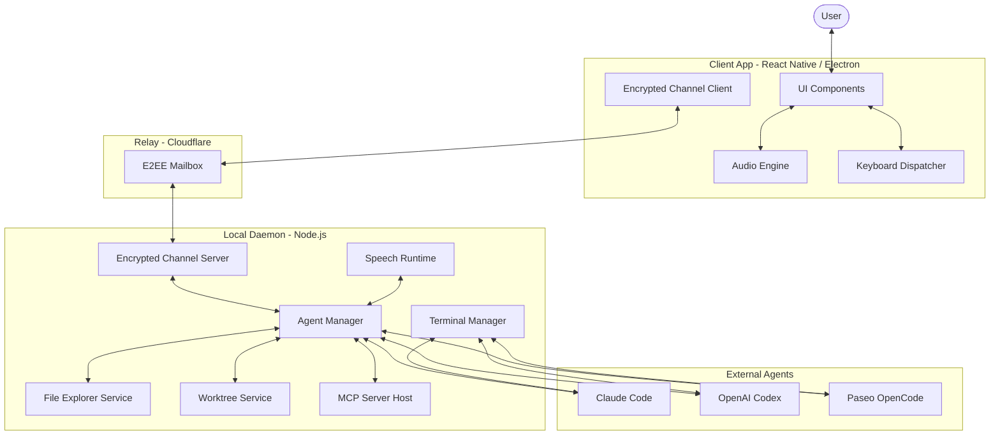

I will read the `.prompt.md` file to understand the instructions and the `.input.paseo.xml` file to process the input.

Based on the analysis of the Paseo codebase, here is a comprehensive review of the project.

### 1. Project Name and Last Commit Date
- **Project Name:** Paseo
- **Last Commit Date:** Monday, 14 April 2025 15:46:27 -0700

---

### 2. Project Description
Paseo is a multi-platform AI agent orchestration framework designed to bridge the gap between local development environments and advanced Large Language Models (LLMs). It operates as a daemon-client architecture where a local "daemon" runs on the user's machine, providing agents with secure, permissioned access to the local filesystem, terminal, and development tools. This allows agents to perform complex engineering tasks like refactoring, running tests, and managing git workflows directly within the user's workspace.

The system emphasizes privacy and security through an end-to-end encrypted (E2EE) relay mechanism. This enables users to connect their mobile devices or web browsers to their local development machine securely, even across different networks. Paseo supports high-fidelity interactions including real-time voice control, terminal emulation, and artifact rendering (like code diffs and previews), creating a "collaborative room" feel for human-agent interaction.

Architecturally, Paseo is a monorepo containing a React Native app (iOS/Android/Web), an Electron desktop wrapper, a CLI, and a powerful Node.js server (daemon). It integrates deeply with existing agentic CLIs like Claude Code and OpenAI Codex, while providing its own "OpenCode" implementation. The project is built for extensibility, supporting Model Context Protocol (MCP) servers and custom agent providers.

---

### 3. Supported Platforms/Deployments & Requirements
- **Desktop:**
    - **Windows:** Supported via Electron. (Reference: `packages/desktop/bin/paseo.cmd`)
    - **macOS:** Supported via Electron (Intel and Apple Silicon). (Reference: `.github/workflows/desktop-release.yml`)
    - **Linux:** Supported via Electron and Nix. (Reference: `nix/package.nix`)
- **Mobile:**
    - **Android:** Native APK via Expo/EAS. (Reference: `.github/workflows/android-apk-release.yml`)
    - **iOS:** Supported via Expo (deployment configured in EAS). (Reference: `packages/app/app.config.js`)
- **Web:**
    - **Browser:** React Native for Web, deployed to Cloudflare Pages. (Reference: `.github/workflows/deploy-app.yml`)
- **Relay/Backend:**
    - **Cloudflare Workers:** Used for the E2EE relay and website hosting. (Reference: `packages/relay/wrangler.toml`)
- **CLI:**
    - **Node.js:** Cross-platform CLI. (Reference: `packages/cli/bin/paseo`)

**Requirements:**
- **Node.js:** v20+ or v22+ (specified in CI and package files).
- **Git:** Required for worktree and repository management.
- **Optional:** External agent CLIs like `claude-code` or `@openai/codex`.

---

### 4. Supported Connectors to Apps/APIs/Messengers
- **Local Filesystem:** Full CRUD access with permissioning logic. (Reference: `packages/server/src/server/file-explorer/service.ts`)
- **Terminal/Shell:** Interactive shell execution and capture. (Reference: `packages/server/src/terminal/terminal.ts`)
- **Git:** Deep integration for diffing, branch management, and worktrees. (Reference: `packages/server/src/server/workspace-git-service.ts`)
- **MCP (Model Context Protocol):** Connects to any MCP-compliant server. (Reference: `packages/server/src/server/agent/mcp-server.ts`)
- **E2EE Relay:** Secure connection between client and daemon. (Reference: `packages/relay/src/index.ts`)
- **Apple/Google Push Notifications:** For agent attention alerts. (Reference: `packages/server/src/server/push/push-service.ts`)

---

### 5. Supported Models/Agents
- **Claude (Anthropic):** Integrated via `claude-code` CLI and direct API. (Reference: `packages/server/src/server/agent/providers/claude-agent.ts`)
- **OpenCode (Local/Remote):** Paseo's internal agent implementation. (Reference: `packages/server/src/server/agent/providers/opencode-agent.ts`)
- **Codex (OpenAI):** Integrated via `@openai/codex` CLI. (Reference: `packages/server/src/server/agent/providers/codex-app-server-agent.ts`)
- **Local Speech Models:** Sherpa-ONNX, Silero VAD, and Pocket TTS for offline voice. (Reference: `packages/server/src/server/speech/providers/local/runtime.ts`)
- **OpenAI Realtime/API:** For voice transcription and text generation. (Reference: `packages/server/src/server/speech/providers/openai/runtime.ts`)

---

### 6. Top 5 Use Cases
1. **Remote Mobile Engineering:** Use the Android/iOS app to command your home workstation to fix bugs or run builds while you are away.
2. **Hands-Free Coding:** Dictate complex refactoring tasks using real-time voice control while observing the terminal output.
3. **Agentic Worktrees:** Spawn multiple agents in isolated git worktrees to explore different implementation paths in parallel.
4. **Context-Aware Debugging:** Attach local files, terminal snapshots, and git diffs to an agent session for high-context troubleshooting.
5. **Scheduled Maintenance:** Use the Loop/Schedule service to run agents periodically (e.g., "Review security logs every night").

---

### 7. Top 20 Features
1. **E2EE Relay:** Secure, private communication between clients and daemons. (`packages/relay/src/e2ee.ts`)
2. **Real-time Voice Overlay:** Low-latency voice interaction with visual feedback. (`packages/app/src/components/realtime-voice-overlay.tsx`)
3. **Terminal Emulation:** Full XTerm-compatible terminal in the UI. (`packages/app/src/components/terminal-emulator.tsx`)
4. **Git Worktree Management:** Isolated environments for agents. (`packages/server/src/utils/worktree.ts`)
5. **MCP Support:** Extensible toolsets via Model Context Protocol. (`packages/server/src/server/agent/mcp-server.ts`)
6. **Permission System:** Granular control over what agents can access. (`packages/server/src/server/agent-attention-policy.ts`)
7. **Multi-Agent Orchestration:** Managing multiple concurrent agent sessions. (`packages/server/src/server/agent/orchestrator.ts`)
8. **Artifact Rendering:** High-fidelity rendering of code diffs and files. (`packages/app/src/components/diff-viewer.tsx`)
9. **Offline Speech (STT/TTS):** Local voice processing using ONNX. (`packages/server/src/server/speech/providers/local/sherpa/sherpa-stt.ts`)
10. **Device Pairing:** QR-code based secure pairing for mobile devices. (`packages/server/src/server/pairing-qr.ts`)
11. **Agent Attention:** Push notifications and visual alerts when agents need input. (`packages/server/src/shared/agent-attention-notification.ts`)
12. **Session Persistence:** Resumable agent sessions across daemon restarts. (`packages/server/src/server/agent/agent-storage.ts`)
13. **File Explorer:** Remote file navigation and selection. (`packages/server/src/server/file-explorer/service.ts`)
14. **Artifact Drawer:** Side-panel for reviewing agent-generated content. (`packages/app/src/components/artifact-drawer.tsx`)
15. **Keyboard Shortcuts:** Comprehensive desktop-grade shortcut system. (`packages/app/src/keyboard/keyboard-shortcuts.ts`)
16. **Dynamic Provider Snapshots:** Real-time discovery of available models/agents. (`packages/server/src/server/agent/provider-snapshot-manager.ts`)
17. **Plan Mode Support:** Structured planning and approval workflow for agents. (`packages/server/src/server/agent/providers/claude-agent.ts`)
18. **Multi-Workspace Support:** Switching between different project directories. (`packages/app/src/stores/workspace-tabs-store.ts`)
19. **Audio Debugging Tools:** Visualization of audio streams and VAD state. (`packages/app/src/config/audio-debug.ts`)
20. **CLI Client:** Full-featured command line interface for headless use. (`packages/cli/src/cli.ts`)

---

### 8. Top 20 Smart Patterns
1. **Coalesced Activity Tracking:** Throttling activity updates to save bandwidth. (`packages/app/src/runtime/activity/last-activity-coalescer.ts`)
2. **Timeline Projections:** Decoupling session history from UI rendering state. (`packages/server/src/server/agent/timeline-projection.ts`)
3. **Provider Launch Configs:** Abstracting CLI arguments into dynamic templates. (`packages/server/src/server/agent/provider-launch-config.ts`)
4. **Recursive Tool Normalization:** Mapping inconsistent CLI tool names to a standard schema. (`packages/server/src/server/agent/tool-name-normalization.ts`)
5. **VAD-Driven Turn Detection:** Intelligent management of when to listen vs. talk. (`packages/server/src/server/voice/voice-turn-controller.ts`)
6. **End-to-End Encryption Handshake:** Secure key exchange over untrusted relays. (`packages/relay/src/encrypted-channel.ts`)
7. **Adaptive Modal Sheets:** UI components that scale between mobile and desktop. (`packages/app/src/components/adaptive-modal-sheet.tsx`)
8. **Bootstrap Boundary:** Handling complex initialization logic in React. (`packages/app/src/components/host-route-bootstrap-boundary.tsx`)
9. **Sequence Gating:** Ensuring message order over async transports. (`packages/app/src/contexts/session-timeline-seq-gate.ts`)
10. **Zod-Based RPC Schemas:** Type-safe communication between CLI and Server. (`packages/server/src/server/chat/chat-rpc-schemas.ts`)
11. **Thinking Tone PCM Generation:** Synthesizing "processing" sounds locally. (`packages/app/src/utils/thinking-tone.ts`)
12. **Draft Key Migration:** Safe versioning of local-storage drafts. (`packages/app/src/stores/draft-store.migration.test.ts`)
13. **Git Diff Bottlenecking:** Managing high-volume git output to prevent UI lag. (`packages/server/src/server/daemon-e2e/git-diff-bottleneck.local.e2e.test.ts`)
14. **PID Locking:** Preventing multiple daemon instances from clashing. (`packages/server/src/server/pid-lock.ts`)
15. **Polymorphic Audio Engine:** Cross-platform audio handling (Native vs Web). (`packages/app/src/voice/audio-engine.d.ts`)
16. **Sidechain Trackers:** Managing auxiliary agent data (like sub-agents). (`packages/server/src/server/agent/providers/claude/sidechain-tracker.ts`)
17. **Partial JSON Parsing:** Processing streaming LLM output before it's finished. (`packages/server/src/server/agent/providers/claude/partial-json.ts`)
18. **Workspace Identity Stability:** Persistent IDs for project folders. (`packages/app/src/utils/workspace-identity.ts`)
19. **Shell Login Environment Capture:** Correctly inheriting user shell configs. (`packages/desktop/src/login-shell-env.ts`)
20. **Supervisor Lifecycle:** Auto-restarting and managing the daemon process. (`packages/server/scripts/supervisor.ts`)

---

### 9. Top 20 Development Trends
1. **Voice First:** Heavy investment in real-time voice and offline speech models.
2. **E2EE Standardization:** Moving all relay traffic to a unified encrypted channel.
3. **MCP Integration:** Shift towards MCP as the primary tool extension mechanism.
4. **Testing Rigor:** Extensive E2E testing using "real" model CLI simulations.
5. **Cross-Platform Parity:** Ensuring feature alignment between Web, Desktop, and Mobile.
6. **Mobile Polish:** Adding native gestures, haptics, and adaptive UI layouts.
7. **Security Hardening:** Implementing strict permission policies for filesystem/terminal.
8. **Performance Optimization:** Virtualization and coalescing for high-volume logs/streams.
9. **Developer Experience:** CLI-based onboarding and automated toolchain setup.
10. **Agent Autonomy:** Improving "Plan Mode" and multi-step reasoning capabilities.
11. **Multi-Agent Collaboration:** Research into agents spawning and managing other agents.
12. **Local-First AI:** Reducing dependency on cloud APIs for speech and simple tasks.
13. **Relay Reliability:** Improved reconnection logic and latency measurement.
14. **Nix Adoption:** Using Nix for reproducible development and deployment.
15. **Type Safety:** Aggressive use of TypeScript and Zod for system-wide contracts.
16. **Documentation Maturity:** Expanded docs for providers, security, and architecture.
17. **Git Native Workflows:** Deep integration with worktrees and branch strategies.
18. **UI/UX Refinement:** Material icons, theme support, and desktop titlebar integration.
19. **Push Notifications:** Transitioning from polling to push-based attention alerts.
20. **Modularization:** Splitting the core into clean packages (relay, highlight, app, server).

---

### 10. Top 10 Advantages
1. **True Privacy:** E2EE ensures your code never touches Paseo's relay in plaintext.
2. **Deep Local Access:** Agents can run commands and read files just like a human developer.
3. **Multi-Device Sync:** Seamlessly move between desktop and mobile with shared state.
4. **Voice Integration:** High-quality voice control makes it accessible in more contexts.
5. **Extensible:** Support for MCP and custom providers means it grows with the ecosystem.
6. **Reliable:** Heavy use of E2E testing and supervisor processes ensures stability.
7. **Beautiful UI:** Polished, modern interface that handles complex data gracefully.
8. **Isolated Environments:** Git worktree support keeps your main branch clean.
9. **Low Latency:** Optimized streaming protocols for terminal and voice.
10. **Developer-Centric:** Built by and for engineers, with deep git and CLI focus.

---

### 11. Top 10 Limitations
1. **Setup Complexity:** Requires Node, Git, and often external CLIs to be functional.
2. **Resource Intensive:** Running the daemon and local speech models can be heavy on RAM/CPU.
3. **Relay Dependency:** While E2EE, it still relies on a relay for cross-network access.
4. **Platform Nuances:** Some features (like terminal keys) behave differently on Windows vs Unix.
5. **Agent CLI Fragility:** Relies on scraping/wrapping other CLIs which can break on updates.
6. **Permission Friction:** Security model requires frequent user "Allow" interactions.
7. **Mobile Limitations:** Native audio/backgrounding can be restricted by OS policies.
8. **Local Model Quality:** Offline STT/TTS is good but not yet at GPT-4o level.
9. **Single User Focus:** Currently optimized for one user across many devices, not teams.
10. **Niche Documentation:** Some advanced configurations require reading the source code.

---

### 12. Top 5 Used and Provided AI Skills
**Provided Skills:**
1. **`skills/paseo/SKILL.md`**: Core Paseo operations and system knowledge.
2. **`skills/paseo-orchestrate/SKILL.md`**: Complex task planning and multi-agent coordination.
3. **`skills/paseo-loop/SKILL.md`**: Patterns for recurring/scheduled agent tasks.
4. **`skills/paseo-committee/SKILL.md`**: Peer review and debating patterns for agents.
5. **`skills/paseo-handoff/SKILL.md`**: Protocols for transferring context between agents.

---

### 13. Data Overview
- **Inputs:** Voice (PCM), Terminal Keys, Filesystem, Git state, MCP Tools.
- **Outputs:** Voice (TTS), Terminal Streams, Code Diffs, OS Notifications, Artifacts.
- **Storage:**
    - **Local JSON/SQLite:** For session history and config. (`packages/server/src/server/agent/agent-storage.ts`)
    - **IndexedDB/Native Store:** For client-side drafts and attachments. (`packages/app/src/attachments/store.ts`)
    - **Git:** Primary source of truth for project state.

---

### 14. Detailed Architecture Review
1. **Daemon (Server):** The heart of Paseo. Manages agents, terminal, and filesystem. (`packages/server/src/server/index.ts`)
2. **Client (App):** React Native UI for interaction. (`packages/app/src/app/index.tsx`)
3. **Relay:** A Cloudflare Worker acting as an E2EE mailbox for cross-network traffic. (`packages/relay/src/index.ts`)
4. **Agent Manager:** Orchestrates different agent providers (Claude, OpenCode). (`packages/server/src/server/agent/agent-manager.ts`)
5. **Encrypted Channel:** Wrapper for secure communication. (`packages/relay/src/encrypted-channel.ts`)
6. **Terminal Manager:** Handles PTY sessions and streaming. (`packages/server/src/terminal/terminal-manager.ts`)
7. **Speech Runtime:** Manages STT/TTS and VAD. (`packages/server/src/server/speech/speech-runtime.ts`)
8. **Worktree Service:** Manages isolated git environments. (`packages/server/src/utils/worktree.ts`)
9. **MCP Server:** Host for Model Context Protocol tools. (`packages/server/src/server/agent/mcp-server.ts`)
10. **Timeline Projection:** Transforms raw events into renderable UI state. (`packages/server/src/server/agent/timeline-projection.ts`)
11. **Provider Registry:** Dynamic discovery of agent capabilities. (`packages/server/src/server/agent/provider-registry.ts`)
12. **Push Service:** Dispatches notifications via Apple/Google. (`packages/server/src/server/push/push-service.ts`)
13. **Audio Engine:** Platform-specific audio capture and playback. (`packages/app/src/voice/audio-engine.native.ts`)
14. **Keyboard Action Dispatcher:** Maps shortcuts to application logic. (`packages/app/src/keyboard/keyboard-action-dispatcher.ts`)
15. **Artifact Drawer:** UI component for non-chat agent output. (`packages/app/src/components/artifact-drawer.tsx`)
16. **Relay Transport:** Client-side logic for connecting to the relay. (`packages/server/src/client/daemon-client-relay-e2ee-transport.ts`)
17. **File Explorer Service:** Remote file system API. (`packages/server/src/server/file-explorer/service.ts`)
18. **Supervisor:** Process manager for the daemon. (`packages/server/scripts/supervisor.ts`)
19. **Snapshot Manager:** Periodically captures provider state. (`packages/server/src/server/agent/provider-snapshot-manager.ts`)
20. **Layout Store:** Manages multi-pane UI state. (`packages/app/src/stores/workspace-layout-store.ts`)

---

### 15. Architecture Graph (Mermaid)

---

### 16. Maturity and Quality Review
- **Maturity:** Highly mature for an open-source tool. The codebase is well-structured, uses modern best practices, and has a clear versioning/release strategy.
- **Stability:** High. The use of supervisor processes, PID locks, and extensive E2E testing suggests a focus on long-running reliability.
- **Security:** Excellent. E2EE relay and granular permission policies for local access demonstrate a "security-first" mindset.
- **Performance:** Good. Optimizations like virtualization and coalescing handle the heavy data streams inherent in agentic workflows.

---

### 17. Development Processes Review
- **Tests:** Very strong. Unit, integration, and E2E tests are pervasive. Use of "real" model simulations in CI is impressive.
- **CI/CD:** Sophisticated. Multi-platform builds, automated releases to GitHub, Cloudflare, and EAS.
- **Documentation:** Solid. Dedicated docs for design, architecture, and providers.
- **AI Integration:** Deep. Not just a wrapper, but a framework that understands agent lifecycles, tool calls, and context.

---

### 18. Top 20 Improvements/Fixes
1. **Centralized Model Registry:** Move model definitions out of providers into a shared catalog. (`packages/server/src/server/agent/providers/claude/claude-models.ts`)
2. **Unified Terminal Protocol:** Standardize terminal keys across web/mobile. (`packages/server/src/shared/terminal-key-input.ts`)
3. **Improved VAD Calibration:** Add auto-calibration for background noise. (`packages/server/src/server/speech/providers/local/sherpa/silero-vad-provider.ts`)
4. **Agent-to-Agent Communication:** Formalize the protocol for agents to message each other. (`packages/server/src/server/agent/orchestrator.ts`)
5. **Persistent Artifacts:** Save agent artifacts (diffs, plans) to the filesystem, not just memory. (`packages/app/src/components/artifact-drawer.tsx`)
6. **Mobile Background Audio:** Better support for keeping voice sessions alive when the app is backgrounded. (`packages/app/src/voice/audio-engine.native.ts`)
7. **Nix-based Toolchain Auto-Install:** Use Nix to automatically install missing dependencies (like `claude-code`). (`nix/package.nix`)
8. **Shared Knowledge Graph:** Implement a local RAG/Graph store for project-wide context.
9. **Multi-User Rooms:** Allow multiple users to join a single agent session. (`packages/server/src/server/websocket-server.ts`)
10. **Voice Command Shortcuts:** Custom voice phrases to trigger complex UI actions.
11. **Better "Plan Mode" Visuals:** A dedicated UI view for reviewing and editing agent plans. (`packages/server/src/server/agent/providers/codex-plan-mode.real.e2e.test.ts`)
12. **Agent Resource Limiting:** Cgroup/Docker integration for restricting agent CPU/RAM.
13. **Local-Only Relay Mode:** Opt-out of Cloudflare for purely local network usage.
14. **Browser Extension:** A Paseo sidecar for web-based development tools.
15. **Rich Artifact Previews:** Render HTML/SVG/Images directly in the artifact drawer.
16. **Agent Personality Profiles:** Custom system prompts for different agent "roles".
17. **Improved Reconnection Logic:** Faster recovery for E2EE channels over flaky mobile data. (`packages/relay/src/encrypted-channel.ts`)
18. **Granular Git Permissions:** Allow "diff" but deny "push" for certain agents. (`packages/server/src/server/agent-attention-policy.ts`)
19. **Desktop Tray Integration:** Minimal daemon control from the OS tray.
20. **Voice Training:** Allow the user to "teach" Paseo their voice/accent for better STT.

---

### 19. Reuse for Agent Swarms
1. **`Orchestrator`**: Core logic for managing multiple agents. (`packages/server/src/server/agent/orchestrator.ts`)
2. **`TimelineProjection`**: Standardizing state across different agents. (`packages/server/src/server/agent/timeline-projection.ts`)
3. **`MCP Server`**: Shared tool access for the swarm. (`packages/server/src/server/agent/mcp-server.ts`)
4. **`Committee Skill`**: Patterns for debating and consensus. (`skills/paseo-committee/SKILL.md`)
5. **`Worktree Service`**: Running swarm members in isolated environments. (`packages/server/src/utils/worktree.ts`)
6. **`Model Resolver`**: Selecting the best model for a specific task. (`packages/server/src/server/agent/model-resolver.ts`)
7. **`Activity Curator`**: Merging and summarizing swarm logs. (`packages/server/src/server/agent/activity-curator.ts`)
8. **`Provider Registry`**: Discovering available "specialists" in the swarm. (`packages/server/src/server/agent/provider-registry.ts`)
9. **`Agent Attention Policy`**: Managing when the swarm interrupts the human. (`packages/server/src/server/agent-attention-policy.ts`)
10. **`Session Timeline Seq Gate`**: Keeping cross-agent messages in order. (`packages/app/src/contexts/session-timeline-seq-gate.ts`)

---

### 20. Reuse for Multi-User/Multi-Agent Shared KB
1. **`Encrypted Channel`**: Secure transport for multi-user interactions. (`packages/relay/src/encrypted-channel.ts`)
2. **`WebSocket Server`**: Real-time synchronization of shared state. (`packages/server/src/server/websocket-server.ts`)
3. **`Agent Storage`**: Versioned persistence of chat and knowledge. (`packages/server/src/server/agent/agent-storage.ts`)
4. **`Artifact Drawer`**: Shared space for viewing evolving specifications. (`packages/app/src/components/artifact-drawer.tsx`)
5. **`File Explorer Service`**: Access to the shared markdown knowledge base. (`packages/server/src/server/file-explorer/service.ts`)
6. **`Zod RPC Schemas`**: Contracts for multi-agent interaction. (`packages/server/src/server/chat/chat-rpc-schemas.ts`)
7. **`Push Service`**: Notifying users of KB updates. (`packages/server/src/server/push/push-service.ts`)
8. **`Timeline Append`**: Atomically adding to the shared log. (`packages/server/src/server/agent/timeline-append.ts`)
9. **`Workspace Identity`**: Stable identifiers for shared projects. (`packages/app/src/utils/workspace-identity.ts`)
10. **`Agent Handoff Skill`**: Formal patterns for passing KB context. (`skills/paseo-handoff/SKILL.md`)

---

### 21. Reuse for Own Hardware / Cloud / Messenger
1. **`Cloudflare Adapter`**: Running logic on Cloudflare Workers. (`packages/relay/src/cloudflare-adapter.ts`)
2. **`Supervisor`**: Managing long-running daemon processes on own hardware. (`packages/server/scripts/supervisor.ts`)
3. **`Relay Transport`**: Secure communication over any messenger/channel. (`packages/server/src/client/daemon-client-relay-e2ee-transport.ts`)
4. **`Speech Runtime`**: Offline voice control on local hardware. (`packages/server/src/server/speech/speech-runtime.ts`)
5. **`CLI Client`**: Headless control via terminal. (`packages/cli/src/cli.ts`)
6. **`Artifact Drawer`**: Rendering complex graph/UI views. (`packages/app/src/components/artifact-drawer.tsx`)
7. **`Encrypted Channel`**: E2EE for messenger-based control. (`packages/relay/src/encrypted-channel.ts`)
8. **`Provider Manifest`**: Dynamic capability discovery for remote agents. (`packages/server/src/server/agent/provider-manifest.ts`)
9. **`Audio Engine`**: Native voice capture on devices. (`packages/app/src/voice/audio-engine.native.ts`)
10. **`Daemon Config Store`**: Persisting hardware-specific settings. (`packages/server/src/server/daemon-config-store.ts`)

---

### 22. Reuse for Team Agents (Cooperative Workflows)
1. **`Agent Attention Policy`**: Rules for agent-human cooperation. (`packages/server/src/server/agent-attention-policy.ts`)
2. **`Orchestrate Skill`**: High-level workflow planning. (`skills/paseo-orchestrate/SKILL.md`)
3. **`Activity Curator`**: Summarizing team/agent work for human review. (`packages/server/src/server/agent/activity-curator.ts`)
4. **`Artifact Drawer`**: Cooperative workspace for code and docs. (`packages/app/src/components/artifact-drawer.tsx`)
5. **`MCP Server`**: Shared toolsets for the team. (`packages/server/src/server/agent/mcp-server.ts`)
6. **`Wait For Agent Tracker`**: Coordinating human-agent turn-taking. (`packages/server/src/server/agent/wait-for-agent-tracker.ts`)
7. **`Push Service`**: Alerting team members to agent needs. (`packages/server/src/server/push/push-service.ts`)
8. **`Workspace Registry`**: Shared catalog of team projects. (`packages/server/src/server/workspace-registry.ts`)
9. **`Agent Lifecycle`**: Formal states for agent work (Planning, Running, Done). (`packages/server/src/shared/agent-lifecycle.ts`)
10. **`Confirm Dialog`**: Human-in-the-loop approval mechanism. (`packages/app/src/utils/confirm-dialog.ts`)
