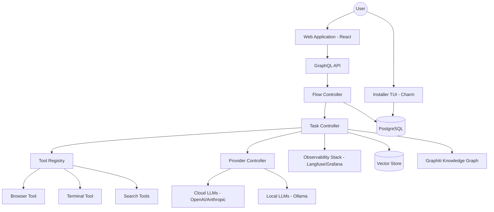

I will start by reading the instructions in `./.prompt.md` to understand the specific task and how to process `pentagi.xml`.
I will begin by examining the first few lines of `pentagi.xml` to understand its structure and how the repository content is represented.
I will read more lines from `pentagi.xml` to capture the complete directory structure and get a better overview of the project's organization.
I will continue reading the directory structure to identify the frontend components and any other significant parts of the repository.
I will read the `README.md` file to obtain the official project description and name, which will help me address the first point of the analysis.
I'll read `backend/cmd/pentagi/main.go` to understand the application's entry point and `backend/docs/installer/installer-overview.md` to get a better high-level description of the project.
I will search for `<file path="backend/cmd/pentagi/main.go">` within `pentagi.xml` to locate and read its content.
I will read the content of `backend/cmd/pentagi/main.go` from `pentagi.xml` by extracting lines 18977 to 19050.
I'll find the starting line for `backend/docs/installer/installer-overview.md` in `pentagi.xml` to check its content.
I'll examine `backend/pkg/controller/flow.go` and `backend/pkg/controller/task.go` to better understand the agent interaction model, which will help me refine the use cases and identify key features and patterns.
I'll read `backend/pkg/controller/flow.go` and `backend/pkg/controller/task.go` to understand the agent orchestration logic, which is crucial for the core functionality.
I'll read the git log at the end of `pentagi.xml` to identify development trends and gain insights into the project's recent evolution.
# PentAGI Analysis Report

## 1. Project Name and Description
**Project Name:** PentAGI

**Description:**
PentAGI is a cutting-edge, autonomous penetration testing platform designed to revolutionize security audits through multi-agent orchestration. It leverages advanced Large Language Models (LLMs) to perform complex security tasks, ranging from initial reconnaissance and vulnerability scanning to exploit research and reporting. The platform is built with a focus on autonomy, allowing security professionals to define high-level objectives that the system then decomposes into actionable subtasks executed by specialized agents.

The project features a dual-interface approach: a professional-grade Terminal User Interface (TUI) for rapid configuration and deployment, and a rich, interactive Web Application for real-time monitoring and management of execution "flows." PentAGI's architecture is highly modular, supporting a wide array of LLM providers (both cloud-based and local), external search engines, and specialized security tools, all integrated into a cohesive environment.

At its core, PentAGI emphasizes observability and traceability. Every agent interaction, tool execution, and "thinking" process is captured and visualized, providing users with a deep understanding of the platform's reasoning and actions. By integrating knowledge graph technologies and vector stores, PentAGI maintains a persistent memory of its findings, enabling it to evolve its strategy as it uncovers new information during an engagement.

## 2. Supported Platforms/Deployments + Requirements
**Supported Platforms:**
- **Docker / Docker Compose:** The primary deployment method using `docker-compose.yml` and specialized configurations for observability.
- **Linux:** Native support via `scripts/entrypoint.sh` and common Linux utilities.
- **Windows / macOS (Darwin):** Supported through cross-platform Go code in `backend/pkg/system/` and Docker.

**Requirements:**
- **Docker & Docker Compose:** Essential for running the multi-service architecture.
- **Go 1.22+:** Required for building the backend and installer.
- **Node.js & NPM/Yarn:** Required for building and running the frontend.
- **PostgreSQL:** Used as the primary relational database for state and flow management.
- **LLM API Keys:** Required for cloud providers (OpenAI, Anthropic, Gemini, etc.).
- **Optional Services:** ClickHouse, Grafana, Loki, Jaeger, and Prometheus for full observability stack.

## 3. Supported Connectors
PentAGI integrates with a variety of external services and tools to enhance its capabilities.

| Connector Type | Service/Tool | Source Code Reference |
| :--- | :--- | :--- |
| **Search Engines** | Google Search | `backend/pkg/tools/google.go` |
| | DuckDuckGo | `backend/pkg/tools/duckduckgo.go` |
| | Perplexity AI | `backend/pkg/tools/perplexity.go` |
| | Tavily Search | `backend/pkg/tools/tavily.go` |
| | SearxNG | `backend/pkg/tools/searxng.go` |
| | Sploitus (Exploits) | `backend/pkg/tools/sploitus.go` |
| | Traversaal | `backend/pkg/tools/traversaal.go` |
| **LLM Providers** | OpenAI (GPT-4, etc.) | `backend/pkg/providers/openai/openai.go` |
| | Anthropic (Claude 3) | `backend/pkg/providers/anthropic/anthropic.go` |
| | Google Gemini | `backend/pkg/providers/gemini/gemini.go` |
| | AWS Bedrock | `backend/pkg/providers/bedrock/bedrock.go` |
| | DeepSeek | `backend/pkg/providers/deepseek/deepseek.go` |
| | ZhipuAI (GLM) | `backend/pkg/providers/glm/glm.go` |
| | Moonshot (Kimi) | `backend/pkg/providers/kimi/kimi.go` |
| | Ollama (Local LLMs) | `backend/pkg/providers/ollama/ollama.go` |
| | Alibaba Qwen | `backend/pkg/providers/qwen/qwen.go` |
| **Observability** | Langfuse (Tracing) | `backend/pkg/observability/langfuse/agent.go` |
| | OpenTelemetry (OTEL) | `backend/pkg/observability/otelclient.go` |
| | Grafana/Loki/Jaeger | `observability/` |
| **System/Security** | Docker Engine | `backend/pkg/docker/client.go` |
| | Terminal/Shell | `backend/pkg/tools/terminal.go` |
| | Web Browser | `backend/pkg/tools/browser.go` |
| | Graphiti (KG) | `backend/pkg/graphiti/client.go` |

## 4. Supported Models/Agents
PentAGI uses a system of specialized agent roles defined by prompt templates, which can be powered by various models.

| Agent Role | Purpose | Source Code Reference |
| :--- | :--- | :--- |
| **Primary Agent** | Main orchestrator and user interface | `backend/pkg/templates/prompts/primary_agent.tmpl` |
| **Pentester** | Specialized in security vulnerability discovery | `backend/pkg/templates/prompts/pentester.tmpl` |
| **Task Planner** | Decomposes goals into actionable subtasks | `backend/pkg/templates/prompts/question_task_planner.tmpl` |
| **Coder** | Analyzes and writes security scripts/code | `backend/pkg/templates/prompts/coder.tmpl` |
| **Searcher** | Expert in gathering intelligence via search | `backend/pkg/templates/prompts/searcher.tmpl` |
| **Memorist** | Manages knowledge and long-term memory | `backend/pkg/templates/prompts/memorist.tmpl` |
| **Reflector** | Critically reviews agent actions and results | `backend/pkg/templates/prompts/reflector.tmpl` |
| **Reporter** | Generates detailed security reports | `backend/pkg/templates/prompts/reporter.tmpl` |

**Model Compatibility:**
- **Remote:** GPT-4o, Claude 3.5 Sonnet, Gemini 1.5 Pro, etc. (via API Tokens).
- **Local:** Llama 3.1, Qwen 2.5, QWQ (via Ollama or vLLM).

## 5. Top 5 Use Cases
1.  **Autonomous Web Application Pentesting:**
    *   **Workflow:** User provides a target URL -> `Task Planner` identifies attack surface -> `Pentester` uses `browser` and `terminal` tools to find vulnerabilities -> `Reflector` validates findings -> `Reporter` generates a final report.
2.  **CVE and Exploit Research:**
    *   **Workflow:** User provides a software version -> `Searcher` queries `Sploitus` and `Google` -> `Enricher` gathers technical details -> `Coder` analyzes exploit feasibility -> `Adviser` provides mitigation steps.
3.  **Automated Security Code Audit:**
    *   **Workflow:** User uploads source code -> `Coder` performs static analysis -> `Pentester` identifies potential logic flaws -> `Task Planner` creates test cases -> `Terminal` tool executes tests in a sandboxed environment.
4.  **Continuous Threat Intelligence Gathering:**
    *   **Workflow:** `Searcher` periodically monitors for new threats -> `Memorist` updates the `Graphiti` knowledge graph -> `Enricher` links new findings to existing assets -> `Primary Agent` alerts the user.
5.  **Interactive Security Operations Assistant:**
    *   **Workflow:** User asks a security question via Web UI -> `Primary Agent` retrieves context from `Graphiti` and `Vector Stores` -> `Adviser` provides a detailed response with execution logs for verification.

## 6. Top 20 Features
1.  **Multi-Agent Orchestration:** Complex task decomposition and delegation (`backend/pkg/controller/flow.go`).
2.  **Visual Execution Flows:** Real-time visualization of agent steps in the Web UI (`frontend/src/pages/flows/flow.tsx`).
3.  **TUI Installer Wizard:** Interactive terminal-based setup (`backend/cmd/installer/main.go`).
4.  **Integrated Browser Tool:** Headless browser for web reconnaissance (`backend/pkg/tools/browser.go`).
5.  **Sandboxed Terminal Execution:** Safe execution of commands in containers (`backend/pkg/tools/terminal.go`).
6.  **Langfuse Integration:** Comprehensive tracing of LLM calls and tool usage (`backend/pkg/observability/langfuse/`).
7.  **Runtime Provider Switching:** Change LLM providers during an active flow (`backend/pkg/controller/flow.go`).
8.  **Knowledge Graph Support:** Integration with Graphiti for structured data (`backend/pkg/graphiti/client.go`).
9.  **Vector Store Memory:** Semantic search over previous findings (`backend/pkg/tools/memory.go`).
10. **GraphQL API & Subscriptions:** Real-time UI updates (`backend/pkg/graph/schema.resolvers.go`).
11. **MCP (Model Context Protocol) Support:** Extensible tool and context integration (`frontend/src/pages/settings/settings-mcp-server.tsx`).
12. **Role-Based Access Control (RBAC):** Manage user permissions (`backend/migrations/sql/20241215_132209_new_user_role.sql`).
13. **Automated Report Generation:** Markdown and PDF exports (`backend/pkg/templates/prompts/reporter.tmpl`).
14. **Screenshot Capture:** Visual evidence of agent actions (`backend/pkg/controller/screenshot.go`).
15. **Local LLM Support:** Integration with Ollama for privacy and cost control (`backend/pkg/providers/ollama/ollama.go`).
16. **Flow Templates:** Save and reuse successful pentesting strategies (`backend/migrations/sql/20260325_120000_flow_templates.sql`).
17. **Thinking Process Visualization:** See the agent's internal reasoning (`backend/migrations/sql/20250414_213004_thinking_msg_part.sql`).
18. **Custom LLM Provider Config:** Support for any OpenAI-compatible API (`backend/pkg/providers/custom/custom.go`).
19. **Real-time Log Monitoring:** Integrated terminal and log viewer in UI (`frontend/src/components/shared/terminal/`).
20. **Self-Hardening Installer:** Security-focused deployment options (`backend/cmd/installer/hardening/hardening.go`).

## 7. Top 20 Smart Patterns
1.  **Agentic Task Decomposition:** Breaking high-level goals into subtasks (`backend/pkg/templates/prompts/subtasks_generator.tmpl`).
2.  **Chain-of-Thought (CoT) Monitoring:** Capturing the "thinking" stage separately from the final response (`backend/pkg/controller/msglog.go`).
3.  **Reflective Feedback Loops:** Agents reviewing each other's work (`backend/pkg/templates/prompts/reflector.tmpl`).
4.  **Dynamic Tool Registration:** Tools are registered and discovered at runtime (`backend/pkg/tools/registry.go`).
5.  **Adaptive Context Management:** Summarizing long execution histories to fit context windows (`backend/pkg/csum/chain_summary.go`).
6.  **Graceful Provider Fallback:** Switching models if one fails or is throttled (`backend/pkg/providers/providers.go`).
7.  **Terminal Sanitization:** Secure handling of ANSI escape codes in the UI (`frontend/src/components/shared/terminal/terminal-sanitizer.ts`).
8.  **Knowledge Graph Grounding:** Using RAG with structured graph data (`backend/pkg/graphiti/client.go`).
9.  **Subscription-Based Updates:** Using GraphQL subscriptions for low-latency status updates (`backend/pkg/graph/subscriptions/`).
10. **Declarative TUI Screens:** Building complex terminal UIs using a component-based pattern (`backend/cmd/installer/wizard/models/`).
11. **Migration-Based Schema Evolution:** Safe database updates with Goose (`backend/migrations/`).
12. **Interface-Driven Controller Logic:** Decoupling workers from their implementation (`backend/pkg/controller/flow.go`).
13. **Embedded Template Management:** Managing prompts as versioned assets (`backend/pkg/templates/`).
14. **Containerized Tool Execution:** Isolating risky operations in Docker (`backend/pkg/docker/client.go`).
15. **Adaptive UI Layouts:** Responsive terminal and web interfaces (`frontend/src/hooks/use-adaptive-column-visibility.ts`).
16. **Automated Evidence Collection:** Taking screenshots and logs automatically for reporting (`backend/pkg/controller/screenshot.go`).
17. **Prompt Injection Protection:** Sanitizing inputs and using structured prompt templates (`backend/pkg/templates/prompts/`).
18. **State Machine for Flows:** Formalizing the lifecycle of an agent engagement (`backend/pkg/controller/flow.go`).
19. **Asynchronous Task Queuing:** Managing concurrent agent operations (`backend/pkg/queue/queue.go`).
20. **Unified Provider Wrapper:** Single interface for all LLM backends (`backend/pkg/providers/provider/wrapper.go`).

## 8. Top 20 Development Trends
1.  **Runtime Model Agility:** Enabling switching between different LLMs during a single task execution.
2.  **Enhanced Terminal UX:** Significant investment in TUI components and terminal emulation in the web.
3.  **Formalizing Agent Workflows:** Moving from ad-hoc tasks to reusable flow templates.
4.  **Observability-First Design:** Making Langfuse and OTEL core parts of the development cycle.
5.  **Improved Test Coverage:** Focus on testing LLM helpers and server-side validation logic.
6.  **MCP Adoption:** Integrating the Model Context Protocol for better tool interoperability.
7.  **Local-First AI:** Increasing support for local models via Ollama and vLLM.
8.  **Structured Output Enforcement:** Using templates and validators to ensure agents return usable data.
9.  **Knowledge Graph Integration:** Shifting from simple RAG to graph-based reasoning.
10. **User-in-the-Loop:** Implementing `ASK_USER` features for human-agent collaboration.
11. **Performance Optimization:** Better handling of large execution logs and traces.
12. **Security Hardening:** Focus on sandboxing and secure deployment in the installer.
13. **Multi-User Collaboration:** Developing RBAC and shared workspaces.
14. **Global LLM Provider Support:** Adding more regional and specialized providers (DeepSeek, GLM, Kimi).
15. **Automated Documentation:** Using tools like Fern for API specification.
16. **Frontend State Management Refinement:** Leveraging Apollo and custom hooks for complex UI states.
17. **Database Efficiency:** Optimizing indices and query patterns for logs.
18. **Dependency Management:** Regular updates to keep the stack modern and secure.
19. **Modular Controller Architecture:** Further decoupling of Flow, Task, and Subtask logic.
20. **Visual Analytics:** Adding dashboards for monitoring resource usage and agent performance.

## 9. Top 10 Advantages
1.  **True Autonomy:** Unlike simple chatbots, it can plan and execute multi-step security engagements.
2.  **Tool Depth:** Real integration with browsers, terminals, and exploit databases.
3.  **Extensible Orchestration:** Easy to add new agent roles and tools.
4.  **Deployment Flexibility:** TUI installer makes complex Docker setups accessible.
5.  **Cost & Privacy Control:** Supports local models alongside top-tier cloud APIs.
6.  **Deep Observability:** Unmatched visibility into agent "thought" and action history.
7.  **Real-Time Interaction:** Modern web UI with instant updates via subscriptions.
8.  **Structured Memory:** Combines vector search with knowledge graphs for better context.
9.  **Standardized API:** Uses GraphQL and OpenTelemetry for integration with other enterprise tools.
10. **Security Focus:** Purpose-built for pentesting, with specialized prompts and tools.

## 10. Top 10 Limitations
1.  **Setup Complexity:** Full observability stack requires significant resources.
2.  **LLM Dependency:** Performance is heavily tied to the reasoning capabilities of the underlying model.
3.  **Potential for Hallucination:** Like all LLM systems, agents may misinterpret tool outputs or security findings.
4.  **Sandbox Escapes (Risk):** While containerized, terminal and browser tools require careful security monitoring.
5.  **Cost Accumulation:** Extensive agent flows can lead to high API token consumption.
6.  **Learning Curve:** The sophisticated UI and terminology (Flows, Tasks, Subtasks) may take time to master.
7.  **Beta Status:** Some advanced features (e.g., full Graphiti integration) show signs of ongoing development.
8.  **Hardware Requirements:** Local model execution requires powerful GPUs.
9.  **Internet Dependency:** Most features rely on external search engines and cloud APIs.
10. **Limited Collaborative Editing:** Multi-user support is present but shared flow editing is still evolving.

## 11. Top 5 Used and Top 5 Provided AI Skills
**Top 5 Used AI Skills:**
1.  **Web Browsing & Reconnaissance:** (`backend/pkg/tools/browser.go`)
2.  **Shell Command Execution & Scripting:** (`backend/pkg/tools/terminal.go`)
3.  **Semantic Search & Retrieval (RAG):** (`backend/pkg/tools/memory.go`)
4.  **Vulnerability & Exploit Lookup:** (`backend/pkg/tools/sploitus.go`)
5.  **Multi-Step Task Planning:** (`backend/pkg/templates/prompts/question_task_planner.tmpl`)

**Top 5 Provided AI Skills:**
1.  **Automated Pentesting Reports:** (`backend/pkg/templates/prompts/reporter.tmpl`)
2.  **Code Security Analysis:** (`backend/pkg/templates/prompts/coder.tmpl`)
3.  **Agent Action Reflection & Validation:** (`backend/pkg/templates/prompts/reflector.tmpl`)
4.  **Structured Knowledge Extraction:** (`backend/pkg/templates/prompts/memorist.tmpl`)
5.  **Autonomous Environment Setup:** (`backend/pkg/templates/prompts/installer.tmpl`)

## 12. Data Inputs, Outputs and Storage Overview
- **Inputs:** User objectives (text), target URLs, source code, API keys, environment configurations.
- **Outputs:** Execution logs, agent "thinking" traces, screenshots, vulnerability reports (MD/PDF), structured knowledge graph nodes.
- **Storage:**
  - **Relational:** PostgreSQL (State, Flows, Tasks, Logs) - `backend/pkg/database/`
  - **Vector:** Integrated vector store (Semantic Memory) - `backend/pkg/tools/memory.go`
  - **Graph:** Graphiti (Structured Knowledge) - `backend/pkg/graphiti/client.go`
  - **Metrics/Logs:** ClickHouse, Prometheus, Loki - `observability/`
  - **Tracing:** Langfuse - `backend/pkg/observability/langfuse/`

## 13. Detailed Architecture Review
PentAGI follows a modular microservices architecture.

1.  **Web UI (React):** User interaction layer, real-time visualization (`frontend/`).
2.  **GraphQL API (GQLGen):** Unified interface between frontend and backend (`backend/pkg/graph/`).
3.  **Flow Controller:** The heart of orchestration, manages agent lifecycles (`backend/pkg/controller/flow.go`).
4.  **Task/Subtask Controller:** Manages granular execution steps (`backend/pkg/controller/task.go`, `subtask.go`).
5.  **Provider Controller:** Abstracts multiple LLM backends (`backend/pkg/providers/providers.go`).
6.  **Tool Registry:** Dynamic management of external capabilities (`backend/pkg/tools/registry.go`).
7.  **Template Manager:** Handles prompt logic and versioning (`backend/pkg/templates/`).
8.  **Observability Collector:** Aggregates traces and metrics (`backend/pkg/observability/`).
9.  **Docker Client:** Manages sandboxed execution environments (`backend/pkg/docker/client.go`).
10. **Database (SQLC/Goose):** Persistent state management (`backend/pkg/database/`, `migrations/`).
11. **Graphiti Client:** Interaction with the knowledge graph service (`backend/pkg/graphiti/client.go`).
12. **Vector Store:** Local semantic memory for agents (`backend/pkg/tools/memory.go`).
13. **Auth/Session Manager:** Handles RBAC and API tokens (`backend/pkg/server/auth/`).
14. **TUI Installer (Charm):** Interactive deployment tool (`backend/cmd/installer/`).
15. **Browser/Terminal Tools:** Low-level interaction primitives (`backend/pkg/tools/`).

## 14. Architecture Mermaid Graph

## 15. Project Maturity, Stability, Security, Performance
- **Maturity:** Highly advanced prototype moving toward production. Core orchestration is solid, but integration with Graphiti and advanced multi-user features are still maturing.
- **Stability:** Good, with comprehensive migrations and error handling. The use of interfaces for workers (`FlowWorker`, `TaskWorker`) ensures robustness.
- **Security:** High focus. Features sandboxed execution, RBAC, and encrypted API token management. However, the nature of autonomous agents executing code requires constant vigilance.
- **Performance:** Optimized for real-time interaction through GraphQL subscriptions. Backend uses concurrent Go patterns effectively. Large logs are a potential bottleneck.

## 16. Review: Tests, CI, Documentation, AI Skills
- **Tests:** Strong coverage in `backend/pkg/server/models/` and `backend/pkg/observability/langfuse/`. Extensive provider-specific tests.
- **CI Pipelines:** Active GitHub Actions (`.github/workflows/ci.yml`) for automated testing and linting.
- **Documentation:** Good internal documentation in `backend/docs/`. TUI installer includes comprehensive help screens.
- **AI Skills:** Very well-structured. Prompts are separated from code, and tools are cleanly interfaced.

## 17. Top 20 Possible Improvements or Fixes
1.  **Transactional Subtask Operations:** Ensure atomicity when updating multiple subtasks (`backend/pkg/controller/task.go:60596`).
2.  **Enhanced Error Recovery:** Better handling of LLM timeout or context window overflow.
3.  **Multi-User Shared Flows:** Real-time collaboration on a single pentesting flow.
4.  **Advanced Evidence Management:** Grouping screenshots and logs by specific vulnerability findings.
5.  **Interactive Report Editor:** Allow users to refine generated reports before export.
6.  **Tool usage cost estimator:** Real-time tracking of API token costs.
7.  **Dynamic Tool Creation:** Allow agents to write and register their own small tools at runtime.
8.  **Deeper MCP Integration:** Support for complex context providers and tool nesting.
9.  **Mobile-Friendly UI:** Improving the web dashboard for tablet/phone use.
10. **Native Desktop App:** Packaging the web UI as an Electron or Tauri app.
11. **Offline Mode Optimization:** Better caching for fully local deployments.
12. **Agent Self-Correction:** More advanced reflection patterns for correcting tool usage errors.
13. **Knowledge Graph Visualization:** Interactive view of the Graphiti knowledge base in the UI.
14. **Custom Prompt Editor:** Integrated UI for modifying and testing prompt templates.
15. **Vulnerability DB Sync:** Automatic updates of exploit data from multiple sources.
16. **Performance Profiling UI:** Integrated view of backend CPU/Memory usage.
17. **Better Search Result Parsing:** More robust extraction of information from complex HTML pages.
18. **Multi-Agent Debates:** Implement a specific "debate" mode for complex architectural decisions.
19. **Automated Red-Teaming of Prompts:** Internal tools to test prompt robustness.
20. **Streamlined Onboarding:** A "Quick Start" flow for common pentesting targets.

## 18. Reuse for Agent Swarm (Debate & Spec)
1.  **FlowWorker / TaskWorker Hierarchy:** The core orchestration model (`backend/pkg/controller/flow.go`).
2.  **Reflector Agent Pattern:** Specifically designed for review and validation (`backend/pkg/templates/prompts/reflector.tmpl`).
3.  **Task Planner:** For decomposing high-level specs into implementation plans (`backend/pkg/templates/prompts/question_task_planner.tmpl`).
4.  **Provider Controller:** For selecting the best model (e.g., GPT-4 for logic, Claude for coding) per task (`backend/pkg/providers/providers.go`).
5.  **Chain Summary logic:** For maintaining context across long debates (`backend/pkg/csum/chain_summary.go`).
6.  **GraphQL Subscriptions:** To visualize the debate in real-time.
7.  **Tool Registry:** For agents to access documentation or existing code during the debate.
8.  **Memorist Agent:** To track key points of agreement/disagreement in the knowledge graph.
9.  **Thinking Message Support:** To see the "internal" reasoning of each debating agent.
10. **Refiner Agent:** To consolidate debate results into a final specification (`backend/pkg/templates/prompts/refiner.tmpl`).

## 19. Reuse for Multi-User/Multi-Agent Shared Knowledge
1.  **Graphiti Client:** The primary interface for evolving a shared graph knowledge base (`backend/pkg/graphiti/client.go`).
2.  **RBAC System:** To manage who can modify shared knowledge (`backend/pkg/server/auth/permissions.go`).
3.  **Vector Store Integration:** For semantic search across all user/agent interactions (`backend/pkg/tools/memory.go`).
4.  **Message Log System:** To maintain a shared history of how knowledge evolved (`backend/pkg/controller/msglog.go`).
5.  **Knowledge Extraction Prompts:** `Memorist` templates for turning text into structured data.
6.  **GraphQL API:** For collaborative UI updates.
7.  **API Tokens:** For external tools to contribute to the knowledge base.
8.  **Assistant Worker Pattern:** Allowing multiple persistent assistants to work in the same flow.
9.  **Snapshot/Screenshot logic:** To share visual context between users.
10. **Common Prompts:** Centralized management of "shared" skills.

## 20. Reuse for Own Hardware / Cloud / Messenger
1.  **Ollama Provider:** For running agents on own hardware (`backend/pkg/providers/ollama/`).
2.  **Docker Orchestration:** For consistent deployment across local and cloud environments.
3.  **Modular Server Router:** Can be adapted for different entry points like Telegram webhooks (`backend/pkg/server/router.go`).
4.  **TUI Framework (Charm):** For high-quality local CLI interaction.
5.  **Integrated Terminal Emulator:** For remote shell access via web/mobile.
6.  **Screenshot/Visual Support:** For providing visual feedback in messengers.
7.  **Voice Control Hook (potential):** Using the modular tool system to integrate STT/TTS.
8.  **Graphiti Visualization:** For navigating knowledge via a web-based graph view.
9.  **LiteLLM/Custom Provider Wrapper:** For easy integration with any cloud LLM endpoint.
10. **InstallerHardening:** For securing own-hardware deployments.

## 21. Reuse for Team Agents (Human/Agent Workflows)
1.  **ASK_USER Logic:** The explicit pattern for pausing execution for human input (`.env.example`).
2.  **Interactive Terminal:** For humans to jump into an agent's terminal session.
3.  **Flow Status Management:** Clearly defined `Waiting` state for user input (`backend/pkg/controller/task.go`).
4.  **Primary Agent Role:** Acting as the user's direct representative in the swarm.
5.  **Task Assignment Wrapper:** For wrapping agent tasks with human-readable context.
6.  **Reflector for Human Validation:** Using the reflector pattern to ask for user approval of findings.
7.  **Real-time Collaboration UI:** Using Apollo/GraphQL for synchronized state.
8.  **Action Logs:** Providing humans with full audit trails of agent actions.
9.  **Adviser Agent:** Specifically designed to provide human-readable guidance.
10. **Permissioned API Tokens:** Allowing humans to delegate specific sub-tasks to external tools.
