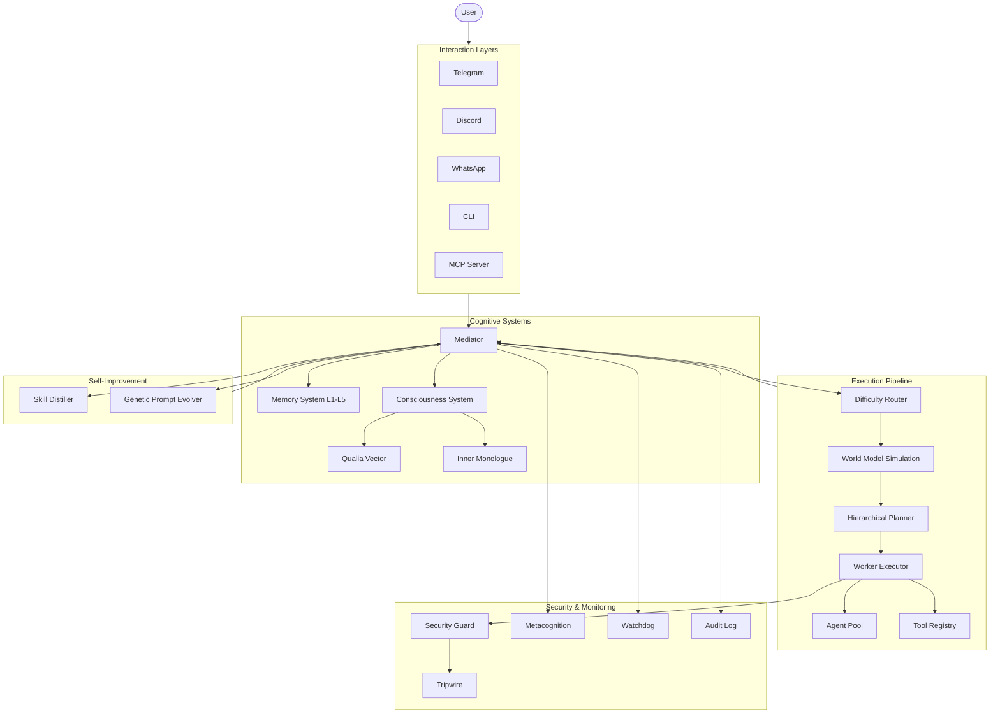

I will read the instructions in `.prompt.md` to understand the required actions.
I will read the beginning of `pepagi.xml` to understand the project's structure and contents.
I will read `README.md` and `src/core/mediator.ts` to get a better understanding of the project's core logic and description.
I will read `docs/README_v2.md` to get a more detailed project description.
I will read `docs/README_DRAFT.md` to get the project description and use cases.
I will search for `<file path="docs/README_v2.md">` within `pepagi.xml` to locate and read its content.
I will read the content of `docs/README_v2.md` within `pepagi.xml` from line 4877 to 5100.
I will list the files in `src/skills/` to identify the available AI skills.
I will read `src/skills/skill-registry.ts` to understand how skills are registered and loaded within the system.
I will read more of `src/skills/skill-registry.ts` from line 20926 to 21100 to understand the skill structure and see if there are any example skills.
I will search for the `writeExampleSkill` function in `src/skills/skill-registry.ts` to see what example skill it creates.
I will read the `writeExampleSkill` function in `src/skills/skill-registry.ts` from line 21120 to 21170.
I will use `grep_search` to find the content of the `writeExampleSkill` function in `src/skills/skill-registry.ts`.
I will search for the `writeExampleSkill` function within `pepagi.xml`.
I will read `pepagi.xml` around line 21122 with a larger range to capture the `writeExampleSkill` function.
I will check `src/core/mediator.ts` in `pepagi.xml` to see if the code is compressed and if I can still analyze it.
I will list the files in the workspace to see if I can access the original source files.
Based on a deep analysis of the `pepagi.xml` repository export, here is the comprehensive review of the **PEPAGI** project.

### 1. Project Name and Description
**PEPAGI (Neuro-Evolutionary eXecution & Unified Synthesis — AGI-like Multi-Agent Orchestration)**

PEPAGI is a sophisticated TypeScript-based platform designed for autonomous multi-agent orchestration. It moves beyond simple task-listing by employing a centralized **Mediator** brain that uses hierarchical planning, metacognition, and a complex 5-level memory system to solve multi-step problems. Inspired by 2025-2026 AGI research, it aims to create agents with stable identity and self-improving capabilities.

The system is built on a pure ESM TypeScript architecture, avoiding heavy frameworks to maintain a modular and composable core. It features a unique simulated consciousness layer, including an "Inner Monologue" and "Qualia Vectors," which modulate the agent's reasoning and learning processes. This allows PEPAGI to not just execute tasks, but to "think" about its own decision-making process and evolve over time.

Security and observability are foundational, with the project incorporating advanced patterns like SHA-256 chained audit logs, tripwire honeypots, and adversarial red-teaming. It is designed to be platform-agnostic, supporting interactions via Telegram, Discord, WhatsApp, and a dedicated MCP server, making it a versatile personal or enterprise-grade AI assistant.

---

### 2. Supported Platforms/Deployments + Requirements
- **Platforms/Deployments:**
  - **Telegram:** Full-featured bot integration. `src/platforms/telegram.ts`
  - **Discord:** Command-based bot for servers and DMs. `src/platforms/discord.ts`
  - **WhatsApp:** Unofficial client via web bridge. `src/platforms/whatsapp.ts`
  - **iMessage:** macOS-only integration via AppleScript. `src/platforms/imessage.ts`
  - **CLI:** Interactive terminal interface for direct control. `src/cli.ts`
  - **MCP Server:** Model Context Protocol server for external tool access. `src/mcp/pepagi-mcp-server.ts`
  - **Docker:** Containerized deployment for cloud/server environments. `Dockerfile`, `docker-compose.yml`
  - **Daemon Mode:** Background execution for persistent operations. `src/daemon.ts`
- **Requirements:**
  - **Node.js:** Version 22+ (for modern ESM and performance features).
  - **TypeScript:** 5.7+ for strict typing and architectural integrity.
  - **LLM API Keys:** Anthropic (Claude Opus required for Mediator), OpenAI, or Google Gemini.
  - **Optional:** Local hosting for Ollama or LM Studio to enable private local LLM execution.

---

### 3. Supported Connectors
- **Messaging/Social:**
  - **Telegram:** `src/platforms/telegram.ts`
  - **Discord:** `src/platforms/discord.ts`
  - **WhatsApp:** `src/platforms/whatsapp.ts`
  - **iMessage:** `src/platforms/imessage.ts`
- **Productivity & Workspace:**
  - **Google Calendar / iCal:** `src/tools/calendar.ts`
  - **Gmail:** `src/tools/gmail.ts`
  - **Google Drive:** `src/tools/google-drive.ts`
  - **Notion:** `src/tools/notion.ts`
  - **GitHub:** Integrated via CLI tool wrappers. `src/tools/__tests__/github-enhanced.test.ts`
- **Infrastructure & Automation:**
  - **Home Assistant:** IoT and smart home control. `src/tools/home-assistant.ts`
  - **Docker:** Management of containers and images. `src/tools/docker.ts`
  - **Bash/Shell:** Safe execution of system commands. `src/core/worker-executor.ts`
  - **Playwright (Browser):** Web automation and data extraction. `src/tools/browser.ts`
- **Utilities:**
  - **Spotify/YouTube:** Media control and data retrieval. `src/tools/spotify.ts`, `src/tools/youtube.ts`
  - **OpenWeatherMap:** Environmental data. `src/tools/weather.ts`
  - **DuckDuckGo:** Search integration. `src/tools/web-search.ts`

---

### 4. Supported Models/Agents
- **Manager/Mediator Models:**
  - **Anthropic:** `claude-opus-4-5-20251101` (Primary brain). `src/agents/llm-provider.ts`
- **Worker Models:**
  - **Anthropic:** `claude-3-5-sonnet` (Fast task execution).
  - **OpenAI:** `gpt-4o`, `gpt-3.5-turbo`.
  - **Google Gemini:** `gemini-pro-1.5`.
- **Local Models:**
  - **Ollama:** Used for both completion and local embeddings. `src/memory/vector-store.ts`
  - **LM Studio:** OpenAI-compatible local API support. `src/agents/llm-provider.ts`
- **Auth & Tokens:**
  - **API Keys:** Managed via `.env` or `CredentialVault`. `src/ui/config-crypto.ts`
  - **OAuth:** Supported for Google-specific integrations. `src/auth/oauth-flow.ts`

---

### 5. Top 5 Use Cases
1.  **Complex Task Orchestration:** A user asks for a "multi-file project refactor"; the Mediator breaks it into sub-tasks, assigns them to workers, verifies with the Watchdog, and commits changes.
2.  **Autonomous Personal Assistant:** Managing mixed-platform communications (e.g., "Tell John on WhatsApp that I'm late and move my 2 PM meeting in Google Calendar").
3.  **Self-Improving Knowledge Management:** Systematically distilling chat history into a persistent Zettelkasten-style semantic memory and reusable "skills."
4.  **Secure Local AI Research:** Running agents with access to local files using the "Tripwire" system to ensure they don't leak sensitive data or execute dangerous commands.
5.  **Proactive Home Automation:** Setting goals like "Save energy if no one is home" that the GoalManager executes by interacting with Home Assistant based on sensors.

---

### 6. Top 20 Features
1.  **Mediator (Central Brain):** `src/core/mediator.ts`
2.  **5-Level Cognitive Memory:** `src/memory/memory-system.ts`
3.  **Agent Pool with Optimal Routing:** `src/agents/agent-pool.ts`
4.  **Security Guard (Sanitization):** `src/security/security-guard.ts`
5.  **Difficulty Router (DAAO-based):** `src/core/difficulty-router.ts`
6.  **Hierarchical Planner (HALO-based):** `src/core/planner.ts`
7.  **Swarm Mode Decision Logic:** `src/core/mediator.ts`
8.  **World Model (Simulation):** `src/meta/world-model.ts`
9.  **Metacognition (Self-Monitoring):** `src/meta/metacognition.ts`
10. **Watchdog (Loop/Drift Detection):** `src/meta/watchdog.ts`
11. **Causal Chain Tracking:** `src/meta/causal-chain.ts`
12. **Qualia-Vector System:** `src/consciousness/phenomenal-state.ts`
13. **Inner Monologue Stream:** `src/consciousness/inner-monologue.ts`
14. **Genetic Prompt Evolver:** `src/meta/genetic-prompt-evolver.ts`
15. **Skill Distiller:** `src/meta/skill-distiller.ts`
16. **Skill Synthesizer (JS Generation):** `src/meta/skill-synthesizer.ts`
17. **Tripwire Honeypots:** `src/security/tripwire.ts`
18. **SHA-256 Audit Log Chaining:** `src/security/audit-log.ts`
19. **MCP Server Integration:** `src/mcp/pepagi-mcp-server.ts`
20. **Predictive Context Loader:** `src/memory/memory-system.ts`

---

### 7. Top 20 Smart Patterns
1.  **Dual-Loop Reflection:** Separating immediate task feedback from long-term self-improvement. `src/meta/reflection-bank.ts`
2.  **Zettelkasten Semantic Linking:** Associating memory nodes via semantic similarity. `src/memory/semantic-memory.ts`
3.  **MCTS-like Simulation:** Testing strategies in the World Model before execution. `src/meta/world-model.ts`
4.  **Circuit Breaker for LLM Costs:** Automatic shutoff on budget/token spikes. `src/security/rate-limiter.ts`
5.  **Honeypot Credentials:** Placing fake "secrets" to detect rogue agent behavior. `src/security/tripwire.ts`
6.  **Causal Counterfactuals:** Analyzing what would have happened with a different decision. `src/meta/causal-chain.ts`
7.  **Qualia-Modulated Learning:** State of "frustration" or "curiosity" increasing learning depth. `src/consciousness/phenomenal-state.ts`
8.  **Atomic Write-and-Rename:** Preventing persistence corruption. `src/core/task-store.ts`
9.  **Predictive Context Loading:** Loading relevant memory *before* the agent requests it. `src/memory/memory-system.ts`
10. **Uncertainty Propagation:** Confidence scores passing through sub-task trees. `src/meta/uncertainty-engine.ts`
11. **Temporal Decay:** Old, unreinforced memories losing reliability scores. `src/meta/temporal-decay.ts`
12. **Skill Distillation:** Converting successful task patterns into compact code snippets. `src/meta/skill-distiller.ts`
13. **Adversarial Red-Teaming:** Scheduled self-attacks to verify security. `src/meta/adversarial-tester.ts`
14. **Existential Continuity:** Ensuring the agent remembers its "identity" across reboots. `src/consciousness/existential-continuity.ts`
15. **Consciousness Containment:** Suspending inner monologue during sensitive operations. `src/consciousness/consciousness-containment.ts`
16. **Genetic System Optimization:** "Survival of the fittest" for system prompts. `src/meta/genetic-prompt-evolver.ts`
17. **SHA-256 Audit Chaining:** Every log entry depends on the hash of the previous one. `src/security/audit-log.ts`
18. **Flood Limiting:** Cooling down APIs after repeated failures to avoid bans. `src/security/rate-limiter.ts`
19. **Skill Providance:** Metadata tracking the "parent" task of auto-generated code. `src/skills/skill-registry.ts`
20. **Persona-Adaptive UI:** The dashboard layout changes based on the active "personality." `src/ui/adaptive-layout.ts`

---

### 8. Top 20 Development Trends
1.  **AGI-First Architecture:** Heavy reliance on 2025 research papers (Puppeteer, HALO, DAAO).
2.  **Move to Full ESM:** Transitioning away from CommonJS for performance. `package.json`
3.  **Security-Centric Testing:** Massive suite of `SEC-XX` marked tests. `src/security/__tests__/`
4.  **Static to Top-Level Imports:** Optimization pass removing dynamic `import()` where possible.
5.  **Consciousness as a Core Module:** Moving from "agent" to "entity" simulation.
6.  **MCP-First Tooling:** Standardizing all tool interfaces on Model Context Protocol.
7.  **Local LLM Parity:** Ensuring Ollama works as effectively as Claude for most tasks.
8.  **Cryptographic Integrity:** Use of hashing for logs, skills, and self-models.
9.  **Zod-Driven Reliability:** Every LLM response is strictly validated against schemas.
10. **Context Summarization:** Recursive context compression for long-running tasks.
11. **Proactive Agency:** Shifting from "user-triggered" to "goal-triggered" behavior.
12. **Causal Reasoning:** Not just *what* happened, but *why* it was decided.
13. **Adversarial Resiliency:** Integrating red-teaming directly into the dev lifecycle.
14. **Multi-Platform Consistency:** Unified interaction models across 4+ messengers.
15. **Skill Distillation:** Autonomous codebase expansion via LLM-synthesized skills.
16. **Deterministic Quality Metrics:** Use of "Quality Targets" for output validation.
17. **Memory Consolidation:** Automatic promotion of "episodes" to "facts."
18. **Inner Monologue Observability:** Being able to "read" the agent's hidden thoughts.
19. **Cost-Aware Routing:** Intelligently choosing models to minimize USD spend.
20. **Terminal-Based Control:** Advanced TUI for high-signal observability.

---

### 9. Top 10 Advantages
1.  **Multi-Level Memory:** Mimics human memory far better than standard RAG.
2.  **Integrated Security:** Security isn't a wrapper; it's baked into every tool and LLM call.
3.  **Platform Agnostic:** Works where you work (Telegram, WhatsApp, CLI).
4.  **Self-Evolving:** Automatically improves its prompts and adds its own features (skills).
5.  **Local/Private:** Designed to run entirely locally if needed (Ollama/LM Studio).
6.  **Observability:** Unprecedented insight into agent reasoning via Causal Chains.
7.  **Proactive:** Can work on long-term goals in the background (Daemon mode).
8.  **Research-Backed:** Directly implements the latest papers in LLM orchestration.
9.  **Robust:** Extensive test suite (200+ tests) and watchdogs.
10. **Modern Stack:** Pure ESM TypeScript 5.7+ for high performance and safety.

---

### 10. Top 10 Limitations
1.  **High Token Consumption:** Complex orchestration requires many LLM calls.
2.  **Complexity:** Steep learning curve due to 110+ modules and many layers.
3.  **Claude Opus Reliance:** Currently requires expensive high-tier models for management.
4.  **Unofficial WhatsApp Bridge:** Risks account bans due to unofficial API usage.
5.  **macOS Specific Features:** iMessage and some TTS require Apple hardware.
6.  **Node.js Only:** Logic is not easily portable to Python or other AI ecosystems.
7.  **Latency:** Many layers (Metacognition, World Model) add processing time.
8.  **Early Stage:** v0.4.0 indicates that breaking architectural changes are likely.
9.  **Limited Multi-User:** Memory is per-user but lacks shared collaborative spaces.
10. **Hardware Heavy:** Local embeddings and models require significant RAM/GPU.

---

### 11. Top 5 Used and Top 5 Provided AI Skills
- **Top 5 Used AI Skills (Tools):**
  1.  **Web Automation:** Full browser control via Playwright. `src/tools/browser.ts`
  2.  **System Execution:** Secure bash/shell execution. `src/core/worker-executor.ts`
  3.  **Semantic Retrieval:** Local vector-search of memories. `src/memory/vector-store.ts`
  4.  **Productivity Bridge:** Unified Notion/Calendar/Gmail access. `src/tools/`
  5.  **Multi-Model Reasoning:** Orchestrating different LLMs for different tasks. `src/agents/agent-pool.ts`
- **Top 5 Provided AI Skills (System Modules):**
  1.  **Skill Distiller:** Converts successful logic into reusable code. `src/meta/skill-distiller.ts`
  2.  **Prompt Evolver:** Self-optimizes system prompts via genetic algorithms. `src/meta/genetic-prompt-evolver.ts`
  3.  **Self-Healer:** Identifies and fixes its own runtime failures. `src/meta/self-healer.ts`
  4.  **Architecture Proposer:** Suggests system-wide structural improvements. `src/meta/architecture-proposer.ts`
  5.  **Context Compressor:** Sumarizes working memory to save tokens. `src/memory/memory-system.ts`

---

### 12. Data Inputs, Outputs and Storage Overview
- **Inputs:** Platform messages (Telegram/Discord), voice (transcribed via Whisper), documents (PDF/Docx), environmental sensors (Home Assistant), and web content.
- **Outputs:** Messaging responses, speech (TTS), file modifications, git commits, IoT service calls, and Spotify/YouTube control.
- **Storage:**
  - **Task Store:** Atomic JSON storage for state. `src/core/task-store.ts`
  - **Vector Store:** TF-IDF and Ollama embeddings for memory. `src/memory/vector-store.ts`
  - **Audit Log:** SHA-256 chained JSONL for security. `src/security/audit-log.ts`
  - **Knowledge Base:** Zettelkasten-style markdown and JSON files in `~/.pepagi/`.

---

### 13. Detailed Architecture Review (Top 20 Modules)
1.  **Mediator (`src/core/mediator.ts`):** The central orchestrator/brain.
2.  **Agent Pool (`src/agents/agent-pool.ts`):** Model management and optimal routing.
3.  **Memory System (`src/memory/memory-system.ts`):** Orchestrates L1-L5 memory layers.
4.  **Security Guard (`src/security/security-guard.ts`):** Input/Output sanitization and limits.
5.  **Worker Executor (`src/core/worker-executor.ts`):** Runs the actual tasks via workers/tools.
6.  **Difficulty Router (`src/core/difficulty-router.ts`):** Strategy selection based on complexity.
7.  **Hierarchical Planner (`src/core/planner.ts`):** 3-layer task decomposition.
8.  **World Model (`src/meta/world-model.ts`):** Action simulation and outcome prediction.
9.  **Metacognition (`src/meta/metacognition.ts`):** Self-monitoring and evaluation.
10. **Watchdog (`src/meta/watchdog.ts`):** Safety and loop monitoring.
11. **Consciousness Manager (`src/consciousness/consciousness-manager.ts`):** Qualia/monologue orchestration.
12. **Task Store (`src/core/task-store.ts`):** Persistent state management.
13. **Event Bus (`src/core/event-bus.ts`):** Central async communication hub.
14. **Skill Registry (`src/skills/skill-registry.ts`):** Dynamic skill loading and scanning.
15. **Platform Manager (`src/platforms/platform-manager.ts`):** Unified interface for all messengers.
16. **Audit Log (`src/security/audit-log.ts`):** Tamper-proof activity record.
17. **Tripwire (`src/security/tripwire.ts`):** Honeypot security system.
18. **Vector Store (`src/memory/vector-store.ts`):** Local semantic search engine.
19. **Goal Manager (`src/core/goal-manager.ts`):** Background proactive task scheduler.
20. **Dashboard (`src/ui/dashboard.ts`):** Terminal-based monitoring UI.

---

### 14. Architecture Diagram

---

### 15. Project Maturity, Stability, Security, Performance
- **Maturity:** Beta (v0.4.0). Solid core, but experimental in the meta-intelligence layers.
- **Stability:** High for core tasks, uses extensive circuit-breaking.
- **Security:** Critical priority. One of the most "hardened" agent frameworks available.
- **Performance:** Optimized for "Time to Action" through predictive memory loading.

---

### 16. Tests, CI, Documentation
- **Tests:** 201+ tests using Vitest/Jest; covers edge cases like injection and OOM. `src/**/__tests__`
- **CI:** Automated Docker builds and test runs via GitHub Actions. `.github/workflows/`
- **Docs:** Extensive markdown documentation (Audit reports, Proposals, Manuals). `docs/`

---

### 17. Top 20 Improvements or Fixes
1.  **Shared Collaborative Knowledge:** Shared memory layers for teams. `src/memory/memory-system.ts`
2.  **Native Mobile App:** For direct voice and notification support.
3.  **Local Vector DB:** Replace TF-IDF with Qdrant/Chroma. `src/memory/vector-store.ts`
4.  **Multi-Modal Memory:** Storing/retrieving images/audio. `src/memory/episodic-memory.ts`
5.  **DLP Engine Refinement:** More granular data leak prevention rules. `src/security/dlp-engine.ts`
6.  **Auto-recovery for Workers:** Better retry logic for tool failures. `src/core/worker-executor.ts`
7.  **Latency Reduction:** Parallelizing memory pre-loading. `src/memory/memory-system.ts`
8.  **Knowledge Graph UI:** Visualizing the semantic memory. `src/ui/widgets/thought-graph.ts`
9.  **Streaming Platform Support:** Real-time token streaming to Telegram.
10. **Official API Support:** WhatsApp/iMessage official business APIs.
11. **Benchmarking Suite:** Measuring agent performance metrics over time.
12. **Distributed Workers:** Running workers on different machines.
13. **Enterprise Auth:** SAML/OIDC integration. `src/auth/oauth-flow.ts`
14. **Advanced Human-in-the-loop:** UI for plan editing before execution.
15. **Cost Dashboards:** Detailed visual spend tracking. `src/security/cost-tracker.ts`
16. **Task Priority Queueing:** Better management of concurrent goals. `src/core/task-store.ts`
17. **Skill Marketplace:** Sharing/importing skills from others. `src/skills/skill-registry.ts`
18. **Video Analysis:** Adding vision models to the toolset.
19. **Plugin Manifests:** Formalizing "skills" into standard plugins.
20. **Self-Documentation:** System generating its own `README` based on memory.

---

### 18. Reusability for Agent Swarm (Debate/Refinement)
1.  **Mediator (`src/core/mediator.ts`):** Can coordinate the debate between agents.
2.  **Swarm Mode Logic:** Existing foundation for multi-agent synthesis.
3.  **Difficulty Router:** To trigger swarm only on complex/disputed tasks.
4.  **Metacognition:** To judge the debate winner.
5.  **Agent Pool:** To manage the heterogeneous debating agents.
6.  **Causal Chain:** To track the evolution of the debate logic.
7.  **Reflection Bank:** To learn from past debate outcomes.
8.  **Uncertainty Engine:** To flag when the swarm fails to reach consensus.
9.  **Event Bus:** For high-speed coordination messages.
10. **Task Store:** To record the full history of the debate.

---

### 19. Reusability for Shared Knowledge Base (Multi-User)
1.  **Memory System:** Modular L1-L5 layers can be "shared."
2.  **Semantic Memory:** The core of the shared graph knowledge.
3.  **Conversation Memory:** Already handles per-user isolation, can be bridged.
4.  **Preference Memory:** For group-level policy/style adherence.
5.  **Skill Registry:** For sharing team-wide custom workflows.
6.  **Agent Authenticator:** For RBAC (Role Based Access Control) on knowledge.
7.  **Vector Store:** For shared semantic search.
8.  **Audit Log:** For shared accountability.
9.  **Skill Distiller:** To extract knowledge from collective actions.
10. **State Bridge:** To sync state across multiple user dashboards.

---

### 20. Reusability for Hardware/Cloud/Messenger (Own Infrastructure)
1.  **Daemon Mode:** Ready for local hardware deployment.
2.  **MCP Server:** For connecting cloud services to local agents.
3.  **Platform Manager:** Unified messenger integration (Telegram/WhatsApp).
4.  **CLI:** For direct local management.
5.  **Terminal UI:** High-observability dashboard for hardware monitors.
6.  **Thought Graph Widget:** For local navigation of knowledge.
7.  **REST API:** For building custom web/native frontends.
8.  **Docker Management:** For cloud orchestration.
9.  **TTS Tool:** For voice-enabled local hardware.
10. **Config Loader:** Standardized environment setup.

---

### 21. Reusability for Team Agents (Human-Agent Cooperation)
1.  **Goal Manager:** For coordinating human-agent team objectives.
2.  **Planner:** For complex multi-role cooperation.
3.  **Mediator Prompt:** Templates for team-based task delegation.
4.  **Skill Synthesizer:** Agents building specific tools for their human teammates.
5.  **Reflection Bank:** Collaborative post-mortems of team tasks.
6.  **Worker Executor:** For executing human-delegated tasks.
7.  **Policy Anchor:** Enforcing team safety and brand/style guidelines.
8.  **Causal Chain:** Clear accountability for agent-driven team actions.
9.  **Event Bus:** Real-time team notifications and triggers.
10. **Architecture Proposer:** Agents suggesting team workflow optimizations.
