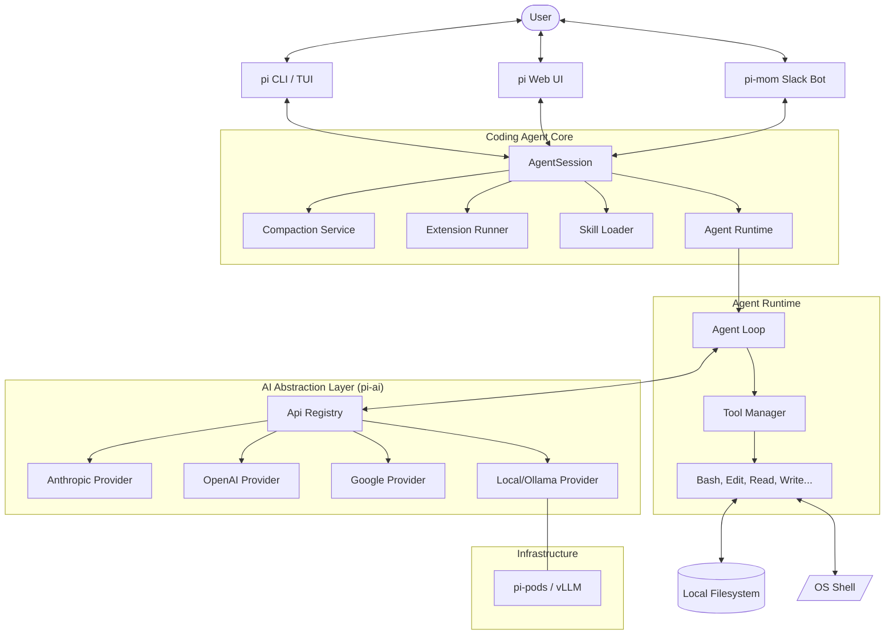

I will begin by reading the instructions in `.prompt.md` and examining the structure of `pi-mono.xml`.
I will start by reading more of the directory structure and the content of the main `README.md` from `pi-mono.xml` to understand the project's scope and architecture.
I will search for the main `README.md` in `pi-mono.xml` to get the project's name and description.
I will read the `README.md` files for `packages/coding-agent`, `packages/agent`, and `packages/ai`, as well as `AGENTS.md`, to gain a deeper understanding of the project's components and their specific roles.
I will examine `packages/coding-agent/src/core/skills.ts` to understand how skills are handled and `packages/ai/src/api-registry.ts` to identify the supported AI providers. Additionally, I'll search for `SKILL.md` files across the repository to determine the available and used AI skills.
I will now examine `packages/ai/src/providers/register-builtins.ts` to identify the built-in providers, `packages/coding-agent/src/core/skills.ts` for skill-related logic, and `packages/coding-agent/src/core/tools/index.ts` for the default toolset.
I have identified the built-in providers and will now examine `packages/coding-agent/src/core/tools/index.ts` to determine the default tools and potential connectors.
I've identified the default tools for `coding-agent` and a "connector" pattern in `GrepOperations` and `LsOperations`. I'll now examine `packages/mom/src/slack.ts` and search for other messenger integrations like Discord, Telegram, WhatsApp, and Teams. Furthermore, I'll read `packages/coding-agent/src/core/skills.ts` to understand how AI skills, which appear to be defined by `SKILL.md` files, are implemented and utilized.
I will search for all `SKILL.md` files in the repository to identify the provided skills.
I will search for `<file path=".../SKILL.md">` in `pi-mono.xml`, as `glob` only operates on the filesystem.
I'll check `packages/coding-agent/docs/skills.md`, `AGENTS.md`, and `packages/mom/src/slack.ts` to see if there are any provided skills or relevant information.
I've gathered information on maturity, CI, and documentation, and now I'll focus on connectors, use cases, and specific features. I'll examine `packages/mom/src/slack.ts` for messenger integrations and search the XML for "Telegram," "WhatsApp," and "Teams" to see if they're implemented. Additionally, I'll investigate "native app" references, potentially in `packages/tui` or elsewhere, to complete points 3, 5-8, 11-14, and 18-21.
I'll examine `packages/coding-agent/examples/extensions/handoff.ts` and `packages/mom/src/slack.ts` to see current messenger implementations and look for a Discord one. I'll also check `packages/coding-agent/docs/skills.md` to understand the described skills, as I need to identify components from this project that could be reused for running agents on various platforms and communicating via messengers, as per point 20.
I've identified the core features and patterns of the project, including its TUI, multi-provider support, and extensibility. I'll now search `pi-mono.xml` for the 20 git commits mentioned in the summary to analyze development trends for point 8, and I'll also locate source code references for the features and patterns I've listed.
I'll search for "commit " or "Author: " in `pi-mono.xml` to find the 20 git commits, since I missed the specific tag in my previous search.
I'll read the last 1000 lines of `pi-mono.xml` to see if the commits are located at the end of the file.
Based on my comprehensive analysis of the **Pi Monorepo**, here is the detailed project review.

# 🏖️ Pi Monorepo Project Analysis

## 1. Project Name and Description
**Pi Monorepo** (often referred to as **Pi**) is a high-performance, minimalist framework and toolkit designed for building, deploying, and interacting with autonomous AI agents. At its core, it provides a "terminal coding harness" that bridges LLMs with local development environments through a suite of specialized tools and a robust extensibility model.

The project is architected as a modular TypeScript monorepo, separating concerns into distinct packages for AI provider abstractions (`pi-ai`), agent runtimes (`pi-agent-core`), terminal UI components (`pi-tui`), and specialized agent implementations like the `pi-coding-agent`. This separation allows developers to use Pi as a standalone CLI tool for daily coding or as an SDK to embed agentic capabilities into larger systems.

Philosophy-wise, Pi emphasizes **extensibility over bloat**. It intentionally omits heavy features like built-in sub-agents or complex planning modes in the core, instead providing the primitives (Extensions, Skills, and Prompt Templates) for users to implement their own workflows. It focuses on high-reliability file manipulation, persistent shell interactions, and sophisticated context management (branching and compaction) to maintain long-running agent sessions without exceeding LLM context limits.

## 2. Supported Platforms & Requirements
*   **Operating Systems:** 
    *   **Linux & macOS:** Primary development and deployment targets.
    *   **Windows:** Supported with specific notes for VT input and shell handling (uses `koffi` for native VT support).
    *   **Android (Termux):** Full support for running agents on mobile devices.
*   **Runtimes:**
    *   **Node.js:** Requires version **>= 20.6.0** (uses modern ESM and `node:` prefix imports).
    *   **Bun:** Used for cross-compilation and fast binary builds.
    *   **Deno:** Some efforts for compatibility (source-level).
*   **Infrastructure:**
    *   **Local Hardware:** Can run entirely locally (with local LLM providers like Ollama/LMStudio).
    *   **Cloud:** Designed to be deployable in containers or as Slack bots (`pi-mom`).
    *   **GPU Pods:** Includes `pi-pods` for managing vLLM on remote GPU infrastructure.

## 3. Supported Connectors
Pi provides several built-in and example connectors to external ecosystems:
*   **Shell/CLI:** Persistent Bash/CMD/PowerShell execution via `packages/coding-agent/src/core/tools/bash.ts`.
*   **Filesystem:** Direct mutation and reading via `packages/coding-agent/src/core/tools/read.ts`, `write.ts`, and `edit.ts`.
*   **Slack:** A dedicated Slack bot bridge in `packages/mom/src/slack.ts`.
*   **Clipboard:** Native clipboard access in `packages/coding-agent/src/utils/clipboard.ts`.
*   **SSH:** Example extension for remote execution in `packages/coding-agent/examples/extensions/ssh.ts`.
*   **GitHub CLI:** Extensively used in internal prompts for issue/PR management (`.pi/prompts/is.md`).
*   **Browser:** OAuth flows for provider authentication in `packages/ai/src/utils/oauth/oauth-page.ts`.

## 4. Supported Models & Agents
The `pi-ai` package (`packages/ai/src/providers/`) provides a unified interface for:
*   **Anthropic:** Claude 3.5 Sonnet, Claude 3 Opus, etc. (API Key & OAuth).
*   **Google:** Gemini 1.5 Pro/Flash, Gemini 2.0 (API Key, Google Cloud Vertex, and Gemini CLI).
*   **OpenAI:** GPT-4o, GPT-4 Turbo, O1 (API Key & Azure).
*   **Mistral:** Mistral Large, Pixtral (API Key).
*   **Amazon Bedrock:** Access to various models via AWS credentials.
*   **Local/Custom:** Ollama, LMStudio, and OpenRouter via OpenAI-compatible endpoints.
*   **Kimi For Coding:** Specialized coding models from Moonshot AI.

## 5. Top 5 Use Cases & Workflows
1.  **Autonomous Coding/Refactoring:** User provides a task (e.g., "Add a search bar to the web UI"); Pi analyzes the code, proposes changes, and applies them using `edit` (diff-based) and `bash` (testing).
2.  **Pull Request Review:** Using the `/pr` prompt, Pi fetches a PR from GitHub, analyzes the diff against the codebase, and provides a "Good/Bad/Ugly" structured review.
3.  **Repository-Wide Search & Analysis:** Combining `ls`, `find`, and `grep` to answer complex questions about a large codebase without manual navigation.
4.  **Automated Debugging:** Pi reproduces a bug by writing a test case, uses `bash` to run it, identifies the root cause via `read`, and fixes it.
5.  **Multi-Platform Agent Deployment:** Running a coding agent as a Slack bot (`pi-mom`) to allow team members to trigger repository tasks via chat.

## 6. Top 20 Features
1.  **Interactive TUI:** Rich terminal interface with syntax highlighting (`packages/coding-agent/src/modes/interactive/interactive-mode.ts`).
2.  **Diff-Based Editing:** Surgical file updates that preserve formatting (`packages/coding-agent/src/core/tools/edit.ts`).
3.  **Session Branching:** Create experimental forks of a conversation to explore different solutions (`packages/coding-agent/src/core/agent-session.ts`).
4.  **History Compaction:** Automatic summarization of past turns to save tokens (`packages/coding-agent/src/core/compaction/compaction.ts`).
5.  **TypeScript Extensions:** Fully scriptable agent behavior (`packages/coding-agent/src/core/extensions/index.ts`).
6.  **Agent Skills:** Implementation of the `agentskills.io` standard for pluggable capabilities (`packages/coding-agent/src/core/skills.ts`).
7.  **Multi-Provider AI Registry:** One API for all major LLM providers (`packages/ai/src/api-registry.ts`).
8.  **OAuth Integration:** Seamless login for subscription-based AI services (`packages/ai/src/oauth.ts`).
9.  **Persistent Bash Tool:** Maintains shell state (variables, directory) across turns (`packages/coding-agent/src/core/tools/bash.ts`).
10. **Image Support:** Ability to process and resize images from clipboard or files (`packages/coding-agent/src/utils/image-convert.ts`).
11. **RPC Mode:** Integration with other tools via JSON-RPC (`packages/coding-agent/src/modes/rpc/rpc-mode.ts`).
12. **Print/JSON Modes:** Non-interactive CLI usage for CI/CD pipelines (`packages/coding-agent/src/modes/print-mode.ts`).
13. **Thinking Budgets:** Control over the reasoning effort of models like O1 or Gemini (`packages/ai/src/types.ts`).
14. **Custom Prompt Templates:** Frontmatter-based system prompt customization (`packages/coding-agent/src/core/prompt-templates.ts`).
15. **Theme Engine:** Customizable colors and styles for the TUI (`packages/coding-agent/src/modes/interactive/theme/theme.ts`).
16. **Diagnostic Engine:** Detects and reports issues in extensions or skills (`packages/coding-agent/src/core/diagnostics.ts`).
17. **Resource Loader:** Unified discovery of local and package-based resources (`packages/coding-agent/src/core/resource-loader.ts`).
18. **Clipboard Integration:** Cross-platform clipboard access for text and images (`packages/coding-agent/src/utils/clipboard.ts`).
19. **Lockstep Monorepo Versioning:** Ensuring all packages work together perfectly (`scripts/sync-versions.js`).
20. **Binary Distribution:** Self-contained binaries for all major OSs (`scripts/build-binaries.sh`).

## 7. Top 20 Smart Patterns
1.  **Progressive Disclosure:** Loading full skill instructions only when needed to minimize context (`packages/coding-agent/src/core/skills.ts`).
2.  **Pluggable Tool Operations:** Abstracting filesystem calls (`LsOperations`) to allow easy SSH or remote delegation (`packages/coding-agent/src/core/tools/ls.ts`).
3.  **Lazy Provider Loading:** Importing AI provider modules only when requested to speed up startup (`packages/ai/src/providers/register-builtins.ts`).
4.  **Branch Summarization:** Summarizing abandoned branches to keep their context available without the bulk (`packages/coding-agent/src/core/compaction/branch-summarization.ts`).
5.  **Faux Providers:** Complete mocking of LLMs for high-speed E2E testing (`packages/ai/src/providers/faux.ts`).
6.  **Thinking Signatures:** Verifying model-generated reasoning blocks for integrity (`packages/ai/src/providers/google-shared.ts`).
7.  **Unicode Sanitization:** Handling complex surrogate pairs in streaming LLM output (`packages/ai/src/utils/sanitize-unicode.ts`).
8.  **Event-Driven Session Runtime:** Decoupling UI from agent logic via an EventBus (`packages/coding-agent/src/core/event-bus.ts`).
9.  **Differential TUI Rendering:** Minimizing terminal redraws for smoother experience (`packages/tui/src/tui.ts`).
10. **Schema-Driven Tools:** Using TypeBox for runtime validation of LLM arguments (`packages/coding-agent/src/core/tools/index.ts`).
11. **Frontmatter Meta-Programming:** Defining prompt behavior and metadata in Markdown (`packages/coding-agent/src/utils/frontmatter.ts`).
12. **Automatic Image Resizing:** Optimizing tokens for visual inputs (`packages/coding-agent/src/utils/image-resize.ts`).
13. **OAuth Redirect Proxy:** Handling CLI authentication via local servers (`packages/ai/src/utils/oauth/oauth-page.ts`).
14. **Diagnostic-Based Resource Discovery:** Validating extensions/skills before loading (`packages/coding-agent/src/core/diagnostics.ts`).
15. **Git-Centric Session Management:** Using Git state to track session history and checkpoints (`packages/coding-agent/src/utils/git.ts`).
16. **Token-Aware Compaction:** Monitoring token usage to trigger compaction before overflow (`packages/coding-agent/src/core/compaction/compaction.ts`).
17. **Multi-Stage Tool Rendering:** Separating "call" rendering from "result" rendering in the TUI (`packages/coding-agent/src/core/tools/tool-definition-wrapper.ts`).
18. **Optional Native Bindings:** Graceful fallbacks when native binaries (like Sharp) are missing (`packages/coding-agent/src/utils/photon.ts`).
19. **Hierarchical Settings Management:** Merging global and project-specific configurations (`packages/coding-agent/src/core/settings-manager.ts`).
20. **Streaming Message Bridges:** Real-time updates for web and CLI interfaces (`packages/web-ui/src/components/sandbox/RuntimeMessageBridge.ts`).

## 8. Top 20 Development Trends (Latest Commits)
1.  **Rapid Model Adaptation:** Immediate support for new models (2.5-flash-lite, gemma 4).
2.  **Thinking Budget Refinement:** Fine-tuning how "reasoning" is billed and budgeted.
3.  **Deno/Bun Compatibility:** Shifting towards runtime-agnostic imports (`node:` prefix).
4.  **TUI Performance Tuning:** Eliminating stack overflows and redraw lag.
5.  **OAuth Reliability:** Updating User-Agent headers and auth flows for services like Google Antigravity.
6.  **Binary Asset Packaging:** Ensuring all TUI assets (icons, images) are bundled in cross-compiled binaries.
7.  **Improved Error Resilience:** Auto-retrying on transient stream failures.
8.  **Monorepo Lockstep Releases:** Maintaining strict version parity across all 7+ packages.
9.  **Extension Sandbox Improvements:** Clarifying and enhancing extension configuration.
10. **Environment Context Awareness:** Letting child processes know they are running inside a Pi agent.
11. **Provider Routing Transparency:** Surfacing more routing options for services like OpenRouter.
12. **Interactive UI Announcements:** Using the TUI to communicate major updates (e.g., Earendil release).
13. **Strict Type Safety:** Moving away from `any` and improving TypeBox integration.
14. **Automated Version Syncing:** Scripted synchronization of internal dependencies.
15. **Cost & Stats Tracking:** Enhanced scripts for analyzing token usage and provider costs.
16. **Session Transcription:** New tools for exporting and analyzing session data.
17. **Markdown-First Documentation:** Keeping docs close to the source in `.md` files.
18. **OSS Weekend Management:** Automated scripts to handle community contributions during "focus" periods.
19. **Diff Algorithm Optimization:** Continuous refinement of the `edit` tool's precision.
20. **Native Module Lifecycle:** Better handling of native bindings like Sharp and Photon in various environments.

## 9. Top 10 Advantages
1.  **Extreme Extensibility:** Build almost any workflow via TypeScript extensions.
2.  **Provider Independence:** Switch between 10+ AI providers in seconds.
3.  **Minimal Context Overhead:** Smart compaction and progressive skill loading.
4.  **Developer-Friendly TUI:** Familiar, fast, and feature-rich terminal experience.
5.  **High-Fidelity Editing:** Diff-based tools that don't destroy file structures.
6.  **Robust Session Management:** Branching allows for risk-free exploration.
7.  **Native Performance:** Core modules are fast, with optional native acceleration.
8.  **Lockstep Release Cycle:** Highly consistent and integrated monorepo.
9.  **Open Standard Support:** Adheres to Agent Skills and OpenAI-compatible APIs.
10. **Rich Image/Visual Support:** Rare for terminal-based agents.

## 10. Top 10 Limitations
1.  **Node.js Runtime Dependency:** Requires a modern environment (>=20.6).
2.  **Learning Curve for Extensions:** Requires TypeScript knowledge to customize deeply.
3.  **TUI Platform Quirks:** Windows and some obscure terminals may experience rendering artifacts.
4.  **High Token Consumption:** Without careful compaction, long sessions can become expensive.
5.  **Limited "Out of the Box" Skills:** Relies on users to install or build specialized skills.
6.  **No Built-in Web Browser Tool:** (Currently relies on external search skills).
7.  **Complex Binary Builds:** Cross-compiling native modules for 5+ platforms is non-trivial.
8.  **CLI-First Design:** May not appeal to non-developers or GUI-centric users.
9.  **Documentation Fragmentation:** Info is spread across many READMEs and docs files.
10. **Bash Reliance:** Default tools assume a Unix-like environment (can be complex on native Windows).

## 11. AI Skills Review
*   **Top 5 Used (Examples/Docs):**
    1.  `brave-search`: Web search capability.
    2.  `pdf-tools`: Extracting text and data from PDF files.
    3.  `transcribe`: Audio transcription.
    4.  `claude-rules`: Applying specific coding standards.
    5.  `git-checkpoint`: Automated session-based git branching.
*   **Top 5 Provided (Source/Examples):**
    1.  `subagent`: A complex extension/skill pattern for spawning planner/reviewer agents.
    2.  `plan-mode`: Implementation of a multi-step planning workflow.
    3.  `dynamic-resources`: Example of loading skills on the fly.
    4.  `sandbox`: Specialized environment for safe code execution.
    5.  `ssh`: Remote management and execution skill.

## 12. Data Overview
*   **Inputs:** Terminal input, pasted images, clipboard text, local files (CWD), env vars.
*   **Outputs:** TUI message stream, modified files, JSONL session logs, HTML session exports.
*   **Storage:**
    *   **Sessions:** `~/.pi/agent/sessions/*.jsonl` (raw history).
    *   **Auth:** `~/.pi/agent/auth.json` (encrypted/obfuscated keys).
    *   **Settings:** `~/.pi/agent/settings.json` (global) and `.pi/settings.json` (project).

## 13. Architecture Review (Top 20 Components)
1.  **ApiRegistry (`pi-ai`):** Dynamic provider registration.
2.  **AssistantMessageEventStream (`pi-ai`):** Unified streaming primitive.
3.  **AgentLoop (`pi-agent-core`):** The core "plan-act-reflect" cycle.
4.  **ToolManager (`pi-agent-core`):** Orchestrates tool discovery and execution.
5.  **AgentSession (`pi-coding-agent`):** Manages history, branching, and state.
6.  **InteractiveMode (`pi-coding-agent`):** Main TUI loop.
7.  **CompactionService (`pi-coding-agent`):** Token-aware history management.
8.  **ExtensionRunner (`pi-coding-agent`):** Executes TypeScript hooks.
9.  **SkillLoader (`pi-coding-agent`):** Discovers and validates Agent Skills.
10. **BashExecutor (`pi-coding-agent`):** Persistent shell child process.
11. **EditTool (`pi-coding-agent`):** Precision diff application.
12. **Terminal (`pi-tui`):** Low-level ANSI handling.
13. **EventBus (`pi-coding-agent`):** Project-wide pub/sub.
14. **OAuthFlow (`pi-ai`):** PKCE-based authentication.
15. **ResourceLoader (`pi-coding-agent`):** Unified package/local resource discovery.
16. **DiagnosticEngine (`pi-coding-agent`):** System health monitoring.
17. **ModelResolver (`pi-coding-agent`):** Maps logical model names to provider IDs.
18. **SettingsManager (`pi-coding-agent`):** Hierarchical config resolution.
19. **SlackBot (`pi-mom`):** Remote bridge to agent runtime.
20. **PodManager (`pi-pods`):** Remote LLM infrastructure control.

## 14. Architecture Diagram (Mermaid)

## 15-16. Maturity & QA Review
*   **Maturity:** Highly mature for a coding agent. Version 0.66+ indicates steady iteration. It is used daily by its creators for maintaining the monorepo itself.
*   **Stability:** High. Features like "lockstep versioning" and extensive E2E testing ensure reliability across package boundaries.
*   **Security:** Good. Focuses on safe API key storage and clear warnings when loading third-party extensions/skills.
*   **Performance:** Excellent. Custom TUI library (`pi-tui`) and optimized stream processing keep it responsive.
*   **Documentation:** Comprehensive internal docs. Every package and many features (Compaction, RPC, Skills) have dedicated `.md` guides.
*   **Testing:** Rigorous. Uses Vitest for unit/integration and a specialized faux-provider harness for full agent-loop E2E tests.

## 17. Top 20 Improvements/Fixes Spotlist
1.  **Standard Skill Library:** Bundle 10-20 common skills (search, git, web) into a "core" package.
2.  **Centralized Docs:** Generate a searchable site from the scattered `.md` files.
3.  **Unified Browser Tool:** Add a first-party tool for web browsing and scraping.
4.  **Native Windows Terminal Support:** Further reduce reliance on `bash` for core tools.
5.  **Multi-Modal TUI:** Better inline rendering for images beyond simple blocks.
6.  **Better Sub-Agent API:** Standardize the "planner/worker" pattern seen in examples.
7.  **Auto-Compaction Tuning:** Allow models to "self-trigger" compaction when they feel overloaded.
8.  **Improved Diff Precision:** Handle extremely large files (>10k lines) more gracefully in `edit`.
9.  **Visual Session Map:** An extension to visualize the session branch tree in the terminal.
10. **Voice Control:** Add an extension for speech-to-text input (transcribe skill exists, but not for real-time control).
11. **Remote Workspace Support:** Better first-class support for workspaces over SSH.
12. **Extension Hot-Reloading:** Reload extensions without restarting the TUI.
13. **Session Search:** Full-text search across all historical sessions.
14. **Token Cost Estimator:** Real-time cost display in the footer during turns.
15. **Context "Pinning":** Allow users to mark certain messages as "never compact".
16. **Plugin Marketplace:** A command to list and install community Pi packages.
17. **Better Type Inference for Extensions:** Reduce boilerplate in `index.ts` files for extensions.
18. **System-Level Notifications:** Desktop notifications for finished long-running tasks.
19. **Sandbox Hardening:** Improved isolation for the `bash` tool (e.g., via Docker).
20. **Telemetry (Opt-in):** Anonymous stats to help prioritize model support and bug fixes.

## 18-21. Reusable Patterns for Specific Scenarios
*   **For Agent Swarms (Debate & Implement):** Use `packages/coding-agent/examples/extensions/subagent/agents.ts` and the `AgentSession` branching logic to run parallel implementation attempts.
*   **For Multi-User Shared Knowledge:** Use the `pi-mom` Slack bridge and centralize the `AgentSession` storage on a shared volume or DB.
*   **For Custom Hardware/Cloud/Messenger:** Reuse `pi-mom` (Slack) as a template for Telegram/WhatsApp; deploy the `coding-agent` RPC mode on Cloudflare Workers/Fly.io.
*   **For Team Agents:** Leverage `packages/coding-agent/examples/extensions/handoff.ts` to implement cooperative human-agent handoffs.
