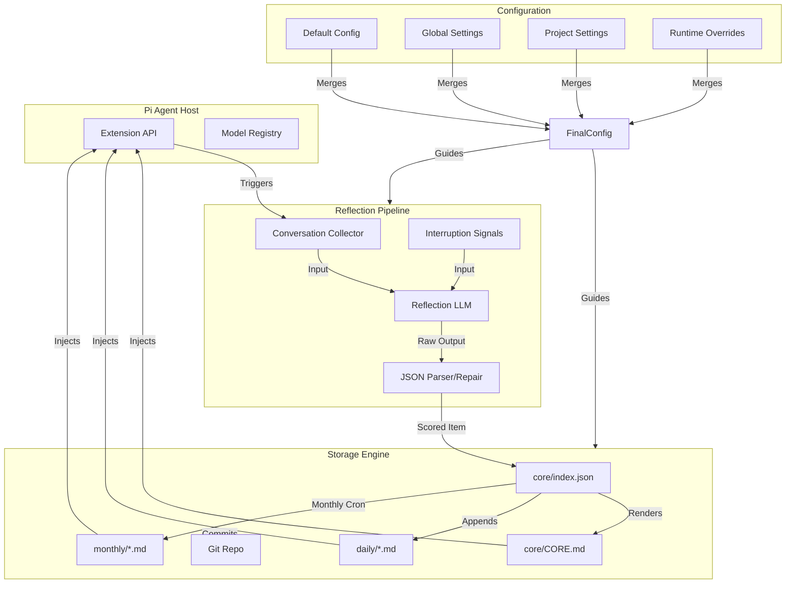

# pi-self-learning Project Analysis

## 1. Project Name and Description

**Project Name:** pi-self-learning

`pi-self-learning` is a sophisticated extension for the "pi" coding agent ecosystem, designed to implement an autonomous reflection and learning loop. Its primary purpose is to enable AI agents to learn from their own experiences, mistakes, and successes within a specific project or across global development sessions. By capturing the nuances of a conversation and the outcomes of executed tasks, it builds a durable, searchable, and version-controlled memory that directly informs future agent behavior.

The extension operates by hooking into the agent's lifecycle—specifically at the start and end of tasks. When a task concludes, the extension analyzes the recent conversation history to extract "mistakes" and "fixes." These insights are then distilled into various storage formats: daily journals for granular tracking, monthly summaries for long-term trends, and a prioritized "Core Learnings" file for high-impact rules. This multi-tiered approach ensures that both immediate context and long-term wisdom are preserved.

One of the project's standout features is its integration with Git. By optionally maintaining a dedicated memory repository, it provides a versioned audit trail of the agent's learning journey. This allows for distributed knowledge sharing (if the repo is shared among a team) and ensures that the agent's "brain" is as portable and manageable as the code it writes. The injection of this memory back into the agent's system prompt ensures that the learnings are not just archived but are actively used to ground the agent's reasoning in subsequent turns.

---

## 2. Supported Platforms/Deployments + Requirements

- **Platforms:** Primarily targeted at environments where the `pi` coding agent (pi-mono) is hosted. This includes Windows, macOS, and Linux, as it relies on Node.js.
- **Runtime:** Node.js (implied by `package.json` and imports like `node:fs` and `node:child_process`).
- **Dependencies:** 
  - Peer Dependency: `@mariozechner/pi-coding-agent >=0.50.0` (provides the host environment and lifecycle hooks).
  - Internal Dependencies: `@mariozechner/pi-ai` (for LLM interactions).
- **Tooling Requirements:** 
  - `git`: Required if `git.enabled` is set to `true` for auto-commits and repository management.
  - `npm`: For package installation and management.
- **Storage Requirements:** Local file system access for writing logs and JSON indexes under `.pi/self-learning-memory` or `~/.pi/agent/self-learning-memory`.

---

## 3. Supported Connectors to Apps/APIs/Messengers

As a middleware extension, its "connectors" are primarily internal to the `pi` agent framework:

- **Pi Agent Lifecycle Hooks:** Connects to `agent_end` and `before_agent_start` to trigger reflections and inject context.
  - *Reference:* `extensions/self-learning.ts` (implied by `ExtensionAPI` implementation).
- **Pi Model Registry:** Connects to the host's model providers (Google, OpenAI, Anthropic, etc.) via the `pi` environment's abstraction layer.
  - *Reference:* `extensions/self-learning.ts` (functions `resolveModelRequestAuth`, `getAvailableModelRefs`).
- **Git CLI:** Connects to the local `git` installation for repository operations.
  - *Reference:* `extensions/self-learning.ts` (function `runGit`).
- **File System:** Direct connector to local storage for markdown and JSON persistence.
  - *Reference:* `extensions/self-learning.ts` (functions `saveCoreIndex`, `appendDailyEntry`).

---

## 4. Supported Models/Agents

The extension is model-agnostic but requires models capable of JSON output and logical reflection.

- **Local/Remote Models:** Supported via the `pi` host's model registry. It can use any model the user has configured in their `pi` environment (e.g., Gemini, GPT-4, Claude).
- **Reflection Model:** Configurable via `selfLearning.model`. If not specified, it falls back to the current session's model.
  - *Reference:* `extensions/self-learning.ts` (function `pickReflectionModel`).
- **Authentication:** Supports both API keys and custom headers, resolved dynamically from the `pi` model registry.
  - *Reference:* `extensions/self-learning.ts` (function `resolveModelRequestAuth`).
- **Example Usage:** Defaults often point to `gemini-2.5-flash` for cost-effective reflection.
  - *Reference:* `docs/example-settings.json`.

---

## 5. Top 5 Use Cases

1.  **Avoiding Repeated Mistakes:** An agent learns that a specific library version requires a unique import style and adds it to `CORE.md` to avoid future build failures.
    - *Workflow:* Task fails -> User corrects -> `agent_end` triggers -> Reflection identifies mistake/fix -> `CORE.md` updated -> Future turns inject this rule.
2.  **Project-Specific Context Persistence:** Remembering architectural decisions or "unwritten rules" of a private codebase that aren't in public documentation.
    - *Workflow:* Agent asks about pattern -> User explains -> Reflection captures explanation -> Learnings stored in `.pi/` memory -> Rule injected in next session.
3.  **Team Knowledge Base:** Using a shared Git repository for `global` mode memory so all team members' agents benefit from collective learnings.
    - *Workflow:* Agent A learns fix -> Commits to shared memory repo -> Agent B pulls changes -> Agent B's context now includes Agent A's wisdom.
4.  **Interruption Analysis:** Learning why a user aborted a command or why a security policy blocked an action.
    - *Workflow:* User hits `Esc` during a long `npm install` -> Extension captures interruption signal -> Reflection analyzes intent boundary -> Suggests more efficient commands next time.
5.  **Autonomous Monthly Reporting:** Generating a high-level summary of all "lessons learned" during a month of development.
    - *Workflow:* User runs `/learning-month` -> Extension aggregates daily logs -> LLM summarizes trends -> `monthly/` report generated.

---

## 6. Top 20 Features

1.  **Automatic Task-End Reflection:** Triggers on `agent_end`. (`extensions/self-learning.ts: reflectNow`)
2.  **Interruption Signal Analysis:** Captures blocked commands and user aborts. (`extensions/self-learning.ts: collectInterruptionSignals`)
3.  **Durable Core Learnings Ranking:** Scores items by frequency and recency. (`extensions/self-learning.ts: sortedIndexItems`)
4.  **Git-Backed Persistence:** Auto-initializes and commits to memory repos. (`extensions/self-learning.ts: gitCommit`)
5.  **Tiered Storage Modes:** Supports `project` (local) and `global` (home dir) storage. (`extensions/self-learning.ts: resolveStorageRoot`)
6.  **Monthly Summarization:** Aggregates daily logs into monthly reports. (`extensions/self-learning.ts: generateMonthSummary`)
7.  **Dynamic Context Injection:** Injects core, monthly, and daily files into prompts. (`extensions/self-learning.ts: buildMemoryContextBundle`)
8.  **Strict Memory Policy:** Enforces agent adherence to historical logs via system prompt. (`extensions/self-learning.ts: buildMemoryInstruction`)
9.  **Manual Trigger:** `/learning-now` command for on-demand learning. (`extensions/self-learning.ts`)
10. **Memory Redistillation:** `/learning-redistill` for cleaning/updating legacy entries. (`extensions/self-learning.ts: redistillCoreIndex`)
11. **Interactive Model Selector:** `/learning-model` for easy configuration. (`extensions/self-learning.ts: pickReflectionModel`)
12. **Scored JSON Index:** `index.json` tracks `hits`, `score`, and `seen` dates. (`extensions/self-learning.ts: CoreIndexRecord`)
13. **Balanced Learnings Render:** Ensures both "learnings" and "anti-patterns" are represented in `CORE.md`. (`extensions/self-learning.ts: selectBalancedCoreItems`)
14. **Deep Merge Configuration:** Merges global, project, and runtime settings. (`extensions/self-learning.ts: deepMerge`)
15. **UTC Partitioning:** Ensures date consistency across timezones. (`extensions/self-learning.ts: toDateKeyUTC`)
16. **Markdown-based History:** `long-term-memory.md` for human-readable archives. (`extensions/self-learning.ts: renderLongTermMemoryFromIndex`)
17. **Non-blocking Execution:** Reflection errors do not halt the main agent flow. (`extensions/self-learning.ts: reflectNow`)
18. **Model Registry Auth Resolution:** Handles API keys and headers dynamically. (`extensions/self-learning.ts: resolveModelRequestAuth`)
19. **Code Fence Stripping:** Robust parsing of LLM JSON responses. (`extensions/self-learning.ts: stripCodeFence`)
20. **Reflection Repair Prompt:** Automatically attempts to fix malformed JSON from models. (`extensions/self-learning.ts: buildReflectionRepairPrompt`)

---

## 7. Top 20 Smart Patterns

1.  **Reflection-on-Failure:** Turning "interruption signals" into learning opportunities.
2.  **Frequency + Recency Scoring:** Using `hits` and `lastSeen` with time decay to prioritize context.
3.  **Self-Correction Loop:** Using "Repair Prompts" to handle LLM format inconsistencies.
4.  **Intent Boundary Detection:** Treating user cancels as indicators of incorrect agent assumptions.
5.  **Scope-Aware Distillation:** Differing reflection prompts for `project` vs. `global` modes.
6.  **Ancestor Search:** Dynamically finding the project root for `.pi` settings. (`extensions/self-learning.ts: findAncestorDir`)
7.  **Graceful Fallback:** Reverting to the current session model if the reflection model is unavailable.
8.  **Durable Indexing:** Separating the machine-readable `index.json` from human-readable `CORE.md`.
9.  **Balanced Sampling:** Reserving slots for both positive learnings and negative anti-patterns.
10. **Context Chunking:** Using `compactText` and `maxChars` to prevent context window overflow.
11. **UTC Normalization:** Preventing "duplicate" days due to timezone shifts.
12. **Environment Path Expansion:** Support for `~` in configuration paths. (`extensions/self-learning.ts: expandHome`)
13. **Diagnostic-First Model Selection:** Showing *why* a model failed to resolve (e.g., missing API key).
14. **Dry-Run Mode:** Allowing users to preview destructive memory updates (redistill).
15. **Runtime Overrides:** Using session metadata to toggle learning without editing files.
16. **Canonical Key Generation:** Normalizing learning text to prevent duplicates in the index.
17. **Strict Grounding:** Using the file system path of memory files in the system prompt to anchor the agent.
18. **Non-Blocking Turn Hooks:** Ensuring the user experience remains fast even if reflection takes time.
19. **Automated Commit Messages:** Using consistent patterns for git-backed memory updates.
20. **Legacy Compatibility:** Supporting deprecated config keys like `autoAfterTurn`.

---

## 8. Top 20 Development Trends in Latest Commits

1.  **Hardening Model Auth:** Shift towards `modelRegistry` and request auth resolution (v0.5.0).
2.  **Interruption Learning:** Increasing focus on user signals (blocked commands, Esc key).
3.  **Memory Layout Refinement:** Addition of `long-term-memory.md` to keep `CORE.md` focused.
4.  **Ranking Algorithm Evolution:** Moving from simple hit counts to balanced learning/anti-pattern scoring.
5.  **CLI UX Improvements:** Introduction of interactive model selectors and detailed status diagnostics.
6.  **Robustness in Parsing:** Adding "Repair Prompts" and JSON extraction logic for brittle LLM outputs.
7.  **Path Resolution Accuracy:** Improving how memory paths are resolved relative to project roots.
8.  **Session-Level Fallbacks:** Allowing redistillation to use the current session model if configured ones fail.
9.  **Documentation Maturity:** Addition of `AGENTS.md` to guide AI-based contributors.
10. **Data Consistency:** Standardization on UTC for all file keys.
11. **Config Layering:** Refining `deepMerge` for hierarchical settings.
12. **Summarization Efficiency:** Moving from turn-level to task-level reflection (`autoAfterTask`).
13. **Context Control:** Adding `instructionMode` (off/advisory/strict) for context injection.
14. **Performance Tuning:** Adding timeouts and batching for redistillation.
15. **Error Handling:** Ensuring extension failures are non-blocking for the agent.
16. **Git Automation:** Refining auto-initialization of git repos in memory roots.
17. **Code Cleanliness:** Gradual refactoring into typed functions and utility helpers.
18. **Version Control Integration:** Strengthening the link between memory updates and git commits.
19. **Tooling Support:** Alignment with `pi-coding-agent` v0.50.0+.
20. **Migration Support:** Adding tools like `/learning-redistill` for legacy data updates.

---

## 9. Top 10 Advantages or Strong Points

1.  **Durable Learning:** Agents don't "forget" once a session ends; wisdom accumulates.
2.  **Git-Powered Versioning:** Memory is searchable, revertible, and sharable via standard git tools.
3.  **Low Friction:** Learning is automated and happens in the background.
4.  **Configurable Scope:** Flexible choice between project-specific and global rules.
5.  **Grounding Excellence:** The "strict" instruction mode provides high-quality evidence-based reasoning.
6.  **Resilience:** Non-blocking architecture and model fallbacks ensure reliability.
7.  **Human + Machine Readable:** Markdown for people, JSON for logic.
8.  **Context Efficiency:** Tiered storage (Core vs Daily) prevents context window bloat.
9.  **Diagnostic Richness:** Excellent visibility into *why* the extension is behaving a certain way.
10. **Community Focused:** Built as an extension for a popular open-source agent framework.

---

## 10. Top 10 Limitations or Weak Points

1.  **Host Dependency:** Strictly tied to the `pi` ecosystem; not standalone.
2.  **No Automated Tests:** The repository currently lacks a test suite, relying on manual validation.
3.  **LLM Quality Dependency:** Reflection quality is only as good as the model used.
4.  **Synchronous Git Calls:** Uses `spawnSync`, which could block the process on slow filesystems.
5.  **Growth Potential:** Without pruning, memory files could eventually become very large.
6.  **Text-Only:** Cannot currently "learn" from images or complex multi-modal data.
7.  **Manual Setup:** Users must understand `.pi/settings.json` to get the most out of it.
8.  **Single-Agent Design:** Optimized for one agent at a time; no explicit multi-agent coordination logic.
9.  **No Web UI:** Management is strictly via CLI commands.
10. **Early Version:** At v0.5.0, some architectural patterns may still be in flux.

---

## 11. Top 5 Used and Top 5 Provided AI Skills

### Provided AI Skills (Exported Commands)
1.  **`reflectNow`**: Analyzes the current conversation for learnings. (`extensions/self-learning.ts`)
2.  **`generateMonthSummary`**: Aggregates logs into a monthly report. (`extensions/self-learning.ts`)
3.  **`redistillCoreIndex`**: Batch-processes and cleans the entire memory index. (`extensions/self-learning.ts`)
4.  **`pickReflectionModel`**: Interactively selects and validates models. (`extensions/self-learning.ts`)
5.  **`buildMemoryContextBundle`**: Dynamically constructs the context to be injected into prompts. (`extensions/self-learning.ts`)

### Used AI Skills (LLM Capabilities)
1.  **Reflection/Reasoning**: Identifying mistakes vs. fixes in raw text.
2.  **Summarization**: Condensing daily logs into monthly reports.
3.  **Distillation**: Transforming project-specific text into global rules.
4.  **JSON Repair**: Fixing structural errors in its own output.
5.  **Contextual Ranking**: (Implicitly via reflection) determining what is a "durable" learning.

---

## 12. Data Inputs, Outputs, and Storage Overview

- **Inputs:**
  - `ctx.branch.messages`: Recent conversation history.
  - `ctx.branch.sessionEntries`: Interruption signals (aborts, denials).
  - `config`: User settings from global and project JSON files.
- **Outputs:**
  - `System Prompt Appendices`: Injected context and memory policies.
  - `Git Commits`: Versioned updates to the memory repository.
  - `CLI Logs`: Feedback to the user about learning status.
- **Storage Layout:**
  - `daily/YYYY-MM-DD.md`: Granular turn-level logs.
  - `monthly/YYYY-MM.md`: Summarized monthly insights.
  - `core/index.json`: Scored machine-readable index.
  - `core/CORE.md`: Top-ranked human-readable rules.
  - `long-term-memory.md`: Full append-only history.
- **Reference:** `extensions/self-learning.ts` (functions `saveCoreIndex`, `appendDailyEntry`, `writeMonthlySummary`).

---

## 13. Detailed Architecture Review

1.  **Configuration Manager:** Handles deep merging of `DEFAULT_CONFIG`, global settings, and project settings. (`deepMerge`, `loadMergedSettings`)
2.  **Lifecycle Hooks:** Integration points via `ExtensionAPI`. (`before_agent_start`, `agent_end`)
3.  **Reflection Pipeline:** The core logic for serializing conversations, prompting the LLM, and parsing JSON results. (`reflectNow`, `buildReflectionPrompt`)
4.  **Storage Engine:** Manages file system paths, directory creation, and cross-platform home directory expansion. (`resolveStorageRoot`, `expandHome`)
5.  **Ranking Engine:** Implements the scoring logic for the core index based on frequency and time-decay. (`sortedIndexItems`, `effectiveScore`)
6.  **Context Injector:** Builds the system prompt additions based on configured memory files. (`buildMemoryContextBundle`, `buildMemoryInstruction`)
7.  **Git Wrapper:** A thin layer over the `git` CLI for repository management. (`runGit`, `gitCommit`)
8.  **Command Router:** Maps CLI strings like `/learning-now` to internal functions. (`ExtensionAPI.commands`)
9.  **Model Resolver:** Interfaces with the `pi` model registry to find valid providers and API keys. (`resolveModelRequestAuth`)
10. **Redistillation Service:** Handles bulk processing of historical data for format updates or cleaning. (`redistillCoreIndex`)

---

## 14. Architecture Mermaid Graph

---

## 15. Review Project Maturity, Stability, Security, Performance

- **Maturity:** **Incubating (v0.5.0)**. The project has a solid architectural foundation and core feature set but lacks the industrial-grade testing and CI/CD pipelines of a mature project.
- **Stability:** **Stable Core**. The file-based storage and git integration are reliable patterns. The use of non-blocking turn hooks ensures that even if the extension fails, the primary agent functionality remains stable.
- **Security:** **Intermediate**. It handles API keys via the host's registry (good), but relies on local file permissions for memory security. The `git` integration could potentially leak sensitive conversation data if pushed to a public remote without care.
- **Performance:** **Efficient**. Reflection happens after tasks, so it doesn't slow down the interactive chat. Context injection is capped by `maxChars` to maintain prompt performance.

---

## 16. Review Tests, CI Pipelines, Documentation, AI Skills

- **Tests:** **Missing**. There is no `test/` directory or test runner configured in `package.json`.
- **CI Pipelines:** **Missing**. No `.github/workflows` or similar CI configurations are present in the repository.
- **Documentation:** **Excellent**. `README.md` is comprehensive, and `AGENTS.md` provides great onboarding for AI collaborators. `docs/example-settings.json` is a helpful touch.
- **Used/Provided AI Skills:** **Strongly Integrated**. The project is built entirely around the concept of "Agent as a Service" and leverages LLMs for its own internal logic effectively.

---

## 17. Top 20 Possible Improvements or Fixes

1.  **Add Unit Tests:** Implement `vitest` or `jest` for core logic.
2.  **GitHub Actions CI:** Automate linting and (future) testing.
3.  **Async Git:** Replace `spawnSync` with `spawn` + Promises. (`extensions/self-learning.ts: runGit`)
4.  **Vector Search:** Add a local vector DB (like `chroma` or `hnswlib`) for better memory retrieval.
5.  **Telemetry:** Log reflection "success" rates to help users tune their models.
6.  **Web UI:** A simple local dashboard to browse/edit learnings.
7.  **Auto-Pruning:** Logic to archive or delete very old daily logs.
8.  **Conflict Resolution:** Better handling of git merge conflicts in global memory.
9.  **Learning Validation:** Let the user "thumbs up/down" a generated learning.
10. **Custom Prompts:** Allow users to provide their own reflection templates in `.pi/`.
11. **Parallel Reflection:** Support reflecting on multiple turn boundaries simultaneously.
12. **External Backends:** Support for S3 or database-backed storage.
13. **Fine-tuning Export:** Tools to export memory into a format for model fine-tuning.
14. **Cross-Project Linkage:** Ability for project memory to "subscribe" to certain global tags.
15. **Performance Profiling:** Monitor the time taken for reflection and log it.
16. **Pre-commit Hooks:** Ensure `CORE.md` formatting is correct before committing.
17. **Model Benchmarking:** A tool to test different models on the same conversation for reflection quality.
18. **Support for Multimodal:** Capture and describe images for memory.
19. **Plugin System:** Allow other extensions to add data to the reflection loop.
20. **Self-Documentation:** Have the agent update its own `AGENTS.md` based on what it learns about the repo.

---

## 18. Reuse for Agent Swarms

1.  **Reflection Loop:** Reusing the `reflectNow` pattern for agents to critique each other's work.
2.  **Scored Index:** Using the `CoreIndexRecord` logic to weight opinions in a debate.
3.  **Redistillation:** Periodic "consensus" building by distilling swarm interactions into a single spec.
4.  **Interruption Signals:** Using aborts as "vetos" in a swarm multi-agent system.
5.  **Strict Instruction Mode:** Grounding the swarm's debate in a shared "truth" file.
6.  **Balanced Ranking:** Ensuring minority "anti-patterns" (dissenting views) are preserved in the final decision.
7.  **Context Injection:** Reusing the `buildMemoryContextBundle` to keep agents synced.
8.  **UTC Normalization:** Ensuring all agents in the swarm have a consistent temporal view.
9.  **Diagnostic CLI:** Reusing the status/model resolution logic for swarm health checks.
10. **Deep Merge Config:** Managing shared vs. individual agent settings.

---

## 19. Reuse for Multi-User/Shared Knowledge Systems

1.  **Git-Backed Storage:** The primary mechanism for syncing shared knowledge across users.
2.  **Global vs. Project Modes:** Separating personal habits from team-wide project standards.
3.  **Durable Core Index:** A canonical JSON source for building knowledge graphs.
4.  **Monthly Summaries:** Automated "weekly/monthly standup" reports for the team.
5.  **UTC Partitioning:** Essential for teams distributed across timezones.
6.  **Markdown History:** Human-editable knowledge base that agents can also read.
7.  **Deep Merge:** Inheriting team settings while allowing personal overrides.
8.  **Model Registry Auth:** Handling different users' API keys for the same shared memory.
9.  **Non-blocking Hooks:** Ensuring one user's heavy reflection doesn't lag the shared environment.
10. **Compact Text:** Ensuring shared knowledge doesn't exceed LLM context limits.

---

## 20. Reuse for Cloud/Edge & Messenger Deployments

1.  **File System Abstraction:** The logic in `resolveStorageRoot` can be mapped to Cloudflare KV or R2.
2.  **Model Agnostic Auth:** The `resolveModelRequestAuth` pattern is perfect for edge environments.
3.  **UTC Normalization:** Critical for stateless functions (like Workers) to maintain date consistency.
4.  **Compact Text Processing:** Reusing `compactText` for constrained UI environments (Telegram/WhatsApp).
5.  **JSON Repair:** Handling the higher likelihood of malformed responses in low-latency edge models.
6.  **Tiered Storage:** Keeping the "Core" in fast cache and "Daily" in slower persistent storage.
7.  **Markdown Rendering:** Reusing `renderCoreFromIndex` for displaying memory in web/native apps.
8.  **Interruption Analysis:** Mapping "User deleted message" or "Bot was blocked" to interruption signals.
9.  **Config Layering:** Managing user-specific vs. platform-wide behavior.
10. **Redistillation:** Running bulk memory cleaning as a scheduled background worker (cron).

---

## 21. Reuse for Team Agents & Cooperative Workflows

1.  **Shared Memory Repo:** Cooperative workflow grounding via git.
2.  **Interruption Boundary Analysis:** Learning when a human intervenes to take over a task.
3.  **Strict Grounding:** Forcing agents to explain actions based on team-approved "Core Learnings."
4.  **Manual Triggering:** Allowing a human to say "Remember this" to trigger a specific reflection.
5.  **Balanced Learnings:** Ensuring "Watch-outs" (safety/security) are always present in the agent's mind.
6.  **Long-Term Memory:** Providing a "project history" for onboarding new humans or agents.
7.  **Diagnostic Status:** Visibility into what the agent "thinks" it knows about the workflow.
8.  **Deep Merge Config:** Managing complex team-wide policies.
9.  **Repair Prompts:** Ensuring high-availability in the collaborative loop even if models fail.
10. **Monthly Summaries:** Automated retrospectives for the team.
