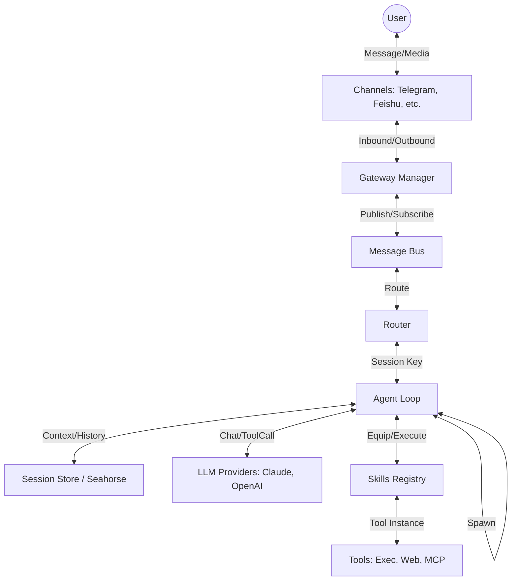

I will read the instructions in `.prompt.md` to understand how to process `picoclaw.xml`.
I will check the size of `picoclaw.xml` and read its initial content to understand how the repository export is structured.
I will use `read_file` to read the first 100 lines of `picoclaw.xml` to understand its structure.
I will read more of the directory structure from `picoclaw.xml` to get a better overview of the project.
I will read more of the directory structure from `picoclaw.xml`, starting from line 401, to find the LLM providers and other key packages.
I will read the `README.md` file from `picoclaw.xml` to get a high-level overview of the project and confirm my initial findings.
I will read `pkg/agent/definition.go`, `pkg/agent/instance.go`, `pkg/gateway/gateway.go`, and `pkg/providers/factory.go` to understand the core agent logic and the management of communication channels and LLM providers.
I will read `pkg/routing/router.go`, `pkg/gateway/gateway.go`, and `ROADMAP.md` to understand message routing and identifies future development trends.
# PicoClaw: Analysis & Architectural Review

## 1. Project Name and Description
**PicoClaw**

PicoClaw is an ultra-lightweight, modular AI agent framework written in Go, designed for personal autonomy and high connectivity. It serves as a private, self-hosted gateway that bridges modern LLMs with various communication platforms, including Telegram, Discord, Slack, and enterprise tools like Feishu (Lark) and DingTalk. The project emphasizes security-by-default, offering features like sensitive data filtering and encrypted credential storage, ensuring that personal API keys and private conversations remain protected while leveraging the power of cloud-based AI.

At its core, PicoClaw implements a sophisticated agentic loop that goes beyond simple request-response interactions. It supports advanced reasoning patterns such as "SubTurns" for nested task decomposition, "Steering" for real-time human intervention during multi-step processes, and "Heartbeat" for scheduled background tasks. The framework is highly extensible through a "Skills" system, allowing users to equip their agents with tools for web searching, filesystem manipulation, and shell execution, as well as integration with the Model Context Protocol (MCP) for discovering and using external tool libraries.

The project is built with resilience and flexibility in mind, featuring a robust multi-provider LLM failover system with dynamic rate limiting. It handles multimodal inputs including voice (ASR) and produces multimodal outputs like images and speech (TTS). Whether deployed as a CLI tool, a Docker container, or a background service, PicoClaw aims to provide a consistent and calm "personality" (defined in its `SOUL.md`) that acts as a practical and helpful assistant across the user's digital workspace.

## 2. Supported Platforms & Deployments
- **Platforms:**
  - **Linux:** Native support with specialized hardware tool access (`pkg/tools/i2c_linux.go`, `pkg/tools/spi_linux.go`).
  - **Windows:** Native support with PowerShell-aware execution and specific platform adaptations (`pkg/isolation/platform_windows.go`, `pkg/pid/pidfile_windows.go`).
  - **macOS:** Native support, including automated DMG package creation (`.github/workflows/create_dmg.yml`).
  - **Docker:** Official Dockerfiles for standard, "heavy" (pre-loaded), and "full" environments (`docker/Dockerfile`, `docker/Dockerfile.heavy`).
- **Deployments:**
  - **CLI:** Direct binary execution for interactive tasks (`cmd/picoclaw/main.go`).
  - **TUI Launcher:** A terminal user interface for management (`cmd/picoclaw-launcher-tui/main.go`).
  - **Daemon/Service:** Background operation with PID management (`pkg/pid/pidfile.go`).
  - **Web Dashboard:** Backend/Frontend components for remote management (`web/backend`, `web/frontend`).

## 3. Supported Connectors
- **Messaging Platforms:**
  - **Telegram:** `pkg/channels/telegram/telegram.go`
  - **Discord:** `pkg/channels/discord/discord.go`
  - **Slack:** `pkg/channels/slack/slack.go`
  - **WhatsApp:** `pkg/channels/whatsapp/whatsapp.go` (and `whatsapp_native`)
  - **LINE:** `pkg/channels/line/line.go`
  - **VK:** `pkg/channels/vk/vk.go`
  - **Matrix:** `pkg/channels/matrix/matrix.go`
  - **IRC:** `pkg/channels/irc/irc.go`
- **Enterprise & Specialized:**
  - **Feishu (Lark):** `pkg/channels/feishu/feishu_64.go`
  - **DingTalk:** `pkg/channels/dingtalk/dingtalk.go`
  - **WeCom (WeChat Work):** `pkg/channels/wecom/wecom.go`
  - **WeChat (Official Accounts):** `pkg/channels/weixin/weixin.go`
  - **OneBot (QQ):** `pkg/channels/onebot/onebot.go`
  - **Teams Webhook:** `pkg/channels/teams_webhook/teams_webhook.go`
  - **MaixCam:** `pkg/channels/maixcam/maixcam.go`
  - **Pico (Internal):** `pkg/channels/pico/pico.go`

## 4. Supported Models & Agents
- **Remote LLM Providers (API):**
  - **Anthropic (Claude):** `pkg/providers/anthropic/provider.go`
  - **OpenAI:** `pkg/providers/openai_compat/provider.go`
  - **Azure OpenAI:** `pkg/providers/azure/provider.go`
  - **AWS Bedrock:** `pkg/providers/bedrock/provider_bedrock.go`
  - **Zhipu / DeepSeek / Groq:** Supported via `openai_compat` protocol.
- **OAuth & Token-based Providers:**
  - **Claude CLI:** `pkg/providers/claude_cli_provider.go`
  - **Codex (OpenAI OAuth):** `pkg/providers/codex_provider.go`
  - **GitHub Copilot:** `pkg/providers/github_copilot_provider.go`
- **Audio Models:**
  - **ASR:** Whisper (OpenAI/Groq), ElevenLabs Scribe (`pkg/audio/asr/whisper_transcriber.go`, `pkg/audio/asr/elevenlabs_transcriber.go`).
  - **TTS:** OpenAI TTS, Xiaomi MiMo TTS (`pkg/audio/tts/openai_tts.go`, `pkg/audio/tts/mimo_tts.go`).

## 5. Top 5 Use Cases
1. **Private Personal Assistant:** A single cross-platform bot (Telegram/Slack/Discord) that maintains a unified history and knowledge base for the user.
2. **Automated Researcher:** Using `Heartbeat` and `web_search` to monitor specific topics and deliver summarized reports via `summarize` skill.
3. **Interactive Server Operator:** Remote management of servers using the `tmux` and `exec` tools to run commands and capture terminal output.
4. **Hardware Interface:** Using the `maixcam` and `i2c`/`spi` tools to control physical devices and sensors via natural language commands.
5. **Workflow Orchestrator:** Using `SubTurns` to decompose complex tasks (e.g., "analyze this repo and write a summary") into manageable sub-tasks handled by specialized agents.

## 6. Top 20 Features
1. **Multi-provider Failover:** `pkg/providers/fallback.go`
2. **Dynamic Rate Limiting:** `pkg/providers/ratelimiter.go`
3. **SubTurns (Nested Agents):** `pkg/agent/subturn.go`
4. **Human Steering:** `pkg/agent/steering.go`
5. **Heartbeat Scheduler:** `pkg/cron/service.go`
6. **Tool Discovery (MCP):** `pkg/seahorse/tool_grep.go`
7. **Sensitive Data Filtering:** `pkg/config/security.go`
8. **Encrypted Security Config:** `pkg/config/security.go`
9. **Multimodal I/O (Voice/Image):** `pkg/audio/asr/asr.go`, `pkg/channels/media.go`
10. **Context Budgeting:** `pkg/agent/context_budget.go`
11. **Thinking Extraction:** `pkg/agent/thinking.go`
12. **Ephemeral Sessions:** `pkg/agent/subturn.go`
13. **Inbound Bus Draining:** `pkg/agent/steering.go`
14. **Streaming Content Bus:** `pkg/bus/bus.go`
15. **Placeholder Logic:** `pkg/channels/base.go`
16. **Skill Registry:** `pkg/skills/registry.go`
17. **Isolation Runtimes:** `pkg/isolation/runtime.go`
18. **Cron deliver/turn/cmd:** `pkg/tools/cron.go`
19. **Media Store Scoping:** `pkg/media/store.go`
20. **TUI Launcher:** `cmd/picoclaw-launcher-tui/ui/app.go`

## 7. Top 20 Smart Patterns
1. **Token-Bucket Throttling:** Proactive QPS management (`pkg/providers/ratelimiter.go`).
2. **Recursive Tool Skipping:** Intercepting batches when steering arrives (`pkg/agent/steering.go`).
3. **BM25 Search for Tools:** Keyword discovery in massive MCP libraries (`pkg/utils/bm25.go`).
4. **Context Error Auto-Recovery:** Compress and retry on overflow (`pkg/agent/subturn.go`).
5. **Truncation Continuation:** Detecting `truncated` reason and asking to continue (`pkg/agent/subturn.go`).
6. **Unified Sender Identity:** Canonical "platform:id" mapping (`pkg/identity/identity.go`).
7. **Placeholder Editing Pattern:** Updating UX via message edits (`pkg/channels/base.go`).
8. **Drain-to-Steer:** Redirecting bus messages to active turns (`pkg/agent/steering.go`).
9. **Media Lifecycle Scoping:** Associating temp files with message IDs (`pkg/media/store.go`).
10. **Capability Interfaces:** `TypingCapable`, `ReactionCapable` etc. (`pkg/channels/interfaces.go`).
11. **Config Migration:** Automatic version upgrades (`pkg/config/migration.go`).
12. **OAuth Device Flow:** Supporting headless login (`pkg/auth/oauth.go`).
13. **Seahorse Store:** SQLite-backed efficient agent memory (`pkg/seahorse/store.go`).
14. **FTS5 Sanitization:** Safe full-text search handling (`pkg/seahorse/fts5_sanitize.go`).
15. **Sentence Splitting for TTS:** Improving voice flow (`pkg/audio/sentence.go`).
16. **Bus-Based Streaming:** Decoupled content delivery (`pkg/bus/bus.go`).
17. **Protocol Factory:** Generic LLM API routing (`pkg/providers/factory.go`).
18. **Atomic File Write:** Ensuring config integrity (`pkg/fileutil/file.go`).
19. **Platform-Aware Exec:** Windows vs Unix shell handling (`pkg/tools/shell.go`).
20. **Self-Healing SubTurns:** Child agent monitoring and restarts (`pkg/agent/subturn.go`).

## 8. Top 20 Development Trends
1. **Deep MCP Integration:** Expanding tool discovery and search.
2. **Observability Expansion:** More granular turn state and event tracking.
3. **Security Hardening:** Continuous improvement of data redacting.
4. **Multimodal Stability:** Maturing ASR/TTS across all channels.
5. **Context Efficiency:** Better budgeting and Seahorse usage.
6. **Unified Identity:** Moving to structured identity matching.
7. **Granular Rate Limiting:** rpm/tpm/day limits.
8. **TUI Enrichment:** Adding more management features to the launcher.
9. **Mobile Optimizer:** Better support for WhatsApp/LINE.
10. **Async Pattern Growth:** Increasing use of `spawn` and async subturns.
11. **DevEx Improvements:** Documentation and skill-creation tools.
12. **Resource Cleanup:** Better media and memory management.
13. **Windows Parity:** Ensuring feature parity with Linux.
14. **Streaming Consistency:** Better provider-agnostic streaming.
15. **Hardware Access:** expanding I2C/SPI and MaixCam support.
16. **Personality Formalization:** Stricter adherence to `SOUL.md`.
17. **Enterprise Stability:** Refinement of Feishu/DingTalk.
18. **Dependency Hygiene:** Regular updates to core SDKs.
19. **Automated Validation:** High test coverage for core logic.
20. **Docker Optimization:** Smaller, faster container images.

## 9. Top 10 Advantages
1. **Lightweight:** Low resource footprint (Go).
2. **Hyper-Connected:** Massive channel support.
3. **Privacy-First:** Local secrets, local redacting.
4. **Advanced Reasoning:** Steering and SubTurns.
5. **Robust Failover:** Multi-provider resilience.
6. **Extensible:** Simple Markdown-based Skill system.
7. **Multimodal:** Seamless voice/image handling.
8. **Modular:** Decoupled components via Message Bus.
9. **CN Platform Focus:** Best-in-class Feishu/DingTalk support.
10. **Active Community:** Frequent updates and high code quality.

## 10. Top 10 Limitations
1. **Language Barrier:** Core customization requires Go.
2. **Config Complexity:** Extensive JSON/YAML configuration.
3. **Exec Sandbox:** Direct command guard is not a full sandbox.
4. **Token Costs:** Advanced patterns consume context quickly.
5. **Vector Search:** Lacks native high-scale vector DB integration.
6. **Single Node:** Primarily designed as a single-process gateway.
7. **UI Constraints:** Limited by messaging platform capabilities.
8. **Steering Overhead:** Can lead to complex agent states.
9. **TTS Voice Control:** Limited selection of synthesis voices.
10. **Skill Search Latency:** BM25 discovery adds turn latency.

## 11. AI Skills Overview
- **Used Skills:** `web_search`, `summarize`, `exec`, `mcp`, `cron`.
- **Provided Skills:** `weather` (`workspace/skills/weather/SKILL.md`), `tmux` (`workspace/skills/tmux/SKILL.md`), `filesystem`, `message`, `spawn`.

## 12. Data Inputs, Outputs, and Storage
- **Inputs:** Text (Messengers), Voice (ASR), Images (Media Store), System State.
- **Outputs:** Text (Markdown/Plain), Voice (TTS), Actions (Exec/Hardware).
- **Storage:** Config (`config.json`/`.security.yml`), Session (`pkg/seahorse`), Media (`pkg/media/store.go`), Credentials (`pkg/auth/store.go`).

## 13. Detailed Architecture Review
- **Gateway Manager:** Multiplexes communication channels (`pkg/gateway/gateway.go`).
- **Message Bus:** Central event and message broker (`pkg/bus/bus.go`).
- **Routing:** Directs messages to agent sessions (`pkg/routing/router.go`).
- **Agent Loop:** Core logic, handling turns and tools (`pkg/agent/loop.go`).
- **Provider Factory:** Abstraction for LLM APIs (`pkg/providers/factory.go`).
- **Skill Registry:** Dynamic tool management (`pkg/skills/registry.go`).
- **Seahorse:** SQLite-based memory engine (`pkg/seahorse/store.go`).
- **Isolation:** Safe command execution environments (`pkg/isolation/runtime.go`).

## 14. Architecture Diagram

## 15. Maturity, Stability, Security, Performance
- **Maturity:** High; sophisticated V2 patterns.
- **Stability:** Very stable core with extensive testing.
- **Security:** Excellent; redacting, encryption, and guards.
- **Performance:** Optimized for lightweight local operation.

## 16. Project Quality Review
- **Tests:** High coverage in core packages (`pkg/agent`, `pkg/providers`).
- **CI/CD:** Full GitHub Actions suite for releases and builds.
- **Documentation:** Exceptional; covers architecture and usage.
- **AI Integration:** Smart use of ASR/TTS and MCP protocols.

## 17. Top 20 Improvements/Fixes
1. **GVisor Sandboxing:** Better isolation for `exec` (`pkg/isolation`).
2. **Vector DB Driver:** Integration for Milvus/Pinecone.
3. **Web UI Logs:** Real-time monitoring in `web/frontend`.
4. **Configurable TTS:** User-facing voice selection (`pkg/audio/tts`).
5. **Knowledge Sharing:** Cross-session graph sharing (`pkg/seahorse`).
6. **MFA Support:** Multi-factor for web dashboard access.
7. **Tool Approval UI:** Messenger buttons for dangerous commands.
8. **Media Retention:** Configurable cleanup policies (`pkg/media`).
9. **Localized Readmes:** More translations for global reach.
10. **Plugin SDK:** Formalizing Go-based extension points.
11. **Browser Control:** Native tool for web automation.
12. **SubTurn Checkpoints:** State persistence for nested agents.
13. **TPM Limiting:** Tokens-per-minute rate limiting (`pkg/providers`).
14. **Local VAD:** Faster audio processing on hardware.
15. **Common Refactor:** Consolidating provider base logic.
16. **Config CLI:** Linting tool for configuration files.
17. **Skill Update Hub:** Automatic pulls for registry updates.
18. **Tmux UX:** Rich messenger buttons for terminal control.
19. **Prompt Versioning:** managing system prompt evolutions.
20. **Self-Monitoring:** Health checks for MCP servers.

## 18. Reuse for Agent Swarm
- **`pkg/agent/subturn.go`:** Orchestrating nested "Spec" and "Review" agents.
- **`pkg/agent/steering.go`:** Allowing human debate/approval of specs.
- **`pkg/agent/thinking.go`:** Reviewing internal reasoning paths.
- **`pkg/providers/factory.go`:** selecting diverse models for different roles.
- **`pkg/agent/context_budget.go`:** managing collective discussion tokens.

## 19. Reuse for Multi-User Knowledge
- **`pkg/seahorse/store.go`:** Primary searchable knowledge engine.
- **`pkg/routing/session_key.go`:** Scoping knowledge (User vs. Group).
- **`pkg/identity/identity.go`:** permission and ownership matching.
- **`pkg/bus/bus.go`:** Real-time knowledge sync across channels.
- **`pkg/state/state.go`:** Tracking evolution of shared graphs.

## 20. Reuse for Own Hardware / Messenger / Graph / Voice
- **`pkg/channels/maixcam/maixcam.go`:** Hardware connector base.
- **`pkg/tools/i2c_linux.go`:** Direct sensor/actuator interaction.
- **`pkg/audio/asr/asr.go` / `pkg/audio/tts/tts.go`:** Voice control foundation.
- **`pkg/gateway/gateway.go`:** Multiplexing Messenger + Web App.
- **`pkg/seahorse/store.go`:** Backend for graph knowledge and visualization.

## 21. Reuse for Team Cooperative Workflows
- **`pkg/agent/steering.go`:** Native Human-in-the-Loop coordination.
- **`pkg/channels/feishu/feishu_64.go`:** Team-centric platform integration.
- **`pkg/agent/subturn.go`:** Delegating sub-tasks across team members.
- **`pkg/tools/cron.go`:** Automated team follow-ups and syncs.
- **`pkg/skills/registry.go`:** Sharing standard operating procedures (SOPs) as skills.
