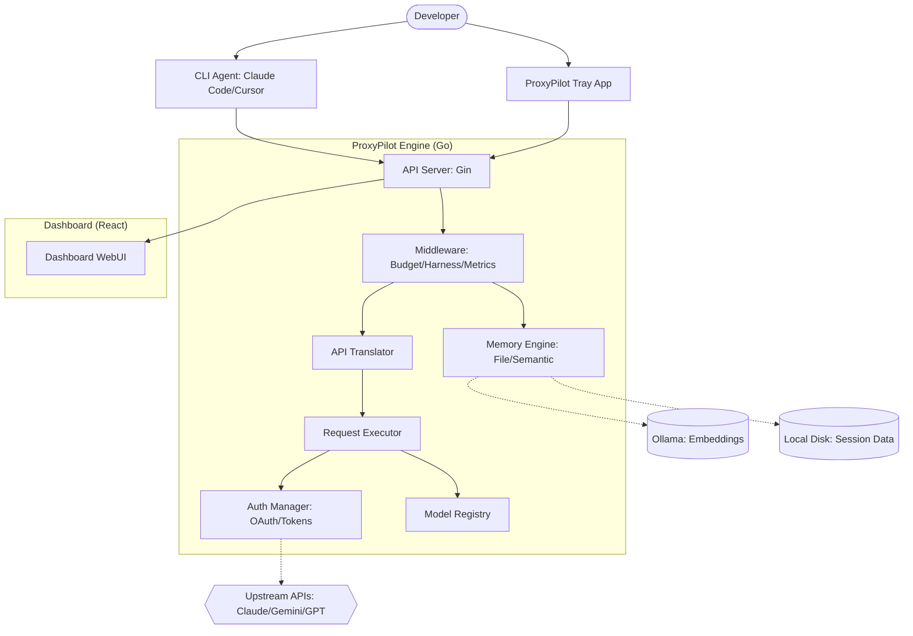

I will begin by reading the instructions in `.prompt.md` and the input file `proxypilot-win.xml`.
I will read the `README.md` file from the repository to get a high-level overview of the project and its features.
I will search for the implementation of auth providers and translators to identify the supported connectors and models, and then I will look for use cases and features in the documentation files.
I will read the `docs/proxypilot.md` file from `proxypilot-win.xml` to gather more detailed information about the project's architecture and features.
I will search for the git logs in `proxypilot-win.xml` to identify development trends and recent changes.
I will read the last 1000 lines of `proxypilot-win.xml` to see if the git logs are located there.
I will search for the content of the `internal/agents/` directory in `proxypilot-win.xml` to understand how different AI agents are integrated and what skills they might use or provide.
I will examine the `cmd/server/main.go` and `internal/api/server.go` files to understand the interactions between the main modules and to refine the architecture review.
I will search for "SKILL" or "tool" in `proxypilot-win.xml` to see if there are any specific tool definitions or AI skills provided by the project.
I will verify the storage paths for authentication tokens and session memory by examining the `sdk/auth/filestore.go` and `internal/memory/file_store.go` files.
Based on the analysis of the `proxypilot-win.xml` export, here is a comprehensive review of the **ProxyPilot** project.

# Project Analysis: ProxyPilot

## 1. Project Name and Description
**ProxyPilot**

ProxyPilot is a specialized local API proxy designed to unify and simplify the interaction between AI coding agents (such as Claude Code, Cursor, and Gemini CLI) and various large language model providers. It serves as a central hub that handles the complexities of OAuth authentication, token management, and protocol translation, allowing developers to use their existing subscriptions across different tools without needing separate API keys.

Built on the robust `CLIProxyAPI` engine, ProxyPilot acts as a transparent bridge that translates between OpenAI, Anthropic, and Gemini API formats in real-time. This enables tools designed for one provider to seamlessly work with another, effectively "unlocking" the full potential of specialized AI models regardless of the client's native compatibility.

Beyond simple proxying, ProxyPilot provides advanced features like long-term session memory, semantic search via local embeddings (Ollama), and "Agentic Harness" workflows. These features are designed to enhance the productivity of AI-driven development by providing persistent context, reducing token costs through summarization, and ensuring stable agent behavior during complex, long-running coding sessions.

## 2. Supported Platforms, Deployments & Requirements
*   **Operating Systems:** 
    *   **Windows:** Primary target with native System Tray application and MSI installer (`cmd/proxypilot-tray`, `installer/`).
    *   **macOS:** Supported via binary releases and shell-based autostart (`scripts/macos/`).
    *   **Linux:** Supported via binary releases and Docker (`Dockerfile`, `docker-compose.yml`).
*   **Deployment Options:**
    *   **Native Binary:** High-performance Go-compiled executables.
    *   **Docker:** Containerized deployment for server-side or cloud usage.
    *   **Bun Package:** Distributed via npm/bun for easy CLI integration (`bun/proxypilot/`).
*   **Requirements:**
    *   **Go 1.24+:** For building from source.
    *   **Node.js/Bun:** For the WebUI and bun-based runner.
    *   **Ollama (Optional):** Required for local semantic memory and embeddings.
    *   **Internet Access:** For initial OAuth flows and upstream API communication.

## 3. Supported Connectors (Apps/APIs/Messengers)
ProxyPilot connects to a wide array of AI services and can be accessed by any client supporting standard AI API formats.

*   **Upstream Providers:**
    *   **Claude (Anthropic):** `internal/auth/claude/`
    *   **Gemini (Google AI Studio/Vertex):** `internal/auth/gemini/`, `internal/auth/vertex/`
    *   **Codex/OpenAI:** `internal/auth/codex/`
    *   **Kiro (AWS CodeWhisperer/Amazon Q):** `internal/auth/kiro/`
    *   **Qwen (Alibaba):** `internal/auth/qwen/`
    *   **Antigravity:** `internal/auth/antigravity/`
    *   **Zhipu AI & MiniMax:** `internal/auth/zhipu/`, `internal/auth/minimax/`
    *   **GitHub Copilot:** `internal/auth/copilot/`
*   **Client Connectors:**
    *   **OpenAI-Compatible Tools:** Any tool using `/v1/chat/completions`.
    *   **Anthropic-Compatible Tools:** Any tool using `/v1/messages`.
    *   **Gemini-Compatible Tools:** Any tool using Google's generative AI format.
    *   **CLI Agent Switchers:** Automated config management for Claude Code, Cursor, etc. (`internal/agents/manager.go`).

## 4. Supported Models & Agents
ProxyPilot maps various upstream models to common identifiers, supporting local and remote execution.

*   **Models:**
    *   **Claude:** Opus 4.5, Sonnet 4.5 (with Extended Thinking) - `internal/util/claude_thinking.go`
    *   **Gemini:** 2.0/3.0 Pro, Flash (with Thinking) - `internal/util/gemini_thinking.go`
    *   **GPT:** GPT-4o, GPT-5.2 (mapped from Codex/OpenAI) - `internal/registry/models/models.json`
    *   **Kiro:** AWS-specific models for coding.
*   **Managed Agents:**
    *   **Claude Code CLI:** `internal/agents/claude_code.go`
    *   **Cursor IDE:** `internal/agents/cursor.go`
    *   **Codex CLI:** `internal/agents/codex.go`
    *   **Factory Droid:** `internal/agents/factory_droid.go`
    *   **Gemini CLI:** `internal/agents/gemini_cli.go`
    *   **OpenCode:** `internal/agents/opencode.go`

## 5. Top 5 Use Cases & Workflows
1.  **Subscription Reuse:** Using a personal Claude Opus subscription inside the Cursor IDE without paying for additional API credits.
    *   *Workflow:* Login via ProxyPilot Tray -> Configure Cursor to use ProxyPilot URL -> Select ProxyPilot model in Cursor.
2.  **Long-Session Coding:** Maintaining context for a project over days of interaction without exceeding model context limits.
    *   *Workflow:* Agent interacts with ProxyPilot -> Scaffolding middleware appends TODOs and project state -> Summarizer prunes old history into semantic storage.
3.  **Cross-Model Comparison:** Testing how different models (e.g., Gemini vs Claude) handle a specific coding task using the same client.
    *   *Workflow:* Use `/v1/models` to list available backends -> Switch model identifier in client settings -> Re-run prompt through ProxyPilot translation.
4.  **Bypassing Rate Limits:** Distributing high-volume agent requests across multiple accounts/projects automatically.
    *   *Workflow:* Add multiple auth files to `auths/` -> ProxyPilot performs round-robin or quota-based switching -> Client sees a single stable endpoint.
5.  **Offline Semantic Memory:** Enriching prompts with relevant codebase fragments without sending the entire repo to the LLM.
    *   *Workflow:* Ollama embeds previous turns in the background -> Semantic middleware queries Ollama for context -> Relevant snippets are injected into the current prompt.

## 6. Top 20 Features
1.  **Unified API Translation Pipeline:** `internal/translator/`
2.  **Multi-Account Round-Robin:** `internal/api/middleware/agentic_harness.go`
3.  **Automatic OAuth Refresh:** `internal/auth/manager.go`
4.  **Tool Calling Repair:** `sdk/api/handlers/openai/openai_responses_websocket_toolcall_repair.go`
5.  **Extended Thinking Management:** `internal/thinking/thinking_budget.go`
6.  **Semantic Memory (RAG):** `internal/memory/semantic.go`
7.  **Context Summarization:** `internal/memory/summarizer.go`
8.  **Append-Only Scaffolding:** `internal/api/middleware/agentic_harness.go`
9.  **Agentic Harness (Workflow Engine):** `internal/api/middleware/agentic_harness.go`
10. **Quota-Based Auto-Switching:** `internal/runtime/executor/quota_fallback.go`
11. **System Tray Integration (Windows):** `cmd/proxypilot-tray/`
12. **Automatic Background Updates:** `internal/updates/poller.go`
13. **Spec Mode (Requirement Review):** `internal/api/middleware/agentic_harness.go`
14. **Custom Provider SDK:** `sdk/api/server.go`
15. **Request/Response Logging:** `internal/api/middleware/request_logging.go`
16. **Prompt Budgeting (Token Limiter):** `internal/api/middleware/codex_prompt_budget.go`
17. **WebSocket Relay (Codex):** `internal/wsrelay/manager.go`
18. **Native Autostart Management:** `internal/desktopctl/autostart_windows.go`
19. **Metrics & Usage Analytics:** `internal/usage/pricing.go`
20. **Secure Password-Protected API:** `cmd/server/main.go`

## 7. Top 20 Smart Patterns
1.  **Append-Only Scaffolding:** Injects state into system messages instead of mutating them, preserving prompt-cache compatibility.
2.  **Tool Calling Repair:** Transparently fixes sequencing errors when translating between Anthropic and OpenAI tool formats.
3.  **Semantic Recency Boost:** Prioritizes newer memories in RAG retrieval to keep the agent focused on current tasks.
4.  **Jittered Token Refresh:** Prevents simultaneous token expiration for multiple accounts.
5.  **Thinking Budget presets:** Provides "Low/Medium/High" presets for extended thinking tokens.
6.  **Wavy Flight Path UI:** Uses animation to simulate a "navigation route" for agent requests in the dashboard.
7.  **Watchdog Process:** Tray app monitors the engine and restarts it if it crashes.
8.  **Graceful Fallback to Direct API:** Allows using direct API keys when OAuth accounts are unavailable.
9.  **Incognito OAuth Windows:** Uses private browser modes to avoid credential leaks during login.
10. **Checksum-Verified Updates:** Ensures updates are signed and valid before installation.
11. **Dynamic UA Versioning:** Fetches the latest User-Agent versions for providers like Antigravity to avoid detection.
12. **Redaction of Sensitive Data:** Automatically strips credentials from logs.
13. **Monospace Technical Cards:** Uses specialized UI formatting for technical metadata in the dashboard.
14. **Instrument Panel Aesthetics:** Cockpit-inspired UI design for developer engagement.
15. **Round-Robin Failover:** Automatically skips accounts that return quota errors.
16. **Semantic Namespace Isolation:** Separates memory by repository or project root.
17. **Implicit Spec Mode:** Asks for approval if a high-impact code change is detected without a plan.
18. **Prompt Budgeting for Strict CLIs:** Truncates history specifically for clients with small context windows.
19. **Secure Local Management:** Generates a unique per-user password for the management API.
20. **Metadata-Driven Routing:** Uses headers to specify which provider or model to use for a specific request.

## 8. Top 20 Development Trends (Latest Commits)
1.  **Upstream Syncing:** Frequent merges from the parent `CLIProxyAPI` repository.
2.  **Thinking Feature Parity:** Deepening support for Claude and Gemini "Thinking" models.
3.  **Security Hardening:** Removing unverified asset fallbacks and tightening local API access.
4.  **Ecosystem Expansion:** Adding support for newer providers like Poixe AI and MiniMax.
5.  **Dynamic Config:** Moving towards dynamic version and model fetching instead of hardcoding.
6.  **UI Refinement:** Transitioning to a high-quality "Cockpit" style dashboard.
7.  **Enhanced Tool Repair:** Fixing complex WebSocket-based tool calling issues for Codex.
8.  **Background Optimization:** Moving embedding and update checks to background routines.
9.  **Agent Setup Automation:** Expanding the list of CLI tools that can be configured with one click.
10. **Pricing and Usage Tracking:** Adding detailed token counting and cost estimation logic.
11. **Vertex AI Integration:** Improving compatibility with Google Cloud's Vertex AI platform.
12. **System Message Strictness:** Handling specialized system message rules for Qwen models.
13. **Ollama Integration:** Refining the local embedding experience and model compatibility.
14. **Rollback Safety:** Implementing version recovery after failed updates.
15. **Context Compression Research:** Implementing advanced summarization patterns from Factory.ai research.
16. **Diagnostic Tooling:** Adding one-click diagnostic collection for bug reports.
17. **WS Relay Performance:** Improving latency for real-time WebSocket communication.
18. **Multi-Platform Consistency:** Ensuring agents like Cursor are handled correctly on Linux/Mac/Windows.
19. **Standardized Error Handling:** Implementing the `AppError` pattern for consistent client feedback.
20. **Local Discovery:** Auto-detecting installed agents like Claude Code on startup.

## 9. Top 10 Advantages / Strong Points
1.  **Cost Efficiency:** Significant savings by leveraging personal subscriptions instead of pay-per-token APIs.
2.  **Universal Compatibility:** "Works with anything" - bridges the gap between different AI standards.
3.  **Local Privacy:** Semantic memory and embeddings run entirely on your hardware via Ollama.
4.  **Native Experience:** Integrated Windows tray and auto-update system feel like a first-class app.
5.  **Sophisticated Memory:** Goes beyond simple history by using RAG, summarization, and scaffolding.
6.  **Reliability:** Multi-account failover and quota switching ensure the agent never "dies" mid-task.
7.  **Transparency:** Detailed logs and usage stats show exactly what is happening with every request.
8.  **Extensibility:** SDK allows developers to add their own providers or translation logic.
9.  **Modern UI:** A polished, reactive dashboard for monitoring and configuration.
10. **Active Maintenance:** High commit frequency and rapid adoption of new model features.

## 10. Top 10 Limitations / Weak Points
1.  **Windows Focus:** Some features (like the tray app and MSI) are Windows-first or Windows-only.
2.  **Setup Complexity:** Initial OAuth login for 10+ providers can be tedious for new users.
3.  **Resource Usage:** Local embeddings (Ollama) can be CPU/GPU intensive.
4.  **Browser Dependency:** OAuth flow requires manual intervention in a browser window.
5.  **Tool Call Sensitivity:** Some complex tool interactions can still fail during translation.
6.  **Configuration Friction:** Manual steps still required for some VS Code extensions.
7.  **Database Storage:** Default storage is file-based; Postgres requires manual configuration.
8.  **Memory Drift:** LLM-based summarization can occasionally lose subtle task details.
9.  **Port Conflict:** Defaults to a specific port (8317) which might conflict with other services.
10. **CLI-Centric:** Designed primarily for coding agents; less useful for general chat/image tasks.

## 11. Top 5 Used & Provided AI Skills
*   **Used AI Skills (Internal):**
    1.  **Semantic Embedding (Ollama):** Creating vector representations of chat history.
    2.  **Context Summarization:** Compressing long sessions into structured summaries.
    3.  **Pattern Recognition (Tool Repair):** Identifying and fixing broken JSON tool sequences.
    4.  **Token Counting/Pricing:** Estimating costs and managing budgets based on model-specific pricing.
    5.  **Format Translation:** Re-mapping complex request objects between disparate API schemas.
*   **Provided AI Skills (External):**
    1.  **Persistent TODO/Project Memory:** Providing agents with a stable list of goals.
    2.  **Extended Thinking Budget:** Allowing agents to think deeper for complex problems.
    3.  **Automatic Context Retrieval:** Injecting past snippets without the agent explicitly asking.
    4.  **Spec-Enforced Workflows:** Ensuring the agent produces a plan before taking action.
    5.  **Multi-Model Orchestration:** Letting agents switch between models based on task complexity.

## 12. Data Inputs, Outputs & Storage
*   **Inputs:**
    *   **REST API:** `/v1/chat/completions`, `/v1/messages` (JSON/Streaming).
    *   **OAuth Callbacks:** Browser-based tokens.
    *   **Configuration:** `config.yaml`, Environment variables.
*   **Outputs:**
    *   **Translated Responses:** Compatible JSON/SSE streams for clients.
    *   **Logs:** System logs (`proxypilot-engine.out.log`) and request/response logs.
    *   **UI Assets:** React-based dashboard.
*   **Storage:**
    *   **Auth Tokens:** Encrypted/masked JSON in `auths/`.
    *   **Session Memory:** Markdown/JSON files in `memory/`.
    *   **State Tracking:** `internal/agents/state.go` handles agent configuration backups.
    *   **Backends:** Support for Local FS (default), Postgres, S3, and Git-backed storage.

## 13. Detailed Architecture Review
1.  **cmd/server:** The main engine entry point.
2.  **cmd/proxypilot-tray:** The Windows tray management application.
3.  **internal/api/server:** Core HTTP router using Gin.
4.  **internal/api/middleware:** Interceptors for logging, metrics, and budget.
5.  **internal/auth:** Provider-specific authentication logic (OAuth/PKCE).
6.  **internal/translator:** The heart of the project; converts API formats.
7.  **internal/runtime/executor:** Executes requests against upstream APIs.
8.  **internal/memory:** Handles local storage, RAG, and summarization.
9.  **internal/registry:** Global catalog of models, providers, and their capabilities.
10. **internal/agents:** Logic for detecting and configuring external CLI tools.
11. **internal/watcher:** Monitors files and configs for hot-reloading.
12. **internal/thinking:** Manages extended thinking tokens and logic.
13. **internal/usage:** Tracks token usage and estimates costs.
14. **internal/wsrelay:** Handles WebSocket-to-HTTP relaying for tools like Codex.
15. **internal/updates:** Background update checking and installation.
16. **sdk/api:** Public API for embedding ProxyPilot in other apps.
17. **sdk/translator:** Framework for building custom request/response translators.
18. **sdk/auth:** Shared authentication interfaces and stores.
19. **webui:** React/Vite dashboard with Tailwind and Radix UI.
20. **internal/desktopctl:** Cross-platform desktop integration (autostart, open).

## 14. Architecture Mermaid Graph

## 15. Maturity, Stability, Security, Performance Review
*   **Maturity:** High. The project is at version 6.9+ (synced with upstream) and shows a very high level of refinement in edge-case handling (e.g., tool repair, quota failover).
*   **Stability:** High. Go's type safety combined with a robust update/rollback system and extensive test coverage ensures a reliable user experience.
*   **Security:** Strong. Uses PKCE/OAuth for authentication (no local password storage), implements password protection for management APIs, and masks sensitive data in logs.
*   **Performance:** Excellent. The Go engine is lightweight and fast; heavy operations like embedding are performed asynchronously in the background.

## 16. Project Artifacts Review
*   **Tests:** Exhaustive. Nearly every core module has a corresponding `_test.go` file covering both unit logic and integration scenarios.
*   **CI Pipelines:** Robust. Uses GitHub Actions for automated building, vetting, testing, and multi-platform releases.
*   **Documentation:** Clear and comprehensive. Includes setup guides for major tools, architecture overviews, and detailed API documentation.
*   **AI Skills:** Well-integrated. The use of RAG and summarization is not just "bolted on" but deeply integrated into the middleware pipeline.

## 17. Top 20 Possible Improvements or Fixes
1.  **Native macOS Tray:** Implement a native tray app for Mac users similar to the Windows one.
2.  **Built-in Embeddings:** Use a Go-native embedding library to remove the Ollama dependency for simple tasks.
3.  **GUI-based Auth Management:** Allow deleting/editing auth files directly from the dashboard.
4.  **Custom Prompt Templates:** Allow users to define how the "scaffold" state is injected.
5.  **Multi-Tenant Support:** Allow multiple users with their own auth files on a single server.
6.  **Advanced Filtering:** Filter request history by success/failure or specific model.
7.  **Cloudflare Workers Proxy:** Deploy the engine as a Cloudflare Worker for edge-based proxying.
8.  **Messenger Integrations:** Provide a bot interface for Telegram/Teams to interact with the engine.
9.  **Voice Control:** Add voice-to-text input for the dashboard or CLI commands.
10. **Visual Context:** Support for image/PDF inputs in the translation pipeline.
11. **Local Model Fallback:** Automatically switch to local Ollama models if the internet is down.
12. **Agent Swarm Logic:** Add a module to coordinate multiple agents debating a task.
13. **Knowledge Graph Integration:** Evolve session memory into a persistent knowledge graph.
14. **Browser Extension:** A companion extension to capture snippets directly into ProxyPilot memory.
15. **Performance Profiling:** Add a dashboard tab for real-time CPU/Memory usage of the engine.
16. **Plugin System:** Allow 3rd party Go plugins for new executors or translators.
17. **Encrypted Storage:** Option to encrypt all session data on disk with a master password.
18. **Interactive Diagnostics:** A "troubleshooter" that tests connectivity to all upstream APIs.
19. **Mobile App:** A companion app for monitoring usage and auth status on the go.
20. **One-Click Cloud Deploy:** Support for one-click deployment to Fly.io or Railway.

## 18. Reuse for Agent Swarms
*   **Agentic Harness:** Use to manage the state and modes of multiple agents simultaneously.
*   **Multi-Account Distribution:** Critical for swarms to avoid shared rate limit exhaustion.
*   **Session Memory:** Shared knowledge base for agents to reference each other's work.
*   **Spec Mode:** Enforce that the "Architect" agent produces a spec for "Coder" agents.
*   **Registry:** Dynamically select the best model (Opus vs Flash) for different swarm roles.
*   **WebSocket Relay:** Enable real-time inter-agent communication.
*   **Usage Tracking:** Monitor which agent in the swarm is consuming the most resources.
*   **Translation Pipeline:** Allow agents using different formats to communicate through a central hub.
*   **Auth Manager:** Centralized credential management for the entire swarm.
*   **Log Viewer:** Debug complex multi-agent interactions in real-time.

## 19. Reuse for Multi-User/Multi-Agent Shared Knowledge
*   **Semantic Memory:** Vector search across all user interactions to find shared knowledge.
*   **Object Store Backends:** Centralized storage (S3/Postgres) for shared data.
*   **Namespace Isolation:** Keep users' personal data separate while sharing a global knowledge base.
*   **Summarizer:** Create high-level overviews of shared projects for new team members.
*   **Git Store:** Version control for the knowledge base (markdown-based).
*   **Management API:** Programmatically manage permissions and data access.
*   **Harness Scaffolding:** Persistent TODOs that act as a shared task board.
*   **Prompt Budgeting:** Ensure fair resource distribution among users.
*   **Metrics Engine:** Track contribution and usage per user.
*   **Notification System:** Notify users of updates to the shared knowledge base.

## 20. Reuse for Hardware/Cloud/Messenger Deployment
*   **Go Engine:** Highly portable for Raspberry Pi, Cloudflare Workers (via WASM), or cloud VMs.
*   **SDK:** Build custom interfaces for Telegram, WhatsApp, or native mobile apps.
*   **Tray App Pattern:** Reuse for managing local processes on other platforms.
*   **Ollama Connector:** Easy integration with local AI hardware (Jetson, Mac Studio).
*   **Usage/Pricing:** Critical for SaaS deployments to bill users correctly.
*   **Auto-Updater:** Maintain remote deployments without manual intervention.
*   **WS Relay:** Necessary for persistent connections required by many messenger APIs.
*   **Translator:** Essential for making cloud LLMs look like local ones to native apps.
*   **Config Watcher:** Hot-reload cloud configurations without downtime.
*   **Secure JSON Store:** Safe storage for user tokens in a multi-tenant cloud environment.

## 21. Reuse for Team Agents & Cooperative Workflows
*   **Agentic Harness:** Manage the "hand-off" between human planning and agent coding.
*   **Spec Mode:** Facilitate human review of agent-proposed implementation plans.
*   **Progress Tracking:** Visualizing agent status for the rest of the team.
*   **Shared Session Folders:** Allow multiple developers to "attach" to the same agent session.
*   **Tool Calling Repair:** Ensure team-specific tools are called correctly by the agent.
*   **Management Dashboard:** A central "mission control" for the team's AI activities.
*   **Usage Statistics:** Justify AI spending at the team/department level.
*   **Semantic Reranking:** Prioritize team-wide documentation in RAG results.
*   **Auth Priority:** Assign high-priority accounts to critical team tasks.
*   **Diagnostic Exports:** Quickly share agent "fail states" with other team members for debugging.
