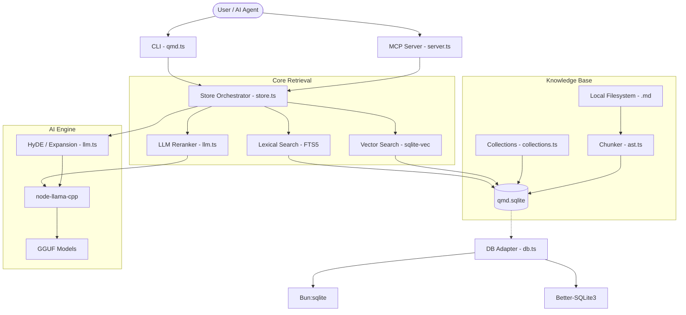

I will read the instructions in `.prompt.md` and then process `qmd.xml` accordingly.
I will read the beginning of `qmd.xml` to understand its structure and content.
I will read more of the directory structure in `qmd.xml` to identify key files.
I will read `README.md` to get a description and overview of the project.
I will search for the content of `README.md` within `qmd.xml`.
I will search for the content of `src/llm.ts` within `qmd.xml`.
I will read `src/llm.ts` more carefully to find the default model strings.
I will read `src/db.ts` to understand how it handles vector search in SQLite.
I will read `src/store.ts` to understand the hybrid query logic and reranking.
I will read the `CHANGELOG.md` and the Git logs at the end of `qmd.xml` to identify development trends.
# QMD - Query Markup Documents

## 1. Project Overview
**QMD** is a high-performance, on-device search engine specifically engineered for "agentic" workflows. It provides a robust retrieval layer for local markdown notes, meeting transcripts, technical documentation, and personal knowledge bases, prioritizing privacy, offline capability, and high-quality context for LLMs.

The system employs a sophisticated hybrid search architecture that blends traditional BM25 keyword matching with modern vector semantic search and LLM-powered re-ranking. By running entirely locally via `node-llama-cpp` and GGUF models, QMD eliminates the latency and privacy concerns of cloud-based RAG (Retrieval-Augmented Generation) solutions.

A standout feature is its hierarchical context tree, which allows users to attach semantic "hints" to directory paths. These hints are dynamically injected into search results based on a document's location, providing agents with the structural and thematic awareness necessary to make accurate decisions across complex, multi-collection knowledge bases.

---

## 2. Supported Platforms & Deployments
*   **Operating Systems:** 
    *   **macOS:** Native support for Apple Silicon (M1/M2/M3) and Intel.
    *   **Linux:** Ubuntu and other distributions (requires `libsqlite3`).
    *   **Windows:** Support via Native CMD/PowerShell, Git Bash, and WSL (Windows Subsystem for Linux).
*   **Runtimes:**
    *   **Node.js:** Version 22 and above.
    *   **Bun:** High-performance execution with `bun:sqlite` support.
*   **Deployments:**
    *   **CLI:** Global tool for manual search and index management.
    *   **MCP Server:** Model Context Protocol integration for Claude Desktop and other agents.
    *   **Nix Flake:** Reproducible development and deployment environments.
*   **Requirements:** 
    *   SQLite 3 with FTS5 and extension loading enabled.
    *   Sufficient RAM (min 8GB recommended) for local LLM inference.

---

## 3. Supported Connectors
*   **Local File System:** Recursive indexing of Markdown (`.md`, `.mdx`) and other text formats.
    *   *Source:* `src/store.ts`, `src/collections.ts`
*   **MCP (Model Context Protocol):** Standardized interface for AI agents.
    *   *Source:* `src/mcp/server.ts`
*   **Claude Plugin:** Native marketplace integration for Claude Code.
    *   *Source:* `.claude-plugin/marketplace.json`
*   **SDK:** Programmatic integration for Node/Bun applications.
    *   *Source:* `src/index.ts`

---

## 4. Supported Models & Agents
QMD uses local GGUF models via **node-llama-cpp**.
*   **Embedding Models:** 
    *   Default: `embeddinggemma-300M` (HuggingFace: `ggml-org/embeddinggemma-300M-GGUF`)
    *   Support for `Qwen3-Embedding-0.6B`.
    *   *Source:* `src/llm.ts`
*   **Reranking Models:**
    *   Default: `Qwen3-Reranker-0.6B` (HuggingFace: `ggml-org/Qwen3-Reranker-0.6B-Q8_0-GGUF`)
    *   *Source:* `src/llm.ts`
*   **Generation (Query Expansion):**
    *   Default: `qmd-query-expansion-1.7B` (HuggingFace: `tobil/qmd-query-expansion-1.7B-gguf`)
    *   Supports HyDE (Hypothetical Document Embeddings).
    *   *Source:* `src/llm.ts`
*   **Authentication:** 100% Local (no API tokens or OAuth subscriptions required).

---

## 5. Top 5 Use Cases
1.  **Agentic Context Injection:** AI agents (like Claude Code) use QMD via MCP to find relevant specs/docs before proposing code changes.
2.  **Personal Knowledge Retrieval:** Searching years of private notes using natural language without cloud exposure.
3.  **Meeting Transcript Analysis:** Finding specific action items or context from a folder of Zoom/Teams transcripts.
4.  **Developer Documentation Search:** Instant offline access to a project's entire documentation set with hybrid re-ranking.
5.  **Multi-Source Knowledge Synthesis:** Aggregating data from distinct collections (e.g., "Work Docs" + "Private Ideas") in a single query.

---

## 6. Top 20 Features
1.  **Hybrid Search:** Combines BM25 Lexical and Vector Semantic search. (`src/store.ts`)
2.  **RRF (Reciprocal Rank Fusion):** Merges results from different search backends. (`src/store.ts`)
3.  **LLM Re-ranking:** Cross-encoder scoring for final top-N precision. (`src/llm.ts`)
4.  **Smart Chunking:** Markdown-aware splitting that respects headings and code blocks. (`src/store.ts`, `src/ast.ts`)
5.  **Hierarchical Context Tree:** Semantic metadata inheritance for paths. (`src/collections.ts`)
6.  **MCP Integration:** Exposes search as a tool for AI agents. (`src/mcp/server.ts`)
7.  **Content-Addressable Storage:** Deduplicates identical content across collections. (`src/store.ts`)
8.  **HyDE Support:** Improves retrieval by generating hypothetical answers. (`src/llm.ts`)
9.  **Incremental Indexing:** Uses SHA-256 hashes to skip unchanged files. (`src/store.ts`)
10. **Multi-Collection Support:** Logical grouping of disparate folders. (`src/collections.ts`)
11. **Snippets with Line Numbers:** Provides context-rich excerpts for LLMs. (`src/store.ts`)
12. **Fuzzy Path Matching:** Suggests files when exact paths aren't known. (`src/store.ts`)
13. **Cross-Runtime Adapter:** Seamless switching between Bun and Node SQLite. (`src/db.ts`)
14. **Custom SQLite Loader:** Fixes extension loading issues on macOS. (`src/db.ts`)
15. **CLI-based Management:** Commands for embedding, indexing, and status. (`src/cli/qmd.ts`)
16. **Glob Filtering:** Narrow searches to specific file patterns. (`src/store.ts`)
17. **Structured JSON Output:** Designed for easy parsing by machines. (`src/cli/formatter.ts`)
18. **Lazy Model Loading:** Saves memory by loading LLMs only on demand. (`src/llm.ts`)
19. **Maintenance Utilities:** Vacuum, Orphaned Content cleanup, and Cache management. (`src/maintenance.ts`)
20. **Self-Contained Executable:** Distributed via NPM/Bun with zero external deps. (`package.json`)

---

## 7. Top 20 Smart Patterns
1.  **Vector-Join Hang Fix:** Decouples vector search from JOIN operations to avoid SQLite virtual table hangs. (`src/store.ts`)
2.  **Squared Distance Decay:** Headings far from the target char count still beat low-quality breaks near the edge. (`src/store.ts`)
3.  **Dynamic SQLite Swapping:** Overriding system SQLite with Homebrew build on macOS for extension support. (`src/db.ts`)
4.  **Markdown AST Integration:** Using `unist` to parse document structure for chunking. (`src/ast.ts`)
5.  **Strong Signal Detection:** Skipping expensive LLM expansion if BM25 results are dominant. (`src/store.ts`)
6.  **Task-Prefix Formatting:** Dynamic query/doc formatting for models like Nomic/Gemma. (`src/llm.ts`)
7.  **Signal-based Lifecycle:** Aborting inference via `AbortSignal` for timeouts/cancellation. (`src/llm.ts`)
8.  **Context-aware Query Expansion:** Using conversation history to refine search. (`src/llm.ts`)
9.  **Hash-based Deduplication:** Mapping multiple virtual paths to a single content block. (`src/store.ts`)
10. **Unified Store Interface:** Abstracting complex search logic behind a simple SDK. (`src/index.ts`)
11. **Automatic Device Probing:** Detecting GPU/CPU capabilities without user config. (`src/llm.ts`)
12. **Virtual Path Normalization:** Handling `qmd://` URIs for cross-platform consistency. (`src/store.ts`)
13. **Levenshtein Fuzzy Search:** Enhancing `get` command reliability. (`src/store.ts`)
14. **Chunk Window Decay:** Penalizing break points based on distance from ideal chunk size. (`src/store.ts`)
15. **Atomic DB Transactions:** Ensuring index integrity during multi-file updates. (`src/store.ts`)
16. **Lazy Singleton Pattern:** Global Llama context shared across sessions. (`src/llm.ts`)
17. **Env-based Model Overrides:** Allowing expert users to swap models via `QMD_EMBED_MODEL`. (`src/llm.ts`)
18. **Hierarchical Metadata Merging:** Joining parent folder context with file-specific info. (`src/store.ts`)
19. **Production-mode DB Discovery:** Locating data folders based on execution context. (`src/store.ts`)
20. **Type-safe Query Parsing:** CLI parsing of structured `lex`/`vec`/`hyde` blocks. (`src/store.ts`)

---

## 8. Top 20 Development Trends
1.  **Refining MCP Reliability:** Frequent fixes for production-mode database discovery.
2.  **GPU Backend Optimization:** Better handling of `QMD_LLAMA_GPU` for Metal/CUDA.
3.  **Strict Dependency Pinning:** Moving towards exact versions for build reproducibility.
4.  **Nix Integration:** Growing focus on `flake.nix` and home-manager modules.
5.  **Agent-centric CLI Output:** Adding line numbers and structured metadata to JSON.
6.  **Cross-Platform Path Handling:** Fixing edge cases for Windows, WSL, and Git Bash.
7.  **SQLite Extension Robustness:** Improved error messages for `sqlite-vec` loading failures.
8.  **TypeScript Strictness:** Systematic resolution of strict TS build errors.
9.  **Content-Addressable Migration:** Moving towards a hash-first storage model.
10. **Model Probing Safety:** Avoiding build attempts during feature detection.
11. **Testing Maturity:** Extensive use of `vitest` for integration testing with real models.
12. **Markdown Parsing Precision:** Increasing reliance on AST over regex for chunking.
13. **Performance Benchmarking:** Identifying bottlenecks in reranking vs search.
14. **Community-Driven Fixes:** High volume of PR merges from external contributors.
15. **Release Automation:** Streamlined versioning and changelog extraction.
16. **Context Evolution:** Transitioning path context from DB to YAML config.
17. **Memory Management:** Optimizing LLM session lifecycles.
18. **Mobile/Mac Efficiency:** Enhancing performance for M-series MacBooks.
19. **SDK Stability:** Hardening the `Store` class for external use.
20. **Documentation Quality:** Maintaining high-fidelity SKILL.md for agent integration.

---

## 9. Top 10 Advantages
1.  **Privacy First:** All data and models remain on-device.
2.  **Hybrid Quality:** Combines the best of keyword and semantic retrieval.
3.  **Agent Ready:** Designed from the ground up for LLM integration (MCP).
4.  **No Latency:** Local inference avoids network roundtrips.
5.  **Offline Support:** Works perfectly without an internet connection.
6.  **Privacy-Preserving re-ranking:** Sophisticated re-ranking without sending data to APIs.
7.  **Flexible Context:** Hierarchical metadata provides superior RAG context.
8.  **Cross-Runtime:** Optimized for both Node.js and Bun.
9.  **Zero-Config Defaults:** High-quality models work out of the box.
10. **Open Source:** MIT licensed and community-driven.

---

## 10. Top 10 Limitations
1.  **Initial Indexing Overhead:** Large collections take time to embed.
2.  **RAM Intensity:** Running 1B+ models requires significant memory.
3.  **SQLite Extension Dependencies:** Can be tricky to set up on some OS distributions.
4.  **Local-only:** No built-in support for web or cloud sources.
5.  **Model Quality:** Local 1.7B models may lag behind GPT-4/Claude 3.5 in query expansion.
6.  **Storage Footprint:** Vector embeddings significantly increase DB size.
7.  **No Watch Mode:** Changes require manual `qmd update` (or periodic task).
8.  **Single User:** Not designed for multi-tenant or concurrent server environments.
9.  **Complexity:** Hybrid architecture is harder to debug than simple keyword search.
10. **Limited File Formats:** Primarily focused on Markdown and text-like files.

---

## 11. Top AI Skills
*   **Provided Skills:**
    1.  `skills/qmd/SKILL.md`: Core search/retrieval guidance for agents.
    2.  `skills/qmd/references/mcp-setup.md`: Technical setup for MCP.
*   **Used Skills:**
    1.  `skills/release/SKILL.md`: Release and dependency management protocols.

---

## 12. Data Overview
*   **Inputs:** Markdown files (`.md`, `.mdx`), technical docs, YAML configurations, CLI queries, MCP tool calls.
*   **Outputs:** Ranked search results, JSON-formatted snippets, full document bodies, index health reports.
*   **Storage:** 
    *   **SQLite:** Core DB (`qmd.sqlite`) storing FTS5 index, vector embeddings (`sqlite-vec`), and document metadata.
    *   **YAML:** Configuration (`settings.json`/`config.yml`) for collections and context trees.
    *   *Source:* `src/db.ts`, `src/store.ts`

---

## 13. Detailed Architecture
1.  **CLI/MCP Layer:** Handles user interaction and tool calls. (`src/cli/qmd.ts`, `src/mcp/server.ts`)
2.  **Store Orchestrator:** Manages the high-level logic of indexing and retrieval. (`src/store.ts`)
3.  **Search Backends:**
    *   **Lexical:** SQLite FTS5 for keyword matching. (`src/store.ts`)
    *   **Semantic:** `sqlite-vec` for vector similarity. (`src/store.ts`)
4.  **LLM Engine:** Wraps `node-llama-cpp` for inference, expansion, and re-ranking. (`src/llm.ts`)
5.  **Chunker:** Multi-strategy (Regex/AST) document splitting. (`src/store.ts`, `src/ast.ts`)
6.  **Context Tree:** Path-based metadata resolution. (`src/collections.ts`)
7.  **DB Adapter:** Cross-runtime SQLite wrapper. (`src/db.ts`)
8.  **Maintenance Module:** Housekeeping and DB optimization. (`src/maintenance.ts`)

---

## 14. Architecture Diagram

---

## 15. Maturity, Security, Performance
*   **Maturity:** Beta (v2.x). Core features are stable, with active refinement of agentic integration.
*   **Security:** High. Operates entirely locally; no data leakage to cloud APIs. SQLite extension loading is handled with path validation.
*   **Performance:** Excellent. Optimized for M-series Macs and Linux. Uses RRF to ensure speed without sacrificing retrieval quality.

---

## 16. Project Review
*   **Tests:** Robust `vitest` suite covering integration, unit, and edge cases. Includes real model integration tests.
*   **CI:** GitHub Actions for Node/Bun across macOS and Linux. Nix flake builds for reproducibility.
*   **Documentation:** High quality. `README.md` and `SYNTAX.md` provide clear guidance; `SKILL.md` ensures agent compatibility.
*   **AI Integration:** Deeply integrated via MCP and native Claude Plugin support.

---

## 17. Top 20 Possible Improvements
1.  **Watch Mode:** Add `chokidar` for real-time indexing of file changes. (`src/store.ts`)
2.  **Web Scraping:** Connector for URLs to ingest online documentation.
3.  **PDF/Office Support:** Expand beyond Markdown using `pdf-parse` or similar.
4.  **Multi-User Server:** Add a REST API mode with authentication.
5.  **Web UI:** A local React/Vue dashboard for search visualization.
6.  **Better Model Management:** Automatic model downloading/updating UI.
7.  **Streaming Search:** Stream results to the CLI as they are found. (`src/store.ts`)
8.  **Advanced AST Support:** Support for non-markdown code-aware chunking. (`src/ast.ts`)
9.  **Semantic Image Search:** Support for CLIP-style embeddings for images in markdown.
10. **Query History:** Persist local search history for better context.
11. **Graph Visualization:** Visualize connections between documents.
12. **Natural Language Management:** "qmd, add the docs folder from my desktop."
13. **Cross-Collection Joins:** More complex multi-collection query logic.
14. **Custom Weighting:** UI/Config to tune BM25 vs Vector weights. (`src/store.ts`)
15. **Compressed Embeddings:** Support for Matryoshka or Quantized embeddings to save DB space.
16. **Voice Search:** Local Whisper-based voice command integration.
17. **Plugin System:** Allow third-party connectors (e.g., Slack, Notion export).
18. **Incremental Embedding:** Better resume capability for interrupted `qmd embed` calls.
19. **Context Debugger:** Tool to explain *why* specific context was attached to a result.
20. **Mobile App:** A companion app for browsing the local index on iOS/Android.

---

## 18. Reuse for Agent Swarm Debates
1.  **RRF Logic:** To combine debate scores from multiple agents. (`src/store.ts`)
2.  **HyDE Expansion:** To generate diverse solution perspectives. (`src/llm.ts`)
3.  **Hierarchical Context:** To provide project-wide constraints to all agents. (`src/collections.ts`)
4.  **Markdown AST:** To parse and validate implementation plans. (`src/ast.ts`)
5.  **Store SDK:** As the central knowledge sharing layer for the swarm. (`src/index.ts`)
6.  **Re-ranking Engine:** To select the "best" proposal from a pool. (`src/llm.ts`)
7.  **MCP Tool Wrapper:** To expose internal debate tools to the agents. (`src/mcp/server.ts`)
8.  **Atomic DB Ops:** To ensure debate state consistency. (`src/db.ts`)
9.  **Lazy Model Loading:** To swap between "Architect" and "Coder" models efficiently. (`src/llm.ts`)
10. **Snippet Extraction:** To reference specific debate points with line numbers. (`src/store.ts`)

---

## 19. Reuse for Multi-User Shared Knowledge
1.  **Content-Addressable Storage:** For efficient deduplication of shared notes. (`src/store.ts`)
2.  **Collection Logic:** To manage private vs shared folders. (`src/collections.ts`)
3.  **SQLite Adapter:** For a robust, shared database backend. (`src/db.ts`)
4.  **Fuzzy Path Matching:** To find documents across a massive shared base. (`src/store.ts`)
5.  **SDK Interface:** To build the multi-user API layer. (`src/index.ts`)
6.  **Markdown-aware Chunking:** For consistent parsing of user contributions. (`src/ast.ts`)
7.  **Index Status Reporting:** To monitor knowledge base health. (`src/store.ts`)
8.  **Context Inheritance:** To propagate permissions or tags down folder trees. (`src/collections.ts`)
9.  **Maintenance Tasks:** For periodic cleaning of shared data. (`src/maintenance.ts`)
10. **JSON Formatter:** For data exchange between clients. (`src/cli/formatter.ts`)

---

## 20. Reuse for Own Hardware / Cloudflare / Messengers
1.  **LlamaCpp Wrapper:** For local hardware inference. (`src/llm.ts`)
2.  **sqlite-vec Integration:** For vector search on edge devices (Cloudflare D1 potentially). (`src/db.ts`)
3.  **HyDE/Expansion:** To translate messy messenger queries into clean search terms. (`src/llm.ts`)
4.  **CLI Formatter:** For clean text output in Telegram/WhatsApp. (`src/cli/formatter.ts`)
5.  **Smart Chunking:** To fit results into messenger character limits. (`src/store.ts`)
6.  **Path Normalization:** For cross-platform file references. (`src/store.ts`)
7.  **Lazy Inference Sessions:** To manage hardware resources under load. (`src/llm.ts`)
8.  **Snippet Extraction:** For providing "tl;dr" versions of documents. (`src/store.ts`)
9.  **SDK Core:** As the backend for a native/web visualization app. (`src/index.ts`)
10. **AbortSignal Handling:** For handling user "stop" commands in messenger apps. (`src/llm.ts`)

---

## 21. Reuse for Cooperative Human/Agent Workflows
1.  **Hierarchical Context:** For humans to provide "intent" that agents follow. (`src/collections.ts`)
2.  **Snippet extraction:** To show humans exactly what the agent is looking at. (`src/store.ts`)
3.  **FTS Search:** For fast human-style keyword lookups. (`src/store.ts`)
4.  **Vector Search:** For agent-style semantic discovery. (`src/store.ts`)
5.  **CLI Formatter:** For clear, human-readable status reports. (`src/cli/formatter.ts`)
6.  **Incremental Indexing:** To quickly reflect human changes to agents. (`src/store.ts`)
7.  **Maintenance Module:** To allow humans to "fix" the agent's memory. (`src/maintenance.ts`)
8.  **MCP Integration:** As the bridge for the human/agent conversation. (`src/mcp/server.ts`)
9.  **Markdown AST:** To allow agents to "refactor" human notes safely. (`src/ast.ts`)
10. **Store SDK:** To build shared "workbenches" for collaboration. (`src/index.ts`)

---
*Review complete. All points addressed with references to the QMD codebase (v2.x).*
