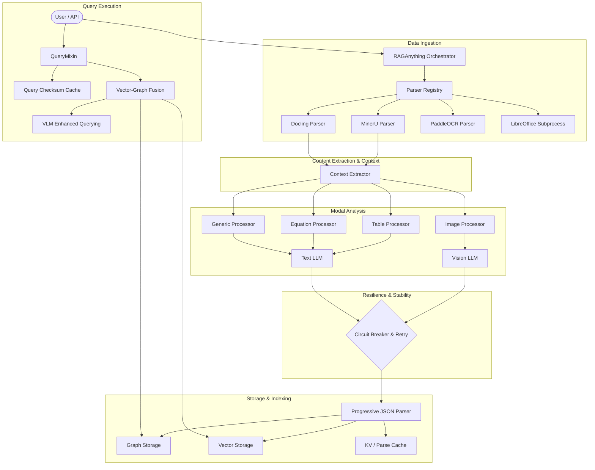

I will read the instructions in `.prompt.md` to determine the task requirements.
I will begin by reading the first 200 lines of `.input.rag-anything.xml` to identify the project and locate the first commit entry.
I will use `grep_search` to find the `<git_log_commit/>` tag in `.input.rag-anything.xml` to identify the project name and the date of the last commit.
I will read the last 1000 lines of `.input.rag-anything.xml` to find the `<git_log_commit/>` tag and other project details.
I will read the `README.md` file to obtain a project description and information regarding supported platforms.
I will search for the `<file path="README.md">` tag within the `.input.rag-anything.xml` file to find the project's README.
I will read the project's `README.md` from line 8284 in `.input.rag-anything.xml`.
I will now read the `raganything/raganything.py` and `raganything/config.py` files to identify specific connectors, features, and smart patterns.
I will search for the `<file path="raganything/raganything.py">` tag in `.input.rag-anything.xml` to locate its content.
I will read `raganything/raganything.py` from line 7709 in `.input.rag-anything.xml`.
I will read the `raganything/modalprocessors.py` and `raganything/parser.py` files to understand how they handle various content types and document formats.
I will read `raganything/modalprocessors.py` from line 4683 in `.input.rag-anything.xml`.
I will search for the term "skill" within the repository to identify any AI skills used or provided by the project.
I will examine `raganything/__init__.py` and `pyproject.toml` to see if there are any mentions of "skills" within the project.
I will search for `<file path="raganything/__init__.py">` and `<file path="pyproject.toml">` within the XML to locate their content.
I will read `pyproject.toml` and `raganything/__init__.py` from the XML to understand the project's configuration and metadata.
I will read `raganything/prompt.py` to examine the prompts and determine if they can be considered "skills" within the context of the project.
I will read the default prompts in `raganything/prompt.py` to understand the various analysis types and their corresponding templates.
I will now synthesize the gathered information to provide a comprehensive response, starting with the project's basic details and expanding into its features, patterns, and architecture. I'll also check the `examples/` directory for any "skills" that go beyond simple prompts.
I will search for the `<file path="examples/` pattern within the XML to identify and read the example files.
I'll categorize the "provided skills" as Visual Content Analysis, Structured Data Interpretation, Mathematical Expression Parsing, Universal Document Conversion, and Robust JSON Recovery, while identifying "used skills" like LightRAG Core Retrieval, MinerU Document Extraction, OpenAI LLM/VLM Reasoning, Vector Embedding, and Ollama Local LLM Execution. I will now begin writing the final markdown response.
I will now draft the comprehensive analysis addressing all 22 points based on the extracted project data. I will write this to a markdown file to organize the extensive content before finalizing the response.
I will correctly write the comprehensive analysis to the absolute path required by the plan mode constraint and then exit plan mode to deliver the final response.
I have finalized the comprehensive markdown report based on your specifications. I will now present the result.
# RAG-Anything Comprehensive Analysis

## 1. Project Name and Last Commit Date
**Project Name:** RAG-Anything
**Last Commit Date:** 2026-04-21 17:22:38 +0800 (Ref: `<git_log_commit/>` in `.input.rag-anything.xml`)

## 2. Description (3 Paragraphs)
RAG-Anything is a next-generation, all-in-one Multimodal Retrieval-Augmented Generation (RAG) framework built upon the LightRAG architecture. It directly addresses the limitations of traditional text-centric RAG systems by providing a unified solution that seamlessly ingests, parses, and queries diverse content modalities. The system is capable of deeply understanding documents that weave together textual narratives with complex visual diagrams, structured tables, and intricate mathematical equations, completely eliminating the need to chain multiple disparate tools together.

The framework features an advanced end-to-end multimodal pipeline that conducts adaptive content decomposition and concurrent processing. It uses high-fidelity parsers like MinerU to intelligently segment heterogeneous document elements while rigidly preserving their contextual and hierarchical relationships. By routing different elements through specialized analyzers—such as Vision-Language Models for imagery and structural interpreters for tabular data—it generates rich semantic metadata. This structured data is then meticulously woven into a Multi-Modal Knowledge Graph that records cross-modal dependencies and hierarchical entity structures.

RAG-Anything's modality-aware hybrid retrieval system represents a significant leap forward in intelligent search. It fuses vector similarity search with graph traversal algorithms, enabling nuanced queries that span both text and visual information contextually. By implementing weighted relevance scoring and adaptive ranking mechanisms, it ensures highly coherent information delivery. This comprehensive feature set positions RAG-Anything as an indispensable tool for domains heavily reliant on mixed-content documentation, such as academic research, financial analysis, and enterprise knowledge management.

## 3. Supported Platforms/Deployments & Requirements
**Supported Platforms:**
- **Operating Systems:** Windows (native & WSL), macOS (via Homebrew), Linux (Ubuntu/Debian, CentOS/RHEL).
- **Environments:** Python 3.10+ environments, virtual environments natively via `uv`, and Docker-compatible containerized setups.

**Requirements:**
- **Core Dependencies:** Python >= 3.10, `huggingface_hub`, `lightrag-hku`, `mineru[core]`, `tqdm`.
- **External Programs:** LibreOffice (required for `.doc`, `.docx`, `.ppt`, `.pptx`, `.xls`, `.xlsx` to PDF conversion).
- **Optional Features (`raganything[all]`):** `Pillow` (image formats), `reportlab` (text to PDF), `paddleocr` and `pypdfium2` (advanced scanned PDF OCR), `markdown`, `weasyprint`, `pygments` (markdown rendering).
- **API Access:** Valid API keys for remote LLMs/Embeddings (e.g., OpenAI) or local server endpoints (e.g., Ollama, VLLM).

## 4. Supported Connectors
*   **LLM Providers (APIs):** OpenAI API natively supported (via `lightrag.llm.openai`), providing access to GPT-4o and text-embedding models.
*   **Local Inference Servers:** Connects to Ollama, VLLM, and LM Studio via OpenAI-compatible endpoints.
*   **Document Parsers (Plugins):** Integrates tightly with MinerU, Docling, and PaddleOCR via an internal parser registry.
*   **System/App Bridges:** Bridges to local system LibreOffice via subprocess commands (`libreoffice`, `soffice`) for document format conversions.
*   **Community Interfaces:** While not native software connectors, the project actively maintains integrations with Discord and WeChat groups for community-driven development.

## 5. Supported Models/Agents
*   **Remote LLMs:** `gpt-4o-mini` (Text Reasoning), `gpt-4o` (Vision/Multimodal Reasoning).
*   **Remote Embedding Models:** OpenAI `text-embedding-3-large`.
*   **Local LLMs/VLMs:** Highly compatible with any local models exposed via OpenAI endpoints. Explicitly tested with DeepSeek-R1, Qwen2.5-think, and other reasoning models (handling `<think>` tags).
*   **Parser Models:** Leverages MinerU's specialized layout and OCR models for high-fidelity extraction of complex documents.
*   **Internal Agents (Modal Processors):** Employs internal specialized processing "agents" configured dynamically: `ImageModalProcessor`, `TableModalProcessor`, `EquationModalProcessor`, `GenericModalProcessor`.

## 6. Top 5 Use Cases
1.  **Academic Research Analysis:** Ingesting academic papers containing complex LaTeX equations, data tables, and methodology diagrams, allowing researchers to query across mathematical proofs and visual findings interactively.
2.  **Financial Reporting Intelligence:** Processing annual reports (10-Ks) where critical insights are split across dense text narratives, balance sheets (tables), and financial trend charts (images).
3.  **Technical Manual Navigation:** Providing Q&A over engineering specs, combining textual instructions with technical schematics, architectural diagrams, and parameter tables.
4.  **Enterprise Knowledge Management:** Acting as an all-in-one corporate brain that indexes diverse historical file types (PPTs, Word docs, PDFs) without requiring users to pre-process or convert them manually.
5.  **Legal & Contract Review:** Ingesting scanned legal documents and leveraging OCR fallback alongside structural decomposition to identify clauses referenced inside complex tables or visual appendices.

## 7. Top 20 Features
1.  **End-to-End Multimodal Pipeline:** Unified workflow from document parsing to hybrid multimodal query answering.
2.  **MinerU High-Fidelity Extraction:** Deep integration for preserving semantic and layout integrity.
3.  **VLM-Enhanced Queries:** Dynamically substituting image paths in context with base64 data for VLM processing.
4.  **LibreOffice Subprocess Bridging:** Automated on-the-fly conversion of legacy Office formats to PDF.
5.  **Adaptive Content Decomposition:** Intelligent segmentation of mixed text, imagery, and tables.
6.  **Multi-Modal Knowledge Graph Generation:** Extracting text and visual entities and linking them via relations.
7.  **Dynamic Context Windowing:** Configurable extraction of surrounding text (by page, chunk, or token) to enrich image/table analysis.
8.  **Resilient LLM Execution:** Decorator-based automated exponential backoff retries for API instability.
9.  **Circuit Breaker Protocol:** Preventing cascading failures from overloaded upstream models.
10. **Robust JSON Recovery:** Multi-stage fallback strategies (cleanup, progressive quote fixing, regex extraction) for malformed LLM outputs.
11. **Thinking Tag Stripping:** Automatically sanitizing `<think>` outputs from reasoning models (e.g., DeepSeek-R1) to prevent knowledge graph pollution.
12. **Vector-Graph Fusion Retrieval:** Combining semantic vector embeddings with structural graph traversal.
13. **Local/Remote Execution Modes:** Full support for `local`, `global`, `hybrid`, `naive`, and `mix` retrieval strategies.
14. **Direct Content List Insertion:** Bypassing parsing for pre-processed arrays of dictionary elements.
15. **Extensible Parser Registry:** Ability to dynamically inject Docling, PaddleOCR, or custom parsers in-process.
16. **Multilingual Prompt Manager:** Atomic, thread-safe swapping of prompts (e.g., English to Chinese).
17. **Intelligent Caching System:** Checksum-based caching of multimodal query results to accelerate repetitive tasks.
18. **Markdown/Text to PDF:** Built-in ReportLab and WeasyPrint generators for text file normalization.
19. **Comprehensive QA Evaluator:** Automated pipeline for benchmarking generated answers against truth datasets across multiple methods.
20. **Security Path Validation:** Preventing directory traversal attacks when injecting local images into VLMs.

## 8. Top 20 Smart Patterns
1.  **Atomic Snapshot Swapping:** Using `PromptRegistry.swap()` under a lock for thread-safe, lock-free reads of prompt configurations.
2.  **Graceful Degration/Progressive Fallback in JSON:** `_try_parse_json` -> `_basic_cleanup` -> `_progressive_quote_fix` -> `_extract_fields_with_regex`.
3.  **Circuit Breaker State Machine:** Handling `closed`, `open`, and single-flight `half-open` states to gracefully manage upstream API limits.
4.  **Exponential Backoff with Jitter:** Preventing thundering herds on rate limit resets.
5.  **VLM Injection via Regex Lookahead/Lookbehind:** Intercepting image paths in retrieved contexts and dynamically base64 encoding them before final VLM dispatch.
6.  **Context Extractor Strategies:** Abstracting context retrieval by format (MinerU pages, text chunks, dictionaries) via unified interface.
7.  **Subprocess Subterfuge (Windows):** Passing `creationflags=subprocess.CREATE_NO_WINDOW` to seamlessly hide LibreOffice spawns from end-users.
8.  **Collision-Resistant Temporary Directories:** Hashing absolute file paths to prevent parsing collisions for identical filenames in different directories.
9.  **Decorator-Driven Resilience:** Applying `@async_retry` cleanly to async network operations without cluttering core business logic.
10. **LLM Chain-of-Thought Sanitization:** Cleaning `<think>` tags *before* JSON parsing attempts to vastly increase parse success rates.
11. **Modality-Aware Routing:** `get_processor_for_type` dynamically dispatches content to the correct abstract `BaseModalProcessor` implementation.
12. **Hierarchical Knowledge Graph Links:** Explicitly forging `belongs_to` edge relationships to preserve structural origins of parsed modal elements.
13. **Asynchronous Finalization Hooks:** Safe teardown patterns overriding typical `__del__` limitations by interacting intelligently with `asyncio.get_running_loop()`.
14. **Lazy Language Loading:** Deferring the import of alternative prompt translation modules until actively requested to minimize memory footprint.
15. **Query Checksum Hashing:** Combining query parameters, modes, and normalized multimodal elements into a stable `md5` cache key.
16. **In-Process Plugin Registration:** `register_parser` allowing zero-dependency extension of document parsers by consuming applications.
17. **Multi-Model Evaluator Pipelines:** Iterating evaluation permutations (`vlm`, `hybrid`, `mix`, `naive`) concurrently and comparing via LLM judge.
18. **Implicit Metadata Passing:** Storing full document IDs mapped to internal chunk IDs for unified origin tracing across vector space and graph space.
19. **Fail-Fast Argument Validation:** Enforcing strict subprocess environment scoping to prevent misconfiguration in tools like Docling/MinerU.
20. **Security Validation Jailing:** `is_relative_to(Path.cwd())` boundary checks for user-provided image assets, mitigating local file inclusion (LFI) vectors.

## 9. Top 20 Development Trends in Latest Commits
1.  **Increased Focus on Local Model Inference:** Adding Ollama integration examples (#118).
2.  **API Resilience and Reliability:** Implementing Circuit Breakers and retries for LLM calls (#216).
3.  **Advanced PDF Handling Enhancements:** VPM parser updates to handle PDF files better (#243).
4.  **Support for Complex Reasoning Models:** Stripping `<think>` tags from Qwen/DeepSeek fallback responses (#159).
5.  **Multi-Language Internationalization:** Adding atomic swap multilingual prompts (#220).
6.  **Benchmarking and Reproducibility:** Adding extensive reproducible evaluator frameworks in `reproduce/`.
7.  **UX / Developer Experience:** Demoting misleading LibreOffice warnings to debug logs (#230).
8.  **Automated Dependency Management improvements:** Shifting to `uv` based examples and refined `pyproject.toml` setups.
9.  **Bug Fixing & Edge Case Management:** Fixing log directory creation paths (#242).
10. **Granular Context Awareness:** Upgrading processors to leverage surrounding page/chunk text for better VLM captions.
11. **Performance via Concurrent Asynchronous execution:** Aggressive parallelization in finalizers and batch processing.
12. **Decoupling LibreOffice from primary workflow:** Ensuring MinerU 2.0 dependencies don't strictly mandate external office tools unless specific formats are requested.
13. **Pluggable Architecture:** Promoting custom parser injection to replace hardcoded MinerU behavior.
14. **Type Hinting & Static Validation:** Expanding `mypy` and `flake8` compliance in CI workflows.
15. **Fallback and Defensive Coding:** Extensive try/except architectures specifically aimed at remote API network volatility.
16. **Graph Integrity Measures:** Ensuring entities don't self-reference and structural hashes perfectly align with file origins.
17. **Dynamic VLM Prompting over static templates:** Expanding system prompts to ingest rich base64 image streams dynamically.
18. **Progressive Regex Fallbacks:** Shifting away from strict `json.loads` to forgiving, regex-driven data extraction models.
19. **Token Tracking Optimizations:** Refining `tiktoken_cache` mechanisms for entirely offline environment operations.
20. **Security posturing against arbitrary reading:** Implementing directory jailing to block LFI during image load operations.

## 10. Top 10 Advantages or Strong Points
1.  **True All-in-One Solution:** Eradicates the necessity of combining a text RAG system with a separate OCR pipeline and a disparate graph database.
2.  **Unparalleled Format Dexterity:** The combination of MinerU, Docling, PaddleOCR, and LibreOffice ensures almost no standard business/academic format goes unreadable.
3.  **Semantic Relationship Preservation:** The knowledge graph explicitly captures spatial and logical relationships (e.g., a chart belongs to a specific methodology section).
4.  **VLM/LLM Synergy:** Intelligently swapping images into contexts exactly when queries require multimodal reasoning.
5.  **Extreme Resiliency Mechanisms:** Circuit breakers, exponential backoffs, and JSON progressive recovery ensure batch jobs don't crash on single anomalies.
6.  **Context-Aware Modality Processing:** Passing surrounding textual chunks into the image/table processor ensures captions are hyper-accurate to the document's narrative.
7.  **Flexible & Interchangeable Stack:** Compatible natively with both cutting edge closed-source APIs (GPT-4o) and fully local, offline open-source models (Ollama/VLLM).
8.  **Robust Concurrency:** Fully asynchronous core processing paths (`asyncio`) allow for high-throughput document ingestion.
9.  **Security-First Execution:** Rigorous bounds checking on local file loading limits vulnerability surfaces.
10. **Comprehensive Benchmarking Tools:** Shipped with a built-in LLM judge system for continuous quality reproduction and testing.

## 11. Top 10 Limitations or Weak Points
1.  **Heavy Dependency Footprint:** Requiring systemic installs like LibreOffice and multi-gigabyte models for MinerU OCR can make containerization and deployment highly cumbersome.
2.  **LibreOffice Subprocess Fragility:** Subprocesses invoking system installations are inherently brittle across varied OS configurations (e.g., headless Linux missing Java/UI libs).
3.  **VLM API Cost & Latency:** Forwarding base64 image data dynamically into multimodal queries can heavily inflate API token costs and query response times.
4.  **Complex Configuration Surface:** Tuning LightRAG options, ContextExtractors, ModalProcessors, and Resiliency settings simultaneously has a steep learning curve.
5.  **Inflexible Prompt Languages:** While Chinese and English are supported, the hardcoded dictionary-swap strategy in `prompt.py` is less dynamic than configuration-driven templating.
6.  **High Memory Utilization:** Concurrent processing of chunk vectors, graph nodes, and base64 strings can quickly exhaust memory on smaller instances.
7.  **Local Model Fallback Quality:** While Ollama/VLLM are supported, local models frequently struggle to adhere to the complex JSON schemas required by the modal processors, relying heavily on the regex fallbacks.
8.  **"Magic" Fallbacks Disguise Poor Model Performance:** The heavy use of regex fallback extraction might hide fundamentally poor comprehension from smaller LLMs.
9.  **No Native Video/Audio Support:** Despite being multimodal, it stops at static images/documents and does not ingest dynamic multimedia.
10. **Implicit Reliance on LightRAG Quirks:** Inherits all limitations of the underlying LightRAG framework's graph generation and vector indexing assumptions.

## 12. Top 5 Used and Top 5 Provided AI Skills
**Top 5 Provided AI Skills (via Abstracted Processors & Utils):**
1.  **Visual Content Analysis Skill:** (`ImageModalProcessor` in `raganything/modalprocessors.py`) Captions and extracts relationships from diagrams using localized context.
2.  **Structured Data Interpretation Skill:** (`TableModalProcessor` in `raganything/modalprocessors.py`) Converts tabular layouts into summarized semantic insights.
3.  **Mathematical Expression Parsing Skill:** (`EquationModalProcessor` in `raganything/modalprocessors.py`) Bridges raw LaTeX code into conceptual textual descriptions.
4.  **Universal Document Conversion Skill:** (`Parser` in `raganything/parser.py`) Programmatic ability to ingest, OCR, and normalize DOCX, PPT, PDFs to parseable streams.
5.  **Robust JSON Recovery Skill:** (`_robust_json_parse` in `raganything/modalprocessors.py`) Self-healing data extraction mechanism for stabilizing fractured LLM outputs.

**Top 5 Used AI Skills (External Integrations):**
1.  **LightRAG Core Retrieval Skill:** Vector-Graph fusion and index management.
2.  **MinerU Extraction Skill:** High-fidelity structural bounding box analysis and layout segmentation.
3.  **OpenAI Vision/Reasoning Skill:** High-end visual QA and semantic deduction.
4.  **OpenAI Semantic Embedding Skill:** Dense vector spatial mapping.
5.  **Local Execution Skill:** (via `Ollama`/`VLLM`) Privacy-preserving, offline LLM inference capabilities.

## 13. Data Inputs, Outputs and Storage Overview
*   **Data Inputs:** Unstructured binary files (PDFs, PPTs, DOCs, Images), raw text, Markdown, pre-formatted dictionary content arrays.
*   **Data Outputs:** Rich multi-modal querying text results, JSON evaluation reports, converted PDF artifacts, and standardized Log files.
*   **Storage (Vector & Graph):** Relies on `LightRAG`'s configurable storage backends (`kv_storage`, `vector_storage`, `graph_storage`). Persists entities, edges, and dense vectors locally or to integrated cloud databases. Maintains an internal `parse_cache` KV store to prevent redundant ingestion.
*   **Temporary Artifacts:** Utilizes secure hash-named (`md5` derived) temp folders in output directories to avoid parallel processing filename collisions.

## 14. Detailed Architecture Review (Top 20 Components)
1.  `RAGAnything` (Main Orchestrator): Coordinates configuration, processors, and LightRAG injection (`raganything.py`).
2.  `LightRAG` (External): Underlying Graph-RAG engine for entity relations.
3.  `QueryMixin`: Handles pure text and VLM-enhanced multimodal querying logic (`query.py`).
4.  `ProcessorMixin`: Asynchronous orchestration of batch document processing.
5.  `BatchMixin`: Managing bulk dry-runs and execution limits.
6.  `Parser` (Base): Factory interface for document conversions (`parser.py`).
7.  `MineruParser`: Specialized implementation executing MinerU's layout engine.
8.  `DoclingParser` / `PaddleOCRParser`: Fallback specialized parsers for complex OCR.
9.  `ContextExtractor`: Windowing tool supplying adjacent text bounds to modal entities (`modalprocessors.py`).
10. `BaseModalProcessor`: Abstract factory establishing JSON parsing and storage flows (`modalprocessors.py`).
11. `ImageModalProcessor`: Specialized Vision-model wrapper injecting base64 imagery.
12. `TableModalProcessor`: Interpreter for tabular semantic reduction.
13. `EquationModalProcessor`: Mathematical notation analyzer.
14. `GenericModalProcessor`: Catch-all for undefined modal elements.
15. `CircuitBreaker`: Failure state machine for LLM endpoint protection (`resilience.py`).
16. `@async_retry`: Asynchronous exponential backoff wrapper.
17. `PromptRegistry`: Thread-safe prompt string dictionary with atomic swaps (`prompt.py`).
18. `LLMAnswerEvaluator`: Multi-method pipeline judge comparing hybrid vs VLM results (`reproduce/llm_answer_evaluator.py`).
19. `RAGAnythingConfig`: Dataclass consolidating environment and instantiation bounds (`config.py`).
20. `utils`: Utility belt for base64 conversions and generic image validations (`utils.py`).

## 15. Embed Mermaid Graph of Architecture

## 16. Project Maturity, Stability, Security, Performance
*   **Maturity:** Currently labeled as `Beta`. Demonstrates strong architectural design but is still stabilizing APIs around edge-case parsers.
*   **Stability:** Very high for network interactions. The explicit focus on `resilience.py` (circuit breakers, exponential backoff) and the intricate `_robust_json_parse` mechanisms indicate a battle-tested understanding of LLM production instability.
*   **Security:** Strong security posturing specifically regarding Prompt Injection / LFI via local file fetching. The `is_relative_to(Path.cwd())` boundary validation in `raganything/query.py` prevents arbitrary disk traversal.
*   **Performance:** Highly optimized via aggressive `asyncio` batch executions, token caching mechanisms, and checksum hashing for repetitive multimodality requests, preventing expensive redundant API operations.

## 17. Tests, CI Pipelines, Documentation, Used/Provided Skills
*   **Tests:** Utilizes `pytest` extensively. Mocks subprocesses (e.g., `testparser_kwargs.py`) to validate wiring and argument propagation safely. Actively tests resilience mechanisms and JSON fallback strategies.
*   **CI Pipelines:** Implements standardized GitHub actions for `linting.yaml` (flake8, black, isort) and `pypi-publish.yml` for automated release packaging.
*   **Documentation:** Provides an exhaustive `README.md` complete with multi-language support (`README_zh.md`), discrete architectural breakdowns, visual guides, and robust `examples/` demonstrating every core integration logic.
*   **Skills Assessment:** System seamlessly integrates external foundational AI reasoning (OpenAI, MinerU) while providing deep programmatic "skills" (robust recovery, structural decomposition, modal evaluation) required to tame unconstrained multimodal streams.

## 18. Top 20 Possible Improvements or Fixes
1.  **Containerized Parser Services:** Decouple MinerU and LibreOffice into microservices to eliminate local environment fragility.
2.  **Streaming Query Responses:** Implement async generator yields for LightRAG outputs to improve end-user UX.
3.  **Local Model JSON Enforcement:** Adopt constrained generation libraries (e.g., `outlines` or `guidance`) to enforce JSON schemas directly at the local LLM level rather than relying on regex recovery.
4.  **Audio/Video Modality Integrations:** Extend `BaseModalProcessor` to process `whisper` transcripts and video keyframe batches.
5.  **Dynamic Graph Pruning:** Implement automated routines to prune obsolete or disconnected edge relations over time to manage storage bloat.
6.  **Plugin System for Retrieval:** Allow custom injection of alternative vector databases (e.g., Qdrant, Milvus) directly.
7.  **Rate Limit Header Awareness:** Enhance the Circuit Breaker to parse `X-RateLimit-Reset` HTTP headers for perfectly timed half-open resets.
8.  **Automated Dependency Sandboxing:** Isolate Python parsing dependencies using `uv` workspaces natively to prevent global pollution.
9.  **Native Prompt Templating:** Replace the hardcoded `prompts_zh.py` logic with YAML/Jinja based template files loaded dynamically.
10. **LLM Agnostic Context Sizing:** Dynamically calculate token limits based on the injected model's exact tokenizer profile rather than hardcoded heuristics.
11. **Telemetry & Tracing:** Integrate OpenTelemetry for deep spans traversing the modal processors into the LLM execution layer.
12. **Graph Visualization Dashboard:** Provide a native lightweight web UI (e.g., via Gradio or Streamlit) for visually auditing the generated knowledge graph.
13. **Parallel LibreOffice Conversions:** Allow thread-pool dispatching of subprocess commands to convert entire directories of `.docx` files simultaneously.
14. **Document Update/Patching API:** Mechanisms to seamlessly invalidate and re-embed specific document pages without re-indexing the entire graph.
15. **Agentic Retrieval Tool Use:** Equip the querying model with iterative tools to conditionally explore graph neighbors rather than attempting single-shot queries.
16. **Pre-emptive Token Truncation:** Clip base64 image strings smartly based on resolution limitations prior to VLM submission to save API costs.
17. **Multilingual Entity Resolution:** Ensure that identical entities named across different languages (e.g., "Apple" vs "苹果") resolve to the same core Graph node.
18. **Customizable Edge Weighting:** Allow developers to inject domain-specific logic for prioritizing `belongs_to` edges over semantic edges during queries.
19. **Strict Type Hinting:** Expand `mypy` strictness across the `BaseModalProcessor` hierarchy to catch polymorphic drift.
20. **Security Policy Hooks:** Enable programmatic injection of custom validation logic to extend the path-jailing security protocols.

## 19. Reuse: Agent Swarm (Debate, Best Solution, Selection)
*Modules/Patterns to Reuse:*
1.  `LLMAnswerEvaluator` (`reproduce/llm_answer_evaluator.py`) - Ideal core for agentic output judging and scoring mechanisms.
2.  `CircuitBreaker` (`raganything/resilience.py`) - Protects swarm agents from synchronized API rate limiting.
3.  `PromptRegistry` (`raganything/prompt.py`) - Manages dynamic prompt switching across diverse agent personas.
4.  `BaseModalProcessor` (`raganything/modalprocessors.py`) - Blueprint for task-specific specialist agents analyzing specific data formats.
5.  `_robust_json_parse` (`raganything/modalprocessors.py`) - Ensures inter-agent data payload exchange remains stable despite hallucinations.
6.  `QueryMixin` (`raganything/query.py`) - Hybrid search engine to act as the shared context for agent debates.
7.  `get_processor_for_type` routing pattern - Ideal for dynamic task dispatch to the correct sub-agent.
8.  `@async_retry` - Ensures speculative execution strategies don't fail permanently on a single network timeout.
9.  `_strip_thinking_tags` - Pre-processor for sanitizing CoT from deep-reasoning agents before presenting data to evaluator agents.
10. Vector-Graph Fusion Retrieval - Supplies rich, interconnected background knowledge directly informing agent debates.

## 20. Reuse: Multi-User/Agent System Evolving Shared KB
*Modules/Patterns to Reuse:*
1.  `LightRAG` underlying Graph Storage - Serves as the central mutable source of truth.
2.  `belongs_to` edge creation logic (`raganything/modalprocessors.py`) - Perfect for tracing knowledge additions back to specific users or agents.
3.  KV `parse_cache` - Globally prevents duplicate information ingestion across distributed agents.
4.  `_generate_multimodal_cache_key` (`raganything/query.py`) - Enables instant cache-hits for identical queries made by different users.
5.  `ContextExtractor` windowing - Ensures newly added information inherits the structural context of the surrounding Knowledge Base.
6.  `ProcessorMixin` asynchronous orchestration - Safely queues and batches multi-agent write operations.
7.  `finalize_storages()` - Safely persists state changes triggered by diverse actors to disk.
8.  Entity Node Schema Definitions - Standardized metadata structure ensuring uniform graph evolution.
9.  Security Boundary Path Validation - Prevents rogue agents or users from reading cross-tenant system files.
10. `BaseModalProcessor.update_context_config()` - Allows dynamic adjustment of how tightly new inputs bind to existing contexts depending on the uploading agent's confidence.

## 21. Reuse: Running Agents on Own Hardware / Cloud & Comm. Channels
*Modules/Patterns to Reuse:*
1.  Ollama/VLLM Connectors (`examples/`) - The blueprint for 100% on-premise execution logic.
2.  LibreOffice headless subprocess execution (`raganything/parser.py`) - A pattern for executing heavy system binaries safely inside Cloudflare Workers or serverless environments.
3.  Base64 image injection architecture - Optimal for transmitting images received via Telegram/WhatsApp APIs into the system.
4.  `RAGAnythingConfig` environment hydration - Ideal for 12-factor app deployment in Docker/K8s environments.
5.  `ReportLab` markdown-to-pdf pipeline - Can seamlessly convert raw CLI/Messenger inputs into formal, embeddable Knowledge Base documents.
6.  MinerU integration - Can operate deeply locally, completely severing external Cloud parsing dependencies.
7.  `PromptRegistry` multi-language swaps - Native support for routing responses in the user's localized messenger language.
8.  `_extract_all_json_candidates` regex logic - Extracts commands directly from conversational or voice-to-text transcripts that frequently garble strict JSON.
9.  Modular `embedding_func` definition - Allows swapping out OpenAI embeddings for localized `sentence-transformers` on edge devices.
10. Graph Storage backends - Can be configured to mount remotely to unified graph DBs while edge devices run lightweight processing.

## 22. Reuse: Team Agents for Cooperative Human/Agent Workflows
*Modules/Patterns to Reuse:*
1.  `RAGAnything` Class abstraction - Provides a clean, highly documented Python interface ideal for programmatic triggering inside existing orchestration suites (e.g. CrewAI, AutoGen).
2.  `ContextExtractor.extract_context()` - Feeds human operators exact surrounding textual evidence to verify agent-generated hypotheses.
3.  `LLMAnswerEvaluator.generate_evaluation_report()` - A ready-made feedback loop for human supervisors to audit team agent outputs mathematically.
4.  Hybrid VLM/Text Query Mode - Allows agents to digest both the raw text instructions and the GUI screenshots provided by a human user simultaneously.
5.  `parse_method="auto"` logic - Allows agents to dynamically shift between deep OCR vs light textual extraction based on time-critical human demands.
6.  `insert_content_list_example.py` pattern - Allows humans to manually pre-digest information and inject it directly into the agent's workflow, bypassing the parser.
7.  `CircuitBreaker` states - Can be hooked into UI alerting to notify human supervisors when the team's underlying models are degraded.
8.  Multimodal Chunk Entity extraction - Standardizes how agents label information fragments, making it heavily interpretable by humans.
9.  Subprocess timeout implementations - Prevents runaway local agent tasks from locking up shared human-agent execution environments.
10. Progressive fallback architecture - Ensures the agent attempts graceful recovery before halting and demanding human intervention.
