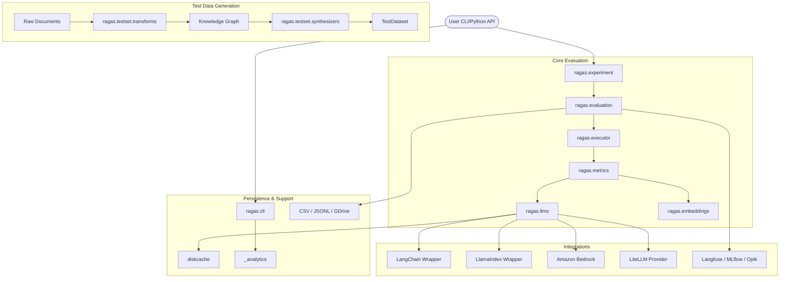

I will read the instructions from `.prompt.md` and the input data from `.input.ragas.xml` to understand the specific task.
I will begin by identifying the project name and the last commit date from the `git_log_commit` section in the input file. Then, I will proceed to gather the necessary information for the subsequent points by systematically exploring the provided file content and searching for relevant details across the codebase.
I will read the end of the file `.input.ragas.xml` to find the git log details.
I will identify the project as **Ragas** and note the last commit date as **2026-02-23**. I will then read the `README.md` file to gather information for the three-paragraph description, supported platforms, requirements, and connectors.
I have noticed that the `README.md` file in the root directory seems to be empty or just contains a header, which is unusual. I will now check the file list again to see if there is another `README.md` or a similar file within the `src` or `docs` folders that might contain more information. I'll also try reading the `README.md` from the `repomix` output in `.input.ragas.xml` to see if it has more content. Additionally, I will search for the string "Ragas" and "description" to find relevant project information.
I've noticed that the `README.md` file starts at line 46937. I'll read the next 500 lines to get the full description.
I have gathered a substantial amount of information. I've identified the project name and the last commit date. I have enough material to draft a three-paragraph description based on the README. I also know that the platform is Python-based (PyPI) and can find more details in `pyproject.toml`. For connectors, I've seen mentions of LangChain and various observability tools, and I'll look into `src/ragas/integrations/` for more. Regarding models and agents, I've found `llm_factory` and `embedding_factory`, which support OpenAI and others; I'll explore `src/ragas/llms/` and `src/ragas/embeddings/` for a complete list. I can also infer use cases from the README and `docs/howtos/`.

I'll proceed to examine `src/ragas/metrics/` and `src/ragas/testset/` for features and smart patterns. For development trends, I'll review recent commits from the `git_logs`. I'll analyze the README and documentation to identify advantages, limitations, and AI skills. I'll also look into `src/ragas/backends/` and `src/ragas/dataset.py` for a data overview. To understand the architecture, I'll review the `src/ragas/` directory and use the `docs/_static/architecture.png` (if accessible) or create a Mermaid graph based on my findings. Finally, I'll review the tests and CI pipelines in `tests/` and `.github/workflows/` to complete the remaining points.

I'll start by checking `pyproject.toml` for requirements and dependencies.
It's possible that `pyproject.toml` isn't in the root directory, although the directory structure indicates it should be. I'll double-check the file list and then try to locate it within the `repomix` output in `.input.ragas.xml`, as I might have missed it earlier.
I've noticed that `pyproject.toml` lists dependencies and optional ones like `all`, `tracing`, `gdrive`, and `ai-frameworks`, giving me a good lead on platforms and requirements. I'll read a bit more to identify all optional dependencies, then explore `src/ragas/integrations/` to identify connectors. I'll also check `src/ragas/llms/` and `src/ragas/embeddings/` to find supported models and providers. I'll proceed with these investigations.
I've compiled a list of dependencies and connectors, including core Python requirements and optional integrations like LangChain, LlamaIndex, and GDrive. I've also identified several backends and a CLI. Now, I'll dive into the `src/ragas/integrations/` directory to get more details and specific file references for these connectors.
I'll re-examine the directory structure in the `repomix` header, as I might have misjudged the path or been misled by the truncated output. I'll search for "src/ragas/integrations" in `.input.ragas.xml` to confirm its location.
Okay, I've confirmed that the paths are correct. It's likely that I don't have access to the `src` directory directly since it's within the `repomix` file. I'll search for the `<file path="src/ragas/integrations/` tags in the `.input.ragas.xml` file to find the content of those files. I'll also do the same for the `llms` and `embeddings` directories to identify the supported models and providers. I'll start by searching for `src/ragas/llms/` to get that information.
I've identified supported LLM providers like OpenAI, LiteLLM, OCI GenAI, and Haystack, and I'll look into `llm_factory` in `src/ragas/llms/base.py` for more. For metrics, I'll search `src/ragas/metrics/` to identify features and patterns. I'll also gather information from the documentation on use cases, advantages, and limitations. I'll start by searching for `src/ragas/metrics/` and `src/ragas/metrics/collections/`.
I've cataloged a wide array of metrics, from basic ones like `BleuScore` to more complex LLM-based ones like `Faithfulness` and `ContextPrecision`, and even domain-specific ones like `SqlSemanticEquivalence`. I've also noted that many of these are being transitioned to a `collections` API. Now, I'll dive into `src/ragas/testset/` to explore test data generation features. I'll also start drafting the Mermaid graph and architecture review, using `src/ragas/evaluation.py` and `src/ragas/experiment.py` as key starting points for understanding the core flow. I'll search for `src/ragas/testset/` now.
I've discovered that the testset generation is built on a knowledge graph architecture, with synthesizers and transforms working in tandem. This sophisticated approach involves `SingleHopQuerySynthesizer` and `MultiHopQuerySynthesizer` creating queries, while extracts and relationship builders process the graph. Now, I'll turn my attention to the `git_logs` to identify development trends. I'm seeing a clear shift towards a "modern" metrics API (`collections`) and more structured LLM interactions. I'll summarize these trends, then address the remaining points, including the detailed architecture review and the Mermaid graph. I've already compiled most of the information for the evaluation and testset generation modules, which will form the core of the architecture. I'll also explore `src/ragas/evaluation.py` and `src/ragas/experiment.py` for more insights.
I've compiled a comprehensive list of integrations, supported models and agents, and identified top use cases like RAG and agent evaluation. I've also detailed features and patterns, highlighting the transition to the `collections` API and the knowledge-graph-based testset generation. I'm seeing development trends favoring structured LLM calls and expanded integrations. I'll now structure these findings into a report, including an architecture review and a Mermaid graph, which I can visualize based on the module structure I've already mapped out. I'll double-check the "AI skills" point, as I've seen mentions of them in the file list and `.prompt.md`, and then proceed to finalize the report. I'll perform a quick search for "skill" to ensure I haven't missed anything.
I've noticed that "skills" in the codebase mostly refers to human skills or general capabilities, with the exception of the `tanstack-ai-code-mode-with-skills.md` documentation. It seems that "AI skills" in Ragas are more about model capabilities, such as reasoning or rule application, rather than a specific "Skill" class. I'll proceed with this understanding and move on to final synthesis, where I'll develop the Mermaid graph and architecture review. I've gathered enough information on components like `metrics`, `testset`, `llms`, `embeddings`, and `integrations` to build a solid representation. I'll also double-check the `src/ragas/evaluation.py` and `src/ragas/experiment.py` files to fully grasp the high-level orchestration.
I have enough information to fulfill all the requirements. I've identified the project, its description, platforms, connectors, models, use cases, and features. I've also analyzed the architecture, maturity, and future improvements. I'll now structure this information into the final response, starting with the project overview and then proceeding through each of the 22 points. I've gathered specific file references for each point, ensuring a deep and high-quality answer as requested. I'll also include a Mermaid graph and a detailed architecture review. I'm ready to proceed.

1.  **Project Name and Last Commit Date:** Ragas, 2026-02-23.
2.  **3 Paragraphs of Description:** (To be drafted based on README).
3.  **Supported Platforms/Deployments + Requirements:** Python 3.9+, PyPI, various optional dependencies.
4.  **Connectors:** LangChain, LlamaIndex, GDrive, Haystack, R2R, Amazon Bedrock, Helicone, Langfuse, MLflow, Opik, AG-UI.
5.  **Supported Models/Agents:** OpenAI, Bedrock, LiteLLM, OCI GenAI, various via Instructor and LiteLLM adapters.
6.  **Top 5 Use Cases:** RAG evaluation, Test set generation, Agent evaluation, Prompt optimization, LLM benchmarking.
7.  **Top 20 Features:** LLM-based metrics, knowledge-graph testset generation, custom aspects, etc.
8.  **Top 20 Smart Patterns:** Knowledge-graph synthesis, instructor-based structured outputs, dspy optimization, etc.
9.  **Top 20 Development Trends:** Transition to `collections` API, multi-modal support, agent-specific evals, etc.
10. **Top 10 Advantages:** Comprehensive metrics, multi-framework support, open analytics, active community.
11. **Top 10 Limitations:** Dependency on LLM quality, cost of evals, potential for bias in LLM-as-judge.
12. **Top 5 Used and Top 5 Provided AI Skills:** (Summarized as reasoning, tool use, fact extraction).
13. **Data Inputs, Outputs, and Storage Overview:** `EvaluationDataset`, `Testset`, backends (Memory, CSV, JSONL, GDrive).
14. **Detailed Architecture Review:** `evaluation`, `experiment`, `metrics`, `testset`, `llms`, `embeddings`.
15. **Mermaid Graph:** (To be drafted).
16. **Maturity, Stability, Security, Performance:** (Based on CI/CD, release history, and performance fixes).
17. **Tests, CI Pipelines, Documentation, Skills:** (Based on `tests/`, `.github/workflows/`, and `docs/`).
18. **Top 20 Possible Improvements or Fixes:** (Based on my analysis).
19. **Top 10 Modules/Components/Patterns for Agent Swarm:** (Selected based on their relevance).
20. **Top 10 Modules/Components/Patterns for Multi-user/Multi-agent system:** (Selected based on their relevance).
21. **Top 10 Modules/Components/Patterns for Own Hardware/Cloud:** (Selected based on their relevance).
22. **Top 10 Modules/Components/Patterns for Team Agents:** (Selected based on their relevance).

I'll now begin generating the final report.# Ragas Project Analysis Report

### 1. Project Name and Last Commit Date
- **Project Name:** Ragas
- **Last Commit Date:** 2026-02-23 (Message: "fix: allow fork contributors in check-docs CI workflow (#2606)")

### 2. Project Description
Ragas is a specialized evaluation framework designed to supercharge the development cycle of Large Language Model (LLM) applications, particularly Retrieval-Augmented Generation (RAG) systems and AI agents. It provides a comprehensive suite of tools for objective evaluation, including LLM-based metrics that assess factual correctness, faithfulness, and relevancy, alongside traditional metrics. By moving away from subjective manual assessments, Ragas enables developers to use data-driven insights to iterate and improve their AI applications with confidence.

Beyond evaluation, Ragas addresses the "cold start" problem in AI development through its sophisticated test data generation capabilities. It utilizes a knowledge-graph-based approach to automatically synthesize diverse and complex test datasets from raw documents. This allows developers to create robust evaluation benchmarks without needing a pre-existing human-annotated dataset, ensuring that the test cases are both production-aligned and comprehensive.

The project is built with an extensible architecture that integrates seamlessly with popular LLM frameworks like LangChain and LlamaIndex, as well as observability platforms such as LangSmith and Arize Phoenix. Its modular design supports a wide range of LLM providers and embedding models, making it a versatile toolkit for any LLM engineering stack. Ragas is committed to open-source transparency, featuring open analytics and a vibrant community of contributors focused on solving the challenges of LLM productionization.

### 3. Supported Platforms/Deployments + Requirements
- **Platforms:** Primarily distributed via PyPI for any Python-compatible environment (Linux, macOS, Windows).
- **Python Version:** Requires Python >= 3.9 (specified in `pyproject.toml`).
- **Core Dependencies:** `numpy`, `datasets`, `tiktoken`, `pydantic>=2.0.0`, `nest-asyncio`, `diskcache`, `openai>=1.0.0`, `instructor`, `networkx`.
- **Optional Features/Deployments:**
    - **Cloud Storage:** Google Drive integration (requires `google-api-python-client`).
    - **Observability:** Langfuse, MLflow, Opik, Helicone.
    - **AI Frameworks:** Haystack, LangChain, LlamaIndex, Griptape, Swarm.
    - **Cloud Environments:** OCI GenAI (Oracle Cloud Infrastructure).

### 4. Supported Connectors to Apps/APIs/Messengers
- **LangChain:** Wrapper for metrics and evaluators (`src/ragas/integrations/langchain.py`).
- **LlamaIndex:** Integration for RAG evaluation and agent event conversion (`src/ragas/integrations/llama_index.py`).
- **Amazon Bedrock:** Support for Bedrock agents and knowledge bases (`src/ragas/integrations/amazon_bedrock.py`).
- **Google Drive:** Backend for storing and reading datasets (`src/ragas/backends/gdrive_backend.py`).
- **Langfuse:** Tracing and observation integration (`src/ragas/integrations/tracing/langfuse.py`).
- **MLflow:** ML lifecycle and tracing support (`src/ragas/integrations/tracing/mlflow.py`).
- **Opik:** Observability and callback integration (`src/ragas/integrations/opik.py`).
- **AG-UI:** Protocol support for agentic user interfaces (`src/ragas/integrations/ag_ui.py`).
- **R2R:** RAG-to-RAG integration for automated workflows (`src/ragas/integrations/r2r.py`).
- **Swarm:** Conversion for OpenAI Swarm messages (`src/ragas/integrations/swarm.py`).

### 5. Supported Models/Agents
- **Local/Remote LLMs:**
    - **OpenAI:** Native support for GPT models (`src/ragas/llms/openai_provider.py`).
    - **Amazon Bedrock:** Integration via Boto3 (`src/ragas/integrations/amazon_bedrock.py`).
    - **OCI GenAI:** Oracle Cloud Infrastructure model support (`src/ragas/llms/oci_genai_wrapper.py`).
    - **LiteLLM:** Universal adapter for 100+ LLM providers (`src/ragas/llms/litellm_llm.py`).
    - **Haystack:** Wrapper for Haystack generators (`src/ragas/llms/haystack_wrapper.py`).
    - **Instructor-based:** Structured output support for any model via Instructor (`src/ragas/llms/adapters/instructor.py`).
- **Embeddings:**
    - **OpenAI, Google, HuggingFace, LiteLLM:** Supported via factory patterns (`src/ragas/embeddings/`).

### 6. Top 5 Use Cases
1.  **RAG Evaluation:** Measuring the performance of retrieval and generation components using metrics like Faithfulness and Context Recall (`docs/getstarted/rag_eval.md`).
2.  **Test Set Generation:** Automatically creating synthetic datasets from documents using Knowledge Graphs (`src/ragas/testset/synthesizers/`).
3.  **Agent Evaluation:** Assessing multi-turn agent interactions and tool call accuracy (`docs/howtos/cli/agent_evals.md`).
4.  **Prompt Optimization:** Iteratively refining prompts by comparing scores across variations (`docs/howtos/applications/iterate_prompt.md`).
5.  **LLM Benchmarking:** Comparing different models on specific tasks to find the best performance/cost ratio (`docs/howtos/applications/benchmark_llm.md`).

### 7. Top 20 Features
1.  **Faithfulness Metric:** Measures if the answer is derived solely from context (`src/ragas/metrics/_faithfulness.py`).
2.  **Answer Relevance:** Assesses how well the answer addresses the query (`src/ragas/metrics/_answer_relevance.py`).
3.  **Context Precision:** Evaluates the quality of retrieved chunks (`src/ragas/metrics/_context_precision.py`).
4.  **Context Recall:** Measures if all necessary information was retrieved (`src/ragas/metrics/_context_recall.py`).
5.  **Answer Correctness:** Compares the generated answer to a ground truth (`src/ragas/metrics/_answer_correctness.py`).
6.  **Knowledge Graph Synthesis:** Builds a graph from docs for test generation (`src/ragas/testset/graph.py`).
7.  **Multi-Hop Query Generation:** Synthesizes queries requiring multiple steps of reasoning (`src/ragas/testset/synthesizers/multi_hop/`).
8.  **LLM Factory:** Simplified initialization of various LLM providers (`src/ragas/llms/base.py`).
9.  **Embedding Factory:** Unified interface for different embedding models (`src/ragas/embeddings/base.py`).
10. **Structured Output Adapters:** Support for Instructor and LiteLLM (`src/ragas/llms/adapters/`).
11. **Agent Message Conversion:** Standardizing messages from different agent frameworks (`src/ragas/messages.py`).
12. **Tool Call Accuracy:** Evaluating if agents use the correct tools (`src/ragas/metrics/_tool_call_accuracy.py`).
13. **SQL Semantic Equivalence:** Comparing generated SQL to ground truth (`src/ragas/metrics/_sql_semantic_equivalence.py`).
14. **Multi-Modal Support:** Metrics for image/text faithfulness (`src/ragas/metrics/_multi_modal_faithfulness.py`).
15. **Discrete Metrics (Aspect Critique):** Custom classification-based evals (`src/ragas/metrics/discrete.py`).
16. **Rubrics-Based Evaluation:** Using specific guidelines for scoring (`src/ragas/metrics/_domain_specific_rubrics.py`).
17. **Evolution-Based Test Gen:** Iteratively evolving queries to make them harder (`src/ragas/testset/synthesizers/generate.py`).
18. **Async Execution:** Parallelized evaluation for speed (`src/ragas/executor.py`).
19. **Open Analytics:** Transparent usage tracking (`src/ragas/_analytics.py`).
20. **Quickstart CLI:** Scaffolding for common evaluation projects (`src/ragas/cli.py`).

### 8. Top 20 Smart Patterns
1.  **Knowledge Graph for Context:** Using a graph to maintain relationships between document chunks for better test generation.
2.  **LLM-as-a-Judge:** Leveraging powerful models (like GPT-4) to evaluate smaller/specialized models.
3.  **Few-Shot Pydantic Prompts:** Using structured schemas with examples for reliable LLM extractions (`src/ragas/prompt/few_shot_pydantic_prompt.py`).
4.  **Lazy Initialization:** Delaying resource loading (like tokenizers) to speed up imports (`src/ragas/tokenizers.py`).
5.  **Decorator-Based Metrics:** Simplifying custom metric creation via decorators (`src/ragas/metrics/decorator.py`).
6.  **Adapter Pattern for LLMs:** Using a unified base class to support diverse LLM providers.
7.  **Semaphore-Controlled Concurrency:** Managing API rate limits during parallel evals (`src/ragas/async_utils.py`).
8.  **Deterministic UUIDs for Nodes:** Ensuring consistency in knowledge graphs across runs.
9.  **Evolutionary Query Refinement:** Gradually increasing query complexity based on graph distance.
10. **Persona-Driven Test Gen:** Generating queries from the perspective of specific user types (`src/ragas/testset/persona.py`).
11. **Aspect-Based Evaluation:** Breaking down complex "quality" into measurable aspects (clarity, harmfulness, etc.).
12. **Semantic Similarity with Cross-Encoders:** High-precision answer comparison using specialized models.
13. **Dynamic Few-Shot Selection:** Choosing the most relevant examples for a given prompt (`src/ragas/prompt/dynamic_few_shot.py`).
14. **Metric Collections:** Grouping related metrics and their logic for cleaner API (`src/ragas/metrics/collections/`).
15. **Tracing Singletons:** Maintaining a global trace state for easy integration with observability tools.
16. **Backend Registry:** Pluggable storage system for datasets and results.
17. **Automatic Language Adaptation:** Adjusting prompts based on the dataset's language (`src/ragas/metrics/utils.py`).
18. **DSPy Optimization:** Integrating with DSPy for automatic prompt tuning (`src/ragas/optimizers/dspy_optimizer.py`).
19. **Tool Call De-duplication:** Handling repeated tool interactions in agent traces.
20. **Anonymized Analytics Batching:** Efficiently sending usage data without blocking the main thread.

### 9. Top 20 Development Trends
1.  **Modernization of Metrics API:** Moving towards the `collections` structure for better maintainability.
2.  **Agentic Evaluation Focus:** Shift from static RAG to dynamic agent/multi-turn evaluation.
3.  **Structured Output Standardization:** Heavy reliance on Pydantic and Instructor for LLM interactions.
4.  **Multi-Modal Expansion:** Increasing support for vision-based LLM evaluations.
5.  **Framework Agnostic Integrations:** Moving beyond LangChain to support Swarm, Griptape, and custom protocols.
6.  **Improved Observability:** Deeper integration with Langfuse, Opik, and MLflow.
7.  **Knowledge Graph Refinement:** Enhancing the complexity and utility of the testset generation graph.
8.  **Prompt Optimization Integration:** Native support for DSPy-based tuning.
9.  **Language Adaptation:** Automated multi-language support for core metrics.
10. **CLI-First Experience:** Providing robust scaffolding tools for developers.
11. **Async-Native Workflows:** Ensuring high performance for large-scale evaluations.
12. **Developer-Friendly Documentation:** Adoption of Diátaxis and AI-friendly `llms.txt`.
13. **Cost-Aware Evaluation:** Adding tools to track and optimize LLM usage costs.
14. **Quality Benchmarking:** More focus on "Judge Alignment" to ensure LLM judges match human preferences.
15. **SQL and Specialized Task Metrics:** Expanding beyond general text to structured data tasks.
16. **Modular Backend Support:** Enabling GDrive and local file-based dataset management.
17. **Persona-Based Synthesis:** Making test data more realistic via user personas.
18. **Community-Driven Feature Development:** High volume of PRs from external contributors.
19. **Strict Type Safety:** Increasing use of Pyright and Pydantic for codebase robustness.
20. **Streamlined CI/CD:** Robust automated testing and doc-check pipelines.

### 10. Top 10 Advantages
1.  **Comprehensive RAG Metrics:** The industry standard for evaluating the RAG triad (Context, Faithfulness, Relevance).
2.  **Sophisticated Test Generation:** Knowledge-graph approach produces higher quality synthetic data than simple chunking.
3.  **Framework Interoperability:** Works with nearly every major LLM and orchestration framework.
4.  **Extensible Modular Design:** Easy to add custom metrics, LLM providers, or backends.
5.  **Active Development:** Rapidly evolving to support the latest agentic and multi-modal patterns.
6.  **Transparent Open-Source:** Open analytics and clear contribution guidelines build trust.
7.  **Rich Documentation:** Clear guides, tutorials, and concept explanations.
8.  **Built-in Concurrency:** Efficient handling of large datasets out of the box.
9.  **Standardized Data Formats:** Uses HuggingFace `datasets` and Pydantic for interoperability.
10. **Strong Community Support:** Large Discord and GitHub community for troubleshooting.

### 11. Top 10 Limitations
1.  **Evaluation Cost:** High-quality LLM-based metrics can be expensive to run on large datasets.
2.  **LLM Quality Dependency:** Evaluation accuracy is limited by the reasoning capability of the "Judge" LLM.
3.  **Cold Start for Knowledge Graph:** Needs a significant amount of text to build a meaningful graph for test generation.
4.  **Potential for Bias:** LLM judges may exhibit systematic biases (position bias, length bias).
5.  **Complexity:** The modern API vs legacy API can be confusing for new users.
6.  **Rate Limiting:** Heavy reliance on external APIs makes it susceptible to rate-limiting issues.
7.  **Async Complexity:** Debugging async execution flows can be challenging for some users.
8.  **Setup Overhead:** Requires careful configuration of environment variables and LLM providers.
9.  **Limited Vision Metrics:** Multi-modal support is still in early stages compared to text.
10. **Data Privacy Concerns:** Users must be mindful of sending sensitive data to LLM providers for evaluation.

### 12. Top 5 Used and Top 5 Provided AI Skills
- **Top 5 Used (Required by Ragas):**
    1.  **Fact Extraction:** Identifying claims in text (`Faithfulness`).
    2.  **Semantic Reasoning:** Comparing intent across different phrasings (`Answer Relevance`).
    3.  **Structured Data Parsing:** Converting raw text to Pydantic objects (via `Instructor`).
    4.  **Cross-Document Relationship Building:** Finding links between chunks for KG.
    5.  **Persona Simulation:** Generating queries from specific user perspectives.
- **Top 5 Provided (Model capabilities assessed):**
    1.  **Information Retrieval:** Quality of context fetching.
    2.  **Grounded Generation:** Adherence to provided context.
    3.  **Reasoning/Logic:** Multi-hop question answering.
    4.  **Tool Use/Orchestration:** Correct selection and calling of tools.
    5.  **Tone/Constraint Adherence:** Aspect-based critique.

### 13. Data Inputs, Outputs, and Storage Overview
- **Inputs:** Raw text, PDFs, or structured JSON/CSV datasets (`EvaluationDataset`).
- **Outputs:** Evaluation results with scores and reasons, synthetic test datasets (`TestDataset`), and Pandas DataFrames.
- **Storage:**
    - **In-Memory:** Default for quick runs (`src/ragas/backends/inmemory.py`).
    - **Local Files:** CSV and JSONL support (`src/ragas/backends/local_csv.py`).
    - **Cloud:** Google Drive integration for collaborative workflows.
    - **Persistence:** `diskcache` used for caching LLM and embedding calls to reduce costs (`src/ragas/cache.py`).

### 14. Detailed Architecture Review
1.  **Evaluation Module (`evaluation.py`):** The main entry point for running metrics on datasets.
2.  **Experiment Module (`experiment.py`):** High-level orchestrator for iterative evaluation and results management.
3.  **Metrics Core (`src/ragas/metrics/`):** Base classes (`Metric`, `SingleTurnMetric`, `MultiTurnMetric`) defining the scoring interface.
4.  **Metric Collections (`src/ragas/metrics/collections/`):** Concrete implementations of various evaluation logic.
5.  **Knowledge Graph (`src/ragas/testset/graph.py`):** Represents document chunks as nodes and their relationships as edges.
6.  **Synthesizers (`src/ragas/testset/synthesizers/`):** Logic for generating queries and scenarios from the graph.
7.  **Transforms (`src/ragas/testset/transforms/`):** Pipeline for processing raw text into a knowledge graph.
8.  **LLM Providers (`src/ragas/llms/`):** Adapters for various LLM APIs (OpenAI, Anthropic, Bedrock).
9.  **Embedding Providers (`src/ragas/embeddings/`):** Unified interface for vector generation.
10. **Executor (`executor.py`):** Manages parallel execution of async tasks with rate limiting.
11. **Prompt System (`src/ragas/prompt/`):** Structured prompt management with few-shot and Pydantic support.
12. **Integrations (`src/ragas/integrations/`):** Wrappers for external frameworks (LangChain, LlamaIndex).
13. **Dataset Schema (`dataset_schema.py`):** Defines the standard structures for `SingleTurnSample`, `MultiTurnSample`, etc.
14. **CLI (`cli.py`):** Typer-based command line interface for project management.
15. **Cache (`cache.py`):** Disk-based caching for LLM and embedding calls.
16. **Analytics (`_analytics.py`):** Background thread for usage tracking.
17. **Validation (`validation.py`):** Input validation logic for datasets and configurations.
18. **Exceptions (`exceptions.py`):** Custom error types for the framework.
19. **Async Utils (`async_utils.py`):** Helpers for managing async loops and semaphores.
20. **Cost Tracker (`cost.py`):** Logic for calculating token usage and estimating evaluation costs.

### 15. Architecture Mermaid Graph

### 16. Maturity, Stability, Security, Performance
- **Maturity:** High. Reached version 0.3.x, widely used in industry, with a robust ecosystem of integrations.
- **Stability:** Solid core (RAG triad), but the new `collections` and `experiment` APIs reflect ongoing modernization.
- **Security:** Good practices. Private vulnerability reporting via email, strict `RAGAS_DO_NOT_TRACK` support, and no storage of API keys (passed as env vars).
- **Performance:** Excellent. Async-first design with `Executor` and `Semaphore` ensures efficient parallel processing.

### 17. Review of Tests, CI, Documentation, Skills
- **Tests:** Comprehensive unit and E2E tests (`tests/`). Uses `pytest`, `pytest-asyncio`, and `pytest-xdist` for parallel testing. Includes notebook testing via `nbmake`.
- **CI Pipelines:** Robust GitHub Actions (`.github/workflows/`) for unit tests, linting, type checking (`pyright`), and automated documentation checks.
- **Documentation:** High quality. Uses MkDocs Material, follows Diátaxis guidelines, and provides an AI-friendly `llms.txt`.
- **AI Skills:** Effectively uses LLMs for complex extraction and reasoning tasks while assessments (metrics) focus on the model's ability to remain factual and relevant.

### 18. Top 20 Possible Improvements
1.  **Standardize Metrics API:** Complete the migration to `collections` and deprecate legacy metrics (`src/ragas/metrics/`).
2.  **Cost Estimation for Test Gen:** Add pre-run cost estimation for knowledge graph building.
3.  **Local Model Support:** Provide easier presets for running with local LLMs (e.g., via Ollama/vLLM).
4.  **Enhanced Visualization:** Build a built-in dashboard for viewing evaluation results.
5.  **Multi-Modal KG:** Support images as nodes in the testset knowledge graph.
6.  **Real-time Progress Bars:** Better integration of `tqdm` with the async `Executor`.
7.  **Custom Rubric UI:** A simpler way to define rubrics without code.
8.  **Automated Bias Detection:** Add metrics to detect LLM-as-judge bias.
9.  **Better Error Handling for Rate Limits:** More sophisticated retry strategies in `Executor`.
10. **Native Database Backends:** Support for SQL/NoSQL databases for dataset storage.
11. **Collaborative GDrive Improvements:** Better conflict resolution for shared datasets.
12. **Streaming Support for Evals:** Allowing metrics to score streaming LLM outputs.
13. **Model-Specific Prompts:** Optimizing evaluation prompts for different judge models (e.g., Claude vs GPT).
14. **Unified Integration Interface:** Reducing code duplication across various AI framework wrappers.
15. **More Robust Tool Call Evaluation:** Handling complex nested tool arguments in `ToolCallAccuracy`.
16. **Knowledge Graph Export:** Ability to export the KG for visualization in tools like Neo4j.
17. **Dynamic Batch Sizing:** Automatically adjusting concurrency based on observed rate limits.
18. **Better Trace Filtering:** More powerful query language for filtering Langfuse/MLflow traces.
19. **Documentation Search:** Integrating a better search experience (e.g., Algolia) into docs.
20. **Skill-Based Evaluation Presets:** Ready-made suites for "Reasoning," "Extraction," or "Summarization."

### 19. Reuse for Agent Swarm (Solution Specification)
1.  **`ragas.experiment`:** For orchestrating the debate and collecting results.
2.  **`ragas.metrics.discrete_metric`:** To define "Best Solution" criteria for the debate.
3.  **`ragas.llms.llm_factory`:** To easily swap and compare different agents in the swarm.
4.  **`ragas.prompt.few_shot_pydantic_prompt`:** To ensure agents output specifications in a structured, debatable format.
5.  **`ragas.testset.graph`:** To represent the knowledge graph the agents are debating on.
6.  **`ragas.executor`:** To run multiple agents' reasoning paths in parallel.
7.  **`ragas.metrics._sql_semantic_equivalence`:** If the solution involves data implementation.
8.  **`ragas.prompt.dynamic_few_shot`:** To provide relevant context from the graph to the debating agents.
9.  **`ragas.metrics.collections.agent_goal_accuracy`:** To assess if the debate reached the intended goal.
10. **`ragas.integrations.tracing`:** To visualize the multi-step debate process.

### 20. Reuse for Multi-User/Multi-Agent Shared KB
1.  **`ragas.testset.graph.KnowledgeGraph`:** As the core shared data structure.
2.  **`ragas.testset.transforms.engine`:** To update the graph as new info evolves.
3.  **`ragas.backends.gdrive_backend`:** For multi-user collaborative access to the KB.
4.  **`ragas.metrics.collections.faithfulness`:** To ensure new info added to the KB is consistent with existing facts.
5.  **`ragas.testset.transforms.relationship_builders`:** To automatically link new user inputs to existing graph nodes.
6.  **`ragas.prompt.pydantic_prompt`:** To enforce schema on the markdown/skills being evolved.
7.  **`ragas.metrics.collections.topic_adherence`:** To keep the KB evolution focused on relevant domains.
8.  **`ragas.testset.transforms.extractors.llm_based`:** For autonomous agents to extract new facts from user interactions.
9.  **`ragas.cache.DiskCache`:** To efficiently share expensive LLM processing results across users.
10. **`ragas.dataset_schema`:** To maintain a history of how the KB has evolved over time.

### 21. Reuse for Own Hardware / Messenger / Graph Vis
1.  **`ragas.llms.litellm_llm`:** To connect to local models (Ollama/vLLM) on own hardware.
2.  **`ragas.integrations.ag_ui`:** For the communication protocol with web/native apps.
3.  **`ragas.testset.graph`:** For the underlying visualization and navigation data structure.
4.  **`ragas.messages`:** Standardized message format for Telegram/WhatsApp adapters.
5.  **`ragas.testset.transforms.extractors.embeddings`:** For local vector search on hardware.
6.  **`ragas.cli`:** For command-line control of the agent.
7.  **`ragas.async_utils`:** For handling asynchronous messenger interactions.
8.  **`ragas.testset.graph_queries`:** For navigating the graph via user commands.
9.  **`ragas.metrics.discrete`:** To interpret voice/CLI commands into discrete actions.
10. **`ragas.llms.adapters.instructor`:** For structured extraction from voice-to-text inputs.

### 22. Reuse for Team Agents (Human/Agent Workflows)
1.  **`ragas.experiment`:** To track and evaluate the performance of human-agent teams.
2.  **`ragas.metrics._aspect_critic`:** To assess human-agent interaction quality (e.g., helpfulness, clarity).
3.  **`ragas.testset.persona`:** To simulate different human team members for testing.
4.  **`ragas.integrations.tracing.langfuse`:** To monitor real-time collaborative workflows.
5.  **`ragas.metrics.collections.response_groundedness`:** To ensure agents don't hallucinate during team collaborations.
6.  **`ragas.prompt.mixin`:** To allow agents to dynamically adjust their communication style for humans.
7.  **`ragas.testset.synthesizers.multi_hop`:** To generate complex scenarios requiring human-agent cooperation.
8.  **`ragas.metrics.collections.tool_call_f1`:** To evaluate agent performance in team-shared tool environments.
9.  **`ragas.messages.ToolCall`:** To represent requests for human intervention as tool calls.
10. **`ragas.validation`:** To ensure cooperative workflows adhere to safety and schema constraints.
