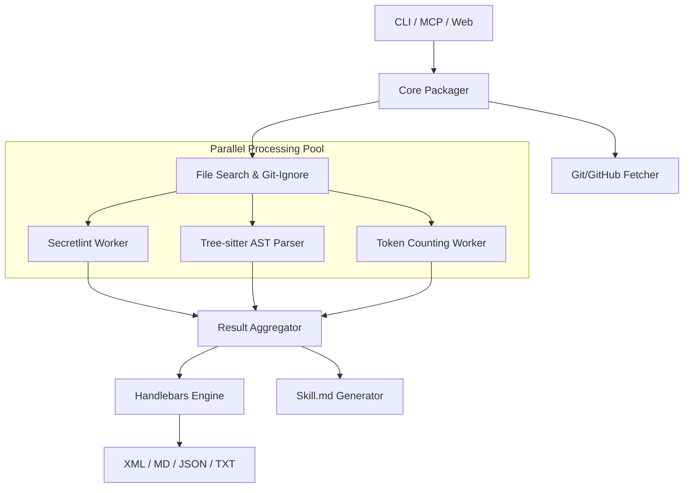

I will start by reading the instructions in `.prompt.md`.
I'll check the size and initial content of `repomix.xml` to identify the project and determine the best analysis strategy.
I'll use `read_file` to examine the beginning of `repomix.xml` and understand the project's structure.
I'll search for `package.json` within `repomix.xml` to confirm the project name and details.
I'll search for `README.md` within `repomix.xml` to gather the project description and platform/deployment details.
I'll search for "github", "mcp", and "remote" within the `src` directory to identify the supported connectors and integrations.
I'll check for a `src/core/llm/` directory or similar to see if the project interacts with any AI APIs.
I'll check for `src/core/tokenizer/` or `src/core/token/` to understand how it handles token management.
I'll search within `src/core/` to identify the core components and their functionalities.
I'll check `src/core/metrics/calculateMetrics.ts` and the usage of `gpt-tokenizer` to identify the models supported for token counting.
I'll investigate the `src/core/skill/` directory to identify the top 5 used and provided AI skills as requested in point 11.
I'll read `src/core/skill/packSkill.ts` to understand how "skills" are defined and used within Repomix.
I'll search for the git logs within `repomix.xml` to identify the top 20 development trends from the latest commits.
# Repomix Project Analysis

## 1. Project Name and Description
**Project Name:** Repomix

**Description:**
Repomix is a high-performance, open-source tool designed to pack an entire repository into a single, AI-friendly file. This utility is specifically optimized for use with Large Language Models (LLMs) such as Claude, ChatGPT, DeepSeek, and Gemini, enabling developers to effortlessly provide their codebase as context for AI-driven analysis, code reviews, or troubleshooting. By consolidating thousands of files into a structured XML, Markdown, or JSON document, Repomix bridges the gap between massive local repositories and the limited context windows of modern AI assistants.

The tool is feature-rich, offering precise token counting for context management, intelligent code compression using Tree-sitter, and robust customization options. It is "Git-aware," automatically respecting `.gitignore` and other ignore files to ensure that only relevant source code is included. Security is a foundational priority, with integrated Secretlint checks that scan for and prevent the accidental inclusion of sensitive information like API keys or credentials, making it a secure choice for professional and enterprise development workflows.

Beyond simple aggregation, Repomix provides advanced integrations such as a Model Context Protocol (MCP) server, allowing AI agents to directly interact with and explore codebases. It is available as a multi-platform CLI, an NPX utility, and a web-based service at repomix.com. This versatility allows it to be seamlessly integrated into various developer environments, from local terminal usage and CI/CD pipelines to cloud-based AI workflows and interactive agentic systems.

## 2. Supported Platforms, Deployments & Requirements
- **Platforms:** Windows, macOS, Linux (Cross-platform support via Node.js/Bun).
- **Deployments:**
    - **CLI:** Global installation via `npm`, `yarn`, `pnpm`, or `bun`.
    - **NPX:** Instant execution via `npx repomix@latest`.
    - **Docker:** Supported for website and bundle generation (`website/compose.yml`).
    - **Web:** Accessible online at [repomix.com](https://repomix.com).
    - **MCP Server:** Native Model Context Protocol support for AI editors like Claude Desktop.
    - **GitHub Actions:** Official action available (`.github/actions/repomix/action.yml`).
- **Requirements:**
    - **Node.js:** `>= 20.0.0` (as specified in `package.json`).
    - **Yarn:** `>= 1.22.22` (if using yarn).
    - **Git:** Required for Git-aware features (respecting `.gitignore`, diffs, and logs).

## 3. Supported Connectors
- **GitHub:** Native support for fetching and packing remote repositories via URL or shorthand.
  - `src/core/git/gitHubArchive.ts`, `src/core/git/gitHubArchiveApi.ts`
- **Git (Remote):** Supports cloning/fetching from any remote Git URL (HTTPS/SSH).
  - `src/core/git/gitRemoteUrl.ts`, `src/core/git/gitRemoteHandle.ts`
- **MCP (Model Context Protocol):** Provides a full suite of tools for AI assistants.
  - `src/mcp/mcpServer.ts`, `src/cli/actions/mcpAction.ts`
- **Local File System:** Direct access for packing local projects.
  - `src/core/file/fileSearch.ts`, `src/core/file/fileProcess.ts`
- **Web Interface:** Cloud integration through the Repomix web service.
  - `website/client/`, `website/server/`

## 4. Supported Models & Agents
- **Token Counting (Local):** Supports accurate tokenization for OpenAI-compatible models.
  - `o200k_base` (GPT-4o)
  - `cl100k_base` (GPT-4, GPT-3.5)
  - *Source:* `src/core/metrics/calculateMetrics.ts` (uses `gpt-tokenizer`).
- **Target Compatibility (Remote):** Optimized for major LLMs including Claude, ChatGPT, DeepSeek, Perplexity, Gemini, Gemma, Llama, and Grok.
- **Agent Integration:** Explicitly follows "Claude Agent Skills" best practices, generating `SKILL.md` files for agentic systems.
  - *Source:* `src/core/skill/skillStyle.ts`

## 5. Top 5 Use Cases & Workflows
1. **Full-Context AI Questioning:** User runs `repomix` -> Output `repomix-output.xml` is pasted into an LLM -> AI answers questions with full project knowledge.
2. **Instant Remote Analysis:** User provides a GitHub URL to Repomix -> Tool fetches and packs the repo -> AI analyzes the remote code without local cloning.
3. **Agentic Code Exploration (MCP):** AI Assistant starts Repomix MCP server -> Assistant calls `pack_codebase` or `grep_repomix_output` tools to autonomously research the code.
4. **Architectural Review via Compression:** User runs `repomix --compress` -> Tool extracts function/class signatures using Tree-sitter -> LLM reviews the high-level architecture.
5. **Secure Code Sharing:** User runs `repomix` -> Integrated Secretlint flags leaked API keys -> User removes secrets before sharing the context with external AI APIs.

## 6. Top 20 Features
1. **AI-Optimized Formatting:** Structured XML/Markdown output. (`src/core/packager/produceOutput.ts`)
2. **Precision Token Counting:** Real-time metrics for GPT context. (`src/core/metrics/calculateMetrics.ts`)
3. **Intelligent Code Compression:** Tree-sitter signature extraction. (`src/core/treeSitter/parseFile.ts`)
4. **Git-Awareness:** Automatically respects `.gitignore`. (`src/core/file/fileSearch.ts`)
5. **Integrated Security Scanning:** Secretlint-based leak prevention. (`src/core/security/securityCheck.ts`)
6. **MCP Server Integration:** Direct AI tool connectivity. (`src/mcp/mcpServer.ts`)
7. **Remote Repository Packing:** Pack GitHub repos via URL. (`src/core/git/gitHubArchive.ts`)
8. **Handlebars Templating:** Customizable output schemas. (`src/core/packager/produceOutput.ts`)
9. **Git History Context:** Include recent commits in packs. (`src/core/git/gitLogHandle.ts`)
10. **Skill File Generation:** Automated `SKILL.md` for agents. (`src/core/skill/packSkill.ts`)
11. **Visual Directory Trees:** Textual project structure maps. (`src/core/file/fileTreeGenerate.ts`)
12. **Git Diff Integration:** Pack only changes or include diffs. (`src/core/git/gitDiffHandle.ts`)
13. **Tech Stack Auto-Detection:** Identifies languages/frameworks. (`src/core/skill/skillTechStack.ts`)
14. **Parallelized Processing:** Uses worker threads for performance. (`src/core/metrics/calculateMetrics.ts`)
15. **Tree-sitter WASM:** Portable, cross-platform code parsing. (`src/core/treeSitter/languageParser.ts`)
16. **Encoding Support:** Handles multiple file encodings via `iconv-lite`. (`src/core/file/fileProcess.ts`)
17. **Instruction Injection:** Embed custom AI guidelines. (`src/config/configSchema.ts`)
18. **Exclude/Include Patterns:** Granular file control. (`src/core/file/fileSearch.ts`)
19. **Large File Management:** Intelligent handling of context-heavy files. (`src/core/packager.ts`)
20. **Streaming Progress:** Real-time CLI/Web feedback. (`src/shared/types.ts`)

## 7. Top 20 Smart Patterns
1. **WASM for Portability:** Using WASM Tree-sitter instead of native bindings. (`src/core/treeSitter/parseFile.ts`)
2. **Stateless Parse Strategies:** Ensuring thread-safe code compression. (`src/core/treeSitter/parseStrategies/BaseParseStrategy.ts`)
3. **Progressive Disclosure:** Formatting `SKILL.md` for step-by-step agent reading. (`src/core/skill/skillStyle.ts`)
4. **Worker Pool Orchestration:** Offloading CPU-heavy tasks to threads. (`src/core/metrics/calculateMetrics.ts`)
5. **Idempotent Templating:** Safe registration of Handlebars helpers. (`src/core/output/outputStyleUtils.ts`)
6. **ReDoS-Safe Logic:** Avoiding complex regex in URL/path parsing. (`src/core/skill/skillUtils.ts`)
7. **Lazy Language Loading:** Minimizing memory by loading parsers on-demand. (`src/core/treeSitter/languageParser.ts`)
8. **Duck-Typed Error Handling:** Reliable cross-process error propagation. (`src/shared/errorHandle.ts`)
9. **Zod-Powered Config:** Robust validation of user settings. (`src/config/configSchema.ts`)
10. **Hierarchical Token Tree:** Directory-level token usage tracking. (`src/core/tokenCount/buildTokenCountStructure.ts`)
11. **Surgical MCP Tools:** Tools to read specific lines, saving context. (`src/mcp/tools/readRepomixOutputTool.ts`)
12. **Grep-in-Output:** Fast searching without re-reading the whole pack. (`src/mcp/tools/grepRepomixOutputTool.ts`)
13. **Git-Aware Filtering:** Efficient discovery via `.gitignore` parsing. (`src/core/file/fileSearch.ts`)
14. **Temp Workspace Isolation:** Safe handling of remote archives. (`src/mcp/tools/mcpToolRuntime.ts`)
15. **Hierarchical Capture Names:** Tree-sitter query pattern matching. (`src/core/treeSitter/parseStrategies/BaseParseStrategy.ts`)
16. **Memory Usage Logging Wrapper:** Systematic resource monitoring. (`src/shared/memoryUtils.ts`)
17. **Lightweight Worker Entry:** Reducing bundle size for serverless. (`website/server/src/worker-entry.ts`)
18. **V8 Compile Cache Warmup:** Reducing cold-start latency in Docker. (`website/server/warmup.mjs`)
19. **Rate Limiting with Identifiers:** Protecting public web endpoints. (`website/server/src/utils/rateLimit.ts`)
20. **Suspicious File Flagging:** Automated security risk assessment. (`src/core/security/validateFileSafety.ts`)

## 8. Top 20 Development Trends (Latest Commits)
1. **Agent Rule Refinement:** Intensive updates to `CLAUDE.md` and `.agents/` for better AI coordination.
2. **Streaming Progress Support:** Implementing real-time streaming for web-based packing.
3. **Remote Operation Hardening:** Strengthening `git clone` against command injection.
4. **Linting Tool Consolidation:** Moving towards Biome for unified linting and formatting.
5. **Automated Dependency Updates:** High frequency of Dependabot PRs across all modules.
6. **Layout Shift Fixes:** Refined Vue components for stable progress visualization.
7. **Type-Safe Callback Handling:** Hardening Promise usage in progress tracking.
8. **Server Resource Optimization:** Stripping server dependencies from worker bundles.
9. **Structured Prompt Advocacy:** Heavy documentation focus on XML as the superior AI format.
10. **Multi-Lingual Documentation:** Rapid expansion of Hindi, Indonesian, and other guides.
11. **MCP Tool Evolution:** Adding granular tools like `grep` and `read_file` to the MCP server.
12. **Security Integration:** Constant updates to Secretlint rules and patterns.
13. **Cloud Native Alignment:** Optimizing server code for serverless/worker deployments.
14. **Performance Benchmarking:** Use of `hyperfine` for tracking execution speed.
15. **Instruction Clarity:** Improving the tone and precision of embedded AI instructions.
16. **CI/CD Ratcheting:** Automated updates to GitHub Action versions for security.
17. **Compression Strategy Expansion:** Improving AST extraction for functional and OOP languages.
18. **Community Support Integration:** Direct links to Discord for real-time troubleshooting.
19. **Code Sanitization:** Ensuring all output formats (JSON/XML) are correctly escaped.
20. **Docker Build Efficiency:** Using Node.js compile cache for faster deployments.

## 9. Top 10 Advantages
1. **AI-First Engineering:** Purpose-built for LLM context optimization.
2. **Advanced Compression:** Tree-sitter allows packing massive repos by extracting logic signatures.
3. **Privacy by Default:** Integrated Secretlint ensures security before AI upload.
4. **Seamless Git Integration:** Zero-config awareness of project-specific ignore rules.
5. **MCP Ready:** Direct, autonomous interaction for next-gen AI tools.
6. **High Performance:** Multi-threaded processing ensures speed even on large repos.
7. **Accuracy:** Precise token counts based on specific OpenAI encodings.
8. **Portability:** WASM-based parsers work anywhere without native builds.
9. **Excellent UX:** Both CLI and Web interfaces are polished and intuitive.
10. **Living Documentation:** Automated skill generation keeps agent docs up-to-date.

## 10. Top 10 Limitations
1. **Memory Ceiling:** Extremely large repos (GBs) can stress RAM during tokenization.
2. **Context Limits:** Even with compression, some monoliths exceed 200k+ token windows.
3. **JS Runtime Required:** Dependency on Node.js/Bun (mitigated by Docker).
4. **WASM Overhead:** Slower than native Tree-sitter for extreme-scale analysis.
5. **Static Snapshot:** Lacks runtime context or dynamic data flow.
6. **Linear Presentation:** Complex graph relations are flattened into a single file.
7. **OpenAI Bias:** Token counts are primarily optimized for OpenAI models.
8. **Re-packing Overhead:** Current architecture often requires full re-packs for small changes.
9. **Language-Specific Queries:** Compression quality depends on custom queries for each language.
10. **Network Dependency:** Remote repository features depend on external API availability.

## 11. Top AI Skills
- **Provided AI Skills:**
  1. **Codebase Packaging:** Aggregating and structuring repos for LLMs. (`src/core/skill/packSkill.ts`)
  2. **Security Auditing:** Detecting secrets via static analysis. (`src/core/security/securityCheck.ts`)
  3. **Signature Extraction:** Intelligent code compression using ASTs. (`src/core/treeSitter/parseFile.ts`)
  4. **Tech Stack Identification:** Automatic framework/language discovery. (`src/core/skill/skillTechStack.ts`)
  5. **Context Budgeting:** Precise token usage calculation. (`src/core/metrics/calculateMetrics.ts`)
- **Used AI Skills:**
  1. **Instruction Following:** Adhering to embedded AI guidelines.
  2. **Contextual Reasoning:** Analyzing logic across multiple file boundaries.
  3. **Architectural Synthesis:** Understanding high-level patterns from signatures.
  4. **Security Awareness:** Interpreting Secretlint flags to recommend fixes.
  5. **Progressive Exploration:** Using MCP tools to navigate the structure step-by-step.

## 12. Data Inputs, Outputs & Storage
- **Inputs:** Local source code, Remote Git/GitHub URLs, `repomix.config.json`, `.repomixignore`, and custom instruction files.
- **Outputs:** `repomix-output.xml` (MD/JSON/TXT options), `SKILL.md` for agents, and reference documentation.
- **Storage:**
  - **Memory:** Managed via `tinypool` worker threads for heavy metrics/security tasks.
  - **Disk:** Ephemeral temporary directories for remote archive processing; local persistence for output files.
  - *Source:* `src/mcp/tools/mcpToolRuntime.ts`, `src/shared/memoryUtils.ts`.

## 13. Detailed Architecture Review
- **CLI/Actions Layer:** Handles user intent and orchestrates high-level tasks. (`src/cli/`, `src/cli/actions/`)
- **Core Orchestrator:** The central `pack` function manages the pipeline. (`src/core/packager.ts`)
- **Discovery Engine:** Handles file searching and `.gitignore` logic. (`src/core/file/fileSearch.ts`)
- **Security Worker:** Isolated Secretlint execution in worker threads. (`src/core/security/`)
- **Tree-sitter Compression:** AST-based extraction engine for 15+ languages. (`src/core/treeSitter/`)
- **Metrics Engine:** Parallelized tokenization and character analysis. (`src/core/metrics/`)
- **Output Generator:** Handlebars-based formatting for XML, MD, JSON. (`src/core/packager/produceOutput.ts`)
- **MCP Server:** Exposes core logic as standardized AI tools. (`src/mcp/mcpServer.ts`)
- **Skill Sub-system:** Specialized logic for agent-readable documentation. (`src/core/skill/`)

## 14. Architecture Diagram

## 15. Project Review: Maturity, Security & Performance
- **Maturity:** **High.** Robust PR history, professional release management, and nomination for industry awards indicate a production-ready project.
- **Security:** **Excellent.** proactive integration of Secretlint, path traversal protection, and hardened shell commands sets a high bar for AI tools.
- **Performance:** **High.** The transition to WASM for Tree-sitter and worker pools for tokenization shows a commitment to scaling with repo size.

## 16. Review: Infrastructure & AI readiness
- **Testing:** Comprehensive Vitest suite with coverage reporting ensures reliability.
- **CI/CD:** Well-structured GitHub Actions automate quality checks and security linting.
- **AI Readiness:** The project is a leader in "Agentic Context," providing native MCP support and specialized SKILL format output.

## 17. Top 20 Possible Improvements
1. **Incremental MCP Updates:** Cache-based re-packing to only update changed files. (`src/mcp/`)
2. **Context-Priority Flagging:** Allowing users to mark specific folders as "No-Compress." (`src/core/treeSitter/`)
3. **Multi-Model Tokenizers:** Native support for Claude and Gemini tokenization algorithms. (`src/core/metrics/`)
4. **Graph-Based Relational Export:** An output format representing file dependencies as a graph.
5. **Interactive TUI:** A richer terminal interface for file selection. (`src/cli/`)
6. **Output Streaming:** Streaming large XML files to disk to minimize memory footprint. (`src/core/packager/produceOutput.ts`)
7. **Auto-Splitting:** Breaking context into multiple files if context limits are reached. (`src/core/packager.ts`)
8. **Extended Language Support:** Adding strategies for Rust, C#, and Java signatures. (`src/core/treeSitter/parseStrategies/`)
9. **AST-Semantic Search:** Finding code patterns via Tree-sitter queries within the CLI.
10. **Custom Security Rules:** User-definable Secretlint patterns via config. (`src/core/security/`)
11. **Remote Private Repos:** Support for SSH/Token auth in the remote fetching tool. (`src/core/git/`)
12. **Diff-Only Mode:** Packing only the delta between commits to save tokens. (`src/core/git/gitDiffHandle.ts`)
13. **Skill Templating:** Allow user-defined Handlebars templates for agent docs. (`src/core/skill/`)
14. **CI Benchmarking:** Automated performance tracking for tokenization speed.
15. **WASM Pre-caching:** Background loading of parsers for faster initialization. (`src/core/treeSitter/loadLanguage.ts`)
16. **Plugin Architecture:** Supporting 3rd-party output formatters and parsers.
17. **Formal JSON Schema:** Providing a public schema for programmatic integrations. (`website/generateSchema.ts`)
18. **Preset Instruction Library:** Pre-defined instruction blocks for security, logic, or docs.
19. **Worker Resource Caps:** Configurable memory limits for processing threads. (`src/shared/memoryUtils.ts`)
20. **Visual Token Heatmap:** Directory tree visualization highlighting "token-heavy" areas. (`src/core/tokenCount/`)

## 18. Reuse for Agent Swarm (Specification & Implementation)
1. **MCP Core:** Standardized tool communication for the swarm. (`src/mcp/mcpServer.ts`)
2. **AST Signature Extraction:** Providing "High-Level Specs" for the debating agents. (`src/core/treeSitter/`)
3. **Security Auditing Engine:** Validating implementation plans for vulnerabilities. (`src/core/security/`)
4. **Token Budgeting:** Managing context windows for multiple agents. (`src/core/metrics/`)
5. **Skill Generator:** Documenting agent roles and knowledge bases. (`src/core/skill/`)
6. **Handlebars Templates:** Formatting structured debates and plans. (`src/core/packager/produceOutput.ts`)
7. **Git History Analysis:** Informing agents of past architectural decisions. (`src/core/git/gitLogHandle.ts`)
8. **Config Validation (Zod):** Ensuring strict adherence to swarm protocols. (`src/config/configSchema.ts`)
9. **Worker Pool Pattern:** Parallelizing agent analysis tasks. (`src/core/metrics/`)
10. **Cross-Worker Error Handling:** Robust communication in multi-agent environments. (`src/shared/errorHandle.ts`)

## 19. Reuse for Multi-User/Multi-Agent Shared Knowledge
1. **XML/JSON Snapshots:** Using packed files as versioned knowledge bases. (`src/core/packager/produceOutput.ts`)
2. **Skill Reference Linking:** Connecting shared docs to specific code logic. (`src/core/skill/packSkill.ts`)
3. **MCP Tool Runtime:** Exposing shared resources via standardized tools. (`src/mcp/tools/mcpToolRuntime.ts`)
4. **Hierarchical Token Tree:** Tracking knowledge contribution by user/agent. (`src/core/tokenCount/`)
5. **Tech Stack Auto-Tagging:** Categorizing shared knowledge assets. (`src/core/skill/skillTechStack.ts`)
6. **Collaborative Security Guardrails:** Shared policies enforced by Secretlint. (`src/core/security/`)
7. **Rate Limiting Utility:** Managing multi-user access to shared agents. (`website/server/src/utils/rateLimit.ts`)
8. **Isolated Worker Processing:** preventing one user's agent from impacting others. (`src/core/metrics/`)
9. **Handlebars Partials:** Reassembling knowledge fragments into unified docs.
10. **Git-Aware Scoping:** Fine-grained privacy control for shared knowledge. (`src/core/file/fileSearch.ts`)

## 20. Reuse for Own Hardware / Cloud / Multi-Channel Messaging
1. **WASM-Based Parsing:** Native-free execution on Cloudflare Workers/Edge. (`src/core/treeSitter/`)
2. **MCP Stdios/HTTP Transports:** Communication across Web, CLI, and Messengers. (`src/mcp/mcpServer.ts`)
3. **Lightweight Worker Entry:** Ideal for low-RAM hardware deployments. (`website/server/src/worker-entry.ts`)
4. **Intent Extraction Queries:** Repurposing Tree-sitter for voice command parsing. (`src/core/treeSitter/queries/`)
5. **Directory Tree Visualizer:** Base for graph navigation in mobile apps. (`src/core/file/fileTreeGenerate.ts`)
6. **JSON Output Formatter:** Feeding structured data to Web/Native UI. (`src/core/packager/produceOutput.ts`)
7. **Grep-in-Output Tool:** Low-bandwidth search for mobile clients. (`src/mcp/tools/grepRepomixOutputTool.ts`)
8. **Surgical Read Tools:** Minimizing data transfer for messaging-based agents. (`src/mcp/tools/readRepomixOutputTool.ts`)
9. **Compile Cache / Warmup:** Critical for reducing latency in serverless cloud functions. (`website/server/warmup.mjs`)
10. **ReDoS Protection:** Essential security for public multi-channel interfaces. (`src/core/skill/skillUtils.ts`)

## 21. Reuse for Cooperative Team Agents
1. **Cooperative Skill Docs:** Using `SKILL.md` as a shared human/agent reference. (`src/core/skill/`)
2. **Progress Streaming:** Providing humans with real-time insight into agent workflows. (`website/server/src/domains/pack/remoteRepo.ts`)
3. **Instruction Injection Engine:** Allowing humans to "steer" agents via high-level headers. (`src/config/configSchema.ts`)
4. **Git Context Alignment:** Synchronizing agent understanding with human commit history. (`src/core/git/`)
5. **Standardized Tool Interfaces:** Common protocols for human/agent task handoff. (`src/mcp/`)
6. **Security Guardrails:** Enforcing human-defined security policies on agents. (`src/core/security/`)
7. **Token Context Management:** Collaborative cost and context monitoring. (`src/core/metrics/`)
8. **Formatted Communication:** Using Handlebars for consistent agent-to-human reporting. (`src/core/packager/produceOutput.ts`)
9. **Onboarding Automation:** Tech stack detection to help new members (human or agent). (`src/core/skill/skillTechStack.ts`)
10. **Serialized Error Context:** Precise blocker reporting for human intervention. (`src/shared/errorHandle.ts`)
