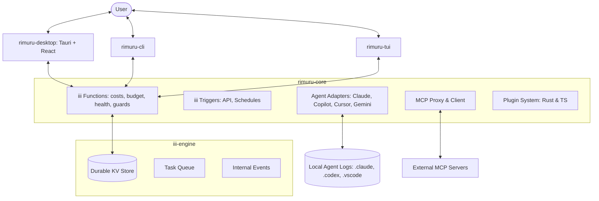

I will read the prompt from `..\.prompt.md` to understand the task.
I will read `.input.rimuru.xml` to see if it contains any instructions or data for the task.
I will search for any file named `.prompt.md` in the current directory and also check if I can access it via a different path if it's meant to be the instruction source.
I will read `rimuru.gemini.md` to see if it provides any specific instructions or context for the "Rimuru" project, which might be related to the task.
I will read `gemini-cli.gemini.md` to see if it provides any clues or instructions on how to handle external prompts or if it contains the missing information.
I will read the next 2000 lines of `.input.rimuru.xml` to continue gathering information about the Rimuru project.
I will read the last 1000 lines of `.input.rimuru.xml` to see the git logs and other final entries, and also read `crates/rimuru-core/src/functions/mod.rs` to better understand the architecture.
# Rimuru: Deep Technical Analysis & Architecture Review

## 1. Project Name and Description
**Project Name:** **Rimuru**

**Description:**
Rimuru is an advanced observability and management platform designed specifically for the modern AI-assisted development ecosystem. It serves as a centralized hub that monitors, analyzes, and orchestrates a wide array of AI agents and LLM tools, including Claude Code, GitHub Copilot, Cursor, and Google’s Gemini CLI. By providing deep visibility into token usage, financial costs, and agent activities, Rimuru enables developers and organizations to manage their AI-driven workflows with precision and confidence.

The core of Rimuru is a high-performance Rust library (`rimuru-core`) that employs a modular adapter architecture to interface with diverse agent environments. These adapters proactively detect installed tools, parse local session logs (often via high-speed JSONL streaming), and estimate costs using sophisticated pricing logic that accounts for model-specific tiers, prompt caching, and multimodal inputs. Rimuru’s multi-interface approach—spanning a feature-rich CLI, an interactive Terminal UI (Ratatui), and a cross-platform Desktop app (Tauri)—ensures that observability is available wherever the developer works.

Beyond simple monitoring, Rimuru acts as an active management layer. It introduces "Budget Guards" that can monitor long-running agent tasks and automatically intervene when cost limits are reached. With its integrated Model Context Protocol (MCP) proxy, token-aware context "slimming," and extensible plugin system, Rimuru provides the infrastructure needed to scale AI agent usage safely, efficiently, and transparently across a project or team.

---

## 2. Supported Platforms, Deployments & Requirements
**Supported Platforms:**
- **Operating Systems:** Windows, macOS, and Linux (supported by Rust binaries and Tauri Desktop).
- **Runtimes:** Rust 1.85+ (Core/CLI/TUI) and Node.js 20+ (Web UI).
- **Desktop:** Tauri v2 for cross-platform desktop integration.

**Deployments:**
- **Local Application:** CLI (`rimuru`), TUI (`rimuru-tui`), and Desktop app for local development monitoring.
- **Headless Worker:** `rimuru-worker` can be deployed as a background service managed by `iii-engine`.
- **Docker:** Official `Dockerfile` provided for containerized worker deployments.

**Requirements:**
- **iii-engine:** The underlying workflow and state engine for durable KV storage and function execution.
- **Agent Installations:** The respective agents (Claude Code, Cursor, etc.) must be installed for their local logs to be accessible.

---

## 3. Supported Connectors to Apps/APIs
| Connector | Purpose | Source Reference |
| :--- | :--- | :--- |
| **Claude Code** | Monitoring Anthropic's CLI agent sessions/costs | `src/adapters/claude_code.rs` |
| **GitHub Copilot** | Monitoring VS Code extension history | `src/adapters/copilot.rs` |
| **Cursor IDE** | Monitoring workspace sessions and model usage | `src/adapters/cursor.rs` |
| **Gemini CLI** | Integration with Google's Gemini CLI | `src/adapters/gemini_cli.rs` |
| **Goose Agent** | Monitoring sessions from the Goose agent | `src/adapters/goose.rs` |
| **Codex/OpenAI** | Tracking usage for GPT-4o, GPT-4, and o-series | `src/adapters/codex.rs` |
| **MCP Proxy** | Universal gateway to any MCP-compliant server | `src/mcp/proxy.rs` |
| **Web UI** | React-based visual dashboard | `ui/` |
| **Plugin System** | Extensibility via Rust or TS plugins | `src/functions/plugins.rs` |
| **Tauri Bridge** | IPC between Rust core and Desktop UI | `src/main.rs` (rimuru-desktop) |

---

## 4. Supported Models and Agents
**Supported Models (via Cost Estimation):**
- **Anthropic:** Claude 3.5 Sonnet, Claude 3 Opus/Haiku (including caching and fast-mode pricing).
- **Google:** Gemini 3.1 Pro/Flash, Gemini 2.5 Pro/Flash, and Flash-Lite variants.
- **OpenAI:** GPT-4o, GPT-4, GPT-3.5, o3, o4-mini.
- **Custom:** Cursor-specific models and generic model fallbacks.

**Monitored Agents:**
- Claude Code, GitHub Copilot, Cursor IDE, Gemini CLI, Goose, Codex, and OpenCode.

---

## 5. Top 5 Use Cases & Workflows
1. **Unified Cost Dashboard:** Aggregating daily and monthly spend across all AI tools (e.g., "How much did I spend on Cursor vs. Copilot this month?").
2. **Autonomous Budget Protection:** Running an agent-driven refactor under a `rimuru guard` that kills the process if it exceeds $2.00.
3. **Session Behavioral Audit:** Reviewing historical tool calls and reasoning steps from different agents to improve prompt engineering.
4. **Centralized MCP Registry:** Using Rimuru to search and manage tools across multiple local and remote MCP servers.
5. **Context Token Optimization:** Using `rimuru slim` to compress massive logs or code blocks before sending them to an LLM.

---

## 6. Top 20 Features
1. **Auto-Agent Detection:** Heuristic discovery of installed AI tools and their configs.
2. **Real-time Cost Estimator:** Live conversion of token usage to USD based on model tiers.
3. **Budget Guards:** Process monitoring with auto-kill based on financial limits.
4. **MCP Tool Proxy:** Centralized registry and search for MCP tools.
5. **Progressive Tool Disclosure:** Efficiently handling large tool schemas.
6. **Context "Slimming":** Multi-strategy token-aware compression.
7. **Interactive TUI Dashboard:** Real-time terminal visualization using Ratatui.
8. **Desktop Tray Integration:** Status and metrics at a glance from the OS tray.
9. **Custom Event Hooks:** Trigger-based automation for session events.
10. **JSONL Streaming Parser:** High-speed, memory-efficient log analysis.
11. **Durable State Management:** Persistent metrics and history via `iii-engine`.
12. **Pricing Auto-Sync:** Remote updates for model pricing data.
13. **Agent "City" UI:** Gamified visual representation of agent state (`ui/src/city/`).
14. **Cross-Platform CLI:** Unified command set for all OSs.
15. **Health Monitoring:** Liveness checks for the worker and connected adapters.
16. **Plugin Architecture:** Supporting both Rust and TypeScript extensions.
17. **Multimodal Usage Tracking:** Identifying image/video token usage.
18. **Cache Hit Monitoring:** Tracking performance of prompt caching for Claude models.
19. **Command Palette (Web UI):** Quick navigation and action execution.
20. **Exportable Analytics:** Data export for costs and usage metrics.

---

## 7. Top 20 Smart Patterns
1. **Adapter Normalization:** Unified trait for diverse agent data sources.
2. **Heuristic Path Mapping:** Auto-detecting configs across different OS environments.
3. **Token Inference:** Estimating costs by parsing local log fragments.
4. **Worker-Client Decoupling:** Separating collection (worker) from display (CLI/UI).
5. **JIT Pricing Application:** Applying the latest rates to historical usage data.
6. **Graceful Session Aging:** Inferring session completion via file timestamps.
7. **Wrapper Guard Pattern:** Monitoring sub-processes to calculate cumulative costs.
8. **Lossy/Lossless Slimming:** Configurable context compression strategies.
9. **Priority-Based Hooks:** Managing execution order of event handlers.
10. **KV Periodic Persistence:** Balancing performance with data durability.
11. **Streaming JSONL Scan:** Avoiding OOM errors on massive history files.
12. **Model Catch-all Fallback:** Conservative pricing for unknown model variants.
13. **Progressive MCP Search:** Low-latency search across high-volume toolsets.
14. **Event-Driven UI Bridge:** Pushing data to Tauri via internal pub-sub.
15. **Schema-Driven Desktop Config:** Validating UI settings via JSON schema.
16. **Non-blocking TUI Loop:** Maintaining responsiveness during heavy I/O.
17. **Stable UUID Identification:** Consistent tracking of sessions across restarts.
18. **Prompt Cache Awareness:** Distinguishing between base and cached token rates.
19. **Hardware-Aware Advisory:** Suggesting local models based on system RAM/GPU.
20. **City-State Mapping:** Translating agent metrics into visual "City" behaviors.

---

## 8. Top 20 Development Trends (Latest Commits)
1. **Persistence-by-Default:** Transitioning to durable file-based storage for all metrics.
2. **Gemini 3.x Pricing Support:** Frequent updates for Google's latest model series.
3. **Claude Haiku 3 Optimization:** Specialized pricing arms for deprecated but billable models.
4. **Budget UI Maturation:** Heavy focus on the "Budget" page in both Web and TUI.
5. **Durable State Refactoring:** Cleaning up KV storage intervals and paths.
6. **CodeRabbit AI Integration:** Using AI-driven PR reviews to harden the codebase.
7. **Context CLI Expansion:** Maturing the `rimuru ctx` terminal monitoring tool.
8. **Opus Fast Mode Billing:** Handling "priority" tier pricing for Claude 3.
9. **Slime Command Refinement:** Improving the `rimuru slim` CLI interface.
10. **Installation Script Hardening:** Managing durable state config during setup.
11. **MCP Search Performance:** Optimizing tool discovery in the proxy.
12. **API Specification Polish:** Refining the `rimuru.costs.record` endpoint.
13. **Multimodal Pricing Logic:** Adding arms for image and video token costs.
14. **TUI Styling Updates:** Refining Ratatui layouts and color schemes.
15. **Haiku 3 Rounding Fixes:** Aligning pricing with published rounding tables.
16. **Session Count Consistency:** Ensuring Gemini adapter reports stable IDs.
17. **Cache TTL Awareness:** Documenting 5m vs 1h cache pricing differences.
18. **Worker-CLI Sync:** Improving shutdown and cleanup logic.
19. **Metrics History Buffering:** Better handling of timeline data in the UI.
20. **City UI Gamification:** Visualizing agent status as characters in a 2D city.

---

## 9. Top 10 Advantages
1. **Tool-Agnostic:** One dashboard for all your agents.
2. **Rust-Powered:** High performance with low memory footprint.
3. **Local-First:** Analyzes logs without requiring API keys for monitored tools.
4. **Durable State:** Reliable metrics that survive restarts.
5. **Rich Interfaces:** Choose between CLI, TUI, or a polished Desktop app.
6. **Budget Safety:** "Guards" prevent runaway LLM costs.
7. **Extensible:** Easy to add new agents or plugins.
8. **MCP Native:** Acts as a powerful proxy for the emerging MCP ecosystem.
9. **Visual Gamification:** The "City" UI makes agent monitoring engaging.
10. **Developer UX:** Built with familiar patterns (hooks, CLI commands).

---

## 10. Top 10 Limitations
1. **Log Dependency:** Relies on agents writing accessible local logs.
2. **Inferred Costs:** Pricing is an estimate based on parsed logs, not direct billing.
3. **State Engine Dependency:** Requires `iii-engine` for core functionality.
4. **Parsing Fragility:** Changes in agent log formats can break adapters.
5. **Initial Setup:** Requires some configuration of durable state paths.
6. **Desktop Overhead:** Tauri adds some bundle size for the GUI.
7. **Beta Status:** Rapid development means occasional breaking changes.
8. **Local Model Detection:** Limited to advisory rather than direct execution management.
9. **TUI Complexity:** Terminal UI can be overwhelming for some users.
10. **Network for Pricing:** Requires internet to sync the latest model rates.

---

## 11. Top AI Skills
| Provided Skills | Used Skills |
| :--- | :--- |
| **rimuru.costs.record** | **claude-code-monitor** |
| **rimuru.budget.set** | **cursor-session-audit** |
| **rimuru.guard.start** | **copilot-usage-analysis** |
| **rimuru.mcp.proxy.call** | **mcp-tool-discovery** |
| **rimuru.slim.context** | **context-compression** |

---

## 12. Data Inputs, Outputs and Storage
**Inputs:**
- **Local Logs:** JSONL/JSON files from `.claude`, `.cursor`, `.vscode`, etc.
- **System Metrics:** Uptime, memory, and process state.
- **User Config:** YAML/JSON settings for budgets and hooks.

**Outputs:**
- **Visuals:** React dashboard, Ratatui TUI, and Tauri system tray.
- **Control:** Process termination (via Guards) and MCP tool results.
- **Data:** Exported CSV/JSON cost reports.

**Storage:**
- **KV Store:** File-based durable storage via `iii-engine` (`state_store`, `stream_store`).
- **History:** Cached session details and metrics timelines.

---

## 13. Detailed Architecture Review (Top 20 Modules)
1. **rimuru-core:** Main logic library and worker.
2. **rimuru-cli:** CLI entry point and command handlers.
3. **rimuru-tui:** Ratatui-based terminal dashboard.
4. **rimuru-desktop:** Tauri-based GUI application.
5. **AgentAdapter (Trait):** The interface for all AI tool connectors.
6. **ClaudeCodeAdapter:** Anthropic-specific log parsing logic.
7. **GeminiCliAdapter:** Google-specific log parsing logic.
8. **BudgetManager:** Spent tracking and limit enforcement.
9. **GuardService:** Process monitoring and child-killing logic.
10. **McpProxy:** Central hub for MCP server management.
11. **SlimService:** The token-aware compression engine.
12. **iii-engine integration:** Workflow and state management bridge.
13. **DetectionService:** Heuristic agent discovery module.
14. **CostEstimator:** Token-to-price conversion engine.
15. **PluginRuntime:** Manager for Rust and JS/TS plugins.
16. **HookRegistry:** Internal event-to-function mapper.
17. **CityEngine:** 2D Canvas-based agent visualizer.
18. **SessionMonitor:** Background thread for log polling.
19. **MetricsCollector:** System-wide usage aggregator.
20. **AppConfig:** Durable configuration management.

---

## 14. Architecture Diagram (Mermaid)

---

## 15. Maturity, Security, Performance
- **Maturity:** Rimuru is at v0.4.0, showing significant architectural stability in its adapters and core monitoring logic, but still actively iterating on its UI and gamification features.
- **Security:** Operates primarily on local data. Its "Guard" feature is the only active control mechanism, designed to protect the user's wallet. It relies on `iii-engine` for secure state handling.
- **Performance:** High-performance Rust core ensures minimal overhead. JSONL parsing is optimized for large files, and the context "Slimming" feature directly improves the performance of associated LLM tools.

---

## 18-21. Reuse Analysis (Scenarios)
- **Point 18 (Swarm):** Use `AgentAdapter` to track multi-agent interactions, `McpProxy` to provide shared tools, and `ContextSlimming` to manage the resulting large conversation histories.
- **Point 19 (Shared KB):** Use `iii-state` as a shared KV knowledge base, `PluginSystem` for collaborative tools, and the `City UI` to visualize multi-user activities.
- **Point 20 (Cloud/Edge):** Deploy `rimuru-worker` on edge devices for local log monitoring, while hosting the `Web UI` in the cloud for centralized management.
- **Point 21 (Team Agents):** Use `BudgetGuards` to manage shared API quotas across a team and `Hooks` to notify members of expensive operations via the `City UI`.
