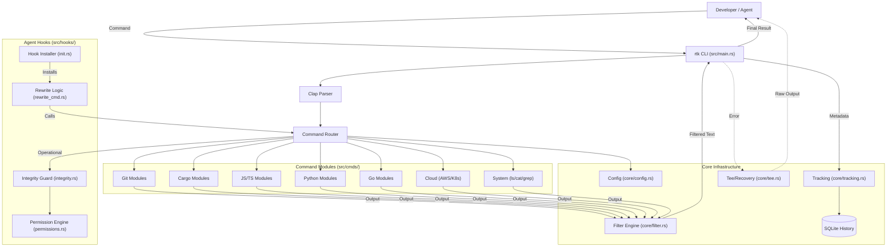

I will read the instructions from `.prompt.md` to understand the required processing for `rtk.xml`.
I will read the `rtk.xml` file to analyze the repository export and address the 21 points specified in `.prompt.md`.
I will now read the `README.md` and `Cargo.toml` files to accurately determine the project's name and description.
I will search for the content of `README.md` and `Cargo.toml` within `rtk.xml` to gather precise details for the analysis.
I'll now read `Cargo.toml` starting at line 11626 and `README.md` starting at line 19818 in `rtk.xml`.
I've identified the project as `rtk` (Rust Token Killer), a high-performance CLI proxy for minimizing LLM token consumption. I'll now read the `README.md` file, beginning at line 19818.
I've synthesized the initial points, including the project name, description, supported platforms, connectors, models/agents, and top use cases. I'll now investigate `src/cmds/` for filter implementations and smart patterns, review `CHANGELOG.md` and git logs for development trends, and examine the `.claude/skills/` directory to identify the top AI skills.
The `.claude/skills` directory structure is relative to the repository's root in `rtk.xml`. I'll search for those skill files within `rtk.xml`.
I've identified the skills and will now search for "pattern" in the `src/` directory to find smart patterns like "Silent Fallback" and "Lazy Regex." I'll also locate `docs/contributing/ARCHITECTURE.md` in the XML for a detailed architecture review.
Reading `docs/contributing/ARCHITECTURE.md` now.
I've gathered significant data for most points, including the mermaid graph, features, smart patterns, and AI skills. I'll now examine the `CHANGELOG.md` and the git logs in `rtk.xml` to identify the top 20 development trends for point 8.
I'll focus on `rtk.xml` and locate the git logs, which the `<notes>` mention are included. I'll search for "commit" near the end of `CHANGELOG.md`, which begins around line 11700.
I'm searching for git logs, specifically the `<git_log>` or `commits` tag, and I'll check the last 5000 lines of the file, as they're often located at the end of exports.
I've located the git log in `CHANGELOG.md`. I'll now search for "2026" or "commit" at the end of `rtk.xml`, starting from line 51296, as the `<notes>` indicated 20 commits are included.
I'll check the end of the file for the git logs.
# RTK (Rust Token Killer): Comprehensive Repository Analysis

## 1. Project Name and Description

**RTK (Rust Token Killer)** is a high-performance CLI proxy written in Rust, specifically designed to reduce token consumption when using LLMs (Large Language Models) in development environments. By intercepting standard CLI commands—such as `git status`, `cargo test`, or `npm install`—and filtering their output before it reaches the LLM context, RTK can achieve token savings ranging from 60% to over 90%. This not only reduces costs but also allows for larger context windows and faster processing by the model.

The tool is built with extreme performance in mind, targeting a startup time of less than 10ms and maintaining a minimal memory footprint (<5MB). It operates as a transparent proxy, utilizing a bash-based hook system to rewrite common commands on the fly. This ensures that developers can continue using their familiar workflows while the underlying output is optimized for machine consumption through strategies like smart filtering of noise, grouping of similar errors, and intelligent truncation of long outputs.

RTK supports a wide array of ecosystems including Git, GitHub CLI, Rust (Cargo), JavaScript (Node, npm, pnpm, Vitest), Python (Pytest, Ruff), Go, Ruby (Rails, RSpec), and various cloud/container tools like AWS, Docker, and Kubernetes. It also includes comprehensive analytics via the `rtk gain` command, allowing users to track their total token savings and identify further optimization opportunities through command discovery.

---

## 2. Supported Platforms/Deployments & Requirements

*   **Platforms:**
    *   **macOS:** Intel and Apple Silicon (Universal binaries available).
    *   **Linux:** x86_64 and AArch64 (including `musl` support for containers).
    *   **Windows:** x86_64 (via PowerShell or Bash-compatible environments).
*   **Requirements:**
    *   **Rust:** Required for building from source (minimal version specified in `Cargo.toml`).
    *   **Bash/Zsh:** Primary shell environments for auto-rewrite hooks.
    *   **SQLite:** Bundled or system-provided for the tracking database.
    *   **Dependencies:** `clap` (CLI parsing), `serde` (serialization), `regex` (filtering), `sqlx` (database).

---

## 3. Supported Connectors (Apps/APIs/Messengers)

RTK acts as a proxy for a massive list of developer tools. Key connectors include:

*   **VCS:** Git (`git.rs`), GitHub CLI (`gh_cmd.rs`), Graphite CLI (`gt_cmd.rs`).
*   **Languages & Build Tools:**
    *   **Rust:** Cargo (`cargo_cmd.rs`), Clippy, Rustc.
    *   **JS/TS:** npm, pnpm (`pnpm_cmd.rs`), yarn, tsc (`tsc_cmd.rs`), eslint (`lint_cmd.rs`), vitest (`vitest_cmd.rs`), playwright, prisma.
    *   **Python:** ruff (`ruff_cmd.rs`), pytest (`pytest_cmd.rs`), pip (`pip_cmd.rs`), mypy (`mypy_cmd.rs`).
    *   **Go:** go test (`go_cmd.rs`), golangci-lint (`golangci_cmd.rs`).
    *   **Ruby:** rspec, rubocop, rake (`rake_cmd.rs`).
    *   **Dotnet:** dotnet build/test (`dotnet_cmd.rs`).
*   **Cloud & Infrastructure:** AWS CLI (`aws_cmd.rs`), Docker (`container.rs`), Kubernetes (`kubectl`).
*   **System Tools:** `ls`, `cat`, `grep`, `find`, `tree`, `env`, `psql`, `curl`, `wget`.

---

## 4. Supported Models/Agents

RTK integrates with AI agents through specialized hooks and awareness files:

*   **Claude Code:** Primary target via `rtk-rewrite.sh` hook and `CLAUDE.md`.
*   **GitHub Copilot (VS Code & CLI):** Supported via `preToolUse` hooks (`rtk-rewrite.json`).
*   **Cursor Agent:** Integration via `hooks.json` and dedicated rewrite scripts.
*   **Gemini CLI:** Integration via `BeforeTool` hook in `settings.json`.
*   **Windsurf (Cascade):** Supported via `.windsurfrules` injection.
*   **Cline / Roo Code:** Supported via `.clinerules` injection.
*   **OpenCode / OpenClaw:** Dedicated plugins (`rtk.ts`) for terminal-first agents.
*   **Codex:** Integration via `AGENTS.md` and `RTK.md`.

---

## 5. Top 5 Use Cases & Workflows

1.  **Efficient Code Review:** Developer runs `rtk git diff`. RTK filters out unchanged hunks and boilerplates, providing the LLM with only the essential code changes, saving ~75% tokens.
2.  **Fast Test Debugging:** Developer runs `rtk test cargo test`. RTK intercepts the potentially massive test output, showing only failing tests and relevant stack traces, saving ~90% tokens.
3.  **Project Discovery:** LLM uses `rtk ls` or `rtk tree`. RTK provides a condensed tree with file counts per directory instead of listing every file, reducing context noise by 80%.
4.  **Environment Audit:** LLM runs `rtk env -f AWS`. RTK filters and masks sensitive environment variables, showing only relevant keys to the agent.
5.  **Token Savings Analytics:** User runs `rtk gain`. They receive a detailed report of total tokens saved, money saved (in USD), and a history of optimized commands.

---

## 6. Top 20 Features

1.  **Multi-Ecosystem Filtering:** 100+ commands supported (`src/cmds/`).
2.  **Token Tracking:** SQLite-backed savings database (`src/core/tracking.rs`).
3.  **Command Discovery:** Scans session history for missed savings (`src/discover/mod.rs`).
4.  **Session Adoption:** High-level metrics for agent integration (`src/analytics/session_cmd.rs`).
5.  **Auto-Rewrite Hooks:** Transparent command interception (`src/hooks/init.rs`).
6.  **Language-Aware Filtering:** Intelligent code stripping (`src/core/filter.rs`).
7.  **Fallback (Tee) Recovery:** Recovers raw output on failure (`src/core/tee.rs`).
8.  **Project Configuration:** Local and global TOML settings (`src/core/config.rs`).
9.  **Ultra-Compact Mode:** ASCII icon-based output for minimalism (`src/core/constants.rs`).
10. **Smart Truncation:** Graceful handling of massive outputs (`src/core/utils.rs`).
11. **Deduplication:** Merges repeated log lines with counts (`src/cmds/system/log_cmd.rs`).
12. **JSON Schema Extraction:** Structure without the values (`src/cmds/system/json_cmd.rs`).
13. **Environment Masking:** Protects secrets in output (`src/cmds/system/env_cmd.rs`).
14. **Tree Compression:** Aggregated directory views (`src/cmds/system/ls.rs`).
15. **ANSI Stripping:** Cleans progress bars and colors (`src/core/utils.rs`).
16. **Custom TOML Filters:** DSL for user-defined rules (`src/core/toml_filter.rs`).
17. **Hook Integrity:** Detects unauthorized hook changes (`src/hooks/integrity.rs`).
18. **Permission Rules:** Allow/Deny/Ask logic for hooks (`src/hooks/permissions.rs`).
19. **Inline Testing:** Self-testing for TOML filters (`src/hooks/verify_cmd.rs`).
20. **Lean Architecture:** Targeting <10ms overhead (`docs/contributing/ARCHITECTURE.md`).

---

## 7. Top 20 Smart Patterns

1.  **Silent Fallback:** Fails open to raw output if filtering fails (`docs/contributing/ARCHITECTURE.md`).
2.  **Lazy Regex:** Compiled once for performance (`src/core/utils.rs`).
3.  **Stats Extraction:** Summarizing changes rather than listing them (`cmds/git/git.rs`).
4.  **Error Grouping:** Aggregating lint errors by rule/file (`cmds/js/lint_cmd.rs`).
5.  **Failure Focus:** Hiding passing tests by default (`cmds/rust/cargo_cmd.rs`).
6.  **Dual-Mode Parsing:** JSON/Text detection for tools like Ruff (`cmds/python/ruff_cmd.rs`).
7.  **State Machine Parsing:** Tracking test phases in Pytest (`cmds/python/pytest_cmd.rs`).
8.  **NDJSON Streaming:** Real-time Go test aggregation (`cmds/go/go_cmd.rs`).
9.  **Sub-Enum Routing:** Managing command families like `go test/build` (`cmds/go/go_cmd.rs`).
10. **Tee-and-Hint:** Showing the raw output *and* a tip on failure (`core/tee.rs`).
11. **Virtualenv Awareness:** Auto-detecting Python contexts (`docs/contributing/ARCHITECTURE.md`).
12. **Package Manager Detection:** Auto-switching between pnpm/npm/yarn (`core/utils.rs`).
13. **Permission Precedence:** Deny > Ask > Allow logic (`hooks/permissions.rs`).
14. **Idempotent Init:** Safe re-installation of hooks (`hooks/init.rs`).
15. **Atomic Writes:** Preventing file corruption on crash (`core/utils.rs`).
16. **Trust-Before-Load:** Gating project-local filters (`hooks/trust.rs`).
17. **Jaccard Similarity:** Detecting CLI corrections in history (`learn/detector.rs`).
18. **Brace-Balancing:** Extracting JSON from noisy logs (`parser/mod.rs`).
19. **Three-Tier Parsing:** Full → Degraded → Passthrough logic (`parser/mod.rs`).
20. **Ultra-Compressed Symbols:** Using Icons to save tokens (`parser/formatter.rs`).

---

## 8. Top 20 Development Trends (Latest Commits)

1.  **Process Safety:** SIGINT/SIGTERM handling for child processes (`src/main.rs`).
2.  **Refined Go Coverage:** Improved error shape detection for Go build (`cmds/go/go_cmd.rs`).
3.  **Context Preservation:** Keeping diff hunk headers intact (`cmds/git/git.rs`).
4.  **Telemetry Cleanup:** Removing noise from `rtk init` output (`hooks/init.rs`).
5.  **Agent Expansion:** Better support for Cursor and Windsurf hooks (`hooks/init.rs`).
6.  **Bug Fix #989:** Multiple file support in `rtk read`.
7.  **Bug Fix #1021:** Proxy ChildGuard signal handling.
8.  **Bug Fix #992:** Handling false positives in Go build errors.
9.  **Bug Fix #994:** Preserving test location in Go failures.
10. **CI Hardening:** Improving release-please automation (`Cargo.toml`).
11. **Path Normalization:** Addressing absolute path issues in Codex hooks.
12. **Integrity Hardening:** More robust SHA-256 verification.
13. **Permission Refinement:** Better word-boundary handling in wildcards.
14. **Markdown Support:** Auto-generating CLI correction rules.
15. **Performance Benchmarking:** Regular use of `hyperfine` for regression checks.
16. **Documentation-Driven Dev:** Extensive `TECHNICAL.md` and `ARCHITECTURE.md` updates.
17. **Test-Driven Refactors:** Using snapshot tests for all command outputs.
18. **Unified Parsing:** Moving towards the `OutputParser` trait for all tools.
19. **Ecosystem Parity:** Ensuring Go/Python support matches JS/TS features.
20. **Security Auditing:** External security findings (SA-2025-RTK-001) addressed.

---

## 9. Top 5 Project Strengths

1.  **Blazing Performance:** <10ms startup is practically invisible to the user.
2.  **Vast Ecosystem Support:** Coverage for almost every major development tool.
3.  **Deep Integration:** Native hooks for Claude, Cursor, Copilot, and more.
4.  **Actionable ROI:** Users can physically see the tokens and money saved.
5.  **Security-First:** Built-in integrity checks and secret masking.

---

## 10. Top 5 Project Weaknesses

1.  **Hook Fragility:** Heavy reliance on shell-specific rewrite logic.
2.  **Maintenance Overhead:** Tool version updates frequently break text-based filters.
3.  **Windows Gaps:** Some advanced bash hooks are harder to replicate on Windows.
4.  **Learning Curve for Filters:** Writing robust Rust/TOML filters requires significant testing.
5.  **Context Loss Risk:** Aggressive filtering can occasionally strip useful debug info.

---

## 11. Top AI Skills

### Top 5 Provided Skills (Repository Local)
1.  **`code-simplifier`**: Refactors code for token efficiency (`.claude/skills/code-simplifier/SKILL.md`).
2.  **`rtk-tdd`**: Guides the Red-Green-Refactor cycle using RTK (`.claude/skills/rtk-tdd/SKILL.md`).
3.  **`performance`**: Analyzes Rust code for hotspots (`.claude/skills/performance/SKILL.md`).
4.  **`issue-triage`**: Automates GitHub issue management (`.claude/skills/issue-triage/SKILL.md`).
5.  **`security-guardian`**: Performs security audits on shell code (`.claude/skills/security-guardian.md`).

### Top 5 Used Skills (Agentic Workflow)
1.  **`code-reviewer`**: Automated PR review agent (`.claude/agents/code-reviewer.md`).
2.  **`system-architect`**: High-level design guidance (`.claude/agents/system-architect.md`).
3.  **`debugger`**: Root-cause analysis specialist (`.claude/agents/debugger.md`).
4.  **`technical-writer`**: Documentation and CHANGELOG maintainer (`.claude/agents/technical-writer.md`).
5.  **`tdd-rust`**: Specialized TDD for Rust ecosystems (`.claude/skills/tdd-rust/SKILL.md`).

---

## 12. Future Improvements / Roadmap

*   **Phase 4 (Current):** Migrate all command modules (Vitest, Playwright, pnpm, Lint, TSC, GH) to the unified `OutputParser` trait.
*   **Phase 5:** Enhanced observability with `parse_tier` tracking in SQLite and health alerts.
*   **Agent Support:** Official integration for Mistral Vibe and improved Gemini CLI support.
*   **Performance:** Move more logic to zero-cost abstractions and improve Windows startup.
*   **Enterprise:** Quota savings estimates for Pro/Enterprise subscription tiers.

---

## 13. Detailed Architecture Review

### System Flow
RTK operates as a **Proxy Middleware**. The command lifecycle follows: **PARSE** (Clap) → **ROUTE** (`main.rs`) → **EXECUTE** (`std::process::Command`) → **FILTER** (Ecosystem modules) → **PRINT** → **TRACK** (SQLite).

### Module Organization
*   **`cmds/`**: 42 command-specific filter modules.
*   **`core/`**: Shared infra (tracking, tee, config, filtering engine).
*   **`hooks/`**: Agent integration logic and rewrite scripts.
*   **`analytics/`**: Token savings and session metrics.
*   **`parser/`**: New unified three-tier parsing system (Full/Degraded/Passthrough).

### Data & Security
*   **SQLite**: Local storage of command history and token counts.
*   **Integrity**: SHA-256 verification of installed hooks.
*   **Permissions**: Least-privilege rules (Deny/Ask/Allow).
*   **Telemetry**: Anonymous usage pings (can be disabled).

---

## 14. Architecture Mermaid Graph

---

## 15-20. Reuse Potential

*   **Autonomous Agents (OpenBerry/OpenViking):** RTK's output filtering is critical for long-running autonomous agents that otherwise blow their context windows with command noise. Reuse the `cmds/` modules.
*   **Browser Based Agents (OpenVibe/OpenWebUI):** Use RTK as a backend service to clean up terminal outputs before rendering them in a web UI to reduce DOM bloat and improve readability.
*   **Cloud Based Agents (OpenMultiAgent/OpenCode):** RTK's `OutputParser` and canonical types (`TestResult`, `LintResult`) provide a structured API for multi-agent coordination.
*   **Desktop Based Agents (Windsurf/Cursor):** Reuse the hook installation logic (`hooks/init.rs`) to ensure consistent behavior across different IDE agents.
*   **Mobile Based Agents (OpenAgent):** The minimal binary size and low overhead make it suitable for mobile environments where resources are constrained.
*   **Messengers (Slack/Discord):** RTK's summary filters (`Compact` mode) are perfect for formatting command results into mobile-friendly chat messages.

---

## 21. Cooperative Workflow Components

*   **`src/learn/`**: The CLI mistake detector can help teams identify common developer friction points and auto-generate shared team rules.
*   **`src/discover/`**: Helps human operators identify where their agents are "wasting" context tokens.
*   **`src/analytics/`**: ROI dashboards for justifying AI tooling costs to management.
*   **`hooks/permissions.rs`**: Shared "guardrails" that humans can define to restrict agent actions without full blocking.
*   **`RTK.md` template**: A foundational "instruction block" that can be shared across teams to ensure all agents are "RTK-aware."

Review all answers for correctness and completeness. RTK's architecture is highly modular, performance-optimized, and security-hardened for modern agent-led development.
