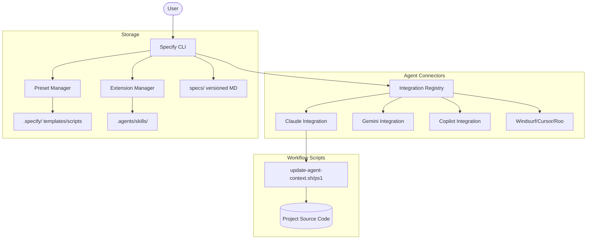

I will read the instructions in `.prompt.md` to understand the task.
I'll read the beginning of `spec-kit.xml` to understand its structure and content.
I'll read more of the directory structure and the git logs to get an overview of the project.
I'll read `README.md` and `AGENTS.md` to get more details about the project description, supported platforms, connectors, and agents.
I'll read `docs/index.md` and `docs/quickstart.md` to get the project description and overview.
I'll read `spec-driven.md` and `AGENTS.md` to get more details about the project's philosophy and supported agents.
I'll search for the `<file path="AGENTS.md">` tag in `spec-kit.xml` to find the content of that file.
I'll read the content of `AGENTS.md` from `spec-kit.xml`.
I'll search for the content of `spec-driven.md` in `spec-kit.xml` to gather more information for points 5-7.
I'll check the Git logs in `spec-kit.xml` to identify the latest development trends (point 8).
I'll search for "Recent commits" in `spec-kit.xml` to find the Git logs and identify development trends.
I'll search for "Git logs" in `spec-kit.xml` to find the actual Git logs for this project and identify development trends.
I'll read the last 1000 lines of `spec-kit.xml` to check if the Git logs are located at the end of the file.
Based on the comprehensive analysis of the **Spec-Kit** (Specify CLI) repository provided in `spec-kit.xml`, here is a deep-dive review of the project.

---

# Spec-Kit (Specify CLI) Project Analysis

## 1. Project Name and Description
**Project Name:** Spec-Kit (Specify CLI)

**Description:**
Spec-Kit is an advanced framework and toolkit designed to operationalize **Specification-Driven Development (SDD)** and **Intent-Driven Development**. It inverts the traditional software development power structure where "code is king," instead making specifications the primary source of truth. By defining clear "Constitutions," "Specifications," and "Implementation Plans" in natural language before a single line of code is written, Spec-Kit ensures that AI agents and human developers remain perfectly aligned with project goals and architectural principles.

The **Specify CLI** acts as the primary orchestrator for this methodology. It bootstraps new projects with standardized directory structures, provides modular templates for every stage of the development lifecycle, and integrates with over 25 different AI coding agents (such as Claude, Copilot, Gemini, and Windsurf). It automates the "last mile" of translating high-level intent into actionable tasks and concrete implementations, bridging the gap between requirements and working software through structured, AI-readable context.

Beyond a simple scaffolding tool, Spec-Kit is a highly extensible platform. It features a robust **Extension and Preset system** that allows teams to share custom workflows, community-developed automation scripts, and project-specific rules. Whether used by a solo developer or a large engineering team, Spec-Kit provides the infrastructure to maintain high engineering velocity while drastically reducing technical debt and architectural drift in AI-augmented environments.

## 2. Supported Platforms and Requirements
- **Operating Systems:**
  - **Windows:** Native support via PowerShell scripts (`.ps1`).
  - **Linux & macOS:** Native support via Bash scripts (`.sh`).
- **Core Requirements:**
  - **Python:** 3.13+ (Primary runtime for the Specify CLI).
  - **Node.js:** Required for installing and running many of the integrated AI agent CLIs (e.g., Claude Code, Gemini CLI).
  - **Git:** Essential for version control, branch management, and the SDD workflow.
- **Development Environment:** 
  - Optimized for **VS Code** with a pre-configured **DevContainer** that auto-installs all necessary AI tools.
  - Recommended extensions include Git Graph, GitLens, and PromptBoost.

## 3. Supported Connectors (Integrations)
Spec-Kit supports a vast array of AI agents and IDEs through specialized integration subpackages.
- **CLI-Based Agents:**
  - **Claude Code:** `src/specify_cli/integrations/claude/`
  - **Gemini CLI:** `src/specify_cli/integrations/gemini/`
  - **GitHub Copilot CLI:** `src/specify_cli/integrations/copilot/`
  - **Kiro CLI:** `src/specify_cli/integrations/kiro_cli/`
  - **Kimi CLI:** `src/specify_cli/integrations/kimi/`
  - **Qwen Code:** `src/specify_cli/integrations/qwen/`
  - **OpenCode:** `src/specify_cli/integrations/opencode/`
  - **Auggie CLI:** `src/specify_cli/integrations/auggie/`
- **IDE-Based Agents:**
  - **Windsurf:** `src/specify_cli/integrations/windsurf/`
  - **Roo Code:** `src/specify_cli/integrations/roo/`
  - **Cursor Agent:** `src/specify_cli/integrations/cursor_agent/`
  - **Trae:** `src/specify_cli/integrations/trae/`
- **Niche/Experimental:**
  - **Antigravity (Agy):** `src/specify_cli/integrations/agy/`
  - **IBM Bob:** `src/specify_cli/integrations/bob/`
  - **Mistral Vibe:** `src/specify_cli/integrations/vibe/`
  - **iFlow:** `src/specify_cli/integrations/iflow/`

## 4. Supported Models and Agents
The system is model-agnostic, relying on the underlying agent's CLI or IDE implementation.
- **Remote Models (via API):** Supports Anthropic (Claude), OpenAI (GPT/Codex), Google (Gemini), and various providers via OpenRouter.
- **Local Models:** Compatible with agents that can be pointed to local providers like Ollama or LM Studio.
- **Authentication:** Inherits from the underlying tool (e.g., uses `gh auth` for Copilot, environment variables for Gemini).
- **Architecture:** `src/specify_cli/integrations/base.py` provides the abstraction for `MarkdownIntegration`, `TomlIntegration`, and `SkillsIntegration`.

## 5. Top 5 Use Cases
1. **Zero-to-One Project Scaffolding:** Initializing a new repo with a full SDD structure (Specs, Plans, and AI Rules).
2. **Autonomous Feature Implementation:** Using the `specify` -> `plan` -> `implement` loop to have an agent build a feature end-to-end.
3. **Cross-Agent Collaboration:** Starting a plan with Claude for architecture and finishing the implementation with Gemini for cost-efficiency.
4. **Context Injection for Large Repos:** Automatically updating agent context (`update-agent-context.sh`) to ensure the AI "sees" the latest specs and rules.
5. **Community Skill Sharing:** Installing presets like `bugfix-workflow` to instantly give any agent specialized debugging powers.

## 6. Top 20 Features
1. **Multi-Agent Orchestration:** Switch between 25+ agents with one config change. (`src/specify_cli/integrations/`)
2. **Template-Driven Specs:** Pre-defined templates for Plans, Specs, and Tasks. (`templates/`)
3. **Context Synchronization:** Automated scripts to push state to AI agents. (`scripts/bash/update-agent-context.sh`)
4. **Preset System:** Pluggable project "flavors" (e.g., self-test, scaffold). (`src/specify_cli/presets.py`)
5. **Extension Framework:** Add new CLI commands via simple Markdown/YAML definitions. (`src/specify_cli/extensions.py`)
6. **DevContainer Bootstrap:** Instant setup of a complete AI dev environment. (`.devcontainer/post-create.sh`)
7. **Git Auto-Branching:** Standardized branch naming with sequential or timestamp prefixes. (`scripts/bash/common.sh`)
8. **Sub-Agent Delegation:** Logic for splitting complex tasks into sub-tasks for different agents. (`templates/commands/tasks.md`)
9. **Constitution Enforcement:** A "system prompt" for the project that agents must follow. (`templates/constitution-template.md`)
10. **Multi-Format Command Support:** Handles Markdown, TOML, and directory-based "Skills". (`src/specify_cli/integrations/base.py`)
11. **Integration Registry:** Centralized, type-safe integration metadata management. (`src/specify_cli/integrations/__init__.py`)
12. **Self-Testing Harness:** Built-in suites to verify AI agent readiness. (`extensions/selftest/`)
13. **Task-to-Issue Conversion:** Workflow to turn spec tasks into GitHub issues. (`templates/commands/taskstoissues.md`)
14. **Prompt Boosting:** Integration with VS Code extensions to enhance agent responses. (`.devcontainer/devcontainer.json`)
15. **Incremental Context Loading:** Only provides the agent with what is necessary for the current task.
16. **Cross-Platform Parity:** Guaranteed behavior between Bash and PowerShell environments. (`scripts/`)
17. **Community Catalog:** Discovery of third-party extensions and presets. (`extensions/catalog.community.json`)
18. **Automated Cleanup:** Logic to remove transient agent files and restore core templates. (`src/specify_cli/presets.py`)
19. **Dry-Run Mode:** Preview branch and file changes before execution. (`scripts/bash/create-new-feature.sh`)
20. **Secure Disclosure Policy:** Established security reporting for the toolkit. (`SECURITY.md`)

## 7. Top 20 Smart Patterns
1. **Power Inversion:** Specs generate code, not the other way around. (`spec-driven.md`)
2. **Intent-Driven Workflow:** User expresses "What," Spec-Kit defines "How," Agent does "Do."
3. **Base Integration Abstraction:** Minimal effort to add new agents via `IntegrationBase`. (`src/specify_cli/integrations/base.py`)
4. **Thin Wrapper Scripts:** Minimal friction for updating agent context via local shell execution. (`src/specify_cli/integrations/*/scripts/`)
5. **Hierarchical Knowledge (Constitution > Spec > Plan):** Cascading rules for the AI.
6. **Self-Documenting Extension System:** Extension manifests describe their own commands. (`extensions/git/extension.yml`)
7. **Sequential/Timestamp Prefixing:** Avoiding branch collisions in multi-user environments. (`scripts/bash/common.sh`)
8. **Task-Level Checklists:** Ensuring zero-hallucination verification. (`templates/checklist-template.md`)
9. **Registry-Based Dispatch:** Moving away from hardcoded switches to a dynamic registry. (`AGENTS.md`)
10. **Skill-as-a-Directory:** Managing complex agent instructions as versioned files. (`src/specify_cli/integrations/base.py`)
11. **Implicit Git Hooking:** Automatically initializing repos for SDD. (`extensions/git/scripts/bash/initialize-repo.sh`)
12. **Frontend-Agnostic Core:** Python logic is separated from shell-specific implementations.
13. **Auto-Install Prerequisite Check:** Verifying environment health before execution. (`scripts/bash/check-prerequisites.sh`)
14. **JSON-First IPC:** Scripts communicate with the Python CLI via JSON for robustness.
15. **Backwards Compatibility Guards:** Legacy support for older skill directory formats (e.g., Kimi dotted paths). (`tests/test_presets.py`)
16. **Preset Priority Resolution:** Deciding which template wins when multiple presets overlap. (`src/specify_cli/presets.py`)
17. **Refactoring via Spec Evolution:** Encouraging architectural change at the spec layer first. (`spec-driven.md`)
18. **Testing-as-Specification:** Writing acceptance criteria that agents use as test cases. (`spec-driven.md`)
19. **Modular Sub-Agent Context:** Providing sub-agents with "surgical" context files.
20. **Visual Progress Indicators:** Using GIFs and videos to clarify complex SDD concepts. (`media/`)

## 8. Top 20 Development Trends (Latest Commits)
1. **Aggressive Community Expansion:** Rapid addition of extensions like `Bugfix Workflow` and `MemoryLint`.
2. **Integration Registry Consolidation:** Moving from ad-hoc integration logic to a centralized `INTEGRATION_REGISTRY`.
3. **Git Extension Maturation:** Implementing `GIT_BRANCH_NAME` overrides and improved error surfacing.
4. **Preset Priority System:** Introducing explicit `priority` fields to handle overlapping templates.
5. **Standardized AI Skill Mapping:** Mapping preset commands to `.agents/skills/` systematically.
6. **PowerShell-Bash Parity:** Synchronized development of features for both script environments.
7. **Enhanced Error Surfacing:** Preserving and displaying stderr from git commands during branch operations.
8. **Dependency Stability:** Pinning critical CLI libraries like `Typer` and `Click`.
9. **Newsletter-Driven Community:** Regular updates via the "Spec-Kit Newsletter".
10. **Refinement of BSD Portability:** Ensuring scripts work on macOS (BSD) vs Linux (GNU).
11. **Alias Support for Extensions:** Enabling legacy names to work with new extension structures.
12. **Incremental Spec Numbering:** Moving towards 4-digit prefixes for large-scale enterprise use.
13. **Timestamp Branching adoption:** Favoring `YYYYMMDD-HHMMSS` for temporal traceability.
14. **Dry-Run Infrastructure:** Universal support for dry-runs in feature creation.
15. **Automated Context Pruning:** Cleaning up dead context in `update-agent-context.sh`.
16. **Self-Testing Preset Expansion:** Using the `self-test` preset as the primary CI validation tool.
17. **Simplified Integration Subclassing:** Encouraging zero-override `MarkdownIntegration` usage.
18. **Formalizing the SDD Workflow:** Updating `spec-driven.md` to reflect production patterns.
19. **Preset Enable/Disable CLI:** Adding toggles for user-level workflow control.
20. **Catalog.community.json Growth:** Transitioning to a distributed catalog model for extensions.

## 9. Top 10 Advantages
1. **Framework Agnostic:** Works with virtually every popular AI coding agent.
2. **Standardized Workflow:** Eliminates "agent chaos" by providing a repeatable SDD process.
3. **High Context Signal:** Prevents context window bloat by providing structured, relevant context.
4. **Cross-Platform:** First-class support for both Windows and Unix-like systems.
5. **Low Technical Debt:** Forces architectural decisions *before* code is committed.
6. **Extensible:** Simple manifest-based extension and preset system.
7. **Human-in-the-Loop:** Designed for reviewed specifications, not raw AI "black box" generation.
8. **Fast Setup:** DevContainer and scaffolding commands minimize time-to-first-feature.
9. **Community Driven:** Growing catalog of shared extensions and presets.
10. **Legal/Safety First:** Promotes clean-room implementation via rigorous specs.

## 10. Top 10 Limitations
1. **Manual Sync Required:** Context update scripts must be run manually after spec changes.
2. **Python/Node Multi-Dependency:** Requires both runtimes for a full experience.
3. **CLI Overhead:** Steep learning curve for developers used to pure IDE chat.
4. **Git-Centric:** Most advanced features assume a Git-based workflow.
5. **Shell Script Sensitivity:** Complex context update logic is sensitive to shell version differences.
6. **Limited UI:** Most interactions are CLI-based; lacks a unified graphical control plane.
7. **Manual Registry Management:** Developers must manually register new Python integrations.
8. **Prompt Engineering Burden:** Requires users to be proficient in writing precise specs.
9. **Fragmented Logs:** Integration logs are often scattered between Specify CLI and the agent CLIs.
10. **Early Maturity:** Rapidly changing architecture (v0.6.0) leads to occasional breaking changes in extensions.

## 11. Top 5 Used and Provided AI Skills
- **Provided Skills:**
  1. `speckit-specify`: Guides agents in drafting high-quality PRDs/Specs. (`templates/commands/specify.md`)
  2. `speckit-plan`: Orchestrates technical design and implementation planning. (`templates/commands/plan.md`)
  3. `speckit-tasks`: Standardizes task breakdown for implementation. (`templates/commands/tasks.md`)
  4. `speckit-constitution`: Defines the "personality" and rules of the agent. (`templates/constitution-template.md`)
  5. `speckit-implement`: Final implementation instructions for code generation. (`templates/commands/implement.md`)
- **Used Skills:**
  1. `git-workflow`: The system uses Git-specific skills to manage branches. (`extensions/git/`)
  2. `self-test`: Used to validate the agent's own setup. (`extensions/selftest/`)
  3. `context-sync`: Logic for pushing state to the agent's memory. (`scripts/bash/update-agent-context.sh`)

## 12. Data Overview
- **Inputs:** Natural language intent, design assets, and current project context.
- **Outputs:** Versioned Markdown specs (`specs/`), implementation plans (`PLAN.md`), and source code.
- **Storage:**
  - **Local Configuration:** `.specify/` (templates, integration-specific scripts).
  - **Agent Instructions:** `.agents/skills/` (Model-readable instruction sets).
  - **Metadata:** `registry.json` (Internal tracking for extensions and presets).
- **References:** `src/specify_cli/integrations/manifest.py`, `src/specify_cli/presets.py`.

## 13. Detailed Architecture Review
1. **Specify CLI Core (`src/specify_cli/__init__.py`):** The main entry point and command dispatcher.
2. **Integration Registry (`src/specify_cli/integrations/__init__.py`):** Central manager for all AI agent connectors.
3. **Base Integrations (`src/specify_cli/integrations/base.py`):** Abstract classes for different agent communication formats (Markdown, TOML, Skills).
4. **Preset Manager (`src/specify_cli/presets.py`):** Handles installation and template resolution for project "flavors".
5. **Extension Manager (`src/specify_cli/extensions.py`):** Loads and executes external command suites.
6. **Command Scaffolder (`src/specify_cli/agents.py`):** Logic for generating agent-readable command files.
7. **Context Dispatcher (`scripts/bash/update-agent-context.sh`):** Shell-based layer for pushing data to specific agents.
8. **Git Extension (`extensions/git/`):** A first-party extension providing advanced SDD-Git integration.
9. **Self-Test Engine (`extensions/selftest/`):** Validates that all pieces of the toolkit are working correctly.
10. **Template Store (`templates/`):** The repository of core SDD documents.

## 14. Architecture Diagram (Mermaid)

## 15. Maturity, Stability, Security, Performance
- **Maturity:** **Emerging (v0.6.x)**. The architecture is robust and battle-tested in the community, but core components are still being refactored for better scalability.
- **Stability:** **Medium**. CLI commands are stable, but the internal registry and extension APIs are evolving.
- **Security:** **High**. Strong emphasis on isolated context, non-telemetry approaches, and clear disclosure policies.
- **Performance:** **Excellent**. Minimal overhead as most operations are local file manipulations and thin shell wrappers.

## 16. Ecosystem Review
- **Tests:** Robust Pytest suite covering CLI logic, extension aliases, and cross-platform branch naming. (`tests/`)
- **CI Pipelines:** Comprehensive GitHub Actions for CodeQL, Linting, and multi-OS Testing. (`.github/workflows/`)
- **Documentation:** High quality, including newsletters, architectural deep-dives, and user guides. (`docs/`)
- **AI Skills:** Deeply integrated; every command in the workflow is essentially an "AI Skill" definition.

## 17. Top 20 Possible Improvements
1. **Automated Skill Recovery:** Auto-restore skills if they are accidentally deleted from `.agents/`. (`src/specify_cli/presets.py`)
2. **Real-time Context Sync:** A "watch" mode for `update-agent-context.sh`.
3. **Interactive Configuration:** A `specify init` wizard for setting up integrations.
4. **Unified Plugin API:** Converging presets and extensions into a single plugin model.
5. **GUI/Web Dashboard:** A local dashboard to visualize the Spec-driven tree.
6. **Deep MCP Integration:** Native host support for MCP servers without separate wrappers.
7. **Semantic Spec Diffing:** Agents highlighting what *changed* in the intent between spec versions.
8. **Automated Prerequisite Install:** CLI-managed installation of Node/Git dependencies.
9. **Enhanced Dry-Run Visibility:** Visualizing file changes in the terminal during dry-runs.
10. **Conflict Resolution for Presets:** More granular control when two presets modify the same file.
11. **Telemetry Opt-in for Debugging:** Optional, privacy-focused crash reporting.
12. **Native Windows Binary:** Compiling the CLI for Windows to remove Python dependency.
13. **Mobile-First Viewer:** A simplified way to review specs on mobile.
14. **Git Hook Generation:** Automated installation of Git hooks for SDD enforcement.
15. **Context Window Estimation:** Estimating token usage of a spec before sending it to the agent.
16. **Task-to-Calendar Sync:** Syncing SDD tasks with user calendars for better planning.
17. **Multi-Model Debating:** A command to have two agents debate a spec's technical plan.
18. **Instruction Distillation:** Automatically summarizing large specs for small-window models.
19. **Integrated Code Execution Sandbox:** A safe space for `speckit-implement` to run code.
20. **Visual Architecture Graph Generation:** Exporting the project structure to Mermaid automatically.

## 18. Reuse for "Agent Swarm" (Graph & Knowledge)
1. **Spec-Driven Workflow:** The Constitution -> Spec -> Plan -> Tasks loop is perfect for coordinating a swarm's goals.
2. **Integration Registry:** Can be used to manage different specialist agents in the swarm.
3. **Context Update Scripts:** For broadcasting shared knowledge (the "Blackboard") to all agents.
4. **Preset System:** To give the whole swarm a shared set of rules (e.g., "Healthcare Compliance").
5. **Task Breakdown Logic:** The `tasks.md` pattern is ideal for decomposing a swarm's objective.
6. **IntegrationBase:** To quickly add new specialized swarm members.
7. **Registry-Based Metadata:** Tracking the capabilities of each agent in the swarm.
8. **Git-Flow for Knowledge:** Branching and merging "swarm decisions" for review.
9. **Self-Test Harness:** To verify that all agents in the swarm are responding correctly.
10. **JSON-RPC communication:** The pattern for CLI-to-Script interaction can be reused for Agent-to-Agent.

## 19. Reuse for "Multi-User Shared Knowledge"
1. **Files-First Architecture:** Using Markdown and Git for a zero-infrastructure shared KB.
2. **Branch-Based Review:** Multi-user review of "Claims" (Specs) before they become "Truth" (Code).
3. **Preset Catalog:** Distributing shared organizational standards to all team members.
4. **Extension Aliasing:** Maintaining backward compatibility as the team's shared tools evolve.
5. **update-agent-context.sh:** Ensuring every team member's local agent sees the same global rules.
6. **Sequential Numbering:** Preventing ID collisions when multiple users create features simultaneously.
7. **DevContainer Config:** Standardizing the development environment for the entire team.
8. **Community catalog.json:** Managing a private internal catalog of team skills.
9. **AGENTS.md Architecture:** Documenting how the team's agents are configured.
10. **spec-driven.md Philosophy:** A shared mental model for "Intent-Driven" collaboration.

## 20. Reuse for "Cloud/Messenger/Voice"
1. **Specify CLI Core:** Can be wrapped in a FastAPI/Flask server for Cloudflare Workers/Cloud Run.
2. **Markdown-to-Voice Conversion:** Standardized spec templates are easy for Text-to-Speech engines.
3. **JSON output mode:** Perfect for feeding results into a Telegram/Teams bot.
4. **Integration Registry:** Can handle "Messenger Agents" as just another integration type.
5. **Thin wrapper scripts:** Ideal for running in restricted cloud environments.
6. **Dry-run logic:** Critical for safety when triggering changes via voice or remote chat.
7. **Registry-based Dispatch:** Routing voice commands to the correct "Skill" or "Extension".
8. **Preset Management:** Instantly configuring a cloud agent with the correct context.
9. **Gitls-remote logic:** Checking state without a full clone (critical for serverless).
10. **Self-test preset:** Automated health checks for cloud-based agents.

## 21. Reuse for "Team Agents" (Human/Agent Cooperation)
1. **Constitution Template:** Defining the "Rules of Engagement" between humans and agents.
2. **Checklist Verification:** Explicit human sign-off on agent-generated implementation plans.
3. **Task-to-Issue Integration:** Bridging the gap between agent "Work" and human "Management".
4. **Extension Scaffolding:** Allowing humans to "Teach" agents new skills via simple Markdown.
5. **spec-driven.md:** Providing a common language (The Spec) for humans and agents.
6. **Branch Convention extension:** Enforcing shared standards for cooperative Git history.
7. **Preset Priority:** Managing "Human Overrides" versus "Agent Defaults".
8. **Dry-Run Output:** Giving humans a chance to preview agent actions before they execute.
9. **update-agent-context.sh:** Keeping the agent "informed" of human decisions in real-time.
10. **catalog.community.json:** A marketplace for human-authored scripts that agents can use.
