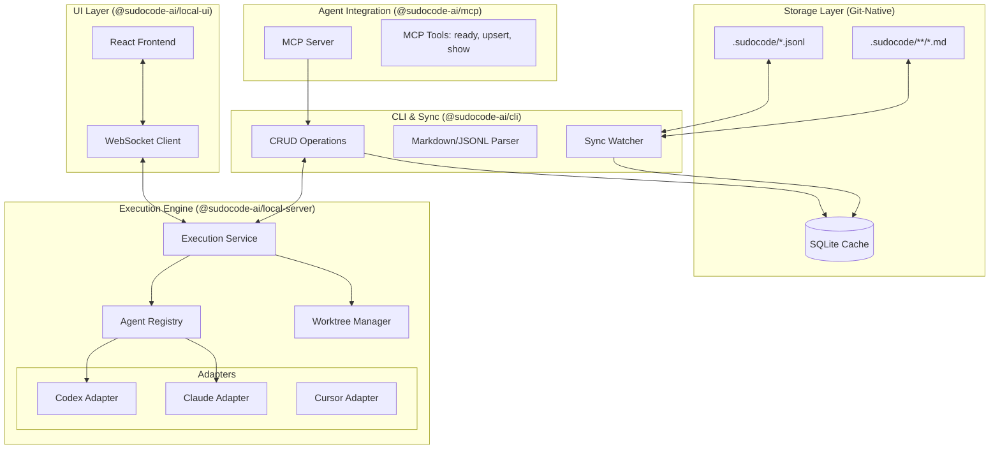

I will begin by reading the instructions in `.prompt.md` and checking for any project-specific mandates in `GEMINI.md`.
I'll begin by examining the structure of `sudocode.xml` to understand how the repository data is organized.
I'll examine the project's `package.json` files and the Git logs at the end of `sudocode.xml` to gather metadata and understand recent development trends.
I'll examine `cli/README.md`, `.claude-plugin/plugin.json`, and the command definitions in `.claude/commands/speckit.analyze.md` to establish a solid understanding of the project's core functionality and integration points.
I'll use `grep_search` to find the exact line numbers for `cli/README.md` and `.claude-plugin/plugin.json` within `sudocode.xml`, allowing me to precisely extract their contents using `read_file`.
I'll extract 200-line segments starting from `cli/README.md` (7353), `.claude-plugin/plugin.json` (1047), and `.claude/CLAUDE.md` (1326), while also checking `sudocode.xml` for any non-placeholder `README.md` content.
I'll extract the main `README.md` from line 64028 of `sudocode.xml` to gain a more comprehensive understanding of the project's overall vision and structure.
I'll now locate the source code for adapters and connectors to provide the required file references. I'll search for the `server/src/adapters/` and `plugins/` directories to identify the relevant implementation files.
I'll examine `server/src/services/agent-registry.ts` and the `server/src/execution/` directory, as recommended in `CLAUDE.md`, to locate the agent adapters since my previous search for `server/src/adapters/` was unsuccessful.
I'll search for `SKILL.md` files or any files with "Skill" in their name within the `.claude/` and `.claude-plugin/` directories to identify the top 5 used or provided AI skills.
I'll read `skills/sudocode/SKILL.md` from `sudocode.xml` and then search the entire XML export for any other `SKILL.md` files to identify additional AI skills.
I'll examine `cli/src/markdown.ts` to identify the regex and logic used for pattern extraction, such as Obsidian-style mentions and relationship tracking, which will help define the "smart patterns" for point 7.
I'll read `cli/src/markdown.ts` beginning at line 14428 to understand its implementation of markdown parsing and relationship extraction.
I'll examine `server/src/services/execution-service.ts` to understand its implementation of execution chains and trajectories, which is crucial for points 18 and 21.
I'll read `server/src/services/execution-service.ts` beginning at line 76842 to analyze its execution orchestration and chain management logic.
# Project Analysis: sudocode

## 1. Project Name and Description
**sudocode**

**sudocode** is a git-native context management and agent orchestration system designed specifically for AI-assisted software development. It addresses the "context drift" and "agent amnesia" problems by treating development context—requirements, tasks, and execution history—as version-controlled code. By living directly within the repository, it enables a seamless collaboration loop between human developers and multiple AI agents.

The system implements a structured **4-tiered abstraction model** (Spec, Issue, Execution, and Artifact) that moves from high-level user intent to low-level code changes. Unlike traditional issue trackers that exist in external silos (like Jira or Linear), sudocode stores its data as human-readable Markdown and machine-optimized JSONL files in a `.sudocode/` directory. This "context-as-code" approach ensures that the "Why" and "How" of every change are as distributed, mergeable, and permanent as the code itself.

Functionally, sudocode provides a suite of tools including a CLI for management, a local server with a React-based Web UI for visualization, and an MCP (Model Context Protocol) server for direct agent interaction. It allows for advanced workflows such as topological execution of dependency graphs, isolated worktree environments for agent runs, and an anchored feedback system that closes the loop between implementation results and initial requirements.

## 2. Supported Platforms and Requirements
- **CLI:** Node.js-based command-line interface (`@sudocode-ai/cli`).
- **MCP Server:** Model Context Protocol implementation for AI agent integration (`@sudocode-ai/mcp`).
- **Local Server:** Express-based backend for orchestration and API access (`@sudocode-ai/local-server`).
- **Web UI:** React-based frontend for kanban boards and execution monitoring (`@sudocode-ai/local-ui`).
- **Claude Plugin:** Dedicated integration for Anthropic's Claude Code.
- **Requirements:** 
  - **Node.js:** version 18.0.0 or higher.
  - **Git:** Required for the distributed database and worktree management.
  - **Operating System:** Cross-platform (Windows, macOS, Linux) via Node.js runtime.

## 3. Supported Connectors
The project uses a plugin-based architecture for external integrations.
- **Beads:** Git-native issues system. 
  - *Source:* `plugins/integration-beads/src/index.ts`
- **Spec-Kit:** Markdown-based specification system. 
  - *Source:* `plugins/integration-speckit/src/index.ts`
- **OpenSpec:** Structured spec and change proposal system. 
  - *Source:* `plugins/integration-openspec/src/index.ts`
- **GitHub:** Syncing issues and pull requests (observed in CI and git logs).
  - *Source:* `plugins/integration-github/src/index.ts`
- **Claude Code:** Native integration via MCP and dedicated plugin.
  - *Source:* `cli/src/auth/claude.ts`, `.claude-plugin/run-mcp.sh`

## 4. Supported Models and Agents
- **Claude Code:** Full support via MCP and custom adapters.
  - *Source:* `server/src/execution/adapters/claude-adapter.ts`
- **Codex:** Support for OpenAI-based coding models.
  - *Source:* `server/src/execution/adapters/codex-adapter.ts`
- **Copilot:** Integration for GitHub Copilot-based agentic workflows.
  - *Source:* `server/src/execution/adapters/copilot-adapter.ts`
- **Cursor:** Support for Cursor's agentic capabilities.
  - *Source:* `server/src/execution/adapters/cursor-adapter.ts`

## 5. Top 5 Use Cases
1.  **Spec-Driven Development:** Defining high-level requirements in Specs and allowing agents to derive and implement Issues based on those requirements.
2.  **Long-Horizon Task Tracking:** Maintaining context across multiple agent sessions by persisting state in git-tracked JSONL/Markdown files.
3.  **Multi-Agent Coordination:** Orchestrating different agents (Claude, Cursor, etc.) to work on separate parts of a dependency graph in parallel.
4.  **Automated Context Handoff:** Capturing agent trajectories and execution feedback so a human or another agent can resume work with full historical context.
5.  **Git-Native Issue Management:** Using a lightweight, decentralized issue tracker that works offline and follows the repository's branching/merging logic.

## 6. Top 20 Features
1.  **Context-as-Code:** Persistent, git-tracked storage in `.sudocode/`. (`cli/src/jsonl.ts`)
2.  **Bidirectional Sync:** Seamless updates between Markdown (human) and JSONL/SQLite (machine). (`cli/src/watcher.ts`)
3.  **4-Tiered Abstraction:** Spec → Issue → Execution → Artifact hierarchy. (`types/src/index.d.ts`)
4.  **MCP Tooling:** 9+ specialized tools for agents to manage their own context. (`mcp/src/server.ts`)
5.  **Isolated Worktree Execution:** Running agents in temporary git worktrees to prevent workspace pollution. (`server/src/execution/worktree/manager.ts`)
6.  **Anchored Feedback System:** Attaching implementation feedback to specific lines in specs. (`cli/src/operations/feedback-anchors.ts`)
7.  **Obsidian-Style Mentions:** Cross-linking entities via `[[ID]]` syntax in Markdown. (`cli/src/markdown.ts`)
8.  **Topological Ordering:** Executing issues in the correct order based on dependencies. (`server/src/services/execution-service.ts`)
9.  **Execution Trajectory Tracking:** Capturing full agent logs, tool calls, and diffs. (`server/src/services/execution-logs-store.ts`)
10. **Interactive Permissions Relay:** WebSocket-based permission prompts for remote agents. (`server/src/execution/executors/acp-executor-wrapper.ts`)
11. **Multi-Agent Adapter Registry:** Pluggable support for Claude, Codex, Cursor, etc. (`server/src/services/agent-registry.ts`)
12. **Real-time Kanban View:** Web-based visualization of issue status and progress. (`frontend/src/pages/IssuesPage.tsx`)
13. **Workflow Automation:** Running entire issue graphs as sequential or parallel workflows. (`server/src/services/workflow-service.ts`)
14. **Local SQLite Cache:** Fast querying for CLI and UI without parsing files repeatedly. (`types/src/schema.ts`)
15. **Configurable Source of Truth:** Choosing between Markdown or JSONL as authoritative. (`cli/src/config.ts`)
16. **Voice Narration Support:** Optional audio feedback for agent actions. (`server/src/services/narration-service.ts`)
17. **Atomic JSONL Operations:** Ensuring no data loss during concurrent git operations. (`cli/src/jsonl.ts`)
18. **Cross-Entity Relationships:** Typed links (`blocks`, `implements`, `related`). (`types/src/index.d.ts`)
19. **Session Persistence:** Resuming agent sessions across different executions. (`server/src/services/execution-service.ts`)
20. **Plugin-based Integrations:** Extensible framework for external trackers. (`plugins/integration-beads/src/index.ts`)

## 7. Top 20 Smart Patterns
1.  **Distributed Git Database:** Using git as the transport and conflict resolution layer for metadata.
2.  **Intent-based Linking:** Extracting relationships from human-written prose (`[[id]]{ blocks }`).
3.  **Smart Relocation of Anchors:** Using fuzzy line matching to keep feedback relevant after code changes.
4.  **Worktree Squashing:** Summarizing complex agent diffs into clean, single-commit artifacts.
5.  **Agent Trajectory Coalescing:** Normalizing disparate agent logs into a unified timeline.
6.  **Permission Pre-flight:** Analyzing agent tool calls to batch permission requests.
7.  **Topological Dependency Resolution:** Preventing circular dependencies in complex task graphs.
8.  **Shadow Git History:** Tracking agent attempts in hidden branches before merging to main.
9.  **Prompt Injection (Context):** Automatically injecting relevant spec/issue data into agent system prompts.
10. **Bidirectional ID Mapping:** Using both short hash-IDs (for humans) and UUIDs (for machines).
11. **Watch-Mode Debouncing:** Grouping file system changes to prevent excessive DB writes.
12. **Polymorphic Relationship Handling:** Allowing any entity type to link to any other entity type.
13. **Execution Chain Linking:** Nesting follow-up executions to track iterative refinement.
14. **Tech Stack Auto-Detection:** (Inferred from plugins) Tailoring agent context based on repo languages.
15. **Incremental Cache Rebuilding:** Only updating SQLite for changed JSONL files.
16. **Shared Agent Registry:** Decoupling agent discovery from execution logic.
17. **Relay-based Interaction:** Using WebSockets to bridge local CLI/Server with remote agents.
18. **Priority-Weighted Queueing:** Ordering the `ready` tool output by priority and dependency.
19. **Frontmatter Metadata Inheritance:** Passing tags and config from Specs down to child Issues.
20. **State-Machine Driven Execution:** Managing agent runs via explicit lifecycle states (preparing, running, completed).

## 8. Top 20 Development Trends in Latest Commits
1.  **Release of v0.2.0:** Major version bump indicating significant stability and feature additions.
2.  **ACP (Agent Client Protocol) Parity:** Focusing on standardized communication with agents like Zed/Neovim.
3.  **Interactive Permission Support:** Moving towards more secure, user-guided agent execution.
4.  **WebSocket Relay Integration:** Enabling better remote/headless agent orchestration.
5.  **Refinement of Worktree Management:** Improving the reliability of isolated agent runs.
6.  **Enhanced Diff Visualization:** Showing untracked files in the execution trajectory viewer.
7.  **CI/CD Pipeline Hardening:** Fixing NPM installation profiling and versioning tests.
8.  **Plugin Ecosystem Growth:** Active development on Beads, Spec-Kit, and OpenSpec integrations.
9.  **Monorepo Consolidation:** Standardizing types and shared logic across the `cli`, `server`, and `mcp` packages.
10. **Improved Metadata Persistence:** Transitioning to more robust JSONL/YAML handling.
11. **Standardization of ID Generation:** Moving towards more collision-resistant hash IDs.
12. **Focus on "Ready" Workflows:** Optimizing the `ready` tool for faster agent onboarding.
13. **Narrator Service Expansion:** Adding more granular control over voice feedback.
14. **Cross-Platform Fixes:** Addressing Windows-specific path and shell issues.
15. **Better Error Handling in Sync:** Making the watcher more resilient to rapid file changes.
16. **API Surface Stability:** Finalizing REST and WebSocket contracts for the local server.
17. **Improved Documentation:** Expanding the `CLAUDE.md` and `README.md` guides.
18. **Vitest Adoption:** Standardizing on Vitest for fast, concurrent testing.
19. **Schema Migrations:** implementing structured database versioning for the SQLite cache.
20. **Security Focus:** Masking tokens and restricting permissions on credential files.

## 9. Top 10 Advantages / Strong Points
1.  **Zero-Silo Context:** Context lives where the code lives, making it impossible to lose during developer/agent transitions.
2.  **Git-Native Flow:** Leverages existing developer workflows (branching, merging, diffing) for project management.
3.  **Extremely Lightweight:** No heavy cloud dependencies; works entirely locally and offline.
4.  **Multi-Agent Agnostic:** Works with Claude, Cursor, Copilot, and more simultaneously.
5.  **High-Fidelity History:** Records not just *what* changed (commits) but *how* it changed (agent trajectories).
6.  **Bidirectional Clarity:** Human-editable Markdown makes it easy for people to stay in the loop.
7.  **Topological Efficiency:** Ensures agents work on the right things in the right order.
8.  **Strong Feedback Loops:** Formally captures agent insights and feeds them back into requirements.
9.  **Scalable Orchestration:** Can manage hundreds of parallel tasks via automated workflows.
10. **Open Standard Focus:** Embracing MCP and ACP for broad ecosystem compatibility.

## 10. Top 10 Limitations / Weak Points
1.  **Local SQLite Cache:** Requires periodic rebuilding if files are modified externally without the watcher running.
2.  **Git Dependency:** Performance can degrade in massive monorepos with deep git history if not optimized.
3.  **Node.js Overhead:** Requires a Node runtime on the machine where the server/CLI runs.
4.  **Initial Setup Curve:** Requires understanding the 4-tiered abstraction to be fully effective.
5.  **Agent-Specific Adapters:** New agent systems require custom adapter implementations in the server.
6.  **No Native Cloud Sync:** Relying entirely on `git push/pull` for collaboration (can be a pro or con).
7.  **Markdown/JSONL Duplication:** Storing data in two formats increases the risk of edge-case sync conflicts.
8.  **Limited Mobile Support:** Currently focused on CLI/Web-based desktop workflows.
9.  **Resource Intensity:** Running multiple agents in parallel via isolated worktrees is CPU/Disk heavy.
10. **Conflict Resolution:** Humans still need to resolve git merge conflicts in `.sudocode/` files occasionally.

## 11. Top AI Skills
### Provided Skills:
1.  **sudocode Skill:** Core guidance for managing specs/issues, planning features, and providing feedback.
    - *Source:* `skills/sudocode/SKILL.md`
2.  **openspec-apply:** Workflow for applying OpenSpec change proposals.
    - *Source:* `.claude/commands/openspec/apply.md`
3.  **speckit-plan:** Guidance for breaking down specs into actionable plans.
    - *Source:* `.claude/commands/speckit.plan.md`
4.  **speckit-tasks-to-issues:** Skill for converting high-level tasks into sudocode Issues.
    - *Source:* `.claude/commands/speckit.taskstoissues.md`
5.  **speckit-analyze:** deep analysis of existing codebases to generate requirements.
    - *Source:* `.claude/commands/speckit.analyze.md`

### Used Skills:
1.  **Git-Workflow:** Advanced git operations (worktrees, rebasing, squashing).
2.  **Markdown-Manipulation:** Parsing and stringifying complex documents with YAML frontmatter.
3.  **Context-Synthesis:** Aggregating multiple sources of project context into a single agent prompt.
4.  **Topological-Sorting:** Managing task dependency graphs.
5.  **Anchored-Feedback-Mapping:** Relocating comments across file versions.

## 12. Data Overview
- **Inputs:** Human-written Markdown specs/issues, agent trajectories (logs), git diffs, external tracker data (via plugins).
- **Outputs:** Updated Markdown/JSONL files, git commits, code artifacts, real-time UI updates, voice narration.
- **Storage:** 
  - **Authoritative:** `.sudocode/*.jsonl` or `.sudocode/**/*.md` (Git-tracked).
    - *Source:* `cli/src/jsonl.ts`, `cli/src/markdown.ts`
  - **Cache:** `~/.cache/sudocode/cache.db` (SQLite, Git-ignored).
    - *Source:* `types/src/schema.ts`
  - **Config:** `~/.config/sudocode/user_credentials.json` (Local only).
    - *Source:* `cli/src/auth/credentials.ts`

## 13. Detailed Architecture Review
1.  **Types Layer (`types/`):** Defines the core data model (Spec, Issue, Execution) and SQLite schema.
2.  **CLI Core (`cli/`):** Handles file I/O (JSONL/Markdown), sync logic, and basic CRUD operations.
3.  **MCP Server (`mcp/`):** Exposes CLI operations as standardized tools for AI agents.
4.  **Execution Engine (`server/src/execution/`):** Manages the lifecycle of agent runs.
5.  **Worktree Manager (`server/src/execution/worktree/`):** Handles isolated git environments for safe agent execution.
6.  **Agent Adapters (`server/src/execution/adapters/`):** Translates generic execution commands into agent-specific protocols (Claude, Cursor).
7.  **Orchestration Service (`server/src/services/execution-service.ts`):** Coordinates between tasks, worktrees, and agents.
8.  **Sync Watcher (`cli/src/watcher.ts`):** Provides real-time updates between the filesystem and the database.
9.  **Feedback Service (`server/src/services/feedback-service.ts`):** Manages the anchored commenting system.
10. **Integration Manager (`server/src/services/integration-service.ts`):** Orchestrates external plugins (Beads, GitHub).
11. **WebSocket Layer (`server/src/services/websocket.ts`):** Broadcasts real-time state changes to the UI.
12. **Frontend UI (`frontend/`):** React application for high-level monitoring and planning.
13. **API Gateway (`server/src/index.ts`):** Unified REST/WS interface for all system components.
14. **Artifact Tracker (`server/src/services/execution-changes-service.ts`):** Monitors code changes during agent runs.
15. **Narration Service (`server/src/services/narration-service.ts`):** Provides voice feedback for agent trajectories.
16. **Agent Registry (`server/src/services/agent-registry.ts`):** Discovers and configures available agent systems.
17. **Workflow Engine (`server/src/services/workflow-service.ts`):** Executes complex task graphs.
18. **Prompt Resolver (`server/src/services/prompt-resolver.ts`):** Dynamically builds agent prompts with context.
19. **Permission Manager (`server/src/execution/executors/permission-manager.ts`):** Handles interactive tool-use approvals.
20. **Migration Engine (`types/src/migrations.ts`):** Manages SQLite schema evolutions.

## 14. Architecture Graph (Mermaid)

## 15. Maturity, Stability, Security, Performance
- **Maturity:** Incipient (v0.2.0). The core architecture is solid, but it's clearly in active development (Alpha/Beta stage).
- **Stability:** Moderate. The use of SQLite as a cache and Git as the source of truth provides good resilience, but rapid schema changes are expected.
- **Security:** Good for local use. Credentials are stored with 600 permissions; tokens are masked. Isolated worktrees prevent agents from accidentally deleting the main repo.
- **Performance:** Optimized for local use. SQLite allows for fast queries even with large task graphs. Worktree operations are the primary bottleneck.

## 16. Tests, CI, Documentation, Skills
- **Tests:** Robust Vitest suite covering unit, integration, and UI tests.
  - *Reference:* `cli/tests/`, `server/tests/`, `frontend/tests/`
- **CI Pipelines:** GitHub Actions for building binaries, running tests, and publishing packages.
  - *Reference:* `.github/workflows/`
- **Documentation:** High quality. Includes a dedicated `CLAUDE.md` repository guide and multiple READMEs.
- **AI Skills:** Well-defined via the `skills/` directory and `.claude/commands/`.

## 17. Top 20 Possible Improvements or Fixes
1.  **Incremental Worktree Sync:** Reducing disk I/O when switching between executions. (`server/src/execution/worktree/manager.ts`)
2.  **Native JIRA/Linear Plugins:** Implementing the "coming soon" connectors. (`plugins/`)
3.  **Conflict Resolution UI:** A specialized tool in the frontend for resolving git conflicts in `.sudocode/`. (`frontend/src/pages/`)
4.  **Agent Performance Metrics:** Tracking time-to-completion and token usage per execution. (`types/src/index.d.ts`)
5.  **Multi-Repo Support:** Allowing one sudocode instance to manage tasks across related repositories. (`cli/src/config.ts`)
6.  **Advanced Filtering in CLI:** Adding complex boolean queries for the `list` commands. (`cli/src/cli.ts`)
7.  **Interactive Graph Editor:** Drag-and-drop relationship editing in the UI. (`frontend/src/components/GraphView.tsx`)
8.  **Automated Skill Discovery:** Scanning the repo for `SKILL.md` files and exposing them to agents. (`server/src/services/agent-registry.ts`)
9.  **Dockerized Execution:** An optional mode for running agents in containers instead of just worktrees. (`server/src/execution/`)
10. **Encrypted JSONL:** Optional encryption for sensitive project metadata in public repos. (`cli/src/jsonl.ts`)
11. **Mobile Notification Relay:** Pushing agent "ready" or "blocked" status to mobile via a generic webhook. (`server/src/services/websocket.ts`)
12. **Semantic Search in Cache:** Using embeddings for searching specs/issues in SQLite. (`types/src/schema.ts`)
13. **Auto-Assignment Logic:** Assigning issues based on agent expertise detected in adapters. (`server/src/services/agent-registry.ts`)
14. **Execution Replay:** A "time-machine" view for agent trajectories. (`frontend/src/components/AgentTrajectory.tsx`)
15. **Plugin Hot-Reloading:** Adding new integrations without restarting the server. (`server/src/services/integration-service.ts`)
16. **Shared Agent Profiles:** Versioning agent configurations (`.sudocode/agents/*.json`). (`types/src/agents.d.ts`)
17. **Refined Anchoring Logic:** Supporting multi-file anchors for cross-cutting changes. (`types/src/index.d.ts`)
18. **LLM-assisted Merge:** Using an agent to resolve JSONL merge conflicts automatically. (`cli/src/jsonl.ts`)
19. **Export to PDF/Doc:** Generating project status reports from specs/issues. (`cli/src/markdown.ts`)
20. **Self-Hosting UI:** Easier deployment for team-shared sudocode servers. (`server/package.json`)

## 18. Reusable Components for Agent Swarm Debate
1.  **Execution Chain (`server/src/services/execution-service.ts`):** Linking multiple agent runs to represent stages of a debate.
2.  **Relationship Graph (`types/src/index.d.ts`):** Representing "supports," "contradicts," or "refines" relationships between agent arguments.
3.  **Polymorphic Feedback (`server/src/services/feedback-service.ts`):** Allowing agents to leave "comments" or "suggestions" on each other's plans.
4.  **Priority System (`types/src/index.d.ts`):** Determining which agent's solution has the highest weight.
5.  **Artifact Tracker (`server/src/services/execution-changes-service.ts`):** Comparing the "implementation plan" artifacts generated by different agents.
6.  **Agent Registry (`server/src/services/agent-registry.ts`):** Dynamically selecting the best model (Sonnet, GPT-4, etc.) for specific debate roles.
7.  **Isolated Worktrees (`server/src/execution/worktree/manager.ts`):** Letting each agent "prototype" its solution in a safe environment.
8.  **ACP Executor Wrapper (`server/src/execution/executors/acp-executor-wrapper.ts`):** Standardizing communication for all swarm members.
9.  **Prompt Resolver (`server/src/services/prompt-resolver.ts`):** Injecting the "current state of the debate" into each agent's context.
10. **Status State Machine (`types/src/index.d.ts`):** Moving a debate from `open` to `needs_review` to `closed` (consensus).

## 19. Reusable Components for Multi-User Shared Knowledge Base
1.  **JSONL Git-Database (`cli/src/jsonl.ts`):** The core distributed synchronization logic.
2.  **Sync Watcher (`cli/src/watcher.ts`):** Keeping everyone's local state in sync with the filesystem.
3.  **Markdown Parser (`cli/src/markdown.ts`):** Human-friendly interface for shared knowledge.
4.  **Obsidian-Style Mentions (`cli/src/markdown.ts`):** For intuitive knowledge cross-linking.
5.  **SQLite Query Engine (`types/src/schema.ts`):** For fast searching across shared knowledge.
6.  **Skill Registry (`skills/sudocode/SKILL.md`):** Defining shared protocols for how users/agents update knowledge.
7.  **WebSocket Broadcast (`server/src/services/websocket.ts`):** For real-time collaboration updates.
8.  **Credential Management (`cli/src/auth/credentials.ts`):** Securely handling individual user API keys.
9.  **Migration Engine (`types/src/migrations.ts`):** Ensuring all users have a consistent database schema.
10. **Plugin Framework (`plugins/`):** For importing external knowledge (Jira, GitHub).

## 20. Reusable Components for own hardware / cloud / messenger
1.  **AcpExecutorWrapper (`server/src/execution/executors/acp-executor-wrapper.ts`):** Can be adapted to relay commands over Telegram/WhatsApp.
2.  **Worktree Manager (`server/src/execution/worktree/manager.ts`):** For isolated execution on own hardware.
3.  **REST API Layer (`server/src/index.ts`):** Can be hosted in Cloudflare Workers (with storage adapters like KV/D1).
4.  **Agent Adapters (`server/src/execution/adapters/`):** Reusable for connecting to various LLM providers from the cloud.
5.  **Narration Service (`server/src/services/narration-service.ts`):** For voice control/feedback via messengers.
6.  **Graph Visualization Logic (`frontend/src/components/GraphView.tsx`):** Ported to web/native apps for navigation.
7.  **JSONL/SQLite Sync Logic (`cli/src/watcher.ts`):** For maintaining state on edge devices.
8.  **CLI Infrastructure (`cli/src/cli.ts`):** For native CLI interaction.
9.  **Permission Manager (`server/src/execution/executors/permission-manager.ts`):** For approving actions via mobile app.
10. **Prompt Templates (`.specify/templates/`):** For consistent agent behavior across all interfaces.

## 21. Reusable Components for Team Cooperative Workflows
1.  **Anchored Feedback (`cli/src/operations/feedback-anchors.ts`):** The primary mechanism for human-agent collaboration on code.
2.  **Topological Ready-Work (`cli/src/operations/ready.ts`):** Ensuring humans and agents don't step on each other's toes.
3.  **Execution Trajectories (`server/src/services/execution-logs-store.ts`):** For humans to audit and "steer" agent work.
4.  **Status Flow (`types/src/index.d.ts`):** `needs_review` state as a formal handoff point.
5.  **Parent-Child Relationships (`types/src/index.d.ts`):** For humans to manage "Epics" while agents handle "Tasks."
6.  **Workflow Context (`server/src/services/execution-service.ts`):** Passing state through a chain of human-agent steps.
7.  **Narration/Voice (`server/src/services/narration-service.ts`):** Improving human awareness of background agent activity.
8.  **Shared Config (`cli/src/config.ts`):** Standardizing team rules for "Context-as-Code."
9.  **Artifact Review Logic (`server/src/services/execution-changes-service.ts`):** For team-based code review of agent outputs.
10. **Skill Sharing (`skills/`):** Distributing "best practices" for agents across the whole team.
