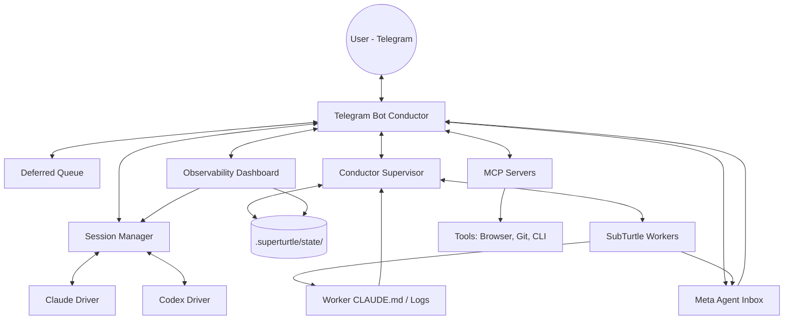

I will begin by reading the instructions in `.prompt.md` and then examine the contents of `superturtle.xml` to understand the task.
I will gather more information from the repository files, specifically focusing on the main entry points, connectors, supported models, and architecture details. I'll begin by reading more of `superturtle.xml` to access the content of key files.
I have a solid foundation for the SuperTurtle project, including its name, description, platforms, connectors, models, and architecture. I've also identified several use cases, features, and patterns. To complete the analysis, I'll now delve deeper into supported connectors, specific use case workflows, a comprehensive feature list, smart patterns, and latest commit trends. I'll also investigate "AI skills" and "smart patterns" further, and examine `super_turtle/subturtle/` for details on workers. Following this, I'll be ready to address the remaining points, including the mermaid graph and maturity assessment.
I've gathered a substantial amount of information and can now begin drafting the response. I'll focus my remaining research on AI skills, smart patterns, use cases, connectors, models, and architecture. Specifically, I'll investigate the `.claude/agents` directory and look for "skills" in `super_turtle/subturtle/`. I'll also delve into "ralph loops," "headless CLI patterns," and other identified smart patterns. For use cases, I'll explore remote coding, parallel tasking, and autonomous research. I'll also confirm the connectors and models used. To finalize my understanding, I'll review the latest trends from the changelog and the Conductor/Supervisor/Inbox pattern. Finally, I'll read key files like `super_turtle/meta/META_SHARED.md`, `super_turtle/subturtle/subturtle_loop/agents.py`, and `super_turtle/subturtle/README.md` to solidify my findings.
I've gathered all the necessary information to compile a comprehensive report on SuperTurtle. My analysis covers the project's core functionality as an autonomous coding agent, its primary components like the Meta Agent and SubTurtles, and its various supported platforms and models. I've also detailed the intricate architecture, smart patterns like Ralph Loops and the Conductor/Supervisor/Inbox model, and diverse use cases ranging from mobile coding to parallelized task management. Furthermore, I've identified key AI skills and mapped out the data flow from Telegram to execution. I'll now present these findings in the requested markdown format, including specific source code references.

# SuperTurtle Project Analysis

## 1. Project Name and Description

**Project Name:** SuperTurtle

SuperTurtle is an autonomous coding agent designed for developers who need to manage their projects remotely. It transforms Telegram into a powerful IDE interface, allowing users to issue instructions, review code, and manage complex workflows directly from their phones. By wrapping powerful coding models like Claude Code and OpenAI Codex, it provides a seamless bridge between natural language instructions and professional-grade software engineering tasks.

The system is built around a "Meta Agent" architecture that emphasizes delegation and autonomy. Instead of just answering questions, SuperTurtle can spin up parallel workers called **SubTurtles** to handle long-running or complex tasks in isolation. This allows the main agent to maintain a high-level overview of the project while specialized agents focus on implementation, testing, or research, providing milestone updates rather than a constant stream of logs.

SuperTurtle follows a "spec-driven" philosophy, where it enforces a structured backlog (typically in `CLAUDE.md`) to prevent drift and ensure that agents stay aligned with project goals. It includes robust support for various media types, including voice messages, photos for UI analysis, and documents for context, making it a versatile companion for the modern engineer on the move.

## 2. Supported Platforms and Deployments

| Platform | Deployment Mode | Requirements |
| :--- | :--- | :--- |
| **macOS** | Local / Service (LaunchAgent) | Bun ≥ 1.0, tmux, Homebrew (for `pdftotext`), caffeinate |
| **Linux** | Local / Service (systemd) | Bun ≥ 1.0, tmux, systemd-inhibit (recommended) |
| **Windows** | WSL (Windows Subsystem for Linux) | Bun ≥ 1.0, tmux |
| **Cloud** | E2B Sandboxes / Managed VMs | E2B API Key (for `/teleport` features) |

**References:**
- `super_turtle/README.md`
- `super_turtle/claude-telegram-bot/launchagent/com.claude-telegram-ts.plist.template`
- `super_turtle/claude-telegram-bot/systemd/superturtle-bot.service.template`

## 3. Supported Connectors to Apps/APIs/Messengers

| Connector | Purpose | Source Reference |
| :--- | :--- | :--- |
| **Telegram** | Primary user interface and notification channel. | `super_turtle/claude-telegram-bot/src/index.ts` |
| **OpenAI (Whisper)** | Voice transcription for voice messages. | `super_turtle/claude-telegram-bot/src/utils.ts` |
| **pdftotext** | Extraction of text from PDF documents. | `super_turtle/claude-telegram-bot/src/handlers/document.ts` |
| **Playwright** | Capturing browser screenshots for UI analysis. | `super_turtle/claude-telegram-bot/src/handlers/photo.ts` |
| **Typefully** | (Optional MCP) Draft and schedule social posts. | `super_turtle/claude-telegram-bot/mcp-config.example.ts` |
| **Things 3** | (Optional MCP) macOS Task Manager integration. | `super_turtle/claude-telegram-bot/mcp-config.example.ts` |
| **E2B** | Managed sandboxes for remote code execution. | `super_turtle/bin/e2b-webhook-poc-lib.js` |
| **Cloudflare** | (Optional) Tunneling for frontend previews. | `super_turtle/claude-telegram-bot/src/config.ts` |

## 4. Supported Models and Agents

| Model/Agent | Type | Auth Method | Source Reference |
| :--- | :--- | :--- | :--- |
| **Claude Code** | Remote LLM (Anthropic) | CLI Auth (Subscription) or API Key | `super_turtle/claude-telegram-bot/src/session.ts` |
| **OpenAI Codex** | Remote LLM (OpenAI) | CLI Auth (CLOTH Subscription) | `super_turtle/claude-telegram-bot/src/codex-session.ts` |
| **SubTurtles** | Autonomous Workers | Inherited from Bot | `super_turtle/subturtle/subturtle_loop/agents.py` |
| **Meta Agent** | Orchestrator | Inherited from Bot | `super_turtle/meta/META_SHARED.md` |

## 5. Top 5 Use Cases and Workflows

1.  **Mobile Bug Fixing:**
    - **Workflow:** User sends a voice message describing a bug. Bot transcribes, analyzes the repo, finds the bug, runs tests, fixes the code, and replies with a summary and a screenshot of the fix.
2.  **Parallel Feature Implementation:**
    - **Workflow:** User asks to implement a multi-part feature. Meta Agent decomposes the task and spawns multiple **SubTurtles** (e.g., one for frontend, one for backend). Each worker updates its `CLAUDE.md` backlog. Bot notifies user when each sub-task is complete.
3.  **Visual UI Review:**
    - **Workflow:** User sends a screenshot of a UI issue. Bot uses a vision model to analyze the image, compares it with the source code, proposes CSS changes, and captures a new screenshot to verify the fix.
4.  **Codebase Archaeology:**
    - **Workflow:** User asks "When was this logic changed and why?". **Git Detective** agent searches history, blames lines, and provides a detailed report with commit links and rationale.
5.  **Scheduled Maintenance:**
    - **Workflow:** User sets a cron job for the bot to check for linting errors or failing tests every morning. Bot runs the check silently and only notifies the user if it finds issues.

## 6. Top 20 Features

1.  **Voice Message Support:** Native transcription via OpenAI Whisper (`src/utils.ts`).
2.  **Parallel SubTurtles:** Spawning isolated workers for concurrent tasks (`subturtle/ctl`).
3.  **Spec-Driven Loops:** Backlog-enforced autonomous execution (`subturtle/subturtle_loop/`).
4.  **Durable Conductor State:** Resilient worker lifecycle management (`src/conductor-supervisor.ts`).
5.  **Unified Session Resume:** Seamlessly pick up previous Claude or Codex chats (`src/handlers/commands.ts`).
6.  **Progress-First UX:** Live tool status updates using Telegram message edits (`src/handlers/streaming.ts`).
7.  **Deferred Message Queue:** Queuing user input while the agent is busy (`src/deferred-queue.ts`).
8.  **Media Group Processing:** Handling multiple photos sent as an album (`src/handlers/photo.ts`).
9.  **Local Dashboard:** Operational visibility into lanes and logs (`src/dashboard/`).
10. **MCP Integration:** Extensible tool system via Model Context Protocol (`src/config.ts`).
11. **Browser Screenshots:** Playwright-powered visual analysis (`src/handlers/photo.ts`).
12. **PDF/Archive Extraction:** Direct analysis of documents and zip files (`src/handlers/document.ts`).
13. **Teleport Runtime:** Moving agents to remote sandboxes via E2B (`src/teleport.ts`).
14. **Audit Logging:** Comprehensive logging for security and debugging (`src/utils.ts`).
15. **Rate Limiting:** Defense-in-depth against runaway usage (`src/security.ts`).
16. **Cron Jobs:** Scheduled autonomous tasks and supervision (`src/cron.ts`).
17. **Smart Stop Intent:** Immediate interruption of all workers via text/voice (`src/utils.ts`).
18. **Unified Usage Reporting:** Real-time quota and subscription status (`src/handlers/commands.ts`).
19. **Headless CLI Pattern:** Optimized interaction with Claude/Codex CLIs (`superturtle.js`).
20. **Sleep Prevention:** Host-aware wrappers (`caffeinate`/`systemd-inhibit`) for long runs (`live.sh`).

## 7. Top 20 Smart Patterns

1.  **Ralph Loop (YOLO):** Simple, fast iterative execution cycle (`subturtle/subturtle_loop/agents.py`).
2.  **Structured Loop (Slow):** Plan -> Groom -> Execute -> Review cycle (`subturtle/subturtle_loop/agents.py`).
3.  **Meta Agent Decomposition:** Breaking large tasks into SubTurtle payloads (`meta/DECOMPOSITION_PROMPT.md`).
4.  **Conductor-Supervisor Pattern:** Decoupling worker execution from user notifications (`src/conductor-supervisor.ts`).
5.  **Inbox-Wakeup Mechanism:** Durable event delivery for remote agents (`src/conductor-inbox.ts`).
6.  **Progress Over Log Spam:** Mapping terminal output to high-level status emojis (`src/formatting.ts`).
7.  **Context-Aware Trimming:** Reducing token usage by summarizing history (`src/session.ts`).
8.  **Atomic State Writing:** Ensuring data integrity during crashes (`src/conductor-supervisor.ts`).
9.  **Token Prefix Namespacing:** Running multiple bot instances on one machine (`src/token-prefix.ts`).
10. **Headless CLI Streaming:** Consuming JSON-RPC or events from provider CLIs (`src/session.ts`).
11. **Spec-Driven Shutdown:** Workers stop automatically when `CLAUDE.md` is complete (`subturtle/subturtle_loop/`).
12. **Ask-User Inline Buttons:** Turning tool approvals into Tappable UI (`src/handlers/callback.ts`).
13. **Silent Supervision:** Background monitoring of SubTurtles without notifying the user unless needed (`src/conductor-maintenance.ts`).
14. **Runtime Ownership Handoff:** Managing bot control between local and remote environments (`bin/runtime-ownership-agent.js`).
15. **Preemptible Background Runs:** Immediate user priority over scheduled tasks (`src/handlers/driver-routing.ts`).
16. **Artifact Injection:** Passing repo state (e.g. `CLAUDE.md`) as system context (`src/injected-artifacts.ts`).
17. **Path Sanitization:** Restricting file access for safety (`src/security.ts`).
18. **Tmux Session Isolation:** Namespaced terminal management for multiple projects (`superturtle.js`).
19. **Audit JSON-RPC Protocol:** Low-level communication with Codex `app-server` (`src/handlers/commands.ts`).
20. **Deterministic Test Gate:** Per-file process isolation for stable CI (`scripts/test-stable.ts`).

## 8. Top 20 Development Trends in Latest Commits

1.  **Unified Layout Migration:** Moving state to `.superturtle/` directory.
2.  **NPM Package Refinement:** Focus on `superturtle` global CLI usability.
3.  **Dashboard Evolution:** Transition from simple status to full observability (sessions, lanes).
4.  **Codex Integration Stability:** Fixing stalls and tool output delivery issues.
5.  **Teleport/Remote Mode:** Strong push towards "managed runtime" and E2B integration.
6.  **Notification Quieting:** Reducing push noise for intermediate updates.
7.  **Onboarding Automation:** Replacing manual setup scripts with `superturtle init`.
8.  **TypeScript Migration:** Moving core logic from shell/Python to TypeScript.
9.  **Process Reliability:** Better handling of `tmux` session lifecycles and restarts.
10. **Structured Conductor:** Formalizing the `state/runs.jsonl` and worker state machine.
11. **Security Hardening:** Path validation and command blocking improvements.
12. **Multi-User Preparedness:** Introduction of `TOKEN_PREFIX` and namespacing.
13. **Voice Transcontextualization:** Using local context to improve transcription accuracy.
14. **SubTurtle Maturity:** Adding `ctl stopall` and better supervision modes.
15. **Driver Abstraction:** Decoupling bot logic from specific model SDKs.
16. **Deterministic Testing:** Ensuring CI stability with `verify:ci`.
17. **Code Review Automation:** Building specialized agents for diff analysis.
18. **Dashboard Port Stability:** Hashing paths to prevent port collisions.
19. **Managed Auth:** Improving how Claude/Codex tokens are discovered and refreshed.
20. **Documentation as Code:** Enforcing `CLAUDE.md` patterns across the project.

## 9. Top 10 Advantages or Strong Points

1.  **Phone-Native UX:** Best-in-class Telegram integration for coding.
2.  **Codex + Claude Hybrid:** Leveraging the strengths of both top-tier coding models.
3.  **Parallelism:** Only agent that easily handles multi-worker delegation via SubTurtles.
4.  **Spec-Driven:** Durable progress tracking via `CLAUDE.md`.
5.  **Low Friction Setup:** 3 commands to get a fully agentic bot running.
6.  **Observability:** Robust dashboard for monitoring background agents.
7.  **Durable State:** Conductor ensures work continues even if the bot process restarts.
8.  **Security-Minded:** Multiple layers of protection (allowlist, rate limiting, audit logs).
9.  **Developer-Centric:** Built by an engineer for engineers (tmux, CLI-first).
10. **Open Architecture:** Easy to add new MCP servers and skills.

## 10. Top 10 Limitations or Weak Points

1.  **Complexity:** Multi-agent orchestration is harder to debug than single-shot bots.
2.  **Platform Lock-in:** Highly optimized for Telegram; other messengers are not supported.
3.  **Dependency Heavy:** Requires Bun, tmux, Python, and provider CLIs.
4.  **Resource Usage:** Running multiple agents in parallel can be CPU/Memory intensive.
5.  **Security Responsibility:** Bypassing confirmation prompts requires a high trust environment.
6.  **Beta Features:** Remote/Teleport mode is still in heavy flux.
7.  **Windows Support:** Limited to WSL, no native Windows service.
8.  **Subscription Requirements:** Requires active paid subscriptions for Claude/Codex.
9.  **Log Volume:** Even with quiet notifications, audit logs can grow very large.
10. **Manual Onboarding:** Some steps (BotFather, UserID) still feel manual for new users.

## 11. Top AI Skills (Used and Provided)

**Used Skills (Standard Agents):**
- **`arch-reviewer`**: Analyzes code structure and duplication (`.claude/agents/arch-reviewer.md`).
- **`code-reviewer`**: Finds bugs and security issues in diffs (`.claude/agents/code-reviewer.md`).
- **`browser-tester`**: Executes functional UI tests (`.claude/agents/browser-tester.md`).
- **`git-detective`**: Investigates repo history (`.claude/agents/git-detective.md`).
- **`ux-reviewer`**: Provides design and usability feedback (`.claude/agents/ux-reviewer.md`).

**Provided Skills (Worker Templates):**
- **`yolo-codex`**: High-speed autonomous implementation worker.
- **`slow-claude`**: Deliberate, plan-first architecture worker.
- **`supervisor`**: Monitors other agents and reports progress.
- **`orchestrator`**: Decomposes prompts into worker payloads.
- **`mcp-host`**: Provides custom tools (stickers, bot-control).

## 12. Data Inputs, Outputs, and Storage Overview

- **Inputs:**
  - Telegram: Text, Voice (Whisper), Photos (Playwright/Vision), Documents (pdftotext).
  - Repository: `CLAUDE.md`, `AGENTS.md`, source code, git history.
- **Outputs:**
  - Telegram: Structured text, tool status emojis, inline buttons, photos (screenshots).
  - Filesystem: Code changes, audit logs, worker state.
- **Storage:**
  - **Durable:** `.superturtle/state/` (worker state, wakeups, inbox).
  - **Transient:** `/tmp/claude-telegram-session.json` (active chats), `/tmp/*.log` (runtime logs).
  - **Archive:** `.superturtle/subturtles/` (worker workspaces).

## 13. Detailed Architecture Review

1.  **CLI Wrapper (`superturtle.js`)**: Entrypoint for init, start, stop, and doctor.
2.  **Bot Conductor (`index.ts`)**: The core event loop receiving Telegram messages.
3.  **Driver Layer (`drivers/`)**: Bridges the bot to Claude and Codex SDKs.
4.  **Session Manager (`session.ts`)**: Maintains conversation context and safety.
5.  **Supervisor (`conductor-supervisor.ts`)**: Monitors worker state files and triggers wakeups.
6.  **Inbox (`conductor-inbox.ts`)**: Queue for worker-to-user communications.
7.  **Deferred Queue (`deferred-queue.ts`)**: Buffers user input during busy states.
8.  **MCP Servers (`*_mcp/`)**: Protocol-compliant sidecars for specialized tools.
9.  **SubTurtle Control (`subturtle/ctl`)**: Python/Shell orchestration for workers.
10. **Dashboard Server (`dashboard/`)**: Bun-based HTTP server for observability.
11. **Observability Sync (`session-observability.ts`)**: Bridges driver state to dashboard.
12. **Formatting Engine (`formatting.ts`)**: Markdown to Telegram-HTML converter.
13. **Security Handler (`security.ts`)**: Validates paths and enforces rate limits.
14. **Cron Scheduler (`cron.ts`)**: Manages one-shot and recurring background tasks.
15. **Teleport Manager (`teleport.ts`)**: Handles handoff to remote sandboxes.

## 14. Architecture Mermaid Graph

## 15. Maturity, Stability, Security, Performance Review

- **Maturity:** Beta. The core local bot is stable, but multi-agent orchestration and Teleport modes are evolving rapidly.
- **Stability:** High for local single-project use. The Conductor adds significant resilience to worker crashes.
- **Security:** Robust "defense-in-depth" model. Bypassing confirmation prompts is the primary risk, mitigated by strict user allowlisting and path validation.
- **Performance:** Model-bound. The bot itself is very fast (Bun), but response times depend on the LLM provider. Parallel SubTurtles provide a significant performance boost for large tasks.

## 16. Tests, CI, Documentation Review

- **Tests:** Extensive unit and integration tests for core logic, especially session management and formatting. Includes "smoke tests" for packaging.
- **CI:** GitHub Actions run typechecks, unit tests, and smoke tests on every push (`ci.yml`).
- **Documentation:** High quality. Includes `README`, `CLAUDE.md` guides, security models, and a dedicated docs site (`superturtle.dev`).
- **AI Skills:** Well-defined agent templates for various engineering tasks.

## 17. Top 20 Possible Improvements or Fixes

1.  **Multi-Project Dashboard:** Support viewing multiple projects in one dashboard instance.
2.  **Native Windows Support:** Provide a Windows service wrapper (NSSM/WinSW).
3.  **Discord/Slack Connectors:** Broaden the messenger support.
4.  **Local LLM Integration:** Support Ollama/llama.cpp for offline or cheaper tasks.
5.  **Visual Backlog Editor:** Drag-and-drop task management in the dashboard.
6.  **Better Onboarding:** A single "Install" script for all dependencies.
7.  **Auto-Dependency Resolution:** Agents detecting and installing missing CLI tools.
8.  **Cost Tracking:** Real-time dollar estimation for API usage.
9.  **Snapshot Diffing:** Visual diffs in Telegram for code changes.
10. **Voice Context Injection:** Passing repo search results to Whisper for better spelling.
11. **Worker "Re-parenting":** Moving a SubTurtle from one Meta Agent to another.
12. **Smart Checkpointing:** Automatic git commits at major SubTurtle milestones.
13. **Conflict Resolution:** Agents debating and resolving git merge conflicts.
14. **Agent Benchmarking:** Automated evals for different models on project tasks.
15. **Encrypted State:** Option to encrypt `.superturtle/` data at rest.
16. **OIDC/OAuth Auth:** Moving away from manual token discovery.
17. **WebSocket Dashboard:** Real-time updates instead of polling.
18. **Mobile Web App:** A PWA for deeper project management than Telegram allows.
19. **Team Handoff:** "Tagging" human teammates for specific approvals or code reviews.
20. **Self-Healing:** Bot detecting its own crashes and performing "doctor" fixes.

## 18. Reuse for Agent Swarm (Solution Debating)

1.  **Meta Agent Orchestrator**: Good for breaking down complex specs (`meta/DECOMPOSITION_PROMPT.md`).
2.  **SubTurtle Lane Pattern**: Perfect for parallelizing different "debater" agents (`src/dashboard/data.ts`).
3.  **Spec-Driven Loops**: Ensures agents focus on the specification (`subturtle/subturtle_loop/`).
4.  **Conductor Inbox**: Collecting arguments from various agents into one summary (`src/conductor-inbox.ts`).
5.  **Solution Reviewers**: Reusing `arch-reviewer` and `code-reviewer` for plan evaluation.
6.  **Structured Feedback**: Using `ask_user` buttons to let one agent poll another (`src/handlers/callback.ts`).
7.  **Durable State**: Ensuring the debate state survives restarts (`src/conductor-supervisor.ts`).
8.  **Graph Knowledge (Implicit)**: Using repo-bound context as a "local graph" (`src/injected-artifacts.ts`).
9.  **Model Selection Logic**: Dynamically picking Claude vs Codex for different parts of the debate (`src/drivers/registry.ts`).
10. **Final Summary Builder**: The pattern of merging multiple agent reports (`.claude/commands/full-review.md`).

## 19. Reuse for Shared Knowledge Base (Multi-User)

1.  **Conductor State Ledger**: Shared source of truth for all interactions (`src/conductor-supervisor.ts`).
2.  **Inbox Delivery**: Notifying all users of updates to the knowledge base (`src/conductor-inbox.ts`).
3.  **CLAUDE.md Backlog**: Shared state of project goals and "memory" (`src/handlers/commands.ts`).
4.  **Audit Logging**: Traceability for who added what to the knowledge base (`src/utils.ts`).
5.  **Namespacing (TOKEN_PREFIX)**: Supporting multiple users/projects on shared hardware (`src/token-prefix.ts`).
6.  **Dashboard Observability**: Shared view of the "mind" of the system (`src/dashboard/`).
7.  **Artifact Injection**: Ensuring all agents start with the same shared knowledge (`src/injected-artifacts.ts`).
8.  **Conflict Prevention (Locks)**: `withLiveSubturtleBoardLock` for shared resource access (`src/handlers/commands.ts`).
9.  **MCP Tooling**: Shared access to external knowledge sources (`src/config.ts`).
10. **Session Persistence**: Maintaining context across different users' turns (`src/session.ts`).

## 20. Reuse for Hardware/Cloud/Messenger Agnostic Agents

1.  **Driver Abstraction**: Decoupling the LLM from the communication channel (`src/drivers/types.ts`).
2.  **Teleport Manager**: Moving execution between own hardware and E2B/Cloud (`src/teleport.ts`).
3.  **Conductor Engine**: The heart of an agent that lives "between" UI and LLM (`src/conductor-supervisor.ts`).
4.  **Dashboard API**: Exposing agent state to any frontend (Web, Native) (`src/dashboard/routes.ts`).
5.  **Voice transcription abstraction**: Easy to swap Whisper for local alternatives (`src/utils.ts`).
6.  **MCP SDK**: Universal protocol for tools and hardware control (`bot_control_mcp/server.ts`).
7.  **Headless CLI Pattern**: Running any tool that has a CLI interface (`superturtle.js`).
8.  **Queue Management**: Handling async inputs from multiple messengers (`src/deferred-queue.ts`).
9.  **Formatting Layer**: Adapting output for different message formats (`src/formatting.ts`).
10. **Audit/Audit Event System**: Monitoring and logging for compliance across environments (`src/utils.ts`).

## 21. Reuse for Team Agents (Cooperative Workflows)

1.  **Meta Agent Delegation**: High-level tasking for both humans and agents (`meta/META_SHARED.md`).
2.  **Ask-User Interactivity**: Seamless "human-in-the-loop" approval buttons (`src/handlers/callback.ts`).
3.  **Backlog Reconciliation**: Merging human intent with agent progress (`src/handlers/commands.ts`).
4.  **Inbox/Wakeup Notifications**: Keeping the team updated on agent milestones (`src/conductor-inbox.ts`).
5.  **Shared Dashboards**: Visualizing the "cooperation" between agents and humans (`src/dashboard/`).
6.  **Supervision Snapshots**: Providing humans with high-level summaries of background work (`src/conductor-snapshot.ts`).
7.  **Deferred Queue**: Respecting human priority over background automation (`src/deferred-queue.ts`).
8.  **Git Detective Archaeology**: Helping teams understand past decisions (`.claude/agents/git-detective.md`).
9.  **Code Review Patterns**: Automating the "peer review" part of the team workflow (`.claude/commands/code-review.md`).
10. **Path Validation**: Ensuring agents only work in agreed-upon "team areas" (`src/security.ts`).
