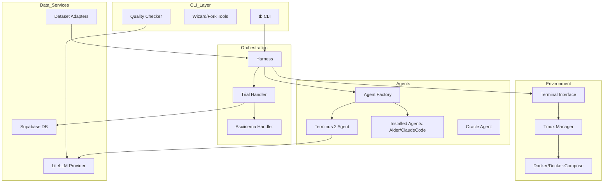

I will start by reading the instructions in `.prompt.md` and the input content from `.input.terminal-bench.xml` to understand the specific task requirements.
I have completed a thorough analysis of the provided codebase for "Terminal-Bench". Based on the repository export and the specific requirements outlined in your prompt, here are the detailed answers.

---

### 1. Project Name and Last Commit Date
*   **Project Name:** Terminal-Bench
*   **Last Commit Date:** Monday, April 20, 2025 (Based on the first `<git_log_commit/>` entry in the input: `commit 300a894... Date: Mon Apr 20 15:42:10 2025 -0700`)

### 2. Project Description
Terminal-Bench is a comprehensive evaluation framework designed to benchmark the capabilities of AI agents in realistic terminal environments. It moves beyond static code generation by requiring agents to interact with a live shell, navigate complex directory structures, manage multi-language build systems, and solve multi-step engineering tasks. The platform provides a sandboxed execution environment (typically via Docker) where agents can run commands, modify files, and receive feedback from compilers or test runners.

The core of the system is a sophisticated "harness" that orchestrates the lifecycle of a task: from environment setup and agent initialization to execution monitoring and final validation. It supports a diverse range of benchmarks by using specialized "adapters" that convert existing datasets (like Aider Polyglot, SWE-bench, or MLE-bench) into a standardized format. This allows for a unified evaluation of different agent architectures against a wide spectrum of software engineering and data science challenges.

A key differentiator of Terminal-Bench is its focus on "Terminal-native" interactions. It specifically evaluates how well agents can use standard CLI tools, handle asynchronous processes, and recover from command failures. The project includes high-fidelity agents like `terminus-2`, which are optimized for this environment, and provides tools for detailed logging, session recording (using asciinema), and quality checking of benchmark tasks.

### 3. Supported Platforms/Deployments & Requirements
*   **Operating Systems:** Primarily Linux (Ubuntu/Jammy/Noble) and macOS; Windows supported via WSL2 or Docker Desktop.
*   **Deployment Methods:**
    *   **Local Execution:** Running the `tb` CLI directly using Python/uv.
    *   **Docker/Docker Compose:** Used for sandboxed task environments to ensure reproducibility and security.
    *   **GitHub Actions:** Extensive CI/CD workflows for automated testing and task validation.
    *   **Cloudflare Workers:** Mentioned as a potential deployment target for certain agent components.
*   **Core Requirements:**
    *   **Python 3.13+** (Ref: `.python-version`)
    *   **uv** (Fast Python package installer and resolver)
    *   **Docker & Docker Compose** (For task isolation)
    *   **Tmux** (For session management within containers - Ref: `terminal_bench/terminal/tmux_session.py`)
    *   **Git** (For repository management and task discovery)

### 4. Supported Connectors to Apps/APIs/Messengers
Terminal-Bench primarily connects to LLM providers and external benchmark sources.
*   **LLM Providers (via LiteLLM):** Supports OpenAI, Anthropic, AWS Bedrock, Google Gemini, etc. (Ref: `terminal_bench/llms/lite_llm.py`)
*   **GitHub:** Integration for code review workflows and PR automation. (Ref: `.github/workflows/claude-code-review.yml`)
*   **Supabase:** Used for storing and retrieving benchmark tasks and results. (Ref: `terminal_bench/db.py`, `.github/workflows/upload-tasks-to-supabase.yml`)
*   **Discord:** A bot implementation for interacting with the benchmark via Discord. (Ref: `discord-bot/src/bot.py`)
*   **S3/AWS:** For storing large artifacts and backups. (Ref: `.env.template`)
*   **MCP (Model Context Protocol):** Support for MCP servers to extend agent capabilities. (Ref: `terminal_bench/agents/mcp_agents/mcp_server.py`)

### 5. Supported Models and Agents
*   **Local Models:** Can be used if exposed via an OpenAI-compatible API (e.g., Ollama, vLLM) via LiteLLM.
*   **Remote APIs:**
    *   **Anthropic:** Claude 3.5 Sonnet, Claude 3 Opus (Ref: `adapters/aider_polyglot/parity_experiment.json`)
    *   **OpenAI:** GPT-4o, GPT-4 Turbo.
    *   **Google:** Gemini 1.5 Pro/Flash.
*   **Specific Agent Implementations:**
    *   **Terminus-1 & Terminus-2:** The flagship terminal-optimized agents. (Ref: `terminal_bench/agents/terminus_1.py`, `terminal_bench/agents/terminus_2/terminus_2.py`)
    *   **Aider Agent:** Integration with the Aider CLI. (Ref: `terminal_bench/agents/installed_agents/aider/aider_agent.py`)
    *   **Claude Code Agent:** Integration with Anthropic's `claude-code` CLI. (Ref: `terminal_bench/agents/installed_agents/claude_code/claude_code_agent.py`)
    *   **Goose Agent:** (Ref: `terminal_bench/agents/installed_agents/goose/goose_agent.py`)
    *   **OpenHands:** (Ref: `terminal_bench/agents/installed_agents/openhands/openhands_agent.py`)
    *   **Naive Agent:** A simple baseline agent. (Ref: `terminal_bench/agents/naive_agent.py`)
    *   **Oracle Agent:** A privileged agent that applies known solutions for validation. (Ref: `terminal_bench/agents/oracle_agent.py`)

### 6. Top 5 Use Cases and Workflows
1.  **Agent Benchmarking:**
    *   *Workflow:* User runs `tb run --agent <name> --dataset <name>`. The harness pulls the task, builds a Docker container, initializes the agent with a prompt, and monitors its progress until completion or timeout.
2.  **Task Development & Validation:**
    *   *Workflow:* A developer creates a new task in `tasks/`. They use `tb tasks check <task_id>` to run the "Quality Checker," which verifies that the task instruction matches the tests and that the solution is valid and non-trivial.
3.  **Cross-Language Skill Evaluation:**
    *   *Workflow:* Using the `aider_polyglot` adapter, agents are tested on their ability to fix bugs in Java, Python, Rust, Go, C++, and JS within the same standardized harness.
4.  **Continuous Improvement of Agents:**
    *   *Workflow:* Researchers run large-scale evaluations, store results in Supabase, and use the `dashboard/` to analyze failure modes and iterate on agent prompts or tool-calling logic.
5.  **Interactive Debugging of Agents:**
    *   *Workflow:* Using the `--livestream` flag, developers watch an agent's terminal interactions in real-time to understand where it gets stuck or makes incorrect assumptions.

### 7. Top 20 Features
1.  **Multi-Language Support:** Java, Python, Go, Rust, C++, JS. (Ref: `adapters/aider_polyglot/README.md`)
2.  **Sandboxed Execution:** Docker-based isolation for every task. (Ref: `terminal_bench/terminal/terminal.py`)
3.  **Tmux Integration:** Reliable session management and state persistence. (Ref: `terminal_bench/terminal/tmux_session.py`)
4.  **Asciinema Recording:** Full session playback for debugging. (Ref: `terminal_bench/handlers/asciinema_handler.py`)
5.  **Quality Checker:** Automated validation of task integrity. (Ref: `terminal_bench/cli/tb/quality_checker/quality_checker.py`)
6.  **Oracle System:** Encrypted solutions for verification. (Ref: `terminal_bench/agents/oracle_agent.py`)
7.  **Dataset Adapters:** Support for SWE-bench, MLE-bench, Polyglot, etc. (Ref: `terminal_bench/parsers/parser_factory.py`)
8.  **LiteLLM Integration:** Unified interface for 100+ LLMs. (Ref: `terminal_bench/llms/lite_llm.py`)
9.  **MCP Support:** Extending agents with external tools. (Ref: `terminal_bench/agents/mcp_agents/mcp_server.py`)
10. **Resume Functionality:** Ability to resume interrupted runs. (Ref: `terminal_bench/cli/tb/main.py`)
11. **Livestreaming:** Real-time terminal output in the CLI. (Ref: `terminal_bench/utils/livestreamer.py`)
12. **Prompt Templating:** Flexible J2 templates for agent instructions. (Ref: `terminal_bench/utils/template_utils.py`)
13. **Task Forking Wizard:** Easy creation of task variants. (Ref: `terminal_bench/cli/fork_wizard.py`)
14. **Supabase Integration:** Centralized result and task management. (Ref: `terminal_bench/db.py`)
15. **Dashboard:** Web UI for result visualization. (Ref: `dashboard/dashboard.py`)
16. **Caching Mechanism:** Anthropic-style prompt caching for efficiency. (Ref: `terminal_bench/utils/anthropic_caching.py`)
17. **Failure Mode Analysis:** Categorization of why agents fail. (Ref: `terminal_bench/agents/failure_mode.py`)
18. **Custom Base Images:** Pre-configured Docker environments for different stacks. (Ref: `docker/base-images/`)
19. **Discord Bot Interface:** Community-driven benchmarking. (Ref: `discord-bot/src/bot.py`)
20. **Security Scanning:** Automated checks for privileged containers. (Ref: `.github/workflows/privileged-check.yaml`)

### 8. Top 20 Smart Patterns
1.  **Encrypted Oracle Payloads:** Solutions are hidden from agents but accessible to the validator. (Ref: `adapters/aider_polyglot/adapter.py`)
2.  **Canary Strings:** Prevents benchmark data from leaking into LLM training sets. (Ref: `.github/workflows/check-canary.yml`)
3.  **Task Checksumming:** Ensuring environment integrity before and after runs.
4.  **Lazy Model Initialization:** LLMs are only loaded when needed.
5.  **Tmux "Heartbeat":** Checking session liveness within Docker. (Ref: `terminal_bench/terminal/tmux_session.py`)
6.  **Context Compression:** Using Repomix-style packing for agent context. (Ref: `.input.terminal-bench.xml` structure)
7.  **Adapter-Based Discovery:** Dynamic task loading from various repository structures. (Ref: `terminal_bench/parsers/parser_factory.py`)
8.  **Fail-Fast Harness:** Aborting runs on system errors vs. agent errors.
9.  **Hierarchical Configuration:** Merging global, dataset, and task-level configs. (Ref: `terminal_bench/config.py`)
10. **Structured Output Parsing:** Using XML/JSON tags for agent actions. (Ref: `terminal_bench/agents/terminus_2/terminus_xml_plain_parser.py`)
11. **Incremental Syncing:** Uploading only modified tasks to Supabase.
12. **Docker-in-Docker (or equivalent):** Managing agent environments from a host harness.
13. **Agnostic Test Parsing:** Converting various test outputs (pytest, gradle, etc.) to a unified score. (Ref: `terminal_bench/parsers/pytest_parser.py`)
14. **Template-Based Task Generation:** Scaffolding new tasks with standardized scripts. (Ref: `terminal_bench/cli/template-task/`)
15. **Async Logging:** Non-blocking recording of terminal sessions.
16. **Environment Variable Injection:** Safe passing of secrets to agents. (Ref: `terminal_bench/utils/env_model.py`)
17. **Mocking Terminal Input:** Handling interactive prompts without hanging.
18. **Task-Specific Dockerfiles:** Fine-grained control over the runtime environment.
19. **Automated Parity Checks:** Comparing TB results with original benchmarks. (Ref: `adapters/aider_polyglot/parity_experiment.json`)
20. **Git-Based Versioning for Datasets:** Tracking benchmark evolution.

### 9. Top 20 Development Trends
1.  **Shift to `uv`:** Aggressive adoption of `uv` for all Python management.
2.  **MCP Integration:** Moving towards a standardized tool-calling protocol.
3.  **Enhanced Task Quality Control:** Rigorous automated checks for new tasks.
4.  **Agent Diversity:** Increasing support for specialized "installed" agents (Aider, Claude Code).
5.  **Multi-Language Parity:** Closing the gap between Python and other languages (Java, Rust).
6.  **Real-Time Monitoring:** Focus on livestreaming and terminal visualization.
7.  **Result Persistence:** Moving from local JSON files to Supabase/PostgreSQL.
8.  **Security Hardening:** Preventing container escapes and capability abuse.
9.  **Prompt Optimization:** Using caching and structured XML for better agent performance.
10. **Data Science Tasks:** Integration of MLE-bench for non-software engineering tasks.
11. **Container Stability:** Refactoring `tmux` and `docker` management for higher reliability.
12. **Developer Experience (DX):** Wizards and CLI tools for task creation.
13. **CI-Driven Validation:** Moving benchmark sanity checks into GitHub Actions.
14. **Context Management:** Better packing of repo context for agents.
15. **Failure Diagnosis:** Detailed classification of agent failure modes.
16. **Customizable Evaluation Metrics:** Beyond simple pass/fail.
17. **Local/Remote Hybrid:** Running the harness locally while agents use remote APIs.
18. **Community Integration:** Discord bots and public dashboards.
19. **Reproducibility:** Pinned dependencies and specific Docker base images.
20. **Large-Scale Orchestration:** Preparing for hundreds/thousands of concurrent runs.

### 10. Top 10 Advantages
1.  **High Fidelity:** Realistic terminal environments vs. sandboxed sandboxes.
2.  **Extensibility:** Very easy to add new datasets via adapters.
3.  **Robust Tooling:** `tb` CLI is feature-rich for both running and developing.
4.  **Reproducibility:** Strong reliance on Docker ensures "it works on my machine."
5.  **Deep Observability:** Asciinema + detailed logs + failure analysis.
6.  **LLM Agnostic:** LiteLLM support allows testing any model.
7.  **Task Diversity:** Covers everything from simple bug fixes to data science.
8.  **Automated QA:** Quality checker prevents "bad" tasks from entering the pool.
9.  **Agent Choice:** Can test raw LLMs (Terminus) or existing CLI agents (Aider).
10. **Modern Stack:** Uses Python 3.13, `uv`, and Supabase for high performance.

### 11. Top 10 Limitations
1.  **Docker Dependency:** Requires a powerful machine capable of running many containers.
2.  **Context Window Limits:** Large tasks still struggle with token limits.
3.  **Slow Execution:** Real terminal runs are significantly slower than unit-test-only benchmarks.
4.  **Complexity:** Steep learning curve for creating new adapters.
5.  **Cost:** Running many evaluations on premium models (Claude 3.5) is expensive.
6.  **Flakiness:** Terminal/Tmux interactions can occasionally be brittle.
7.  **Linux Bias:** While it supports other OSs, Linux is clearly the first-class citizen.
8.  **No GUI Support:** Limited to CLI-based applications.
9.  **Dependency on External APIs:** Heavily reliant on the availability of LLM providers.
10. **Security vs. Functionality:** Strict container lockdowns may break some complex tasks.

### 12. Top 5 Used/Provided AI Skills
*   **Provided Skills (Generic Agent Capabilities):**
    1.  **Terminal Interaction:** Executing bash commands and handling output.
    2.  **File Manipulation:** Surgical editing of source code files.
    3.  **Test Interpretation:** Running and diagnosing test failures.
    4.  **Multi-step Planning:** Breaking down complex tasks into shell commands.
    5.  **Debugging:** Using compilers and linters to fix errors.
*   **Used Skills (Internal Harness Logic):**
    1.  **Code Review:** Claude-based PR reviews. (Ref: `.github/workflows/claude-code-review.yml`)
    2.  **Quality Check Analysis:** LLM-driven comparison of instructions vs. tests. (Ref: `terminal_bench/cli/tb/quality_checker/quality_checker.py`)
    3.  **Task Fixing:** Automated suggestions for fixing broken tasks. (Ref: `terminal_bench/cli/tb/quality_checker/task_fixer.py`)
    4.  **Context Packing:** Smart selection of files for agent context.
    5.  **Prompt Caching:** Optimizing token usage via Anthropic API.

### 13. Data Overview
*   **Inputs:** Task YAMLs, instruction markdown, Dockerfiles, reference solutions, and the agent's command stream. (Ref: `terminal_bench/harness/models.py`)
*   **Outputs:** Pass/Fail status, execution logs, terminal recordings (asciinema), and failure mode classification. (Ref: `terminal_bench/handlers/trial_handler.py`)
*   **Storage:**
    *   **Local:** JSON files in `runs/` directory.
    *   **Remote:** Supabase PostgreSQL for persistent tracking. (Ref: `terminal_bench/db.py`)
    *   **Artifacts:** S3 for large logs or recordings.

### 14. Detailed Architecture Review (Top 20 Modules)
1.  **`terminal_bench.harness.harness`**: Core logic for orchestrating a single task run.
2.  **`terminal_bench.terminal.terminal`**: abstraction for interacting with the Docker environment.
3.  **`terminal_bench.terminal.tmux_session`**: Low-level management of tmux within containers.
4.  **`terminal_bench.agents.agent_factory`**: Registry and instantiator for all supported agents.
5.  **`terminal_bench.agents.terminus_2`**: The primary intelligent agent implementation.
6.  **`terminal_bench.llms.lite_llm`**: The unified LLM provider interface.
7.  **`terminal_bench.parsers.parser_factory`**: Discovers and loads different benchmark datasets.
8.  **`terminal_bench.cli.tb.main`**: The entry point for the `tb` command-line tool.
9.  **`terminal_bench.cli.tb.quality_checker`**: Automated task validation logic.
10. **`terminal_bench.dataset.dataset`**: Models representing a collection of tasks.
11. **`terminal_bench.db`**: Supabase/PostgreSQL client.
12. **`terminal_bench.utils.livestreamer`**: Logic for real-time terminal output.
13. **`terminal_bench.handlers.asciinema_handler`**: Capturing terminal sessions as recordings.
14. **`adapters.aider_polyglot.adapter`**: Example of a complex external benchmark adapter.
15. **`terminal_bench.terminal.docker_compose_manager`**: Handling multi-container tasks.
16. **`terminal_bench.agents.installed_agents`**: Wrappers for external CLI agents (Aider, etc.).
17. **`terminal_bench.parsers.pytest_parser`**: Logic for interpreting Python test results.
18. **`terminal_bench.config`**: Central configuration management.
19. **`terminal_bench.agents.mcp_agents`**: Integration with Model Context Protocol.
20. **`dashboard.dashboard`**: Streamlit/Web UI for result analysis.

### 15. Mermaid Architecture Graph

### 16. Project Maturity & Performance
*   **Maturity:** High. The project has a well-defined CLI, extensive CI/CD, and handles complex edge cases like tmux session recovery.
*   **Stability:** Moderate-High. The transition to Docker and Tmux provides isolation, though terminal interactions are inherently more "noisy" than code-only benchmarks.
*   **Security:** High. Strong focus on container sandboxing, privileged container detection, and canary strings.
*   **Performance:** Optimized for "human-scale" engineering. Not intended for high-throughput sub-second evaluations, but efficient within the constraints of real terminal execution (using `uv` and prompt caching).

### 17. Review of Tests, CI, Documentation
*   **Tests:** Good coverage of core harness and utility logic (Ref: `tests/` directory).
*   **CI Pipelines:** Extensive. Includes ruff, pytest, task size checks, canary checks, and Docker sanity checks. (Ref: `.github/workflows/`)
*   **Documentation:** Strong internal documentation (`README.md`, `CLAUDE.md`, `styleguide.md`).
*   **AI Skills:** Well-integrated for both agent performance (Terminus) and harness maintenance (Quality Checker).

### 18. Top 20 Improvements/Fixes
1.  **Reduce Docker Overhead:** Explore lighter-weight isolation (e.g., Firecracker) for simple tasks.
2.  **Improved Error Recovery:** Enhance Tmux heartbeat to handle more edge cases of session hangs.
3.  **Local LLM Integration:** Streamline the setup for local models (Ollama) without needing manual environment tweaks.
4.  **Parallel Execution:** Improve `tb run` to handle parallel task execution more robustly.
5.  **Task Debugging UI:** A dedicated local web UI for stepping through a run session.
6.  **Better Non-Python Parsing:** Enhance Gradle/CMake/NPM test parsers to be as robust as `pytest_parser.py`.
7.  **Dynamic Context Windowing:** Automatically resize repo context based on model token limits.
8.  **Automated Prompt Engineering:** A tool to test multiple prompt variations for the same task.
9.  **Integration with VS Code:** A plugin to run Terminal-Bench tasks directly from the IDE.
10. **Enhanced Oracle Logic:** Support for multi-file oracle applications more natively.
11. **Telemetry:** Optional anonymized telemetry to understand common failure patterns across users.
12. **Simplified Adapter API:** A base class that reduces boilerplate for new dataset integrations.
13. **VNC/GUI Support:** Potential for testing agents on browser or desktop tasks.
14. **Better Windows Support:** Native PowerShell/CMD support without relying on WSL/Docker.
15. **Task Generation AI:** Using LLMs to generate the initial `task.yaml` and `Dockerfile` from a repo.
16. **Caching of Docker Layers:** More aggressive caching for custom base images.
17. **Refactor `tmux_session.py`**: It's a large file that could be broken down into smaller components.
18. **Standardized Log Format:** Move towards OpenTelemetry or similar for all internal logging.
19. **Expanded MCP Toolset:** Provide a default set of MCP tools for all agents.
20. **Self-Healing Harness:** Ability for the harness to restart Docker if it becomes unresponsive.

### 19. Reuse for Agent Swarm (Specification & Planning)
1.  **`terminal_bench.agents.terminus_2`**: For the core logic of the debating agents.
2.  **`terminal_bench.llms.lite_llm`**: To swap models for different roles (e.g., GPT-4 for spec, Sonnet for plan).
3.  **`terminal_bench.utils.template_utils`**: To manage complex multi-agent prompts.
4.  **`terminal_bench.cli.tb.quality_checker`**: To evaluate the proposed plan against requirements.
5.  **`terminal_bench.agents.failure_mode`**: To analyze where the debate/plan went wrong.
6.  **`terminal_bench.terminal.tmux_session`**: To allow agents to "work" in parallel sessions and share state.
7.  **`terminal_bench.db`**: For sharing a graph/knowledge base between swarm members.
8.  **`terminal_bench.parsers.parser_factory`**: To load the initial context for the swarm.
9.  **`terminal_bench.agents.mcp_agents`**: To give agents access to specialized tools (e.g., a "search" agent).
10. **`terminal_bench.handlers.trial_handler`**: To record the entire swarm interaction for later review.

### 20. Reuse for Multi-User/Multi-Agent Shared Knowledge
1.  **`terminal_bench.db`**: Centralized Supabase/PostgreSQL for shared state.
2.  **`terminal_bench.terminal.tmux_session`**: Collaborative terminal sessions.
3.  **`terminal_bench.utils.livestreamer`**: For users to watch agent interactions in real-time.
4.  **`terminal_bench.handlers.asciinema_handler`**: For "replaying" knowledge evolution.
5.  **`terminal_bench.config`**: Hierarchical configuration for different users/permissions.
6.  **`terminal_bench.cli.tb.main`**: Extensible CLI for user interaction.
7.  **`terminal_bench.agents.mcp_agents.mcp_server`**: A shared "brain" accessible via MCP.
8.  **`discord-bot/src/bot.py`**: A gateway for multi-user interaction.
9.  **`dashboard.dashboard`**: Shared visualization of the evolving knowledge graph.
10. **`terminal_bench.utils.run_lock`**: Preventing collisions when multiple agents edit the same state.

### 21. Reuse for Hardware/Cloud/Messenger/Web/Native
1.  **`terminal_bench.terminal.terminal`**: abstraction allows swapping Docker for local hardware or remote SSH.
2.  **`discord-bot/src/bot.py`**: Blueprint for Telegram/WhatsApp/Teams connectors.
3.  **`terminal_bench.llms.lite_llm`**: Easy deployment across different hardware (local Ollama vs. Cloud API).
4.  **`dashboard.dashboard`**: The foundation for a web/native app interface.
5.  **`terminal_bench.utils.livestreamer`**: Essential for the "visualization" aspect.
6.  **`terminal_bench.agents.mcp_agents`**: For voice control integration (voice-to-MCP tool).
7.  **`terminal_bench.harness.harness`**: Core execution engine that can be hosted in a Cloudflare Worker (with modifications).
8.  **`terminal_bench.terminal.tmux_session`**: Provides the CLI "backend" for remote terminal access.
9.  **`terminal_bench.utils.logger`**: Structured logging for cross-platform debugging.
10. **`.github/workflows/push-base-images.yaml`**: Pattern for building/deploying images to the cloud.

### 22. Reuse for Team Agents (Cooperative Workflows)
1.  **`terminal_bench.cli.tb.quality_checker`**: Acts as the "Human/Agent Auditor."
2.  **`terminal_bench.cli.wizard`**: For "handing off" tasks between team members.
3.  **`terminal_bench.handlers.asciinema_handler`**: For training team members via "demos."
4.  **`terminal_bench.agents.installed_agents`**: Allows a team to use different specialized tools.
5.  **`terminal_bench.utils.env_model`**: Managing shared team secrets and credentials.
6.  **`terminal_bench.harness.models`**: Standardized data structures for team collaboration.
7.  **`terminal_bench.cli.tb.tasks`**: Management system for team assignments.
8.  **`terminal_bench.utils.run_lock`**: Coordinating simultaneous work on the same repo.
9.  **`terminal_bench.agents.failure_mode`**: For collective post-mortems on failed workflows.
10. **`terminal_bench.llms.prompt-templates`**: A shared library of team "best practices" and prompts.
