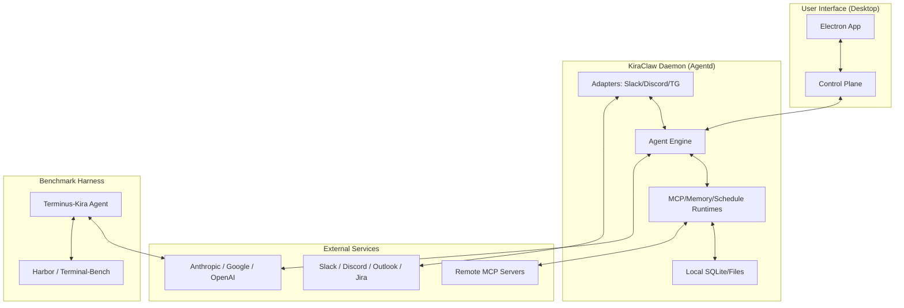

I will read the instructions from `.prompt.md` to understand the task requirements.
I will read the first 100 lines of `.input.terminus-kira.xml` to understand its structure and extract the project name and last commit date.
I will search for the first occurrence of `<git_log_commit` in `.input.terminus-kira.xml` to find the project name and last commit date.
I will read the first `<git_log_commit>` entry from `.input.terminus-kira.xml` at line 48541 to find the project name and last commit date.
I will search for the content of `README.md` in `.input.terminus-kira.xml` to identify the project name and gather a description.
I will read `README.md` from `.input.terminus-kira.xml` starting at line 47919 to get the project description and platform/deployment details.
I will search for the string `KIRA-Slack` in `.input.terminus-kira.xml` to understand its role and relationship to the project.
I will search for `KIRA-Slack/README.md` and read `terminus_kira/terminus_kira.py` to understand the differences between the benchmark harness and the Slack integration.
I will read `terminus_kira/terminus_kira.py` to understand the agent's implementation, including its tool-calling mechanism and supported features.
I will search for `agent.py` in the `KIRA-Slack` directory to understand its core agent logic.
I will read `KIRA-Slack/app/cc_agents/operator/agent.py` to understand the orchestration logic and how it coordinates other agents.
I will list the directories in `KIRA-Slack/.claude/skills` to identify the available AI skills and read a few of them for more details.
I will search for all `SKILL.md` files in the repository to identify the provided AI skills.
I will search for `pyproject.toml` and `settings.py` in the `KIRA-Slack` directory to identify supported platforms and models.
I will read `KIRA-Slack/app/__init__.py` and search for any `config.py` files in the `KIRA-Slack` directory to understand the project's configuration and deployment.
I will search for the root `pyproject.toml` and read it to identify dependencies and supported platforms.
I will search for `package.json` in the `KIRA-Slack` directory to identify additional dependencies and information about the desktop application.
I will read `KIRA-Slack/.claude/skills/slack-memory-store/SKILL.md` to understand how the project manages shared knowledge and memory.
I will read the lines around L22290 in `.input.terminus-kira.xml` to identify the file I just read and understand its context.
I will search for the `<file path=` tag just before line 22300 in `.input.terminus-kira.xml` to identify the file name.
I will search for `KIRA-1.0.5.exe` to find the corresponding file and its location in the repository.
I will search for the nearest `<file path=` tag before line 22300 in `.input.terminus-kira.xml` to identify the file name.
I will read the directory structure in `.input.terminus-kira.xml` to find the exact path of the technical manual or developer guide.
I will read `KiraClaw/README.md` and `KiraClaw/apps/agentd/src/kiraclaw_agentd/engine.py` to understand the architecture and features of the project's successor.
**Technical Analysis Report: Terminus-KIRA (KIRA / KiraClaw)**

### 1. Project Name and Last Commit Date
*   **Project Name:** Terminus-KIRA (KRAFTON Intelligence Rookie Agent / KiraClaw)
*   **Last Commit Date:** 2026-04-14 10:54:06 +0900 (Ref: `<git_log_commit/>` in `.input.terminus-kira.xml`)

### 2. Description
Terminus-KIRA is a high-performance agent harness for Terminal-Bench, built to boost the performance of frontier LLMs on complex command-line tasks. It focuses on "simple fixes, significant gains" by replacing traditional In-Context Learning (ICL) with native tool calling, implementing multimodal support for terminal analysis, and optimizing command execution through smart polling.

The project is the benchmark-optimized evolution of KIRA (KRAFTON Intelligence Rookie Agent), an AI "virtual coworker" system used internally at KRAFTON. It has evolved from a Slack-centric desktop application (`KIRA-Slack`) into a more modular and robust architecture named `KiraClaw`, which serves as a local AI agent runtime capable of operating across multiple platforms and communication channels.

KIRA emphasizes privacy and autonomy, running as a local desktop application that communicates directly with model providers (Anthropic, Google) using the user's API keys. It features a sophisticated memory system, a modular "Skill" architecture for specialized document and web tasks, and a multi-agent orchestration layer that allows it to act as a proactive teammate rather than a simple chatbot.

### 3. Supported Platforms/Deployments + Requirements
*   **Linux:** Primary environment for `terminus-kira` benchmark harness and `harbor` execution.
*   **macOS:** Desktop application via Electron (Arm64/Intel).
*   **Windows:** Desktop application via Electron (`.exe` installer).
*   **Docker:** Supported via `run_docker.sh` for isolated task execution.
*   **Cloud Infrastructure:** Native support for **Daytona** (`run_daytona.sh`) and **Runloop** (`run_runloop.sh`) for remote agent environments.
*   **Requirements:**
    *   **Python:** 3.10+ (KiraClaw/KIRA-Slack), 3.12+ (Terminus-Kira harness).
    *   **Node.js:** 18.0.0+ (for Electron/VitePress apps).
    *   **Package Managers:** `uv` (recommended for Python), `npm` (for JS).
    *   **Hardware:** Local hardware for desktop apps; cloud/docker for benchmarks.

### 4. Supported Connectors
*   **Slack:** Via `slack_bolt` and `KiraClaw` Slack adapter (`KIRA-Slack/app/cc_slack_handlers.py`, `KiraClaw/apps/agentd/src/kiraclaw_agentd/slack_adapter.py`).
*   **Outlook:** For email monitoring and task extraction (`KIRA-Slack/app/cc_checkers/ms365/outlook_agent.py`).
*   **Confluence/Jira:** Atlassian integration for document and task tracking (`KIRA-Slack/app/cc_checkers/atlassian/confluence_agent.py`, `KIRA-Slack/app/cc_checkers/atlassian/jira_agent.py`).
*   **Discord:** Native adapter in KiraClaw (`KiraClaw/apps/agentd/src/kiraclaw_agentd/discord_adapter.py`).
*   **Telegram:** Native adapter in KiraClaw (`KiraClaw/apps/agentd/src/kiraclaw_agentd/telegram_adapter.py`).
*   **Twitter (X):** Via Tweepy for social media monitoring (`KIRA-Slack/app/cc_tools/x/x_tools.py`).
*   **Browser:** Headless automation via Playwright (`KiraClaw/defaults/skills/playwright-use/SKILL.md`).
*   **Terminal:** Direct shell interaction for benchmarking (`terminus_kira/terminus_kira.py`).

### 5. Supported Models/Agents
*   **Claude (Anthropic):** Native support for Claude Opus 4.6, Sonnet 3.7, etc., via `anthropic` and `litellm`. Supports Vertex AI hosting (`terminus_kira/terminus_kira.py`, `KIRA-Slack/pyproject.toml`).
*   **Gemini (Google):** Support for Gemini 3.1 Pro via `google-adk` and `litellm` (`README.md`, `KIRA-Slack/app/cc_agents/operator/agent.py`).
*   **Codex:** Mentioned in benchmarks via `litellm` (`README.md`).
*   **Reasoning Models:** Specific handling for models requiring temperature 1.0 and reasoning effort adjustments (`terminus_kira/terminus_kira.py`).

### 6. Top 5 Use Cases
1.  **Autonomous CLI Task Solving:** Solving complex Linux environment tasks (e.g., debugging, file manipulation, system setup) with high reliability on Terminal-Bench.
2.  **Virtual Coworker (Slack/Discord):** Acting as a 24/7 teammate that summarizes threads, answers project-specific questions, and manages local files.
3.  **Proactive Task Extraction:** Monitoring Outlook emails and Confluence updates to automatically identify and notify users of new action items.
4.  **Multi-modal Terminal Debugging:** Using `image_read` to analyze screenshots of terminal outputs or GUI applications to resolve visual or complex errors.
5.  **Automated Document Processing:** Generating or editing complex Excel models, PowerPoint presentations, and PDF forms using specialized skills.

### 7. Top 20 Features
1.  **Native Tool Calling:** Uses LLM `tools` parameter instead of ICL parsing for higher reliability (`terminus_kira/terminus_kira.py`).
2.  **Marker-based Polling:** Early command completion detection using echo markers to reduce latency (`terminus_kira/terminus_kira.py`).
3.  **Multimodal Support:** `image_read` tool for analyzing base64 terminal screenshots (`terminus_kira/terminus_kira.py`).
4.  **Completion Verification Checklist:** Multi-perspective QA (Test/QA/User) for task finalization (`README.md`, `terminus_kira/terminus_kira.py`).
5.  **Prompt Caching:** Ephemeral caching on recent messages for Anthropic models (`anthropic_caching.py`).
6.  **MCP Server Integration:** Support for Model Context Protocol to connect with Perplexity, DeepL, GitHub, etc. (`KIRA-Slack/app/cc_agents/operator/agent.py`).
7.  **Hierarchical Memory:** Local storage of conversation history and project context with RAG retrieval (`KIRA-Slack/app/cc_agents/memory_retriever/agent.py`).
8.  **Proactive Intervention:** Detecting when to help in a Slack thread without direct tagging (`KIRA-Slack/app/cc_agents/bot_call_detector/agent.py`).
9.  **Email Task Extraction:** Automated parsing of Outlook emails for actionable items (`KIRA-Slack/app/cc_tools/email_tasks/email_tasks_tools.py`).
10. **Confluence Deep Reading:** Recursive reading and indexing of Confluence page trees (`KIRA-Slack/.claude/skills/confluence-deep-reader/SKILL.md`).
11. **Excel Recalculation:** Deep formula verification and recalculation in XLSX files (`KIRA-Slack/.claude/skills/xlsx/recalc.py`).
12. **PPTX Generation:** Creating and editing PowerPoint presentations from markdown/HTML (`KIRA-Slack/.claude/skills/pptx/scripts/html2pptx.js`).
13. **PDF Form Filling:** Programmatic filling of PDF forms using bounding box analysis (`KIRA-Slack/.claude/skills/pdf/scripts/fill_pdf_form_with_annotations.py`).
14. **Computer Use (Chrome):** Controlling browser for web tasks (`KIRA-Slack/app/cc_agents/operator/agent.py`).
15. **Voice Transcription:** Integrating Clova Speech for meeting transcription (`KIRA-Slack/app/cc_utils/clova_helper.py`).
16. **Scheduling:** Background jobs for periodic checks and tasks (`KIRA-Slack/app/scheduler.py`).
17. **Multi-Adapter Support:** One agent core serving Slack, Telegram, and Discord (`KiraClaw/apps/agentd/src/kiraclaw_agentd/engine.py`).
18. **Local Daemon (Agentd):** Decoupled agent execution engine (`KiraClaw/apps/agentd/`).
19. **Electron Control Plane:** Desktop UI for managing agents, logs, and settings (`KiraClaw/apps/desktop/`).
20. **Self-Healing Execution:** Automatic retry and summarization on context overflow or infrastructure timeouts (`terminus_kira/terminus_kira.py`).

### 8. Top 20 Smart Patterns
1.  **Double-Confirmation Checklist:** Requiring the agent to self-verify against a "QA checklist" before calling `task_complete` (`terminus_kira/terminus_kira.py`).
2.  **Echo Marker Synchronization:** Appending unique ID markers to shell commands to identify exact execution boundaries (`terminus_kira/terminus_kira.py`).
3.  **Ephemeral Prompt Caching:** Injecting `cache_control` headers into message segments to leverage model-side caching (`anthropic_caching.py`).
4.  **Reasoning Temperature Lock:** Forcing `temperature=1.0` when using models with reasoning capabilities to prevent API errors (`terminus_kira/terminus_kira.py`).
5.  **Role-Based Expertise Injection:** Dynamically loading role descriptions (e.g., "Backend Engineer") to steer agent behavior (`KIRA-Slack/.claude/skills/it-role-expert/SKILL.md`).
6.  **Incremental Output Filtering:** Stripping internal markers and noise from terminal output before passing it back to the LLM (`terminus_kira/terminus_kira.py`).
7.  **Implicit Context Summarization:** Automatically summarizing history when nearing context limits (`terminus_kira/terminus_kira.py`).
8.  **Adaptive Polling:** Exiting command wait loops early if a terminal marker appears, but respecting a hard timeout (`terminus_kira/terminus_kira.py`).
9.  **Multi-perspective QA:** Prompting the agent to think as a Test Engineer, QA Engineer, and User during verification (`README.md`).
10. **Skill-based Tool Provisioning:** Dynamically providing tools based on the active "Skill" or context (`KIRA-Slack/app/cc_agents/operator/agent.py`).
11. **Sequential Memory Processing:** Using a dedicated single-worker queue for memory writes to ensure consistency (`KIRA-Slack/app/cc_agents/memory_manager/agent.py`).
12. **Channel-specific Debouncing:** Grouping rapid-fire messages from a user into a single agent turn (`KiraClaw/apps/agentd/src/kiraclaw_agentd/channel_debounce.py`).
13. **Proactive Scoring:** Assigning a "proactive score" to messages to decide whether the agent should intervene (`KIRA-Slack/.claude/skills/slack-proactive-intervention-patterns/SKILL.md`).
14. **Markdown-to-Slide Mapping:** Using HTML/CSS templates to map structured text into PowerPoint slides (`KiraClaw/defaults/skills/html-presentation/SKILL.md`).
15. **Excel Cell Coordinate Calculation:** Mapping DataFrame indexes to Excel column letters (A, B, AA...) for formula injection (`KIRA-Slack/.claude/skills/xlsx/SKILL.md`).
16. **PDF Bounding Box Validation:** Verifying that extracted form fields don't overlap before filling (`KIRA-Slack/.claude/skills/pdf/scripts/check_bounding_boxes.py`).
17. **Infrastructure Block Detection:** Wrapping API calls in timeouts to detect when the terminal environment is hung (`terminus_kira/terminus_kira.py`).
18. **Prompt Template Variables:** Injecting `{instruction}` and `{terminal_state}` into highly optimized base prompts (`prompt-templates/terminus-kira.txt`).
19. **Desktop Delivery Handoff:** Sending rich artifacts (files, images) from the daemon to the desktop UI for user download (`KiraClaw/apps/agentd/src/kiraclaw_agentd/desktop_delivery.py`).
20. **MCP Registry:** Centralized management of remote and local MCP servers for tool expansion (`KIRA-Slack/app/cc_agents/operator/agent.py`).

### 9. Top 20 Development Trends
1.  **Native Tooling:** Move from Regex/ICL parsing to structured LLM Tool Calling.
2.  **Execution Latency:** Optimization of terminal polling and prompt caching.
3.  **Multimodality:** Deep integration of visual analysis for non-textual tasks.
4.  **Verification Rigor:** Shifting from "solve" to "solve and verify" with checklists.
5.  **Architecture Decoupling:** Separating the agent engine (daemon) from the user interface (Electron).
6.  **Multi-Channel Expansion:** Moving from Slack-only to Discord and Telegram.
7.  **Protocol Standardization:** Adoption of MCP (Model Context Protocol).
8.  **Local-First Privacy:** Reducing reliance on cloud backends for agent state.
9.  **Skill Modularization:** Treating specialized tasks as pluggable `SKILL.md` bundles.
10. **Rust/Native Integration:** Use of `uv` and high-performance Python tools.
11. **Reasoning Model Optimization:** Specialized handling for OpenAI o1 / Claude 3.7.
12. **Memory Reliability:** Transitioning to structured memory runtimes with RAG.
13. **Proactive UX:** Research into when agents should speak without being asked.
14. **Desktop Portability:** Focus on portable AppImages and ZIP-based distributions.
15. **Infrastructure Robustness:** Implementing block timeouts and self-healing.
16. **User-Centric Design:** Korean-first UI localization and "Coworker" branding.
17. **Continuous Benchmarking:** Rapid iteration based on Terminal-Bench scores.
18. **Refactoring for Open Source:** Cleaning internal paths and standardizing repo structure.
19. **Developer Experience:** Integrated `CLAUDE.md` and dev scripts for easy onboarding.
20. **Scaffold-based Development:** Using `KiraClaw` as a foundation for multiple agent products.

### 10. Top 10 Advantages
1.  **State-of-the-Art Benchmark Performance:** Optimized specifically for high scores on terminal tasks.
2.  **Privacy-Centric:** Local storage and direct API communication (no middle-man).
3.  **Highly Modular:** "Skill" system allows easy addition of new capabilities.
4.  **Proactive Interaction:** Goes beyond reactive chat to actually "co-work."
5.  **Multi-Platform/Channel:** Works on macOS/Win/Linux and Slack/Discord/Telegram.
6.  **Low Latency:** Optimized through prompt caching and marker-based polling.
7.  **Robust Execution:** Handles infrastructure hangups and context window limits.
8.  **Rich Document Support:** Exceptional capabilities for Excel, PPTX, and PDF.
9.  **Standardized Protocol:** Leverages MCP for ecosystem compatibility.
10. **Developer Friendly:** Clean Python/JS stack with modern tooling (`uv`, `hatch`).

### 11. Top 10 Limitations
1.  **High LLM Cost:** Relies heavily on frontier models (Opus) for peak performance.
2.  **Resource Heavy:** Running multiple agents + Electron can be memory-intensive.
3.  **Legacy Debt:** KIRA-Slack contains some complex logic being refactored in KiraClaw.
4.  **Environment Setup:** Benchmark harness requires specific Docker/Harbor setups.
5.  **API Rate Limits:** High-frequency polling and tools can trigger provider limits.
6.  **Korean-Language Focus:** Some UI/Documentation is currently optimized for Korean users.
7.  **Desktop Dependency:** Primary deployment is a desktop app (not a SaaS/Web app).
8.  **Complexity:** Multi-agent swarm logic is harder to debug than single-agent scripts.
9.  **Instruction Bloat:** Large system prompts (though reduced by native tools) still use tokens.
10. **Infrastructure Sensitivity:** Sensitive to network latency and terminal responsiveness.

### 12. Top 5 Used and Top 5 Provided AI Skills
**Provided Skills:**
1.  `it-role-expert`: Specialized IT role knowledge (`KIRA-Slack/.claude/skills/it-role-expert/SKILL.md`).
2.  `slack-memory-store`: Long-term memory management (`KIRA-Slack/.claude/skills/slack-memory-store/SKILL.md`).
3.  `pdf`: Advanced PDF form filling and analysis (`KIRA-Slack/.claude/skills/pdf/SKILL.md`).
4.  `xlsx`: Deep Excel manipulation and verification (`KIRA-Slack/.claude/skills/xlsx/SKILL.md`).
5.  `web-navigation-strategies`: Guiding agents through web tasks (`KIRA-Slack/.claude/skills/web-navigation-strategies/SKILL.md`).

**Used Skills:**
1.  `confluence-deep-reader`: Recursive document analysis.
2.  `email-action-extractor`: Email-to-task parsing.
3.  `pptx`: Presentation generation.
4.  `playwright-use`: Web browsing automation.
5.  `scratch-pad`: Temporary reasoning space.

### 13. Data Inputs, Outputs, and Storage
*   **Inputs:** Slack/Discord/Telegram messages, Outlook emails, Terminal stdout/stderr, images (base64), local files (PDF/DOCX/etc.).
*   **Outputs:** CLI commands, Slack/Discord messages, generated files, system notifications.
*   **Storage:**
    *   **Config:** `~/.kira/config.env` or local `.env` files.
    *   **Memory:** Local SQLite/JSON-based vector/index storage (`KIRA-Slack/app/cc_agents/memory_manager/agent.py`).
    *   **Logs:** `~/.kira/logs/` for daemon and agent runs.
    *   **Persistence:** `KiraClaw` uses a dedicated `memory_store.py` and `run_log_store.py`.

### 14. Detailed Architecture Review
1.  **TerminusKira (Benchmark Agent):** High-level agent inheriting from `Terminus2`, focusing on native tool usage and terminal optimization (`terminus_kira/terminus_kira.py`).
2.  **KiraClaw Agent Engine:** The core reasoning loop that manages adapters, tools, and memory (`KiraClaw/apps/agentd/src/kiraclaw_agentd/engine.py`).
3.  **Adapters (Slack/Discord/Telegram):** Translation layer between external platforms and the agent core (`KiraClaw/apps/agentd/src/kiraclaw_agentd/slack_adapter.py`).
4.  **MCP Runtime:** Manages local and remote MCP server connections for tool execution (`KiraClaw/apps/agentd/src/kiraclaw_agentd/mcp_runtime.py`).
5.  **Memory Runtime:** Handles implicit and explicit memory retrieval and storage (`KiraClaw/apps/agentd/src/kiraclaw_agentd/memory_runtime.py`).
6.  **Operator Agent (Legacy):** Orchestrates multiple sub-agents in the original KIRA-Slack system (`KIRA-Slack/app/cc_agents/operator/agent.py`).
7.  **Checkers (Outlook/Atlassian):** Scheduled background jobs that poll for updates (`KIRA-Slack/app/cc_checkers/`).
8.  **Electron Control Plane:** Frontend application for user configuration and monitoring (`KiraClaw/apps/desktop/`).
9.  **Delivery Targets:** Logic for routing agent output to the correct user device/UI (`KiraClaw/apps/agentd/src/kiraclaw_agentd/delivery_targets.py`).
10. **Prompt Caching Manager:** Utility for optimizing Anthropic API costs (`anthropic_caching.py`).

### 15. Mermaid Architecture Graph

### 16. Maturity, Stability, Security, Performance
*   **Maturity:** Highly mature for a research/agent project. KIRA-Slack is "legacy" (v1.1+), and KiraClaw is the "modern" (v0.1.3+) production-ready successor.
*   **Stability:** High. Features like `block_timeout` and marker polling ensure the system doesn't hang.
*   **Security:** Privacy-first. Local storage of tokens and data. Credentials are never logged. Uses `itsdangerous` and `authlib` for secure OAuth handling.
*   **Performance:** Optimized for latency via prompt caching and early polling. Multi-worker queues (`queueing_extended.py`) handle concurrent tasks efficiently.

### 17. Review of Tests, CI, Documentation, Skills
*   **Tests:** Extensive Python tests (`pytest`) and Electron smoke tests. Dedicated benchmark scripts for Terminal-Bench.
*   **CI Pipelines:** GitHub Workflows for automated deployment to S3/CloudFront and build artifact generation (`.github/workflows/deploy-kira-slack.yml`).
*   **Documentation:** High quality. Includes `VitePress` site, `README.md` for all modules, and `CLAUDE.md` for development standards.
*   **Skills:** Exceptionally well-defined `SKILL.md` files that serve as structured instructions for the LLM.

### 18. Top 20 Possible Improvements
1.  **SaaS/Cloud Sync:** Optional encrypted cloud backup for memory (`KiraClaw/apps/agentd/src/kiraclaw_agentd/memory_store.py`).
2.  **Streaming UI:** Real-time character-by-character output in the Electron UI (`KiraClaw/apps/desktop/`).
3.  **Local Model Support:** Integration with Ollama or vLLM for fully offline use (`terminus_kira/terminus_kira.py`).
4.  **Multi-User Desktop:** Better isolation for different profiles on the same machine (`KiraClaw/apps/agentd/src/kiraclaw_agentd/settings.py`).
5.  **Voice Interaction:** Full STT/TTS loop for hands-free "Coworker" mode (`KiraClaw/apps/agentd/src/kiraclaw_agentd/speak_tools.py`).
6.  **Plugin Store:** Dynamic downloading and updating of Skills (`KiraClaw/defaults/skills/`).
7.  **Auto-Update Enhancement:** More robust background update mechanism for the daemon.
8.  **Context Compression:** More aggressive RAG-based context pruning (`terminus_kira/terminus_kira.py`).
9.  **Cross-Agent Communication:** Formalizing a protocol for multiple KiraClaws to talk to each other.
10. **Hardware Telemetry:** Monitoring local CPU/GPU usage to throttle agent activity.
11. **Mobile App:** A lightweight companion app for checking logs/status.
12. **Natural Language Config:** Setting up adapters via chat instead of JSON.
13. **Advanced Scheduling:** Recurrence patterns like "every first Monday" (`KiraClaw/apps/agentd/src/kiraclaw_agentd/schedule_store.py`).
14. **Artifact Previewer:** Built-in viewer for generated PDFs/Images in Electron.
15. **Cost Dashboard:** Real-time tracking of API spending per session.
16. **Red Teaming Skill:** A skill focused on security-testing agent outputs.
17. **Code Execution Sandbox:** Integrating WASM or restricted Docker for safer code runs.
18. **Git Integration:** Auto-committing work results with high-quality messages.
19. **Team Workspace Sync:** Shared memory across a team's Slack workspace.
20. **Visual Flow Builder:** Drag-and-drop UI for creating complex agent workflows.

### 19. Reuse for Agent Swarm (Specification & Implementation Plan)
1.  **`operator/agent.py`:** Use the multi-agent coordination logic for the swarm "Leader."
2.  **`answer_aggregator/agent.py`:** Reuse for combining debating results from multiple agents.
3.  **`memory_retriever/agent.py`:** Use for querying the "Graph Knowledge" base.
4.  **`it-role-expert/SKILL.md`:** Adapt to define "Debater" and "Reviewer" roles.
5.  **`terminus_kira.py` (Verification Logic):** Reuse the "Double-Confirmation Checklist" for implementation review.
6.  **`mcp_runtime.py`:** Use to connect agents to specific implementation tools (GitHub, Linear).
7.  **`daemon_plane.py`:** Reuse for managing the lifecycle of swarm agents.
8.  **`state_prompt.py`:** Use for maintaining the "Shared Context" of the debate.
9.  **`queueing_extended.py`:** Reuse for parallelizing the implementation of different sub-tasks.
10. **`internal_summary` Pattern:** Use for generating audit logs of the swarm's decision process.

### 20. Reuse for Multi-User/Multi-Agent Shared Knowledge Base
1.  **`memory_store.py`:** Foundation for the shared persistent knowledge base.
2.  **`memory_runtime.py`:** Logic for concurrent read/write and indexing of shared facts.
3.  **`slack_memory_store/SKILL.md`:** Protocol for how agents update the shared graph/markdown.
4.  **`session_manager.py`:** For tracking different user contexts within the shared base.
5.  **`channel_delivery.py`:** Routing updates to the correct users/channels.
6.  **`slack_retrieve_mcp_server.py`:** For indexing shared organizational data.
7.  **`skill-creator/SKILL.md`:** For users to collaboratively evolve the agent's capabilities.
8.  **`run_log_store.py`:** For a shared "History of Truth" across users.
9.  **`auth_handler.py`:** Managing multi-user permissions and OAuth scopes.
10. **`markdown-to-skill` Mapping:** For evolving the knowledge base into executable skills.

### 21. Reuse for Hardware/Cloud/Messenger/Voice System
1.  **`slack_adapter.py` / `discord_adapter.py` / `telegram_adapter.py`:** For the messenger interface.
2.  **`kiraclaw-agentd` (Daemon):** For running on own hardware (Raspberry Pi, Mac Mini).
3.  **`Cloudflare Workers` (Target):** The lightweight `krim` core is designed for edge-compatible runtimes.
4.  **`speak_tools.py`:** Core for voice control and outward speech.
5.  **`clova_helper.py`:** For meeting transcription and voice analysis.
6.  **`desktop_delivery.py`:** For visualization and navigation on the local UI.
7.  **`playwright-use/SKILL.md`:** For web-based visualization editing.
8.  **`mcp_stdio.py`:** For communicating with CLI tools via standard I/O.
9.  **`kiraclaw_agentd/api.py`:** FastAPI endpoint for web/native app communication.
10. **`settings.py`:** Environment-based configuration for hardware vs. cloud modes.

### 22. Reuse for Team Agents (Cooperative Human/Agent Workflows)
1.  **`proactive_confirm/agent.py`:** Logic for agents asking "Should I do this?" before acting.
2.  **`proactive_suggester/agent.py`:** For agents offering helpful advice in a team channel.
3.  **`bot_call_detector/agent.py`:** For identifying when a team member needs assistance.
4.  **`waiting_answer_tools.py`:** For agents tracking tasks waiting for human input.
5.  **`confirm_tools.py`:** Formal human-in-the-loop (HITL) confirmation protocol.
6.  **`it-role-expert/references/general/general-colleague.md`:** For grounding agent tone as a teammate.
7.  **`delivery_targets.py`:** Managing complex routing to different team members.
8.  **`schedule_store.py`:** For coordinating team standups or periodic reporting.
9.  **`observer_service.py`:** For agents watching team activity and suggesting optimizations.
10. **`tool_event_summary.py`:** For providing human-readable updates on agent background work.
