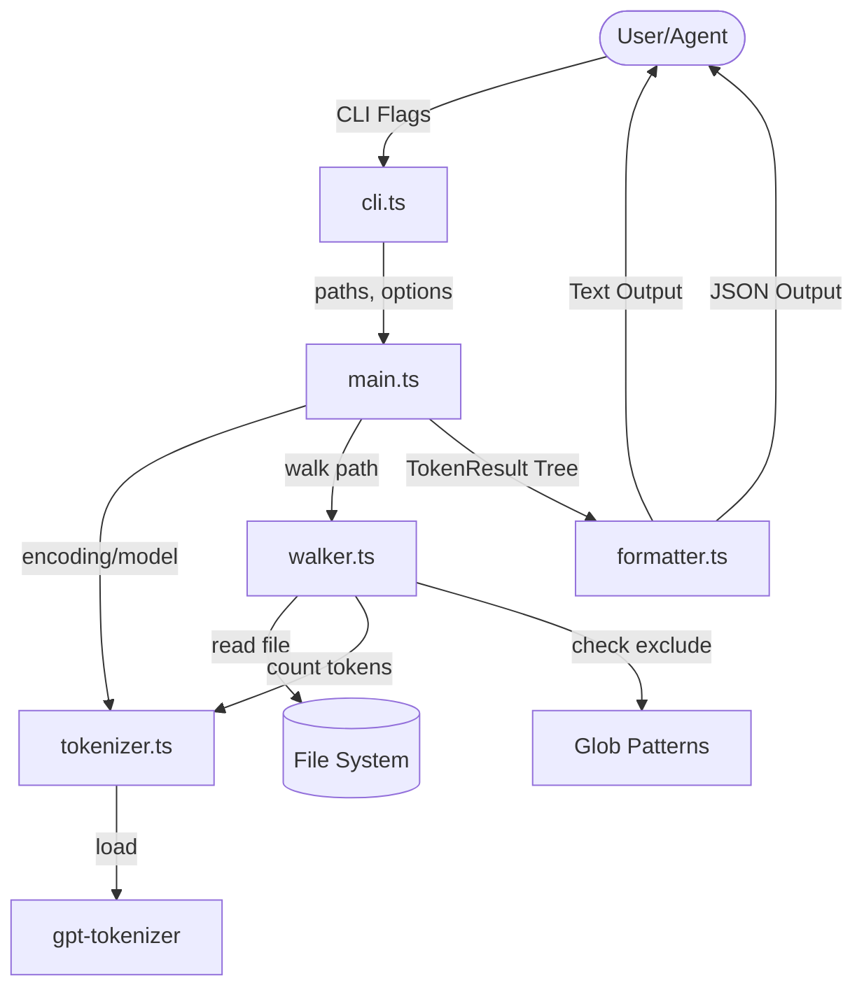

I will begin by reading the instructions in `.prompt.md` and examining the contents of `tokenu.xml`.
I will read the `README.md`, `package.json`, and core source files from `tokenu.xml` to understand the project's scope and functionality.
I will read the core files from `tokenu.xml` starting from line 28380 to understand the project's dependencies and source code.
I will read the contents of `AGENTS.md` to see if it provides any specific instructions or skills for AI agents.
I will search for the starting line of `AGENTS.md` in `tokenu.xml` to read its content.
# Project Analysis: tokenu

## 1. Project Name and Description
**Project Name:** `tokenu`

`tokenu` is a high-performance, Unix `du`-like command-line utility specifically designed to count token usage across files and directories. It bridges the gap between traditional file system analysis and modern Large Language Model (LLM) requirements by providing granular insights into the "token size" of a codebase. This allows developers and AI agents to accurately estimate costs and manage context window limits before interacting with models like GPT-4o.

The tool is built with a focus on being "agent-friendly," offering structured JSON output alongside human-readable text. It mimics the familiar interface of the standard `du` command, supporting recursive traversal, depth limiting, and summarization, while swapping byte-counts for token-counts using official-style encodings.

By integrating with the Tessl ecosystem, `tokenu` ensures high standards of code quality and security, making it a reliable component for both manual development workflows and automated AI agent environments.

## 2. Supported Platforms and Requirements
*   **Platforms:** Cross-platform support (Linux, macOS, Windows) via Node.js.
*   **Requirements:**
    *   **Node.js:** Version `>=24.0.0` (as specified in `package.json`).
    *   **Package Manager:** `pnpm` (v10.31.0 recommended).
    *   **Dependencies:** Primarily relies on `gpt-tokenizer` for accurate tokenization.

## 3. Supported Connectors to Apps/APIs/Messengers
`tokenu` is a stateless CLI tool and does not connect directly to external APIs or messengers for its core functionality. However, it functions as a "data provider" connector for:
*   **CLI/Terminal:** Standard Unix-like piping and output.
*   **AI Agents/MCP:** The `--json` flag provides a machine-readable connector for agents to ingest repository context metrics.
*   **Source References:**
    *   `src/bin/cli.ts`: Handles CLI interaction.
    *   `src/formatter.ts`: Provides the JSON "connector" output format.

## 4. Supported Models and Agents
`tokenu` supports a wide range of OpenAI models by utilizing their respective encodings:
*   **Encodings:** `o200k_base` (default for GPT-4o), `o200k_harmony`, `cl100k_base` (GPT-4, GPT-3.5), `p50k_base`, `p50k_edit`, `r50k_base`.
*   **Models:** Explicit support for model names like `gpt-4o`, `gpt-3.5-turbo` via resolution logic.
*   **Source References:**
    *   `src/tokenizer.ts`: Implements `resolveEncoding` and `getTokenCounter`.
    *   `src/types.ts`: Defines `CliOptions` for model and encoding.

## 5. Top 5 Use Cases
1.  **Context Window Management:** Before pasting code into an LLM, use `tokenu` to ensure the selection fits within the model's context limit (e.g., 128k for GPT-4o).
    *   *Workflow:* `tokenu -a src/` -> check total -> adjust selection.
2.  **Cost Estimation:** Calculate the exact cost of processing a directory or a whole repository through a paid API.
    *   *Workflow:* `tokenu -c .` -> multiply total tokens by model price per 1k tokens.
3.  **CI/CD Token Budgeting:** Prevent large codebases from exceeding budget or context limits by setting threshold checks in CI.
    *   *Workflow:* `tokenu --json` -> parse output in script -> fail build if tokens > threshold.
4.  **AI Agent Tooling (MCP):** AI agents can call `tokenu` to "see" which parts of a repository are most "dense" and decide which files to read first.
    *   *Workflow:* Agent runs `tokenu --json -d 1` -> identifies large modules -> drills down into specific files.
5.  **Repository Audit:** Identify "token-heavy" files (e.g., large data files or generated code) that should be excluded from LLM prompts.
    *   *Workflow:* `tokenu -a --exclude "node_modules/**"` -> find outliers -> update `.gitignore` or exclude patterns.

## 6. Top 20 Features
1.  **Recursive Traversal:** Full directory tree walking (`src/walker.ts`).
2.  **Summarize Flag:** `-s` for directory totals only (`src/formatter.ts`).
3.  **Human-Readable Format:** `-h` prints 1K, 1M instead of raw numbers (`src/formatter.ts`).
4.  **All Files Flag:** `-a` shows counts for every file, not just directory sums (`src/walker.ts`).
5.  **Max Depth Control:** `-d <N>` limits traversal depth (`src/walker.ts`).
6.  **Grand Total:** `-c` produces a final count across all arguments (`src/formatter.ts`).
7.  **JSON Output:** `--json` for structured data ingestion (`src/formatter.ts`).
8.  **Encoding Selection:** `--encoding` for specific tokenizer versions (`src/tokenizer.ts`).
9.  **Model Mapping:** `--model` flag maps model names to encodings (`src/tokenizer.ts`).
10. **Exclusion Patterns:** `--exclude` supports repeatable glob-like patterns (`src/walker.ts`).
11. **Binary Detection:** Automatically skips binary files to avoid tokenizing garbage data (`src/walker.ts`).
12. **Stateless Operation:** No side effects on the file system.
13. **Npx Support:** "Zero-install" usage via `npx tokenu`.
14. **TypeScript Powered:** Full type safety across the core logic (`src/types.ts`).
15. **High Performance:** Efficient file streaming and counting.
16. **Security Focused:** Uses `eslint-plugin-security` and `lockfile-lint`.
17. **Tessl Integration:** Managed agent rules and development skills (`tessl.json`).
18. **Conventional Commits:** Enforced via Husky and `validate-conventional-commit`.
19. **Automated Releases:** Uses Changesets for versioning (`.changeset/config.json`).
20. **Comprehensive Tests:** High coverage using Node's native test runner (`__tests__`).

## 7. Top 20 Smart Patterns
1.  **Unix Philosophy:** Mimics `du` behavior for instant familiarity (`src/bin/cli.ts`).
2.  **Agent-First Design:** JSON output includes timestamp and versioning for reliable agent parsing (`src/types.ts`).
3.  **Binary Buffer Heuristic:** Simple yet effective check for binary data (`src/walker.ts`).
4.  **Recursive Accumulation:** Totals are built bottom-up from files to parents (`src/walker.ts`).
5.  **Environment-Aware Traversal:** Respects `rootDir` and base paths (`src/walker.ts`).
6.  **Encapsulated Tokenizer:** Abstracted `TokenCountFn` allows for future tokenizer swap-ins (`src/types.ts`).
7.  **Functional Formatting:** Pure functions for text/JSON generation for testability (`src/formatter.ts`).
8.  **Depth-First Search (DFS):** Standard traversal pattern for directory trees.
9.  **Glob Pattern Filtering:** Familiar exclusion syntax (`src/walker.ts`).
10. **Graceful Error Handling:** Handles missing files or permission issues during walk.
11. **Modern Module System:** Uses ESM exclusively (`package.json`).
12. **Devcontainer Setup:** Consistent development environment via `.devcontainer`.
13. **Dependency Provenance:** Verified publishing via `publishConfig.provenance`.
14. **Stale Issue Management:** Automated cleanup of inactive issues via GitHub Actions.
15. **Link Checking:** Automated verification of documentation links.
16. **Managed Skills:** Using `.tessl` to vendor development intelligence.
17. **Strict Type Checking:** `noUncheckedIndexedAccess` and `verbatimModuleSyntax` in `tsconfig.json`.
18. **Fast Build Pipeline:** Uses `tsdown` for lightning-fast compilation.
19. **Pre-commit Quality Gates:** Husky hooks for linting and testing.
20. **Dependency Grouping:** Organized Dependabot configuration.

## 8. Top 20 Development Trends (Latest Commits)
1.  **Shift to `tsdown`:** Migration from `tsup` for faster builds.
2.  **Tessl Integration:** Adoption of `tessl.json` and `.tessl/` for agent-assisted development.
3.  **Node 24+ Adoption:** Moving to the latest Node.js LTS features.
4.  **Security Hardening:** Integration of `lockfile-lint` and Snyk checks.
5.  **Agent Rule Management:** Introduction of `AGENTS.md` and `.tessl/RULES.md`.
6.  **Enhanced Documentation:** Adding visual screenshots and depth-specific guides.
7.  **Pnpm 10 Migration:** Upgrading to the latest pnpm features like `trustPolicy`.
8.  **CI/CD Optimization:** Refined GitHub Actions for release previews and link checking.
9.  **ESLint 9 Flat Config:** Modernizing the linting infrastructure.
10. **Conventional Commit Enforcement:** Stricter git message validation.
11. **Changeset Versioning:** Moving toward semi-automated semantic releases.
12. **Codecov Integration:** Focus on maintainable test coverage.
13. **Native Node Testing:** Abandoning external test runners for `node:test`.
14. **Dependency Provenance:** Explicit focus on supply chain security.
15. **Devcontainer Polish:** Better onboarding for contributors.
16. **Glob Pattern Support:** Enhancing the exclusion logic.
17. **Model Name Mapping:** Frequent updates to support new OpenAI model identifiers.
18. **JSON Schema Refinement:** Improving the machine-readable output format.
19. **Binary Detection Improvement:** Refining file type checks.
20. **GitHub Labeler Automation:** Better PR organization.

## 9. Top 10 Advantages / Strong Points
1.  **Simplicity:** Does one thing and does it well (Unix philosophy).
2.  **Standardized Encodings:** Uses `gpt-tokenizer` to match actual OpenAI behavior.
3.  **Speed:** Fast directory walking and tokenization.
4.  **No Dependencies:** Minimal production dependencies (mostly just the tokenizer).
5.  **Agent Friendly:** Designed specifically to be used by AI agents as a discovery tool.
6.  **Type Safety:** Robust TypeScript implementation.
7.  **Security:** Proactive security policies and automated scanning.
8.  **Dev DX:** Excellent developer experience with ready-to-use devcontainers.
9.  **Standard CLI Patterns:** Adheres to `du` expectations (flags, formatting).
10. **Zero-Config:** Works out of the box with sensible defaults (GPT-4o encoding).

## 10. Top 10 Limitations / Weak Points
1.  **OpenAI-Centric:** Currently optimized only for OpenAI-style tokenizers.
2.  **Node.js Runtime Required:** No standalone binary (must have Node.js).
3.  **In-Memory Count:** Tokenization happens in-memory, which could be an issue for extremely large files (GBs).
4.  **No Web UI:** Strictly CLI based.
5.  **No Diffing:** Cannot natively "diff" token counts between git branches yet.
6.  **No Cost Calculation:** Does not output dollar amounts directly (requires external math).
7.  **Limited Model Support:** Missing Anthropic/Claude or Google/Gemini tokenizers.
8.  **Stateless:** Doesn't cache results; re-counts everything every time.
9.  **No Native Multi-threading:** Directory walk is asynchronous but limited by single-process Node.js overhead.
10. **Basic Exclusion:** Glob support is basic compared to `.gitignore` awareness.

## 11. Top 5 Used and Provided AI Skills
### Used AI Skills (Development Phase):
1.  **`octocat`:** Manages GitHub operations via `gh` CLI. (`.tessl/tiles/mcollina/skills/skills/octocat/SKILL.md`)
2.  **`typescript-magician`:** Advanced TS type optimization. (`.tessl/tiles/mcollina/skills/skills/typescript-magician/SKILL.md`)
3.  **`linting-neostandard`:** ESLint 9 workflows.
4.  **`node-best-practices`:** Expert Node.js guidance.
5.  **`documentation-diataxis`:** Specializing in the Diátaxis framework for docs.

### Provided AI Skills (Application Phase):
1.  **Context Counting:** Provides raw token metrics for context window management.
2.  **Repo Discovery:** Agents use it to identify large modules via JSON output.
3.  **Exclusion Tuning:** Helps agents decide what to *ignore* in a prompt.
4.  **Token Cost Analysis:** Skill to predict API costs based on current code state.
5.  **Codebase Scaling Insight:** Skill to detect when a project has outgrown specific model limits.

## 12. Data Inputs, Outputs, and Storage
*   **Inputs:** File system access (read-only).
    *   `src/walker.ts`: Recursively reads files and stats.
*   **Outputs:** `stdout` in Text or JSON format.
    *   `src/formatter.ts`: Formats internal `TokenResult` tree into strings.
*   **Storage:** Volatile only (in-memory during execution). No persistent database or configuration file is used on the host.

## 13. Detailed Architecture Review
1.  **CLI Entry (`src/bin/cli.ts`):** Parses `process.argv` and invokes the orchestration layer.
2.  **Orchestrator (`src/main.ts`):** High-level API `walkAndCount` that ties the walker and tokenizer together.
3.  **Walker (`src/walker.ts`):** Core recursive logic. It walks the disk, filters based on globs, detects binary files, and calls the tokenizer for each valid text file.
4.  **Tokenizer (`src/tokenizer.ts`):** Abstraction layer for `gpt-tokenizer`. It resolves aliases (e.g., `gpt-4o` -> `o200k_base`) and returns a counting function.
5.  **Formatter (`src/formatter.ts`):** Responsible for the final presentation. It traverses the internal `TokenResult` tree to produce the requested output format.
6.  **Types (`src/types.ts`):** Defines the "contract" between all modules, ensuring consistent data structures (e.g., `TokenResult`).

## 14. Mermaid Graph of Architecture

## 15. Project Maturity, Stability, Security, Performance
*   **Maturity:** v1.0.0. Features are stable and core logic is well-tested.
*   **Stability:** High. Adheres to strict semantic versioning and uses battle-tested dependencies like `gpt-tokenizer`.
*   **Security:** Excellent for a CLI tool. Uses Snyk, `lockfile-lint`, `eslint-plugin-security`, and follows responsible disclosure policies (`SECURITY.md`).
*   **Performance:** Good. Asynchronous I/O ensures the event loop remains unblocked during large repository walks.

## 16. Review of Tests, CI, and Documentation
*   **Tests:** Native `node:test` suite. Good coverage on core components (walker, tokenizer, formatter).
*   **CI Pipelines:** Robust GitHub Actions for Lint, Test, Coverage, and Release. Includes link checking and automated labelers.
*   **Documentation:** Comprehensive. `README.md` provides clear examples, and `docs/` folder covers individual flags in depth.
*   **AI Skills:** Integrated with Tessl skills for development, showing a modern, agent-assisted development lifecycle.

## 17. Top 20 Possible Improvements
1.  **Anthropic/Claude Support:** Add `tiktoken` or equivalent for Claude models. (`src/tokenizer.ts`)
2.  **Google/Gemini Support:** Add Gemini-specific token counting. (`src/tokenizer.ts`)
3.  **Gitignore Awareness:** Automatically respect `.gitignore` files. (`src/walker.ts`)
4.  **Cost Calculator:** Add a `--cost <price_per_1k>` flag. (`src/formatter.ts`)
5.  **Multi-threaded Walking:** Use Worker Threads for faster I/O on large disks. (`src/walker.ts`)
6.  **Progress Bar:** Add a TTY progress bar for large directory walks. (`src/bin/cli.ts`)
7.  **Token Diffing:** Compare current tokens vs. `HEAD`. (`src/main.ts`)
8.  **Interactive Mode:** Browse directories and see token counts in a TUI.
9.  **Caching:** Cache file token counts based on hash to speed up repeat runs.
10. **Export to CSV:** Add CSV output for spreadsheet analysis. (`src/formatter.ts`)
11. **Streaming Tokenization:** Tokenize large files in chunks. (`src/walker.ts`)
12. **Custom Encodings:** Allow users to provide custom BPE files. (`src/tokenizer.ts`)
13. **Integration with `.env`:** Load default models/encodings from environment.
14. **Markdown Table Output:** Output as a markdown table. (`src/formatter.ts`)
15. **Context Window Check:** Flag to fail if total tokens > limit for a model. (`src/bin/cli.ts`)
16. **Remote URL Support:** Count tokens for a GitHub URL without cloning.
17. **Top N Files:** Flag to show only the largest N files by tokens. (`src/formatter.ts`)
18. **Average Token Length:** Show average tokens per line/word. (`src/formatter.ts`)
19. **Tree View:** Traditional tree-style output visualization. (`src/formatter.ts`)
20. **MCP Server Mode:** Run as a persistent MCP server for real-time agent queries.

## 18. Swarm Reusability (Solution Specification)
1.  **`src/walker.ts`:** Essential for gathering the "facts" of a repository.
2.  **`src/tokenizer.ts`:** Used to evaluate which models a solution might fit into.
3.  **JSON Output Pattern:** Standardized way to share state between swarm members.
4.  **`src/types.ts` (`TokenResult`):** The shared data structure for repo size knowledge.
5.  **Exclusion Patterns:** Vital for pruning a graph-based search of a repository.
6.  **Binary Detection:** Ensures agents don't try to "read" non-text nodes in a knowledge graph.
7.  **`src/main.ts` (`walkAndCount`):** A clean API for a "Discovery Agent" in the swarm.
8.  **Depth-Limited Search:** Useful for swarm agents that only need high-level summaries.
9.  **Tessl Rule Integration:** Pattern for enforcing swarm behavior policies.
10. **Changeset Pattern:** For tracking how a solution specification evolves over time.

## 19. Multi-user / Shared Knowledge Reusability
1.  **`src/types.ts` (`JsonOutput`):** Format for syncing "token metadata" to a shared graph.
2.  **`src/formatter.ts`:** Logic to serialize repo state into markdown/JSON for shared docs.
3.  **`src/walker.ts`:** Mechanism to index shared knowledge bases (markdown/files).
4.  **Tessl Managed Rules:** Shared skill sets across different user sessions.
5.  **Conventional Commit Pattern:** Standardizing how shared knowledge is "committed" by users/agents.
6.  **Security Disclosure Pattern:** Protocol for handling sensitive data in a shared knowledge base.
7.  **Exclusion Globs:** Common "ignore list" for shared indexing.
8.  **Human-Readable Formatting:** For making shared metrics accessible to human collaborators.
9.  **Binary Heuristics:** To avoid polluting a shared vector/graph store with binary junk.
10. **Node 24+ Async Context:** Patterns for tracking user/agent identity across async flows.

## 20. Edge / Cloud / Messenger Reusability
1.  **`gpt-tokenizer` Dependency:** Lightweight and works in Edge/Cloudflare Workers.
2.  **Stateless Design:** Perfect for FaaS (Lambda, Workers) where no disk persistence exists.
3.  **JSON Output:** Ideal for webhook responses to Telegram/WhatsApp.
4.  **`src/tokenizer.ts`:** Easily portable to any JS environment.
5.  **Human-Readable Formatting:** Short, concise strings for mobile messenger displays.
6.  **Depth Limiters:** Allows messengers to display "quick glances" without flooding the chat.
7.  **Binary Detection:** Crucial for protecting voice/chat interfaces from being flooded with raw data.
8.  **Standard CLI Args Pattern:** Adaptable for "Slash Commands" in Teams/Slack.
9.  **`src/walker.ts`:** Can be adapted to walk S3/Cloud storage instead of local FS.
10. **ESM Architecture:** Native support in modern edge runtimes.

## 21. Team Agent Reusability (Cooperative Workflows)
1.  **`AGENTS.md` Pattern:** Clear entry point for team-based AI orchestration.
2.  **Tessl Skills Vendoring:** Method for team members to share custom agent abilities.
3.  **JSON Summary:** Acts as a "contract" between different team agents.
4.  **Exclusion Patterns:** Defining the shared "no-go" zones for the team.
5.  **Token Budgeting:** Helping team agents stay within shared API credit limits.
6.  **Conventional Commits:** Managing the history of cooperative changes.
7.  **`src/main.ts`:** High-level API that can be wrapped in a team-wide RPC call.
8.  **CI Validation:** Automated "referee" for team submissions.
9.  **`src/formatter.ts`:** Multi-format output for different team needs (Devs/PMs/Agents).
10. **Lockfile Linting:** Ensuring all team members (human or agent) use secure dependencies.
