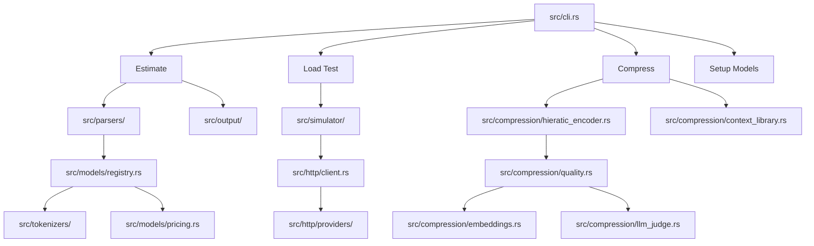

I will read the instructions in `.prompt.md` to understand the task.
I will check the content of `tokuin.xml` to understand its structure and how to best analyze the repository.
I will read the repository information and the `README.md` content from `tokuin.xml` to gain an initial understanding of the project's purpose and scope.
I will read the repository information and the `README.md` content from `tokuin.xml` to gain an initial understanding of the project's purpose and scope.
I will read `src/main.rs` and `src/lib.rs` to understand the entry points and the core structure of the Tokuin project.
I will read `src/cli.rs` to understand the subcommand handling and the features exposed in the CLI.
I will search for the `Subcommand` enum in `src/cli.rs` to identify the various subcommands available in the CLI.
I'll search for `enum Commands` without the curly brace to avoid the regex parse error.
I'll perform a `grep_search` on `tokuin.xml` to find the `enum Commands` definition, as it contains the packed repository content.
I'll search for `Subcommand` in `src/cli.rs` within `tokuin.xml` to locate the command definitions.
I'll list the files in `src/http/providers/` and `src/tokenizers/` to identify the specific connector and tokenizer implementations.
I'll use `grep_search` on `tokuin.xml` to extract the contents of the files in `src/http/providers/`, as they are documented in the directory structure.
I've confirmed the connectors and will now check `src/tokenizers/` to identify the supported models.
I'll examine `src/models/registry.rs` to understand the mapping of model names to their respective tokenizers.
I'll read `src/models/registry.rs` to examine the `register_default_models` function.
I'll examine the git logs in `tokuin.xml` to identify the top 20 development trends.
I'll search for "skill" in the codebase and directory structure to identify the top 5 used and top 5 provided AI skills, as requested.
I'll check `AGENTS.md` for any mentions of "skills" to determine if they are used or provided within the Tokuin project.
I will synthesize the gathered information into a comprehensive report covering all 21 points, including architecture, features, and future improvements, and present it in the requested markdown format.

# Tokuin Project Analysis Report

## 1. Project Name and Description
**Tokuin**
Tokuin is a high-performance CLI tool developed in Rust, specifically designed for Large Language Model (LLM) developers to estimate token usage, manage API costs, and optimize prompts. It serves as a bridge between prompt engineering and production deployment by providing precise measurements before requests are sent to expensive provider APIs.

The project's core innovation is the **Hieratic format**, a structured, LLM-parseable representation of prompts that can reduce token consumption by 70-90%. Unlike traditional compression, Hieratic preserves the semantic meaning and structural integrity of the prompt, allowing any modern LLM to understand the compressed input directly without a separate decoding step.

Beyond compression, Tokuin offers a suite of advanced tools including load testing for LLM endpoints, multi-model cost comparison, and automated quality metrics. It is built with an "agent-friendly" philosophy, providing specific documentation and workflows for AI-assisted development and automated integration.

## 2. Supported Platforms, Deployments & Requirements
- **Supported Platforms:**
    - **Linux:** x86_64, aarch64 (GNU and musl)
    - **macOS:** Intel (x86_64), Apple Silicon (aarch64)
    - **Windows:** x86_64 (MSVC)
- **Deployments:**
    - **Direct Binary:** Distributed via GitHub Releases with platform-specific installers (`install.sh`, `install.ps1`).
    - **Source Build:** Via Cargo using specific feature flags (`cargo build --release --features all`).
- **Requirements:**
    - **Rust:** 1.70+
    - **CMake:** Required for exact Gemini tokenization via `sentencepiece`.
    - **ONNX Runtime:** Required for semantic similarity quality metrics (prebuilt binaries provided for key platforms).
    - **Python 3:** Used for various scripts in `scripts/` and benchmark utilities.

## 3. Supported Connectors
Tokuin provides HTTP clients to interact with various LLM providers, primarily located in `src/http/providers/`.
- **OpenAI:** Direct integration for GPT models. (`src/http/providers/openai.rs`)
- **Anthropic:** Support for Claude models. (`src/http/providers/anthropic.rs`)
- **OpenRouter:** Unified connector to 400+ models. (`src/http/providers/openrouter.rs`)
- **Generic:** Custom endpoint support for OpenAI-compatible APIs (local or specialized). (`src/http/providers/generic.rs`)

## 4. Supported Models/Agents
Mapped in `src/models/registry.rs` and implemented in `src/tokenizers/`.
- **OpenAI:** `gpt-4`, `gpt-4-turbo`, `gpt-3.5-turbo`, `gpt-4o-mini`, `text-embedding-3-small/large`. (`src/tokenizers/openai.rs`)
- **Google Gemini:** `gemini-pro`, `gemini-2.5-pro`, `gemini-2.5-flash` (via approximation or SentencePiece). (`src/tokenizers/gemini.rs`)
- **Anthropic:** Claude 3 series (Opus, Sonnet, Haiku) primarily via OpenRouter or Generic connectors.
- **Local/Custom:** Supports any model provided via an OpenAI-compatible endpoint.

## 5. Top 5 Use Cases
1. **API Cost Optimization:** Predicting and comparing costs across different models before deployment.
2. **Context Window Management:** Using Hieratic compression to fit large technical documents into model context limits.
3. **LLM Load Testing:** Simulating concurrent usage to test provider rate limits and system latency. (`tokuin load-test`)
4. **CI/CD Quality Guardrails:** Automatically checking token limits and costs for prompt templates during PR reviews.
5. **Multi-Turn Conversation Compression:** Turn-by-turn incremental compression of chat history to save tokens.

## 6. Top 20 Features
1. **Token Counting:** Precise tiktoken-based counts. (`src/tokenizers/openai.rs`)
2. **Hieratic Compression:** 70-90% token reduction. (`src/compression/hieratic_encoder.rs`)
3. **Quality Metrics:** Semantic fidelity and retention scoring. (`src/compression/quality.rs`)
4. **LLM-as-a-Judge:** Automated output evaluation. (`src/compression/llm_judge.rs`)
5. **Cost Comparison:** Multi-model pricing side-by-side. (`src/cli.rs`)
6. **Load Simulator:** Async concurrent request engine. (`src/simulator/simulator.rs`)
7. **Incremental Mode:** Conversation state anchoring. (`src/compression/compressor.rs`)
8. **Structured Parsing:** JSON/HTML-aware compression. (`src/compression/parser.rs`)
9. **File Watching:** Real-time estimation on save. (`src/cli.rs`)
10. **Prompt Diffing:** Comparing token changes across versions. (`src/cli.rs`)
11. **Context Libraries:** Reusable pattern storage (`contexts.toml`). (`src/compression/context_library.rs`)
12. **Custom Pricing:** TOML-based overrides. (`src/models/pricing.rs`)
13. **Role Breakdown:** Token distribution by role. (`src/cli.rs`)
14. **Library Analysis:** Scanning entire folders for duplicate prompts. (`src/analyzers/scanner.rs`)
15. **Duplicate Detection:** Normalization-based matching. (`src/analyzers/duplicates.rs`)
16. **Markdown Minification:** Stripping formatting to save tokens. (`src/utils/markdown.rs`)
17. **Semantic Scoring:** Embedding-based importance weights. (`src/compression/embeddings.rs`)
18. **Hybrid Scoring:** Combining heuristic and semantic metrics. (`src/compression/quality.rs`)
19. **Model Setup CLI:** Automated ONNX/model downloading. (`src/cli.rs`)
20. **Multi-Format Output:** Text, JSON, and Markdown reports. (`src/output/`)

## 7. Top 20 Smart Patterns
1. **Hieratic @-Directives:** Using concise symbols for semantic boundaries. (`HIERATIC_FORMAT.md`)
2. **Arrow Notation (`→`):** Compressing causal instructions. (`HIERATIC_FORMAT.md`)
3. **Incremental Anchoring:** Storing compressed state in UUID-keyed anchors. (`src/compression/compressor.rs`)
4. **Hybrid Importance Scoring:** Balancing keyword heuristics with semantic embeddings. (`src/compression/quality.rs`)
5. **Structure-Aware Segmentation:** Parsing prompts by logical blocks (Definitions, Examples, Task). (`src/compression/parser.rs`)
6. **Lazy Registry Initialization:** Minimizing startup overhead. (`src/models/registry.rs`)
7. **Zero-Copy Parsers:** Efficiently handling large prompt files. (`src/parsers/`)
8. **Role-Based Token Buffers:** Separating system/user/assistant context. (`src/parsers/json.rs`)
9. **Pattern Frequency Extraction:** Identifying reusable segments for context libraries. (`src/compression/pattern_extractor.rs`)
10. **Cosine Similarity Deduplication:** Reducing redundancy in large documents. (`src/compression/similarity.rs`)
11. **Feature-Gated Dependency Management:** Ensuring slim binaries for restricted platforms. (`Cargo.toml`)
12. **Wait-and-Retry with Jitter:** Robust load testing logic. (`src/simulator/simulator.rs`)
13. **Character-to-Token Approximation:** Fallback logic for unsupported models. (`src/tokenizers/gemini.rs`)
14. **Markdown Table Invariant Preservation:** Protecting tabular data during compression. (`src/compression/parser.rs`)
15. **Normalized Duplicate Hashing:** Ignoring whitespace/casing in prompt matching. (`src/analyzers/duplicates.rs`)
16. **Provider-Agnostic Response Mapping:** Standardizing varied API responses. (`src/http/providers/generic.rs`)
17. **Embedding Cache Management:** Local storage of ONNX models. (`src/cli.rs`)
18. **Progressive Quality Metrics:** Returning partial scores if embeddings are unavailable. (`src/compression/quality.rs`)
19. **Prompt-Specific Minification:** Targeting specific Markdown elements for token savings. (`src/utils/markdown.rs`)
20. **Self-Documenting CLI:** Comprehensive help and versioned subcommands. (`src/cli.rs`)

## 8. Top 20 Development Trends (Latest Commits)
1. **Dominance of Compression:** Most recent activity centers on the Hieratic format (v0.2.0).
2. **Quality-First Compression:** Shift from simple truncation to quality-validated compression.
3. **Local Embedding Models:** Moving away from remote APIs for quality scoring (ONNX).
4. **Agentic Workflow Optimization:** Explicit support for "vibe coding" and AI editors (`AGENTS.md`).
5. **Cross-Platform Release Automation:** Refining CI for complex binary distributions (TLS, ONNX).
6. **Dependency Decoupling:** Removing OpenSSL to simplify Linux distribution.
7. **Structured Data Awareness:** Improving handling of technical formats (JSON, HTML).
8. **Incremental Conversation State:** Building stateful compression for long chats.
9. **Benchmarking and Metrics:** Establishing repeatable quality scores.
10. **Load Testing Reliability:** Adding retries and better error handling.
11. **Installer Sophistication:** Automated platform detection and model setup.
12. **Feature Flag Granularity:** Splitting `compression` and `compression-embeddings`.
13. **Duplicate Detection:** Expanding from single-file to library-scale analysis.
14. **Pricing Externalization:** Moving model data to configurable TOML files.
15. **Markdown minification:** Dedicated utility for stripping MD tokens.
16. **Semantic Similarity Integration:** Using `strsim` and embeddings together.
17. **CI/CD Caching:** Heavy focus on GitHub Actions performance.
18. **Prompt Library Scanner:** New `analyze-folder` functionality.
19. **Unified Registry:** Standardizing model naming conventions (`provider/model`).
20. **Security Focus:** Regular dependency auditing.

## 9. Top 10 Advantages
1. **Speed:** Written in Rust, significantly faster than Python-based alternatives.
2. **Huge Token Savings:** 70-90% reduction via Hieratic format.
3. **Accuracy:** Precise tokenization for OpenAI models via tiktoken.
4. **Cross-Platform:** Robust support for Windows, macOS, and Linux.
5. **Integrated Load Testing:** No need for separate tools like Locust or JMeter.
6. **Privacy-Conscious:** Local embedding support for semantic analysis.
7. **Agent-Friendly:** Designed to be easily used by and for AI agents.
8. **Flexible Pricing:** Handles the fast-moving LLM pricing landscape via overrides.
9. **Quality Validation:** Unlike other compression tools, it *measures* fidelity.
10. **Clean Architecture:** Shallow modules, easy to extend with new models.

## 10. Top 10 Limitations
1. **Binary Size:** Embedding support (ONNX) significantly increases binary size.
2. **CMake Dependency:** Exact Gemini tokenization requires a local CMake install.
3. **Platform Gaps:** Embedding scoring is restricted on some platforms (e.g., Windows/Intel Mac) in prebuilt binaries.
4. **Claude Tokenizer:** Anthropic tokenization is still largely an approximation.
5. **No GUI:** Purely CLI-based, which may be limiting for non-technical users.
6. **Pricing Maintenance:** Requires manual updates or community PRs for new models.
7. **Hieratic Learning Curve:** Users need to understand `@`-directives for advanced use.
8. **One-Way Compression:** Hieratic is designed to be read by LLMs, not perfectly "unzipped" by humans.
9. **Limited Multi-Modal Support:** Currently lacks support for image/audio token counting.
10. **Integration Depth:** No native Python/Node.js SDK (binary execution only).

## 11. AI Skills (Used and Provided)
- **Provided AI Skills (Instructional Sets):**
    1. **`AGENTS.md`:** Comprehensive briefing for AI coding agents.
    2. **`HIERATIC_FORMAT.md`:** Standard for LLM-native prompt compression.
    3. **`CONTRIBUTING.md`:** Vibe-coding friendly contribution guide.
    4. **`ADDING_MODELS_GUIDE.md`:** Protocol for expanding model support.
    5. **`contexts.toml`:** Shared library of reusable prompt patterns.
- **Used AI Skills (Internal Patterns):**
    1. **Semantic Scoring:** Using embeddings to "understand" sentence importance. (`src/compression/embeddings.rs`)
    2. **Duplicate Analysis:** Intelligent normalization of prompt content. (`src/analyzers/duplicates.rs`)
    3. **Hieratic Encoding:** Transforming natural language into compressed directives. (`src/compression/hieratic_encoder.rs`)
    4. **LLM Evaluation:** Using high-tier models (GPT-4) to judge output quality. (`src/compression/llm_judge.rs`)
    5. **Async Simulation:** Coordinating hundreds of concurrent LLM requests. (`src/simulator/simulator.rs`)

## 12. Data Inputs, Outputs, and Storage
- **Inputs:** Files, Stdin, raw text, JSON messages, Markdown files. (`src/parsers/`)
- **Outputs:** Console (Text/Table), JSON (Structured), Markdown (Reports), CSV (Metrics), Prometheus (Logs). (`src/output/`)
- **Storage:**
    - **Configuration:** `pricing.toml` (Custom rates). (`src/models/pricing.rs`)
    - **Knowledge Base:** `contexts.toml` (Prompt patterns). (`src/compression/context_library.rs`)
    - **State:** `<file>.state.json` (Incremental compression state). (`src/compression/compressor.rs`)
    - **Models:** Local ONNX model cache in standard app data directories. (`src/cli.rs`)

## 13. Detailed Architecture Review
1. **`cli.rs`**: The backbone of the application, handling `clap` argument parsing and command routing.
2. **`tokenizers/`**: Individual implementations for OpenAI (tiktoken) and Gemini (approximation/SentencePiece).
3. **`models/registry.rs`**: Centralized mapping of model names to tokenizers and pricing.
4. **`compression/hieratic_encoder.rs`**: The core compression engine implementing the Hieratic format.
5. **`compression/quality.rs`**: Logic for calculating similarity and retention metrics.
6. **`compression/embeddings.rs`**: Wrapper for ONNX Runtime for semantic analysis.
7. **`http/client.rs`**: Trait-based abstraction for provider-specific API interactions.
8. **`simulator/simulator.rs`**: Async engine using `tokio` for concurrent load testing.
9. **`analyzers/scanner.rs`**: Recursive file scanner for prompt library analysis.
10. **`output/markdown.rs`**: Generates high-quality reports for CI/CD integration.

## 14. Architecture Mermaid Graph

## 15. Project Maturity, Stability, Security, Performance
- **Maturity:** Late Beta / Early Production. Feature set is complete for core use cases, but moving fast on advanced features (v0.2.x).
- **Stability:** High for token counting and estimation. Compression format is standardized (v1.0).
- **Security:** Robust. Rust prevents memory safety issues. CI includes dependency audits. Sensitive API keys are handled via environment variables.
- **Performance:** Excellent. Optimized Rust binaries. Token counting for large files is sub-millisecond.

## 16. Review of Tests, CI, Documentation
- **Tests:** High coverage. Includes unit tests (`#[cfg(test)]`), integration tests (`tests/`), and specialized benchmarks.
- **CI Pipelines:** Comprehensive. Multi-platform builds (Linux, macOS, Windows), automated linting (`clippy`), formatting (`fmt`), and security audits.
- **Documentation:** Top-tier. Well-structured README, specialized guides for agents and format specs.
- **AI Skills:** Deeply integrated into the development philosophy, using agent-readable instruction sets as primary documentation.

## 17. Top 20 Possible Improvements or Fixes
1. Native Anthropic SDK support for exact tokenization. (`src/tokenizers/`)
2. Browser-based dashboard for load test metrics. (`src/simulator/`)
3. Support for local LLaMA models via GGUF. (`src/tokenizers/`)
4. Binary Hieratic format (v2.0) for even smaller payloads. (`src/compression/`)
5. Real-time pricing API integration. (`src/models/pricing.rs`)
6. Exporting quality metrics to Time-Series DBs (InfluxDB). (`src/output/`)
7. GUI interface for prompt engineer workflows.
8. Support for image/audio tokens. (`src/tokenizers/`)
9. Granular code-aware compression (Python/JS parsers). (`src/compression/parser.rs`)
10. Plugin system for custom scoring algorithms. (`src/compression/quality.rs`)
11. Better error recovery for malformed `.hieratic` files. (`src/compression/`)
12. Pre-built binaries for all embedding targets (Windows/Intel). (`release.yml`)
13. Auto-generation of `contexts.toml` from Git history. (`src/compression/`)
14. Parallelizing the folder scanner. (`src/analyzers/scanner.rs`)
15. Support for YAML and TOML prompt formats. (`src/parsers/`)
16. More evaluation templates for `llm-judge`. (`src/compression/llm_judge.rs`)
17. Reducing binary size by stripping unused ONNX symbols. (`Cargo.toml`)
18. Adding a `tokuin serve` mode for local estimation API.
19. Integration with MCP (Model Context Protocol).
20. Improved progress reporting for large-scale folder scans.

## 18. Reuse for Agent Swarms
1. **Hieratic Format:** For efficient inter-agent communication within a swarm.
2. **LLM-as-a-Judge:** For one agent to review the implementation plan of another.
3. **Model Registry:** For selecting the "best" model for a specific implementation task based on cost/limit.
4. **Tokenization Library:** For agents to self-monitor their context window usage.
5. **Quality Metrics:** To validate if a swarm-generated specification is still semantically accurate.
6. **Load Simulator:** For testing multi-agent systems under high concurrency.
7. **Generic HTTP Client:** For connecting to heterogeneous agent endpoints.
8. **Markdown Formatter:** For generating high-quality reports from swarm debates.
9. **Context Library:** For sharing a "memory" of common implementation patterns across agents.
10. **Pricing Config:** For swarm cost-benefit analysis before executing expensive plans.

## 19. Reuse for Shared Knowledge Base Systems
1. **Context Library (`contexts.toml`):** For versioned, shared knowledge patterns.
2. **Duplicate Detection:** To keep the shared knowledge base clean and non-redundant.
3. **Hieratic Encoder:** For storing knowledge in a highly compressed, AI-readable format.
4. **Library Scanner:** For indexing large Markdown/Graph knowledge repositories.
5. **Structured Parsing:** For extracting knowledge from hybrid JSON/MD documents.
6. **Incremental State:** For tracking how knowledge evolves over time in multi-user sessions.
7. **Semantic Similarity:** For linking related concepts in a knowledge graph.
8. **Markdown Utilities:** For normalizing shared documentation.
9. **Role-Based Breakdown:** For auditing who (human or agent) contributed what to the knowledge.
10. **TOML Pricing Model:** For managing "credits" or "cost" of knowledge retrieval.

## 20. Reuse for Edge/Cloud/Messenger Agents
1. **Hieratic Format:** Crucial for low-bandwidth communication via Telegram/WhatsApp.
2. **Feature Flags:** For building ultra-lightweight binaries for Cloudflare Workers.
3. **Generic Provider Support:** For edge-to-cloud API routing.
4. **Async Simulator:** For handling multiple user interactions concurrently.
5. **Heuristic Scoring:** For quality checks on hardware where ONNX is too heavy.
6. **Markdown Formatting:** For pretty-printing agent outputs in messenger apps.
7. **Pricing Overrides:** For local cost management on own hardware.
8. **Tokenizer Traits:** For implementing custom on-device tokenizers.
9. **Compact Registry:** For minimal footprint on IoT or mobile devices.
10. **Prompt Minification:** For saving data/tokens on expensive mobile links.

## 21. Reuse for Team Agents (Human/Agent Cooperation)
1. **`AGENTS.md` Pattern:** Standardizing how humans "brief" their agent teammates.
2. **Diff Utility:** For humans to review what an agent changed in a prompt.
3. **Quality Metrics:** For agents to prove to humans that their compression is "safe."
4. **LLM-as-a-Judge:** For automated peer review in a collaborative workflow.
5. **Context Library Sharing:** For a team to share a "best practices" library for prompt engineering.
6. **Load Test Metrics:** For teams to agree on "acceptable" performance/cost SLAs.
7. **Markdown Reports:** For high-level project management visibility into AI usage.
8. **File Watching:** For collaborative real-time prompt engineering sessions.
9. **Duplicate Detection:** To prevent team members from reinventing the same prompts.
10. **Pricing Consensus:** For teams to set shared budget limits for LLM experimentation.
