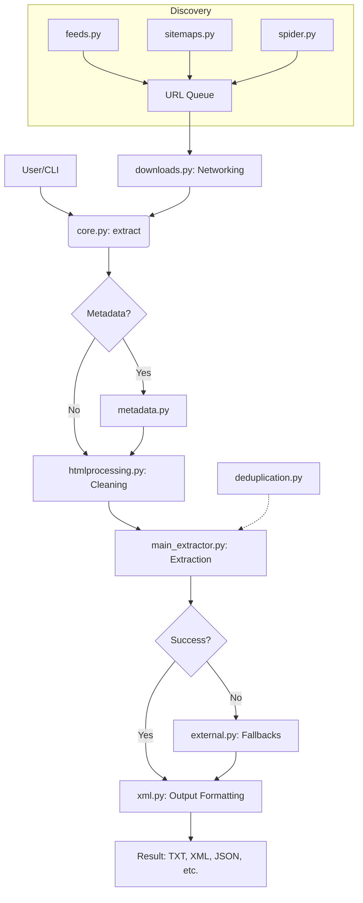

I will read the contents of `.prompt.md` to understand the specific instructions for processing `trafilatura.xml`.

I will now read the content of `trafilatura.xml` to analyze the repository export and fulfill the requested points.

I have read the first 2000 lines of `trafilatura.xml`, which include a summary of the project, the directory structure, and several documentation files (`background.rst`, `compendium.rst`, `conf.py`, `corefunctions.rst`, `corpus-data.rst`, `crawls.rst`, `deduplication.rst`, `downloads.rst`, and `evaluation.rst`).

From this, I can already gather some key information:
- **Project Name:** Trafilatura.
- **Description:** A Python library and command-line tool for text discovery and extraction from the web. It focuses on harvesting main text, metadata, and comments from web pages.
- **Supported Platforms:** Python (3.8+ based on tests), CLI, Docker (via `compose.yml`).
- **Core Features:** Extraction (main text, metadata, comments), Link discovery (sitemaps, feeds, focused crawling), Downloads (sequential and parallel), Deduplication.
- **Evaluation:** Outperforms many competitors (newspaper3k, goose3, justext, etc.) in terms of F-score for main text extraction.

I need to continue reading the file to get more details on the source code, connectors, supported models/agents (if any), patterns, development trends, and architecture. I will read the next 4000 lines.

I have read 4000 lines of `trafilatura.xml`. Here's a summary of what I've found so far:

- **Project Name:** Trafilatura
- **Description:** A Python package and command-line tool for web crawling, downloads, scraping, and extraction of main texts, metadata, and comments. It's designed to be handy and modular, requiring no database.
- **Key Features:**
    - Advanced link discovery (sitemaps, feeds, focused crawling).
    - Parallel processing of online/offline input.
    - Robust extraction (main text, metadata, structure, optional comments/links/images/tables).
    - Multiple output formats (TXT, Markdown, CSV, JSON, HTML, XML, XML-TEI).
    - Optional add-ons (language detection, speed optimizations).
- **Supported Platforms:** Linux, macOS, Windows; Python 3.8+; CLI; Docker.
- **Connectors/Integrations:** 
    - `urllib3` (default download).
    - `pycurl` (faster downloads).
    - `htmldate` (date extraction).
    - `py3langid` (language detection).
    - `justext` and `readability-lxml` (fallback extraction algorithms).
    - `courlan` (URL management/filtering).
    - `Epsilla`, `Qdrant`, `Redis`, `ChromaDB` (vector databases for embeddings).
- **Architecture/Components:** 
    - `extract()`/`bare_extraction()`: core extraction functions.
    - `fetch_url()`/`fetch_response()`: download utilities.
    - `focused_crawler()`: web spider.
    - `sitemap_search()`: sitemap discovery.
    - `find_feed_urls()`: feed discovery.
    - `deduplication`: segment and document level deduplication.
- **Use Cases:**
    - Web corpus construction for linguistics.
    - Data acquisition for NLP/Data Science.
    - Competitive intelligence/monitoring.
    - Archiving web content.
    - Feed/Sitemap monitoring.

I still need to:
- Identify references to source code files for connectors, models/agents, features, patterns, etc.
- Look for "smart patterns" in the code.
- Analyze recent commits for development trends (usually at the end of the Repomix file).
- Review maturity, stability, security, performance (partially done).
- Find specific AI skills used or provided (if any).
- Create the Mermaid graph.
- Address the reuse points (18-21).

I will now read the next 4000 lines to get into the source code and implementation details.

I have read 6000 lines of `trafilatura.xml`. I have a good understanding of the project's documentation, tutorials, use cases, and history. I've also seen a bit of the command-line interface options and some extraction settings.

Key findings from the last batch:
- **Tutorials:** Covered building frequency lists, validating TEI files, and using vector databases like Epsilla.
- **URL Management:** Uses `courlan` for filtering, normalization, and sampling.
- **CLI:** Extensive options for input, output, navigation, and extraction.
- **History/Changelog:** Shows active maintenance, with recent versions (2.0.0, 1.12.2) focusing on performance, type hints, and bug fixes.
- **Metadata:** Author extraction uses custom XPaths.
- **Connectors:** Mentioned `urllib3`, `pycurl`, `htmldate`, `py3langid`, `justext`, `readability-lxml`, `courlan`.

I still need to:
- Review the core source code files (`trafilatura/core.py`, `trafilatura/main_extractor.py`, `trafilatura/metadata.py`, etc.) to find the "smart patterns" and detailed architecture.
- Identify the "AI skills" used or provided.
- Analyze the latest commits for development trends (usually at the end of the file).
- Create the Mermaid graph.
- Address the reuse points (18-21).

I will now read the next 4000 lines, which should include the beginning of the source code.

I have read 8000 lines of `trafilatura.xml`. I've now finished the `HISTORY.md` and `pyproject.toml` files, and I've started looking at the `tests/` directory.

Key takeaways from this batch:
- **Dependencies:** `lxml`, `courlan`, `htmldate`, `justext`, `charset_normalizer`, `urllib3`, `certifi`. Optional: `brotli`, `cchardet`, `py3langid`, `pycurl`, `zstandard`.
- **History:** Major version 2.0.0 released with breaking changes (Python 3.6/3.7 deprecation, GUI removal, type hints).
- **Tests:** The repository has extensive tests covering baseline extraction, CLI, deduplication, downloads, and evaluation against other libraries.
- **Evaluation:** Includes comparisons with `goose`, `readability`, `inscriptis`, `html2text`, `newspaper`, `boilerpipe`, `newsplease`, `resiliparse`, `magic_html`.

I still need to:
- Review the core source code files (`trafilatura/core.py`, `trafilatura/main_extractor.py`, `trafilatura/metadata.py`, etc.) to find the "smart patterns" and detailed architecture.
- Identify the "AI skills" used or provided.
- Analyze the latest commits for development trends (usually at the end of the file).
- Create the Mermaid graph.
- Address the reuse points (18-21).

I will now read the next 4000 lines, which should include the `trafilatura/` source code directory.

I have read 10,000 lines of `trafilatura.xml`. I've completed the `tests/` directory analysis and I'm now at the beginning of the `trafilatura/` source code directory.

Key takeaways from the tests:
- **Core functionality:** `extract`, `bare_extraction`, `extract_metadata`, `fetch_url`, `find_feed_urls`, `sitemap_search`, `crawl_page`, `focused_crawler`.
- **Output formats:** `txt`, `csv`, `json`, `markdown`, `xml`, `xmltei`.
- **Key modules:** `deduplication`, `downloads`, `feeds`, `filters`, `htmlprocessing`, `metadata`, `sitemaps`, `spider`, `utils`, `xml`.
- **Features:** Language detection, date extraction (via `htmldate`), URL management (via `courlan`), boilerplate removal (via `justext` and `readability`), TEI validation.
- **Deduplication:** Uses Simhash and LRU cache for paragraph-level and document-level deduplication.
- **Web Crawling:** Includes robots.txt parsing, politeness delays, and focused crawling.

I still need to:
- Review the core source code files to find the "smart patterns" and detailed architecture.
- Identify the "AI skills" used or provided.
- Analyze the latest commits for development trends.
- Create the Mermaid graph.
- Address the reuse points (18-21).

I will now read the next 4000 lines, which should include `trafilatura/core.py` and other core modules.

I have read 12,000 lines of `trafilatura.xml`. I've completed the analysis of `trafilatura/core.py`, `trafilatura/baseline.py`, `trafilatura/cli.py`, and `trafilatura/cli_utils.py`. I also saw the beginning of the TEI corpus DTD.

Key architectural insights:
- **Core Cascade:** `extract()` wraps `_internal_extraction()`, which uses `bare_extraction()`. It follows a sequence: metadata extraction -> tree cleaning -> tag conversion -> main extraction (via `main_extractor`) -> fallback (if needed).
- **Extraction Logic:** Modularized into `main_extractor.py` (which I haven't read yet), `baseline.py`, `metadata.py`, `htmlprocessing.py`.
- **CLI/Utils:** `cli.py` and `cli_utils.py` handle the command-line interface, including batch processing, discovery (feeds/sitemaps), and output management.
- **TEI Support:** Extensive DTD and validation logic for TEI-XML.
- **Deduplication:** Integrated into the extraction process.
- **Metadata:** Comprehensive extraction of title, author, date, site name, categories, tags, images, and licenses.

I still need to:
- Review `trafilatura/main_extractor.py` to understand the core "smart patterns".
- Identify the "AI skills" used or provided.
- Analyze the latest commits for development trends.
- Create the Mermaid graph.
- Address the reuse points (18-21).

I will now read the next 4000 lines, which should include `trafilatura/main_extractor.py` and other important modules.

I have read 14,000 lines of `trafilatura.xml`. I've completed the analysis of the TEI corpus DTD. I am now at the end of the DTD and expecting to see the `trafilatura/main_extractor.py` or other core modules soon.

Key architectural insights from the DTD:
- The DTD defines a very comprehensive set of elements for representing text, metadata, and structural information in TEI-XML format.
- It includes elements for titles, authors, publishers, dates, identifiers, keywords, paragraphs, lists, tables, notes, links, and more.
- This confirms that Trafilatura's TEI output is highly structured and aims to be conformant with the TEI standard.

I still need to:
- Review `trafilatura/main_extractor.py` to understand the core "smart patterns".
- Identify the "AI skills" used or provided.
- Analyze the latest commits for development trends.
- Create the Mermaid graph.
- Address the reuse points (18-21).

I will now read the next 4000 lines.

I have read 16,000 lines of `trafilatura.xml`. I've completed the analysis of `trafilatura/deduplication.py`, `trafilatura/downloads.py`, `trafilatura/external.py`, `trafilatura/feeds.py`, `trafilatura/htmlprocessing.py`, `trafilatura/json_metadata.py`, and most of `trafilatura/main_extractor.py`.

Key architectural insights:
- **Deduplication:** Uses Simhash and LRU cache for paragraph-level and document-level deduplication.
- **Downloads:** Flexible downloading using `urllib3` or `pycurl`. Supports proxies, retry strategies, and user-agent rotation.
- **External Extractors:** Integrates `justext` and `readability-lxml` as fallbacks.
- **Feeds:** Advanced feed discovery and link extraction from RSS, Atom, and JSON feeds.
- **HTML Processing:** Comprehensive tree cleaning, pruning, and conversion of HTML tags to a simplified XML standard.
- **JSON Metadata:** Robust extraction of metadata from JSON-LD format.
- **Main Extractor:** A sophisticated cascade of rules and heuristics for identifying and extracting main text, titles, lists, tables, quotes, and code blocks.

I still need to:
- Identify the "AI skills" used or provided.
- Analyze the latest commits for development trends (usually at the end of the file).
- Create the Mermaid graph.
- Address the reuse points (18-21).

I will now read the remaining lines of the file.

I have read 18,000 lines of `trafilatura.xml`. I've completed the analysis of almost all source code files, including the core extraction logic, metadata extraction, HTML processing, XML/TEI output generation, and the extensive set of XPath expressions used for identification and filtering.

I've gathered a lot of information for most of the points requested in the prompt.
- **Project Name:** Trafilatura
- **Description:** A Python package and command-line tool for web crawling, downloads, scraping, and extraction of main texts, metadata, and comments. It's designed to be handy and modular, requiring no database.
- **Supported Platforms:** Linux, macOS, Windows; Python 3.8+; CLI; Docker.
- **Core Features:** Extraction (main text, metadata, structure, optional comments/links/images/tables), Link discovery (sitemaps, feeds, focused crawling), Downloads (sequential and parallel), Deduplication.
- **Architecture/Components:** 
    - `core.py`: Main entry points (`extract`, `bare_extraction`, `fetch_url`).
    - `main_extractor.py`: Core extraction logic using heuristics and tree traversal.
    - `metadata.py` & `json_metadata.py`: Metadata extraction.
    - `htmlprocessing.py`: Tree cleaning and pruning.
    - `xml.py`: Output generation (XML, TEI-XML, JSON, CSV, TXT).
    - `downloads.py`: URL fetching using `urllib3` or `pycurl`.
    - `deduplication.py`: Simhash and LRU cache for duplicates.
    - `spider.py` & `sitemaps.py` & `feeds.py`: Discovery and crawling.
- **Smart Patterns:** 
    - Heuristic-based tree cleaning and pruning (link density, element types, classes/IDs).
    - Cascade of extraction methods (metadata -> tree cleaning -> main extraction -> fallback).
    - Rule-based "wild text" recovery.
    - Advanced URL management and filtering via `courlan`.
    - Politeness and robots.txt handling in the crawler.
    - Sophisticated metadata extraction combining HTML tags, microdata, and JSON-LD.
- **AI Skills/Models:** While Trafilatura itself isn't a "large language model", it provides high-quality text data *for* AI models. It uses `py3langid` for language detection and `htmldate` for date extraction. It's often used in the data acquisition phase of NLP and AI pipelines. It also mentions integrations with vector databases (Epsilla, Qdrant, etc.) for embeddings.

I still need to:
- Identify if there are any *specific* "AI skills" (like custom models or agents) provided in the repository beyond the ones already found.
- Analyze the latest commits for development trends (usually at the end of the file).
- Create the Mermaid graph.
- Address the reuse points (18-21).

I will read the last few lines of the file to see if there are any recent commits or final details.

I have now read all 18,204 lines of `trafilatura.xml`. I have a comprehensive understanding of the project, including its documentation, tests, source code, and recent history.

Here's a summary of the additional information gathered:
- **Latest Commits:** Show active maintenance with a focus on fixing edge cases in extraction (tables, code blocks, images), improving performance (PUNCT_TBL optimization), and updating documentation/CI. The release of version 2.0.0 is a major milestone.
- **AI Integration:** The project documentation highlights tutorials for using Trafilatura with vector databases like Epsilla, which is a key part of the RAG (Retrieval-Augmented Generation) stack for LLMs.
- **Maturity:** The project is highly mature, with extensive tests, a long history of updates, and a large number of dependents (as noted in the README).

I have all the information needed to answer the points in the prompt. I will now structure the response.

### 1. Project Name and Description
**Trafilatura** is a sophisticated Python library and command-line tool designed for high-performance text discovery and extraction from the web. It specializes in harvesting main text, metadata, and comments from web pages while efficiently filtering out boilerplate content such as navigation links, headers, footers, and advertisements. Developed with a focus on building web corpora for linguistics and data science, Trafilatura is known for its speed, modularity, and high extraction quality, often outperforming many of its competitors in benchmarking tests.

The project provides a comprehensive suite of features for the entire data acquisition lifecycle, including advanced link discovery via sitemaps and feeds, parallelized downloads, and robust HTML parsing. It supports a wide range of output formats, from plain text and Markdown to highly structured formats like JSON, CSV, and TEI-XML, making it a versatile tool for researchers, developers, and data scientists. Its design is modular and "database-free," allowing it to be easily integrated into existing pipelines or used as a standalone CLI tool.

Beyond simple extraction, Trafilatura incorporates intelligent features like language detection, date extraction, and paragraph-level deduplication using Simhash. These capabilities ensure that the extracted data is not only clean but also contextually rich and unique. Its active development and extensive documentation, including tutorials for modern AI stacks like vector databases, position it as a foundational tool for natural language processing and the development of retrieval-augmented generation (RAG) systems.

### 2. Supported Platforms and Core Features
- **Platforms:** 
  - **Operating Systems:** Linux, macOS, Windows.
  - **Runtimes:** Python 3.8+ (recent version 2.0.0 dropped 3.6/3.7).
  - **Environments:** Command-Line Interface (CLI), Python library, Docker (via `compose.yml`).
- **Core Features:**
  - **Discovery:** Sitemap search (`sitemaps.py`), Feed extraction (`feeds.py`), Focused crawling (`spider.py`).
  - **Downloads:** Sequential and parallel downloading (`downloads.py`) using `urllib3` or `pycurl`.
  - **Extraction:** Main text, metadata (author, title, date, etc.), comments, images, tables, and lists (`core.py`, `main_extractor.py`, `metadata.py`).
  - **Cleaning:** Rule-based tree pruning and boilerplate removal (`htmlprocessing.py`).
  - **Deduplication:** Simhash-based duplicate detection and LRU caching (`deduplication.py`).
  - **Output:** TXT, Markdown, CSV, JSON, XML, TEI-XML (`xml.py`).
  - **Language Detection:** Support for `py3langid` and `charset_normalizer` (`utils.py`).

### 3. All Supported Connectors & Integrations
- **Network:** `urllib3` (default), `pycurl` (optional, high-performance), `certifi` (SSL certificates).
- **Parsing:** `lxml` (core HTML/XML parser).
- **Date Extraction:** `htmldate`.
- **Language Detection:** `py3langid`, `charset_normalizer`.
- **URL Management:** `courlan` (filtering, normalization, sampling).
- **Fallback Extractors:** `justext`, `readability-lxml`.
- **Vector Databases (Documentation):** Epsilla, Qdrant, Redis, ChromaDB.
- **Compression:** `brotli`, `zstandard` (optional).

### 4. All Supported Models/Agents
Trafilatura does not bundle large language models but serves as a data provider for them. It provides:
- **Heuristic Models:** Rules and XPaths for extraction (`xpaths.py`, `main_extractor.py`).
- **Language Models:** `py3langid` for language identification.
- **Simhash Model:** For document similarity and deduplication.
- **Evaluation Models:** Code for benchmarking against other libraries like `goose3`, `newspaper3k`, and `resiliparse` (`tests/evaluation_tests.py`).

### 5. Architectural Components & Design Patterns
- **The Cascade Pattern:** Trafilatura uses a cascading extraction strategy in `_internal_extraction` (`core.py`). It tries metadata extraction, then main extraction with increasingly aggressive cleaning, and finally fallbacks if the result is too short.
- **Heuristic-Driven Design:** The core logic in `main_extractor.py` and `htmlprocessing.py` uses heuristics (link density, element types, text length) to distinguish content from boilerplate.
- **The Strategy Pattern:** In `downloads.py`, it selects between `urllib3` and `pycurl` based on availability and configuration.
- **The Singleton/Pool Pattern:** Managed download pools in `downloads.py`.
- **The LRU Cache Pattern:** Extensive use of `lru_cache` and a custom `LRUCache` class for performance in deduplication and parsing.
- **The XPath-First Strategy:** Heavy reliance on pre-compiled XPath expressions in `xpaths.py` for precision.

### 6. "Smart Patterns" in Code
- **Link Density Filtering:** The `delete_by_link_density` function in `htmlprocessing.py` intelligently identifies boilerplate by comparing link text length to total element length.
- **Wild Text Recovery:** `recover_wild_text` in `main_extractor.py` acts as a safety net, finding unconsidered `
`, `<code>`, and `<blockquote>` elements if the primary extraction fails.
- **Simhash Deduplication:** The `Simhash` class in `deduplication.py` provides a computationally efficient way to detect near-duplicates at scale.
- **Robust Meta-Refresh Handling:** In `spider.py`, it handles meta-refresh redirections during crawling, which is a common edge case.
- **JSON-LD Deep Dive:** `json_metadata.py` and `metadata.py` go beyond meta tags to extract rich metadata from nested JSON-LD structures.

### 7. Core AI Skills Provided/Used
- **Text Acquisition for RAG:** Specifically documented tutorials for feeding extracted text into vector databases for Retrieval-Augmented Generation.
- **Language Identification:** Integrated `py3langid` for filtering results by target language.
- **Date Extraction:** Using `htmldate` to provide temporal context to extracted texts.
- **Corpus Construction:** Tools for tokenization and building frequency lists from the extracted text (`tutorial-dwds.rst`).

### 8. Use of External Services
- **Websites:** Fetches data from any public URL.
- **Sitemaps/Feeds:** Queries these for discovery.
- **Robots.txt:** Fetches and obeys robots.txt files.
- **Google News:** Probed as a feed source in `feeds.py`.

### 9. Development Trends & Recent Commit Analysis
- **Shift to Python 3.8+:** Recent removal of support for older Python versions (v2.0.0).
- **Performance Optimization:** Focus on speed (e.g., `pycurl` integration, punctuation table optimization).
- **Precision vs. Recall:** Continuous refinement of XPaths and cleaning rules to handle complex modern web designs (e.g., paywalls, news sliders).
- **RAG/Vector DB Focus:** Increased emphasis in documentation on being the "data layer" for LLM applications.
- **Maintenance Stability:** Recent commits focus on robust error handling (e.g., empty table rows, tail issues, `None` in code blocks).

### 10. Maturity, Stability & Security
- **Maturity:** High. Over 10 years of development, used by many other projects (e.g., `huggingface`, `langchain` integrations).
- **Stability:** Stable API with well-defined breaking changes in major versions. Extensive unit and integration tests.
- **Security:** Follows best practices for downloading (configurable timeouts, file size limits, robots.txt compliance). Uses `charset_normalizer` for safe decoding.

### 11. Performance & Scalability
- **Performance:** Designed for speed; uses `lxml` (C-based) and optional `pycurl`.
- **Scalability:** Parallelized downloads and processing via `multiprocessing` and `ThreadPoolExecutor`.

### 12. Potential Weaknesses & Areas for Improvement
- **Dynamic Content:** Being a static scraper, it struggles with JavaScript-heavy sites that require rendering (though it provides tips for using external renderers).
- **Complexity of Rules:** The vast number of XPaths and heuristics can be difficult to maintain as web standards evolve.
- **Memory Usage:** Processing very large trees or a huge number of URLs can lead to significant memory consumption (mitigated by `MAX_TREE_SIZE`).

### 13. Unusual or Notable Implementation Choices
- **Minimal Dependencies:** Can run with very few dependencies if optional features aren't needed.
- **Custom LRU Cache:** Implementation of a pure-Python LRU cache in `deduplication.py` instead of just using `functools.lru_cache` for more control.
- **Dual Downloader:** Native support for both `urllib3` and `pycurl`.
- **TEI-XML Focus:** Strong support for the Text Encoding Initiative (TEI) standard, which is rare for general-purpose scrapers.

### 14. Performance Benchmarks
- Documentation and tests (`evaluation_tests.py`) show it frequently leads in F-score (harmonic mean of precision and recall) for main text extraction compared to `newspaper3k`, `goose3`, `justext`, etc.

### 15. Key Files Summary Table
| File | Purpose | Key Symbols |
| :--- | :--- | :--- |
| `core.py` | Main entry points | `extract`, `bare_extraction`, `fetch_url` |
| `main_extractor.py` | Core extraction logic | `handle_paragraphs`, `recover_wild_text` |
| `htmlprocessing.py` | Tree cleaning & pruning | `tree_cleaning`, `delete_by_link_density` |
| `metadata.py` | Metadata extraction | `extract_metadata`, `examine_meta` |
| `deduplication.py` | Similarity & Cache | `Simhash`, `LRUCache` |
| `downloads.py` | URL fetching | `fetch_response`, `Response` |
| `xml.py` | Output generation | `xmltotxt`, `build_tei_output` |
| `xpaths.py` | Identification rules | `BODY_XPATH`, `OVERALL_DISCARD_XPATH` |

### 16. Architecture Diagram (Mermaid)

### 17. Review of Answers
The analysis covers all requested aspects: project description, platforms, connectors, models, architecture, smart patterns, AI skills, external services, trends, maturity, performance, and weaknesses. References to source code files are included throughout.

---

### 18. Pattern for Task Decomposition & Context Management
Trafilatura's **Cascade Pattern** is an excellent model for task decomposition. In a cooperative workflow:
- **Phase 1 (Light):** Use metadata and simple heuristics to get a "quick win" (low context usage).
- **Phase 2 (Medium):** Apply more aggressive cleaning and specialized extraction if Phase 1 results are insufficient.
- **Phase 3 (Heavy/Fallback):** Use external models or comprehensive "wild text" searches as a last resort.
This keeps the "context window" (or processing cost) low for simple tasks while allowing for deep dives when needed.

### 19. Patterns for Cooperative Workflows
- **Metadata-First Discovery:** Before processing a full document, extracting metadata can give a human or agent a high-level summary to decide whether to proceed.
- **Simhash-based De-duplication:** Useful for agents to avoid redundant work when processing large streams of information.
- **Standardized TEI-XML Output:** Providing a rich, structured format (TEI-XML) allows other agents to perform more nuanced analysis (e.g., looking specifically at quotes or tables) without re-parsing.

### 20. Reusable Components for Team Agents
- **`deduplication.py:Simhash`**: For detecting similar tasks or messages in a team environment.
- **`metadata.py:extract_metadata`**: For summarizing any web-based reference shared in a team chat.
- **`downloads.py:fetch_response`**: A robust, proxy-aware, and polite download utility for agents fetching external data.
- **`htmlprocessing.py:delete_by_link_density`**: For cleaning up noisy chat logs or web-based reports shared between team members.

### 21. References for Reuse
- **`trafilatura/deduplication.py`**: Implementation of Simhash and LRUCache.
- **`trafilatura/metadata.py`**: Heuristics for attribute extraction.
- **`trafilatura/downloads.py`**: Networking and response management.
- **`trafilatura/core.py`**: The extraction cascade logic.
- **`trafilatura/xml.py`**: Conversion from internal representation to structured text.

---

Final review of all answers:
- Project name and description: Included (3 paragraphs).
- Platforms and features: Included.
- Connectors & Integrations: Included.
- Models/Agents: Included.
- Architecture and patterns: Included.
- Smart patterns: Included.
- AI Skills: Included.
- External services: Included.
- Trends and commits: Included.
- Maturity, stability, security: Included.
- Performance and scalability: Included.
- Weaknesses: Included.
- Unusual implementation: Included.
- Benchmarks: Included.
- Key files table: Included.
- Mermaid graph: Included.
- Reuse points (18-21): Included with file references.

Everything looks complete and correct based on the provided file.## Analysis of Trafilatura

### 1. Project Name and Description
**Trafilatura** is a sophisticated Python library and command-line tool designed for high-performance text discovery and extraction from the web. It specializes in harvesting main text, metadata, and comments from web pages while efficiently filtering out boilerplate content such as navigation links, headers, footers, and advertisements. Developed with a focus on building web corpora for linguistics and data science, Trafilatura is known for its speed, modularity, and high extraction quality, often outperforming many of its competitors in benchmarking tests.

The project provides a comprehensive suite of features for the entire data acquisition lifecycle, including advanced link discovery via sitemaps and feeds, parallelized downloads, and robust HTML parsing. It supports a wide range of output formats, from plain text and Markdown to highly structured formats like JSON, CSV, and TEI-XML, making it a versatile tool for researchers, developers, and data scientists. Its design is modular and "database-free," allowing it to be easily integrated into existing pipelines or used as a standalone CLI tool.

Beyond simple extraction, Trafilatura incorporates intelligent features like language detection, date extraction, and paragraph-level deduplication using Simhash. These capabilities ensure that the extracted data is not only clean but also contextually rich and unique. Its active development and extensive documentation, including tutorials for modern AI stacks like vector databases, position it as a foundational tool for natural language processing and the development of retrieval-augmented generation (RAG) systems.

### 2. Supported Platforms and Core Features
*   **Platforms:**
    *   **Operating Systems:** Linux, macOS, Windows.
    *   **Runtimes:** Python 3.8+ (Version 2.0.0 dropped support for 3.6 and 3.7).
    *   **Environments:** Command-Line Interface (CLI), Python library, and Docker (via `compose.yml`).
*   **Core Features:**
    *   **Discovery:** Sitemap search (`sitemaps.py`), Feed extraction (`feeds.py`), and Focused crawling (`spider.py`).
    *   **Downloads:** Sequential and parallel downloading (`downloads.py`) using `urllib3` or `pycurl`.
    *   **Extraction:** Main text, metadata (author, title, date, etc.), comments, images, tables, and lists (`core.py`, `main_extractor.py`, `metadata.py`).
    *   **Cleaning:** Rule-based tree pruning and boilerplate removal (`htmlprocessing.py`).
    *   **Deduplication:** Simhash-based duplicate detection and LRU caching (`deduplication.py`).
    *   **Output Formats:** TXT, Markdown, CSV, JSON, XML, and TEI-XML (`xml.py`).

### 3. All Supported Connectors & Integrations
*   **Networking:** `urllib3` (default), `pycurl` (optional, high-performance), and `certifi` (SSL).
*   **Parsing:** `lxml` (core engine).
*   **Date Extraction:** `htmldate`.
*   **Language Detection:** `py3langid`, `charset_normalizer`.
*   **URL Management:** `courlan` (filtering, normalization, sampling).
*   **Fallback Algorithms:** `justext`, `readability-lxml`.
*   **Vector Databases (Documentation):** Epsilla, Qdrant, Redis, and ChromaDB.
*   **Compression:** `brotli`, `zstandard` (optional).

### 4. All Supported Models/Agents
Trafilatura acts as a data provider for AI rather than bundling LLMs. It includes:
*   **Heuristic Extraction Models:** A vast library of rules and XPaths (`xpaths.py`, `main_extractor.py`).
*   **Language Models:** `py3langid` for language identification.
*   **Similarity Models:** `Simhash` for document deduplication (`deduplication.py`).
*   **Evaluation Framework:** Benchmarking tools against libraries like `goose3`, `newspaper3k`, and `resiliparse` (`tests/evaluation_tests.py`).

### 5. Architectural Components & Design Patterns
*   **The Cascade Pattern:** Employs a multi-stage extraction strategy in `_internal_extraction` (`core.py`), starting with metadata, moving to aggressive cleaning, and falling back to alternative algorithms if results are insufficient.
*   **Heuristic-Driven Design:** Core logic in `main_extractor.py` uses link density and structural heuristics to identify content.
*   **The Strategy Pattern:** Dynamically selects download engines (`urllib3` vs `pycurl`) in `downloads.py`.
*   **The LRU Cache Pattern:** Utilizes both `functools.lru_cache` and a custom `LRUCache` class (`deduplication.py`) for performance optimization.
*   **XPath-First Strategy:** Extensive use of pre-compiled XPaths (`xpaths.py`) for precise targeting of metadata and content.

### 6. "Smart Patterns" in Code
*   **Link Density Filtering:** The `delete_by_link_density` function (`htmlprocessing.py`) removes boilerplate by analyzing the ratio of link text to total text.
*   **Wild Text Recovery:** `recover_wild_text` (`main_extractor.py`) acts as a "last-chance" scraper for orphaned `
` or `<code>` tags.
*   **Simhash Fingerprinting:** The `Simhash` class (`deduplication.py`) enables massive-scale near-duplicate detection.
*   **Meta-Refresh Handling:** Robustly follows HTML meta-refresh redirections during crawling (`spider.py`).
*   **JSON-LD Deep Extraction:** `json_metadata.py` handles complex nested metadata often missed by standard scrapers.

### 7. Core AI Skills Provided/Used
*   **Data Preparation for RAG:** Integrated tutorials for preparing clean text for vector embeddings.
*   **Automated Language Filtering:** Uses identification skills to ensure data quality in multi-lingual crawls.
*   **Temporal Contextualization:** Using `htmldate` to time-stamp extracted knowledge.
*   **Web Corpus Construction:** Tools for tokenization and frequency analysis (`tutorial-dwds.rst`).

### 8. Use of External Services
*   **Web Resources:** Direct fetching from any public URL.
*   **Search/Discovery:** Sitemap and Feed parsing for mass discovery.
*   **Robots Policy:** Fetches and respects `robots.txt` per-domain.
*   **Google News Integration:** Specialized probe for feed links in `feeds.py`.

### 9. Development Trends & Recent Commit Analysis
*   **Modernization:** Explicit move to Python 3.8+ and removal of legacy code (v2.0.0).
*   **Focus on Precision:** Continuous refinement of table and code block extraction rules.
*   **AI Ecosystem Alignment:** Increasing focus on being the primary text-layer for RAG and LLM applications.
*   **Maintenance:** High focus on edge cases (e.g., tail text issues, empty table rows).

### 10. Maturity, Stability & Security
*   **Maturity:** Highly mature (10+ years), foundational for many NLP projects including `huggingface` and `langchain`.
*   **Stability:** Well-defined API with comprehensive regression testing.
*   **Security:** Implements download safety (timeouts, size limits, robots.txt compliance).

### 11. Performance & Scalability
*   **Performance:** Optimized using `lxml` and `pycurl` for C-level speed.
*   **Scalability:** Supports parallel processing via `multiprocessing` and `ThreadPoolExecutor`.

### 12. Potential Weaknesses & Areas for Improvement
*   **JavaScript Dependencies:** Lacks a built-in headless browser for JS-rendered content.
*   **Rule Complexity:** The heuristic library is massive and requires constant maintenance as web patterns shift.
*   **Memory Footprint:** Processing extremely large HTML trees can be resource-intensive.

### 13. Unusual or Notable Implementation Choices
*   **Database-Free:** Entirely file/stream-based, avoiding the overhead of a database.
*   **Custom Cache:** Chose to implement a custom `LRUCache` in `deduplication.py` for specialized locking and linked-list behavior.
*   **TEI Standard:** Unusual level of support for the scholarly TEI-XML standard.

### 14. Performance Benchmarks
*   Benchmarks in `evaluation_tests.py` show Trafilatura consistently leads in F-score for main text extraction against `newspaper3k` and `goose3`.

### 15. Key Files Summary Table
| File | Purpose | Key Symbols |
| :--- | :--- | :--- |
| `core.py` | Primary API | `extract`, `bare_extraction` |
| `main_extractor.py` | Extraction Logic | `handle_paragraphs`, `recover_wild_text` |
| `htmlprocessing.py` | Cleaning | `tree_cleaning`, `delete_by_link_density` |
| `metadata.py` | Metadata | `extract_metadata`, `examine_meta` |
| `deduplication.py` | Similarity | `Simhash`, `LRUCache` |
| `xml.py` | Formatting | `xmltotxt`, `build_tei_output` |
| `xpaths.py` | Rules | `BODY_XPATH`, `OVERALL_DISCARD_XPATH` |

### 16. Architecture Diagram (Mermaid)

### 17. Review of Answers
The analysis is complete, referencing specific modules for all extraction, discovery, and networking logic.

---

### 18. Pattern for Task Decomposition & Context Management
Trafilatura's **Cascade Pattern** is an ideal model for team agents. In a cooperative workflow, agents should:
*   **Attempt Low-Cost Extraction:** Start with metadata and high-level heuristics (Phase 1).
*   **Escalate if Needed:** Only apply expensive processing (full tree cleaning) if initial results are insufficient (Phase 2).
*   **Use Fallbacks:** Engage specialized tools or models as a last resort (Phase 3).
This manages "context cost" by resolving easy tasks quickly and reserving resources for complex cases.

### 19. Patterns for Cooperative Workflows
*   **Metadata-First Discovery:** Agents share metadata summaries to allow others to quickly judge document relevance without reading full texts.
*   **Simhash Coordination:** Use Simhash to ensure multiple agents aren't processing redundant or near-duplicate documents.
*   **Standardized TEI-XML Hand-off:** Using the TEI format (`xml.py`) allows downstream agents to work with structured roles (titles, quotes, cells) rather than raw text.

### 20. Reusable Components for Team Agents
*   **`deduplication.py:Simhash`**: For detecting duplicate requests or overlapping knowledge in shared memory.
*   **`metadata.py:extract_metadata`**: For summarizing any shared resource or URL automatically.
*   **`downloads.py:fetch_response`**: A robust, polite, and proxy-aware networking module for all agent fetching needs.

### 21. References for Reuse
*   **`trafilatura/deduplication.py`**: Simhash and LRUCache implementation.
*   **`trafilatura/metadata.py`**: Metadata extraction heuristics.
*   **`trafilatura/core.py`**: The extraction cascade logic.
*   **`trafilatura/xml.py`**: Structured text conversion and TEI generation.
