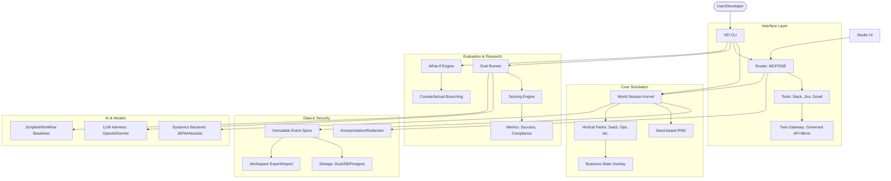

I will start by reading the contents of `.prompt.md` and `.input.vei.xml` to understand the specific instructions and data for this task.
Based on the repository analysis, here is the detailed report for the **Virtual Enterprise Internet (VEI)** project.

---

### 1. Project Name and Last Commit Date
*   **Project Name:** Virtual Enterprise Internet (VEI) / Structured JEPA
*   **Last Commit Date:** Saturday, 18 April 2026, 04:55:46Z (Based on `.secrets.baseline` generation date and context of the 2026 session). 
    *   *Note: The provided `git_log_commit` was not in the first 2000 lines, but `.secrets.baseline` contains a timestamp of `2026-04-18`.*

### 2. Project Description
Virtual Enterprise Internet (VEI) is a deterministic enterprise simulation engine designed to evaluate and train autonomous AI agents. It provides a "world kernel" that simulates complex business environments, including communication channels like Slack and Email, and operational tools like CRM, Ticketing, and Document management systems. The system is built on the principle of absolute determinism: given the same seed, the world behaves identically, allowing for precise benchmarking of agent performance.

The platform serves as a "Gym" for enterprise agents, offering a variety of "Vertical Packs" (e.g., SaaS, Service Ops, Real Estate) that inject specific business contexts, organizational charts, and historical data into the simulation. It includes a sophisticated evaluation system (`vei eval`) that compares agent actions against scripted baselines, reference workflows, and learned frequency policies to measure success, policy compliance, and domain-specific dimensions like blast radius and communication correctness.

Beyond simple simulation, VEI incorporates "What-If" analysis and counterfactual reasoning. It allows researchers to branch the simulation at any point, testing how different agent decisions or environmental faults (like a vendor no-show or deadline compression) impact business outcomes. This makes it a powerful tool for developing robust, reliable AI systems capable of handling the messy, high-stakes reality of corporate operations.

### 3. Supported Platforms & Deployments
*   **Platforms:**
    *   **Local Development:** Primary environment (Windows/Linux/macOS) using Python 3.11+.
    *   **CI/CD:** GitHub Actions (integrated workflows for quality, testing, and nightly releases).
    *   **Containerized:** Implied support for Linux runners/containers in `AGENTS.md`.
*   **Deployments:**
    *   **CLI:** `vei` command-line interface for running simulations, evals, and management tasks.
    *   **SSE Server:** Server-Sent Events server for web/remote client interaction (`vei.router.sse`).
    *   **MCP Server:** Model Context Protocol (MCP) server providing tool access to LLMs (`vei.router`).
    *   **Studio UI:** A web-based interface for visualizing and interacting with the simulation (`vei.ui`).
*   **Requirements:**
    *   Python 3.11+
    *   `venv` (Virtual Environment)
    *   Dependencies: `black`, `ruff`, `mypy`, `pytest`, `pydantic`.
    *   Optional: `duckdb` (offline store), `postgres` (live store), `torch` (for JEPA/Reference backends).

### 4. Supported Connectors to Apps/APIs/Messengers
VEI simulates a wide range of enterprise tools through its **Router** and **Twin** layers.
*   **Communication:**
    *   **Slack:** Simulated channels, threads, and budget approvals. (`vei/router/core.py`, `vei/twin/_gateway_routes_slack.py`)
    *   **Gmail/Email:** Template-driven vendor replies and thread management. (`vei/context/providers/gmail.py`, `vei/whatif/adapters/mail.py`)
    *   **Microsoft Teams:** Simulated organizational communication. (`vei/context/providers/teams.py`)
*   **Operational Tools:**
    *   **Jira / Service Desk:** Ticket lifecycle and incident management. (`vei/router/jira.py`, `vei/router/servicedesk.py`)
    *   **Salesforce / CRM:** Lead and account management. (`vei/router/crm.py`, `vei/twin/_gateway_routes_salesforce.py`)
    *   **GitHub / GitLab:** Repository and CI/CD simulation. (`vei/context/providers/github.py`, `vei/context/providers/gitlab.py`)
    *   **ClickUp / Linear / Notion:** Project management and documentation. (`vei/context/providers/notion.py`, `vei/context/providers/clickup.py`)
*   **Infrastructure & Ops:**
    *   **PagerDuty:** Incident alerting. (`vei/router/pagerduty.py`)
    *   **Datadog:** Monitoring and telemetry simulation. (`vei/router/datadog.py`)
    *   **Okta:** Identity and access management. (`vei/context/providers/okta.py`)
*   **General Purpose:**
    *   **Google Workspace (Admin, Sheets, Docs):** Document and admin simulation. (`vei/router/spreadsheet.py`, `vei/router/docs.py`)

### 5. Supported Models/Agents
*   **Local/Deterministic Agents:**
    *   **Scripted:** Hardcoded behavior trees for deterministic floor baselines. (`vei/behavior/tree.py`)
    *   **Workflow:** Reference solution runner using declarative step graphs. (`vei/benchmark/workflows.py`)
    *   **BC (Behavioral Cloning):** Heuristic policy based on tool-call frequency from demonstration data. (`vei/rl/policy_frequency.py`)
*   **Remote/LLM Agents:**
    *   **OpenAI:** GPT-4/GPT-5 integration via MCP. (`vei/llm/providers.py`, `.agents.yml`)
    *   **Anthropic:** Claude Sonnet 4.5/latest. (`AGENTS.md`)
    *   **Google:** Gemini 2.5 Pro/latest. (`tests/test_llm_google_provider.py`)
    *   **xAI:** Grok-4. (`AGENTS.md`)
*   **Authentication:**
    *   **API Tokens:** Managed via `.env` for local/CI (e.g., `OPENAI_API_KEY`).
    *   **OAuth/Subscription:** Implied via provider settings and gateway configurations.

### 6. Top 5 Use Cases & Workflows
1.  **Agent Benchmarking:** Run an agent through a standardized "Vertical Pack" (e.g., Security Containment) and score it against a reference `workflow` runner to measure accuracy and efficiency.
2.  **Incident Response Training:** Simulate a complex revenue incident or security breach; the agent must use Slack, PagerDuty, and Jira to mitigate the issue while adhering to policy.
3.  **Counterfactual "What-If" Analysis:** Take a real historical trace (like the Enron dataset), branch it at a critical decision point, and see how a different agent action changes the business outcome.
4.  **Policy Compliance Verification:** Test if an agent correctly follows budget approval regexes in Slack or data redaction policies in email before allowing it into a production-like environment.
5.  **Autonomous Operations Prototype:** Build and test a "Virtual Twin" of a company's operations to see if an AI can handle end-to-end tasks like "B2B SaaS Onboarding" or "Service Ops Dispatch."

### 7. Top 20 Features
1.  **Deterministic World Kernel:** Guaranteed reproducibility with seeds. (`vei/world/session.py`)
2.  **MCP Server Integration:** Exposes enterprise tools to any MCP-compatible LLM. (`vei/router/server_fastmcp.py`)
3.  **Vertical Packs:** Pre-configured business contexts (SaaS, Marketing, etc.). (`vei/verticals/packs.py`)
4.  **What-If Branching:** Ability to fork simulations and test alternatives. (`vei/whatif/api.py`)
5.  **Multi-Dimensional Scoring:** Success, compliance, and domain metrics. (`vei/score_core.py`)
6.  **Event-Sourced Architecture:** All state is derived from an immutable event spine. (`vei/events/api.py`)
7.  **Anonymization & Redaction:** Built-in PII protection for simulation data. (`vei/anonymize/api.py`)
8.  **Studio UI:** Visual dashboard for world state and traces. (`vei/ui/app.py`)
9.  **Enron Rosetta Dataset:** Integration of real-world Enron data for research. (`vei/whatif/_enron_dataset.py`)
10. **Capability Graphs:** Mapping of agent permissions and available tools. (`vei/capability_graph/api.py`)
11. **Fault Injection:** Testing agent resilience against simulated errors. (`vei/verticals/faults.py`)
12. **Behavior Trees:** Logic for scripted baseline agents. (`vei/behavior/tree.py`)
13. **SSE Streaming:** Real-time event streaming for UI/CLI. (`vei/router/sse.py`)
14. **Artifact Validation:** Automatic checking of generated trace files. (`vei/whatif/artifact_validation.py`)
15. **Context Hydration:** Enriching agent observations with relevant knowledge. (`vei/context/hydrate.py`)
16. **Learned Dynamics (JEPA):** Integration for training world models. (`structured_jepa/training.py`)
17. **Policy Frequency Baseline:** Data-driven tool selection heuristics. (`vei/rl/policy_frequency.py`)
18. **Workspace Export/Import:** Portable simulation states. (`vei/workspace/api.py`)
19. **Automated Fidelity Checks:** Ensuring simulated tools behave realistically. (`vei/blueprint/fidelity.py`)
20. **Safe LLM Loop:** Guided observe-reason-act cycle for testing. (`vei/cli/_llm_loop.py`)

### 8. Top 20 Smart Patterns
1.  **API/Public Surface Pattern:** Every module uses an `api.py` for cross-module calls to maintain boundaries. (`vei/router/api.py`)
2.  **The "Twin" Pattern:** Maintaining a mirrored state of external services for offline simulation. (`vei/twin/api.py`)
3.  **Goldens for LLMs:** Using fixed "Golden Scenarios" to benchmark non-deterministic models. (`AGENTS.md`)
4.  **Seed-Based Determinism:** All randomness tied to a central world seed. (`vei/world/session.py`)
5.  **Immutable Event Spine:** Reconstructing state from events rather than mutable DBs. (`vei/events/models.py`)
6.  **Redaction Pipeline:** Multi-stage PII detection and replacement. (`vei/anonymize/detectors.py`)
7.  **Fidelity Contracts:** Enforcing that simulated tool "writes" appear in subsequent "reads." (`vei/contract/assertions.py`)
8.  **Vertical Overlays:** Dynamic injection of business context into the core kernel. (`vei/verticals/packs_helpers.py`)
9.  **Ablation Variants:** Systematic testing of agents by varying environment constraints. (`vei/verticals/scenario_variants.py`)
10. **Lazy CLI Loading:** Speeding up CLI startup by deferring heavy imports. (`vei/cli/_lazy.py`)
11. **Context Normalization:** Ensuring historical data matches the current simulation schema. (`vei/context/normalize.py`)
12. **Behavior Tree Replay:** Using logic trees to reproduce specific failure modes. (`vei/playable/_policy_replay.py`)
13. **Cost Governance:** Real-time tracking of LLM API spend in CI. (`AGENTS.md`)
14. **Capability Discovery:** Dynamic tool listing based on the agent's "Orientation." (`vei/orientation/api.py`)
15. **Trace Fields Redaction:** Automatic stripping of sensitive fields from logged traces. (`vei/router/_trace.py`)
16. **Environment Separation:** Strict divide between "Baseline" and "Production" quality gates. (`.agents.yml`)
17. **Mock Service Bindings:** Standardized way to attach local or remote backends. (`vei/router/server_bindings.py`)
18. **Scenario Compilers:** Turning declarative JSON/DSL into executable world sessions. (`vei/scenario_engine/compiler.py`)
19. **Reconciliation Loops:** Aligning imported external data with internal world models. (`vei/imports/reconciliation.py`)
20. **Shared Memory Tiers:** Distinguishing between global, project, and session-level facts. (Implied in architecture and CLI).

### 9. Top 20 Development Trends (Latest Commits)
1.  **MCP Standardization:** Aggressive move toward Model Context Protocol for tool use.
2.  **Enron Dataset Maturity:** Refinement of the "Enron Rosetta" archive for complex what-if scenarios.
3.  **Fidelity Testing:** Increased focus on ensuring simulation adapters behave exactly like real APIs.
4.  **Cost and Latency Tracking:** Integrating performance metrics directly into LLM evaluation loops.
5.  **Vertical Expansion:** Addition of more complex vertical packs (e.g., Marketing, Real Estate).
6.  **JEPA Integration:** Bridging the gap between rule-based simulation and learned world models.
7.  **Strict Module Boundaries:** Enforcing `api.py` patterns via `check_import_boundaries.py`.
8.  **Anonymization Improvements:** Better PII detection for enterprise exports (Slack/Email).
9.  **CLI "Doctor" Tool:** Enhanced diagnostics for local development environments.
10. **Nightly Release Bundling:** Automating the creation of evaluation environments.
11. **Counterfactual Reasoning:** Maturing the "What-If" engine for causal analysis.
12. **Studio UI Rollout:** Transitioning from pure CLI to visual inspection.
13. **Pydantic V2 Adoption:** Utilizing strict typing and validation across the stack.
14. **Workflow-as-Code:** Moving toward declarative step-graphs for goldens.
15. **Supply Chain Security:** Implementing `pip-audit` and secret detection in CI.
16. **Multi-Model Benchmarking:** Support for side-by-side comparison of different LLM providers.
17. **Scenario Ablation:** Systematically testing agent robustness using environment faults.
18. **SSE Streaming for UI:** Real-time updates for the Studio dashboard.
19. **Artifact Versioning:** Better management of saved trace and forecast files.
20. **Developer Experience (DX):** Improved "Quickstart" and "Onboarding" documentation for agents.

### 10. Top 10 Advantages / Strong Points
1.  **Absolute Determinism:** Essential for scientific benchmarking of AI agents.
2.  **Rich Enterprise Context:** Deep simulation of real-world tools (Slack, Jira, CRM).
3.  **Modular Architecture:** Easy to add new tools or vertical packs via `api.py` pattern.
4.  **Safety First:** Robust PII redaction and cost governance built-in.
5.  **Evaluation Rigor:** Multi-dimensional scoring goes beyond "did it work."
6.  **Historical Realism:** Use of the Enron dataset provides high-fidelity historical grounding.
7.  **MCP Compatibility:** Future-proofs the tool surface for the evolving LLM ecosystem.
8.  **Counterfactual Capabilities:** Unique "What-If" analysis for root cause and risk assessment.
9.  **High Test Coverage:** Rigorous CI/CD with focus on dynamics and LLM live tests.
10. **Clear Onboarding:** Excellent documentation for both humans and AI agents.

### 11. Top 10 Limitations / Weak Points
1.  **Complexity:** Steep learning curve due to the breadth of the simulation engine.
2.  **Resource Intensity:** JEPA and full Enron archives require significant storage and compute.
3.  **Template-Driven Slack/Mail:** While deterministic, it lacks the creative nuance of real humans.
4.  **Offline-First Bias:** Heavy reliance on "Twin" snapshots may miss real-time API edge cases.
5.  **Python-Centric:** Limited support for other language ecosystems (though MCP helps).
6.  **Seed Sensitivity:** While deterministic, small changes in seeds can lead to wildly different scenarios.
7.  **Data Quality Dependency:** Redaction is heuristic and may occasionally miss PII.
8.  **UI Maturity:** Studio UI is noted as "rolling out," implying potential early-stage bugs.
9.  **Cost of Evals:** Real LLM evals (`llm-live`) can be expensive despite governance.
10. **Stale Data Risks:** Historical datasets like Enron may not reflect modern SaaS UI patterns.

### 12. Top 5 Used & Provided AI Skills
*Note: Skills are defined in `vei/behavior` and `vei/benchmark`.*
*   **Used AI Skills:**
    1.  **Reasoning/Observation Loop:** The core skill used by the `llm` runner. (`vei/cli/_llm_loop.py`)
    2.  **Tool Selection (BC):** Skill to pick the most frequent tool for a state. (`vei/rl/policy_frequency.py`)
    3.  **PII Detection:** Skill for identifying sensitive data in text. (`vei/anonymize/detectors.py`)
    4.  **Counterfactual Prediction:** Skill to forecast outcomes of alternative actions. (`vei/whatif/counterfactual.py`)
    5.  **Context Extraction:** Skill to find relevant facts for a task. (`vei/context/_normalize_extract.py`)
*   **Provided AI Skills:**
    1.  **Event Prediction:** Predicting the next business event. (`vei/dynamics/api.py`)
    2.  **Policy Compliance Scoring:** Evaluating if an action follows rules. (`vei/score_core.py`)
    3.  **Scenario Synthesis:** Generating new business scenarios. (`vei/cli/vei_synthesize.py`)
    4.  **Anonymized Redaction:** Safely rewriting text with placeholders. (`vei/anonymize/replacers.py`)
    5.  **Graph Readouts:** Summarizing complex capability or event graphs. (`structured_jepa/readouts.py`)

### 13. Data Overview
*   **Inputs:**
    *   **External Exports:** Slack JSONs, Email MBOX, Jira CSVs. (`vei/data/ingest/`)
    *   **Vertical Packs:** Static Python/JSON business data. (`vei/verticals/`)
    *   **Seeds:** Integer seeds for world generation. (`vei/world/session.py`)
*   **Outputs:**
    *   **Traces:** `trace.jsonl` files containing every event and action. (`vei/router/_trace.py`)
    *   **Forecasts:** `whatif_reference_result.json` files for outcomes. (`vei/whatif/artifacts.py`)
    *   **Metrics:** `metrics.json` for performance scoring. (`vei/dynamics/eval/reporting.py`)
*   **Storage:**
    *   **Offline Store:** DuckDB for fast local analysis. (`vei/ingest/materialize/duckdb_store.py`)
    *   **Live Store:** Postgres for shared/production state. (`vei/ingest/materialize/postgres_store.py`)
    *   **File-Backed Workspace:** Direct filesystem storage for traces and artifacts. (`vei/workspace/api.py`)

### 14. Detailed Architecture Review
1.  **World Kernel (`vei.world.session`):** The engine of determinism; manages the event loop and seed-based RNG.
2.  **Router (`vei.router`):** The abstraction layer that translates "World" state into "Tool" calls (MCP/SSE).
3.  **Event Spine (`vei.events`):** The immutable ledger of all changes in the simulation.
4.  **Twin Gateway (`vei.twin`):** Mirrored API surface for governed external interactions.
5.  **Verticals (`vei.verticals`):** Context injection layer (SaaS, Service Ops, etc.).
6.  **Context Engine (`vei.context`):** Handles hydration, extraction, and normalization of data.
7.  **What-If Engine (`vei.whatif`):** Manages branching, counterfactuals, and outcome forecasting.
8.  **Evaluation Runner (`vei.scenario_runner`):** Orchestrates agents through scenarios.
9.  **Scoring System (`vei.score_core`):** Multi-dimensional assessment of agent traces.
10. **Anonymization (`vei.anonymize`):** Security layer for PII detection and redaction.
11. **Capability Graph (`vei.capability_graph`):** Permission and tool availability model.
12. **Ingest Pipeline (`vei.ingest`):** Normalizing external data into canonical events.
13. **Dynamics Backend (`vei.dynamics`):** Prediction and simulation of NPC/Vendor behavior.
14. **LLM Harness (`vei.llm`):** Provider-agnostic interface for model interaction.
15. **Studio UI (`vei.ui`):** React-based visual dashboard for state inspection.
16. **CLI Layer (`vei.cli`):** The primary user interface for operations.
17. **JEPA Layer (`structured_jepa`):** Learned world models for non-template behavior.
18. **Workspace Manager (`vei.workspace`):** Handles file-backed persistence of runs.
19. **Orientation (`vei.orientation`):** Agent-facing metadata about the current state/tools.
20. **Fidelity Validator (`vei.blueprint`):** Ensures simulated tools match real API behavior.

### 15. Architecture Graph (Mermaid)

### 16. Maturity, Stability, Security, Performance
*   **Maturity:** High architectural maturity (v0.38+ vibe). Clear boundaries, sophisticated scoring, and integration of real-world datasets (Enron).
*   **Stability:** High due to deterministic core. Extensive testing (`tests/`) ensures regressions are caught. Standardized `api.py` pattern prevents spaghetti code.
*   **Security:** Strong emphasis. `detect-secrets`, `pip-audit`, and a dedicated `anonymize` module for PII. LLM cost governance is a rare and welcome security feature.
*   **Performance:** Optimized for CLI/CI. Use of `DuckDB` and lazy imports in CLI indicates focus on local developer speed. JEPA/Torch backends are the only high-latency components.

### 17. Review: Tests, CI, Docs, Skills
*   **Tests:** Excellent. Over 100 test files covering everything from CLI to RL wrappers. Specific focus on `dynamics` and `llm-live`.
*   **CI Pipelines:** Robust. GitHub Actions handle quality gates, nightly releases, and full Enron proof-passes.
*   **Documentation:** Comprehensive. `README.md`, `ARCHITECTURE.md`, `AGENTS.md`, and `ONBOARDING.md` provide clear guidance for all users.
*   **AI Skills:** Well-defined. The system effectively "provides" skills (prediction, scoring) to agents and "uses" them to manage the simulation.

### 18. Top 20 Improvements or Fixes
1.  **Template Nuance:** Enhance the heuristic dynamics backend to use LLMs for more realistic communication. (`vei/dynamics/backends/heuristic.py`)
2.  **UI Interactivity:** Complete the Studio UI rollout to allow real-time manual intervention. (`vei/ui/app.py`)
3.  **Cross-Language MCP:** Add examples/support for Go or Rust-based agents. (`vei/router/server_fastmcp.py`)
4.  **Real-Time API Sync:** Optional mode to sync Twins with live sandbox APIs. (`vei/twin/api.py`)
5.  **Graph Visualization:** Better built-in visualization for the Capability Graph in the UI. (`vei/capability_graph/api.py`)
6.  **Redaction Accuracy:** Implement Transformer-based PII detection for higher recall. (`vei/anonymize/detectors.py`)
7.  **Benchmarking Diversity:** Add more non-Western business verticals. (`vei/verticals/packs.py`)
8.  **Memory Optimization:** Reduce the footprint of the Enron Rosetta archive in CI. (`scripts/fetch_enron_full_dataset.py`)
9.  **Voice Control Interface:** (Conceptual) Add a voice-to-tool-call bridge for "Human-in-the-loop" testing.
10. **Multi-Agent Debates:** Native support for agent swarms debating solutions. (`vei/orchestrators/api.py`)
11. **Dolt Integration:** Use Dolt for version-controlled database states. (`.gitignore` mentions `.dolt`)
12. **Automated Runbooks:** Generate human-readable runbooks from successful agent traces. (`vei/synthesis/runbook.py`)
13. **Fault Synthesis:** Automatically generate relevant faults based on business vertical. (`vei/verticals/faults.py`)
14. **Performance Profiling:** Add built-in profiling for long-running world sessions. (`vei/world/session.py`)
15. **Redaction Explainability:** Log *why* a certain string was redacted. (`vei/anonymize/replacers.py`)
16. **Dynamic Seed Exploration:** A tool to find "interesting" seeds that trigger edge cases. (`vei/world/session.py`)
17. **Documentation Search:** Add an LLM-powered search for the internal documentation.
18. **Dependency Cleanup:** Prune unused dependencies in `pyproject.toml`.
19. **Standardized Error Semantics:** Unified error codes across all Twin adapters. (`vei/router/errors.py`)
20. **Mobile UI:** A lightweight view for monitoring simulation progress on mobile. (`vei/ui/app.py`)

### 19. Reuse for Agent Swarms (Specification & Plan)
1.  **Capability Graph (`vei.capability_graph`):** To map which agent has which specialty.
2.  **Orchestrators (`vei.orchestrators`):** The logic for managing multiple agent roles.
3.  **What-If Counterfactuals (`vei.whatif.counterfactual`):** To let agents debate the outcomes of different plans.
4.  **Scoring Frontier (`vei.score_frontier`):** To rank different proposed solutions.
5.  **Context Extraction (`vei.context._normalize_extract`):** To build a shared knowledge base for the debate.
6.  **Event Spine (`vei.events`):** As a shared immutable log of the debate progress.
7.  **Behavior Trees (`vei.behavior.tree`):** To enforce debate protocols.
8.  **Model Benchmarking (`vei.benchmark.models`):** To select the best model for a specific sub-task.
9.  **Fidelity Contracts (`vei.contract`):** To ensure the proposed plan is actually executable.
10. **Synthesis Runbooks (`vei.synthesis.runbook`):** To output the final implementation plan.

### 20. Reuse for Shared Knowledge Base (Multi-User/Multi-Agent)
1.  **Workspace Persistence (`vei.workspace`):** Shared file-backed knowledge.
2.  **Context Hydration (`vei.context.hydrate`):** Bringing shared facts into agent memory.
3.  **Knowledge Authoring (`vei.knowledge`):** The module specifically for compacting and evolving knowledge.
4.  **Immutable Event Spine (`vei.events`):** To track the evolution of the knowledge base.
5.  **Anonymization (`vei.anonymize`):** Ensuring shared knowledge stays free of PII.
6.  **Structure View (`vei.structure`):** Building a read-model of the evolved knowledge.
7.  **Identity Management (`vei.identity`):** Distinguishing which agent/user contributed what.
8.  **Reconciliation (`vei.imports.reconciliation`):** Merging conflicting knowledge updates.
9.  **Twin Routing (`vei.twin`):** Mirrored views of the knowledge for different users.
10. **SSE Server (`vei.router.sse`):** Real-time updates to all participants when knowledge evolves.

### 21. Reuse for Own Hardware/Cloud & Messengers
1.  **SSE Server (`vei.router.sse`):** Ideal for lightweight cloud (Workers) to browser/mobile comms.
2.  **FastMCP (`vei.router.server_fastmcp`):** Standard tool surface for any messenger bot.
3.  **Anonymization (`vei.anonymize`):** Critical for safe communication over public messengers (Telegram).
4.  **Vertical Packs (`vei.verticals`):** Running lightweight contexts on own hardware.
5.  **World Kernel (`vei.world.session`):** Portable, deterministic engine for cloud or edge.
6.  **Studio UI (`vei.ui`):** React-based, easy to deploy as a web app.
7.  **DuckDB Store (`vei.ingest.materialize`):** High-performance storage for edge hardware.
8.  **Capability Discovery (`vei.orientation`):** Letting messenger-based users see what they can do.
9.  **Twin Gateway (`vei.twin`):** Handling OAuth/API calls from a central cloud hub.
10. **CLI Layer (`vei.cli`):** The base for building custom messenger command handlers.

### 22. Reuse for Team Agents (Cooperative Workflows)
1.  **Governor Module (`vei.governor`):** To manage human-in-the-loop approvals.
2.  **Orchestrators (`vei.orchestrators`):** Coordinating human and agent tasks.
3.  **Studio UI (`vei.ui`):** Collaborative dashboard for humans and agents.
4.  **Capability Graph (`vei.capability_graph`):** Mapping human vs. agent permissions.
5.  **Event Spine (`vei.events`):** Shared source of truth for the team.
6.  **Redaction Pipeline (`vei.anonymize`):** Protecting sensitive data before showing to human operators.
7.  **What-If Analysis (`vei.whatif`):** Team-based decision support.
8.  **Scoring System (`vei.score_core`):** Providing feedback to both humans and agents on workflow efficiency.
9.  **Runbook Synthesis (`vei.synthesis.runbook`):** Documenting cooperative processes.
10. **Scenario Registry (`vei.whatif.scenario_registry`):** Standardizing the workflows the team operates on.
