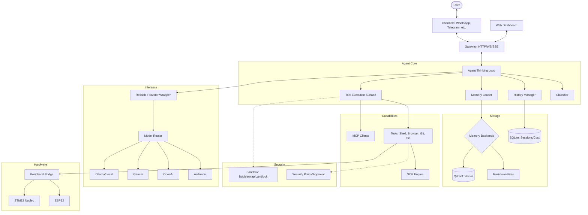

I will read the instructions in `.prompt.md` and the content of `zeroclaw.xml` to understand the task.
I will start by reading the `README.md` file to get the project name and a high-level description.
I will read `AGENTS.md` and `docs/README.md` to find more detailed project information and context.
I will list the files in the current directory to understand the available resources.
I will search for the content of `README.md` within `zeroclaw.xml` to find the project name and description.
I will read the `README.md` content from `zeroclaw.xml` starting at line 43889, and also search for `AGENTS.md` within the same file.
I will search for the "Git logs" section in `zeroclaw.xml` to identify the latest development trends.
I will read lines 2001 to 4000 of `zeroclaw.xml` to see if the Git logs are located there.
I will read the last 500 lines of `zeroclaw.xml` to locate the Git logs and identify recent development trends.
I will read `src/channels/mod.rs` and `src/providers/mod.rs` within `zeroclaw.xml` to understand how connectors and models are registered.
I will read `src/tools/mod.rs` within `zeroclaw.xml` to identify the available tools and features.
I will check the `.claude/skills` and `src/skills/` directories in `zeroclaw.xml` to identify the AI skills.
I will read `src/agent/mod.rs` and `src/memory/mod.rs` within `zeroclaw.xml` to understand the core agent structure and data storage.
# ZeroClaw Analysis Report

## 1. Project Name and Description
**Project Name:** ZeroClaw — Personal AI Assistant

ZeroClaw is a high-performance, ultra-lean personal AI assistant framework written entirely in Rust. It is designed to be 100% agnostic, allowing users to swap between various LLM providers (Anthropic, OpenAI, Gemini, etc.) and messaging platforms (WhatsApp, Telegram, Slack, etc.) without compromise. Built by members of the Harvard and MIT communities, it prioritizes local control, security, and extreme resource efficiency.

The core philosophy of ZeroClaw is "zero overhead," enabling it to run on hardware as modest as a $10 board with less than 5MB of RAM — a 99% reduction in memory usage compared to similar projects like OpenClaw. Despite its tiny footprint, it provides a full-featured autonomous runtime, including a web dashboard, standard operating procedures (SOPs) for automation, and deep hardware integration with microcontrollers like ESP32 and STM32.

ZeroClaw acts as a personal gateway to agentic intelligence, emphasizing a single-user, local-first experience. It features a robust security model with DM pairing and sandboxing, and it provides a comprehensive suite of tools for file management, web browsing, coding, and multi-agent orchestration. It is positioned as the successor to legacy Python or Node.js based assistants, offering near-instant cold starts and a portable architecture.

## 2. Supported Platforms, Deployments & Requirements
*   **Operating Systems:** 
    *   **Windows:** Supports MSVC and GNU targets; requires Visual Studio Build Tools and Rust toolchain.
    *   **Linux:** Supports x86_64, aarch64, armv7 (Raspberry Pi, etc.).
    *   **macOS:** Supports x86_64 and aarch64 (Apple Silicon).
    *   **Android:** Supported via NDK toolchain (armv7, aarch64).
*   **Deployments:**
    *   **Native Binary:** Single static binary with no runtime dependencies.
    *   **Docker:** Sandboxed execution via `runtime.kind = "docker"`.
    *   **Cloud:** Marketplace templates for Coolify, Dokploy, Easypanel.
    *   **Hardware (Firmware):** ESP32, ESP32-UI, STM32 Nucleo, Arduino Uno, Raspberry Pi GPIO.
*   **Requirements:**
    *   **Runtime:** < 5MB RAM, < 10ms startup.
    *   **Build:** 2-4GB+ RAM, 6-10GB+ Disk (for compilation from source).
    *   **Dependencies:** Rust stable toolchain (2024 edition).

## 3. Supported Connectors (Apps/APIs/Messengers)
ZeroClaw supports a vast array of messaging and integration platforms via the `Channel` trait.

*   **Messengers:**
    *   **WhatsApp:** `src/channels/whatsapp.rs`, `src/channels/whatsapp_web.rs`
    *   **Telegram:** `src/channels/telegram.rs`
    *   **Signal:** `src/channels/signal.rs`
    *   **Discord:** `src/channels/discord.rs`
    *   **Slack:** `src/channels/slack.rs`
    *   **Matrix:** `src/channels/matrix.rs`
    *   **iMessage:** `src/channels/imessage.rs`
    *   **Bluesky:** `src/channels/bluesky.rs`
    *   **Nostr:** `src/channels/nostr.rs`
    *   **Mattermost:** `src/channels/mattermost.rs`
    *   **Nextcloud Talk:** `src/channels/nextcloud_talk.rs`
    *   **IRC:** `src/channels/irc.rs`
    *   **Email:** `src/channels/email_channel.rs`
*   **Enterprise/Region-Specific:**
    *   **DingTalk:** `src/channels/dingtalk.rs`
    *   **Lark/Feishu:** `src/channels/lark.rs`
    *   **QQ:** `src/channels/qq.rs`
    *   **WeCom (WeChat Work):** `src/channels/wecom.rs`
*   **Other Connectors:**
    *   **LinkedIn:** `src/tools/linkedin.rs`
    *   **Reddit:** `src/channels/reddit.rs`
    *   **Twitter:** `src/channels/twitter.rs`
    *   **MQTT:** `src/channels/mqtt.rs`
    *   **WebSocket:** `src/gateway/ws.rs`
    *   **Webhook:** `src/channels/webhook.rs`

## 4. Supported Models and Agents
ZeroClaw abstracts model access through the `Provider` trait, supporting both direct API keys and subscription-based OAuth.

*   **Remote Providers (API):**
    *   **Anthropic (Claude):** `src/providers/anthropic.rs`
    *   **OpenAI (GPT-4o, etc.):** `src/providers/openai.rs`
    *   **Google Gemini:** `src/providers/gemini.rs`
    *   **AWS Bedrock:** `src/providers/bedrock.rs`
    *   **Azure OpenAI:** `src/providers/azure_openai.rs`
    *   **OpenRouter:** `src/providers/openrouter.rs`
    *   **DeepSeek:** via `src/providers/compatible.rs`
    *   **Telnyx:** `src/providers/telnyx.rs`
*   **Subscription Auth (OAuth/Tokens):**
    *   **OpenAI Codex (ChatGPT Sub):** `src/providers/openai_codex.rs`, `src/auth/openai_oauth.rs`
    *   **Claude Code:** `src/providers/claude_code.rs`, `src/auth/anthropic_token.rs`
    *   **Gemini OAuth:** `src/auth/gemini_oauth.rs`
    *   **GitHub Copilot:** `src/providers/copilot.rs`
*   **Local Providers:**
    *   **Ollama:** `src/providers/ollama.rs`
    *   **KiloCLI:** `src/providers/kilocli.rs`

## 5. Top 5 Use Cases
1.  **Personal Life Automation:** Automating multi-platform messaging, scheduling tasks via Cron, and managing personal knowledge bases via voice or chat.
2.  **Autonomous DevOps/Coding:** Using the integrated `git`, `shell`, and `claude_code` tools to perform repo maintenance, bug fixing, and CI/CD monitoring.
3.  **Hardware-Agent Interfacing:** Controlling smart home devices or industrial peripherals via ESP32/STM32 bridges and MQTT triggers.
4.  **Information Retrieval & Research:** Leveraging `web_search`, `browser` control, and `mcp_client` to synthesize information from various sources into structured reports.
5.  **Autonomous Task Swarms:** Deploying multiple agents (`swarm` tool) to collaborate on complex goals like project specification, implementation planning, and verification.

## 6. Top 20 Features
1.  **Lean Rust Runtime:** <5MB RAM usage. (`src/main.rs`)
2.  **Multi-Channel Inbox:** Unified interface for 20+ platforms. (`src/channels/mod.rs`)
3.  **Standard Operating Procedures (SOPs):** Event-driven workflows. (`src/sop/mod.rs`)
4.  **Web Dashboard:** Real-time monitoring and control UI. (`web/src/App.tsx`)
5.  **Hands (Swarm Orchestration):** Autonomous agent management. (`src/hands/mod.rs`, `src/tools/swarm.rs`)
6.  **Subscription-Native Auth:** OAuth and token support for ChatGPT/Claude subscriptions. (`src/auth/mod.rs`)
7.  **Hardware Peripherals:** ESP32/STM32/RPi support. (`src/hardware/mod.rs`, `src/peripherals/mod.rs`)
8.  **Knowledge Graph:** Graph-based memory storage. (`src/memory/knowledge_graph.rs`)
9.  **Model Failover:** Resilient chains and automatic retries. (`src/providers/reliable.rs`)
10. **MCP Support:** Model Context Protocol for tool extension. (`src/tools/mcp_client.rs`)
11. **Smart Sandboxing:** Landlock, Bubblewrap, and Docker isolation. (`src/security/mod.rs`)
12. **Lifecycle Hooks:** Middleware for LLM calls and tool execution. (`src/hooks/mod.rs`)
13. **Cost Tracking:** Detailed token usage and USD cost monitoring. (`src/agent/cost.rs`, `src/cost/mod.rs`)
14. **Memory Decay/Consolidation:** Intelligent fact management. (`src/memory/decay.rs`, `src/memory/consolidation.rs`)
15. **Onboarding Wizard:** Guided CLI setup for new users. (`src/onboard/mod.rs`, `src/tui/onboarding.rs`)
16. **ZeroClaw Doctor:** Diagnostic tool for system health. (`src/doctor/mod.rs`)
17. **Skill Platform:** Bundled and workspace-specific capabilities. (`src/skills/mod.rs`)
18. **Tunnel Integration:** Cloudflare, Tailscale, Ngrok support. (`src/tunnel/mod.rs`)
19. **Verifiable Intent:** Cryptographic verification of agent actions. (`src/verifiable_intent/mod.rs`)
20. **TUI Onboarding:** Terminal-based interactive setup. (`src/tui/onboarding.rs`)

## 7. Top 20 Smart Patterns
1.  **Trait-Based Extensibility:** Standardizing Providers, Channels, and Tools. (`src/lib.rs`)
2.  **Hierarchical Personality:** Layering `SOUL.md`, `IDENTITY.md`, and `USER.md`. (`src/agent/personality.rs`)
3.  **DM Pairing Code:** Gated access for untrusted senders. (`src/security/pairing.rs`)
4.  **Thinking Tag Stripping:** Handling reasoning streams in real-time. (`src/channels/mod.rs`)
5.  **Memory Time-Decay:** Weighting memories by age and relevance. (`src/memory/decay.rs`)
6.  **Orphan Result Pruning:** Cleaning up history when tool calls are lost. (`src/agent/agent.rs`)
7.  **Subscription Auth Rotation:** Managing multiple OAuth profiles. (`src/auth/profiles.rs`)
8.  **Adaptive Context Compression:** Fitting more info into smaller windows. (`src/agent/context_compressor.rs`)
9.  **Intent Verification:** Requiring crypto-signed intent for critical actions. (`src/verifiable_intent/verification.rs`)
10. **Hardware Memory Mapping:** Unified access to microcontroller memory. (`src/hardware/protocol.rs`)
11. **Message Classification:** Fast routing before heavy LLM processing. (`src/agent/classifier.rs`)
12. **Autonomy Gating:** ReadOnly/Supervised/Full security levels. (`src/security/policy.rs`)
13. **Response Caching:** Deduplicating identical LLM requests. (`src/memory/response_cache.rs`)
14. **Incremental History Pruning:** Differential token management. (`src/agent/history_pruner.rs`)
15. **Browser Delegation:** Offloading heavy web tasks to sub-agents. (`src/tools/browser_delegate.rs`)
16. **Cron-Triggered Prompting:** Scheduled autonomous "thoughts." (`src/cron/scheduler.rs`)
17. **Peripheral Discovery:** Scanning for local hardware nodes. (`src/hardware/discover.rs`)
18. **TOML-to-JSON Config Migration:** Automatic legacy config upgrades. (`src/migration.rs`)
19. **Gateway SSE Streaming:** Real-time updates to the web dashboard. (`src/gateway/sse.rs`)
20. **Workspace Boundary Enforcement:** Path traversal prevention. (`src/security/workspace_boundary.rs`)

## 8. Top 20 Development Trends
1.  **CI/CD Migration:** Moving to specialized repositories for package managers (AUR, Homebrew).
2.  **Channel Metadata Propagation:** Passing user IDs into system prompts for personalization.
3.  **In-flight Reasoning Handling:** Stripping `<think>` tags from streaming channel updates.
4.  **Config Macro Evolution:** Using procedural macros for schema and CLI generation.
5.  **Provider Compliance:** Aligning with Anthropic's latest OAuth usage terms.
6.  **Web UI State Persistence:** Local storage for UI configuration (e.g., sidebars).
7.  **Security Hook Integration:** Wiring security checks deeper into the library API.
8.  **Multi-Locale Documentation:** Maintaining parity across 30+ README translations.
9.  **Binary Footprint Control:** Rigorous monitoring of static binary size.
10. **Marketplace Template Syncing:** Automating updates for Docker-based deployments.
11. **Cost Attribution:** Tracking costs per model and per agent request accurately.
12. **Timezone-Aware Scheduling:** Improving Cron reliability for local timezones.
13. **OAuth Profile Eviction:** Automatically cleaning up stale authentication tokens.
14. **History Integrity:** Fixing orphan tool result issues during history trimming.
15. **TUI/GUI Convergence:** Harmonizing onboarding between terminal and web.
16. **Feature Gating:** Moving heavy subsystems (Matrix, Nostr) behind Rust features.
17. **Tauri Integration:** Developing cross-platform desktop/mobile apps.
18. **Diagnostic Expansion:** Adding more checks to `zeroclaw doctor`.
19. **DeepSeek Integration:** Optimizing for latest DeepSeek model quirks.
20. **Dependency Versioning:** Stricter control over macro and crate versions.

## 9. Top 10 Advantages
1.  **Efficiency:** Unmatched <5MB RAM footprint.
2.  **Performance:** Rust-native speed and instant startup.
3.  **Portability:** Single binary for everything from RPi to Cloud.
4.  **Privacy:** Local-first, no mandatory external telemetry.
5.  **Flexibility:** Plug-and-play architecture for providers/channels.
6.  **Hardware Support:** Native peripheral control (not just software).
7.  **Security:** Multi-layered sandboxing and explicit pairing.
8.  **Cost:** Designed for $10 hardware; efficient token usage.
9.  **Autonomy:** Robust SOP and Cron-based scheduling.
10. **Ecosystem:** 70+ tools and comprehensive API/Web dashboard.

## 10. Top 10 Limitations
1.  **Single-User Focus:** Not natively designed for multi-tenant usage.
2.  **Build Intensity:** Compilation requires significant RAM and time.
3.  **Configuration Surface:** Overwhelming number of options for beginners.
4.  **Docs Gaps:** Some advanced hardware/firmware features lack deep docs.
5.  **Sandbox Platform limits:** Linux has the best sandboxing (Landlock).
6.  **Dependency on APIs:** Still requires external LLMs for "brain" power.
7.  **Memory Complexity:** Managing different backends (SQLite/Qdrant) can be complex.
8.  **Hallucination Risk:** High-autonomy modes require careful prompt tuning.
9.  **Setup Overhead:** manual setup is complex (mitigated by `onboard`).
10. **Feature Gating:** Some features (e.g., Matrix) require manual re-compilation.

## 11. Top AI Skills
*   **Provided Skills:**
    1.  `github-issue`: Filing bug reports/features. (`.claude/skills/github-issue/SKILL.md`)
    2.  `github-pr`: Opening and updating Pull Requests. (`.claude/skills/github-pr/SKILL.md`)
    3.  `github-pr-review`: Autonomous PR review agent. (`.claude/skills/github-pr-review/SKILL.md`)
    4.  `skill-creator`: Framework for building new skills. (`.claude/skills/skill-creator/SKILL.md`)
    5.  `zeroclaw`: Core assistant reference and CLI guide. (`.claude/skills/zeroclaw/SKILL.md`)
*   **Used/Integrated Skills:**
    1.  `read_skill`: Tool to ingest and learn new capabilities. (`src/tools/read_skill.rs`)
    2.  `skill_tool`: Running logic encapsulated in skills. (`src/tools/skill_tool.rs`)
    3.  `creator`: Automated skill generation logic. (`src/skills/creator.rs`)
    4.  `improver`: Refinement of existing skills. (`src/skills/improver.rs`)
    5.  `audit`: Security auditing of third-party skills. (`src/skills/audit.rs`)

## 12. Data Overview (Inputs, Outputs, Storage)
*   **Inputs:** CLI flags, TOML configuration, Platform messages (DMs/Webhooks), Hardware sensors (GPIO/ADC), Web pages (browser), MCP tools. (Refs: `src/channels/traits.rs`, `src/config/schema.rs`, `src/hardware/traits.rs`)
*   **Outputs:** Console logs, Platform replies, Hardware actuators (PWM/GPIO), Shell results, Web dashboard state, Push notifications. (Refs: `src/observability/log.rs`, `src/peripherals/traits.rs`)
*   **Storage:**
    *   **SQLite:** Relational data for sessions, costs, and memory. (`src/memory/sqlite.rs`)
    *   **Markdown:** Audit-friendly memory storage. (`src/memory/markdown.rs`)
    *   **Qdrant:** Vector embeddings for RAG. (`src/memory/qdrant.rs`)
    *   **Filesystem:** Workspace documents, skill files, and OAuth profiles. (`src/config/workspace.rs`, `src/auth/profiles.rs`)

## 13. Detailed Architecture Review
1.  **Gateway (`src/gateway/`):** The control plane. Handles HTTP/WS/SSE, pairing, and provides the API for the web dashboard.
2.  **Agent Core (`src/agent/`):** The "brain." Manages the thinking loop (`loop_.rs`), classification (`classifier.rs`), and history management.
3.  **Channels (`src/channels/`):** The "ears and mouth." Platform-specific adapters that normalize input/output via a shared trait.
4.  **Providers (`src/providers/`):** The "logic." Abstract interface for various LLM backends with routing and failover.
5.  **Tools (`src/tools/`):** The "hands." Atomic capabilities exposed to the agent.
6.  **Memory (`src/memory/`):** The "long-term brain." Various backends for persisting facts, patterns, and history.
7.  **SOP Engine (`src/sop/`):** The "reflexes." Event-driven automation for recurring or triggered tasks.
8.  **Hardware (`src/hardware/`):** The "nervous system." Protocol and discovery for connecting to microcontrollers.
9.  **Security (`src/security/`):** The "immune system." Sandboxing, policy enforcement, and intent verification.
10. **Cron (`src/cron/`):** The "clock." Scheduling autonomous events.

## 14. Architecture Diagram (Mermaid)

## 15. Project Review: Maturity, Stability, Security, Performance
*   **Maturity:** Highly active (v0.6.9). 5500+ commits. Backed by students from Harvard/MIT.
*   **Stability:** Built on Rust's type safety and memory management. Comprehensive error handling and retry logic in `ReliableProvider`.
*   **Security:** Deny-by-default policy. Workspace isolation. DM pairing. Landlock/Bubblewrap support. 129+ automated security tests.
*   **Performance:** Benchmarked at <5MB RAM and <10ms startup, significantly outperforming Python/JS alternatives.

## 16. Review: Tests, CI, Docs, Skills
*   **Tests:** Massive suite covering component, integration, and system levels (`tests/`). Includes "battle tests" for memory.
*   **CI Pipelines:** Robust GitHub Actions for cross-platform builds, security scanning, and marketplace syncing.
*   **Documentation:** Multi-locale (30+) READMEs, deep architectural guides, and detailed reference docs.
*   **Skills:** Mature system for adding capabilities via simple Markdown/TOML definitions.

## 17. Top 20 Possible Improvements/Fixes
1.  **Unified Local Inference:** Better first-class support for `llama.cpp` or `candle` directly in binary.
2.  **SOP Visual Editor:** Drag-and-drop workflow builder in the Web UI.
3.  **Multi-Tenant Gateway:** Supporting multiple users with isolated workspaces.
4.  **Enhanced Mobile UI:** Responsive improvements for the dashboard on small screens.
5.  **Voice Interaction:** Native STT/TTS in the gateway for direct voice calls. (`src/channels/voice_call.rs` exists but is basic).
6.  **Automated Skill Auditing:** Deeper static analysis of skill risk levels.
7.  **Dynamic Sandboxing:** Per-tool sandboxing profiles based on risk.
8.  **Memory Visualization:** 3D/Graph view of the Knowledge Graph in the dashboard.
9.  **Plugin Hot-Reloading:** WASM-based tools that can be updated without restart.
10. **Hardware Simulation:** Virtual ESP32 targets for testing firmware logic.
11. **Better "One-Click" for Windows:** native `.exe` installer or Scoop/Winget improvements.
12. **Context Caching Support:** Implementing native support for Anthropic/Gemini context caching.
13. **Hierarchical Swarms:** Native support for leader/follower agent hierarchies.
14. **Fine-grained Cost Limits:** Per-channel or per-session USD budgets.
15. **Telemetry Opt-in:** Structured usage reporting for maintainers (if user permits).
16. **OIDC/SAML Auth:** Enterprise authentication for the gateway.
17. **GPU Acceleration:** Optional crates for accelerating vector search or local models.
18. **Unified CLI Output:** More consistent formatting across all subcommands.
19. **Conflict Resolution UI:** Interface for managing memory merge conflicts. (`src/memory/conflict.rs`)
20. **Legacy Import Cleanup:** More robust handling of various OpenClaw workspace versions.

## 18. Reuse for Agent Swarms (Debating Solutions)
1.  **`src/agent/classifier.rs`**: For routing debate points to specific expert agents.
2.  **`src/tools/swarm.rs`**: Foundation for agent-to-agent delegation.
3.  **`src/agent/thinking.rs`**: Capturing and structuring agent reasoning steps.
4.  **`src/memory/knowledge_graph.rs`**: Shared graph to store debated claims and evidence.
5.  **`src/tools/delegate.rs`**: Mechanism for spawning sub-tasks.
6.  **`src/agent/eval.rs`**: Evaluation framework for grading proposed solutions.
7.  **`src/verifiable_intent/mod.rs`**: Ensuring decisions are cryptographically traceable.
8.  **`src/agent/context_analyzer.rs`**: Analyzing the current debate state for missing info.
9.  **`src/tools/project_intel.rs`**: Providing project context to debaters.
10. **`src/agent/loop_detector.rs`**: Preventing agents from circular reasoning during debate.

## 19. Reuse for Multi-User Shared Knowledge Base
1.  **`src/memory/namespaced.rs`**: Isolating user-specific vs shared knowledge.
2.  **`src/memory/sqlite.rs`**: Relational storage for structured knowledge metadata.
3.  **`src/memory/markdown.rs`**: Collaborative, human-readable audit trails.
4.  **`src/memory/consolidation.rs`**: Merging diverse user inputs into a single "truth."
5.  **`src/memory/hygiene.rs`**: Cleaning and deduplicating user-contributed facts.
6.  **`src/memory/importance.rs`**: Ranking knowledge relevance across the user base.
7.  **`src/memory/conflict.rs`**: Logic for resolving competing knowledge updates.
8.  **`src/skills/mod.rs`**: Shared capability library across users.
9.  **`src/gateway/ws.rs`**: Real-time synchronization of knowledge updates.
10. **`src/memory/audit.rs`**: Tracking who updated what and when.

## 20. Reuse for Edge/Cloud Agent with Voice & Visuals
1.  **`src/hardware/mod.rs`**: Communication with local hardware peripherals.
2.  **`src/tunnel/cloudflare.rs`**: Secure remote access without port forwarding.
3.  **`src/channels/voice_call.rs`**: Voice interface infrastructure.
4.  **`src/channels/transcription.rs`**: STT integration.
5.  **`src/channels/tts.rs`**: TTS integration.
6.  **`src/gateway/canvas.rs`**: Visual collaboration surface.
7.  **`src/gateway/hardware_context.rs`**: Passing hardware state to the agent.
8.  **`src/peripherals/rpi.rs`**: Direct GPIO control on Raspberry Pi.
9.  **`web/src/pages/Memory.tsx`**: Graph visualization templates.
10. **`src/runtime/wasm.rs`**: Running lightweight logic in Cloudflare Workers.

## 21. Reuse for Team Agents (Cooperative Human/Agent Workflows)
1.  **`src/sop/mod.rs`**: Defining hand-off points between humans and agents.
2.  **`src/tools/ask_user.rs`**: Native "Human-in-the-loop" approval pattern.
3.  **`src/approval/mod.rs`**: Structured approval workflows for team actions.
4.  **`src/channels/debounce.rs`**: Handling high-volume team chat without flooding.
5.  **`src/gateway/session_queue.rs`**: Managing concurrent team requests.
6.  **`src/agent/personality.rs`**: Defining team roles and personas.
7.  **`src/security/iam_policy.rs`**: Role-based access control for team members.
8.  **`src/tools/jira_tool.rs`**: Syncing with existing team project management.
9.  **`src/tools/google_workspace.rs`**: Cooperative document editing.
10. **`src/hooks/builtin/webhook_audit.rs`**: Auditing team interactions for compliance.
