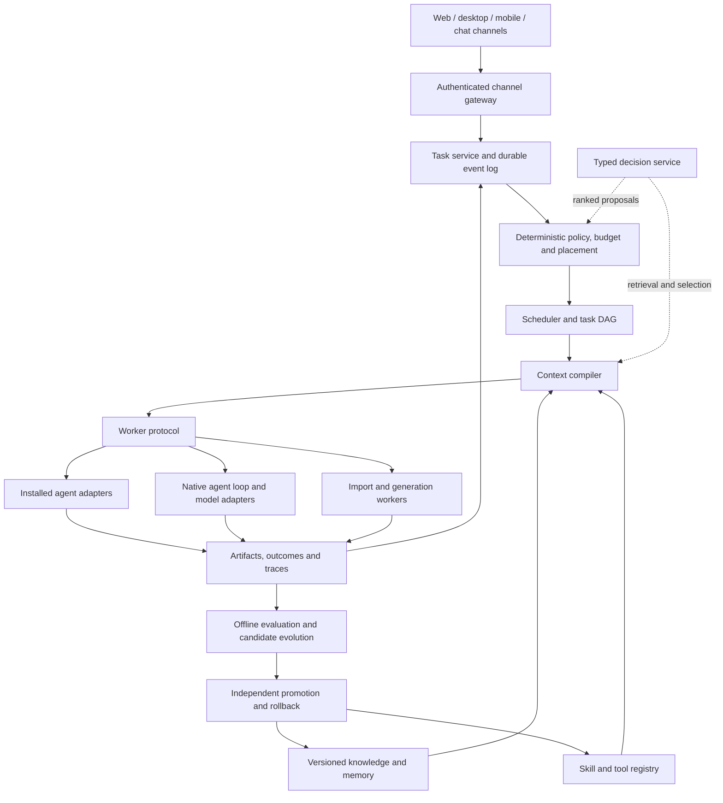

# Team-agent harness architecture

[Home](README.md) · [Contracts](contracts.md) · [Implementation plan](roadmap.md) · [Evidence limits](methodology.md)

## Recommendation

Build a **local-first, durable control plane with replaceable workers**, rather than combining several full agent frameworks. The control plane owns tasks, identity, permissions, event history, artifacts, budgets and promotion decisions. Workers own execution: an installed agent, an embedded agent loop, a model server, an importer or a media generator. A worker may run on the same computer or an authenticated remote host.

This is a proposed architecture informed by source inspection, not a measured claim that one stack is universally state of the art. The strongest reusable ideas are explicit adapters, recorded continuations, hybrid retrieval with a cost ladder, evidence-backed memory, small task-specific skill/tool sets, bounded typed decisions, and evaluation-gated evolution. The design must beat a simple single-agent baseline before adding more autonomous coordination.

## Boundaries and ownership

| Component | Owns | Must not silently own |
|---|---|---|
| Task service | Objective, acceptance checks, task DAG, state transitions, event sequence | Provider-specific transcript as the only task record |
| Policy service | Workspace grants, allowed effects, privacy, resource limits | Model-suggested permission escalation |
| Scheduler | Ready tasks, placement, leases, admission, retry classification | Open-ended strategy or code-generation quality |
| Agent adapter | Runtime launch, negotiated features, native session references, event normalization | Shared-memory truth or authority beyond task grant |
| Model adapter | Inference transport, model capabilities, quota observations | Agent subprocess lifecycle |
| Context compiler | Relevant evidence/skills/tool declarations within a budget | Destructive memory mutation |
| Knowledge service | Immutable source versions and rebuildable indexes | Treating imported prose as privileged instructions |
| Evolution service | Candidate proposals and reproducible evaluations | Direct production promotion or evaluator modification |
| Channel adapter | Identity mapping, delivery semantics, rendering limits | Independent task state or permission policy |

Keep task IDs distinct from native provider session IDs. A user can switch agents while retaining the task, artifacts and provenance, but internal reasoning/session formats need not be portable. Transfer a checked handoff package, not a fabricated conversion of hidden model state.

An external agent may execute native tools outside the harness gateway. Negotiate `effectInterception`, `approvalInterception`, `filesystemIsolation`, `networkIsolation` and `cancellationEnforcement` explicitly. Strong effect fencing applies only to operations mediated by the gateway or constrained by an enforceable worker sandbox. An opaque native-agent mode must expose weaker cancellation, visibility and uncertain-effect handling; do not schedule it for tasks requiring guarantees it cannot enforce.

## Practical implementation choices

Start with a TypeScript service, SQLite transactional state and a content-addressed blob directory. Use a responsive web UI plus a desktop shell that starts the local daemon. Python workers handle document parsing, retrieval experiments and media models. This is a proposed implementation choice to reduce initial moving parts; no startup or memory benchmark has been run.

The first native-loop candidate is [Pi](https://github.com/earendil-works/pi) ([review](projects/ai-agents--pi.md)); the first application/adapter reference is [Paseo](https://github.com/getpaseo/paseo) ([review](projects/ai-agents--paseo.md)). [Mastra](https://github.com/mastra-ai/mastra) ([review](projects/ai-agents--mastra.md)) is an alternative if adopting its workflow ecosystem removes more work than it adds. Choose one core execution abstraction after a spike; wrapping all three would duplicate sessions, memory and policy.

For multi-host/cloud operation, keep the same APIs and introduce PostgreSQL task/event storage, object storage and leased workers. A cloud server cannot operate a laptop that is asleep or offline; tasks become waiting-for-host or move only to a compatible authorized host. Keep local credentials on their owning host. [Cloudflare Agents](https://github.com/cloudflare/agents) ([review](projects/ai-agents--agents.cloudflare.md)) offers a cloud-specific lifecycle option; adopting it requires a separate local implementation of the worker boundary.

## Consistency and failure semantics

1. Persist an accepted command and its idempotency key before dispatch.
2. Atomically reserve budget, acquire a task lease and increment its attempt/epoch.
3. Compile a context manifest recording exact sources, skills, tool schemas, policy and model configuration.
4. Launch a worker with an expiry, scoped workspace and artifact sink. Record its native session reference.
5. Persist ordered events and tool intents. A tool effect gets a stable effect ID distinct from the attempt ID.
6. Reconcile completed effects before retrying. If a provider cannot deduplicate or reveal outcome, mark the effect uncertain and require reconciliation; never claim exactly-once delivery by default.
7. Verify acceptance checks independently, close the task, release reservations and deliver a deduplicated outcome notification.

Durable transcript replay and process checkpointing are separate guarantees. An existing request may have billed or performed an external action even if its response was lost. Lease tokens fence stale writes only when the receiving store/tool gateway checks them. [Multica's lease store](projects/ai-agents--multica.md) ([source](https://github.com/multica-ai/multica)) illustrates atomic owner checks; use the repository identity recorded in that report if upstream changes.

## Data planes

The [Delta article](https://delta.dev/blog/fine-grained-version-control-for-agents)
([review](analyses/delta-fine-grained-version-control-2026-11-01.md)) motivates an
optional artifact-history experiment. Our inference is to keep that history
separate from authorization, external-effect receipts and signed publication.
Historical reconstruction must identify its exact version and persistence status;
it cannot certify task correctness. This is a proposed evaluation, not an adopted
storage replacement or an implemented synchronization guarantee.

- **Control:** tasks, grants, subscriptions, capability catalog, event cursors and leases.
- **Evidence:** source blobs, extracted blocks, code symbols, traces and signed/hash-addressed artifacts.
- **Retrieval:** lexical/vector/graph indexes, rerank caches and context manifests; rebuildable from evidence.
- **Execution:** sandboxed filesystem/process/network operations and external agent sessions.
- **Evaluation:** frozen task sets, candidate variants, judges, costs and promotion records.

The personal profile, project knowledge, team memory and private channel conversations have separate scopes. Retrieval authorization occurs before ranking and is rechecked on source expansion. Deleting a source propagates to chunks, embeddings, graph claims, caches and derived memories; immutable audit envelopes can retain tombstones without retaining deleted content.

## Build, integrate, or defer

| Decision | Initial choice | Reason and evidence |
|---|---|---|
| Durable task/event/policy layer | Build a small shared core | Must remain independent of any model or agent vendor |
| Installed agents | Integrate protocol/SDK adapters | [Paseo](https://github.com/getpaseo/paseo) ([review](projects/ai-agents--paseo.md)), [Agent Orchestrator](https://github.com/ComposioHQ/agent-orchestrator) ([review](projects/ai-agents--agent-orchestrator.md)) |
| Retrieval | Lexical + embeddings + optional reranker; source/version metadata first | [Memory analysis](memory.md) |
| Temporal graph | Optional, only for relationship-heavy work | [Graphiti](https://github.com/getzep/graphiti) ([review](projects/ai-agents-mem--graphiti.md)) |
| Document conversion | Integrate mature parsers in workers | [Import analysis](import-generation.md) |
| Skills | Versioned registry and evaluated variants | [Skills analysis](skills.md) |
| Decision model | Pluggable Jev/local classifier, with abstention | [Decision analysis](decisions.md) |
| Multi-agent swarm | Bounded task DAG with conflict admission | [OpenSwarm](https://github.com/unohee/OpenSwarm) ([review](projects/ai-agents-swarm--openswarm.md)) |
| Weight editing/self-rewriting core | Defer | [Evolution analysis](evolution.md), [model analysis](models.md) |

## What establishes SOTA for this harness

No common benchmark was run across the 507 projects. Their feature lists and task-specific demos cannot establish a global ordering. The decision should be a Pareto comparison of task success, latency, cost, intervention rate, privacy and recovery reliability on the intended workload. Use the [evaluation plan](evaluation.md), publish per-slice results and pin configurations. A more complicated system earns adoption only when the improvement survives held-out tasks and failure injection.

## Research evidence and update boundary

The November 1 review strengthens three cross-cutting boundaries. First,
eligibility and user authority precede learned routing or preference scores;
see [models](models.md) and [decisions](decisions.md). Second, acquired source
bytes, diagnostic presentation, reviewed claims and reusable executable resources
carry distinct provenance; see [the refresh evidence](analyses/research-refresh-evidence-2026-11-01.md),
[memory](memory.md) and [imports](import-generation.md). Third, finished output,
delivery acknowledgement, external-effect certainty and verified task success
are independent states, even when they share one user-facing task.

The [Delta article review](analyses/delta-fine-grained-version-control-2026-11-01.md)
is now complemented by the [Delta Claude client review](analyses/unreviewed/ai-skills--repo.delta-claude.md)
([source](https://github.com/zed-industries/delta-claude)). Its outbox and acknowledgement
helpers provide scoped client evidence, not proof of server durability or
authorization to replay the original action. No collaborative-history backend
was adopted by this research refresh.

The implemented maintenance changes keep generated parent source lists separate
from repository-owned configuration, hide background Windows subprocesses and
allow immediate disposal of known finished owned scratch after confirmed
descendant shutdown. Broad stale cleanup retains its age and ownership checks;
neither path authorizes deletion of research evidence. Review and measured
verification outcomes remain in [incremental analyses](analyses/latest-run.md).

The follow-up October 28 revisions add a preservation rule for every writer, including cleanup: absence, unreadable state and an unsupported schema are different outcomes. [OpenSandbox](https://github.com/alibaba/OpenSandbox) ([review](projects/ai-agents-sandbox--opensandbox.md)) protects unknown and newer vault formats while retaining a narrower legacy cleanup exception. Teamagent should carry the version/lineage decision into deletion and terminal cleanup; a safe read path alone does not establish safe lifecycle behavior.

Keep planning, installation, execution and verification as distinct states. [Vercel Skills](https://github.com/vercel-labs/skills) ([review](projects/ai-agents-skills--search.vercel.md)) illustrates that a check preserving installed content can still perform discovery and telemetry. [Modern Web Guidance](https://github.com/GoogleChrome/modern-web-guidance-src) ([review](projects/ai-skills--design.modern-web-guidance.google.md)) adds deterministic graders whose static selector checks do not prove rendered layout or interaction. Operation plans must disclose actual network/effect scope, and promotion evidence must match the behavior being claimed.

Local observation is now a separate implemented maintenance action: `repos:observe` records known checkout revisions for analysis while retaining earlier remote-observation evidence. It neither establishes remote freshness nor reviews dirty working-tree edits. The [maintenance contract](research-sync.md) distinguishes this local evidence from synchronization and the later explicit source-review receipt. Article recovery likewise records its acquisition representation and limitations instead of replacing HTTP failures with an invented successful HTTP receipt.

The 2026-10-28 source reviews reinforce separate ownership for authorization, external effects and evidence. [Orca](https://github.com/stablyai/orca) ([scoped review](projects/ai-agents-swarm--orca.md)) cancels malformed permission decisions but gives the permission handler a lifetime distinct from session cancellation. The harness must state which owner cancels, settles and persists each resource; one cancellation flag cannot establish all three outcomes.

[LangWatch](https://github.com/langwatch/langwatch) ([scoped review](projects/ai-eval--langwatch.md)) deduplicates cost rows after evaluator execution. A deduplicated accounting row is not proof of a deduplicated provider call. Evaluation receipts must identify the actual effect boundary, preserve uncertainty and distinguish production behavior from stronger test doubles. Apply this distinction to voice enrollment, synthesis, deployment and message delivery as well as evaluation.

[Contextrie](https://github.com/feuersteiner/contextrie) ([scoped review](projects/ai-agents-mem--xx-2604-contextrie.md)) illustrates why validated relevance scores and prompt-based context tightness need explicit fan-out and byte/token budgets. Retain the selected source/version manifest alongside composed text; the text alone does not establish grounding. These conclusions refine the proposed architecture without asserting runtime adoption or benchmark gains.

The implemented [maintenance workflow](research-sync.md) separates source discovery, successful fetch, extraction, scoped review and recommendation changes. Preserve original source bytes and full Git revisions. A repository rename must retain the report identity and aliases; an unavailable origin cannot silently become a deleted analysis. The [incremental index](analyses/repositories.md) and [architecture changelog](CHANGELOG.md) expose remaining review work.

Apply the same boundary to the product: fetched knowledge is a candidate input; analyzed claims and executable skills require their own promotion receipt. Source age, commit volume and cache hits are operational signals, not estimates of truth or task success. An automated change packet must carry truncation, shallow-history and dirty-worktree limits to the human or agent reviewer.

The [November 1 reconciliation](analyses/reconciliation-2026-11-01.md) extends
these maintenance boundaries to regenerated folder layouts, reviewed upstream
renames and explicitly registered additional sources. Imported declarations
update the owned inventory; they do not replace the portable review ledger.
Local observation preserves remote-check timestamps and dirty checkout contents.
An unavailable public source remains tracked independently from its private
recovery backup.

Static-text improvements now have an explicit derivative-adoption operation:
verify the exact prior record, both exports and unchanged original bytes, retain
an immutable before/after receipt, then publish. An interrupted report write
resumes from that receipt without repeating capture or conversion. The
[source-maintenance contract](research-sync.md) states the actual bounds and
partial-state behavior. These research-tool changes do not install the reviewed
agents, change media/provider admission or establish comparative performance.

